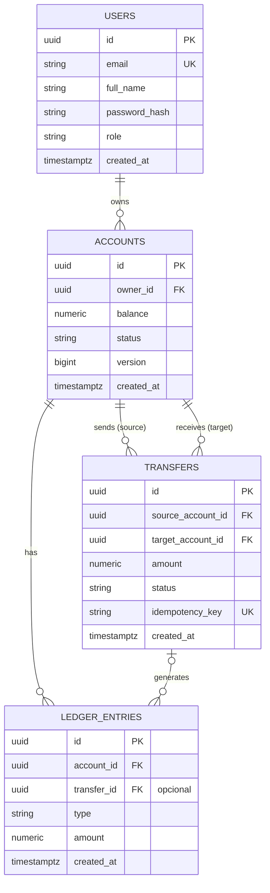
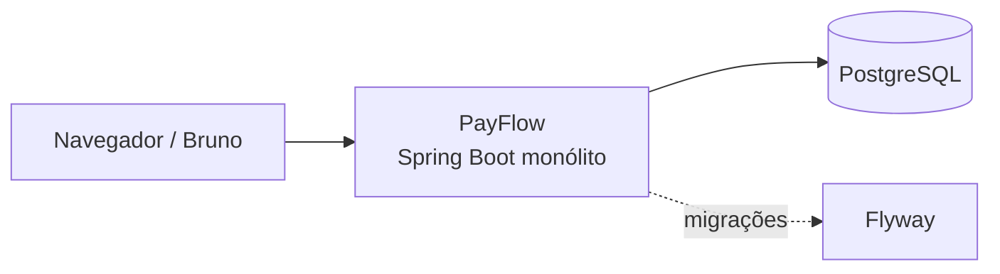
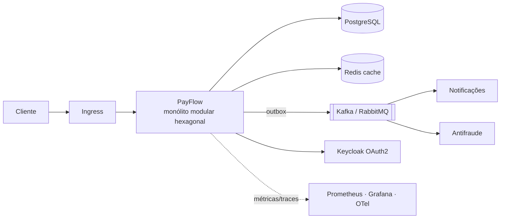
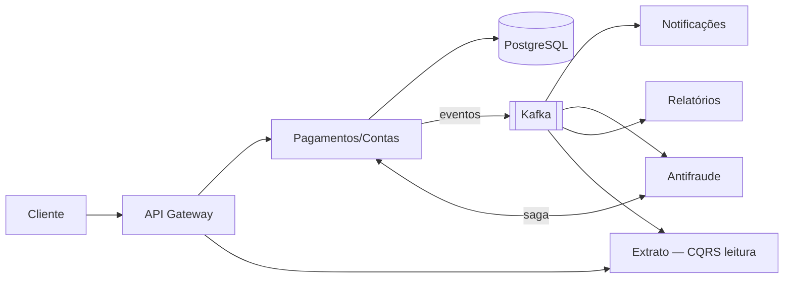

# Projeto central — PayFlow

Carteira digital simplificada. Domínio escolhido porque força dinheiro, transações, concorrência, idempotência, segurança e consistência. **Os nomes abaixo são definidos aqui uma única vez e valem para todo o curso.**

## Convenções
- Pacote base: `com.payflow`. Repositório: `payflow`. Tags de marco: `payflow-<módulo>` (ver `projeto/marcos.md`).
- Dinheiro: `BigDecimal`, escala 2, `RoundingMode.HALF_EVEN`; no banco `NUMERIC(19,2)`.
- IDs públicos: `UUID`. Tabelas em `snake_case` no plural. Timestamps em UTC (`TIMESTAMPTZ`, `java.time.Instant`).
- Código, nomes e commits em inglês.

## Entidades (domínio)

| Entidade | Tabela | Descrição |
|---|---|---|
| `User` | `users` | Pessoa que se cadastra e faz login (`email` único, `password_hash`, `role`). |
| `Account` | `accounts` | Conta de um usuário (`owner_id`, `balance`, `status`, `version` para locking a partir de P2). |
| `Transfer` | `transfers` | Transferência entre duas contas (`source_account_id`, `target_account_id`, `amount`, `status`, `idempotency_key`). |
| `LedgerEntry` | `ledger_entries` | Lançamento contábil imutável (`account_id`, `transfer_id` **opcional**: nulo nos depósitos, `type` DEBIT/CREDIT, `amount`). Alimenta o extrato. Ver `projeto/adrs/0001-ledger-transfer-id-nulo.md`. |

Introduzidas depois (não usar antes do módulo indicado):

| Entidade | Módulo | Tabela |
|---|---|---|
| `OutboxEvent` | P3 | `outbox_events` |
| `PaymentRequest` (QR code simulado) | P3 | `payment_requests` |

> Atualizado na J3 (2026-11-12): acrescentados `users.full_name` e `created_at` nas tabelas, e a ligação `transfers` → `ledger_entries` ficou **opcional** (depósito não é transferência). Os **nomes** de entidades e tabelas não mudaram.

## Regras de negócio
1. Saldo nunca fica negativo. 2. Transferência é atômica: débito e crédito ocorrem juntos ou nenhum (ACID). 3. O saldo é igual à soma dos lançamentos da conta. 4. Repetir a mesma `idempotency_key` não repete a transferência. 5. Lançamentos nunca são alterados nem apagados.

## Arquitetura por nível

### 🟢 Júnior — monólito

### 🔵 Pleno — monólito modular com mensageria

> **Depois da P5:** o módulo `notification` vira o serviço **`payflow-notifications`** (banco próprio, consome `payflow.transfers.v1` e as filas do RabbitMQ) e um **`payflow-gateway`** (Spring Cloud Gateway) passa a ser a porta de entrada (`/api/**` → monólito; `/api/v1/notification-preferences/**` → notificações; `/internal/**` nunca roteado). O *checkout* **não** chama o serviço de notificações de forma síncrona (decisão 135). O diagrama acima continua válido para o resto do sistema.

### 🟣 Sênior — serviços extraídos

Os diagramas podem ganhar detalhes, mas **nomes de entidades e módulos não mudam** sem registrar a decisão em `projeto/adrs/` e em `progresso.md`.

> **Depois da P6** (**por leitura**; nenhum arquivo do PayFlow foi gerado nem compilado): a aplicação **se explica**. **Logs** em JSON (ECS) com `requestId` e `traceId`, **métricas** (`payflow.transfer`, *gauge*/*counter* do Outbox, etiquetas de baixa cardinalidade), **traços** OTLP (amostragem 0,1), tudo ligado pelo `traceId` (que volta no Problem Details). O **Actuator** fica na **porta de gestão** (8081, não publicada; `health`, `info`, `prometheus` com papel `METRICS`). `compose.observability.yaml` sobe **Prometheus, Grafana e Jaeger** (portas em `127.0.0.1`); o **painel** RED + negócio + JVM e os **9 alertas** (com *runbook* e testes `promtool`) vêm do Git. *Readiness* = `readinessState` + banco; *liveness* = só o processo. Contrato HTTP `/api/v1`, esquema (nenhuma migração) e dinheiro (uma transação) inalterados.

> **Depois da P10** (**por leitura**; nenhum arquivo do PayFlow foi gerado nem compilado; o laboratório `2-pleno/P10-seguranca-intermediaria/lab` é uma **versão mínima**, com contas em memória): o PayFlow **não emite nem guarda senhas**. A **API** é *Resource Server* do **Keycloak** (`/realms/payflow`; RS256; `aud=payflow-api`; `typ=Bearer`; escopos `transfers:read`/`transfers:write` e papéis `USER`/`ADMIN`; **dono = `sub`**, que é o `users.id`), os **serviços** se autenticam por **Client Credentials** (um cliente por serviço; `/internal/**` exige escopo `internal:notify` **e** `azp` conhecido), a **aplicação** acessa o banco como `app_a`/`app_b` (grupo `payflow_app`, **sem DDL** e **sem `UPDATE`/`DELETE` em `ledger_entries`**; migrações pelo `payflow_migrator`; a conta mestra **não** é usada) e a **imagem** sai com **SBOM**, **assinatura por digest** e **portão de *deploy***. Contrato HTTP `/api/v1`, dinheiro (uma transação) e as regras de negócio **inalterados**; **uma migração nova: V12** (`users.password_hash` passa a aceitar `NULL`; a `V13` a remove depois de migrar os usuários).

> **Depois da S1** (**por leitura**; nenhum arquivo do PayFlow foi gerado nem compilado; o laboratório `3-senior/S1-sistemas-distribuidos/lab` é de **Java puro** e **modela** mecanismos): a **consistência é decidida por operação** (saldo/transferência no primário; extrato com token de versão; resumos eventuais). O **extrato** vira **CQRS** (módulo `statement`: `statement_entries`/`statement_checkpoints` alimentados por `LedgerEntryPosted` com **`account_seq`** por conta; `V13`/`V14`) e o **pagamento** passa a ser uma **saga orquestrada** no módulo `payment` (`account_holds`, `payment_sagas`; `V15`): `reservar` → `antifraude` (**hipótese**: serviço extraído) → `capturar` (**pivô**, lança no ledger) → `notificar`. Cada salto tem **chave de idempotência derivada** (`sagaId:passo`, até o PSP; `idempotency_keys`, `V17`). O **gateway** limita por `azp`/`sub` (Redis, modo degradado) e `/api/**` sai com `no-store`. **Não** há *sharding* nem *event sourcing* (ADR 0024, com gatilhos). Entidades novas (**só** a partir da S1): `AccountHold` (`account_holds`), `PaymentSaga` (`payment_sagas`), `StatementEntry` (`statement_entries`), `IdempotencyKey` (`idempotency_keys`). Contrato HTTP `/api/v1` e nomes anteriores **inalterados**.

> **Depois da S5** (**por leitura**; nenhum arquivo do PayFlow foi gerado nem compilado; o laboratório `3-senior/S5-seguranca-avancada/lab` é de **Java puro** e de **contêineres descartáveis** e **modela** mecanismos): a **autorização vira uma função testada** (`AuthorizationPolicy.decide(chamador, ação, dono)`, negar por padrão, MFA em dinheiro, *break-glass*); os **papéis do banco** ficam `payflow_owner` (sem login), `payflow_migrator` (só o pipeline), `payflow_app` (**sem `UPDATE`/`DELETE` no ledger**; expurgo por `purge_idempotency_keys` com piso de 24 h) e `payflow_readonly` (leitura **por coluna**); entra a **trilha de auditoria** (módulo `audit`; entidade `AuditEvent` → `audit_events`, **`V25`**, *append-only*, só `INSERT` pela aplicação, cadeia de HMAC e âncora externa fora do banco). **mTLS interno não foi adotado** (decisão 232, com gatilhos); **o PAN não toca o PayFlow** (campos hospedados do PSP; só *token* + últimos 4); **cifra por campo** só onde a ameaça justifica (CPF, **se** coletado). Entidade nova (**só** a partir da S5): `AuditEvent` (`audit_events`). Contrato HTTP `/api/v1` e nomes anteriores **inalterados**.

> **Depois da S6** (**por leitura**; nenhum arquivo do PayFlow foi gerado nem compilado; nada aplicado em conta AWS; o laboratório `3-senior/S6-arquitetura-nuvem-custo/lab` é de **Java puro** com **preços reais da AWS Price List** e **modela** custos e SCPs): o PayFlow ganha **preço** para cada decisão: **revisão Well-Architected** versionada (4 HIGH nas fundações e na operação, com dono), ***trade-offs* com preço datado** (folga de AZ **B × B2**, Multi-AZ do RDS mantido), **região em aberto** (`sa-east-1` ×1,60; latência a medir; exigências a confirmar), **API e consumidor em Fargate ARM** e **Lambda só para *jobs*** (cruzamento medido no modelo), **SDK do provedor só em adaptadores** com teste de arquitetura e **plano de saída** (multi-cloud ativo/ativo **não** adotado), **estimativa** (US$ 887,89 / US$ 1.424,28 por mês; 71% fixo; custo por 1.000 transferências), **NAT × *endpoints*** (a 164 fica por segurança), **política de tags** com SCP na criação, **orçamento e anomalia por conta e por serviço**, **compromissos só no piso e depois de 3 meses**, **Spot só com *checkpoint***, ***landing zone*** (7 contas: gestão sem carga, `log-archive`, `audit`, `payflow-backup`, `payflow-prod`, `payflow-staging`, `study`; 8 SCPs testadas com 17 casos e 5 mutantes) e ***runbook* de custo**. **Nenhuma migração** (V26 livre); contrato `/api/v1` **inalterado**. ADR 0029.
