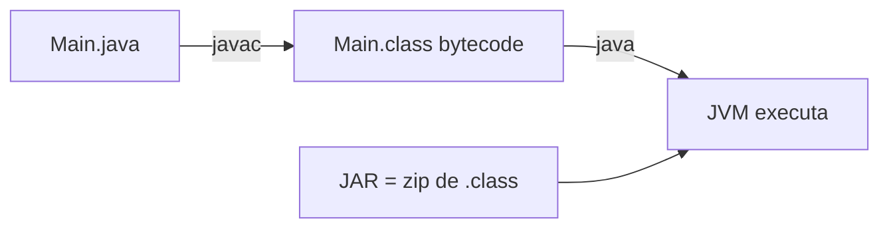
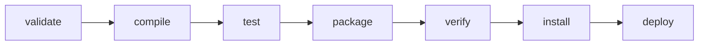

# J0.02 — JDK via SDKMAN, Maven (ciclo de vida, dependências, plugins) e visão de Gradle

> ⏱️ ~1h30 · 🟢 Júnior · Pré-requisitos: J0.01

## 🎯 Objetivos
Ao final desta aula você consegue:
- Instalar e alternar versões do JDK com o SDKMAN.
- Explicar a diferença entre JDK, JRE e JVM.
- Criar um projeto Maven e ler o `pom.xml` (coordenadas, dependências, plugins).
- Rodar o ciclo de vida (`compile`, `test`, `package`) e dizer o que cada fase faz.
- Reconhecer o equivalente em Gradle.

## 🤔 Por que isso importa
Todo projeto Java do mercado usa uma ferramenta de build (Maven ou Gradle). Quando "não compila na minha máquina", o motivo costuma ser versão de JDK errada ou dependência mal declarada. Entender o build elimina uma das maiores fontes de frustração de júnior.

## 💡 Intuição (explicação simples)
- **JDK** é a **oficina completa** (compilador `javac`, ferramentas e a JVM). **JVM** é a máquina que executa o programa. **JRE** era a "só o necessário para rodar", hoje embutida no JDK.
- **SDKMAN** é um **guarda-roupa de versões**: você guarda vários JDKs e veste o que o projeto pede.
- **Maven** é uma **receita de bolo com cozinheiro automático**: o `pom.xml` diz *o que* é o projeto e quais ingredientes (dependências) usa; o Maven busca os ingredientes na despensa central e segue as etapas na ordem certa.

## 🔬 Como funciona por dentro

**Do código ao programa rodando:**



**Maven: convenção sobre configuração.** Se você seguir a estrutura padrão, não precisa configurar nada:

```
projeto/
├── pom.xml
├── src/main/java        # código de produção
├── src/main/resources   # arquivos de configuração
├── src/test/java        # testes
└── target/              # saída do build (nunca vai pro Git)
```

**Coordenadas** identificam qualquer artefato no mundo Maven: `groupId` (organização, `com.payflow`), `artifactId` (nome, `payflow`) e `version`. Dependências são baixadas do **Maven Central** para `~/.m2/repository` e reaproveitadas.

**Ciclo de vida.** Fases em ordem fixa; pedir uma fase executa todas as anteriores. As principais (lista completa de 23 fases na [documentação oficial](https://maven.apache.org/guides/introduction/introduction-to-the-lifecycle.html)):



| Comando | O que faz |
|---|---|
| `mvn compile` | Compila `src/main` |
| `mvn test` | Compila e roda os testes |
| `mvn package` | Gera o `.jar` em `target/` |
| `mvn verify` | Roda verificações (testes de integração entram aqui) |
| `mvn install` | Copia o jar para o seu `~/.m2` local |
| `mvn clean` | Apaga `target/` (é um ciclo separado, não faz parte do padrão) |

**Plugins.** As fases são vazias; quem trabalha são plugins presos a elas (`maven-compiler-plugin` na `compile`, `maven-surefire-plugin` na `test`). Você também chama metas diretamente: `mvn dependency:tree`.

**Escopos de dependência** (conforme a [documentação](https://maven.apache.org/guides/introduction/introduction-to-dependency-mechanism.html)): `compile` (padrão), `provided` (o ambiente fornece), `runtime` (só na execução), `test` (só nos testes).

**Dependência transitiva.** Se A depende de B e B depende de C, o Maven traz C junto. Conflitos de versão são resolvidos pela regra do "mais próximo da raiz"; `mvn dependency:tree` mostra o resultado.

## 🛠️ Exemplo prático

### 1. Instalar o SDKMAN e o JDK 25

> ⚠️ **Não testado nesta execução:** o instalador (`curl | bash`) não foi rodado no ambiente de autoria. Os comandos vêm da [página oficial de instalação](https://sdkman.io/install/). Leia o script antes de executar qualquer `curl | bash`.

```bash
curl -s "https://get.sdkman.io" | bash
source "$HOME/.sdkman/bin/sdkman-init.sh"
sdk version                    # deve mostrar a versão do script
sdk list java                  # lista distribuições; procure "Temurin" e a versão 25
sdk install java <identificador-do-25>   # use exatamente o que a lista mostrar
java -version                  # deve mostrar 25
```
O identificador exato muda a cada patch (por isso não o fixamos aqui). Para alternar: `sdk use java <id>` (só no terminal atual) ou `sdk default java <id>` (padrão). Versões adotadas no curso: `00-guia/versoes.md`.

Se o SDKMAN não for opção (ex.: instalar via gerenciador de pacotes), o importante é `java -version` mostrar **25** e `JAVA_HOME` apontar para ele.

### 2. Criar um projeto Maven (testado com Maven 3.9.12)

```bash
mkdir -p ~/treino-j0 && cd ~/treino-j0
mvn -B archetype:generate -DgroupId=com.payflow -DartifactId=demo \
    -DarchetypeArtifactId=maven-archetype-quickstart -DinteractiveMode=false
cd demo
mvn test
```
Saída esperada (trecho):
```
Running com.payflow.AppTest
Tests run: 1, Failures: 0, Errors: 0, Skipped: 0
```
O arquétipo gera um projeto de exemplo antigo; observe o `pom.xml` gerado, **mas não o copie como modelo**: o PayFlow vai usar o gerador do Spring em J5.

### 3. Anatomia mínima de um `pom.xml` moderno

```xml
<project xmlns="http://maven.apache.org/POM/4.0.0">
  <modelVersion>4.0.0</modelVersion>

  <groupId>com.payflow</groupId>
  <artifactId>demo</artifactId>
  <version>0.1.0-SNAPSHOT</version>

  <properties>
    <maven.compiler.release>25</maven.compiler.release>
    <project.build.sourceEncoding>UTF-8</project.build.sourceEncoding>
  </properties>

  <dependencies>
    <dependency>
      <groupId>org.junit.jupiter</groupId>
      <artifactId>junit-jupiter</artifactId>
      <version>VERSAO</version>   <!-- confirme a versão em J1.16 -->
      <scope>test</scope>
    </dependency>
  </dependencies>
</project>
```
`-SNAPSHOT` indica versão em desenvolvimento. Quem define a versão de cada dependência no PayFlow será o Spring Boot (J5); por isso aqui `VERSAO` é um marcador.

### 4. Inspecionar o que o Maven resolveu
```bash
mvn dependency:tree           # árvore de dependências (a quickstart traz o JUnit antigo)
mvn help:effective-pom        # POM final, com tudo que foi herdado
mvn -v                        # versão do Maven e do Java que ele está usando
```

### 5. Visão de Gradle
Mesmo conceito (build declarativo + plugins + dependências), outra sintaxe, e o build é um script (Groovy ou Kotlin):

```kotlin
// build.gradle.kts
plugins { java }
repositories { mavenCentral() }
dependencies { testImplementation("org.junit.jupiter:junit-jupiter:VERSAO") }
```
Comandos equivalentes: `gradle build` ≈ `mvn package`, `gradle test` ≈ `mvn test`. **No curso usamos Maven.** Você só precisa saber ler um `build.gradle` e saber que Gradle é comum em projetos Kotlin/Android e em empresas grandes. ⚠️ Esse trecho Gradle é ilustrativo e não foi executado.

## 🧠 Pausa para lógica
**Enunciado:** o projeto depende da biblioteca `A 1.0` e da `B 1.0`. `A` depende de `C 2.0`; `B` depende de `C 1.0`. Qual versão de `C` o Maven usa? E se você declarar `C 3.0` direto no seu `pom.xml`?

<details><summary>Dica</summary>Regra: vence a declaração mais próxima da raiz do projeto; em empate de distância, vence a que aparece primeiro no `pom.xml`.</details>

<details><summary>Solução</summary>
Distância igual (2) para `C 2.0` e `C 1.0`; vence quem foi declarada primeiro: se `A` vem antes de `B`, usa `C 2.0`. Declarando `C 3.0` direto, a distância é 1 e ela vence. Comprove com `mvn dependency:tree`.
</details>

**Variação mais difícil:** por que "primeira declarada vence" é perigoso para a estabilidade do build, e qual mecanismo do Maven fixa versões de forma explícita? *(Pesquise `dependencyManagement`; o Spring Boot usa exatamente isso.)*

## ⚠️ Erros comuns e boas práticas de produção
```
[ERROR] Failed to execute goal org.apache.maven.plugins:maven-compiler-plugin:...:compile
        ... error: release version 25 not supported
```
Causa: o Maven está rodando com um JDK mais antigo que 25. Confira `mvn -v` e `echo $JAVA_HOME`.

```
[ERROR] Failed to execute goal ... Could not resolve dependencies ... Could not transfer artifact
```
Causa comum: sem internet, proxy ou nome/versão de dependência errados.

```
[ERROR] No goals have been specified for this build.
```
Causa: rodou `mvn` sem fase/meta.

- Sempre use `-B` (batch mode) em scripts e CI.
- Não commite `target/`. Não edite arquivos de `~/.m2`.
- Evite `mvn install -DskipTests` como hábito: esconde problemas.
- Fixe a versão do Java no `pom.xml` (`maven.compiler.release`), não dependa do que está instalado.
- No projeto de verdade, prefira o **Maven Wrapper** (`mvnw`), que garante a mesma versão do Maven para todos; o gerador do Spring em J5 o inclui.

## 🧩 Exercícios
1. **Fixação:** o que acontece se você rodar `mvn package`? Quais fases são executadas, e por quê? *(Todas até `package`, incluindo `test`.)*
2. **Aplicação no PayFlow:**
   - [ ] `java -version` mostra 25 (via SDKMAN ou outro método).
   - [ ] `mvn -v` mostra o Maven usando o JDK 25.
   - [ ] Projeto `demo` criado e `mvn test` verde (pode ser descartado depois).
3. **Desafio (opcional):** altere `maven.compiler.release` do `demo` para `25`, atualize o código de teste se necessário e rode `mvn package`. Descubra o nome do `.jar` gerado e execute-o com `java -cp target/demo-1.0-SNAPSHOT.jar com.payflow.App`. Qual a saída?

<details><summary>Solução do desafio</summary>
O quickstart gera `App` com `System.out.println("Hello World!")`; a saída é `Hello World!`. Se o POM gerado usar versão do compilador antiga, a propriedade `maven.compiler.release` precisa estar presente.
</details>

## 🎤 Na entrevista
- **Qual a diferença entre JDK, JRE e JVM?** JVM executa bytecode; JRE = JVM + bibliotecas; JDK = JRE + ferramentas de desenvolvimento (`javac`, etc.).
- **O que é o `pom.xml` e qual o ciclo de vida do Maven?** Descrição declarativa do projeto; fases `validate → compile → test → package → verify → install → deploy`.
- **O que são dependências transitivas e como resolver conflitos?** Dependências das dependências; `dependency:tree`, `dependencyManagement` e `exclusions`.

## 📚 Para ir além
- 📄 [Maven: Introduction to the Build Lifecycle](https://maven.apache.org/guides/introduction/introduction-to-the-lifecycle.html): tabela completa das fases. Olhe a "Lifecycle Reference".
- 📄 [Maven: Dependency Mechanism](https://maven.apache.org/guides/introduction/introduction-to-dependency-mechanism.html): escopos e transitividade.
- 📄 [SDKMAN: instalação](https://sdkman.io/install/): comandos oficiais.
- 📄 [Dev.java — tutoriais gerais](https://dev.java/learn/): trilha oficial da Oracle, útil a partir de J1.
- 🎥 ⚠️ Nenhum vídeo verificado nesta execução.

## ✅ Checklist da aula
- [ ] Tenho o JDK 25 ativo e `mvn -v` o reconhece.
- [ ] Sei listar as fases principais do Maven.
- [ ] Rodei `dependency:tree` e identifiquei uma dependência transitiva.
- [ ] Sei o equivalente Gradle de `mvn test`.
