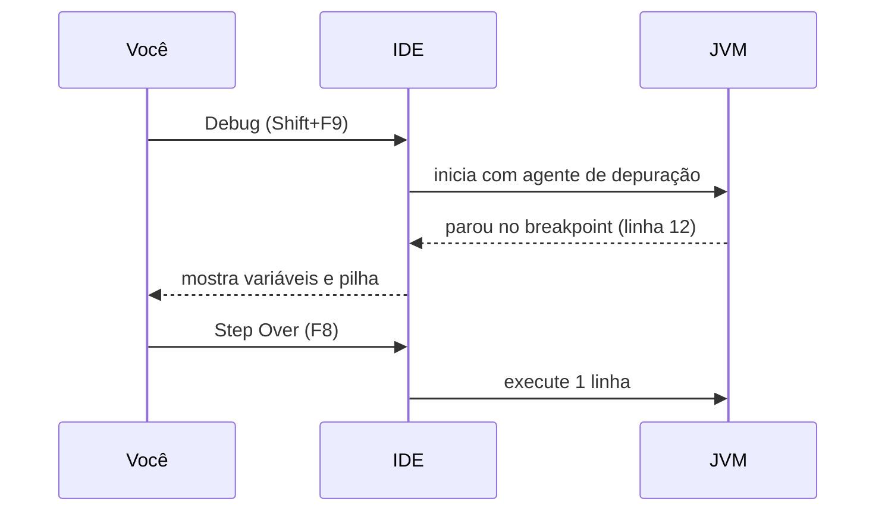

# J0.03 — IntelliJ IDEA: atalhos, debugger e refatorações

> ⏱️ ~1h30 · 🟢 Júnior · Pré-requisitos: J0.02

## 🎯 Objetivos
Ao final desta aula você consegue:
- Abrir um projeto Maven no IntelliJ IDEA e configurar o JDK 25.
- Navegar pelo código e executar ações sem o mouse (Search Everywhere, Find Action).
- Depurar um programa com breakpoints, *step over/into/out* e inspeção de variáveis.
- Aplicar refatorações seguras (renomear, extrair método).

## 🤔 Por que isso importa
A IDE é a ferramenta em que você passa o dia. Dominar navegação e debugger troca "colocar `System.out.println` em todo lugar" por encontrar o erro em minutos. Refatoração automática muda nomes em centenas de arquivos sem quebrar nada, algo que o júnior precisa fazer com confiança.

## 💡 Intuição (explicação simples)
Depurar é **assistir o programa em câmera lenta**: você pausa no meio da execução, olha o conteúdo de cada variável e avança uma linha por vez. É a diferença entre ler a cena do crime nos jornais e estar lá com uma lanterna.

## 🔬 Como funciona por dentro
- **Indexação:** ao abrir o projeto, a IDE indexa os símbolos (classes, métodos). É por isso que a busca e o "ir para a definição" são instantâneos, e por que no início o computador parece lento.
- **Debugger:** a IDE inicia a JVM com um agente de depuração (JDWP) e conversa com ela. Um *breakpoint* faz a JVM **suspender a thread** naquela linha; a IDE então lê variáveis e a pilha de chamadas (*call stack*).
- A documentação oficial do debugger do IntelliJ está em [Debug code](https://www.jetbrains.com/help/idea/debugging-code.html). O debug exige a opção de compilador que gera informação de depuração (ligada por padrão).



## 🛠️ Exemplo prático

### 1. Abrir e configurar
1. `File → Open` e escolha a pasta do `demo` (a que tem `pom.xml`). Aceite "Trust Project".
2. `File → Project Structure → Project → SDK`: selecione o JDK 25 (a IDE detecta os instalados pelo SDKMAN em `~/.sdkman/candidates/java`; se não, `Add SDK → Add JDK from disk`).
3. Deixe o IntelliJ importar o Maven (janela *Maven* à direita).

> Os nomes de menus e atalhos abaixo valem para a versão atual do IntelliJ IDEA em um *keymap* padrão (Linux/Windows). Se algo não bater, use **Find Action**, que acha qualquer comando pelo nome.

### 2. Atalhos que valem ouro (keymap padrão Linux/Windows)
| Atalho | Faz |
|---|---|
| `Shift` `Shift` (duas vezes) | **Search Everywhere**: arquivos, classes, ações, configurações |
| `Ctrl+Shift+A` | **Find Action**: roda qualquer comando pelo nome (e mostra o atalho dele) |
| `Ctrl+N` / `Ctrl+Shift+N` | Ir para classe / arquivo |
| `Ctrl+B` ou `Ctrl+clique` | Ir para a declaração |
| `Alt+Enter` | Ações e correções rápidas (a tecla mais útil) |
| `Shift+F10` / `Shift+F9` | Rodar / depurar |
| `Shift+F6` | Renomear (refatoração) |
| `Ctrl+Alt+M` | Extrair método |
| `Ctrl+Alt+L` | Formatar código |
| `Ctrl+/` | Comentar linha |

Fonte para conferir e imprimir: [Mastering keyboard shortcuts](https://www.jetbrains.com/help/idea/mastering-keyboard-shortcuts.html) (Search Everywhere, Find Action e cartão de referência em PDF em *Help → Keyboard Shortcuts PDF*). Os demais atalhos da tabela são os do keymap padrão; confira o seu em *Settings → Keymap*.

### 3. Depurar um programa
Crie `src/main/java/com/payflow/FeeCalculator.java`:

```java
package com.payflow;

public class FeeCalculator {

    // Taxa de 1,5% sobre o valor, mínimo de 2,00. (Usamos double só para a aula;
    // em J1.15 você verá por que dinheiro é BigDecimal.)
    static double fee(double amount) {
        double percentage = amount * 0.015;
        double fee = Math.max(percentage, 2.00);
        return fee;
    }

    public static void main(String[] args) {
        double[] amounts = {50.0, 100.0, 1000.0};
        double total = 0;
        for (double amount : amounts) {
            double f = fee(amount);
            total += f;
            System.out.println("amount=" + amount + " fee=" + f);
        }
        System.out.println("total fees=" + total);
    }
}
```
Rodar (`Shift+F10` ou no terminal):
```bash
mvn -q compile && java -cp target/classes com.payflow.FeeCalculator
```
Saída esperada:
```
amount=50.0 fee=2.0
amount=100.0 fee=2.0
amount=1000.0 fee=15.0
total fees=19.0
```

**Passo a passo no debugger:**
1. Clique na margem esquerda da linha `double f = fee(amount);` para criar um breakpoint (bolinha vermelha).
2. `Shift+F9` (Debug). A execução para na linha.
3. Na janela **Debug → Variables**, veja `amount`, `total`, `f`.
4. `F8` (*Step Over*) executa a linha sem entrar no método; `F7` (*Step Into*) entra em `fee`; `Shift+F8` (*Step Out*) sai dele; `F9` (*Resume*) continua até o próximo breakpoint.
5. Em **Frames** (pilha), clique em `main` para ver o contexto de quem chamou.
6. Clique com o botão direito no breakpoint e coloque a condição `amount > 500`: agora ele só para na iteração do 1000.0 (*conditional breakpoint*).
7. Use **Evaluate Expression** (`Alt+F8`) para testar `amount * 0.015` ao vivo.

Tente: pare dentro de `fee` com `amount=50.0`. Note que `percentage` vale 0.75 e `Math.max` devolve 2.0. Você acabou de ver a regra do mínimo funcionando sem escrever um `println`.

### 4. Refatorar sem medo
1. Coloque o cursor em `fee` (o método) → `Shift+F6` → renomeie para `calculateFee`. A IDE altera **todas** as chamadas.
2. Selecione as linhas do cálculo e use `Ctrl+Alt+M` para extrair um método `applyMinimum`.
3. Rode de novo; a saída tem de ser idêntica. Refatorar é mudar a estrutura **sem mudar o comportamento**; sem testes (J1.16) a confiança vem da saída idêntica.

## 🧠 Pausa para lógica
**Enunciado:** esse programa soma 3 taxas. Faça uma previsão **antes** de rodar: se o breakpoint condicional for `total > 15`, em qual iteração (índice) ele para?

<details><summary>Dica</summary>Anote `total` ao final de cada iteração: 2.0, 4.0, 19.0.</details>
<details><summary>Solução</summary>
A condição é avaliada *antes* de executar a linha. Na 3ª iteração (`amount=1000.0`), `total` ainda vale 4.0, então a condição fica falsa. Ela só será verdadeira se o breakpoint estiver na linha *depois* de `total += f` (por exemplo, no `println`), onde total=19.0 na 3ª iteração. Posição do breakpoint importa.
</details>

**Variação:** e se o array tivesse 1 milhão de valores? Por que o breakpoint condicional ainda é útil e quais são as desvantagens? *(Cada checagem custa; a execução fica bem mais lenta.)*

## ⚠️ Erros comuns e boas práticas de produção
- **"Cannot resolve symbol" em código correto:** normalmente o Maven não foi importado ou o JDK do projeto está errado. Use *Maven → Reload All Maven Projects* e confira `Project Structure → SDK`.
- **`error: release version 25 not supported`** no IntelliJ: o JDK do projeto (ou do Maven nas configurações do IDE) é antigo. Ajuste em *Settings → Build Tools → Maven → Runner/Importing* e em *Project Structure*.
- **Breakpoint "cinza" (não para):** o código não foi recompilado ou aquela linha não executa. Rode em modo Debug de novo.
- Não deixe `System.out.println` de depuração no código que vai para o Git; remova antes do commit.
- Não commite a pasta `.idea/` nem arquivos `*.iml` (vão para o `.gitignore`, J0.04).
- Atenção ao `Alt+Enter`: leia a sugestão antes de aceitar; a IDE ajuda, mas não conhece o seu domínio.

## 🧩 Exercícios
1. **Fixação:** qual a diferença entre *Step Over*, *Step Into* e *Step Out*? *(Over: executa a linha inteira; Into: entra no método chamado; Out: executa até sair do método atual.)*
2. **Aplicação no PayFlow:**
   - [ ] `FeeCalculator` rodando e depurando conforme descrito.
   - [ ] Breakpoint condicional criado e verificado.
   - [ ] Método renomeado e outro extraído pela IDE, com saída idêntica.
   - [ ] Você anotou 5 atalhos que ainda não usava (em papel ou no README do seu repositório).
3. **Desafio (opcional):** abra `Settings → Keymap`, procure pelo atalho de "Rename" e troque por outro de sua preferência; depois restaure. Isso treina a usar **Find Action** como rede de segurança.

## 🎤 Na entrevista
- **Como você investiga um bug que só acontece com certos dados?** Reproduzo, uso breakpoint condicional, inspeciono variáveis e a pilha, formulo uma hipótese e comprovo com *Evaluate Expression*. Depois escrevo um teste para travar a correção.
- **O que é refatoração e como fazê-la com segurança?** Mudar a estrutura sem mudar o comportamento, em passos pequenos, usando a IDE e com testes passando antes e depois.

## 📚 Para ir além
- 📄 [IntelliJ IDEA — Debug code](https://www.jetbrains.com/help/idea/debugging-code.html): visão geral oficial do debugger; no fim há uma série de vídeos (Essentials, Advanced, Professional).
- 📄 [IntelliJ IDEA — Mastering keyboard shortcuts](https://www.jetbrains.com/help/idea/mastering-keyboard-shortcuts.html): referência oficial e cartão em PDF.

## ✅ Checklist da aula
- [ ] Projeto aberto no IntelliJ com JDK 25.
- [ ] Usei `Shift Shift` e `Ctrl+Shift+A` para achar comandos.
- [ ] Depurei com Step Over/Into/Out e com breakpoint condicional.
- [ ] Renomeei e extraí método com a IDE.
