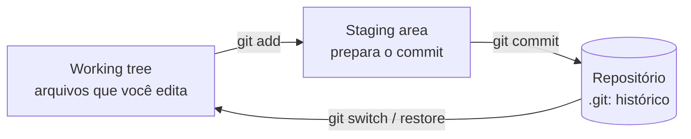
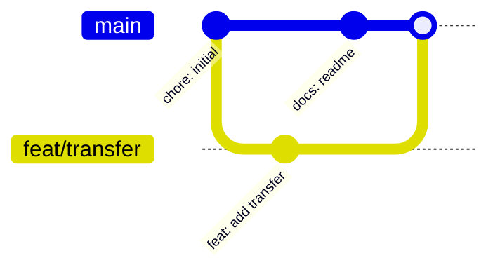

# J0.04 — Git: commit, branch, merge, rebase e `.gitignore`

> ⏱️ ~1h30 · 🟢 Júnior · Pré-requisitos: J0.01

## 🎯 Objetivos
Ao final desta aula você consegue:
- Criar um repositório, fazer commits e ler o histórico.
- Explicar as três áreas do Git (working tree, staging, repositório).
- Criar e juntar branches com `merge` e entender o que o `rebase` faz.
- Resolver um conflito de merge.
- Escrever um `.gitignore` adequado a um projeto Java/Maven.

## 🤔 Por que isso importa
Nenhum time trabalha sem Git. Ele guarda o histórico, permite que várias pessoas mexam no mesmo código e dá a você uma rede de segurança: tudo que foi commitado pode ser recuperado. Errar no Git (commitar uma senha, perder trabalho em um `reset`) é um erro clássico de júnior.

## 💡 Intuição (explicação simples)
Git é um **caderno com fotografias do projeto**. A cada `commit` você tira uma foto com uma legenda. Uma *branch* é **uma cópia paralela do caderno** onde você experimenta sem estragar o original; o *merge* cola de volta as páginas novas. O *staging* é a **bancada onde você separa o que vai aparecer na próxima foto**.

## 🔬 Como funciona por dentro

**Três áreas:**



**Commits formam um grafo.** Cada commit guarda um *snapshot*, a mensagem, o autor e o **hash do(s) pai(s)**. Uma branch é só um **ponteiro** para um commit; `HEAD` aponta para onde você está.



**Merge vs rebase:**
- `merge` junta duas linhas criando um **commit de merge**; o histórico preserva o que aconteceu de fato.
- `rebase` **reaplica** seus commits em cima de outra base, produzindo histórico linear, mas **cria commits novos** (hashes novos).
- **Regra de ouro:** nunca faça rebase de commits que outras pessoas já baixaram (já publicados em branch compartilhada).

**Conflito** ocorre quando as duas linhas alteraram a mesma região. O Git para e marca no arquivo:
```
<<<<<<< HEAD
versão da branch atual
=======
versão da branch que está entrando
>>>>>>> feature
```
Você escolhe o resultado final, apaga os marcadores, faz `git add` e conclui.

Referência completa em português: [Pro Git (PT-BR)](https://git-scm.com/book/pt-br/v2), capítulos "Fundamentos do Git" e "Ramificação (Branching) no Git".

## 🛠️ Exemplo prático

Todos os comandos abaixo foram executados com **git 2.53.0**.

### 1. Configuração inicial (uma vez)
```bash
git config --global user.name  "Seu Nome"
git config --global user.email "voce@exemplo.com"
git config --global init.defaultBranch main
git config --global --list
```
O e-mail deve ser o mesmo da conta do GitHub (J0.05) para o histórico ser atribuído a você.

### 2. Primeiro repositório
```bash
mkdir -p ~/treino-j0/git-lab && cd ~/treino-j0/git-lab
git init
printf 'target/\n.idea/\n*.iml\n.env\n' > .gitignore
echo "# payflow" > README.md
git status                       # arquivos "untracked"
git add .gitignore README.md
git commit -m "chore: initial commit"
git log --oneline
```
Saída do `log`:
```
415ac99 chore: initial commit        # seu hash será diferente
```

### 3. Branch e merge
```bash
git switch -c feat/a             # cria e entra na branch
echo a > a.txt && git add a.txt && git commit -m "feat: add a"
git switch main
echo "mais uma linha" >> README.md && git commit -am "docs: update readme"
git merge feat/a -m "merge feat/a"
git log --oneline --graph
```
Saída esperada (hashes variam):
```
*   b0df1c3 merge feat/a
|\
| * 6025a9c feat: add a
* | 626faa3 docs: update readme
|/
* 415ac99 chore: initial commit
```
As duas linhas mexeram em arquivos diferentes, então o Git juntou sozinho.

### 4. Conflito, passo a passo
```bash
git switch -c x && echo X > README.md && git commit -am "change on x"
git switch main && echo Y > README.md && git commit -am "change on main"
git merge x
```
Saída:
```
CONFLICT (content): Merge conflict in README.md
Automatic merge failed; fix conflicts and then commit the result.
```
```bash
git status                       # "both modified: README.md"
cat README.md                    # veja os marcadores <<<<<<<, =======, >>>>>>>
```
Edite o arquivo deixando o conteúdo final desejado (por exemplo `XY`), depois:
```bash
git add README.md
git commit                       # conclui o merge
# ou, para desistir e voltar ao estado anterior:
git merge --abort
```

### 5. Rebase (em branch **sua**, ainda não publicada)
```bash
git switch feat/a
git rebase main                  # reaplica os commits de feat/a em cima de main
git switch main && git merge feat/a    # agora é "fast-forward": sem commit de merge
```
Se aparecer conflito no rebase: resolva, `git add`, `git rebase --continue` (ou `git rebase --abort`).

### 6. Desfazer coisas com segurança
| Situação | Comando |
|---|---|
| Descartar alteração ainda não adicionada | `git restore arquivo` |
| Tirar do staging | `git restore --staged arquivo` |
| Corrigir a mensagem do último commit (não publicado) | `git commit --amend` |
| Desfazer um commit **já publicado** | `git revert <hash>` (cria um commit inverso) |
| Guardar trabalho pela metade | `git stash` / `git stash pop` |
| Recuperar "commit perdido" | `git reflog` |

`git reset --hard` apaga alterações não commitadas: use só quando tiver certeza.

### 7. `.gitignore` para Java/Maven
```gitignore
# build
target/
# IDE
.idea/
*.iml
.vscode/
# ambiente e segredos
.env
*.pem
application-local.yml
# sistema
.DS_Store
```
O `.gitignore` só vale para arquivos **ainda não rastreados**. Se você já commitou `target/`, remova do índice com `git rm -r --cached target/` e comite.

## 🧠 Pausa para lógica
**Enunciado:** o Git identifica commits por um hash. Se duas pessoas fazem o mesmo commit (mesmos arquivos, mensagem, autor, data e pai), o hash é o mesmo. Se qualquer coisa muda, o hash muda totalmente. Por que o `rebase` "muda" os hashes dos commits, mesmo que o conteúdo da mudança seja o mesmo?

<details><summary>Dica</summary>O hash inclui o commit pai.</details>
<details><summary>Solução</summary>
O hash é calculado sobre o conteúdo do commit, que inclui o hash do pai. Ao reaplicar o commit sobre outra base, o pai muda, logo o hash muda. Por isso reescrever histórico já publicado obriga todo mundo a reconciliar.
</details>

**Variação:** por que `git revert` é seguro em branch compartilhada e `git reset` não é?

## ⚠️ Erros comuns e boas práticas de produção
```
fatal: not a git repository (or any of the parent directories): .git
```
Você não está dentro de um repositório: `pwd`, `git init` ou `cd` para a pasta certa.

```
error: Your local changes to the following files would be overwritten by merge
```
Há alterações não commitadas: faça commit ou `git stash` antes.

```
! [rejected]  main -> main (non-fast-forward)
```
O remoto tem commits que você não tem: `git pull` (ou `git pull --rebase`) antes do `push`. *(Detalhado em J0.05.)*

- **Nunca commite segredos** (senhas, tokens, `.env`). Se commitou, **o segredo está comprometido**: troque-o; apagar em um commit novo não remove do histórico.
- Commits pequenos e focados, com mensagem que explica o quê e por quê.
- Nunca use `git push --force` em branch compartilhada. Se precisar, `--force-with-lease`, e só na sua própria branch.
- `git add .` é conveniente, mas confira com `git status` e `git diff --staged` antes de commitar.

## 🧩 Exercícios
1. **Fixação:** o que a sequência `git add`, `git commit` faz com cada uma das 3 áreas?
2. **Aplicação no PayFlow:** inicialize o repositório local.
   - [ ] Pasta `~/dev/payflow` (da J0.01) com `git init`.
   - [ ] `.gitignore` para Java/Maven/IntelliJ, e `README.md` com descrição de 3 linhas.
   - [ ] Primeiro commit com a mensagem `chore: initial commit`.
   - [ ] Branch `docs/readme-badges` criada, um commit nela, e `merge` na `main`.
   - [ ] `git log --oneline --graph` mostra o resultado.
3. **Desafio (opcional):** provoque e resolva um conflito de rebase (em vez de merge) e compare os dois históricos com `git log --graph`.

<details><summary>Solução de referência (exercício 2)</summary>

```bash
cd ~/dev/payflow && git init
printf 'target/\n.idea/\n*.iml\n.env\n' > .gitignore
printf '# PayFlow\n\nCarteira digital simplificada.\nProjeto do treinamento Java.\n' > README.md
git add . && git commit -m "chore: initial commit"
git switch -c docs/readme-badges
echo "" >> README.md && echo "Status: em construção" >> README.md
git commit -am "docs: add project status"
git switch main && git merge docs/readme-badges
git log --oneline --graph
```
</details>

## 🎤 Na entrevista
- **Qual a diferença entre `merge` e `rebase`?** Merge preserva o histórico e cria um commit de junção; rebase reaplica commits sobre outra base, deixando o histórico linear, mas reescrevendo hashes. Não reescrevo histórico compartilhado.
- **O que é o staging?** Área intermediária onde se monta o próximo commit, para commitar só parte das alterações.
- **Commitei uma senha por engano. E agora?** Troco a senha imediatamente (considero-a vazada); só então limpo o histórico, se necessário.
- **`git pull` faz o quê?** `fetch` + `merge` (ou `rebase`, com `--rebase`).

## 📚 Para ir além
- 📄 [Pro Git (PT-BR)](https://git-scm.com/book/pt-br/v2): livro oficial e gratuito; leia "Fundamentos do Git" e "Ramificação (Branching) no Git".
- 📑 Cheatsheet deste curso: [`recursos/cheatsheets/git.md`](../../recursos/cheatsheets/git.md).
- 🎥 ⚠️ Nenhum vídeo verificado nesta execução.

## ✅ Checklist da aula
- [ ] Rodei o fluxo de merge e vi o grafo.
- [ ] Resolvi um conflito manualmente.
- [ ] Sei desfazer sem `reset --hard`.
- [ ] Meu `.gitignore` cobre `target/`, `.idea/` e `.env`.
