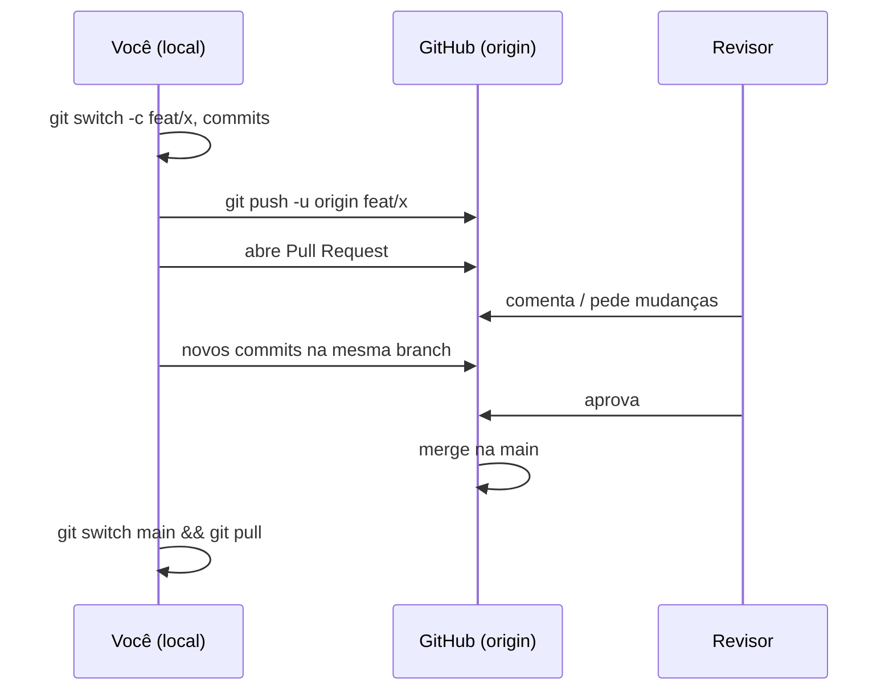

# J0.05 — GitHub: pull request, resolução de conflitos e Conventional Commits

> ⏱️ ~1h30 · 🟢 Júnior · Pré-requisitos: J0.04

## 🎯 Objetivos
Ao final desta aula você consegue:
- Criar um repositório no GitHub e conectar o repositório local (`remote`, `push`).
- Abrir, revisar e fazer o merge de um pull request.
- Resolver conflitos entre sua branch e a `main`.
- Escrever mensagens de commit no padrão Conventional Commits.
- Descrever um fluxo de trabalho com branches curtas.

## 🤔 Por que isso importa
No trabalho, ninguém envia código direto para a `main`: toda mudança passa por **pull request (PR)**, onde outra pessoa revisa. Um PR bem escrito e commits legíveis aceleram a revisão e tornam o histórico útil para achar quando um bug entrou.

## 💡 Intuição (explicação simples)
O repositório remoto é a **pasta compartilhada do time**. O PR é você **entregar uma proposta de alteração em cima da mesa** e dizer "revisem e, se estiver bom, incorporem". Conventional Commits são **etiquetas padronizadas** nas fotos do caderno: dá para achar rápido "todas as correções" ou "todos os recursos novos".

## 🔬 Como funciona por dentro
- **Remote:** apelido para uma URL de outro repositório (por convenção, `origin`). `push` envia commits; `fetch` traz sem mexer na sua branch; `pull` = `fetch` + integração.
- **Pull request:** é um recurso do GitHub (não do Git): uma proposta para integrar uma branch em outra, com discussão, revisão e checagens automáticas. Descrição oficial: [About pull requests](https://docs.github.com/en/pull-requests/collaborating-with-pull-requests/proposing-changes-to-your-work-with-pull-requests/about-pull-requests).



- **Formas de merge no GitHub:** *Create a merge commit* (preserva tudo), *Squash and merge* (vira um commit só) e *Rebase and merge* (linear). O time define a regra; squash é comum em PRs pequenos.
- **Autenticação:** por HTTPS (token) ou **SSH** (par de chaves). Senha da conta não é aceita para `git push` por HTTPS.

**Conventional Commits** ([especificação 1.0.0](https://www.conventionalcommits.org/en/v1.0.0/)):

```
<tipo>[escopo opcional]: <descrição>

[corpo opcional]

[rodapé(s) opcional(is)]
```
| Tipo | Quando |
|---|---|
| `feat` | Nova funcionalidade |
| `fix` | Correção de bug |
| `docs` | Só documentação |
| `refactor` | Mudança interna sem alterar comportamento |
| `test` | Testes |
| `chore` / `build` / `ci` | Tarefas de manutenção, build, pipeline |

`BREAKING CHANGE:` no rodapé (ou `!` antes dos dois pontos, como `feat!:`) indica mudança incompatível. Na spec, `fix` corresponde a versão PATCH, `feat` a MINOR e breaking a MAJOR do versionamento semântico. Os tipos `docs`, `refactor` etc. vêm da convenção do Angular citada pela spec.

## 🛠️ Exemplo prático

### 1. Autenticação (escolha uma)
**SSH (recomendado):**
```bash
ssh-keygen -t ed25519 -C "voce@exemplo.com"      # aceite o caminho padrão; use uma senha (passphrase)
cat ~/.ssh/id_ed25519.pub                         # copie a linha INTEIRA (é a chave PÚBLICA)
```
No GitHub: *Settings → SSH and GPG keys → New SSH key* e cole. Teste:
```bash
ssh -T git@github.com
# esperado: "Hi <usuario>! You've successfully authenticated, but GitHub does not provide shell access."
```
**Nunca compartilhe o arquivo sem `.pub`** (a chave privada).

**Alternativa:** GitHub CLI (`gh auth login`), que guia o login pelo navegador. (`gh` 2.46.0 está instalado na máquina de autoria.)

> ⚠️ **Não testado nesta execução:** criar o repositório remoto e dar `push` exigem a sua conta do GitHub; os comandos abaixo seguem a documentação e o comportamento padrão do Git. Os conflitos locais foram testados na J0.04.

### 2. Criar o repositório `payflow` e publicar
No GitHub: *New repository* → nome `payflow` → **sem** README/.gitignore (você já tem) → *Create*. Depois:
```bash
cd ~/dev/payflow
git remote add origin git@github.com:<seu-usuario>/payflow.git
git remote -v
git branch -M main
git push -u origin main
```
Com a GitHub CLI, tudo em um comando: `gh repo create payflow --private --source=. --remote=origin --push`.

### 3. O fluxo de uma mudança
```bash
git switch main && git pull                 # comece atualizado
git switch -c docs/add-contributing         # nome: tipo/descricao-curta
echo "# Como contribuir" > CONTRIBUTING.md
git add CONTRIBUTING.md
git commit -m "docs: add contributing guide"
git push -u origin docs/add-contributing
```
O `push` imprime um link para abrir o PR (ou use `gh pr create --fill`).

**Boa descrição de PR:**
```markdown
## O quê
Adiciona CONTRIBUTING.md com o fluxo de branches e commits.

## Por quê
Padronizar como o time envia mudanças.

## Como testar
Abrir o arquivo e conferir os links.
```
Para PRs de código acrescente: o que mudou, riscos, e como validar.

### 4. Conflito entre sua branch e a `main`
A `main` andou enquanto você trabalhava. Na sua branch:
```bash
git fetch origin
git rebase origin/main        # ou: git merge origin/main (siga a regra do time)
# resolva os conflitos (J0.04), depois:
git add <arquivos> && git rebase --continue
git push --force-with-lease   # necessário SÓ porque o rebase reescreveu a SUA branch
```
O GitHub também oferece um editor de conflitos na tela do PR para casos simples.

### 5. Commits bons e ruins
| ❌ | ✅ |
|---|---|
| `ajustes` | `fix: reject transfer with non-positive amount` |
| `wip` | `feat(account): create account on user signup` |
| `Atualiza coisa` | `refactor: extract fee calculation to its own class` |

Mensagens em **inglês**, no imperativo, até ~72 caracteres na primeira linha (decisão deste curso: ver `progresso.md`).

### 6. Proteger a `main`
No repositório: *Settings → Branches → Add branch protection rule* (ou *Rulesets*): exigir PR e aprovação antes de merge. ⚠️ Os nomes exatos de menu mudam; consulte a documentação do GitHub. Em repositório individual isso é opcional, mas é bom treinar o hábito.

## 🧠 Pausa para lógica
**Enunciado:** você recebe o histórico de commits abaixo e deve **gerar o changelog automático** agrupando por tipo. Como você agruparia?
```
feat: add account creation
fix: round fee with HALF_EVEN
feat(transfer): add idempotency key
docs: update README
fix!: change balance type to BigDecimal
```
<details><summary>Dica</summary>Extraia o texto antes de `:` e agrupe por prefixo; `!` indica breaking.</details>
<details><summary>Solução</summary>

```bash
printf '%s\n' "feat: add account creation" "fix: round fee with HALF_EVEN" \
  "feat(transfer): add idempotency key" "docs: update README" \
  "fix!: change balance type to BigDecimal" > /tmp/commits.txt
sed -E 's/^([a-z]+)(\([^)]*\))?(!)?:.*/\1\3/' /tmp/commits.txt | sort | uniq -c
```
Saída: `1 docs`, `2 feat`, `1 fix`, `1 fix!`. O `fix!` indica MAJOR; o resto é MINOR/PATCH. É por isso que o padrão permite automatizar versões.
</details>

## ⚠️ Erros comuns e boas práticas de produção
```
git@github.com: Permission denied (publickey).
```
A chave pública não foi cadastrada no GitHub ou o agente SSH não a carregou: `ssh-add ~/.ssh/id_ed25519`, `ssh -T git@github.com`.

```
! [rejected]        main -> main (fetch first)
error: failed to push some refs to 'github.com:...'
```
O remoto tem commits que você não tem: `git pull --rebase` e tente novamente.

```
remote: error: GH013: Repository rule violations found ... (ou: protected branch hook declined)
```
Push direto à branch protegida: abra um PR.

- **PRs pequenos** (idealmente < 400 linhas) são revisados mais rápido e com melhor qualidade.
- Revise o próprio diff na tela do PR antes de pedir revisão.
- Receba comentários como informação sobre o código, não sobre você; responda e resolva cada um.
- Nunca faça push de `.env`, chaves ou tokens. O GitHub pode bloquear alguns padrões, mas não conte com isso.
- Não force-push em `main`.

## 🧩 Exercícios
1. **Fixação:** classifique cada commit: (a) "corrige NPE ao buscar conta"; (b) "cria endpoint de extrato"; (c) "renomeia variável sem mudar nada"; (d) "atualiza versão do plugin do Maven". *(fix; feat; refactor; build ou chore.)*
2. **Aplicação no PayFlow:** entrega do marco **J0**.
   - [ ] Repositório `payflow` no GitHub com `.gitignore`, `README.md` e o commit inicial.
   - [ ] Uma branch `docs/readme-setup` com a seção "Como rodar" no README (JDK 25 e Maven).
   - [ ] PR aberto, com descrição "O quê / Por quê / Como testar", e merge feito por você.
   - [ ] Todos os commits no padrão Conventional Commits.
   - [ ] (Será criada no fim do módulo) tag `payflow-J0`.
3. **Desafio (opcional):** simule um segundo desenvolvedor clonando o repo em outra pasta (`git clone`), edite a mesma linha do README e provoque um conflito entre dois PRs. Resolva usando `rebase` e explique.

## 🎤 Na entrevista
- **Como é seu fluxo para entregar uma funcionalidade?** Atualizo a `main`, crio branch curta, faço commits pequenos, abro PR com descrição, respondo à revisão, faço o merge após aprovação e checagens, e apago a branch.
- **Squash merge ou merge commit?** Squash dá histórico limpo (um commit por PR); merge commit preserva commits intermediários. Depende do padrão do time.
- **Por que Conventional Commits?** Histórico legível, changelog e versionamento automáticos, e escopo claro de cada mudança.
- **O que fazer ao receber comentário com o qual você discorda?** Perguntar a motivação, expor os argumentos com dados e, se não houver consenso, escalar para a pessoa responsável pela decisão técnica.

## 📚 Para ir além
- 📄 [About pull requests — GitHub Docs](https://docs.github.com/en/pull-requests/collaborating-with-pull-requests/proposing-changes-to-your-work-with-pull-requests/about-pull-requests): definição oficial.
- 📄 [Conventional Commits 1.0.0](https://www.conventionalcommits.org/en/v1.0.0/): especificação curta; leia inteira em 5 minutos.
- 📄 [Pro Git (PT-BR) — capítulo "GitHub"](https://git-scm.com/book/pt-br/v2): contribuindo para projetos no GitHub.
- 🎥 ⚠️ Nenhum vídeo verificado nesta execução.

## ✅ Checklist da aula
- [ ] Autentiquei no GitHub (SSH ou `gh`).
- [ ] Publiquei o `payflow` e abri o primeiro PR.
- [ ] Resolvi um conflito com a `main`.
- [ ] Meus commits seguem o padrão.
