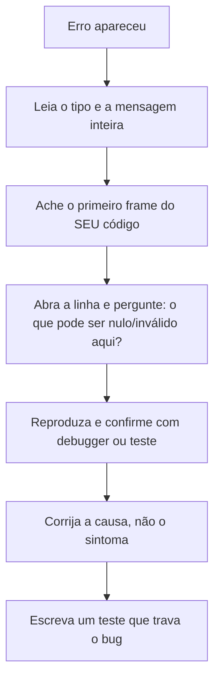

# J0.06 — Ler stack traces e documentação, e pedir ajuda direito

> ⏱️ ~1h30 · 🟢 Júnior · Pré-requisitos: J0.02, J0.03

## 🎯 Objetivos
Ao final desta aula você consegue:
- Ler um *stack trace* de cima para baixo e achar a linha do seu código que originou o erro.
- Distinguir o tipo da exceção, a mensagem e a pilha de chamadas.
- Procurar na documentação oficial (Javadoc, Maven, Spring) em vez de adivinhar.
- Escrever um pedido de ajuda com contexto suficiente para ser respondido.

## 🤔 Por que isso importa
Júnior que sabe ler o erro resolve metade dos problemas sozinho. A outra metade se resolve pedindo ajuda bem: quem ajuda precisa reproduzir o problema, e um "não funciona" sem contexto custa tempo de todo mundo. Autonomia é a competência que mais separa o júnior que cresce.

## 💡 Intuição (explicação simples)
Um stack trace é o **rastro de pegadas** do programa até o tropeço. Cada linha é um método que chamou o próximo; a primeira pegada é onde ele caiu, a última é por onde ele entrou. Você começa pela queda e sobe até achar a primeira pegada **que é sua**.

## 🔬 Como funciona por dentro
Cada thread tem uma **pilha de chamadas** (*call stack*): ao chamar um método, empilha-se um *frame*; ao retornar, desempilha-se. Quando uma exceção não é tratada, ela "sobe" a pilha, e a JVM imprime os frames no momento do erro.

```
Exception in thread "main" java.lang.NullPointerException: Cannot invoke "String.charAt(int)" because "name" is null
	at Demo.ownerInitial(Demo.java:11)
	at Demo.main(Demo.java:6)
```
Leitura:
1. **Tipo:** `java.lang.NullPointerException`.
2. **Mensagem:** o que aconteceu e (nas versões atuais do Java) *qual expressão* era nula; `"name" is null`.
3. **Frames:** de cima para baixo, do mais recente (onde estourou) ao mais antigo (`main`). `Demo.java:11` = arquivo e linha.
4. **"Caused by:"** aparece quando uma exceção foi embrulhada em outra; **a causa raiz geralmente é a última** `Caused by`.

Em aplicações Spring os traces têm dezenas de linhas de frameworks (`org.springframework...`, `jakarta...`). **Ignore o que é biblioteca e procure a primeira linha com o seu pacote** (`com.payflow...`).

Fonte da documentação da API de todas essas classes: [Java SE 25 API](https://docs.oracle.com/en/java/javase/25/docs/api/index.html).

## 🛠️ Exemplo prático

> Testado com OpenJDK 17.0.21 e conferido o comportamento com `javac -g`. No JDK 25 o formato é o mesmo.

### 1. `NullPointerException` com mensagem útil
`Demo.java`:
```java
import java.util.Map;

public class Demo {
    public static void main(String[] args) {
        Map<String, String> owners = Map.of("acc-1", "Ana");
        System.out.println(ownerInitial(owners, "acc-2"));
    }

    static char ownerInitial(Map<String, String> owners, String accountId) {
        String name = owners.get(accountId);   // devolve null: "acc-2" não existe
        return name.charAt(0);                  // linha 11: aqui estoura
    }
}
```
```bash
javac -g Demo.java && java Demo
```
Saída:
```
Exception in thread "main" java.lang.NullPointerException: Cannot invoke "String.charAt(int)" because "name" is null
	at Demo.ownerInitial(Demo.java:11)
	at Demo.main(Demo.java:6)
```
**Diagnóstico:** `name` é nulo porque `owners.get("acc-2")` devolve `null` para chave inexistente. O erro *aparece* na linha 11, mas a **causa** está no dado que chegou. Corrigir é decidir: a conta inexistente é um erro (lançar exceção clara) ou um caso normal (devolver vazio)? *(Em J1.14 você verá `Optional`.)*

> Sem a opção `-g` (ou ao rodar `java Demo.java` direto), o nome da variável aparece como `"<local2>"`. O Maven compila com informação de depuração por padrão, então no dia a dia você vê o nome.

### 2. Outras exceções comuns
```java
public class Div {
    public static void main(String[] args) {
        System.out.println(10 / Integer.parseInt(args[0]));
    }
}
```
```bash
javac Div.java
java Div 0       # ArithmeticException: / by zero  →  at Div.main(Div.java:2)
java Div abc     # NumberFormatException: For input string: "abc"
java Div         # ArrayIndexOutOfBoundsException (args vazio)
```
Saídas reais:
```
Exception in thread "main" java.lang.ArithmeticException: / by zero
	at Div.main(Div.java:2)
Exception in thread "main" java.lang.NumberFormatException: For input string: "abc"
	at java.base/java.lang.NumberFormatException.forInputString(NumberFormatException.java:67)
	at java.base/java.lang.Integer.parseInt(Integer.java:668)
	at java.base/java.lang.Integer.parseInt(Integer.java:786)
	at Div.main(Div.java:2)
```
No segundo, as 3 primeiras linhas são código do JDK (`java.base/...`). **A sua** é a última: `Div.java:2`. Aí começa a investigação: o argumento não é número.

### 3. Fluxo de depuração em 6 passos


### 4. Procurar na documentação certa
| Dúvida | Onde olhar primeiro |
|---|---|
| "O que `Map.get` devolve se a chave não existe?" | Javadoc da classe no [Java SE 25 API](https://docs.oracle.com/en/java/javase/25/docs/api/index.html) |
| "Como funciona um escopo do Maven?" | [Dependency Mechanism](https://maven.apache.org/guides/introduction/introduction-to-dependency-mechanism.html) |
| "Como aprender um tópico de Java do zero?" | [Dev.java — tutoriais](https://dev.java/learn/) |
| Uma mensagem de erro específica | Cole a **mensagem exata entre aspas** no buscador; ignore trechos que mudam (caminhos, ids) |

Prefira a **fonte primária** (documentação oficial). Respostas antigas de fóruns podem ser de versões diferentes (lembre das mudanças em `00-guia/versoes.md`, como `javax` → `jakarta`). Cheque a data e a versão.

### 5. Como pedir ajuda direito
Um bom pedido responde a 5 perguntas, nesta ordem:

```markdown
**Objetivo:** o que eu queria fazer.
**O que aconteceu:** o erro (texto, não print) com o stack trace completo.
**O que esperava:** o resultado correto.
**O que já tentei:** hipóteses descartadas e como.
**Como reproduzir:** passos mínimos, versão do Java/Maven, trecho de código (menor possível).
```
Exemplo ruim: *"minha API não funciona, alguém sabe?"*
Exemplo bom: *"Ao chamar `GET /accounts/acc-2` recebo NPE em `AccountService.ownerInitial:11` (trace abaixo). Esperava 404. Já confirmei que a conta não existe no mapa. Java 25, Maven 3.9.12. Código mínimo em https://gist..."*

Antes de perguntar: 15 a 30 minutos de tentativa real é um bom equilíbrio (combine isso com o seu time). **Faça o "pato de borracha"**: explique o problema em voz alta ou por escrito; muitas vezes você mesmo acha a resposta.

Sobre IA: assistentes de código ajudam a explicar erros, mas **podem inventar APIs e versões**. Trate a resposta como hipótese, confirme na documentação oficial e rode o código. **Nunca cole segredos ou dados reais de clientes** em ferramentas externas.

## 🧠 Pausa para lógica
**Enunciado:** o trace abaixo é de um sistema maior. Em qual linha do **seu** código você começaria?
```
java.lang.IllegalStateException: Insufficient funds
	at com.payflow.account.Account.debit(Account.java:42)
	at com.payflow.transfer.TransferService.execute(TransferService.java:30)
	at com.payflow.transfer.TransferController.create(TransferController.java:18)
	at java.base/jdk.internal.reflect.DirectMethodHandleAccessor.invoke(DirectMethodHandleAccessor.java:103)
	at org.springframework.web.method.support.InvocableHandlerMethod.doInvoke(InvocableHandlerMethod.java:258)
```
*(Exemplo ilustrativo, não é saída real do PayFlow, que ainda não existe.)*

<details><summary>Dica</summary>Ignore as linhas de `java.base` e `org.springframework`.</details>
<details><summary>Solução</summary>
Comece em `Account.java:42` (onde a exceção é lançada), mas o contexto de negócio está em `TransferService.execute:30`. Aqui o erro nem é um bug: é a regra "saldo nunca fica negativo" funcionando; o problema real é que o cliente deveria receber um erro 4xx claro (J6), não uma exceção vazando.
</details>

**Variação:** o trace termina com `Caused by: java.sql.SQLException: ...` bem embaixo. Por que a causa raiz costuma estar na última `Caused by`?

## ⚠️ Erros comuns e boas práticas de produção
- **Ler só a primeira linha** e ignorar o resto da mensagem (muitas vezes ela diz exatamente o que fazer).
- **Mandar print em vez de texto:** o texto pode ser buscado e copiado.
- **Engolir exceção:** `catch (Exception e) {}` esconde o problema. Nunca faça isso.
- **Corrigir o sintoma:** colocar `if (x != null)` sem entender por que veio nulo só empurra o bug para frente.
- **Perder o trace:** ao relançar, preserve a causa (`new RuntimeException("msg", e)`); em log, passe a exceção (`log.error("msg", e)`), não só `e.getMessage()`.
- **Vazar trace para o cliente** da API em produção expõe detalhes internos (tema de segurança, J8).

## 🧩 Exercícios
1. **Fixação:** dado o trace do exemplo da seção 🧠, diga o tipo, a mensagem e o método onde a exceção foi lançada.
2. **Aplicação no PayFlow:**
   - [ ] Crie `~/dev/payflow/docs/debugging.md` com seu **modelo pessoal de pedido de ajuda** (as 5 perguntas) e o fluxo de depuração em 6 passos.
   - [ ] Reproduza o NPE do `Demo`, depure no IntelliJ (J0.03) e anote a causa no arquivo.
   - [ ] Commit com `docs: add debugging guide` e PR (J0.05).
3. **Desafio (opcional):** faça o `Div` tratar cada erro com uma mensagem amigável usando `try/catch` por tipo específico (sem `catch (Exception e)`).

<details><summary>Solução de referência (desafio)</summary>

```java
public class Div {
    public static void main(String[] args) {
        try {
            System.out.println(10 / Integer.parseInt(args[0]));
        } catch (ArrayIndexOutOfBoundsException e) {
            System.err.println("Informe um número como argumento.");
        } catch (NumberFormatException e) {
            System.err.println("Argumento não é número: " + args[0]);
        } catch (ArithmeticException e) {
            System.err.println("Divisão por zero.");
        }
    }
}
```
</details>

## 🎤 Na entrevista
- **Como você investiga uma exceção em produção?** Leio tipo, mensagem e a primeira linha do meu código no trace; busco o mesmo erro nos logs (horário, id de correlação), reproduzo localmente com os mesmos dados, corrijo a causa e escrevo um teste.
- **O que é `Caused by`?** Exceção original embrulhada em outra; a causa raiz está na última.
- **Quando você pede ajuda?** Depois de tentar e ter um relato claro: objetivo, erro, o que testei, como reproduzir.

## 📚 Para ir além
- 📄 [Java SE 25 API](https://docs.oracle.com/en/java/javase/25/docs/api/index.html): Javadoc oficial; pesquise a classe e leia a seção de métodos.
- 📄 [Dev.java — Learn](https://dev.java/learn/): tutoriais oficiais em trilhas, para consultar a partir de J1.
- 🎥 ⚠️ Nenhum vídeo verificado nesta execução.

## ✅ Checklist da aula
- [ ] Sei apontar tipo, mensagem e frame relevante em um trace.
- [ ] Distingo código meu de código de biblioteca.
- [ ] Tenho meu modelo de pedido de ajuda salvo.
- [ ] Reproduzi e depurei o NPE no IntelliJ.
