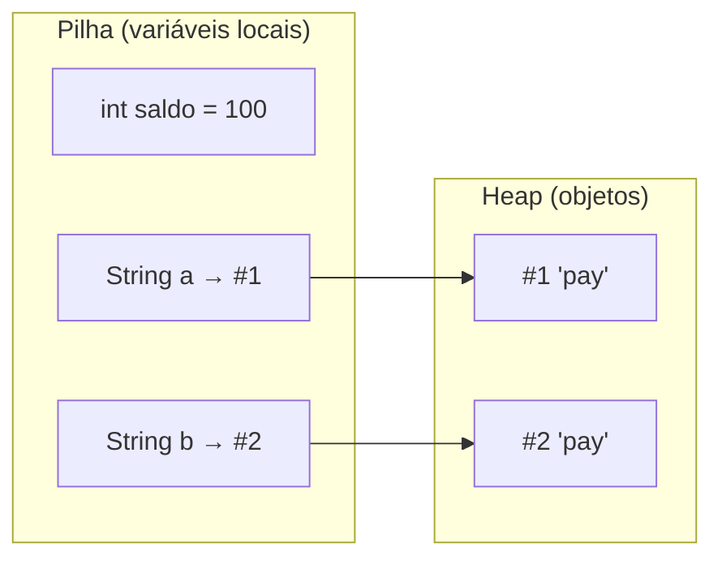

# J1.01 — Primeiro programa, tipos primitivos e por referência

> ⏱️ ~1h30 · 🟢 Júnior · Pré-requisitos: J0.02 (JDK e Maven), J0.03 (IntelliJ)

## 🎯 Objetivos
Ao final desta aula você consegue:
- Compilar e rodar um programa Java pelo terminal e pelo IntelliJ.
- Escolher o tipo primitivo certo (`int`, `long`, `double`, `boolean`, `char`) e explicar por que dinheiro **não** usa `double`.
- Explicar a diferença entre tipo primitivo e tipo por referência (`String`, objetos, `null`).
- Prever o resultado de `==` versus `equals` em `String`.
- Reconhecer *overflow* e conversões (*casting*) e seus riscos.

## 🤔 Por que isso importa
Todo bug financeiro clássico começa aqui: um `int` que estoura, um `double` que soma `0.1 + 0.2` e dá `0.30000000000000004`, uma `String` comparada com `==`. Entender como a JVM guarda cada valor evita esses bugs antes de escrever a primeira linha do PayFlow.

## 💡 Intuição (explicação simples)
- **Primitivo** é um **número escrito no próprio papel**: a variável *contém* o valor. Copiar é tirar uma fotocópia.
- **Referência** é um **endereço num papel**: a variável contém o endereço de uma casa (o objeto, no *heap*). Copiar a variável copia o endereço; as duas apontam para a mesma casa.
- `null` é um papel em branco: não aponta para casa nenhuma.

## 🔬 Como funciona por dentro

`a == b` compara **os endereços** (#1 ≠ #2); `a.equals(b)` compara o **conteúdo**.

| Tipo | Tamanho | Faixa / uso |
|---|---|---|
| `byte` / `short` | 8 / 16 bits | raros no dia a dia |
| `int` | 32 bits | −2.147.483.648 a 2.147.483.647; contagens e índices |
| `long` | 64 bits | ids numéricos, timestamps em ms (sufixo `L`) |
| `double` / `float` | 64 / 32 bits | ponto flutuante **binário**: aproximado |
| `boolean` | — | `true` ou `false` |
| `char` | 16 bits | um caractere UTF-16 (`'A'`) |

Cada primitivo tem um *wrapper* (`Integer`, `Long`, `Double`, `Boolean`…), que é objeto e pode ser `null`. A conversão automática entre os dois se chama *boxing/unboxing*; desembalhar um `null` lança `NullPointerException`.

Referência: [Java SE 25 API — `Object`](https://docs.oracle.com/en/java/javase/25/docs/api/java.base/java/lang/Object.html).

## 🛠️ Exemplo prático
> Testado com JDK 25 (OpenJDK 25.0.5): `java L01.java` (modo "arquivo único", sem `javac`).

Primeiro programa, `Hello.java`:
```java
public class Hello {
    public static void main(String[] args) {
        System.out.println("Olá, PayFlow!");
    }
}
```
```bash
javac Hello.java && java Hello     # compila e roda
java Hello.java                    # atalho: compila na memória e roda
```
Saída: `Olá, PayFlow!`

`Tipos.java` (cada linha ilustra uma armadilha):
```java
import java.math.BigDecimal;

public class Tipos {
    public static void main(String[] args) {
        int max = Integer.MAX_VALUE;
        System.out.println(max + 1);                       // overflow silencioso
        System.out.println(0.1 + 0.2);                     // double é binário
        System.out.println(new BigDecimal("0.1").add(new BigDecimal("0.2")));
        System.out.println(7 / 2 + " " + 7 / 2.0 + " " + 7 % 2);   // divisão inteira
        String a = new String("pay"), b = new String("pay");
        System.out.println((a == b) + " " + a.equals(b));
        long big = 3_000_000_000L;
        System.out.println((int) big);                     // cast estreita e corrompe
        var name = "Ana";                                  // var: tipo inferido (String)
        System.out.println(name.getClass().getSimpleName());
        Integer x = null;
        try { int y = x; } catch (NullPointerException e) { System.out.println("NPE unboxing"); }
        char c = 'A'; c += 1; System.out.println(c);
    }
}
```
Saída real:
```
-2147483648
0.30000000000000004
0.3
3 3.5 1
false true
-1294967296
String
NPE unboxing
B
```
Leitura:
- `Integer.MAX_VALUE + 1` **não dá erro**: volta ao menor valor (*overflow*). Para contas em centavos, use `long`; para dinheiro em geral, `BigDecimal` (J1.15).
- `0.1 + 0.2`: `double` guarda frações em base 2; 0,1 não tem representação exata. Por isso a decisão do curso: **dinheiro é sempre `BigDecimal`**, construído a partir de `String`.
- `7 / 2` com dois inteiros é **divisão inteira** (3). Basta um operando `double` para virar 3.5. `%` é o resto.
- `var` só vale para variável local com inicializador; o tipo continua sendo estático.

## 🧠 Pausa para lógica
**Enunciado:** um contador de transações usa `int`. Em que momento ele "vira negativo" se receber 1.000 transações por segundo, e qual tipo você usaria?

<details><summary>Dica</summary>2.147.483.647 ÷ 1.000 ÷ 86.400 s/dia.</details>
<details><summary>Solução</summary>

2.147.483.647 / 1.000 ≈ 2.147.483 s ≈ 24,8 dias. Depois disso o contador vira −2.147.483.648. Use `long` (limite ≈ 9,2 × 10¹⁸) e, para ids públicos, UUID (decisão do curso).
</details>

**Variação:** por que `(int) 3_000_000_000L` deu `-1294967296`? (Dica: o cast mantém só os 32 bits de baixo.)

## ⚠️ Erros comuns e boas práticas de produção
- **Comparar `String` com `==`.** Funciona "às vezes" por causa do *string pool* (`"pay" == "pay"` dá `true`, como visto no exemplo da J1.04) e quebra com `new String` ou texto vindo da rede. Sempre `equals`.
- **`double` para dinheiro.** Nunca. `BigDecimal("0.10")`, não `BigDecimal(0.1)`.
- **Divisão inteira inesperada:** `(a / b) * 100` com inteiros zera a porcentagem.
- **Unboxing de `null`:** `Integer saldo = mapa.get("x"); int s = saldo;` → `NullPointerException`.
- Erro de compilação que você verá: `incompatible types: possible lossy conversion from double to int` (o compilador exige o cast explícito).

## 🧩 Exercícios
1. **Fixação:** sem rodar, preveja `10 / 4`, `10 / 4.0`, `10 % 4`, `'a' + 1` e `(char) ('a' + 1)`. Depois confira.
2. **Aplicação no PayFlow (mini-projeto `mini-bank`):**
   - [ ] Crie o projeto Maven `mini-bank` (`groupId com.payflow`, `artifactId mini-bank`, Java 25) com `mvn archetype:generate` ou pelo IntelliJ (J0.02).
   - [ ] Classe `com.payflow.minibank.Main` que imprime o saldo inicial como `BigDecimal` `"0.00"`.
   - [ ] `mvn -q package` passa e `java -cp target/classes com.payflow.minibank.Main` imprime a saída.
3. **Desafio (opcional):** escreva um programa que mostre `Long.MAX_VALUE + 1` e `Math.addExact(Long.MAX_VALUE, 1)`. O que muda?

<details><summary>Solução de referência (1 e 3)</summary>

1. `2`, `2.5`, `2`, `98` (char vira int), `b`.
3. O primeiro dá `-9223372036854775808` (overflow silencioso); `Math.addExact` lança `ArithmeticException: long overflow`. Prefira os métodos `*Exact` quando um estouro for um erro de negócio.
</details>

## 🎤 Na entrevista
- **Diferença entre `==` e `equals`?** `==` compara valor em primitivos e endereço em referências; `equals` compara conteúdo, se a classe o implementar (J1.08).
- **Por que não usar `double` para dinheiro?** Ponto flutuante binário não representa frações decimais exatas; erros se acumulam. Usa-se `BigDecimal`.
- **O que é overflow?** Resultado fora da faixa do tipo; em Java inteiros dão a volta sem erro.

## 📚 Para ir além
- 📄 [Dev.java — Learn](https://dev.java/learn/): trilha oficial; veja a parte de "Language Basics".
- 📄 [Java SE 25 API](https://docs.oracle.com/en/java/javase/25/docs/api/index.html): consulte `Integer`, `Math`, `String`.
- 🎥 ⚠️ Nenhum vídeo verificado nesta execução.

## ✅ Checklist da aula
- [ ] Compilei e rodei um programa pelo terminal e pelo IntelliJ.
- [ ] Explico pilha vs heap e primitivo vs referência.
- [ ] Sei por que dinheiro não usa `double`.
- [ ] Projeto `mini-bank` criado.
