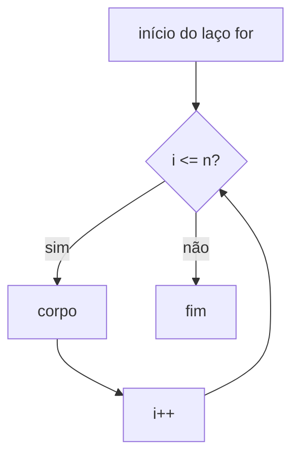

# J1.02 — Operadores, condicionais e laços

> ⏱️ ~1h30 · 🟢 Júnior · Pré-requisitos: J1.01

## 🎯 Objetivos
Ao final desta aula você consegue:
- Usar operadores aritméticos, relacionais e lógicos, incluindo curto-circuito (`&&`, `||`).
- Escrever decisões com `if/else`, operador ternário e `switch` como expressão.
- Escolher entre `for`, `for-each` e `while`, e controlar o fluxo com `break` e `continue`.
- Evitar o erro clássico *off-by-one* em limites de laço.

## 🤔 Por que isso importa
Regras de negócio são condições e repetições: "se o saldo cobre o valor, debite", "para cada lançamento, some". Um `<` no lugar de `<=` perde o último item do extrato; um `=` no lugar de `==` nem compila em Java, mas a lógica errada compila.

## 💡 Intuição (explicação simples)
Um programa é uma receita. **Condicional** é "se a massa estiver mole, adicione farinha". **Laço** é "bata até ficar homogêneo". O computador segue as linhas em ordem; condicionais e laços são os desvios e os retornos nessa leitura.

## 🔬 Como funciona por dentro
- **Operadores:** `+ - * / %`, `== != < > <= >=`, `&& || !`, `+=` e companhia, `++`/`--`.
- **Curto-circuito:** em `a && b`, se `a` é falso, `b` **nem é avaliado**. Por isso `x != null && x.length() > 3` é seguro.
- **`i++` vs `++i`:** `i++` devolve o valor antigo e depois incrementa; `++i` incrementa e devolve o novo.
- **`switch` como expressão** (Java 14+): usa `->`, não precisa de `break`, devolve valor e, com `enum`, o compilador exige cobrir todos os casos.



## 🛠️ Exemplo prático
> Testado com JDK 25 (`java L02.java`).

```java
public class Fluxo {
    enum Tier { BASIC, GOLD }

    static int fee(Tier t) {
        return switch (t) {            // sem default: o compilador confere todos os casos
            case BASIC -> 5;
            case GOLD -> 0;
        };
    }

    public static void main(String[] args) {
        int balance = 100;
        if (balance > 50 && balance < 200) System.out.println("mid");
        System.out.println(fee(Tier.BASIC) + " " + fee(Tier.GOLD));

        int sum = 0;
        for (int i = 1; i <= 5; i++) {          // 1..5 inclusive
            if (i == 3) continue;               // pula o 3
            sum += i;
        }
        System.out.println(sum);                // 1+2+4+5

        int n = 0;
        while (n < 3) n++;
        System.out.println(n);

        int[] v = {10, 20, 30};
        for (int e : v) System.out.print(e + " ");   // for-each
        System.out.println();

        String day = "SAT";
        String kind = switch (day) {
            case "SAT", "SUN" -> "weekend";
            default -> "weekday";
        };
        System.out.println(kind);
        System.out.println(true ? "a" : "b");        // ternário
        int i = 5;
        System.out.println(i++ + " " + ++i);
    }
}
```
Saída real:
```
mid
5 0
12
3
10 20 30 
weekend
a
5 7
```
Notas: `i++ + " " + ++i` imprime `5 7` (usa 5, vira 6; incrementa para 7 e usa 7). **Evite escrever isto no código real**, é só para entender.

## 🧠 Pausa para lógica
**Enunciado (paginação e off-by-one):** o extrato tem 23 lançamentos e mostra 10 por página (páginas numeradas a partir de 1). Quantas páginas existem e quais índices (0-based) a página 3 mostra?

<details><summary>Dica</summary>Divisão inteira arredonda para baixo; precisa arredondar para cima.</details>
<details><summary>Solução</summary>

Páginas = `(23 + 10 - 1) / 10 = 3`. A página `p` cobre os índices de `(p-1)*10` até `min(p*10, 23) - 1`. A página 3 mostra os índices 20, 21 e 22 (3 itens).
```java
int total = 23, size = 10, page = 3;
int pages = (total + size - 1) / size;
int from = (page - 1) * size, to = Math.min(page * size, total);
for (int i = from; i < to; i++) System.out.println(i);   // 20 21 22
```
</details>

**Variação:** o que acontece se `page` for 0? Escreva a validação.

## ⚠️ Erros comuns e boas práticas de produção
- **Off-by-one:** `i <= v.length` lança `ArrayIndexOutOfBoundsException: Index 3 out of bounds for length 3`.
- **`=` em vez de `==`** em `if (x = 5)`: o compilador recusa para `int` (`incompatible types: int cannot be converted to boolean`), mas com `boolean` compila e atribui.
- **`switch` clássico sem `break`** "cai" para o próximo caso (*fall-through*). Prefira `->`.
- **Laço infinito:** `while (true)` sem `break`; condição que nunca muda.
- Muitos `if` aninhados: prefira retorno antecipado (*guard clauses*) para manter o código plano.

## 🧩 Exercícios
1. **Fixação:** escreva FizzBuzz de 1 a 20 usando `for` e `if`.
2. **Aplicação no PayFlow (`mini-bank`):**
   - [ ] Classe `FeeTable` com método `static int feeInCents(Tier tier)` usando `switch` como expressão (`BASIC` = 500, `GOLD` = 0).
   - [ ] `Main` imprime a tabela de tarifas percorrendo `Tier.values()` com `for-each`.
   - [ ] Compila sem `default` no `switch` (o compilador valida o `enum`).
3. **Desafio (opcional):** some apenas os números pares de 1 a 100 sem usar `if` dentro do laço.

<details><summary>Solução de referência</summary>

```java
for (int i = 1; i <= 20; i++) {
    if (i % 15 == 0) System.out.println("FizzBuzz");
    else if (i % 3 == 0) System.out.println("Fizz");
    else if (i % 5 == 0) System.out.println("Buzz");
    else System.out.println(i);
}
// desafio: for (int i = 2; i <= 100; i += 2) sum += i;   // 2550
```
</details>

## 🎤 Na entrevista
- **O que é curto-circuito?** `&&` e `||` param de avaliar assim que o resultado é conhecido; permite proteger acessos (`x != null && ...`).
- **`switch` clássico vs expressão?** A expressão devolve valor, não tem *fall-through* e, com `enum`/sealed, o compilador exige exaustividade.
- **Diferença entre `break` e `continue`?** `break` sai do laço; `continue` pula para a próxima iteração.

## 📚 Para ir além
- 📄 [Dev.java — Learn](https://dev.java/learn/): seção de controle de fluxo.
- 📄 [Java SE 25 API](https://docs.oracle.com/en/java/javase/25/docs/api/index.html): `Math` (`min`, `max`, `*Exact`).
- 🎥 ⚠️ Nenhum vídeo verificado nesta execução.

## ✅ Checklist da aula
- [ ] Uso `switch` como expressão.
- [ ] Explico curto-circuito e `i++` vs `++i`.
- [ ] Calculo paginação sem *off-by-one*.
- [ ] `FeeTable` do `mini-bank` pronta.
