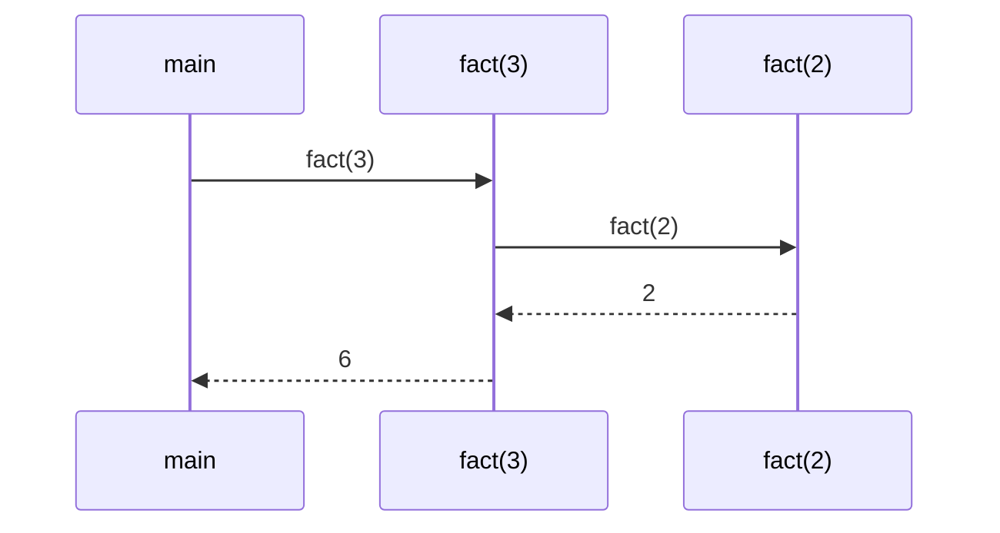

# J1.03 — Métodos e escopo; depuração passo a passo

> ⏱️ ~1h30 · 🟢 Júnior · Pré-requisitos: J1.01, J1.02, J0.03 (debugger)

## 🎯 Objetivos
Ao final desta aula você consegue:
- Declarar métodos com parâmetros, retorno, sobrecarga e *varargs*.
- Explicar que o Java **passa tudo por valor** (inclusive referências).
- Delimitar o escopo de uma variável (bloco, método).
- Depurar um programa passo a passo observando a pilha de chamadas e variáveis.
- Reconhecer recursão e o `StackOverflowError`.

## 🤔 Por que isso importa
Método é a unidade de reuso e de teste. Entender "passagem por valor" evita o bug de achar que um método trocou o objeto do chamador (ou que não pôde alterá-lo). E depurar com *breakpoints* é mais rápido do que espalhar `System.out.println`.

## 💡 Intuição (explicação simples)
Um método é uma **máquina de café**: você entrega ingredientes (parâmetros), ela devolve a bebida (retorno). Ela recebe **cópias** do que você entrega. Se o ingrediente é um **cartão com o endereço de uma despensa** (uma referência), a máquina pode mexer *dentro* da despensa, mas se ela rasgar o cartão, o seu continua intacto.

## 🔬 Como funciona por dentro
Cada chamada cria um **frame** na pilha com seus parâmetros e variáveis locais; ao retornar, o frame some (é isso que você viu em J0.06 como *stack trace*).


- **Passagem por valor:** o parâmetro recebe uma cópia. Para primitivos, cópia do número; para objetos, cópia **do endereço**.
- **Sobrecarga (*overload*):** mesmo nome, parâmetros diferentes (`sum(int,int)` e `sum(int...)`). O compilador escolhe pela assinatura.
- **Escopo:** uma variável vive no bloco `{ }` onde foi declarada.
- **Recursão** gasta um frame por chamada; sem caso-base, estoura a pilha.

## 🛠️ Exemplo prático
> Testado com JDK 25.

```java
import java.util.*;

public class Metodos {
    static void reassign(int n) { n = 99; }                       // altera só a cópia
    static void mutate(List<String> l) { l.add("x"); }            // altera o objeto apontado
    static void reassignRef(List<String> l) { l = new ArrayList<>(); l.add("y"); } // troca a cópia do endereço
    static int sum(int... v) { int s = 0; for (int e : v) s += e; return s; }
    static int sum(int a, int b) { return a + b; }                // sobrecarga
    static int fact(int n) { return n <= 1 ? 1 : n * fact(n - 1); }
    static void deep(int n) { deep(n + 1); }                      // sem caso-base

    public static void main(String[] args) {
        int a = 1; reassign(a); System.out.println(a);
        List<String> l = new ArrayList<>(); mutate(l); reassignRef(l); System.out.println(l);
        System.out.println(sum() + " " + sum(1, 2, 3) + " " + sum(4, 5) + " " + fact(5));
        try { deep(0); } catch (StackOverflowError e) { System.out.println("SO"); }
    }
}
```
Saída real:
```
1
[x]
0 6 9 120
SO
```
- `a` continua `1`: o método mexeu na cópia.
- `l` tem `[x]`: `mutate` alterou o objeto compartilhado; `reassignRef` só trocou a cópia local do endereço.

### Depurando no IntelliJ (passo a passo)
1. Clique na margem esquerda da linha `fact(n - 1)` para criar um *breakpoint*.
2. Botão direito no triângulo ▶ → **Debug 'Metodos.main()'** (ou `Shift+F9`).
3. Na janela **Debugger**, observe **Frames** (a pilha de `fact`) e **Variables** (`n`).
4. **F8 Step Over** executa a linha; **F7 Step Into** entra no método; **Shift+F8 Step Out** sai; **F9 Resume** continua.
5. Faça um breakpoint condicional (botão direito no ponto → condição `n == 2`).
6. Em **Evaluate Expression** (`Alt+F8`) teste `n * 2` sem alterar o código.

*(Atalhos conforme o keymap padrão do IntelliJ; confira o seu em Settings → Keymap, como visto em J0.03. Os atalhos não foram testados neste ambiente.)*

## 🧠 Pausa para lógica
**Enunciado:** escreva `isPalindrome(String s)` recursivo que ignora maiúsculas (`"Arara"` → `true`). Qual é o caso-base?

<details><summary>Dica</summary>Compare o primeiro e o último caractere e chame o método para o miolo.</details>
<details><summary>Solução</summary>

```java
static boolean isPalindrome(String s) {
    String t = s.toLowerCase();
    if (t.length() <= 1) return true;                       // caso-base
    if (t.charAt(0) != t.charAt(t.length() - 1)) return false;
    return isPalindrome(t.substring(1, t.length() - 1));
}
```
</details>

**Variação:** reescreva com `for` e dois índices. Qual usa menos memória de pilha?

## ⚠️ Erros comuns e boas práticas de produção
- **Achar que `mutate` e `reassign` são equivalentes** (veja o exemplo).
- **Método gigante:** mais de ~20 linhas costuma esconder duas responsabilidades. Extraia e dê nomes que contam a intenção.
- **Parâmetros demais** (mais de 3–4): agrupe em um objeto (record, J1.14).
- **Efeito colateral escondido:** método chamado `getBalance` que altera estado.
- Erro de compilação típico: `missing return statement` (algum caminho não retorna) e `variable x might not have been initialized`.
- `java.lang.StackOverflowError` aparece como um *stack trace* repetindo o mesmo frame milhares de vezes: procure o caso-base ausente.

## 🧩 Exercícios
1. **Fixação:** o que imprime `static void f(int[] a) { a[0] = 9; a = new int[]{1}; }` quando chamado com `int[] x = {5}; f(x); System.out.println(x[0]);`?
2. **Aplicação no PayFlow (`mini-bank`):**
   - [ ] Em `FeeTable`, método `static long totalInCents(int... amounts)` (varargs).
   - [ ] Depure `Main` com um breakpoint condicional e anote em `docs/debugging.md` do `payflow` o que viu em **Frames**.
3. **Desafio (opcional):** `static long fib(int n)` recursivo e iterativo; meça o tempo para `n = 40` de cada um.

<details><summary>Solução de referência</summary>

1. Imprime `9`: o primeiro `a[0] = 9` altera o array compartilhado; a reatribuição só afeta a cópia local.
3. Recursivo ingênuo faz ~2ⁿ chamadas (leva segundos em `n = 40`); o iterativo é O(n) (microssegundos). Os tempos variam por máquina, meça os seus.
</details>

## 🎤 Na entrevista
- **Java é por valor ou por referência?** Sempre por valor; para objetos, o valor copiado é a referência.
- **O que é sobrecarga e como difere de sobrescrita?** Sobrecarga: mesmo nome com parâmetros diferentes, resolvida em compilação. Sobrescrita (J1.06): subclasse redefine método herdado, resolvida em execução.
- **Por que ocorre `StackOverflowError`?** Chamadas aninhadas demais (tipicamente recursão sem caso-base) esgotam a pilha da thread.

## 📚 Para ir além
- 📄 [Dev.java — Learn](https://dev.java/learn/): métodos e escopo.
- 📄 [Debug code — IntelliJ IDEA](https://www.jetbrains.com/help/idea/debugging-code.html): guia oficial do debugger (link já verificado em J0).
- 🎥 ⚠️ Nenhum vídeo verificado nesta execução.

## ✅ Checklist da aula
- [ ] Explico passagem por valor com um exemplo.
- [ ] Sei sobrecarregar um método e usar *varargs*.
- [ ] Depurei com Step Over/Into e breakpoint condicional.
- [ ] Reconheço `StackOverflowError`.
