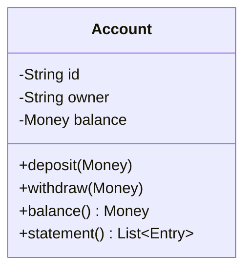

# J1.05 — Classes, objetos e encapsulamento

> ⏱️ ~1h30 · 🟢 Júnior · Pré-requisitos: J1.01 a J1.04

## 🎯 Objetivos
Ao final desta aula você consegue:
- Modelar um conceito do domínio como classe com atributos, construtor e métodos.
- Aplicar encapsulamento: estado privado, invariantes protegidas pelos métodos.
- Distinguir classe, objeto, atributo de instância e `static`.
- Usar `this`, `final` e construtores com validação.
- Devolver coleções internas sem expor o estado (`Collections.unmodifiableList`).

## 🤔 Por que isso importa
Em sistemas reais o objeto **garante as próprias regras**. Se qualquer parte do código pode fazer `account.balance = -500`, a regra "saldo nunca fica negativo" (regra 1 do PayFlow, `projeto-central.md`) vira uma esperança. Encapsulamento transforma regras em código que não dá para burlar.

## 💡 Intuição (explicação simples)
Uma classe é a **planta da casa**; o objeto é a **casa construída**. O encapsulamento é o **caixa eletrônico**: você não enfia a mão no cofre, só usa os botões "depositar" e "sacar", e a máquina recusa o que quebra a regra.

## 🔬 Como funciona por dentro
- `new Account(...)` aloca o objeto no heap, executa o construtor e devolve a referência.
- Cada objeto tem sua **cópia** dos atributos de instância; atributos/métodos `static` pertencem à **classe**.
- Modificadores: `private` (só a própria classe), padrão (mesmo pacote), `protected`, `public` (detalhes em J1.16).
- Um objeto **sempre válido** nasce válido (construtor valida) e continua válido (métodos validam).



## 🛠️ Exemplo prático
> Esta é a base do `mini-bank` que compila e passa nos testes com JDK 25 e JUnit 6.1.3 (ver J1.16).

`Account.java` em `src/main/java/com/payflow/minibank/` (versão desta aula, ainda sem `Money` nem extrato; usa `long` em centavos temporariamente):
```java
package com.payflow.minibank;

import java.util.Objects;

public class Account {
    private final String id;          // final: não muda depois de construída
    private final String owner;
    private long balanceInCents;      // provisório: vira Money em J1.14/J1.15

    public Account(String id, String owner) {
        this.id = Objects.requireNonNull(id, "id");
        this.owner = Objects.requireNonNull(owner, "owner");
    }

    public void deposit(long cents) {
        if (cents <= 0) throw new IllegalArgumentException("Amount must be positive: " + cents);
        balanceInCents += cents;
    }

    public void withdraw(long cents) {
        if (cents <= 0) throw new IllegalArgumentException("Amount must be positive: " + cents);
        if (cents > balanceInCents) throw new IllegalStateException("Insufficient funds");
        balanceInCents -= cents;
    }

    public String id() { return id; }
    public String owner() { return owner; }
    public long balanceInCents() { return balanceInCents; }

    @Override
    public String toString() { return "Account[" + id + ", " + owner + ", " + balanceInCents + "]"; }
}
```
Uso:
```java
Account ana = new Account("acc-1", "Ana");
ana.deposit(10_000);
ana.withdraw(3_025);
System.out.println(ana);          // Account[acc-1, Ana, 6975]
ana.withdraw(999_999);            // IllegalStateException: Insufficient funds
```
Pontos de projeto:
- **Sem `setBalance`.** O saldo só muda por `deposit`/`withdraw`, que protegem a regra.
- `Objects.requireNonNull(x, "nome")` falha cedo (*fail fast*) com mensagem útil em vez de um NPE distante.
- Estilo: este curso usa acessores sem prefixo (`id()`), como os *records* (J1.14); o prefixo `getX` é a convenção JavaBean, que o Spring/JPA usam em J5.

### Estado de objeto vs `static`
```java
class Counter {
    static int created = 0;       // da classe: um só
    final int number;             // do objeto: um por instância
    Counter() { number = ++created; }
}
```

## 🧠 Pausa para lógica
**Enunciado:** a regra "saldo é a soma dos lançamentos" (regra 3 do PayFlow) pode ser verificada. Dado o `long[] entries = {+10000, -3025, +500}` (créditos positivos, débitos negativos), calcule o saldo e diga se algum ponto da sequência ficou negativo.

<details><summary>Dica</summary>Mantenha um acumulador e teste a cada passo.</details>
<details><summary>Solução</summary>

```java
long running = 0; boolean wentNegative = false;
for (long e : entries) { running += e; if (running < 0) wentNegative = true; }
// running = 7475; wentNegative = false
```
</details>

**Variação:** e se `entries` pudesse vir fora de ordem? Por que a ordem importa para a regra 1?

## ⚠️ Erros comuns e boas práticas de produção
- **Atributos `public`** e *setters* para tudo: quebra o encapsulamento e invariantes.
- **Expor a coleção interna** (`return entries;`): o chamador pode limpá-la. Devolva uma visão imutável (J1.16 e o código final do `mini-bank`).
- **Construtor sem validação**: objeto nasce inválido e o erro aparece longe.
- **`static` mutável** compartilhado: estado global escondido, difícil de testar e perigoso com *threads*.
- **Esquecer `this.`** quando parâmetro e atributo têm o mesmo nome (`id = id` não faz nada).
- Mensagem comum: `error: variable owner not initialized in the default constructor` (campo `final` sem atribuição).

## 🧩 Exercícios
1. **Fixação:** crie `Rectangle` com largura e altura positivas validadas no construtor e métodos `area()` e `perimeter()`.
2. **Aplicação no PayFlow (`mini-bank`):**
   - [ ] Classe `Account` como acima (`deposit`, `withdraw`, saldo sem *setter*).
   - [ ] Classe `Bank` com `open(id, owner)` e `get(id)`, guardando as contas num `Map` (use `HashMap`; J1.11 explica por dentro).
   - [ ] `Main` abre duas contas, deposita, saca e imprime.
   - [ ] Saldo negativo é impossível (teste manual: saque maior que o saldo lança exceção).
3. **Desafio (opcional):** adicione `transfer(Account from, Account to, long cents)` em `Bank` e pense: o que acontece se o `deposit` falhar depois do `withdraw`? (Pista para J3: transações.)

<details><summary>Solução de referência (desafio)</summary>

Se `withdraw` passa e `deposit` falha, o dinheiro some. Em memória, valide tudo **antes** de mexer (`to` existe? valor positivo?) e só então debite/credite. Em banco de dados, isso é o papel da transação ACID (J3).
</details>

## 🎤 Na entrevista
- **O que é encapsulamento e para que serve?** Esconder o estado e expor operações que mantêm as invariantes; reduz o acoplamento e protege regras.
- **Qual a diferença entre classe e objeto?** Classe é o molde; objeto é uma instância com estado próprio.
- **Quando usar `static`?** Para o que pertence à classe e não depende de instância (utilitários, constantes); evitar estado mutável.

## 📚 Para ir além
- 📄 [Dev.java — Learn](https://dev.java/learn/): classes e objetos.
- 📄 [Java SE 25 API — `Objects`](https://docs.oracle.com/en/java/javase/25/docs/api/index.html): `requireNonNull`, `equals`, `hash`.
- 📖 *Effective Java* (Joshua Bloch): capítulos sobre minimizar a acessibilidade e a mutabilidade.
- 🎥 ⚠️ Nenhum vídeo verificado nesta execução.

## ✅ Checklist da aula
- [ ] `Account` não tem *setter* de saldo e valida no construtor.
- [ ] `Bank` guarda contas em um `Map`.
- [ ] Explico classe vs objeto e `static` vs instância.
- [ ] Commit `feat: add account and bank` no `mini-bank`.
