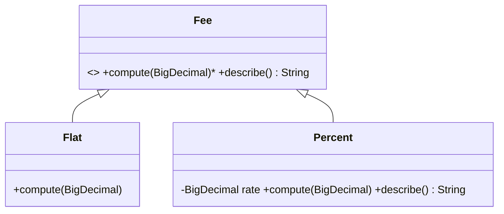

# J1.06 — Herança, polimorfismo e classes abstratas

> ⏱️ ~1h30 · 🟢 Júnior · Pré-requisitos: J1.05

## 🎯 Objetivos
Ao final desta aula você consegue:
- Criar uma subclasse com `extends`, reaproveitando e sobrescrevendo comportamento (`@Override`, `super`).
- Explicar polimorfismo: a mesma chamada, comportamentos diferentes conforme o objeto real.
- Declarar uma classe abstrata com métodos abstratos.
- Usar `instanceof` e *cast* com segurança.
- Decidir quando herança é apropriada (e quando não é).

## 🤔 Por que isso importa
Spring, JPA e as bibliotecas que você usará nas próximas semanas estão cheios de hierarquias. Ler `AbstractX`, `BaseY` e métodos sobrescritos é rotina. E aplicar herança onde não cabe é uma das maiores fontes de código frágil; a aula J1.07 mostra a alternativa.

## 💡 Intuição (explicação simples)
Herança é a relação **"é um"**: um `Gato` *é um* `Animal`. Polimorfismo é o **controle remoto universal**: você aperta "ligar" e cada aparelho liga do seu jeito. Classe abstrata é uma **receita incompleta**: define os passos comuns e deixa em branco o que cada filho precisa preencher.

## 🔬 Como funciona por dentro
- Em `Fee f = new Percent(...)`, o tipo **declarado** é `Fee` (o que o compilador enxerga) e o tipo **real** é `Percent` (o que a JVM usa).
- Chamada de método de instância é resolvida **em execução** pelo tipo real (*dynamic dispatch*). É o polimorfismo.
- Classe `abstract` não pode ser instanciada; métodos `abstract` não têm corpo e as subclasses concretas são obrigadas a implementá-los.
- Java tem **herança simples de classe** (um só `extends`).
- `super.metodo()` chama a versão do pai; `super(...)` no construtor chama o construtor do pai.



## 🛠️ Exemplo prático
> Testado com JDK 25.

```java
import java.math.BigDecimal;

public class Heranca {
    static abstract class Fee {
        abstract BigDecimal compute(BigDecimal amount);             // cada tarifa decide
        String describe() {                                         // comportamento comum
            return getClass().getSimpleName() + " -> " + compute(new BigDecimal("100.00"));
        }
    }
    static class Flat extends Fee {
        BigDecimal compute(BigDecimal a) { return new BigDecimal("2.50"); }
    }
    static class Percent extends Fee {
        private final BigDecimal rate;
        Percent(String r) { rate = new BigDecimal(r); }
        BigDecimal compute(BigDecimal a) { return a.multiply(rate); }
        @Override String describe() { return "Percent(" + rate + ") via " + super.describe(); }
    }

    public static void main(String[] args) {
        Fee[] fees = { new Flat(), new Percent("0.015") };
        for (Fee f : fees) System.out.println(f.describe());       // polimorfismo
        Object o = fees[0];
        System.out.println(o instanceof Fee);
        try { Percent p = (Percent) fees[0]; }                      // cast inválido
        catch (ClassCastException e) { System.out.println("CCE"); }
    }
}
```
Saída real:
```
Flat -> 2.50
Percent(0.015) via Percent -> 1.50000
true
CCE
```
Leitura: o laço não sabe qual tarifa tem em mãos; adicionar `Tiered` amanhã **não exige mudar o laço**. `1.50000` mostra que `BigDecimal.multiply` soma as escalas (2 + 3 = 5); em J1.15 você arredonda para 2 casas com `HALF_EVEN`.

`@Override` faz o compilador conferir que você realmente sobrescreve algo; sem ele, um erro de digitação cria um método novo silenciosamente.

## 🧠 Pausa para lógica
**Enunciado:** a taxa de saque é `Flat 2.50` para valores até 500 e `Percent 1%` acima disso. Onde fica a regra de escolha, dentro de `Flat`/`Percent` ou fora? Escreva `static Fee chooseFor(BigDecimal amount)`.

<details><summary>Dica</summary>Quem conhece a regra de escolha não deveria ser a própria tarifa.</details>
<details><summary>Solução</summary>

```java
static Fee chooseFor(BigDecimal amount) {
    return amount.compareTo(new BigDecimal("500")) <= 0 ? new Flat() : new Percent("0.01");
}
```
Fora: cada tarifa só sabe calcular; a escolha é uma decisão separada (padrão *Strategy* em P4).
</details>

**Variação:** como testaria `chooseFor` exatamente no limite de 500.00 e em 500.01?

## ⚠️ Erros comuns e boas práticas de produção
- **Herança só para reaproveitar código** (sem relação "é um"): prefira composição (J1.07).
- **Hierarquias profundas** (3+ níveis): difíceis de entender e de mudar.
- **Chamar método sobrescrevível no construtor:** o filho pode ser chamado antes de estar inicializado.
- **Cast sem checar:** `ClassCastException: class Heranca$Flat cannot be cast to class Heranca$Percent`. Use `instanceof` com *pattern matching* (`if (f instanceof Percent p) ...`) ou, melhor, resolva por polimorfismo.
- **Esquecer `@Override`** e criar sobrecarga acidental.
- `final class` proíbe herança; use quando a classe não foi desenhada para ser estendida (*Effective Java*, item 19).

## 🧩 Exercícios
1. **Fixação:** `abstract class Shape { abstract double area(); }` com `Circle` e `Square`; some as áreas de um `Shape[]`.
2. **Aplicação no PayFlow (`mini-bank`):**
   - [ ] `abstract class Fee` com `Flat` e `Percent` (valores em `BigDecimal`, vindos de `String`).
   - [ ] `FeeSelector.chooseFor(BigDecimal)` como na pausa de lógica.
   - [ ] `Main` imprime a tarifa para 100, 500 e 500.01.
3. **Desafio (opcional):** adicione `Tiered` (0,5% até 1.000; 0,3% acima) sem alterar o código que usa `Fee`.

<details><summary>Solução de referência (fixação)</summary>

```java
abstract class Shape { abstract double area(); }
class Circle extends Shape { double r; Circle(double r){this.r=r;} double area(){ return Math.PI*r*r; } }
class Square extends Shape { double s; Square(double s){this.s=s;} double area(){ return s*s; } }
```
</details>

## 🎤 Na entrevista
- **O que é polimorfismo?** Capacidade de tratar objetos de tipos diferentes pela mesma interface/superclasse, com o comportamento decidido pelo tipo real em execução.
- **Classe abstrata vs interface?** Abstrata pode ter estado e construtor, e só se herda uma; interface define contrato e uma classe pode implementar várias (J1.07).
- **Sobrecarga vs sobrescrita?** Sobrecarga: assinaturas diferentes, escolhida na compilação. Sobrescrita: mesma assinatura na subclasse, escolhida na execução.

## 📚 Para ir além
- 📄 [Dev.java — Learn](https://dev.java/learn/): herança e polimorfismo.
- 📖 *Effective Java* (Bloch): "Favor composition over inheritance" e "Design and document for inheritance or else prohibit it".
- 🎥 ⚠️ Nenhum vídeo verificado nesta execução.

## ✅ Checklist da aula
- [ ] Sei sobrescrever com `@Override` e chamar `super`.
- [ ] Explico *dynamic dispatch*.
- [ ] Hierarquia `Fee` criada e usada polimorficamente.
- [ ] Sei por que evitar herança profunda.
