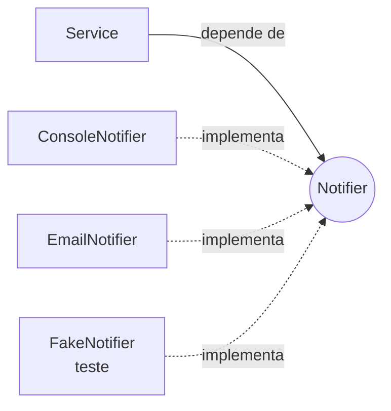

# J1.07 — Interfaces e composição vs herança

> ⏱️ ~1h30 · 🟢 Júnior · Pré-requisitos: J1.05, J1.06

## 🎯 Objetivos
Ao final desta aula você consegue:
- Declarar e implementar interfaces (métodos abstratos, `default` e `static`).
- Programar "para a interface" e injetar a dependência pelo construtor.
- Explicar composição ("tem um") e por que costuma ser preferível à herança.
- Usar uma interface funcional com lambda onde há um único método abstrato.
- Trocar implementações (console, e-mail, falso em teste) sem alterar quem as usa.

## 🤔 Por que isso importa
Este é o **alicerce da injeção de dependência** do Spring (J5) e dos testes com dublês (J7). Um `TransferService` que recebe um `Notifier` por interface funciona com e-mail em produção e com um falso no teste.

## 💡 Intuição (explicação simples)
Interface é a **tomada de parede**: define o formato do plugue. Qualquer aparelho que respeite o formato funciona, e quem projetou a casa não precisa saber qual aparelho será ligado. Composição é montar o carro com **peças que você escolhe** (motor, rodas) em vez de herdar de "Carro de corrida" e ficar preso às escolhas dele.

## 🔬 Como funciona por dentro
- Uma interface é um **contrato**: lista de métodos que o implementador deve oferecer. Uma classe pode implementar várias (`implements A, B`).
- Desde Java 8: métodos `default` (com corpo, herdáveis) e `static`. Servem para evoluir a interface sem quebrar implementações.
- **Interface funcional:** exatamente um método abstrato; pode ser escrita como **lambda** (detalhes em J1.13). A anotação `@FunctionalInterface` pede ao compilador que confira.
- **Composição:** a classe guarda outro objeto em um atributo e delega a ele. A dependência entra pelo construtor (injeção manual).



## 🛠️ Exemplo prático
> Testado com JDK 25.

```java
import java.util.List;

public class Composicao {
    interface Notifier {
        void send(String to, String msg);                           // abstrato
        default void sendAll(List<String> to, String msg) {          // com corpo
            to.forEach(x -> send(x, msg));
        }
    }
    static class Console implements Notifier {
        public void send(String to, String msg) { System.out.println("to " + to + ": " + msg); }
    }
    static class Service {
        private final Notifier notifier;                             // composição
        Service(Notifier n) { notifier = n; }                        // injeção pelo construtor
        void done() { notifier.sendAll(List.of("a", "b"), "ok"); }
    }

    public static void main(String[] args) {
        new Service(new Console()).done();
        new Service((to, msg) -> System.out.println("[lambda] " + to)).done();   // lambda como implementação
    }
}
```
Saída real:
```
to a: ok
to b: ok
[lambda] a
[lambda] b
```
`Service` não sabe quem é o `Notifier`. Esse é o conceito de **inversão de dependência**: o serviço depende da abstração, e quem monta a aplicação escolhe a peça concreta. Em J5 o Spring fará essa montagem por você.

### Herança vs composição, na prática
| | Herança | Composição |
|---|---|---|
| Relação | "é um" | "tem um" / "usa um" |
| Acoplamento | Alto (filho depende dos detalhes do pai) | Baixo (depende só do contrato) |
| Troca em execução | Não | Sim (injetar outro objeto) |
| Teste | Difícil de isolar | Fácil (injetar um falso) |

## 🧠 Pausa para lógica
**Enunciado:** `interface Clock { Instant now(); }` e um `Report` que escreve "gerado em <hora>". Como testar o relatório de forma determinística?

<details><summary>Dica</summary>Injete o relógio em vez de chamar `Instant.now()` direto.</details>
<details><summary>Solução</summary>

```java
class Report {
    private final java.time.Clock clock;
    Report(java.time.Clock clock) { this.clock = clock; }
    String header() { return "gerado em " + clock.instant(); }
}
// teste: new Report(Clock.fixed(Instant.parse("2026-11-12T10:00:00Z"), ZoneOffset.UTC)).header()
```
O `mini-bank` usa exatamente isto (`java.time.Clock`, J1.15).
</details>

**Variação:** por que `Clock.fixed` é melhor que dormir (`Thread.sleep`) até a hora desejada?

## ⚠️ Erros comuns e boas práticas de produção
- **Interface com um único implementador "para o futuro":** só crie quando houver motivo (testes, trocar tecnologia, fronteira entre módulos).
- **Interfaces gordas** com 15 métodos: quem implementa fica obrigado a tudo (*interface segregation*, P4).
- **`new` dentro da classe** (`this.notifier = new Console()`) trava o acoplamento e impede o teste.
- Erro de compilação típico: `X is not abstract and does not override abstract method send(String,String) in Notifier`.
- **Conflito de `default`** em duas interfaces com o mesmo método: o compilador exige que você escolha (`A.super.m()`).

## 🧩 Exercícios
1. **Fixação:** crie `interface Greeter { String greet(String name); }` e use como lambda: `name -> "Olá, " + name`.
2. **Aplicação no PayFlow (`mini-bank`):**
   - [ ] `interface StatementPrinter { void print(Account account); }` com implementação `ConsolePrinter`.
   - [ ] `Bank` ou `Main` recebe o `StatementPrinter` pelo construtor.
   - [ ] Uma segunda implementação (`CsvPrinter`, apenas gerando texto) sem mudar quem usa.
3. **Desafio (opcional):** converta `Fee` (J1.06) em interface `Fee` com `default String describe()`. Que vantagem e que desvantagem em relação à classe abstrata?

<details><summary>Solução de referência (desafio)</summary>

Vantagem: `Flat`/`Percent` podem implementar outras interfaces e `Fee` vira lambda (`amount -> ...`). Desvantagem: interface não guarda estado nem construtor; o `describe` precisa se apoiar só nos métodos da interface.
</details>

## 🎤 Na entrevista
- **Interface vs classe abstrata?** Interface é contrato (várias por classe, sem estado de instância); abstrata compartilha estado e implementação parcial (uma só). Prefira interface por padrão.
- **Por que "composição em vez de herança"?** Menos acoplamento, troca em execução e testes mais simples; herança expõe detalhes internos do pai.
- **O que é injeção de dependência?** Entregar a dependência pronta (construtor/parâmetro) em vez de a classe criá-la; é o que o Spring automatiza.

## 📚 Para ir além
- 📄 [Dev.java — Learn](https://dev.java/learn/): interfaces.
- 📖 *Effective Java* (Bloch): "Prefer interfaces to abstract classes".
- 🎥 ⚠️ Nenhum vídeo verificado nesta execução.

## ✅ Checklist da aula
- [ ] Implemento e uso interfaces com `default`.
- [ ] Injeto dependências pelo construtor.
- [ ] Explico composição vs herança com um exemplo.
- [ ] `StatementPrinter` no `mini-bank` com duas implementações.
