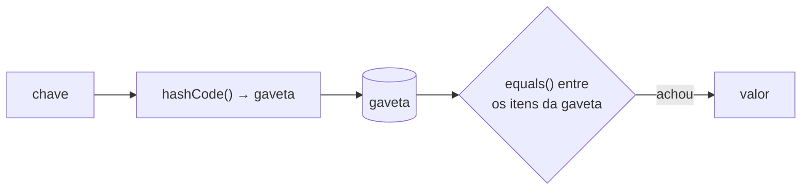

# J1.08 — `equals`, `hashCode` e `toString`

> ⏱️ ~1h30 · 🟢 Júnior · Pré-requisitos: J1.04, J1.05, J1.06

## 🎯 Objetivos
Ao final desta aula você consegue:
- Explicar a diferença entre identidade (`==`) e igualdade (`equals`).
- Implementar `equals` e `hashCode` coerentes entre si.
- Explicar o contrato entre `equals` e `hashCode` e o que quebra quando ele é violado.
- Escrever `toString` útil para logs.
- Escolher por qual atributo uma entidade é "igual" a outra (por exemplo, `id`).

## 🤔 Por que isso importa
`HashSet` e `HashMap` (J1.10 e J1.11) dependem desse contrato. Um `equals` sem `hashCode` faz o objeto "sumir" de um `Set`, e o bug é silencioso: nenhuma exceção, só dados errados. Em J5, as entidades JPA têm cuidados específicos com `equals`.

## 💡 Intuição (explicação simples)
Imagine um **fichário com gavetas** (o `HashMap`). O `hashCode` diz **em qual gaveta** procurar; o `equals` confere **qual pasta** dentro da gaveta é a certa. Se dois objetos "iguais" apontam para gavetas diferentes, você procura na gaveta errada e conclui que a pasta não existe.

## 🔬 Como funciona por dentro
Contrato (documentado em [`Object`](https://docs.oracle.com/en/java/javase/25/docs/api/java.base/java/lang/Object.html)):
1. **Reflexivo, simétrico, transitivo, consistente** e `x.equals(null)` é `false`.
2. **Se `a.equals(b)`, então `a.hashCode() == b.hashCode()`.** (O inverso não é obrigatório: colisões existem.)
3. O padrão de `Object.equals` é identidade (`==`) e o de `toString` é `NomeDaClasse@hash` (pouco útil).



## 🛠️ Exemplo prático
> Testado com JDK 25.

```java
import java.util.*;

public class Igualdade {
    static class Bad {                                    // equals SEM hashCode
        String id;
        Bad(String i) { id = i; }
        @Override public boolean equals(Object o) { return o instanceof Bad b && id.equals(b.id); }
    }
    static class Good {
        final String id;
        Good(String i) { id = i; }
        @Override public boolean equals(Object o) { return o instanceof Good g && id.equals(g.id); }
        @Override public int hashCode() { return Objects.hash(id); }
        @Override public String toString() { return "Good[" + id + "]"; }
    }

    public static void main(String[] args) {
        Set<Bad> s1 = new HashSet<>(); s1.add(new Bad("1"));
        System.out.println(s1.contains(new Bad("1")));                 // false!
        Set<Good> s2 = new HashSet<>(); s2.add(new Good("1"));
        System.out.println(s2.contains(new Good("1")) + " " + new Good("1"));
        System.out.println(new Object().toString().startsWith("java.lang.Object@"));
        System.out.println(new Bad("1").equals(null));
    }
}
```
Saída real:
```
false
true Good[1]
true
false
```
- `Bad` falha porque, sem `hashCode`, cada instância cai em uma gaveta diferente (hash de identidade) e o `equals` nunca é consultado.
- `o instanceof Good g && ...` já trata `null` (o `instanceof` com `null` é `false`) e faz o *cast*.
- `Objects.hash(...)` combina os campos; `Objects.equals(a, b)` compara com segurança de `null`.

### Aplicação no `Account`
```java
@Override public boolean equals(Object o) { return o instanceof Account other && id.equals(other.id); }
@Override public int hashCode() { return id.hashCode(); }
@Override public String toString() { return "Account[" + id + ", " + owner + ", " + balance + "]"; }
```
Duas `Account` são "a mesma" se têm o mesmo `id`, mesmo com saldos diferentes: **igualdade de entidade por identidade de negócio**. Já para valores como `Money` ou `Entry`, a igualdade é por **todos** os campos (os *records* da J1.14 geram isso sozinhos).

## 🧠 Pausa para lógica (`HashMap` por dentro)
**Enunciado:** um `HashMap` tem 16 gavetas e escolhe a gaveta por `hash % 16` (simplificação). Insira as chaves com hashes 3, 19, 35 e 4. Em que gavetas ficam e quantas colisões há?

<details><summary>Dica</summary>Calcule o resto da divisão por 16.</details>
<details><summary>Solução</summary>

3 → gaveta 3; 19 → 3; 35 → 3; 4 → 4. Três chaves colidem na gaveta 3 e são desambiguadas por `equals`. Com muitas colisões a busca degenera de O(1) para percorrer a lista da gaveta; por isso um bom `hashCode` espalha os valores. (A implementação real do `HashMap` usa um cálculo mais refinado e converte gavetas grandes em árvores; o princípio é o mesmo.)
</details>

**Variação:** o que acontece se o `hashCode` de uma chave **mudar** depois de inserida no `HashSet` (campo mutável)? Por quê?

## ⚠️ Erros comuns e boas práticas de produção
- **Sobrescrever só um** dos dois métodos.
- **Usar campo mutável no `hashCode`** de objeto que está em `HashSet`/chave de `HashMap`: ao mudar, o objeto fica "perdido" na gaveta antiga.
- **`equals(Bad other)`** em vez de `equals(Object)`: vira sobrecarga e não é chamado pelas coleções. `@Override` denuncia o erro.
- **`toString` com dados sensíveis** (senha, token, documento completo): ele vai parar em logs. Nunca inclua.
- **`toString` que percorre relações** (`User` → `Account` → `User` …) causa `StackOverflowError` (ciclo).
- Para dinheiro, use `compareTo` e não `equals` em `BigDecimal` (`2.0` ≠ `2.00`, J1.15).

## 🧩 Exercícios
1. **Fixação:** crie `Point(int x, int y)` com `equals`, `hashCode` e `toString`; coloque dois pontos iguais em um `HashSet` e confira `size() == 1`.
2. **Aplicação no PayFlow (`mini-bank`):**
   - [ ] `Account` com `equals`/`hashCode` por `id` e `toString` sem dados sensíveis.
   - [ ] Teste (rascunho, JUnit formal em J1.16): duas `Account` com o mesmo `id` são iguais; ids diferentes não são.
   - [ ] `Main` demonstra `new HashSet<>(List.of(a1, a1Copy)).size()`.
3. **Desafio (opcional):** implemente o `equals` de uma classe `Admin extends User`. O que acontece com a simetria se `User.equals` usar `instanceof User` e `Admin.equals` exigir `getClass()`?

<details><summary>Solução de referência (desafio)</summary>

`user.equals(admin)` retorna `true` (admin é `User`), mas `admin.equals(user)` retorna `false` (classes diferentes): viola a **simetria**. É uma razão para evitar herança em entidades (J1.07) ou usar `final`/`record`.
</details>

## 🎤 Na entrevista
- **Qual o contrato entre `equals` e `hashCode`?** Objetos iguais têm o mesmo hash; o inverso não é exigido. Violar isso quebra `HashMap`/`HashSet`.
- **Como funciona um `HashMap`?** O hash escolhe a gaveta; `equals` desambigua dentro dela; colisões têm custo extra.
- **Por que `hashCode` não deve usar campos mutáveis?** O objeto muda de gaveta e não é mais encontrado.

## 📚 Para ir além
- 📄 [Java SE 25 API — `Object`](https://docs.oracle.com/en/java/javase/25/docs/api/java.base/java/lang/Object.html): o contrato escrito por extenso.
- 📄 [Java SE 25 API — `HashMap`](https://docs.oracle.com/en/java/javase/25/docs/api/java.base/java/util/HashMap.html): desempenho e fator de carga.
- 📖 *Effective Java* (Bloch): itens sobre `equals`, `hashCode` e `toString`.
- 🎥 ⚠️ Nenhum vídeo verificado nesta execução.

## ✅ Checklist da aula
- [ ] Implemento `equals`/`hashCode` juntos.
- [ ] Explico a "gaveta" do `HashMap`.
- [ ] `Account` com igualdade por `id`.
- [ ] Meu `toString` não vaza dado sensível.
