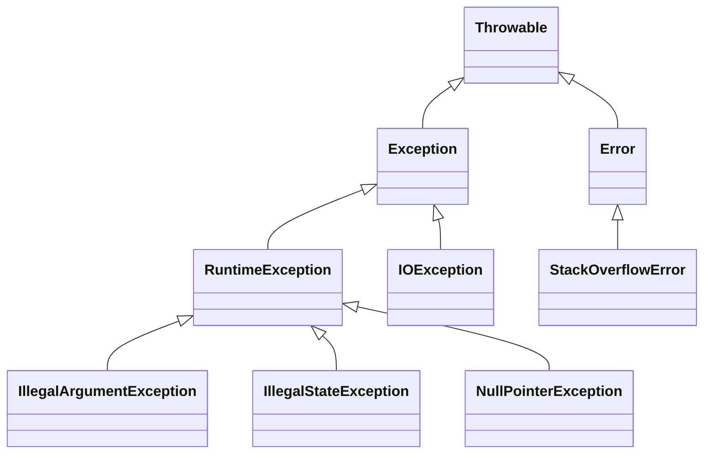

# J1.09 — Exceções (checked vs unchecked, try-with-resources)

> ⏱️ ~1h30 · 🟢 Júnior · Pré-requisitos: J0.06, J1.05, J1.07

## 🎯 Objetivos
Ao final desta aula você consegue:
- Lançar, capturar e propagar exceções com `throw`, `throws`, `try/catch/finally`.
- Distinguir *checked* (`Exception`) e *unchecked* (`RuntimeException`) e escolher entre elas.
- Criar uma exceção de negócio própria preservando a causa.
- Fechar recursos com `try-with-resources` (`AutoCloseable`).
- Evitar as armadilhas clássicas (engolir exceção, `catch (Exception)` genérico).

## 🤔 Por que isso importa
Erro é parte do fluxo normal de um sistema financeiro: saldo insuficiente, conta inexistente, arquivo ausente. Tratar com clareza decide se o cliente recebe uma resposta útil (J6) ou um stack trace, e se o time acha a causa em minutos ou horas (J0.06).

## 💡 Intuição (explicação simples)
Exceção é o **alarme de incêndio**: interrompe o que está acontecendo e sobe os andares até alguém com responsabilidade tratar. *Checked* é o alarme que o prédio **obriga** você a declarar no plano de evacuação (o compilador exige); *unchecked* é o que acontece por erro de uso (não faz sentido forçar todo mundo a declarar).

## 🔬 Como funciona por dentro

- **Checked** (`Exception` e filhas, exceto `RuntimeException`): o compilador obriga `catch` ou `throws`. Indica falha previsível fora do controle do código (I/O, rede). Ex.: `IOException`.
- **Unchecked** (`RuntimeException` e filhas): erro de programação ou violação de regra. Não exige declaração. Ex.: `IllegalArgumentException`, `NullPointerException`.
- **`Error`**: problema da JVM (memória, pilha); não se captura em código normal.
- `finally` sempre executa (exceto se a JVM terminar). `try-with-resources` fecha cada recurso `AutoCloseable` **em ordem inversa** à abertura, mesmo com exceção.
- Ao embrulhar, passe a causa (`new AppEx("msg", e)`) para o `Caused by` (J0.06).

## 🛠️ Exemplo prático
> Testado com JDK 25.

```java
import java.io.*;

public class Excecoes {
    static class Res implements AutoCloseable {
        final String n;
        Res(String n) { this.n = n; System.out.println("open " + n); }
        public void close() { System.out.println("close " + n); }
    }
    static class AppEx extends Exception {                       // checked, com causa
        AppEx(String m, Throwable c) { super(m, c); }
    }
    static void load() throws AppEx {
        try { Integer.parseInt("x"); }
        catch (NumberFormatException e) { throw new AppEx("config invalid", e); }
    }
    static int f() { try { return 1; } finally { System.out.println("finally"); } }

    public static void main(String[] args) {
        try (Res a = new Res("A"); Res b = new Res("B")) {
            System.out.println("work");
            throw new IllegalStateException("boom");
        } catch (IllegalStateException e) {
            System.out.println("caught " + e.getMessage());
        }
        try { load(); }
        catch (AppEx e) { System.out.println(e.getMessage() + " <- " + e.getCause().getClass().getSimpleName()); }
        System.out.println(f());
        try { Object o = "s"; Integer i = (Integer) o; }
        catch (ClassCastException | IllegalStateException e) { System.out.println("multi"); }
        try { new FileReader("nope.txt"); }
        catch (IOException e) { System.out.println(e.getClass().getSimpleName() + ": " + e.getMessage()); }
    }
}
```
Saída real:
```
open A
open B
work
close B
close A
caught boom
config invalid <- NumberFormatException
finally
1
multi
FileNotFoundException: nope.txt (No such file or directory)
```
- Os recursos são fechados **B, depois A**, e só então roda o `catch`.
- `finally` roda antes do `return` entregar o valor.
- O texto da mensagem de `FileNotFoundException` (`No such file or directory`) vem do sistema operacional e muda no Windows.

### Exceção de negócio do `mini-bank`
```java
public class InsufficientFundsException extends RuntimeException {
    public InsufficientFundsException(Money balance, Money requested) {
        super("Insufficient funds: balance=" + balance + ", requested=" + requested);
    }
}
```
É *unchecked* porque o chamador normalmente não consegue "recuperar" no mesmo ponto; a camada de cima (a API, em J6) a traduz em um erro 4xx. Mensagens e código em inglês (decisão do curso).

## 🧠 Pausa para lógica
**Enunciado:** `parseAmount(String s)` deve devolver o valor ou lançar `IllegalArgumentException` com a mensagem `"Invalid amount: <texto>"` para `"abc"`, `""` e `null`. Escreva usando `try/catch` só para o caso do formato.

<details><summary>Dica</summary>`new BigDecimal("abc")` lança `NumberFormatException`; `new BigDecimal(null)` lança `NullPointerException`.</details>
<details><summary>Solução</summary>

```java
static BigDecimal parseAmount(String s) {
    if (s == null || s.isBlank()) throw new IllegalArgumentException("Invalid amount: " + s);
    try { return new BigDecimal(s.strip()); }
    catch (NumberFormatException e) { throw new IllegalArgumentException("Invalid amount: " + s, e); }
}
```
Valide o que dá para validar **antes**; use `catch` para o que só o parser sabe.
</details>

**Variação:** por que não usar exceções para controlar o fluxo normal (por exemplo, `catch` para saber se uma conta existe)?

## ⚠️ Erros comuns e boas práticas de produção
- **Engolir:** `catch (Exception e) {}` esconde o problema (J0.06).
- **Perder a causa:** `throw new X(e.getMessage())` apaga o stack trace original. Passe `e` como causa.
- **`catch (Exception e)` genérico** captura até erros de programação. Capture o tipo mais específico possível.
- **Logar e relançar** a mesma exceção em várias camadas: log duplicado. Trate **ou** propague, em geral logando uma vez na borda.
- **Lançar `Exception`/`RuntimeException` crua:** a mensagem é o único sinal. Crie tipos com significado.
- **Esquecer de fechar recurso:** use sempre `try-with-resources`.
- Erro de compilação: `unreported exception java.io.IOException; must be caught or declared to be thrown`.

## 🧩 Exercícios
1. **Fixação:** sem rodar, diga o que imprime um método com `try { return "A"; } finally { System.out.println("B"); }`.
2. **Aplicação no PayFlow (`mini-bank`):**
   - [ ] `InsufficientFundsException` (unchecked) lançada por `Account.withdraw`.
   - [ ] `Bank.get(id)` lança `IllegalArgumentException("Account not found: <id>")` (versão com `Optional` na J1.14).
   - [ ] `Main` captura `InsufficientFundsException` e imprime a mensagem, sem `catch (Exception)`.
   - [ ] O saldo permanece o mesmo após a exceção.
3. **Desafio (opcional):** crie `ConfigException` checked que embrulha `IOException` ao ler um arquivo de configuração, preservando a causa.

<details><summary>Solução de referência (fixação)</summary>

Imprime `B` e então o chamador recebe `"A"`: o `finally` executa antes de o método devolver.
</details>

## 🎤 Na entrevista
- **Checked vs unchecked?** Checked: o compilador obriga tratar (falhas previsíveis de I/O). Unchecked: erros de programação ou regra, sem obrigação. Frameworks modernos preferem unchecked.
- **Para que serve `try-with-resources`?** Garante `close()` mesmo com exceção, em ordem inversa, sem `finally` manual.
- **`finally` sempre executa?** Sim, exceto se a JVM morrer (`System.exit`, falha fatal); evite `return` dentro de `finally`.

## 📚 Para ir além
- 📄 [Dev.java — Learn](https://dev.java/learn/): tratamento de exceções.
- 📄 [Java SE 25 API](https://docs.oracle.com/en/java/javase/25/docs/api/index.html): hierarquia de `Throwable`.
- 📖 *Effective Java* (Bloch): capítulo sobre exceções.
- 🎥 ⚠️ Nenhum vídeo verificado nesta execução.

## ✅ Checklist da aula
- [ ] Distingo checked e unchecked e escolho com critério.
- [ ] Uso `try-with-resources` e preservo a causa ao relançar.
- [ ] `InsufficientFundsException` implementada e testada manualmente.
- [ ] Nenhum `catch` vazio no meu código.
