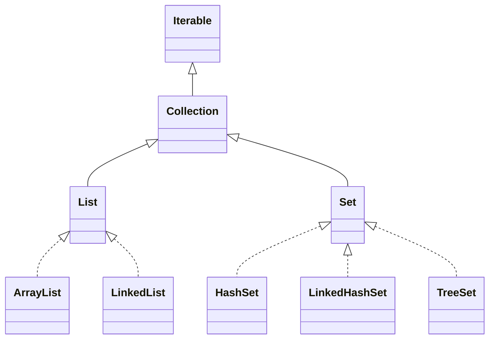

# J1.10 — Collections I: `List` e `Set`

> ⏱️ ~1h30 · 🟢 Júnior · Pré-requisitos: J1.04, J1.07, J1.08

## 🎯 Objetivos
Ao final desta aula você consegue:
- Usar `List` (`ArrayList`) e `Set` (`HashSet`, `LinkedHashSet`, `TreeSet`) e dizer o que cada um garante.
- Percorrer, buscar, remover e ordenar com segurança.
- Distinguir coleções mutáveis de imutáveis (`List.of`).
- Evitar `ConcurrentModificationException`.
- Detectar duplicidade com `Set` (O(1) em média).

## 🤔 Por que isso importa
O extrato é uma lista de lançamentos; o conjunto de ids já processados evita cobrar duas vezes. Escolher a coleção certa muda desempenho e corretude, e Spring Data devolve `List`/`Set`/`Page` em quase toda consulta.

## 💡 Intuição (explicação simples)
- **`List`** é uma **fila de compras escrita num caderno**: ordem importa, repetidos são permitidos, acessa-se pela posição.
- **`Set`** é um **conjunto de convidados**: ninguém aparece duas vezes e a pergunta é "esta pessoa está na lista?".

## 🔬 Como funciona por dentro

| Implementação | Ordem | Busca (`contains`) | Observação |
|---|---|---|---|
| `ArrayList` | inserção | O(n) | Array por baixo; acesso por índice O(1); o padrão para listas |
| `LinkedList` | inserção | O(n) | Raramente vale a pena; evite por padrão |
| `HashSet` | nenhuma | O(1) em média | Usa `hashCode`/`equals` (J1.08) |
| `LinkedHashSet` | inserção | O(1) | `HashSet` que lembra a ordem |
| `TreeSet` | ordenada | O(log n) | Exige `Comparable` ou `Comparator` |

`List.of(...)`/`Set.of(...)` criam coleções **imutáveis**: `add` lança `UnsupportedOperationException`. Programe pela interface: `List<String> l = new ArrayList<>();`.

## 🛠️ Exemplo prático
> Testado com JDK 25.

```java
import java.util.*;

public class ListSet {
    public static void main(String[] args) {
        List<String> l = new ArrayList<>(List.of("b", "a", "c"));
        l.add("a"); l.remove("b"); Collections.sort(l);
        System.out.println(l + " " + l.indexOf("c") + " " + l.contains("a"));
        try { List.of(1).add(2); } catch (UnsupportedOperationException e) { System.out.println("UOE"); }
        try { for (String s : l) if (s.equals("a")) l.remove(s); }       // remove durante o for-each
        catch (ConcurrentModificationException e) { System.out.println("CME"); }
        l.removeIf(s -> s.equals("a")); System.out.println(l);           // jeito certo

        Set<String> hs = new HashSet<>(List.of("x", "y", "x".repeat(1)));
        System.out.println(hs.size());
        Set<Integer> ts = new TreeSet<>(List.of(5, 1, 3)); System.out.println(ts);
        Set<String> lhs = new LinkedHashSet<>(); lhs.add("z"); lhs.add("a"); lhs.add("z"); System.out.println(lhs);

        List<String> ids = List.of("t1", "t2", "t1");
        Set<String> seen = new HashSet<>();
        for (String id : ids) if (!seen.add(id)) System.out.println("dup " + id);   // add devolve false se já existia

        List<Integer> nums = new ArrayList<>(List.of(10, 20, 30));
        nums.remove(Integer.valueOf(10)); nums.remove(0); System.out.println(nums);
    }
}
```
Saída real:
```
[a, a, c] 2 true
UOE
CME
[c]
2
[1, 3, 5]
[z, a]
dup t1
[30]
```
Leitura:
- `l` ficou `[a, a, c]`: o `"b"` saiu e o segundo `"a"` entrou. `List.of("b","a","c")` copiada em `ArrayList` é mutável.
- No `for-each`, remover o elemento `"a"` do meio e continuar o laço quebra o iterador (`ConcurrentModificationException`). Use `removeIf` ou um `Iterator` explícito.
- `nums.remove(Integer.valueOf(10))` remove **o valor** 10; `nums.remove(0)` remove **o índice** 0. `remove(int)` vs `remove(Object)` é uma armadilha clássica.
- `Set.add` devolve `false` quando o elemento já existe: a forma idiomática de detectar duplicidade.

## 🧠 Pausa para lógica
**Enunciado (detectar duplicidade em O(n)):** reescreva `hasDuplicate` da J1.04 usando `Set`. Qual a diferença de custo para 1 milhão de ids?

<details><summary>Dica</summary>`add` devolve `false` se o elemento já estava no conjunto.</details>
<details><summary>Solução</summary>

```java
static boolean hasDuplicate(List<String> ids) {
    Set<String> seen = new HashSet<>();
    for (String id : ids) if (!seen.add(id)) return true;
    return false;
}
```
Dois laços fazem ~n²/2 comparações (≈ 5×10¹¹ para 10⁶); o `Set` faz ~n inserções (≈ 10⁶). Troca-se memória (o `Set`) por tempo.
</details>

**Variação:** encontre **quais** ids estão duplicados (devolva um `Set<String>`).

## ⚠️ Erros comuns e boas práticas de produção
- **Modificar a coleção durante o `for-each`** → `java.util.ConcurrentModificationException` (veja no exemplo).
- **`remove(int)` vs `remove(Object)`** em `List<Integer>`.
- **Mudar o objeto depois de pô-lo num `HashSet`** quando o `hashCode` depende do campo alterado (J1.08).
- **Devolver a lista interna** da classe: devolva `List.copyOf(...)` ou `Collections.unmodifiableList(...)`.
- **Usar `LinkedList`** achando que "inserir é mais rápido": na prática `ArrayList` ganha na maioria dos casos.
- `UnsupportedOperationException` ao alterar uma lista que veio de `List.of` ou `stream().toList()`.
- Não assuma ordem em `HashSet`: ela pode mudar entre execuções e versões.

## 🧩 Exercícios
1. **Fixação:** dada `List<Integer> n = List.of(4, 8, 15, 16, 23, 42)`, produza uma nova lista só com os pares sem alterar a original.
2. **Aplicação no PayFlow (`mini-bank`):**
   - [ ] `Account` guarda os lançamentos em `List<Entry>` e `statement()` devolve uma **visão imutável**.
   - [ ] Em `Bank`, `Set<String>` de ids para impedir abrir duas contas com o mesmo id.
   - [ ] Confirme: `account.statement().clear()` lança `UnsupportedOperationException`.
3. **Desafio (opcional):** dadas duas listas de ids, calcule a interseção e a diferença usando `Set`.

<details><summary>Solução de referência</summary>

```java
List<Integer> evens = new ArrayList<>();
for (int x : n) if (x % 2 == 0) evens.add(x);          // 4, 8, 16, 42
// desafio
Set<String> inter = new HashSet<>(a); inter.retainAll(new HashSet<>(b));
Set<String> diff = new HashSet<>(a);  diff.removeAll(new HashSet<>(b));
```
</details>

## 🎤 Na entrevista
- **`ArrayList` vs `LinkedList`?** `ArrayList` usa array (acesso O(1) por índice, inserção no meio O(n)); `LinkedList` usa nós (inserção nas pontas O(1), acesso O(n)). Na prática, `ArrayList`.
- **Como `HashSet` evita duplicatas?** Usa `hashCode` para achar a gaveta e `equals` para confirmar.
- **Por que `ConcurrentModificationException` ocorre em uma só *thread*?** O iterador detecta que a coleção mudou fora dele (*fail-fast*).

## 📚 Para ir além
- 📄 [Dev.java — Learn](https://dev.java/learn/): *collections*.
- 📄 [Java SE 25 API — pacote `java.util`](https://docs.oracle.com/en/java/javase/25/docs/api/java.base/java/util/HashMap.html): `HashMap` (como `HashSet` é implementado) e irmãos na mesma página de pacote.
- 📖 *Effective Java* (Bloch): itens sobre coleções e programar pela interface.
- 🎥 ⚠️ Nenhum vídeo verificado nesta execução.

## ✅ Checklist da aula
- [ ] Escolho `List` vs `Set` pelo problema.
- [ ] Removo durante iteração com `removeIf`.
- [ ] `statement()` do `mini-bank` devolve visão imutável.
- [ ] Detecto duplicidade com `Set` em O(n).
