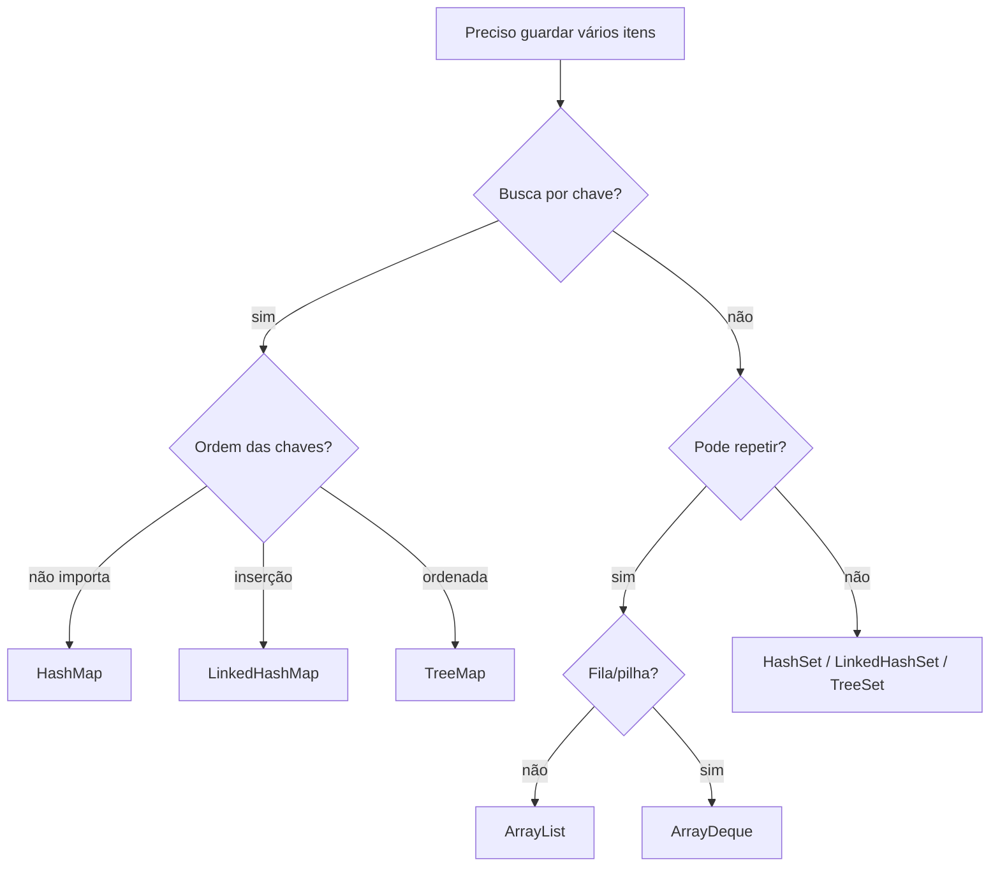

# J1.11 — Collections II: `Map`, `Queue` e como escolher

> ⏱️ ~1h30 · 🟢 Júnior · Pré-requisitos: J1.08, J1.10

## 🎯 Objetivos
Ao final desta aula você consegue:
- Usar `Map` (`HashMap`, `LinkedHashMap`, `TreeMap`) com `put`, `get`, `getOrDefault`, `merge`, `computeIfAbsent`.
- Percorrer um `Map` por `entrySet`.
- Usar `Deque`/`Queue` como pilha e fila e `PriorityQueue` por prioridade.
- Escolher a coleção certa para cada problema.
- Contar e agrupar elementos com `Map`.

## 🤔 Por que isso importa
"Buscar a conta pelo id" é um `Map`. "Processar as transferências na ordem de chegada" é uma fila. Contar ocorrências, agrupar por conta, manter um cache simples: tudo `Map`. Entender `HashMap` por dentro (J1.08) explica o desempenho que você verá mais tarde em cache (P2).

## 💡 Intuição (explicação simples)
- **`Map`** é um **dicionário**: você consulta pela palavra (chave) e obtém o significado (valor). Chaves não se repetem.
- **Fila** é a **fila do banco**: o primeiro a chegar é o primeiro atendido (FIFO).
- **Pilha** é a **pilha de pratos**: o último colocado é o primeiro retirado (LIFO).
- **`PriorityQueue`** é a **fila com senha preferencial**: quem tem maior prioridade sai primeiro.

## 🔬 Como funciona por dentro
| Estrutura | Quando usar | Custo típico |
|---|---|---|
| `HashMap` | busca por chave, sem ordem | `get`/`put` O(1) médio |
| `LinkedHashMap` | idem, lembrando ordem de inserção | O(1) |
| `TreeMap` | chaves ordenadas, faixas | O(log n) |
| `ArrayDeque` | pilha ou fila | O(1) nas pontas |
| `PriorityQueue` | sempre o menor (ou maior) primeiro | `offer`/`poll` O(log n) |

Escolher uma coleção:

Observação: `Map` **não** estende `Collection`; é uma hierarquia à parte. `HashMap` permite uma chave `null`; `Map.of` não.

## 🛠️ Exemplo prático
> Testado com JDK 25.

```java
import java.util.*;

public class Mapas {
    public static void main(String[] args) {
        Map<String, Integer> m = new HashMap<>();
        m.put("a", 1); m.put("a", 2);                 // sobrescreve
        m.putIfAbsent("b", 3);
        m.merge("a", 10, Integer::sum);               // a = 2 + 10
        System.out.println(new TreeMap<>(m) + " " + m.getOrDefault("z", 0) + " " + m.get("z"));

        Map<String, Integer> count = new TreeMap<>();
        for (String w : "a b a c b a".split(" ")) count.merge(w, 1, Integer::sum);
        System.out.println(count);
        for (Map.Entry<String, Integer> e : count.entrySet())
            System.out.print(e.getKey() + "=" + e.getValue() + ";");
        System.out.println();

        Map<String, List<String>> g = new TreeMap<>();
        g.computeIfAbsent("k", k -> new ArrayList<>()).add("v");
        System.out.println(g);

        Deque<Integer> st = new ArrayDeque<>(); st.push(1); st.push(2); System.out.println(st.pop());   // pilha
        Queue<String> q = new ArrayDeque<>(); q.offer("a"); q.offer("b"); System.out.println(q.poll() + q.peek()); // fila
        PriorityQueue<Integer> pq = new PriorityQueue<>(List.of(5, 1, 3)); System.out.println(pq.poll());
        System.out.println(Map.of("k", 1).get("k"));
        try { Map.of("k", 1, "k", 2); } catch (IllegalArgumentException e) { System.out.println(e.getMessage()); }
    }
}
```
Saída real:
```
{a=12, b=3} 0 null
{a=3, b=2, c=1}
a=3;b=2;c=1;
{k=[v]}
2
ab
1
1
duplicate key: k
```
Leitura:
- `get` de chave ausente devolve `null`; `getOrDefault` evita o NPE depois.
- `merge(chave, 1, Integer::sum)` é o idioma de **contagem**.
- `computeIfAbsent` é o idioma de **agrupar** (cria a lista na primeira vez).
- Pilha: `push`/`pop`; fila: `offer`/`poll`/`peek`. `poll` devolve `null` se vazia (já `remove` lança exceção).
- `HashMap` e `Set` não garantem ordem; por isso o exemplo usou `TreeMap` para imprimir de modo previsível.

## 🧠 Pausa para lógica
**Enunciado (cache de saldo com limite):** implemente um cache LRU simples que mantém no máximo 3 contas, descartando a **menos recentemente usada**. Dica: `LinkedHashMap` tem esse recurso.

<details><summary>Dica</summary>Construtor `new LinkedHashMap<>(16, 0.75f, true)` (ordem de acesso) e sobrescreva `removeEldestEntry`.</details>
<details><summary>Solução</summary>

```java
class Lru<K, V> extends LinkedHashMap<K, V> {
    private final int max;
    Lru(int max) { super(16, 0.75f, true); this.max = max; }
    @Override protected boolean removeEldestEntry(Map.Entry<K, V> eldest) { return size() > max; }
}
// put 1,2,3; get 1; put 4 → sai o 2
```
Em P2 você verá cache com Redis e Caffeine; o princípio é o mesmo.
</details>

**Variação:** troque por `PriorityQueue` para processar transferências por valor decrescente (`Comparator.reverseOrder()`).

## ⚠️ Erros comuns e boas práticas de produção
- **NPE por `map.get(k)` seguido de uso direto** (J0.06): trate `null` ou use `getOrDefault`.
- **Chave mutável** (cuja `hashCode` muda): o valor "some" (J1.08).
- **Iterar e remover**: use `entrySet().removeIf(...)` ou `values().removeIf(...)`.
- **Assumir ordem em `HashMap`**.
- **`Map.of` com chave repetida** lança `IllegalArgumentException: duplicate key: k`.
- **Estruturas não *thread-safe*:** `HashMap` com várias *threads* corrompe dados; o pleno vê `ConcurrentHashMap` (P1).
- **`Stack`/`Vector`/`Hashtable`:** são legados; prefira `ArrayDeque`/`ArrayList`/`HashMap`.

## 🧩 Exercícios
1. **Fixação:** conte a frequência das palavras de `"to be or not to be"` e imprima em ordem alfabética.
2. **Aplicação no PayFlow (`mini-bank`):**
   - [ ] `Bank` guarda contas em `Map<String, Account>` (`LinkedHashMap`, para listar na ordem de abertura).
   - [ ] `Bank.open` rejeita id repetido com `IllegalArgumentException("Account already exists: <id>")`.
   - [ ] Fila de saques pendentes (`Queue<PendingWithdrawal>`) processada em ordem de chegada no `Main`.
3. **Desafio (opcional):** agrupe uma lista de `Entry` por tipo (`DEPOSIT`/`WITHDRAWAL`) usando `computeIfAbsent`.

<details><summary>Solução de referência (fixação)</summary>

```java
Map<String, Integer> f = new TreeMap<>();
for (String w : "to be or not to be".split(" ")) f.merge(w, 1, Integer::sum);
System.out.println(f);   // {be=2, not=1, or=1, to=2}
```
</details>

## 🎤 Na entrevista
- **Como funciona um `HashMap`?** (Resposta da J1.08: hash escolhe a gaveta, `equals` desambigua, colisões custam.) E acrescente: quando a tabela enche (fator de carga), ela **cresce** e redistribui.
- **`HashMap` vs `TreeMap`?** O primeiro dá O(1) sem ordem; o segundo dá O(log n) com chaves ordenadas e operações por faixa.
- **Quando usar `Queue` e quando `Stack`?** Fila para ordem de chegada (FIFO); pilha para desfazer/recursão (LIFO).

## 📚 Para ir além
- 📄 [Java SE 25 API — `HashMap`](https://docs.oracle.com/en/java/javase/25/docs/api/java.base/java/util/HashMap.html): desempenho e fator de carga.
- 📄 [Dev.java — Learn](https://dev.java/learn/): trilha de coleções.
- 📖 *Effective Java* (Bloch): coleções e escolha de interface.
- 🎥 ⚠️ Nenhum vídeo verificado nesta execução.

## ✅ Checklist da aula
- [ ] Uso `merge` e `computeIfAbsent`.
- [ ] Escolho a coleção com o fluxograma.
- [ ] `Bank` usa `LinkedHashMap` e valida id repetido.
- [ ] Sei a diferença entre pilha e fila.
