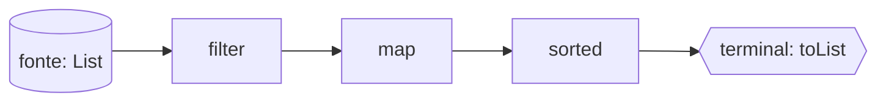

# J1.13 — Lambdas e Streams

> ⏱️ ~1h30 · 🟢 Júnior · Pré-requisitos: J1.07, J1.10 a J1.12

## 🎯 Objetivos
Ao final desta aula você consegue:
- Escrever lambdas e referências de método (`Tx::amount`) e identificar a interface funcional correspondente.
- Montar *pipelines* de `Stream` com `filter`, `map`, `sorted`, `distinct`, `reduce`.
- Coletar resultados com `Collectors` (`toList`, `groupingBy`, `counting`, `toMap`, `joining`).
- Explicar que um `Stream` é **preguiçoso** e de **uso único**.
- Saber quando um laço `for` é mais claro que um *stream*.

## 🤔 Por que isso importa
Extrato por tipo, total por conta, ids sem duplicatas: operações sobre coleções são o coração do dia a dia. Streams também aparecem em Spring Data, em testes (AssertJ) e em código de colegas. Mas legibilidade vem primeiro: um *stream* de 12 linhas aninhadas é pior que um laço claro.

## 💡 Intuição (explicação simples)
Um *stream* é uma **esteira de fábrica**: os itens passam por estações (filtrar, transformar, agrupar) e no fim alguém empacota o resultado. A esteira só **liga** quando há uma estação final (*terminal*); sem ela, nada anda. E uma esteira roda uma vez só.

## 🔬 Como funciona por dentro
- **Interfaces funcionais** (pacote `java.util.function`): `Function<T,R>` (transforma), `Predicate<T>` (testa), `Supplier<T>` (produz), `Consumer<T>` (consome), `BiFunction`, `UnaryOperator`…
- **Lambda:** `x -> x * 2`; **referência de método:** `Integer::sum`, `Tx::amount`, `String::isEmpty`.
- **Operações intermediárias** (devolvem `Stream`, preguiçosas): `filter`, `map`, `sorted`, `distinct`, `limit`.
- **Operações terminais** (disparam o processamento): `toList`, `collect`, `reduce`, `count`, `anyMatch`, `forEach`.
- Variáveis locais capturadas pela lambda precisam ser **efetivamente finais** (não reatribuídas).
- *Streams* **não alteram** a fonte e **não podem ser reutilizados**.



## 🛠️ Exemplo prático
> Testado com JDK 25.

```java
import java.math.BigDecimal;
import java.util.*;
import java.util.function.*;
import java.util.stream.*;

public class Streams {
    record Tx(String account, String type, BigDecimal amount) {}

    public static void main(String[] args) {
        List<Tx> txs = List.of(
            new Tx("A", "DEP", new BigDecimal("100.00")),
            new Tx("A", "WD",  new BigDecimal("30.00")),
            new Tx("B", "DEP", new BigDecimal("50.00")));

        Function<Integer, Integer> dbl = x -> x * 2;
        Predicate<String> empty = String::isEmpty;
        Supplier<String> sup = () -> "s";
        BiFunction<Integer, Integer, Integer> add = Integer::sum;
        System.out.println(dbl.apply(4) + " " + empty.test("") + sup.get() + add.apply(1, 2));

        System.out.println(txs.stream().filter(t -> t.type().equals("DEP"))
            .map(Tx::amount).reduce(BigDecimal.ZERO, BigDecimal::add));

        Map<String, Long> countByAccount = txs.stream()
            .collect(Collectors.groupingBy(Tx::account, TreeMap::new, Collectors.counting()));
        System.out.println(countByAccount);

        Map<String, List<String>> typesByAccount = txs.stream()
            .collect(Collectors.groupingBy(Tx::account, TreeMap::new,
                     Collectors.mapping(Tx::type, Collectors.toList())));
        System.out.println(typesByAccount);

        System.out.println(txs.stream().map(Tx::account).distinct().sorted(Comparator.reverseOrder()).toList());
        System.out.println(txs.stream().anyMatch(t -> t.amount().compareTo(new BigDecimal("90")) > 0));
        System.out.println(IntStream.rangeClosed(1, 5).sum() + " " + txs.stream().max(Comparator.comparing(Tx::amount)).get());

        Stream<Integer> s = Stream.of(1, 2); s.toList();
        try { s.toList(); } catch (IllegalStateException e) { System.out.println(e.getMessage()); }

        Map<String, BigDecimal> totalByAccount = txs.stream()
            .collect(Collectors.toMap(Tx::account, Tx::amount, BigDecimal::add, TreeMap::new));
        System.out.println(totalByAccount);
        System.out.println(Stream.iterate(1, x -> x * 2).limit(5).map(String::valueOf).collect(Collectors.joining(",")));
    }
}
```
Saída real:
```
8 trues3
150.00
{A=2, B=1}
{A=[DEP, WD], B=[DEP]}
[B, A]
true
15 Tx[account=A, type=DEP, amount=100.00]
stream has already been operated upon or closed
{A=130.00, B=50.00}
1,2,4,8,16
```
Leitura:
- Soma de dinheiro com `reduce(BigDecimal.ZERO, BigDecimal::add)`: **nunca** `mapToDouble`.
- `toMap` com função de *merge* (`BigDecimal::add`) soma valores de chaves repetidas; sem ela, chave repetida lança `IllegalStateException: Duplicate key`.
- Reutilizar o `Stream` lança `IllegalStateException: stream has already been operated upon or closed`.
- `Stream.toList()` devolve lista **imutável** (diferente de `collect(Collectors.toList())`, que é mutável por padrão da implementação, mas sem garantia).
- Dica de compilação: aninhar `collect(... TreeMap::new ...)` direto dentro de `System.out.println(...)` pode quebrar a inferência de tipos (`method println ... cannot be applied to given types`). Guarde em uma variável tipada (`Map<String, Long>`), como acima.

## 🧠 Pausa para lógica
**Enunciado:** dado o extrato `List<Tx>`, calcule o **saldo por conta** (depósitos somam, saques subtraem) com um *stream*.

<details><summary>Dica</summary>`toMap` com a chave da conta e um valor que depende do tipo; merge com `BigDecimal::add`.</details>
<details><summary>Solução</summary>

```java
Map<String, BigDecimal> balance = txs.stream().collect(Collectors.toMap(
    Tx::account,
    t -> t.type().equals("DEP") ? t.amount() : t.amount().negate(),
    BigDecimal::add,
    TreeMap::new));
// {A=70.00, B=50.00}
```
</details>

**Variação:** reescreva com um `for` e `Map.merge`. Qual ficou mais legível para você?

## ⚠️ Erros comuns e boas práticas de produção
- **Lambda com efeito colateral** em `map`/`filter` (alterar lista externa): bugs sutis. *Streams* devem ser funcionais.
- **Reusar o `Stream`** (veja a exceção acima).
- **Ignorar o retorno:** `list.stream().map(...)` sem terminal não faz nada.
- **Stream gigantesco e ilegível:** extraia métodos nomeados ou use um `for`.
- **Streams paralelos** (`parallelStream`) sem medir: quase sempre piora; deixe para P1/S2.
- **`Optional.get()`** de `max`/`findFirst` sem checar (J1.14).
- Erro típico: `local variables referenced from a lambda expression must be final or effectively final`.

## 🧩 Exercícios
1. **Fixação:** de `List<String>` com nomes, devolva em maiúsculas, sem repetidos e em ordem alfabética.
2. **Aplicação no PayFlow (`mini-bank`):**
   - [ ] `Statement`/`Account` ganha `Money totalDeposits()` e `Money totalWithdrawals()` via `stream` + `reduce`.
   - [ ] `Bank.accountsOf(String owner)` devolve `List<Account>` com `filter`.
   - [ ] Sem `double` e sem `forEach` com efeito colateral.
3. **Desafio (opcional):** agrupe o extrato por **mês** (`java.time`, J1.15) e some os valores.

<details><summary>Solução de referência (fixação)</summary>

```java
names.stream().map(String::toUpperCase).distinct().sorted().toList();
```
</details>

## 🎤 Na entrevista
- **O que é um `Stream` e por que é preguiçoso?** Pipeline de operações sobre uma fonte; só executa quando há operação terminal, o que permite otimizações (parar cedo com `limit`/`anyMatch`).
- **`map` vs `flatMap`?** `map` transforma 1→1; `flatMap` transforma 1→N e "achata" os resultados.
- **Quando evitar streams?** Lógica com muitos efeitos colaterais, depuração difícil ou ganho de legibilidade zero.

## 📚 Para ir além
- 📄 [Java SE 25 API — pacote `java.util.stream`](https://docs.oracle.com/en/java/javase/25/docs/api/java.base/java/util/stream/package-summary.html): visão geral oficial (operações, *laziness*, redução).
- 📄 [Dev.java — Learn](https://dev.java/learn/): lambdas e streams.
- 📖 *Effective Java* (Bloch): capítulo sobre lambdas e streams.
- 🎥 ⚠️ Nenhum vídeo verificado nesta execução.

## ✅ Checklist da aula
- [ ] Escrevo lambdas e referências de método.
- [ ] Monto pipelines com `filter`/`map`/`collect`.
- [ ] Somo dinheiro com `BigDecimal` e `reduce`.
- [ ] Sei por que um `Stream` não se reutiliza.
