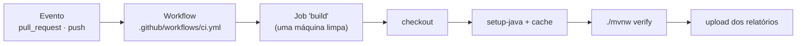

# J10.01 — GitHub Actions: build e testes por pull request

> ⏱️ ~1h30 · 🟢 Júnior · Pré-requisitos: J0.04 e J0.05 (Git, branch e pull request), J7.01 a J7.09 (suíte, JaCoCo, Checkstyle, SpotBugs, Conventional Commits), J9.02 (o `Dockerfile` roda com `-DskipTests`: o CI é quem testa)

> ⚠️ **Verificação:** o **GitHub Actions de verdade não foi executado** (não há repositório do aluno aqui, e rodar workflows publicaria código). Foram executados: o `./mvnw -B -ntp verify` do `lab/ci-lab` (JDK 25.0.5, Maven Wrapper 3.9.12: 4 testes, Testcontainers com `postgres:18`, JaCoCo, **BUILD SUCCESS em 10,9 s** na máquina do autor), um build **quebrado de propósito**, o `actionlint 1.7.12` (sobre os quatro workflows e sobre um workflow ruim) e o `check-pr-title.sh`. Versões das *actions* e do *runner* vêm das páginas oficiais, conferidas em 2026-11-13. O que o Actions faz **na nuvem** (cache, artefatos, status na PR) está descrito pela documentação, não observado.

## 🎯 Objetivos
Ao final desta aula você consegue:
- **Explicar** o que é integração contínua (CI) e **ler** a anatomia de um workflow (evento, job, *runner*, passo, *action*).
- **Escrever** um workflow que compila e testa o PayFlow a cada *pull request* e a cada `push` na `main`.
- **Restringir** o `GITHUB_TOKEN` (`permissions`), cancelar execuções repetidas (`concurrency`) e limitar o tempo (`timeout-minutes`).
- **Tornar o CI obrigatório** (*ruleset*/proteção de branch) e **validar o título da PR** (Conventional Commits) sem abrir uma brecha de *script injection*.

## 🤔 Por que isso importa
Até a J9, "está pronto" significava "passou **na minha máquina**". A J7 criou uma suíte e portões de qualidade (JaCoCo, Checkstyle, SpotBugs), mas ela só vale se alguém **lembrar de rodar** e se rodar em um ambiente igual para todos. A integração contínua roda o mesmo `./mvnw verify` **em uma máquina limpa, a cada mudança**, e **bloqueia o merge** se falhar. Em uma entrevista de júnior, "como é o CI do projeto?" é pergunta comum; no dia a dia, é o que impede a `main` de quebrar às 17h de sexta.

## 💡 Intuição (explicação simples)
Pense no **portão de embarque do aeroporto**: não importa o que você jurou sobre a mala em casa; ela passa pelo mesmo raio-X, **toda vez**, e quem falha não embarca. O workflow é o raio-X; a PR é a mala; o *ruleset* é a regra "sem raio-X verde, sem embarque".

## 🔬 Como funciona por dentro

### 1. Anatomia

| Peça | O que é | No `ci.yml` |
|---|---|---|
| **Workflow** | Arquivo YAML em `.github/workflows/` | `ci.yml` |
| **Evento** (`on`) | O que dispara | `pull_request`, `push` na `main`, `workflow_call` |
| **Job** | Conjunto de passos em **uma** máquina; jobs rodam em paralelo, salvo `needs` | `build` |
| **Runner** (`runs-on`) | A máquina (VM) descartável | `ubuntu-24.04` |
| **Passo** (`steps`) | Um comando (`run`) ou uma *action* (`uses`) | `checkout`, `setup-java`, `verify` |
| **Action** | Passo reutilizável publicado em um repositório (`dono/repo@versão`) | `actions/checkout`, `actions/setup-java` |

Cada execução começa de uma **VM nova**: nada do passo anterior da *execução* anterior existe (por isso há cache, J10.02). O repositório **não** vem baixado: o `actions/checkout` o faz.

### 2. O que o *runner* tem
O repositório `actions/runner-images` lista o que há na imagem `ubuntu-24.04` (imagem `20261111.370.1`, conferida): **Docker 28.0.4** (cliente e servidor), Compose 2.38.2, Git 2.56.1, Java 8, 11, 17 (padrão), 21 e **25.0.5**, **Maven 3.10.0**, Node 22. Duas consequências:
1. **Testcontainers funciona** no runner (Docker já está lá): é o mesmo `@PayflowTest` da J7, sem serviço extra.
2. O Maven do runner (**3.10.0**) **não é** o da sua máquina e do `Dockerfile` (**3.9.12**). Para "o mesmo build em todo lugar", use o **Maven Wrapper**: um script `mvnw` versionado no repositório que baixa a versão fixada em `.mvn/wrapper/maven-wrapper.properties`. Isso entra no PayFlow (exercício).

> `ubuntu-latest` hoje aponta para o Ubuntu 24.04, mas o README do repositório avisa que o `-latest` **muda** quando uma versão nova vira GA (com anúncio prévio). O treinamento fixa `ubuntu-24.04`: o build não muda sozinho num dia qualquer. A imagem `ubuntu-26.04` já existe; migre **de propósito**, numa PR.

### 3. Segurança por padrão: três linhas que valem ouro
```yaml
permissions:
  contents: read                  # o GITHUB_TOKEN so le o codigo
concurrency:
  group: ci-${{ github.workflow }}-${{ github.ref }}
  cancel-in-progress: ${{ github.event_name == 'pull_request' }}
# e no job:  timeout-minutes: 20
```
- **`permissions`:** o `GITHUB_TOKEN` é uma credencial que o Actions cria a cada execução. Sem a linha, ele herda o padrão do repositório (que pode ser amplo). Com `contents: read`, um passo malicioso (ou uma *action* comprometida) **não consegue** dar `push` nem abrir issue. Peça mais **por job**, só onde precisa (J10.06 pede `id-token: write` só nos jobs de deploy).
- **`concurrency`:** se você faz três `push` seguidos numa PR, só a última execução importa; as anteriores são canceladas (economiza minutos). **Na `main` não cancele** (`cancel-in-progress` só em `pull_request`).
- **`timeout-minutes`:** o padrão de um job é **360 minutos**; um teste travado gastaria seis horas da sua cota. Um limite de 20 já denuncia o problema.

### 4. Obrigar o CI: *ruleset*
Um workflow que ninguém é **obrigado** a respeitar é decoração. No GitHub: *Settings → Rules → Rulesets* (a documentação: "About rulesets"): ruleset para a branch `main` com **Require a pull request before merging** e **Require status checks to pass** (escolha o *check* `build, test and quality gates`: o nome do **job**, não do arquivo). Assim, `push` direto na `main` e merge com CI vermelho ficam **bloqueados**. Detalhe do ambiente: o check só aparece na lista depois de **ter rodado uma vez**.

## 🛠️ Exemplo prático

### 1. O workflow `ci.yml` (do `lab/ci-lab`, validado por `actionlint`)
```yaml
name: CI

on:
  pull_request:
  push:
    branches: [main]
  workflow_call:          # o cd.yml reaproveita este workflow como portao antes do deploy

permissions:
  contents: read          # minimo: o GITHUB_TOKEN so le o codigo

concurrency:
  group: ci-${{ github.workflow }}-${{ github.ref }}
  cancel-in-progress: ${{ github.event_name == 'pull_request' }}

jobs:
  build:
    name: build, test and quality gates
    runs-on: ubuntu-24.04          # fixo; "ubuntu-latest" muda de versao sem voce pedir
    timeout-minutes: 20
    steps:
      - uses: actions/checkout@3d3c42e5aac5ba805825da76410c181273ba90b1 # v7.0.1
        with:
          persist-credentials: false

      - uses: actions/setup-java@77dd5b2ce225ea11469928ac317850245a74ae78 # v6.2.0
        with:
          distribution: temurin
          java-version: '25'
          cache: maven              # chave = hash dos pom.xml; restaura ~/.m2

      - name: Verify (compile, tests with Testcontainers, JaCoCo gate)
        run: ./mvnw -B -ntp verify

      - name: Coverage summary
        if: ${{ !cancelled() }}
        run: python3 scripts/ci/coverage-summary.py target/site/jacoco/jacoco.csv >> "$GITHUB_STEP_SUMMARY"

      - name: Upload reports
        if: ${{ !cancelled() }}
        uses: actions/upload-artifact@cf430e030ddbb5b0abf93d22962f4752f3646cd9 # v7.0.2
        with:
          name: reports
          path: |
            target/surefire-reports/
            target/site/jacoco/
          retention-days: 7
          if-no-files-found: warn
```
Pontos:
- As *actions* estão fixadas pelo **SHA do commit** (com a versão no comentário), não por `@v7`. Uma *tag* pode ser movida por quem controla o repositório da *action*; o SHA não. Explicação e tabela completa na J10.02.
- `persist-credentials: false`: o `checkout` não deixa o token gravado no `.git/config` (não há `push` neste job).
- `cache: maven` (J10.02) restaura o `~/.m2`. O `workflow_call` deixa o `cd.yml` (J10.06) **reusar** este workflow como portão: o deploy só começa depois dele.
- `if: ${{ !cancelled() }}` nos passos de relatório: eles rodam **também quando os testes falham**, que é quando você mais precisa deles.

### 2. O Maven Wrapper (uma vez, no PayFlow)
```bash
export JAVA_HOME=/usr/lib/jvm/java-25-openjdk-amd64
mvn wrapper:wrapper -Dmaven=3.9.12          # gera mvnw, mvnw.cmd e .mvn/wrapper/maven-wrapper.properties
cat .mvn/wrapper/maven-wrapper.properties
```
```text
wrapperVersion=3.3.4
distributionType=only-script
distributionUrl=https://repo.maven.apache.org/maven2/org/apache/maven/apache-maven/3.9.12/apache-maven-3.9.12-bin.zip
```
Faça *commit* dos três arquivos (`mvnw` com permissão de execução: `git update-index --chmod=+x mvnw` se o sistema de arquivos não a guardar). Daqui em diante, **`./mvnw`** no lugar de `mvn`.

### 3. Rodando o mesmo comando do CI na sua máquina
```bash
cd lab/ci-lab && ./mvnw -B -ntp verify      # -B: sem cores/progresso; -ntp: sem log de download
```
```text
[INFO] Tests run: 2, Failures: 0, Errors: 0, Skipped: 0 ... -- in com.payflow.lite.AccountsApiTest
[INFO] Tests run: 2, Failures: 0, Errors: 0, Skipped: 0 ... -- in com.payflow.lite.config.PayflowPropertiesTest
[INFO] Tests run: 4, Failures: 0, Errors: 0, Skipped: 0
[INFO] Analyzed bundle 'payflow-lite' with 8 classes
[INFO] BUILD SUCCESS            (10,9 s, com o PostgreSQL 18 do Testcontainers já baixado)
```
**Regra de ouro do CI: o que o CI roda, você consegue rodar igual.** Se o workflow tiver um comando que só existe lá, depurar vira adivinhação.

### 4. O CI vermelho (medido)
Mudei de propósito a mensagem esperada de um teste (`"at least 32 bytes"` → `"pelo menos 32 bytes"`). A saída, que é exatamente o que o Actions mostra no log do passo:
```text
[ERROR] Tests run: 2, Failures: 1, Errors: 0, Skipped: 0 ... <<< FAILURE! -- in com.payflow.lite.config.PayflowPropertiesTest
[ERROR] PayflowPropertiesTest.rejectsAJwtSecretShorterThan32Bytes:13
Expecting throwable message: ... to contain: ...
[INFO] BUILD FAILURE            (código de saída 1)
```
O Actions só olha o **código de saída**: `0` = passo verde; qualquer outro = vermelho, os passos seguintes são pulados (exceto os com `if: ${{ !cancelled() }}`/`always()`), e a PR mostra ✗ no *check*.

### 5. Título da PR em Conventional Commits (e a brecha que ele ensina)
`.github/workflows/pr-title.yml` (J7.09 prometeu esta checagem no CI):
```yaml
name: PR title

on:
  pull_request:
    types: [opened, edited, synchronize, reopened]

permissions:
  contents: read

jobs:
  conventional-commits:
    runs-on: ubuntu-24.04
    timeout-minutes: 2
    steps:
      - uses: actions/checkout@3d3c42e5aac5ba805825da76410c181273ba90b1 # v7.0.1
        with:
          persist-credentials: false
      - name: Check the title (Conventional Commits)
        env:
          PR_TITLE: ${{ github.event.pull_request.title }}    # dado do usuario: SEMPRE por env, nunca inline no run
        run: bash scripts/ci/check-pr-title.sh "$PR_TITLE"
```
`scripts/ci/check-pr-title.sh` (a mesma expressão do *hook* `commit-msg` da J7.09):
```bash
#!/usr/bin/env bash
# Valida o titulo da PR contra Conventional Commits (a mesma regex do hook da J7.09).
set -Eeuo pipefail
title="${1:-}"
pattern='^(feat|fix|docs|style|refactor|perf|test|build|ci|chore|revert)(\([a-z0-9._-]+\))?!?: .{1,72}$'
if [[ "$title" =~ $pattern ]]; then
  echo "ok: title follows Conventional Commits"
else
  echo "error: PR title must look like 'feat(scope): short description' (got a title that does not match)" >&2
  exit 1
fi
```
Medido:
```text
feat(api): add transfers  -> ok: title follows Conventional Commits
fix: x                    -> ok: title follows Conventional Commits
Add stuff                 -> error: PR title must look like 'feat(scope): short description' ...
feat(API): x              -> error: ... (escopo em maiúsculas não passa)
```
**Por que o título vai por `env:` e não direto no `run:`?** Porque `${{ ... }}` é **substituição de texto antes de o shell rodar**. O título da PR é escrito por **qualquer pessoa** que abra uma PR. Se o `run:` fosse `bash check.sh "${{ github.event.pull_request.title }}"` e o título fosse `x"; echo PWNED; echo "`, o shell receberia:
```text
bash check.sh "x"; echo PWNED; echo ""
```
Reproduzi a expansão no terminal: o `echo PWNED` **executa**. Em um workflow real, no lugar do `echo` entraria algo que lê segredos. É a **injeção de script** da documentação de segurança do Actions. A defesa: o valor entra por **variável de ambiente** (`env:`) e o script o usa como **dado** (`"$PR_TITLE"`). O `actionlint` pega o erro: ao analisar um workflow com `run: echo "${{ github.event.pull_request.title }}"`, ele respondeu `"github.event.pull_request.title" is potentially untrusted. avoid using it directly in inline scripts. instead, pass it through an environment variable.`

## 🧠 Pausa para lógica
**Enunciado:** o `concurrency` usa `group: ci-${{ github.workflow }}-${{ github.ref }}`. Duas PRs diferentes (refs `refs/pull/10/merge` e `refs/pull/11/merge`) cancelam uma à outra? E dois `push` seguidos na `main` com `cancel-in-progress: false`: o que acontece?
<details><summary>Dica</summary>O que define "a mesma fila" é o texto do `group`. Compare os dois textos.</details>
<details><summary>Solução</summary>

Não cancelam: os `group` são **diferentes** (`...refs/pull/10/merge` × `...refs/pull/11/merge`), cada PR tem a sua fila. Dois `push` na `main` compartilham o `group`; sem cancelamento, o GitHub deixa **uma** execução rodando e **uma** pendente: se chegar uma terceira, a pendente é cancelada e **substituída** pela mais nova (comportamento `queue: single` descrito na página `workflow-syntax`). Variação: o que muda se o `group` for só `ci`? Todas as PRs disputariam a mesma fila.
</details>

## ⚖️ Trade-offs e quando NÃO usar (resumo)
CI hospedado é o ponto de partida mais simples, mas: (1) **custa minutos** em repositório privado (J10.02); (2) é um serviço de terceiro: um *outage* do GitHub para o seu time; (3) `runs-on: self-hosted` dá controle e custo próprio, mas **você** passa a manter e proteger a máquina (nunca em repositório público que aceita PR de estranhos). Alternativas de mesmo papel: GitLab CI, Jenkins, CircleCI, Azure Pipelines (tabela na J10.07).

## ⚠️ Erros comuns e boas práticas de produção
| Sintoma | Causa | Correção |
|---|---|---|
| `mvnw: Permission denied` no runner | o bit de execução não foi para o Git | `git update-index --chmod=+x mvnw` e novo *commit* |
| O *check* exigido nunca aparece na lista do *ruleset* | o workflow ainda não rodou na `main` | abra uma PR de teste e rode uma vez |
| Verde na máquina, vermelho no CI | JDK/Maven diferentes, teste que depende de ordem, de relógio ou de fuso | `./mvnw`, `java-version: '25'`, `Clock` injetado (J1.15) |
| PR de *fork* sem segredos | por segurança, `pull_request` de fork **não** recebe `secrets` | testes não podem depender de segredo (J10.02) |
| `Resource not accessible by integration` | o `permissions` mínimo não cobre o que o passo faz | conceda **só** a permissão que falta, no **job** |
| Minutos acabando | jobs sem `timeout-minutes`, execuções duplicadas | `concurrency`, cache, `paths-ignore` (docs) |

## 🧩 Exercícios
1. **Fixação:** (a) o que acontece com os passos depois de um passo que falha? Como rodar um passo mesmo assim? (b) Por que `permissions: contents: read` no topo? (c) Por que `ubuntu-24.04` em vez de `ubuntu-latest`?
2. **Aplicação no PayFlow:**
   - [ ] `mvn wrapper:wrapper -Dmaven=3.9.12`; `./mvnw -v` mostra Maven 3.9.12 e o Java 25; commit `build: add maven wrapper`.
   - [ ] `.github/workflows/ci.yml` copiado do laboratório; `actionlint` **sem saída**: `docker run --rm -v "$PWD":/repo -w /repo rhysd/actionlint:1.7.12 -no-color .github/workflows/*.yml`.
   - [ ] `pr-title.yml` e `scripts/ci/check-pr-title.sh` (com `chmod +x`).
   - [ ] Uma PR de teste com **teste quebrado de propósito**: o *check* fica vermelho; corrija e ele fica verde (anote os dois links de execução em `docs/ci-notes.md`).
   - [ ] *Ruleset* da `main`: PR obrigatória + o *check* do CI + o do título.
   - [ ] Troque o título por `Add stuff`: o `pr-title` falha.
3. **Desafio (opcional):** faça o CI rodar em **matriz** (`strategy.matrix.java: ['21','25']`) só para ver o que muda; depois remova (o PayFlow é Java 25).

<details><summary>Soluções de referência</summary>

1. (a) Os seguintes são **pulados**; use `if: ${{ !cancelled() }}` (ou `always()`) no passo que deve rodar de qualquer jeito, como o *upload* de relatórios. (b) Mínimo privilégio: se algo for comprometido, o token não escreve. (c) O `-latest` muda de versão do sistema sem você pedir; o build deixa de ser reproduzível.
2. O `ci.yml` do laboratório serve sem mudanças, **se** o seu `pom.xml` for o do PayFlow (Checkstyle e SpotBugs já rodam no `verify`, J7.06 e J7.08).
</details>

## 🎤 Na entrevista
1. **O que é CI e por que importa?** *Resposta-modelo:* integrar o código na branch principal com frequência e validá-lo **automaticamente** (build, testes, análise) em ambiente limpo a cada mudança. Pega regressões na PR, não em produção, e torna o "pronto" objetivo.
2. **Qual a diferença entre CI e CD?** *Resposta-modelo:* CI valida a mudança; **entrega contínua** deixa o artefato sempre pronto para ir a produção; **implantação contínua** vai a produção sozinha. No PayFlow o CD tem uma **aprovação manual** (J10.06).
3. **Por que fixar a *action* por SHA e restringir o `GITHUB_TOKEN`?** *Resposta-modelo:* *actions* são código de terceiros que roda com acesso ao seu repositório; a *tag* pode ser movida, o SHA não; o token mínimo limita o estrago.
4. **O que é *script injection* no Actions?** *Resposta-modelo:* usar `${{ }}` com dado controlado por terceiro (título de PR, nome de branch) dentro de `run:`; o texto é substituído antes do shell, virando comando. Defesa: `env:` + variável entre aspas.

## 📚 Para ir além
- 📄 [Sintaxe de workflows](https://docs.github.com/en/actions/reference/workflows-and-actions/workflow-syntax): `on`, `permissions`, `concurrency`, `timeout-minutes`.
- 📄 [Uso seguro do Actions](https://docs.github.com/en/actions/reference/security/secure-use): injeção de script, `GITHUB_TOKEN`, fixar por SHA.
- 📄 [Eventos que disparam workflows](https://docs.github.com/en/actions/reference/workflows-and-actions/events-that-trigger-workflows): `pull_request` × `pull_request_target`.
- 📄 [Sobre *rulesets*](https://docs.github.com/en/repositories/configuring-branches-and-merges-in-your-repository/managing-rulesets/about-rulesets): checks obrigatórios.
- 💻 [actions/runner-images](https://github.com/actions/runner-images): o que há em cada imagem e o esquema de rótulos `-latest`.
- 💻 [rhysd/actionlint](https://github.com/rhysd/actionlint): o linter usado aqui.
- 🎥 Vídeos: ⚠️ nenhum link de vídeo foi verificado nesta execução.

## ✅ Checklist da aula
- [ ] Sei dizer o que é evento, job, runner, passo e action.
- [ ] `./mvnw` fixa o Maven em 3.9.12 e o CI usa o mesmo comando que eu.
- [ ] `permissions`, `concurrency` e `timeout-minutes` estão no workflow.
- [ ] O *ruleset* bloqueia merge com CI vermelho.
- [ ] Nenhum `${{ github.event... }}` de texto livre dentro de `run:`.
