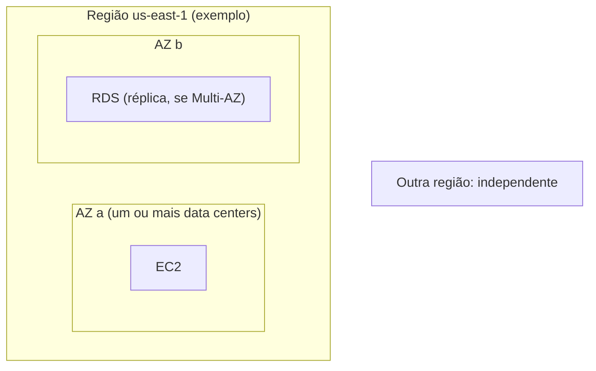

# J10.03 — Conceitos de nuvem e responsabilidade compartilhada

> ⏱️ ~1h30 · 🟢 Júnior · Pré-requisitos: J2.01 (cliente-servidor, IP, DNS), J9.01 (container × VM), J8.07 (LGPD básica)

> ⚠️ **Verificação:** aula **conceitual**: não há código a executar. Os fatos sobre o plano gratuito da AWS vêm das páginas oficiais, lidas em 2026-11-13 (links no fim). **Só um preço da AWS aparece aqui (o do IPv4 público, com fonte)**: preços mudam e variam por região; a aula ensina a **fórmula** e manda você ao *AWS Pricing Calculator* e ao *Cost Explorer*. Termos de "responsabilidade compartilhada" seguem a página oficial do modelo.

## 🎯 Objetivos
Ao final desta aula você consegue:
- **Diferenciar** IaaS, PaaS, SaaS (e *serverless*) e **classificar** serviços do PayFlow.
- **Explicar** região, zona de disponibilidade (AZ) e como escolher uma região.
- **Desenhar** o modelo de **responsabilidade compartilhada** para o PayFlow: o que é da AWS e o que é seu.
- **Estimar** o custo mensal de um recurso pela fórmula (preço × quantidade × tempo) e **listar** as cobranças que surpreendem.

## 🤔 Por que isso importa
O júnior que "só sobe a aplicação" precisa entender onde ela roda e **de quem é cada falha**: o banco caiu (e o backup, é seu?), o disco encheu, a porta ficou aberta para o mundo. Uma conta de nuvem mal configurada é causa recorrente de vazamento de dados e de fatura inesperada, e as duas coisas são problemas de **quem entendeu o modelo e quem não**.

## 💡 Intuição (explicação simples)
**Morar:** *on-premises* é **construir a casa**: terreno, obra, encanamento, tudo seu. **IaaS** é **alugar um terreno com a estrutura pronta**: você monta o resto (VM: EC2). **PaaS** é **alugar um apartamento mobiliado**: você só traz suas roupas (aplicação) e a plataforma cuida do prédio. **SaaS** é **hotel**: você usa o quarto e não mexe em nada. O **responsabilidade compartilhada** é o contrato do aluguel: o prédio é do proprietário, **o que você faz dentro e a chave da porta** são seus.

## 🔬 Como funciona por dentro

### 1. Modelos de serviço
| Modelo | Você gerencia | O provedor gerencia | Exemplo AWS | No PayFlow |
|---|---|---|---|---|
| **IaaS** | SO, runtime, app, dados, rede lógica | hardware, virtualização, data center | **EC2** | a instância que roda o Docker |
| **PaaS** | app e dados (e configuração) | SO, *patches*, runtime/banco, escala básica | **RDS** (banco gerenciado) | o PostgreSQL |
| **Serverless / FaaS** | só o código | tudo, inclusive a escala (paga por execução) | Lambda (P9) | fora do escopo da J10 |
| **SaaS** | só o uso e os dados | tudo | GitHub, Gmail | o próprio GitHub Actions |
| *Armazenamento de objetos* | os objetos e as permissões | durabilidade, hardware | **S3** | pacote de deploy |

A fronteira não é uma linha só: o **RDS** é "banco como serviço" (você não instala o PostgreSQL nem aplica correções do SO), mas **você** escolhe versão, cria usuários, desenha o esquema e liga o backup.

### 2. Regiões e zonas

- **Região:** localização geográfica com várias zonas, **independente** das outras (dados e recursos **ficam** na região onde você os cria, salvo se você os replicar). Escolha por: **latência** ao usuário, **serviços disponíveis**, **preço** (varia por região: compare no calculador), **requisitos legais** (a LGPD não *obriga* data center no Brasil, mas transferência internacional de dados tem regras próprias: decisão para o jurídico, J8.07).
- **Zona de disponibilidade (AZ):** um ou mais data centers isolados, na mesma região, ligados por rede rápida. Distribuir entre AZs protege de falha de **um** data center (alta disponibilidade, P9).
- O treinamento usa **`us-east-1`** (região padrão de muitos tutoriais e de bom suporte a recursos) porque o objetivo é **estudar com custo mínimo**; para usuários brasileiros em produção, `sa-east-1` (São Paulo) reduz a latência: **compare o preço** no calculador antes de decidir.

### 3. Responsabilidade compartilhada
A AWS descreve (página "Shared Responsibility Model") a divisão em duas metades: **da AWS, a segurança "DA" nuvem** (hardware, rede global, instalações, a virtualização) e **do cliente, a segurança "NA" nuvem** (o que você coloca e como configura). Aplicada ao PayFlow:
| Camada | EC2 (IaaS) | RDS (gerenciado) | S3 |
|---|---|---|---|
| Data center, hardware, virtualização | AWS | AWS | AWS |
| Sistema operacional e *patches* | **você** (`dnf update`) | AWS | AWS |
| Versão/engine do banco | n/a | **você escolhe a versão**; AWS aplica a manutenção que você agenda | n/a |
| Rede: quem alcança o recurso | **você** (Security Group) | **você** (SG, `--no-publicly-accessible`) | **você** (Block Public Access, política) |
| Identidade e permissões (IAM) | **você** | **você** | **você** |
| Dados, esquema, backups, criptografia ligada | **você** | **você** (retenção, restauração) | **você** |
| Código e dependências da aplicação | **você** | n/a | n/a |

Regra prática: **tudo o que é configuração e dado é seu.** A maioria dos vazamentos em nuvem vem de configuração do cliente (bucket público, porta aberta, chave no Git), não de invasão ao data center.

### 4. Como a nuvem cobra
Quatro eixos (sem preços aqui; os valores você consulta):
1. **Tempo de recurso ligado** (VM, banco): cobra por segundo/hora **mesmo parado de uso** (VM *desligada* não cobra computação, mas o **disco** continua).
2. **Armazenamento:** por GB-mês (disco EBS, S3, *snapshots*, imagens no ECR, logs).
3. **Tráfego de saída** para a internet (a entrada costuma ser grátis): **egress**.
4. **Recursos que "ficam por aí":** IP público, *snapshot* final do banco, volume órfão, NAT Gateway (não usamos), Elastic IP sem uso.

> 💸 O endereço **IPv4 público** passou a ser cobrado **por hora** a partir de **1º/02/2024**: o anúncio oficial (link abaixo) informa **US$ 0,005 por IP por hora**, ou seja, 0,005 × 730 ≈ **US$ 3,65 por mês** por IP: uma instância com IP público tem esse custo, **dentro ou fora** do plano gratuito, a menos que créditos o cubram. Por isso o treinamento prefere o acesso por **túnel SSM** e a destruição completa (J10.07).

**Fórmula:** `custo_mês ≈ preço_por_hora × 730 h × quantidade` (730 = 24 × 365 ÷ 12), mais armazenamento (GB × preço/GB-mês) e saída (GB × preço/GB). Você não precisa decorar preços: precisa saber **quais itens** entram na conta.

### 5. O plano gratuito da AWS (contas novas) — conferido em 2026-11-13
Pelas páginas oficiais de *Billing* e *Free Tier*:
- Conta criada **a partir de 15/07/2025**: você escolhe entre **plano Free** e **plano Paid**; em ambos recebe **US$ 100 em créditos** e pode ganhar **até mais US$ 100** completando atividades; mais ~30 serviços "sempre gratuitos" até certos limites.
- **Plano Free:** **sem cobrança** enquanto explora; acaba em **6 meses** ou quando os créditos acabarem (o que vier primeiro); depois **a conta é fechada** (dados retidos por 90 dias) a menos que você **migre para Paid**. Alguns serviços **não** estão disponíveis nele.
- **Pegadinha documentada:** o plano Free **vira Paid automaticamente** se a conta entrar no **AWS Organizations**, configurar o **Control Tower** etc. (lista na página "Choosing a plan"). Veremos por que isso importa na J10.04.
- Contas criadas **antes** de 15/07/2025 seguem o modelo antigo (12 meses, limites de uso, `t2.micro`/`t3.micro`).
- EC2, S3 e RDS aparecem em aws.amazon.com/free como "disponíveis nos dois planos". Os **tipos de instância elegíveis** (conta nova): `t3.micro`, `t3.small`, `t4g.micro`, `t4g.small`, `c7i-flex.large`, `m7i-flex.large` (documentação do EC2); a CLI mostra os da sua conta com `aws ec2 describe-instance-types --filters Name=free-tier-eligible,Values=true`.
Não existe "grátis para sempre" para uma VM e um banco: **trate o plano como crédito de estudo**, destrua tudo no fim (J10.07) e **monitore** (J10.04).

## 🧠 Pausa para lógica
**Enunciado:** uma VM custa `p` dólares/hora e fica ligada o mês inteiro, mas a aplicação só é usada 8 h por dia útil (22 dias). (a) Qual a fração do tempo realmente usada? (b) Se desligá-la fora do horário, quanto do custo **de computação** economiza? (c) O que **continua** cobrando com a VM desligada?

Dica
(a) divida as horas usadas pelas 730 do mês.

Solução

(a) 8 × 22 = 176 h ÷ 730 ≈ **24%**. (b) A computação cairia a ~24%: economia de ~**76%** do item "computação" (`p × 554 h` a menos). (c) Disco (EBS), IP público/Elastic IP, *snapshots*, e o **banco** (RDS cobra enquanto existe, a menos que você o pare, o que a AWS limita a períodos curtos: ⚠️ conferir). Variação: some o custo do disco ao cenário.

## ⚖️ Trade-offs e quando NÃO usar nuvem
Nuvem troca **capital** por **custo variável** e dá elasticidade e serviços prontos; em troca, há **dependência do provedor** (*lock-in*), curva de aprendizado e fatura imprevisível se você não monitora. Para um sistema estável, previsível e já dimensionado, hardware próprio ou um VPS simples pode custar menos; para requisitos legais de localização, avalie. Em S6, o FinOps trata disso.

## ⚠️ Erros comuns e boas práticas de produção
- Achar que "gerenciado" significa "seguro por padrão": o RDS aceita conexão de onde o seu Security Group permitir.
- **Deixar recurso esquecido** (a maior causa de fatura de estudante): o resumo da J10.07.
- Usar a conta **root** no dia a dia (J10.04).
- Misturar estudo e produção na mesma conta.
- Região diferente da esperada: o console mostra os recursos **de uma região por vez**: `us-east-1` vazia não significa que não há nada em `sa-east-1`.

## 🧩 Exercícios
1. **Fixação:** (a) classifique GitHub Actions, RDS, EC2 e Gmail em IaaS/PaaS/SaaS. (b) O que é uma AZ e por que o RDS Multi-AZ a usa? (c) Em "Security Group aberto para `0.0.0.0/0` na porta 5432", de quem é a responsabilidade?
2. **Aplicação no PayFlow:** em `docs/cloud-notes.md`:
   - [ ] a tabela de responsabilidade do PayFlow (EC2, RDS, S3, GitHub) preenchida com **suas** palavras;
   - [ ] o diagrama (Mermaid) da arquitetura-alvo da J10 (J10.06);
   - [ ] a lista de **tudo o que pode cobrar** nessa arquitetura (use os quatro eixos);
   - [ ] a região escolhida e **por quê**.
3. **Desafio (opcional):** abra o *AWS Pricing Calculator* (link abaixo) e monte a estimativa de uma `t3.small` + RDS pequeno + 20 GB de disco **sem copiar o resultado para o material**: guarde só o **método** (quais campos preencher).

Soluções de referência

1. (a) Actions: SaaS (a plataforma de CI); RDS: PaaS (gerenciado); EC2: IaaS; Gmail: SaaS. (b) Data center(s) isolado(s) da mesma região; Multi-AZ mantém uma cópia em outra AZ para sobreviver à falha de uma. (c) **Sua**: a regra de rede é configuração do cliente.

## 🎤 Na entrevista
1. **IaaS × PaaS × SaaS, com exemplo?** *Resposta-modelo:* o quanto você gerencia: IaaS (EC2: eu cuido do SO), PaaS (RDS/Beanstalk: eu cuido da app e dos dados), SaaS (GitHub: eu uso).
2. **O que é responsabilidade compartilhada?** *Resposta-modelo:* a AWS responde pela segurança **da** nuvem (infraestrutura); eu respondo pela segurança **na** nuvem (identidade, rede, dados, configuração, código). Exemplo: bucket público é falha **minha**.
3. **Como escolher a região?** *Resposta-modelo:* latência, disponibilidade do serviço, custo, requisitos legais; e o dado **fica** na região até eu replicar.

## 📚 Para ir além
- 📄 [Modelo de responsabilidade compartilhada](https://aws.amazon.com/compliance/shared-responsibility-model/): a definição oficial, com diagramas.
- 📄 [Infraestrutura global (whitepaper)](https://docs.aws.amazon.com/whitepapers/latest/aws-overview/global-infrastructure.html): regiões, AZs.
- 📄 [Plano gratuito: escolha do plano](https://docs.aws.amazon.com/awsaccountbilling/latest/aboutv2/free-tier-plans.html) e [Free Tier FAQs](https://aws.amazon.com/free/free-tier-faqs/).
- 📄 [Free Tier no EC2](https://docs.aws.amazon.com/AWSEC2/latest/UserGuide/ec2-free-tier-usage.html): instâncias elegíveis antes/depois de 15/07/2025.
- 📄 [Cobrança de IPv4 público](https://aws.amazon.com/blogs/aws/new-aws-public-ipv4-address-charge-public-ip-insights/): o anúncio oficial.
- 🎥 Vídeos: ⚠️ nenhum link de vídeo foi verificado nesta execução. Livros: *Cloud FinOps* e *AWS Well-Architected* (só por título; capítulos não conferidos).

## ✅ Checklist da aula
- [ ] Classifico serviços em IaaS/PaaS/SaaS.
- [ ] Sei o que é região e AZ, e por que escolhi a minha região.
- [ ] Sei, para cada recurso do PayFlow, o que é meu e o que é da AWS.
- [ ] Sei os quatro eixos de custo e a fórmula `preço × 730 h`.
- [ ] Li as regras do plano gratuito, inclusive a pegadinha do Organizations.
