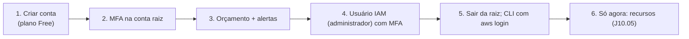

# J10.04 — 💸 Conta AWS: alerta de custos, MFA e IAM

> ⏱️ ~1h30 · 🟢 Júnior · Pré-requisitos: J10.03, J8.01 (autenticação × autorização), J8.07 (segredos fora do Git)

> 💸 **Esta é a aula em que a conta nasce.** Nada aqui cobra por si só, mas é a **ordem** que protege o seu dinheiro: **MFA e alerta de custos ANTES de criar qualquer recurso.**

> ⚠️ **Verificação:** **não há conta AWS neste ambiente.** Foram executados: `aws login help` (AWS CLI 2.39.5), e o script `10-budget.sh` contra o **moto** (emulador: valida a sintaxe dos parâmetros e do JSON, **não** que a AWS aceite o orçamento). As regras do plano gratuito, do MFA da conta raiz e do `aws login` vêm das páginas oficiais, lidas em 2026-11-13. Os passos do **console** (cliques) **não** foram executados: confira os nomes dos menus na sua tela.

## 🎯 Objetivos
Ao final desta aula você consegue:
- **Criar** a conta AWS com **MFA na conta raiz**, sem chave de acesso para ela, e saber **quando** usá-la.
- **Criar** um orçamento (*budget*) com alertas por e-mail e **acompanhar** o uso no *Cost Explorer* e no *Free Tier*.
- **Explicar** usuário, grupo, papel (*role*) e política (*policy*) do IAM, e **ler** uma política JSON.
- **Configurar** a CLI com credenciais **de curta duração** (`aws login`), sem guardar chave de acesso em arquivo.

## 🤔 Por que isso importa
Credenciais de nuvem vazadas são usadas em minutos para minerar criptomoeda **na sua fatura**. E o erro clássico de quem estuda é criar recursos sem ter nem um alarme de custo. Esta aula é curta em código e longa em hábito: é a diferença entre "aprendi nuvem" e "aprendi nuvem e paguei uma fatura de três dígitos".

## 💡 Intuição (explicação simples)
A **conta raiz** é o **dono do prédio**: pode demolir tudo, trocar o cartão de crédito, fechar a conta. Você a usa **raramente**, com a **fechadura mais forte** (MFA). No dia a dia, você usa um **crachá de funcionário** (usuário/papel do IAM) com **só as chaves de que precisa** (política). O **orçamento** é o **alarme de fumaça** da casa: não apaga o fogo, mas te acorda.

## 🔬 Como funciona por dentro

### 1. Ordem de abertura (💸)

1. **Criar a conta** em aws.amazon.com (e-mail, cartão, telefone). Escolha o **plano Free** (J10.03): sem cobrança enquanto durar o plano/créditos. Regra do plano (J10.03): **não entre em AWS Organizations nem Control Tower**, ou a conta vira **Paid** automaticamente.
2. **MFA na raiz** (próximo item).
3. **Orçamento** (item 3).
4. **Usuário IAM** (item 5).

### 2. MFA (autenticação multifator)
Uma senha vazada sozinha deixa de bastar: o segundo fator é algo que você **tem** (app autenticador, chave de segurança/*passkey*). Console: *conta → Security credentials → Multi-factor authentication → Assign MFA device*; prefira **chave de segurança/passkey** ou app autenticador. Guarde os **códigos de recuperação** e o e-mail da raiz **fora** do seu computador de trabalho (cofre de senhas). A página da AWS sobre MFA da raiz (link abaixo) descreve os tipos aceitos. **Não crie chaves de acesso para a conta raiz**: nunca. Use a raiz só para o que **exige** a raiz (fechar a conta, alterar plano de suporte, restaurar acesso).

### 3. Orçamento e alertas (💸 a defesa principal)
Console: *Billing and Cost Management → Budgets → Create budget → Cost budget (monthly)*. Ou pela CLI, o que o `10-budget.sh` faz: 3 notificações por e-mail (**50%** e **80%** do gasto **real** e **100%** da **previsão**).
```bash
#!/usr/bin/env bash
# J10.04: orcamento mensal com alertas por e-mail. Uso: ALERT_EMAIL=voce@exemplo.com bash 10-budget.sh
source "$(dirname "$0")/env.sh"
: "${ALERT_EMAIL:?set ALERT_EMAIL}"
LIMIT="${BUDGET_USD:-10}"
budget="$(jq -n --arg n "${PROJECT}-monthly" --arg l "$LIMIT" \
  '{BudgetName:$n, BudgetLimit:{Amount:$l, Unit:"USD"}, TimeUnit:"MONTHLY", BudgetType:"COST"}')"
notifs="$(jq -n --arg e "$ALERT_EMAIL" '[
  {Notification:{NotificationType:"ACTUAL",     ComparisonOperator:"GREATER_THAN", Threshold:50,  ThresholdType:"PERCENTAGE"}, Subscribers:[{SubscriptionType:"EMAIL",Address:$e}]},
  {Notification:{NotificationType:"ACTUAL",     ComparisonOperator:"GREATER_THAN", Threshold:80,  ThresholdType:"PERCENTAGE"}, Subscribers:[{SubscriptionType:"EMAIL",Address:$e}]},
  {Notification:{NotificationType:"FORECASTED", ComparisonOperator:"GREATER_THAN", Threshold:100, ThresholdType:"PERCENTAGE"}, Subscribers:[{SubscriptionType:"EMAIL",Address:$e}]}
]')"
aws budgets create-budget --account-id "$ACCOUNT_ID" --budget "$budget" --notifications-with-subscribers "$notifs"
echo "budget ${PROJECT}-monthly: USD ${LIMIT}/month"
```
Executei o script contra o **moto**: `budget payflow-monthly: USD 10/month` (exit 0); isso prova que o JSON e os parâmetros (`--budget`, `--notifications-with-subscribers`) estão bem formados, não que a AWS os aceite. **Limitação documentada:** há **atraso** entre a cobrança e o alerta (a página de Budgets avisa): o orçamento **não é um freio**, é um aviso. Complemente com: **Cost Explorer** (gasto por serviço/dia) e a página de **Free Tier usage** (créditos restantes); olhe **todo dia** nos primeiros dias, e **sempre** depois de criar recursos.

### 4. IAM em 5 palavras
| Conceito | O que é |
|---|---|
| **Usuário** | identidade de uma pessoa (ou de um programa, mas prefira papéis) com credenciais |
| **Grupo** | conjunto de usuários que recebem as mesmas permissões |
| **Papel (*role*)** | identidade **sem senha**, **assumida** temporariamente por uma pessoa, um serviço (EC2) ou uma entidade externa (GitHub Actions, J10.06) |
| **Política (*policy*)** | documento JSON: **quem pode fazer o quê, em quais recursos, sob quais condições** |
| **Mínimo privilégio** | dar só o necessário: a política mais curta que funciona |

Anatomia de uma política (a da instância, `deploy/iam/ec2-policy.json`, trecho):
```json
{
  "Effect": "Allow",
  "Action": ["ssm:GetParameter", "ssm:GetParameters"],
  "Resource": "arn:aws:ssm:__REGION__:__ACCOUNT_ID__:parameter/payflow/*"
}
```
`Effect` (Allow/Deny), `Action` (o verbo da API), `Resource` (o ARN, o "endereço" do recurso: `arn:aws:serviço:região:conta:recurso`), e, opcionalmente, `Condition`. **Tudo é negado por padrão**; um `Deny` explícito vence qualquer `Allow`. Os `__X__` são marcadores que o `env.sh` preenche (J10.05).

### 5. Seu acesso diário: **sem chave de acesso**
Há três jeitos de a CLI autenticar:
1. **Chave de acesso** (`AKIA...` + segredo) de um usuário IAM: **longa duração**; se vazar, vale até alguém revogar. É o que aparece em tutoriais antigos. **Evite.**
2. **IAM Identity Center** (SSO): a recomendação para equipes. Em conta **standalone** do plano Free há uma armadilha: a instância de **organização** do Identity Center exige uma conta de gerenciamento do **AWS Organizations** (documentação "Get set up for IAM Identity Center"), e **entrar no Organizations migra o plano Free para Paid** (documentação "Choosing a plan"). Para este treinamento, **não habilite**.
3. **`aws login`** (CLI 2.39.5 tem o comando; a descrição do `help`: "Login for local development using AWS Management Console credentials... the CLI will acquire temporary credentials and a refresh token... refresh automatically"). Você entra no navegador com o **usuário IAM + MFA** e a CLI recebe credenciais **temporárias**. Requisito (página "Sign in for local development"): a identidade precisa da política gerenciada **`SignInLocalDevelopmentAccess`**; a raiz não precisa de nada, mas **não use a raiz**.

Plano:
1. No console, *IAM → Users → Create user* `payflow-admin`, com acesso ao console e **MFA**; **sem** chaves de acesso. Para estudo, anexe `AdministratorAccess` **e** `SignInLocalDevelopmentAccess` por um **grupo** `payflow-admins`. (Um administrador total é aceitável numa conta **só de estudo**; numa conta de equipe seria o oposto do mínimo privilégio.)
2. `aws login` (siga o navegador). Confira: `aws sts get-caller-identity` → o ARN do **seu** usuário (não `root`).
3. `aws configure set region us-east-1` e `aws configure set output json`.
4. ⚠️ O comportamento exato do `aws login` (perfis, `--remote` para máquina sem navegador) **não foi executado**: leia `aws login help`.

### 6. Rotina de higiene
- Tags `project=payflow` em **tudo** (os scripts fazem): é como a J10.07 encontra e prova a destruição.
- Nunca commite `~/.aws`, chaves ou o `ALERT_EMAIL` de outra pessoa; `scripts/ci/check-secrets.sh` (J8.07) vigia o padrão `AKIA`.

## 🧠 Pausa para lógica
**Enunciado:** o orçamento é de US$ 10 e tem alertas em 50%, 80% e 100% (previsão). O gasto sobe US$ 1,50 por dia a partir do dia 1. Em que dia chega cada alerta de gasto **real**? Em que dia a **previsão** ultrapassa 100%?
<details><summary>Dica</summary>Gasto real no dia d = 1,5·d. Previsão ≈ (gasto até hoje ÷ dias decorridos) × dias do mês.</details>
<details><summary>Solução</summary>

50% = US$ 5 → 1,5·d ≥ 5 → d ≥ 3,33 → **dia 4**. 80% = US$ 8 → d ≥ 5,33 → **dia 6**. A previsão para um mês de 30 dias, com ritmo de 1,5/dia, é 45 dólares: **ultrapassa os 100% (US$ 10) já nos primeiros dias** (assim que a AWS tem dados suficientes para projetar). O aviso real só chegaria no dia 7 (1,5·7 = 10,5) → **o alerta de previsão é o que te salva**. Variação: some o atraso de ~1 dia do faturamento.
</details>

## ⚠️ Erros comuns e boas práticas de produção
- **Criar recursos antes do orçamento.** A ordem da aula não é capricho.
- **Chave de acesso da raiz** ou de usuário no GitHub: o `check-secrets.sh` e o *secret scanning* do GitHub existem para pegar, mas **a rotação é sempre o primeiro passo** (J8.07: segredo vazado = comprometido).
- **Política com `"Action": "*", "Resource": "*"`** em produção: administrador de fato.
- **E-mail do alerta que você não lê.** Teste: crie um orçamento de US$ 0,01 e veja chegar o e-mail.
- Erros típicos da CLI: sem região, `You must specify a region` (visto nos testes do laboratório); sem credenciais ou com credenciais expiradas aparecem mensagens sobre credenciais/`ExpiredToken` (⚠️ de memória: o texto varia com a versão da CLI).

## 🧩 Exercícios
1. **Fixação:** (a) por que não usar a conta raiz no dia a dia? (b) Qual a diferença entre usuário e papel? (c) Por que "Deny explícito vence Allow" importa?
2. **Aplicação no PayFlow** (💸 **passo a passo, nesta ordem**):
   - [ ] Conta criada no **plano Free**; MFA na raiz (anote em `docs/cloud-notes.md` **que** ativou e **qual tipo**, nunca o segredo).
   - [ ] Orçamento criado (`ALERT_EMAIL=... bash scripts/aws/10-budget.sh` **depois** de `aws login`); **o e-mail de teste chegou**.
   - [ ] Usuário `payflow-admin` em grupo com MFA, `aws login` funcionando; `aws sts get-caller-identity` mostra o usuário.
   - [ ] Abri **Cost Explorer** e **Free Tier usage**: anote os créditos restantes.
   - [ ] Região `us-east-1` no console e na CLI (`aws configure get region`).
3. **Desafio (opcional):** escreva uma política que só permita `s3:GetObject` no prefixo `deploy/` de **um** bucket e teste com o *IAM Policy Simulator* (⚠️ ferramenta do console, não executada aqui).

<details><summary>Soluções de referência</summary>

1. (a) A raiz não tem limites e é o alvo mais valioso; um erro ou vazamento é irreversível. (b) Usuário: credenciais próprias e permanentes; papel: assumido temporariamente, sem senha (serviço, pessoa federada). (c) Permite bloquear algo **de forma que nenhuma outra política reabra** (as "barreiras").
</details>

## 🎤 Na entrevista
1. **O que você faz primeiro numa conta AWS nova?** *Resposta-modelo:* MFA na raiz, sem chaves para ela, alerta de custo/orçamento, usuário/papel administrativo com MFA para o dia a dia, região definida e tags.
2. **Usuário IAM × papel?** *Resposta-modelo:* usuário tem credenciais próprias; papel é assumido e dá credenciais temporárias (serviços e federação usam papéis).
3. **Como você evita chave de acesso vazada?** *Resposta-modelo:* não usar chaves de longa duração: papéis de instância (EC2), OIDC para o CI, `aws login`/SSO para pessoas; varredura de segredos; rotação imediata ao vazar.

## 📚 Para ir além
- 📄 [Escolha do plano (Free × Paid)](https://docs.aws.amazon.com/awsaccountbilling/latest/aboutv2/free-tier-plans.html): regras e a pegadinha do Organizations.
- 📄 [MFA da conta raiz](https://docs.aws.amazon.com/IAM/latest/UserGuide/id_root-user_manage_mfa.html).
- 📄 [Orçamentos da AWS](https://docs.aws.amazon.com/cost-management/latest/userguide/budgets-managing-costs.html): inclusive o atraso dos alertas.
- 📄 [Entrada para desenvolvimento local (`aws login`)](https://docs.aws.amazon.com/signin/latest/userguide/command-line-sign-in.html).
- 📄 [Preparar o IAM Identity Center](https://docs.aws.amazon.com/singlesignon/latest/userguide/get-set-up-for-idc.html): instâncias de organização × conta.
- 🎥 ⚠️ nenhum vídeo verificado.

## ✅ Checklist da aula
- [ ] MFA na raiz; **nenhuma** chave de acesso da raiz.
- [ ] Orçamento com alertas **testado**; Cost Explorer e Free Tier abertos.
- [ ] `aws sts get-caller-identity` mostra o meu usuário (não a raiz).
- [ ] Não habilitei Organizations/Identity Center no plano Free.
- [ ] Sei ler uma política: Effect, Action, Resource, Condition.
