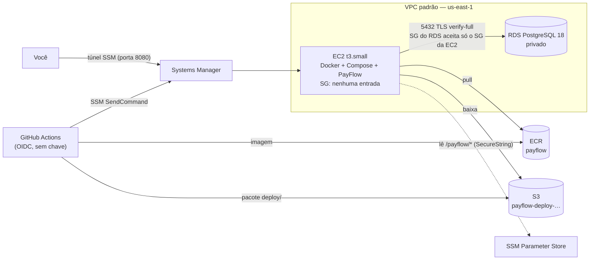

# J10.05 — 💸 EC2, RDS, S3, ECR e Security Groups

> ⏱️ ~1h30 · 🟢 Júnior · Pré-requisitos: J10.03, J10.04 (conta, MFA, orçamento, `aws login`), J3.03 (PostgreSQL), J9.03 (Compose, rede, segredos)

> 💸 **A partir daqui você cria recursos que cobram.** Cada passo traz o aviso e o **desfazer**; a destruição completa é a J10.07. Se parar a aula no meio, **rode a J10.07 antes de dormir**.

> ⚠️ **Verificação:** **sem conta AWS**: os scripts `30-storage.sh`, `40-network.sh`, `50-database.sh` e `60-instance.sh` foram executados **contra o moto** (emulador): provam sintaxe, ordem e a lógica dos scripts (`exit 0`, ids gerados); **não** provam que a AWS aceita cada combinação (por exemplo, `--engine-version 18`, `db.t4g.micro` no seu plano, o `resolve:ssm:` do AMI, a região). O que foi executado **de verdade**: PostgreSQL 18 com TLS e a conexão `sslmode=verify-full` do PayFlow Lite (item 4). A disponibilidade do PostgreSQL 18.6 no RDS e os tipos de instância gratuitos vêm das páginas oficiais (2026-11-13).

## 🎯 Objetivos
Ao final desta aula você consegue:
- **Descrever** EC2, EBS, AMI, RDS, S3, ECR e Security Group e **dizer o que cada um cobra**.
- **Desenhar** a rede do PayFlow: instância **sem porta aberta**, banco **privado** que só aceita a instância.
- **Criar** os recursos por script (**infraestrutura reproduzível**) e **conferir** o resultado.
- **Conectar** a aplicação ao RDS com TLS **validado** (`verify-full`) e explicar o erro quando a validação falha.

## 🤔 Por que isso importa
Subir uma VM e um banco "pelo console" funciona **uma vez**; refazer, explicar e **destruir sem esquecer nada** exige que a criação seja um script (a ideia de infraestrutura como código, que o Terraform leva ao próximo nível em P8). E quase todo incidente de nuvem de júnior está nas **cinco linhas** desta aula: porta aberta, banco público, bucket público, permissão ampla, segredo no lugar errado.

## 💡 Intuição (explicação simples)
Um **prédio comercial**: a **EC2** é a sua sala; o **Security Group** é o **porteiro** com uma lista de quem entra (e a sua sala tem **lista vazia**: ninguém entra pela portaria; você se comunica por um canal interno, o SSM); o **RDS** é o **cofre do andar**, que só abre para quem **o porteiro da sua sala** abona; o **S3** é o **depósito** de caixas; o **ECR** é a **estante de imagens** prontas.

## 🔬 Como funciona por dentro

### 1. A arquitetura-alvo

O que **não** existe de propósito: porta 22 (SSH), IP fixo, NAT Gateway, balanceador, domínio. Cada um desses é custo ou superfície de ataque que a J10 dispensa; o P9 os traz de volta quando fizer sentido.

### 2. EC2, AMI, EBS e IMDSv2
- **EC2** é a máquina virtual. **Tipo** define CPU/memória: `t3.small` (2 vCPU, 2 GiB; família "burstable") aparece na lista de elegíveis ao plano gratuito de contas novas (documentação do EC2); `t3.micro` (1 GiB) é elegível em **todas** as contas, mas a JVM com `MaxRAMPercentage=75` (J9.02) mais o sistema operacional fica **apertada** em 1 GiB. Confirme os da **sua** conta: `aws ec2 describe-instance-types --filters Name=free-tier-eligible,Values=true --query 'InstanceTypes[].InstanceType' --output text`.
- **AMI** é a imagem do disco inicial. O script usa o **parâmetro público do SSM** do Amazon Linux 2023 (`/aws/service/ami-amazon-linux-latest/al2023-ami-kernel-default-x86_64`, mostrado na documentação do AL2023): o `resolve:ssm:` no `--image-id` faz a AWS trocar pelo AMI **atual** na hora de lançar. (Para reproduzir exatamente, fixe o id do AMI.)
- **EBS** é o disco (aqui `gp3`, 20 GiB, **criptografado**, `DeleteOnTermination=true`: some junto com a instância; sem isso, o disco **continua cobrando órfão**).
- **IMDSv2 obrigatório** (`HttpTokens=required`): o serviço de metadados (`169.254.169.254`) entrega as credenciais temporárias do papel da instância. A v1 responde a um simples `GET`, e uma falha de **SSRF** na aplicação (J8: OWASP A01) o transforma em roubo de credenciais; a v2 exige um **token** obtido por `PUT` (o `deploy.sh` faz isso). `HttpPutResponseHopLimit=1` impede que um container alcance o token **por padrão**; se um dia um container precisar, aumente **conscientemente**.
- **Sem par de chaves SSH:** o acesso é pelo **SSM Session Manager** (o agente já vem no AL2023; o papel tem `AmazonSSMManagedInstanceCore`). Sem porta 22, não há alvo para varredura.
- **`user-data`** roda **uma vez** no primeiro boot, como root (log em `/var/log/cloud-init-output.log`). O nosso instala o Docker e o plugin do Compose **fixando a versão e conferindo o sha256**, e baixa o certificado raiz do RDS:
```bash
#!/bin/bash
# Roda UMA vez, no primeiro boot (EC2 user data, como root). Log: /var/log/cloud-init-output.log
set -Eeuo pipefail

dnf install -y docker jq
systemctl enable --now docker

# Docker Compose nao vem no pacote do Amazon Linux 2023: baixe a versao FIXA e confira o sha256
COMPOSE_VERSION=v5.7.1
PLUGIN_DIR=/usr/local/lib/docker/cli-plugins
mkdir -p "$PLUGIN_DIR"
cd "$PLUGIN_DIR"
base="https://github.com/docker/compose/releases/download/${COMPOSE_VERSION}"
curl -fsSL -o docker-compose "${base}/docker-compose-linux-x86_64"
curl -fsSL -o docker-compose.sha256 "${base}/docker-compose-linux-x86_64.sha256"
echo "$(cut -d' ' -f1 docker-compose.sha256)  docker-compose" | sha256sum -c -
chmod +x docker-compose
rm docker-compose.sha256

# Pasta da aplicacao e o certificado raiz do RDS (para sslmode=verify-full)
install -d -m 755 /opt/payflow/certs
curl -fsSL -o /opt/payflow/certs/global-bundle.pem https://truststore.pki.rds.amazonaws.com/global/global-bundle.pem
```
(O AL2023 empacota `docker`, mas não o plugin do Compose: documentação "Using AL2023 in containers" lista `docker`, `containerd` e `nerdctl`. O Compose v5.7.1 e o arquivo `.sha256` foram **vistos** na página de *releases* do GitHub; o `user-data.sh` em si **não rodou** em um AL2023 real, só passou no `shellcheck`.)

### 3. Security Groups
Um **Security Group** é um firewall **com estado** (a resposta de uma conexão permitida volta sozinha) **na interface da instância**: só tem regras de **permissão**. **Entrada** é negada por padrão; **saída** é liberada por padrão. A regra do banco usa **outro SG como origem**:
```bash
#!/usr/bin/env bash
# J10.05: security groups. A instancia NAO tem regra de entrada; o banco so aceita a instancia.
source "$(dirname "$0")/env.sh"
VPC_ID="$(aws ec2 describe-vpcs --filters Name=isDefault,Values=true --query 'Vpcs[0].VpcId' --output text)"
[[ "$VPC_ID" != "None" ]] || { echo "no default VPC in ${AWS_REGION}" >&2; exit 1; }

tagspec() { echo "ResourceType=security-group,Tags=[{Key=project,Value=${PROJECT}},{Key=Name,Value=$1}]"; }
EC2_SG_ID="$(aws ec2 create-security-group --group-name "$EC2_SG" --description "payflow app (no inbound)" \
  --vpc-id "$VPC_ID" --tag-specifications "$(tagspec "$EC2_SG")" --query GroupId --output text)"
RDS_SG_ID="$(aws ec2 create-security-group --group-name "$RDS_SG" --description "payflow db (5432 from app only)" \
  --vpc-id "$VPC_ID" --tag-specifications "$(tagspec "$RDS_SG")" --query GroupId --output text)"
aws ec2 authorize-security-group-ingress --group-id "$RDS_SG_ID" --protocol tcp --port 5432 --source-group "$EC2_SG_ID" >/dev/null
echo "vpc=${VPC_ID} ec2_sg=${EC2_SG_ID} rds_sg=${RDS_SG_ID}"
```
`--source-group "$EC2_SG_ID"` significa "aceite **qualquer recurso que use este SG**", independente do IP: se a instância trocar de IP, a regra continua válida, e **nada mais** na internet alcança a 5432. Compare com o erro clássico `0.0.0.0/0` na 5432 (banco exposto ao mundo). O SG da EC2 tem **zero** regras de entrada (a saída padrão basta para falar com SSM, ECR, S3 e RDS).

### 4. RDS e o TLS verificado
```bash
#!/usr/bin/env bash
# J10.05: RDS PostgreSQL + segredos no Parameter Store
source "$(dirname "$0")/env.sh"
VPC_ID="$(aws ec2 describe-vpcs --filters Name=isDefault,Values=true --query 'Vpcs[0].VpcId' --output text)"
RDS_SG_ID="$(aws ec2 describe-security-groups --filters "Name=group-name,Values=${RDS_SG}" "Name=vpc-id,Values=${VPC_ID}" --query 'SecurityGroups[0].GroupId' --output text)"
read -r -a SUBNETS <<< "$(aws ec2 describe-subnets --filters "Name=vpc-id,Values=${VPC_ID}" Name=default-for-az,Values=true --query 'Subnets[].SubnetId' --output text)"
(( ${#SUBNETS[@]} >= 2 )) || { echo "RDS needs subnets in at least 2 AZs" >&2; exit 1; }
aws rds create-db-subnet-group --db-subnet-group-name "$DB_SUBNETS" --db-subnet-group-description "payflow" \
  --subnet-ids "${SUBNETS[@]}" --tags "${TAGS[@]}" >/dev/null

DB_PASSWORD="$(openssl rand -base64 32 | tr -d '/+=\n' | cut -c1-32)"
JWT_SECRET="$(openssl rand -base64 48 | tr -d '\n')"
aws rds create-db-instance --db-instance-identifier "$DB_ID" \
  --engine postgres --engine-version "${DB_ENGINE_VERSION:-18}" \
  --db-instance-class "${DB_CLASS:-db.t4g.micro}" --allocated-storage 20 --storage-type gp3 --storage-encrypted \
  --db-name payflow --master-username payflow --master-user-password "$DB_PASSWORD" \
  --db-subnet-group-name "$DB_SUBNETS" --vpc-security-group-ids "$RDS_SG_ID" \
  --no-publicly-accessible --no-multi-az --backup-retention-period 1 --no-deletion-protection \
  --tags "${TAGS[@]}" >/dev/null
aws ssm put-parameter --name /payflow/db_password --type SecureString --value "$DB_PASSWORD" --tags "${TAGS[@]}" >/dev/null
aws ssm put-parameter --name /payflow/jwt_secret  --type SecureString --value "$JWT_SECRET"  --tags "${TAGS[@]}" >/dev/null
unset DB_PASSWORD JWT_SECRET

echo "waiting for the database (10 to 15 minutes)..."
aws rds wait db-instance-available --db-instance-identifier "$DB_ID"
ENDPOINT="$(aws rds describe-db-instances --db-instance-identifier "$DB_ID" --query 'DBInstances[0].Endpoint.Address' --output text)"
aws ssm put-parameter --name /payflow/db_host --type String --value "$ENDPOINT" --tags "${TAGS[@]}" >/dev/null
echo "db endpoint: ${ENDPOINT}"
```
- **PostgreSQL 18:** a página de notas de versão do RDS lista a **18.6** (conferida; a 19 também aparece na página). Ao pedir `--engine-version 18` o RDS escolhe a **versão menor padrão**: ⚠️ confirme com `aws rds describe-db-engine-versions --engine postgres --query 'DBEngineVersions[?starts_with(EngineVersion, \`18\`)].EngineVersion'` e **fixe** a menor que aparecer. Mantém a paridade com o `postgres:18` da J3/J7/J9 (decisão 5).
- `--no-publicly-accessible` (sem IP público, só dentro da VPC), `--storage-encrypted`, `--backup-retention-period 1` (um dia de backup automático; em produção, mais), `--no-multi-az` (um só AZ: **sem alta disponibilidade**, decisão de custo consciente), `--no-deletion-protection` (**só no estudo**: em produção, **ligada**).
- **Segredos:** a senha do banco e o segredo do JWT nascem **no seu terminal** (`openssl rand`), vão para o **Parameter Store** como `SecureString` (criptografado) e a variável é apagada (`unset`). O papel da instância só lê `/payflow/*`. A senha aparece como argumento do `aws rds create-db-instance`: **visível** em `ps` para outros usuários da **sua** máquina durante a chamada. Aceitável em estudo; em produção use `--manage-master-user-password` (o RDS guarda e rotaciona no Secrets Manager: P9/P10).
- ⚠️ A decisão de pôr o JWT e a senha no **SSM Parameter Store** (e não no Secrets Manager) é de **custo e simplicidade**; o preço do Secrets Manager não foi consultado.
- **Banco criado ≠ banco pronto:** leva ~10 a 15 minutos (`aws rds wait db-instance-available`; ⚠️ o tempo é do material da AWS/experiência, não medido por mim); depois, o **Flyway** (J3.12) cria o esquema **na primeira subida da aplicação**, sem seed (decisão 31).

**TLS e `sslmode=verify-full`.** O `compose.prod.yaml` usa `jdbc:postgresql://${DB_HOST}:5432/payflow?sslmode=verify-full&sslrootcert=/certs/global-bundle.pem`. Os modos do driver, do mais fraco ao mais forte: `prefer` (usa TLS se houver; **não valida**), `require` (exige TLS, **não valida o certificado**), `verify-ca` (valida a cadeia), **`verify-full`** (valida a cadeia **e o nome do servidor**: impede o *man-in-the-middle*). O pacote de certificados raiz do RDS é o `global-bundle.pem` (a página "Using SSL/TLS with RDS" o documenta; a URL `truststore.pki.rds.amazonaws.com/global/global-bundle.pem` respondeu 200).

**Experimento (executado):** PostgreSQL 18 local com um certificado assinado por uma CA de laboratório (nome `rds.local`) e o PayFlow Lite apontando para ele:
```text
sslmode=verify-full, CA certa, host rds.local   -> Healthy ("status":"UP")
SELECT count(*) FILTER (WHERE ssl) ... pg_stat_ssl  -> 10 de 11 conexões usam TLS (a 11ª é o psql do teste)
sslmode=verify-full, CA ERRADA                  -> a aplicação NÃO sobe (reinicia em laço)
sslmode=verify-full, host wrong.local           -> PGjdbcHostnameVerifier: Server name validation failed:
                                                   certificate for host wrong.local dNSName entries subjectAltName,
                                                   but none of them match.
```
O erro de **nome** é o que você veria se usasse o IP, ou um *alias*, em vez do **endpoint** do RDS (`payflow-db.xxxxx.us-east-1.rds.amazonaws.com`): sempre use o endpoint.

### 5. S3 e ECR
```bash
#!/usr/bin/env bash
# J10.05: bucket privado do pacote de deploy e repositorio ECR
source "$(dirname "$0")/env.sh"

if [[ "$AWS_REGION" == "us-east-1" ]]; then
  aws s3api create-bucket --bucket "$BUCKET" >/dev/null
else
  aws s3api create-bucket --bucket "$BUCKET" --create-bucket-configuration "LocationConstraint=${AWS_REGION}" >/dev/null
fi
aws s3api put-public-access-block --bucket "$BUCKET" \
  --public-access-block-configuration BlockPublicAcls=true,IgnorePublicAcls=true,BlockPublicPolicy=true,RestrictPublicBuckets=true
aws s3api put-bucket-encryption --bucket "$BUCKET" \
  --server-side-encryption-configuration '{"Rules":[{"ApplyServerSideEncryptionByDefault":{"SSEAlgorithm":"AES256"}}]}'
aws s3api put-bucket-lifecycle-configuration --bucket "$BUCKET" --lifecycle-configuration \
  '{"Rules":[{"ID":"expire-deploy-bundles","Status":"Enabled","Filter":{"Prefix":"deploy/"},"Expiration":{"Days":7}}]}'
aws s3api put-bucket-tagging --bucket "$BUCKET" --tagging "TagSet=[{Key=project,Value=${PROJECT}}]"

aws ecr create-repository --repository-name "$ECR_REPO" --image-tag-mutability IMMUTABLE \
  --image-scanning-configuration scanOnPush=true --tags "${TAGS[@]}" >/dev/null
echo "bucket: ${BUCKET}"
echo "ecr:    ${ACCOUNT_ID}.dkr.ecr.${AWS_REGION}.amazonaws.com/${ECR_REPO}"
```
- **S3** guarda **objetos** em **buckets** (nomes **globalmente únicos**: por isso o id da conta e a região no nome). O `put-public-access-block` com as quatro opções impede, em nível de bucket, que uma política ou ACL torne algo público por engano; `put-bucket-encryption` liga a criptografia padrão (SSE-S3, `AES256`); o *lifecycle* **expira** os pacotes de deploy em 7 dias (nada acumula e cobra).
- **ECR** é o registro **privado** de imagens. `IMMUTABLE` impede reescrever uma *tag* (a tag **é** o SHA do commit, J10.06): o que foi para produção não muda sob você. `scanOnPush` liga a varredura básica de vulnerabilidades (⚠️ o que ela cobre e seu custo: confira na documentação do ECR).

### 6. IAM: dois papéis, nenhuma chave
O `20-iam.sh` cria: (1) o **papel da instância** (`payflow-ec2-role`, confiança em `ec2.amazonaws.com`) com `AmazonSSMManagedInstanceCore` + uma política de **mínimo privilégio** (ler `/payflow/*`, puxar a imagem do repositório `payflow`, ler `deploy/*` do bucket); (2) o **provedor OIDC do GitHub** e o **papel do GitHub Actions** (J10.06). Os JSON ficam em `deploy/iam/` e foram validados com `python3 -m json.tool`; o **efeito** (por exemplo, se o `ssm:SendCommand` com a condição de *tag* funciona como você espera) **não** foi testado: use o *IAM Policy Simulator*/`aws iam simulate-principal-policy` na sua conta e **tente o caminho negativo** (com um recurso sem a tag).

### 7. Execução contra o moto (o que ela prova)
```text
10-budget exit=0 · 20-iam exit=0 · 30-storage exit=0 · 40-network exit=0 · 50-database exit=0 · 60-instance exit=0
91-verify-empty ANTES da destruição: achou instância, volume, RDS, SG, bucket, ECR, parâmetros e papéis (exit 1)
```
Achados do laboratório: (1) o moto **não** traz as políticas gerenciadas da AWS por padrão (precisou de `MOTO_IAM_LOAD_MANAGED_POLICIES=true`): limite do emulador, não do script; (2) um `head-bucket` imprimia JSON no meio da destruição (corrigido); (3) o `ssm-deploy.sh` falhou com `NoRegion` quando rodei sem `AWS_REGION`: o script **depende** da região (o `env.sh` a define).

## 🧠 Pausa para lógica
**Enunciado:** o SG do banco permite 5432 a partir do SG da EC2. Um desenvolvedor, para testar do notebook, adiciona `0.0.0.0/0` na 5432 "só por 5 minutos" e esquece. (a) O que muda na superfície de ataque? (b) O que **ainda** protege o banco? (c) Qual alternativa permite acesso temporário seguro?
<details><summary>Dica</summary>Banco com `--no-publicly-accessible` tem IP público?</details>
<details><summary>Solução</summary>

(a) Em tese, a 5432 passa a aceitar tráfego da internet inteira. (b) Com `--no-publicly-accessible` o banco **não tem IP público** (a resolução de nome devolve IP privado), então a regra aberta **não** o expõe de fato: duas camadas independentes, e por isso você usa as duas (defesa em profundidade). Ainda assim, a regra errada fica no inventário e **vira exposição real** se alguém ligar o acesso público depois. (c) **Túnel pela instância**: `aws ssm start-session --document-name AWS-StartPortForwardingSessionToRemoteHost ...` ou rodar o `psql` pela própria instância (J10.06). Variação: como detectar regra aberta com a CLI (`describe-security-groups --filters Name=ip-permission.cidr,Values=0.0.0.0/0`).
</details>

## ⚖️ Trade-offs e quando NÃO usar
Uma EC2 + RDS é o desenho **mais simples e barato** que ainda é real; **não** tem alta disponibilidade (uma AZ, uma instância), nem balanceador, nem escala. Serve a um estudo e a uma aplicação pequena. Alternativas: PaaS (App Runner, Elastic Beanstalk: menos controle, menos trabalho), contêineres gerenciados (ECS/Fargate: P9), Kubernetes (P7). **Não use** esta topologia para algo que não possa ficar fora do ar durante um *reboot*.

## ⚠️ Erros comuns e boas práticas de produção
| Sintoma | Causa | Correção |
|---|---|---|
| `VPCIdNotSpecified`/"no default VPC" | região sem VPC padrão | use a região do treinamento ou crie uma VPC (P9) |
| `InvalidParameterValue: ... not eligible for Free Tier` (⚠️ de memória) | tipo de instância fora da lista | `describe-instance-types --filters Name=free-tier-eligible,Values=true` |
| A aplicação não alcança o RDS (`Connection timed out`) | SG do banco sem a regra do SG da EC2, ou SG errado na instância | `describe-security-groups`; confira os dois grupos |
| `The connection attempt failed` com `verify-full` | nome ≠ certificado, ou `global-bundle.pem` ausente | use o endpoint do RDS e confira o arquivo montado |
| `AccessDenied` ao ler o parâmetro | política sem o caminho `/payflow/*`, ou chave KMS própria sem `kms:Decrypt` | ⚠️ com a chave padrão do SSM isso não deve ocorrer; com chave própria, conceda `kms:Decrypt` |
| EC2 sem aparecer no SSM | sem papel/perfil, sem saída para a internet, ou o agente ainda iniciando | `aws ssm describe-instance-information` |
| Fatura com volume "esquecido" | instância destruída, EBS sem `DeleteOnTermination` | J10.07, `91-verify-empty.sh` |

## 🧩 Exercícios
1. **Fixação:** (a) por que o SG do banco usa o SG da EC2 como origem e não o IP? (b) Diferencie `require` e `verify-full`. (c) O que o `IMMUTABLE` do ECR evita?
2. **Aplicação no PayFlow** (💸):
   - [ ] `GH_REPO=dono/payflow bash scripts/aws/20-iam.sh` (o `GH_SUB` é ajustado na J10.06; anote o `AWS_ROLE_ARN`).
   - [ ] `bash scripts/aws/30-storage.sh`; confirme `aws s3api get-public-access-block --bucket ...` com as 4 opções `true`.
   - [ ] `bash scripts/aws/40-network.sh`; `aws ec2 describe-security-groups --filters Name=tag:project,Values=payflow` e **mostre** que o SG da EC2 tem `IpPermissions: []`.
   - [ ] `bash scripts/aws/50-database.sh` (💸 **o RDS começa a cobrar/consumir créditos aqui**).
   - [ ] **Antes** da EC2, rode `aws ec2 describe-instance-types --filters Name=free-tier-eligible,Values=true` e registre a lista da **sua** conta.
   - [ ] `bash scripts/aws/60-instance.sh`; anote `INSTANCE_ID`; `aws ssm describe-instance-information` mostra a instância como `Online` (pode levar alguns minutos).
   - [ ] Em `docs/cloud-notes.md`: ids, região, o que cada passo custa (use o **Cost Explorer** no dia seguinte).
3. **Desafio (opcional):** escreva um *script* `scripts/aws/inventory.sh` que lista, por tag `project=payflow`, tudo o que existe, sem usar o `91-verify-empty.sh`.

<details><summary>Soluções de referência</summary>

1. (a) O IP da instância muda quando ela é recriada; o SG não. (b) `require` cifra mas aceita **qualquer** certificado (impostor); `verify-full` valida a cadeia e o **nome**. (c) Reescrever uma *tag* já publicada (o "latest" mutável da J9.01).
</details>

## 🎤 Na entrevista
1. **O que é um Security Group e como difere de uma NACL?** *Resposta-modelo:* SG é firewall com estado na interface do recurso, só com regras de permissão; a NACL é sem estado, por sub-rede, com regras de permitir e negar (P9).
2. **Como proteger um banco no RDS?** *Resposta-modelo:* sem acesso público, SG só para a aplicação, TLS validado, criptografia em repouso, backup, credenciais fora do código e rotacionáveis, mínimo privilégio no IAM.
3. **Por que IMDSv2?** *Resposta-modelo:* exige token de sessão, o que mitiga SSRF para roubo de credenciais do papel da instância.

## 📚 Para ir além
- 📄 [Free Tier no EC2](https://docs.aws.amazon.com/AWSEC2/latest/UserGuide/ec2-free-tier-usage.html): tipos elegíveis e o comando para listá-los.
- 📄 [Lançar o AL2023 pelo parâmetro do SSM](https://docs.aws.amazon.com/linux/al2023/ug/ec2.html) · [Docker no AL2023](https://docs.aws.amazon.com/linux/al2023/ug/install-docker.html).
- 📄 [Metadados da instância (IMDSv2)](https://docs.aws.amazon.com/AWSEC2/latest/UserGuide/configuring-instance-metadata-service.html).
- 📄 [Session Manager](https://docs.aws.amazon.com/systems-manager/latest/userguide/session-manager.html).
- 📄 [Versões do PostgreSQL no RDS](https://docs.aws.amazon.com/AmazonRDS/latest/PostgreSQLReleaseNotes/postgresql-versions.html) · [SSL/TLS com o RDS](https://docs.aws.amazon.com/AmazonRDS/latest/UserGuide/UsingWithRDS.SSL.html) · [no PostgreSQL](https://docs.aws.amazon.com/AmazonRDS/latest/UserGuide/PostgreSQL.Concepts.General.SSL.html).
- 📄 [ECR: primeiros passos pela CLI](https://docs.aws.amazon.com/AmazonECR/latest/userguide/getting-started-cli.html).
- 🎥 ⚠️ nenhum vídeo verificado.

## ✅ Checklist da aula
- [ ] Recursos criados com **tag** `project=payflow`.
- [ ] SG da EC2 sem regra de entrada; SG do banco aceita só o SG da EC2.
- [ ] RDS **sem** acesso público, criptografado; sei por que `--no-deletion-protection` é só de estudo.
- [ ] Bucket com Block Public Access; ECR com tags imutáveis.
- [ ] Anotei o que cada recurso cobra e **onde conferir** (Cost Explorer).
