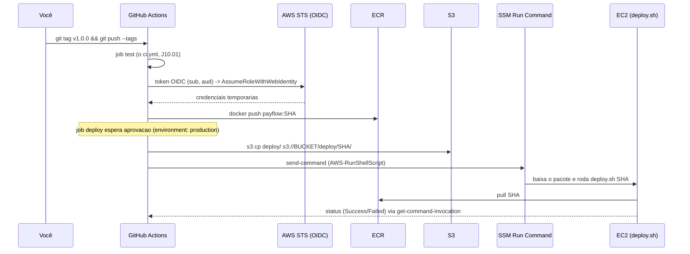

# J10.06 — 💸 Deploy do PayFlow: imagem, OIDC, SSM e rollback

> ⏱️ ~1h30 · 🟢 Júnior · Pré-requisitos: J10.01, J10.02, J10.05, J9.02 a J9.04 (imagem, Compose, segredos por arquivo), J8.03 (JWT) e J8.07 (limite do corpo na borda)

> ✅ **Validação final (2026-11-24):** este módulo foi executado no PayFlow reconstruído (CI local e AWS emulada); resultado e o que continua não executado no [README do módulo](README.md). Os avisos "não executado" abaixo descrevem a escrita original.

> 💸 Esta aula **liga** o que a J10.05 criou. O custo é o das EC2/RDS/ECR/S3 já criadas, **mais** o tempo de execução do pipeline. Termine com a J10.07.

> ⚠️ **Verificação:** **a AWS e o GitHub Actions de verdade não foram executados.** Executados **de verdade**: o `deploy.sh` (com PostgreSQL 18 em TLS, o SSM do **moto** e o Docker local), o `compose.prod.yaml`, o *Caddy* (`Caddyfile` validado; limite do corpo e cabeçalhos medidos), o SQL de `bootstrap-admin` (PostgreSQL 18 com o DDL real da J3.12), a conferência do hash BCrypt com o Spring Security 7.1.2, o `ssm-deploy.sh` contra o moto, `actionlint` e `shellcheck`. **Não executados:** a federação OIDC, o `send-command` real, o `user-data` no AL2023, o túnel `ssm start-session` (exige o *Session Manager plugin*, que não está instalado aqui), o `rollback`, o login do painel por túnel e o PayFlow **do aluno** dentro desse pipeline.

## 🎯 Objetivos
Ao final desta aula você consegue:
- **Explicar** o fluxo de entrega (teste → imagem → pacote → comando na instância) e **por que não há chave de acesso** guardada no GitHub.
- **Configurar** a confiança OIDC entre o GitHub e a AWS (papel, `aud`, `sub`) e **descobrir** o `sub` real do seu repositório.
- **Ler** o `deploy.sh` e **explicar** cada decisão (segredos por arquivo, `chown 10001`, IMDSv2, `--wait`, reversão).
- **Acessar** a aplicação sem abrir porta (túnel SSM) e **criar o primeiro usuário** de produção.
- **Opcional:** pôr o **Caddy** na frente (HTTPS com domínio próprio, limite do corpo).

## 🤔 Por que isso importa
"Deploy" é o momento em que o seu código passa a valer para alguém. Um deploy **manual** (SSH, copiar, reiniciar) é lento, não deixa rastro e depende de uma chave que vaza. Um deploy **por pipeline** é repetível, auditável (quem, quando, qual *commit*) e pode ser **desfeito**.

## 💡 Intuição (explicação simples)
O GitHub Actions é um **entregador** que precisa entrar no seu prédio. Em vez de você lhe dar uma **cópia da chave** (chave de acesso guardada, que ele pode perder), o prédio **confere o crachá dele na portaria** (o token OIDC, assinado pelo GitHub, que diz *"sou a execução X do repositório Y, no ambiente production"*) e lhe dá uma **chave descartável de 1 hora**. Se o crachá não diz exatamente o que a portaria espera, **não entra**.

## 🔬 Como funciona por dentro

### 1. O fluxo


### 2. OIDC: como a confiança é montada
1. **Provedor de identidade** na AWS (`create-open-id-connect-provider --url https://token.actions.githubusercontent.com --client-id-list sts.amazonaws.com`, feito no `20-iam.sh`).
2. **Papel** cuja *trust policy* diz: "aceito quem apresentar um token do GitHub com `aud = sts.amazonaws.com` **e** `sub = <exatamente este valor>`" (`deploy/iam/github-trust.json`):
```json
{
  "Version": "2012-10-17",
  "Statement": [
    {
      "Effect": "Allow",
      "Principal": { "Federated": "arn:aws:iam::__ACCOUNT_ID__:oidc-provider/token.actions.githubusercontent.com" },
      "Action": "sts:AssumeRoleWithWebIdentity",
      "Condition": {
        "StringEquals": {
          "token.actions.githubusercontent.com:aud": "sts.amazonaws.com",
          "token.actions.githubusercontent.com:sub": "__SUB__"
        }
      }
    }
  ]
}
```
3. No workflow: `permissions: id-token: write` (o job pode **pedir** o token) + `aws-actions/configure-aws-credentials` com `role-to-assume`. Sem `id-token: write`, o passo falha.

**O `sub` decide quem entra.** Valores documentados (página do GitHub "Configuring OpenID Connect in AWS"): `repo:ORG/REPO:ref:refs/heads/BRANCH`, `repo:ORG/REPO:environment:NOME` (quando o job usa `environment:`) e o curinga `repo:ORG/REPO:*` (**qualquer** branch, PR e ambiente: evite). Usamos `repo:OWNER/REPO:environment:production`: só os jobs com `environment: production` assumem o papel, e o *environment* pode exigir **aprovação manual** (*Settings → Environments → production → Required reviewers*). Nunca deixe um papel de deploy assumível a partir de `pull_request`.

> ⚠️ **Pegadinha da documentação:** para repositórios criados **depois de 15/07/2026** (ou que optaram), a claim `sub` passa a incluir **IDs imutáveis** do dono e do repositório, no formato `repo:ORG@ID/REPO@ID:...`. Se a sua trust policy usa o formato antigo, o resultado é `Not authorized to perform sts:AssumeRoleWithWebIdentity`. **Descubra o `sub` real** em vez de adivinhar: um passo de depuração (rode **uma vez**, num workflow temporário, e apague):
```yaml
      - name: Show OIDC claims (debug, remove afterwards)
        run: |
          jwt="$(curl -sS -H "Authorization: bearer $ACTIONS_ID_TOKEN_REQUEST_TOKEN" "$ACTIONS_ID_TOKEN_REQUEST_URL&audience=sts.amazonaws.com" | jq -r .value)"
          cut -d. -f2 <<<"$jwt" | tr '_-' '/+' | base64 -d 2>/dev/null | jq '{sub, aud, iss, environment, ref}'
```
O token **não** é impresso (só as *claims*, que não são segredo). Se o `base64 -d` reclamar de preenchimento, é o *padding*: adicione `=`. (⚠️ não executado.) Defina `GH_SUB='<o valor impresso>'` antes do `20-iam.sh`.

### 3. As variáveis do repositório
*Settings → Secrets and variables → Actions → **Variables***: `AWS_ROLE_ARN` (saída do `20-iam.sh`), `AWS_REGION`, `AWS_ACCOUNT_ID`, `ECR_REPOSITORY` (`payflow`), `DEPLOY_BUCKET`, `INSTANCE_ID` (saída do `60-instance.sh`). **Nenhuma é segredo** (é por isso que são *variables*, não *secrets*): o poder vem da confiança OIDC, não de um valor guardado.

### 4. O workflow `cd.yml`
```yaml
name: CD

on:
  push:
    tags: ['v*.*.*']
  workflow_dispatch:

permissions:
  contents: read

concurrency:
  group: cd-production
  cancel-in-progress: false      # nunca cancele um deploy no meio

jobs:
  test:
    uses: ./.github/workflows/ci.yml

  image:
    name: build and push the image
    needs: test
    runs-on: ubuntu-24.04
    timeout-minutes: 20
    permissions:
      contents: read
      id-token: write            # permite pedir o token OIDC (sem chave de acesso guardada)
    outputs:
      tag: ${{ steps.meta.outputs.tag }}
    steps:
      - uses: actions/checkout@3d3c42e5aac5ba805825da76410c181273ba90b1 # v7.0.1
        with:
          persist-credentials: false
      - uses: aws-actions/configure-aws-credentials@e1253824e5c10ff9df46874f81ed3ec929e19cfd # v6.3.0
        with:
          role-to-assume: ${{ vars.AWS_ROLE_ARN }}
          aws-region: ${{ vars.AWS_REGION }}
      - id: meta
        run: echo "tag=${GITHUB_SHA}" >> "$GITHUB_OUTPUT"
      - name: Login to ECR
        env:
          REGISTRY: ${{ vars.AWS_ACCOUNT_ID }}.dkr.ecr.${{ vars.AWS_REGION }}.amazonaws.com
        run: aws ecr get-login-password | docker login --username AWS --password-stdin "$REGISTRY"
      - uses: docker/setup-buildx-action@f87e5991a6d7451dcb8d9637bfbc97413f497069 # v4.4.1
      - uses: docker/build-push-action@c3c9e263c25d99ce0380d002d59b67737d91b0dc # v7.4.0
        with:
          context: .
          push: true
          tags: ${{ vars.AWS_ACCOUNT_ID }}.dkr.ecr.${{ vars.AWS_REGION }}.amazonaws.com/${{ vars.ECR_REPOSITORY }}:${{ steps.meta.outputs.tag }}
          cache-from: type=gha
          cache-to: type=gha,mode=max

  deploy:
    name: deploy to EC2 through SSM
    needs: image
    runs-on: ubuntu-24.04
    timeout-minutes: 15
    environment: production      # permite exigir aprovacao manual e limita quem assume o papel
    permissions:
      contents: read
      id-token: write
    steps:
      - uses: actions/checkout@3d3c42e5aac5ba805825da76410c181273ba90b1 # v7.0.1
        with:
          persist-credentials: false
      - uses: aws-actions/configure-aws-credentials@e1253824e5c10ff9df46874f81ed3ec929e19cfd # v6.3.0
        with:
          role-to-assume: ${{ vars.AWS_ROLE_ARN }}
          aws-region: ${{ vars.AWS_REGION }}
      - name: Upload the deploy bundle
        env:
          BUCKET: ${{ vars.DEPLOY_BUCKET }}
        run: aws s3 cp deploy/ "s3://$BUCKET/deploy/$GITHUB_SHA/" --recursive --exclude 'iam/*'
      - name: Run deploy.sh on the instance
        env:
          BUCKET: ${{ vars.DEPLOY_BUCKET }}
          INSTANCE_ID: ${{ vars.INSTANCE_ID }}
          TAG: ${{ needs.image.outputs.tag }}
        run: bash scripts/ci/ssm-deploy.sh
```
Decisões: dispara por **tag** `vX.Y.Z` (ou manualmente); **reusa** o `ci.yml` (`uses: ./.github/workflows/ci.yml`) como portão **antes** de gastar com imagem (J9: testes fora do `docker build`); a tag da imagem é o **SHA do commit** (rastreável e imutável no ECR); `concurrency` **sem cancelar** (nunca interrompa um deploy); `environment: production` no job `deploy`; `id-token: write` **só** nos dois jobs que falam com a AWS. A imagem é construída com o `Dockerfile` da J9 (que já usa `-DskipTests`: os testes rodaram no job `test`).

O envio do comando (`scripts/ci/ssm-deploy.sh`, testado contra o moto: `Success`):
```bash
#!/usr/bin/env bash
# Pede ao SSM que a instancia baixe o pacote do S3 e rode deploy.sh; espera e mostra a saida.
set -Eeuo pipefail
: "${BUCKET:?}" "${INSTANCE_ID:?}" "${TAG:?}"
cmd="aws s3 cp s3://${BUCKET}/deploy/${TAG}/ /opt/payflow/ --recursive && bash /opt/payflow/deploy.sh ${TAG}"
params="$(jq -cn --arg c "$cmd" '{commands: [$c]}')"
cmd_id="$(aws ssm send-command --instance-ids "$INSTANCE_ID" --document-name AWS-RunShellScript \
  --comment "payflow deploy ${TAG}" --parameters "$params" --query Command.CommandId --output text)"
echo "command id: $cmd_id"
status=0
aws ssm wait command-executed --command-id "$cmd_id" --instance-id "$INSTANCE_ID" || status=$?
aws ssm get-command-invocation --command-id "$cmd_id" --instance-id "$INSTANCE_ID" \
  --query '[Status, StandardOutputContent, StandardErrorContent]' --output text
exit "$status"
```
O `jq -cn --arg` monta o JSON com **escape correto**: nunca concatene texto em JSON/shell. O `aws ssm wait command-executed` falha (código ≠ 0) se o comando falhar; o `get-command-invocation` mostra a saída do `deploy.sh` no log do Actions.

### 5. O `deploy.sh` (roda na instância, como root, pelo SSM)
```bash
#!/usr/bin/env bash
# Roda NA INSTANCIA (como root, via SSM Run Command). Uso: deploy.sh <tag-da-imagem>
# Variaveis para teste local: PAYFLOW_DIR, AWS_REGION, REGISTRY, SKIP_ECR_LOGIN=1, PULL_POLICY=never, COMPOSE_EXTRA="-f arquivo"
set -Eeuo pipefail

TAG="${1:?usage: deploy.sh <image-tag>}"
APP_DIR="${PAYFLOW_DIR:-/opt/payflow}"
cd "$APP_DIR"

imds() {   # IMDSv2: pega um token de sessao e so entao le o metadado
  local token
  token="$(curl -fsS -X PUT http://169.254.169.254/latest/api/token -H 'X-aws-ec2-metadata-token-ttl-seconds: 60')"
  curl -fsS -H "X-aws-ec2-metadata-token: ${token}" "http://169.254.169.254/latest/meta-data/$1"
}
AWS_REGION="${AWS_REGION:-$(imds placement/region)}"
export AWS_REGION AWS_DEFAULT_REGION="$AWS_REGION"
REGISTRY="${REGISTRY:-$(aws sts get-caller-identity --query Account --output text).dkr.ecr.${AWS_REGION}.amazonaws.com}"

param() { aws ssm get-parameter --name "/payflow/$1" --with-decryption --query Parameter.Value --output text; }

echo ">> secrets"
umask 077
mkdir -p secrets
param db_password > secrets/db_password
param jwt_secret  > secrets/jwt_secret
DB_HOST="$(param db_host)"
# arquivo .pgpass (usado so pelo bootstrap-admin.sh, que roda psql): host:porta:banco:usuario:senha
printf '%s:5432:payflow:payflow:%s\n' "$DB_HOST" "$(cat secrets/db_password)" > secrets/pgpass
# o container roda como uid 10001 (J9.02): o arquivo precisa ser DELE e so dele ler
chown 10001:10001 secrets/db_password secrets/jwt_secret
chmod 400 secrets/db_password secrets/jwt_secret secrets/pgpass

echo ">> image ${REGISTRY}/payflow:${TAG}"
if [[ "${SKIP_ECR_LOGIN:-0}" != "1" ]]; then
  aws ecr get-login-password | docker login --username AWS --password-stdin "$REGISTRY"
fi
[[ -f .env ]] && cp .env .env.previous
printf 'PAYFLOW_IMAGE=%s/payflow:%s\nDB_HOST=%s\n' "$REGISTRY" "$TAG" "$DB_HOST" > .env

# COMPOSE_EXTRA e palavra-solta de proposito (varios argumentos)
# shellcheck disable=SC2086
compose() { docker compose --env-file .env -f compose.prod.yaml ${COMPOSE_EXTRA:-} "$@"; }

echo ">> up"
if compose up -d --pull "${PULL_POLICY:-always}" --wait --wait-timeout 120; then
  echo ">> deployed ${TAG}"
else
  echo "!! deploy failed; logs:" >&2
  compose logs --tail 80 app >&2 || true
  if [[ -f .env.previous ]]; then
    echo "!! rolling back to the previous image" >&2
    cp .env.previous .env
    compose up -d --wait --wait-timeout 120 || true
  fi
  exit 1
fi
```
Decisões, uma a uma:
1. **IMDSv2** (`imds()`): token por `PUT`, só então o `GET` do metadado (região).
2. **Segredos do Parameter Store → arquivos** em `secrets/`, lidos por `configtree` (J9.03, J8.07): a senha **nunca** vai para `-e`, para o `docker inspect` nem para o `.env`. `umask 077` antes de gravar.
3. **`chown 10001:10001` e `chmod 400`.** Na J9.03 o `chmod 600` com dono do *host* (uid 1000) deu `AccessDeniedException` porque a aplicação roda como **10001**; em dev a saída foi `644`. Na instância você é root e **pode** dar o arquivo ao uid certo: só o dono lê. **Executei** os dois lados: com o arquivo `-r-------- 1000 1000` o container caiu com `java.nio.file.AccessDeniedException: /run/secrets/spring.datasource.password`; depois de `chown 10001:10001` (feito por um container root, porque aqui não tenho `sudo`) o `compose up --wait` ficou **Healthy** e `/actuator/health` respondeu `{"status":"UP"}`.
4. **`.env` com a imagem e o host do banco**, e uma cópia `.env.previous`: é o mecanismo de **volta**.
5. **`up -d --pull always --wait --wait-timeout 120`:** espera o `healthcheck` ficar saudável; **se não ficar**, imprime as últimas 80 linhas do log, **volta** para a imagem anterior e sai com erro, o que deixa o job do Actions **vermelho**. ⚠️ A **reversão não foi exercitada** (só o caminho feliz foi executado): teste-a no seu primeiro deploy quebrado de propósito.
6. **`PULL_POLICY`, `COMPOSE_EXTRA` e `PAYFLOW_DIR`** existem **só para o teste local** (usei-os para executar o script contra o PostgreSQL de laboratório).

O `compose.prod.yaml` (só a aplicação; o banco é o RDS):
```yaml
name: payflow

services:
  app:
    image: ${PAYFLOW_IMAGE:?set PAYFLOW_IMAGE}
    restart: unless-stopped
    environment:
      SPRING_DATASOURCE_URL: jdbc:postgresql://${DB_HOST:?set DB_HOST}:5432/payflow?sslmode=verify-full&sslrootcert=/certs/global-bundle.pem
      SPRING_DATASOURCE_USERNAME: payflow
      SPRING_CONFIG_IMPORT: configtree:/run/secrets/
    secrets:
      - source: db_password
        target: spring.datasource.password
      - source: jwt_secret
        target: payflow.security.jwt.secret
    volumes:
      - ./certs/global-bundle.pem:/certs/global-bundle.pem:ro
    ports:
      - "127.0.0.1:8080:8080"        # so o proprio host alcanca; o acesso de fora e por tunel SSM (ou pelo Caddy)
    logging:
      driver: json-file
      options: { max-size: "10m", max-file: "3" }
    healthcheck:
      test: ["CMD", "wget", "-q", "-O", "/dev/null", "http://localhost:8080/actuator/health"]
      interval: 10s
      timeout: 3s
      retries: 5
      start_period: 40s

secrets:
  db_password:
    file: ./secrets/db_password
  jwt_secret:
    file: ./secrets/jwt_secret
```
**Executado** com o PayFlow Lite: a aplicação conectou por `verify-full` ao PostgreSQL 18 de laboratório, o Flyway aplicou a migração e a saúde ficou `UP`. A porta é publicada **só em `127.0.0.1:8080`** da instância (decisão 72): o mundo não a alcança.

### 6. Acessando sem abrir porta: túnel SSM (⚠️ não executado)
Instale o *Session Manager plugin* (página da AWS) e:
```bash
aws ssm start-session --target "$INSTANCE_ID" \
  --document-name AWS-StartPortForwardingSession \
  --parameters '{"portNumber":["8080"],"localPortNumber":["8080"]}'
# em outro terminal:  curl http://localhost:8080/actuator/health
```
O túnel conecta o **seu** `localhost:8080` ao `127.0.0.1:8080` **da instância**, autenticado pelo IAM e registrado no CloudTrail. **Sem porta aberta, sem IP para atacar.** ⚠️ **Painel pelo túnel:** o PayFlow sem perfil emite o cookie de sessão `Secure` (J8.03); em `http://localhost` os navegadores principais tratam `localhost` como contexto seguro, mas **isto não foi verificado**: se o login não "grudar", teste a **API** (`POST /api/v1/auth/token` e o Bearer) e registre o achado em `docs/cloud-notes.md`.

### 7. O primeiro usuário (produção não tem seed)
O ambiente sem perfil **não** carrega o `R__dev_seed.sql` (decisão 31); logo, **não há ninguém para fazer login**. O SQL abaixo cria um **ADMIN** e a conta dele. O **hash BCrypt é gerado no seu computador** (a senha em texto **nunca** vai à instância):
```bash
# no seu computador (exemplo com Python; o formato $2a$10$ e o prefixo {bcrypt} sao o da decisao 57)
python3 -m venv /tmp/bc && /tmp/bc/bin/pip -q install bcrypt
/tmp/bc/bin/python -c 'import bcrypt,getpass;print("{bcrypt}"+bcrypt.hashpw(getpass.getpass().encode(),bcrypt.gensalt(10,prefix=b"2a")).decode())'
```
Conferi esse formato **com o Spring Security 7.1.2**: um hash gerado assim, com o prefixo `{bcrypt}`, passou no `DelegatingPasswordEncoder` (`matches` verdadeiro para a senha certa e falso para outra) e tem 68 caracteres. O SQL (executado no PostgreSQL 18 com o DDL real da J3.12):
```sql
-- Cria o PRIMEIRO usuario (ADMIN) e a conta dele. Producao nao tem seed (decisao 31).
-- Uso: psql -v email=... -v full_name=... -v hash=... -f bootstrap-admin.sql   (o hash ja com o prefixo {bcrypt})
\set ON_ERROR_STOP on
BEGIN;
WITH u AS (
  INSERT INTO users (email, full_name, password_hash, role)
  VALUES (lower(trim(:'email')), :'full_name', :'hash', 'ADMIN')
  RETURNING id
)
INSERT INTO accounts (owner_id) SELECT id FROM u;
COMMIT;
SELECT u.email, u.role, length(u.password_hash) AS hash_len, a.status, a.balance
FROM users u JOIN accounts a ON a.owner_id = u.id;
```
```text
       email       | role  | hash_len | status | balance
 admin@payflow.dev | ADMIN |       68 | ACTIVE |    0.00
```
Rodando de novo com o mesmo e-mail: `ERROR: duplicate key value violates unique constraint "uk_users_email"` (a restrição da J3 protege). O script `bootstrap-admin.sh` roda esse SQL **na instância** (via sessão SSM) com um container `postgres:18` e `sslmode=verify-full`: **não executado** (o `psql` dentro do container com `PGPASSFILE` não foi testado). Escolha uma senha forte (≥ 12 caracteres, J8.07) e **apague o histórico do seu terminal**.

### 8. Opcional (caminho B): HTTPS público com Caddy
Se você tem um **domínio** seu: abra 80/443 no SG da instância (💸 e superfície de ataque), aponte o DNS para o IP da instância e use `compose.edge.yaml` + `Caddyfile`:
```text
{$PAYFLOW_DOMAIN} {
	encode zstd gzip

	# O teto do CORPO da requisicao e da borda (J8.07, decisao 63): 64 KB basta para a API do PayFlow
	request_body {
		max_size 64KB
	}

	header {
		Strict-Transport-Security "max-age=31536000"
		-Server
	}

	reverse_proxy app:8080
}
```
**Executado** localmente (Caddy 2.11, PayFlow Lite, domínio `localhost` com certificado interno): `caddy validate` → `Valid configuration`; `POST` pequeno → **201**; `POST` de ~100 KB → **413** no Caddy; **o mesmo corpo direto na aplicação → 500** (o PayFlow Lite não tem `@Size`; o PayFlow tem, J8.07, mas só **depois** de o Jackson ler o corpo todo: por isso o teto do corpo é da **borda**, a promessa da decisão 63); resposta `HTTP/2 200` com `strict-transport-security: max-age=31536000`. **Não executado:** a emissão real de certificado (Let's Encrypt precisa de domínio público, portas 80/443 e tem limites de emissão: **guarde o volume `caddy_data`**).

> **Por que não usei um nome "grátis" por IP (sslip.io etc.)?** O Let's Encrypt limita certificados por **domínio registrado**; um serviço compartilhado por muita gente tende a esbarrar nesse limite, e o sslip.io **não** aparece na *Public Suffix List* (consultei a lista em 2026-11-13). Em estudo, o túnel SSM dispensa isso.

## 🧠 Pausa para lógica
**Enunciado:** o *job* `deploy` usa `needs: image`, e o `image` usa `needs: test`. Se o `test` falhar, o que acontece com os outros dois? E se o `deploy` falhar **depois** de a imagem já ter sido enviada ao ECR?
<details><summary>Dica</summary>Um job só roda se todos os de `needs` terminaram com **sucesso**.</details>
<details><summary>Solução</summary>

`image` e `deploy` são **pulados** (nada é gasto nem implantado). Se o `deploy` falhar, a **imagem fica no ECR** (inofensiva: tag imutável, ainda não em uso), e o `deploy.sh` terá **revertido** a instância para a imagem anterior; corrija e crie **outra tag** (você não pode reusar o SHA/tag: `IMMUTABLE`). Variação: o que muda se o `cd.yml` rodasse `image` e `test` em paralelo? (Você gastaria minutos de imagem mesmo com testes quebrados.)
</details>

## ⚖️ Trade-offs e quando NÃO usar
Este desenho é **simples e barato**, não é **sem indisponibilidade**: o `up` recria o container (alguns segundos fora do ar; o `graceful shutdown` da J9 protege as requisições em andamento). Para zero-downtime: *rolling*/*blue-green* e balanceador (P8/P9). `SendCommand` roda **como root** na instância: o papel do GitHub tem poder real, por isso o `sub` restrito, o ambiente com aprovação e a condição de tag. Alternativas: ECS/Fargate (P9), Elastic Beanstalk, Kubernetes (P7), Terraform para criar tudo (P8).

## ⚠️ Erros comuns e boas práticas de produção
| Sintoma | Causa | Correção |
|---|---|---|
| `Not authorized to perform sts:AssumeRoleWithWebIdentity` | `sub`/`aud` não batem, ou falta `id-token: write` | imprima as claims (item 2) e ajuste a trust policy |
| `Credentials could not be loaded` na action | `role-to-assume` vazio (variável não definida) | confira *Variables* e o nome exato |
| `AccessDeniedException` no `send-command` | falta `ssm:SendCommand` para o **documento** ou a **instância** (a política pede os **dois** recursos e a tag `project=payflow`) | use o Policy Simulator |
| `InvalidInstanceId` / instância não aparece | agente SSM offline, sem papel, sem saída para a internet | `aws ssm describe-instance-information` |
| `repository ... tag invalid: The image tag 'X' already exists` (⚠️ de memória) | `IMMUTABLE` e a tag já existe | nova tag (novo commit) |
| Aplicação reinicia em laço | segredo ilegível (uid), DB inalcançável, `verify-full` falhando | `docker compose logs app` pelo SSM; a **primeira** falha (J9.04) |
| Deploy "passou" mas é a versão antiga | o `.env` não mudou / `--pull never` | `docker compose config` e `docker image ls` |
| `Success` do SSM com saída truncada | o SSM corta a saída do comando em ~24 KB (⚠️ de memória) | grave logs em arquivo; use `docker compose logs` |

## 🧩 Exercícios
1. **Fixação:** (a) por que o papel do GitHub não é assumível a partir de `pull_request`? (b) Qual a vantagem do SHA como tag? (c) Por que `chown 10001` na instância mas `chmod 644` em dev?
2. **Aplicação no PayFlow** (💸):
   - [ ] Imprima as claims OIDC (item 2) e ajuste `GH_SUB` / a trust policy; `AWS_ROLE_ARN` e as variáveis no repositório; *Environment* `production` com você como revisor.
   - [ ] Copie `deploy/`, `scripts/ci/ssm-deploy.sh` e `.github/workflows/cd.yml`; `actionlint` limpo; `shellcheck` sem avisos.
   - [ ] `git tag v0.1.0 && git push origin v0.1.0`: acompanhe `test` → `image` → aprovação → `deploy`. Anote os três tempos.
   - [ ] Pelo túnel SSM: `curl http://localhost:8080/actuator/health` → `UP`; **registre** o resultado do login do painel e, se falhar, do `POST /api/v1/auth/token`.
   - [ ] Crie o primeiro ADMIN (item 7) e **faça login**.
   - [ ] **Quebre de propósito** um deploy (por exemplo, uma variável de ambiente inválida) e **prove a reversão**: `docker compose ps` na instância mostra a imagem anterior.
   - [ ] `docs/deploy-notes.md`: o fluxo, as variáveis, o `sub` real, os tempos, os achados.
   - [ ] Tag `payflow-J10` (depois da J10.07).
3. **Desafio (opcional):** adicione ao `deploy.sh` um *smoke test* que, depois do `--wait`, chama `/api/v1/accounts` sem token e confirma **401** (a segurança da J8 está ativa em produção).

<details><summary>Soluções de referência</summary>

1. (a) Qualquer pessoa pode abrir uma PR (e em repositório público, de um *fork*): o papel com poder de deploy só pode ser assumido por quem passou pelo **ambiente** `production` (aprovado). (b) Rastreabilidade (do SHA ao código) e imutabilidade. (c) Em dev o dono do arquivo é seu uid e a aplicação roda como 10001; na instância o root entrega o arquivo ao dono certo.
</details>

## 🎤 Na entrevista
1. **Por que OIDC em vez de uma chave de acesso nos *secrets* do GitHub?** *Resposta-modelo:* não há segredo de longa duração para vazar; as credenciais são temporárias e atreladas ao repositório/ambiente por *claims* assinadas; o acesso é auditável.
2. **Como você faria rollback?** *Resposta-modelo:* a tag imutável da versão anterior continua no registro; guardo a referência anterior (`.env.previous`) e reimplanto; o *healthcheck* decide se o deploy valeu.
3. **Por que não abrir SSH?** *Resposta-modelo:* superfície de ataque e chaves a gerenciar; o Session Manager autentica por IAM, não exige porta aberta e deixa trilha de auditoria.
4. **Onde fica o limite do corpo da requisição e por quê?** *Resposta-modelo:* na borda (proxy/balanceador/gateway), porque a aplicação só consegue validar tamanho depois de ler o corpo.

## 📚 Para ir além
- 📄 [OIDC no AWS (GitHub)](https://docs.github.com/en/actions/how-tos/security-for-github-actions/security-hardening-your-deployments/configuring-openid-connect-in-amazon-web-services): `id-token: write`, `aud`, `sub`, o formato novo.
- 📄 [Conceito de OIDC no GitHub Actions](https://docs.github.com/en/actions/concepts/security/openid-connect).
- 📄 [Ambientes e aprovações](https://docs.github.com/en/actions/how-tos/deploy/configure-and-manage-deployments/control-deployments).
- 📄 [SSM Run Command](https://docs.aws.amazon.com/systems-manager/latest/userguide/run-command.html) · [Session Manager](https://docs.aws.amazon.com/systems-manager/latest/userguide/session-manager.html).
- 💻 [aws-actions/configure-aws-credentials](https://github.com/aws-actions/configure-aws-credentials) · [docker/build-push-action](https://github.com/docker/build-push-action).
- 🎥 ⚠️ nenhum vídeo verificado.

## ✅ Checklist da aula
- [ ] Nenhuma chave de acesso guardada no GitHub.
- [ ] O `sub` da trust policy é o **real** (impresso) e aponta para o ambiente `production`.
- [ ] Tag → teste → imagem → aprovação → deploy funcionou, com a saída do `deploy.sh` no log.
- [ ] A aplicação responde `UP` pelo túnel; não há porta aberta no SG.
- [ ] Criei o primeiro ADMIN e fiz login; provei (ou registrei que não provei) a reversão.
