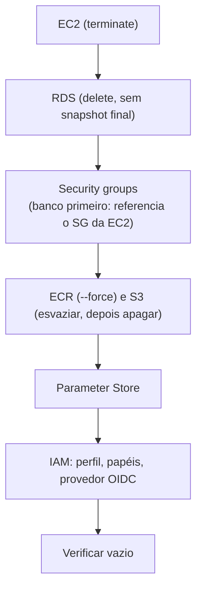

# J10.07 — 💸 Destruir tudo e a equivalência AWS ↔ Azure ↔ GCP

> ⏱️ ~1h30 · 🟢 Júnior · Pré-requisitos: J10.04 a J10.06

> 💸 **Esta é a aula que protege o seu bolso.** Faça-a **no mesmo dia** em que criou os recursos, mesmo que o deploy tenha falhado.

> ⚠️ **Verificação:** o `90-teardown.sh` e o `91-verify-empty.sh` foram executados **contra o moto** (emulador): ANTES da destruição o verificador achou **9 itens** (instância, volume, RDS, snapshot automático, SGs, bucket, ECR, parâmetros, papéis; exit 1); DEPOIS: tudo `ok` (exit 0); a **segunda** execução do teardown foi **idempotente** (9 passos "skipped", exit 0); sem `CONFIRM=payflow` o script **recusou** rodar. **Não** foi executado numa conta real: o comportamento real da AWS (dependências entre recursos, tempos, o que a conta cobra depois) é o que você vai conferir. A tabela de equivalência vem das páginas de comparação oficiais do Azure e do Google Cloud (200 em 2026-11-13); **os nomes dos serviços mudam: confirme lá**.

## 🎯 Objetivos
Ao final desta aula você consegue:
- **Destruir** a pilha do PayFlow **na ordem certa** e **provar** que nada ficou.
- **Listar** o que continua cobrando depois que a "coisa principal" some.
- **Conferir** a fatura/uso no dia seguinte e **desligar** o que restar (orçamento, usuário, conta).
- **Traduzir** cada serviço usado entre AWS, Azure e GCP.

## 🤔 Por que isso importa
A história mais comum de "fatura inesperada" não é um ataque: é **um volume, um IP ou um banco esquecido**. Saber **destruir e provar** é metade de saber criar. E, em entrevista, "você só conhece a AWS?" tem resposta honesta: **os conceitos são os mesmos**, os nomes mudam.

## 💡 Intuição (explicação simples)
Sair de um **apartamento alugado**: você não só vai embora; devolve a chave, **cancela a conta de luz e a internet**, e **tira foto** de cada cômodo vazio. Se esquecer uma assinatura, ela continua chegando. O `91-verify-empty.sh` é a foto dos cômodos vazios.

## 🔬 Como funciona por dentro

### 1. Por que a ordem importa

Cada seta é uma **dependência real**: o SG da EC2 **não pode** ser apagado enquanto o SG do banco o referencia (nem enquanto a instância o usa); um bucket **não vazio** não se apaga; o papel só se apaga depois de **desanexar** as políticas e remover do perfil. Quando o script falha no meio, **rode de novo**: ele é **idempotente** (o `try` registra "skipped" e segue).

### 2. O script
```bash
#!/usr/bin/env bash
# J10.07: destroi TUDO que os scripts criaram, na ordem inversa. Uso: CONFIRM=payflow bash 90-teardown.sh
source "$(dirname "$0")/env.sh"
[[ "${CONFIRM:-}" == "$PROJECT" ]] || { echo "this deletes the ${PROJECT} stack in ${AWS_REGION}; run with CONFIRM=${PROJECT}" >&2; exit 1; }
try() { "$@" || echo "  (skipped: $*)" >&2; }     # idempotente: o que ja nao existe nao para o resto

echo ">> EC2"
ids="$(aws ec2 describe-instances --filters "Name=tag:project,Values=${PROJECT}" Name=instance-state-name,Values=pending,running,stopping,stopped \
  --query 'Reservations[].Instances[].InstanceId' --output text)"
if [[ -n "$ids" ]]; then
  # shellcheck disable=SC2086
  aws ec2 terminate-instances --instance-ids $ids >/dev/null
  # shellcheck disable=SC2086
  aws ec2 wait instance-terminated --instance-ids $ids
fi

echo ">> RDS (sem snapshot final: o banco de estudo nao guarda dados reais)"
if aws rds describe-db-instances --db-instance-identifier "$DB_ID" >/dev/null 2>&1; then
  aws rds delete-db-instance --db-instance-identifier "$DB_ID" --skip-final-snapshot --delete-automated-backups >/dev/null
  aws rds wait db-instance-deleted --db-instance-identifier "$DB_ID"
fi
try aws rds delete-db-subnet-group --db-subnet-group-name "$DB_SUBNETS"

echo ">> security groups (o do banco primeiro: ele referencia o da instancia)"
for sg in "$RDS_SG" "$EC2_SG"; do
  gid="$(aws ec2 describe-security-groups --filters "Name=group-name,Values=${sg}" --query 'SecurityGroups[0].GroupId' --output text)"
  [[ "$gid" == "None" ]] || try aws ec2 delete-security-group --group-id "$gid"
done

echo ">> ECR e S3"
try aws ecr delete-repository --repository-name "$ECR_REPO" --force >/dev/null
if aws s3api head-bucket --bucket "$BUCKET" >/dev/null 2>&1; then
  aws s3 rm "s3://${BUCKET}" --recursive >/dev/null
  aws s3api delete-bucket --bucket "$BUCKET"
fi

echo ">> parametros do SSM"
try aws ssm delete-parameters --names /payflow/db_password /payflow/jwt_secret /payflow/db_host >/dev/null

echo ">> IAM"
try aws iam remove-role-from-instance-profile --instance-profile-name "$EC2_PROFILE" --role-name "$EC2_ROLE"
try aws iam delete-instance-profile --instance-profile-name "$EC2_PROFILE"
try aws iam detach-role-policy --role-name "$EC2_ROLE" --policy-arn arn:aws:iam::aws:policy/AmazonSSMManagedInstanceCore
try aws iam delete-role-policy --role-name "$EC2_ROLE" --policy-name payflow-runtime
try aws iam delete-role --role-name "$EC2_ROLE"
try aws iam delete-role-policy --role-name "$GH_ROLE" --policy-name payflow-deploy
try aws iam delete-role --role-name "$GH_ROLE"
try aws iam delete-open-id-connect-provider --open-id-connect-provider-arn "arn:aws:iam::${ACCOUNT_ID}:oidc-provider/${OIDC_URL}"

echo ">> budget (opcional: ele nao cobra; apague se quiser)"
echo "done. Now run 91-verify-empty.sh"
```
Notas:
- `CONFIRM=payflow` evita um acidente (sem a variável, recusa).
- `--skip-final-snapshot --delete-automated-backups` apagam o banco **sem guardar nada**: isso é **irreversível**. Correto para estudo; **jamais** em produção (lá: snapshot final, proteção contra exclusão, e a regra de que **ninguém apaga banco de produção por script**).
- O orçamento **não** é apagado (não cobra); remova-o à mão quando terminar o estudo.

### 3. Provar que ficou vazio
```bash
#!/usr/bin/env bash
# J10.07: prova que nada ficou. Sai com 1 se achar qualquer coisa do projeto.
source "$(dirname "$0")/env.sh"
found=0
check() {  # check "<descricao>" "<saida do comando>"
  if [[ -n "$2" && "$2" != "None" ]]; then echo "LEFTOVER $1: $2"; found=1; else echo "ok       $1"; fi
}
check "ec2 instances"   "$(aws ec2 describe-instances --filters "Name=tag:project,Values=${PROJECT}" Name=instance-state-name,Values=pending,running,stopping,stopped --query 'Reservations[].Instances[].InstanceId' --output text)"
check "ebs volumes"     "$(aws ec2 describe-volumes --filters "Name=tag:project,Values=${PROJECT}" --query 'Volumes[].VolumeId' --output text)"
check "elastic ips"     "$(aws ec2 describe-addresses --query 'Addresses[].PublicIp' --output text)"
check "snapshots"       "$(aws ec2 describe-snapshots --owner-ids self --filters "Name=tag:project,Values=${PROJECT}" --query 'Snapshots[].SnapshotId' --output text)"
check "rds instances"   "$(aws rds describe-db-instances --query "DBInstances[?DBInstanceIdentifier=='${DB_ID}'].DBInstanceIdentifier" --output text)"
check "rds snapshots"   "$(aws rds describe-db-snapshots --query "DBSnapshots[?DBInstanceIdentifier=='${DB_ID}'].DBSnapshotIdentifier" --output text)"
check "security groups" "$(aws ec2 describe-security-groups --filters "Name=tag:project,Values=${PROJECT}" --query 'SecurityGroups[].GroupId' --output text)"
check "s3 bucket"       "$(aws s3api list-buckets --query "Buckets[?Name=='${BUCKET}'].Name" --output text)"
check "ecr repository"  "$(aws ecr describe-repositories --query "repositories[?repositoryName=='${ECR_REPO}'].repositoryName" --output text 2>/dev/null || true)"
check "ssm parameters"  "$(aws ssm describe-parameters --parameter-filters Key=Name,Option=BeginsWith,Values=/payflow --query 'Parameters[].Name' --output text)"
check "iam roles"       "$(aws iam list-roles --query "Roles[?starts_with(RoleName, '${PROJECT}-')].RoleName" --output text)"
exit "$found"
```
O script consulta, **por tag e por nome**, cada tipo de recurso que cobra e sai com `1` se achar algo. Saída do experimento (moto) **antes** e **depois**:
```text
LEFTOVER ec2 instances: i-052f…   |   ok       ec2 instances
LEFTOVER ebs volumes:  vol-a470…  |   ok       ebs volumes
LEFTOVER rds instances: payflow-db |  ok       rds instances
LEFTOVER rds snapshots: rds:payflow-db-…  | ok  rds snapshots
LEFTOVER security groups: sg-b258… sg-f29c… | ok security groups
LEFTOVER s3 bucket / ecr repository / ssm parameters / iam roles ...   |   ok (todos)
exit=1                                                                  |   exit=0
```
**Limite honesto:** o verificador só enxerga **a região** em que roda e **o que tem a tag/nome** esperados. Um recurso criado à mão (sem tag) ou em **outra região** passa batido. Por isso o próximo passo é humano.

### 4. O que continua cobrando (a lista de esquecidos)
| Recurso | Por que fica | Como achar |
|---|---|---|
| **Volume EBS** | instância sem `DeleteOnTermination` | `aws ec2 describe-volumes --filters Name=status,Values=available` |
| **Elastic IP / IPv4 público** | IP alocado e solto (cobrado por hora, J10.03) | `aws ec2 describe-addresses` |
| **Snapshots** (EBS e RDS) | manuais não expiram | `describe-snapshots --owner-ids self`, `rds describe-db-snapshots` |
| **Logs** (CloudWatch Logs) | grupos de log com retenção "nunca" | console → CloudWatch → Log groups |
| **Imagens no ECR** e objetos no S3 | armazenamento por GB-mês | o `--force` e o `rm --recursive` do script |
| **NAT Gateway, balanceadores** | não criamos, mas **aparecem** em tutoriais | Cost Explorer por serviço |
| **Recursos em outra região** | você esqueceu de olhar | o seletor de região do console; "Tag Editor" por região |
| **Parâmetros/segredos** | Secrets Manager cobra por segredo | `describe-parameters`, `secretsmanager list-secrets` |

### 5. O dia seguinte
1. **Cost Explorer** (*Billing → Cost Explorer*): gasto por **serviço** e por **dia**: **nenhum serviço deve crescer** depois da destruição. Os dados de faturamento levam até ~24 h para refletir (a própria AWS avisa do atraso nos alertas, J10.04): **olhe de novo em 2 dias**.
2. **Free Tier usage / créditos:** anote o saldo.
3. **Orçamento:** deixe-o (não cobra) **ou** apague.
4. **IAM:** desative/apague o usuário de estudo se não for usá-lo (e **as chaves de acesso**, se você criou alguma contra o conselho).
5. **Fechar a conta**, se terminou **definitivamente**: *Account → Close account* (exige a **raiz**; há um período de **90 dias** para reativar, de acordo com a página do plano Free; ⚠️ detalhes do fechamento: leia a página oficial antes). No plano Free a conta **fecha sozinha** ao fim dos 6 meses ou dos créditos (J10.03): **baixe o que quiser guardar** antes.

### 6. A tabela de equivalência
| Conceito | AWS (usado aqui) | Azure | Google Cloud |
|---|---|---|---|
| Máquina virtual | **EC2** | Virtual Machines | Compute Engine |
| Disco da VM | **EBS** | Managed Disks | Persistent Disk / Hyperdisk |
| Banco PostgreSQL gerenciado | **RDS for PostgreSQL** | Azure Database for PostgreSQL | Cloud SQL for PostgreSQL |
| Armazenamento de objetos | **S3** | Blob Storage | Cloud Storage |
| Registro de imagens | **ECR** | Azure Container Registry | Artifact Registry |
| Firewall da instância | **Security Group** | Network Security Group | regras de firewall da VPC |
| Identidade e permissões | **IAM** (papéis, políticas) | Microsoft Entra ID + Azure RBAC | Cloud IAM |
| Credencial de curta duração para o CI | **OIDC + papel** | federação de identidade de workload (Entra) | Workload Identity Federation |
| Segredos e parâmetros | **SSM Parameter Store** / Secrets Manager | Key Vault / App Configuration | Secret Manager |
| Acesso sem porta aberta | **SSM Session Manager** | Azure Bastion | IAP (túnel TCP) |
| Orçamento e alertas | **Budgets** | Cost Management (orçamentos) | Cloud Billing (orçamentos) |
| Rede virtual | VPC | Virtual Network (VNet) | VPC |
| Região / zona | Region / AZ | Region / Availability Zone | Region / Zone |
| CI/CD gerenciado | CodeBuild/CodePipeline (usamos GitHub Actions) | Azure Pipelines | Cloud Build |
Como usar: as páginas oficiais de comparação (links abaixo) têm a lista completa e **atualizada**; as linhas desta tabela foram escritas a partir do conhecimento do autor e **conferidas por amostragem** contra a página do Google (que lista, por exemplo, o ECR, o Key Vault e o Bastion nas colunas correspondentes). **Em dúvida, confie na página oficial.** Cuidado com a **semântica**: um Security Group da AWS (com estado, na interface) não é um NSG do Azure em tudo (que se associa a sub-redes ou interfaces); trate a tabela como **mapa de busca**, não como equivalência exata.

### 7. O que mudaria em P9 e S6
Esta pilha é a **menor** que funciona. Em P9 você troca partes por serviços mais robustos (ECS/Fargate, balanceador, Multi-AZ, SQS/SNS, Secrets Manager) e em S6 mede o custo e a arquitetura com o *Well-Architected*; em P8, o **Terraform** substitui os scripts `*.sh` por infraestrutura como código com **estado**: o `terraform destroy` faz o que o `90-teardown.sh` faz, mas **sabe** o que criou.

## 🧠 Pausa para lógica
**Enunciado:** o `90-teardown.sh` usa `try` (continua quando um passo falha). Qual o **risco** disso e como o `91-verify-empty.sh` o compensa? E por que o `try` **não** envolve o `delete-db-instance`?
<details><summary>Dica</summary>O que acontece com um erro silenciado de "permissão negada"?</details>
<details><summary>Solução</summary>

Risco: um erro **real** (permissão, dependência) vira apenas "skipped" e o recurso **fica** cobrando; o verificador, que roda **depois** e sai com 1, torna a falha **visível**. O `delete-db-instance` fica **fora** do `try` (dentro de `if aws rds describe... then`), porque **o passo seguinte depende dele** (`wait db-instance-deleted`, depois o sub-net group): se a exclusão falha, o script **deve parar** (`set -e`) em vez de seguir adiante. Variação: como o *Terraform* resolve a ordem? (Pelo grafo de dependências.)
</details>

## ⚠️ Erros comuns e boas práticas de produção
| Sintoma | Causa | Correção |
|---|---|---|
| `DependencyViolation` ao apagar um SG | SG referenciado por outro ou usado por uma ENI | apague o que o referencia primeiro; aguarde a EC2 terminar |
| `BucketNotEmpty` | objetos (ou versões) ainda existem | esvazie (`s3 rm --recursive`); com versionamento ligado, apague as versões |
| RDS "deleting" por muitos minutos | normal | `aws rds wait db-instance-deleted` |
| `InvalidDBInstanceState` | banco ainda `creating`/`modifying` | espere ficar `available` e rode de novo |
| O verificador acusa `iam roles` | papel com política em linha ainda anexada | o teardown remove; rode de novo e leia o `skipped` |
| Fatura continua subindo | recurso em outra região, ou sem a tag | Cost Explorer por **região** e por **serviço**; o *Tag Editor* |
| Ficou o provedor OIDC | outro repositório seu usa o mesmo provedor | só apague se nenhum outro papel o usa |

## 🧩 Exercícios
1. **Fixação:** (a) por que o SG do banco é apagado antes do SG da EC2? (b) O que `--skip-final-snapshot` implica? (c) Cite três coisas que cobram **sem** instância ligada.
2. **Aplicação no PayFlow** (💸 **faça hoje**):
   - [ ] **Antes**: `bash scripts/aws/91-verify-empty.sh` (deve listar os recursos; guarde a saída).
   - [ ] `CONFIRM=payflow bash scripts/aws/90-teardown.sh`.
   - [ ] **Depois**: `bash scripts/aws/91-verify-empty.sh` (deve sair com 0); cole a saída em `docs/cloud-notes.md`.
   - [ ] Confira **o seletor de região** do console em `us-east-1` e na região em que você clicou algo por engano.
   - [ ] **No dia seguinte e 2 dias depois:** Cost Explorer e créditos; anote o gasto total do módulo.
   - [ ] Decida: manter o usuário/orçamento ou apagar; anote.
   - [ ] Preencha a tabela de equivalência para **três serviços** que você ainda não conhecia.
   - [ ] `docs/cloud-notes.md` fechado: custo real, achados, o que **não** funcionou. Tag `payflow-J10`; PR mesclada.
3. **Desafio (opcional):** reescreva o `91-verify-empty.sh` para também varrer **todas as regiões** (`aws ec2 describe-regions`).

<details><summary>Soluções de referência</summary>

1. (a) O SG do banco **referencia** o da EC2 (a regra de 5432); não se apaga o referenciado enquanto houver referência. (b) O banco some **sem backup final**: dados irrecuperáveis. (c) Volume EBS órfão, IP público/Elastic IP, snapshots, imagens no ECR, objetos no S3, grupos de log.
</details>

## 🎤 Na entrevista
1. **Como você evita custos esquecidos em nuvem?** *Resposta-modelo:* orçamento e alertas, tags em tudo, infraestrutura como código (destruição reproduzível), revisão periódica no Cost Explorer e *lifecycle* automático nos recursos de armazenamento.
2. **O que é FinOps, em uma frase?** *Resposta-modelo:* prática de gerir e otimizar o custo da nuvem com dados, envolvendo engenharia, finanças e produto (aprofundado em S6).
3. **Você usou outra nuvem?** *Resposta-modelo:* honesta: "fiz o deploy na AWS; sei mapear os conceitos (VM, banco gerenciado, objeto, IAM, rede) para Azure e GCP e conheço a tabela de equivalência, mas não operei lá."

## 📚 Para ir além
- 📄 [Azure para profissionais da AWS](https://learn.microsoft.com/en-us/azure/architecture/aws-professional/services): comparação de serviços.
- 📄 [Comparação AWS, Azure e Google Cloud](https://cloud.google.com/docs/get-started/aws-azure-gcp-service-comparison): a lista oficial do Google.
- 📄 [Plano Free: encerramento e migração](https://docs.aws.amazon.com/awsaccountbilling/latest/aboutv2/free-tier-plans.html) · [Orçamentos](https://docs.aws.amazon.com/cost-management/latest/userguide/budgets-managing-costs.html).
- 📑 *Cloud FinOps* (livro; só o título): custo como disciplina de engenharia.
- 🎥 ⚠️ nenhum vídeo verificado.

## ✅ Checklist da aula
- [ ] O `91-verify-empty.sh` **depois** do teardown saiu com 0 e eu guardei a saída.
- [ ] Olhei outras regiões e o Cost Explorer; anotei o custo real.
- [ ] Sei a lista de "esquecidos" e como achar cada um.
- [ ] Preenchi três linhas da tabela de equivalência.
- [ ] Decidi o destino da conta (manter, esvaziar, fechar).
