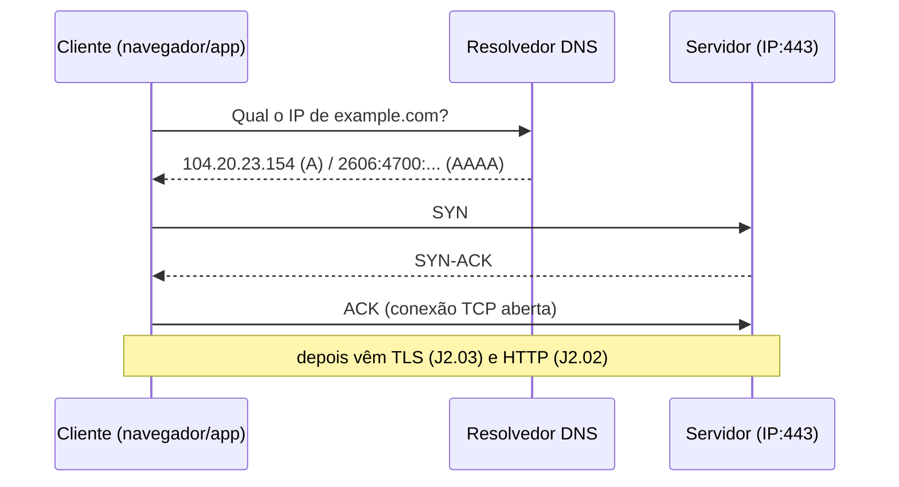

# J2.01 — Cliente-servidor, IP, DNS, portas e TCP

> ⏱️ ~1h30 · 🟢 Júnior · Pré-requisitos: J0.01, J1.09, J1.15

## 🎯 Objetivos
Ao final desta aula você consegue:
- Explicar o modelo cliente-servidor e o que acontece entre digitar um endereço e receber a resposta.
- Distinguir endereço IP, nome (DNS), porta e socket.
- Descrever o que o TCP garante (conexão, ordem, retransmissão) e o que ele não garante.
- Abrir um servidor e um cliente TCP em Java e reconhecer `BindException` e `ConnectException`.
- Consultar DNS e portas abertas pelo terminal (`dig`, `ss`).

## 🤔 Por que isso importa
Toda aplicação do PayFlow (API, banco, Docker, nuvem) é um programa que **escuta numa porta** e outro que **conversa com ele pela rede**. Quando algo dá `Connection refused`, `Address already in use` ou `UnknownHostException`, o júnior que entende IP, DNS e porta acha a causa em minutos; quem não entende tenta reiniciar tudo.

## 💡 Intuição (explicação simples)
Pense nos **Correios**:
- **IP** é o endereço da rua e do prédio (`172.66.147.243`).
- **Porta** é o número do apartamento: o prédio (máquina) tem muitos moradores (programas).
- **DNS** é a lista telefônica: você sabe o nome ("example.com") e ela diz o endereço.
- **TCP** é o carteiro que exige confirmação de recebimento: se uma carta se perde, ele reenvia; e entrega na ordem certa.
- **Cliente** pede; **servidor** fica de plantão esperando pedidos.

## 🔬 Como funciona por dentro

- **IP** identifica uma interface de rede. **IPv4** (`a.b.c.d`, 32 bits) e **IPv6** (128 bits). `127.0.0.1` (e `::1`) é o **loopback**: a própria máquina. Faixas **privadas** (RFC 1918: `10/8`, `172.16/12`, `192.168/16`) não são roteadas na internet; reaparecem em VPCs na nuvem (J10).
- **DNS** traduz nome em IP. Registro **A** → IPv4, **AAAA** → IPv6, **CNAME** → apelido para outro nome. As respostas têm **TTL** (tempo de cache); por isso uma troca de IP demora a "propagar".
- **Porta**: número de 0 a 65535. Conhecidas: 22 SSH, 80 HTTP, 443 HTTPS, 5432 PostgreSQL. Abaixo de 1024 normalmente exigem privilégio; por isso apps usam 8080. Um **socket** é o par `IP:porta`; uma conexão é identificada por (IP origem, porta origem, IP destino, porta destino). O cliente recebe uma **porta efêmera** aleatória.
- **TCP**: *three-way handshake* abre a conexão; cada byte é numerado, confirmado e retransmitido se preciso; entrega **em ordem**. Não garante tempo (pode demorar) nem que o outro lado processou — só que os bytes chegaram. UDP (sem conexão, sem garantia) existe, mas fica fora deste módulo.
- **Camadas** (simplificado): aplicação (HTTP) sobre transporte (TCP) sobre rede (IP).

## 🛠️ Exemplo prático
> Testado com JDK 25.0.5 (Linux). Precisa de internet só para o DNS de `example.com`; os endereços e a porta mudam na sua máquina.

### DNS e portas pelo terminal
```bash
dig +noall +answer example.com          # nome -> IPs (A)
getent hosts localhost                   # resolução local (inclui /etc/hosts)
ss -tln                                  # portas TCP em escuta (-t TCP, -l listening, -n numérico)
```
Saída de `dig` (os IPs variam):
```
example.com.		116	IN	A	104.20.23.154
example.com.		116	IN	A	172.66.147.243
```
O `116` é o TTL restante, em segundos.

### Java: DNS, servidor TCP e cliente TCP (`Rede.java`)
```java
import java.net.*;
import java.io.*;
import java.nio.charset.StandardCharsets;

public class Rede {
    public static void main(String[] args) throws Exception {
        // 1) DNS: nome -> endereços IP
        for (InetAddress a : InetAddress.getAllByName("example.com")) {
            System.out.println("example.com -> " + a.getHostAddress() + (a instanceof Inet4Address ? " (IPv4)" : " (IPv6)"));
        }
        System.out.println("loopback: " + InetAddress.getLoopbackAddress());

        // 2) TCP: um servidor "echo" em porta livre (0) e um cliente que conversa com ele
        try (ServerSocket server = new ServerSocket(0, 50, InetAddress.getLoopbackAddress())) {
            int port = server.getLocalPort();
            Thread t = Thread.startVirtualThread(() -> {
                try (Socket s = server.accept();
                     var in = new BufferedReader(new InputStreamReader(s.getInputStream(), StandardCharsets.UTF_8));
                     var out = new PrintWriter(new OutputStreamWriter(s.getOutputStream(), StandardCharsets.UTF_8), true)) {
                    out.println("echo: " + in.readLine());
                } catch (IOException e) { e.printStackTrace(); }
            });
            try (Socket c = new Socket(InetAddress.getLoopbackAddress(), port);
                 var in = new BufferedReader(new InputStreamReader(c.getInputStream(), StandardCharsets.UTF_8));
                 var out = new PrintWriter(new OutputStreamWriter(c.getOutputStream(), StandardCharsets.UTF_8), true)) {
                System.out.println("cliente conectou de " + c.getLocalSocketAddress().toString().replaceAll(":\\d+$", ":<porta efêmera>") + " para porta " + port);
                out.println("oi PayFlow");
                System.out.println(in.readLine());
            }
            t.join();
        }

        // 3) Porta ocupada
        try (ServerSocket a = new ServerSocket(0)) {
            try (ServerSocket b = new ServerSocket(a.getLocalPort())) { }
            catch (BindException e) { System.out.println("BindException: " + e.getMessage()); }
        }
        // 4) Porta sem ninguém ouvindo
        try (Socket s = new Socket("127.0.0.1", 1)) { }
        catch (ConnectException e) { System.out.println("ConnectException: " + e.getMessage()); }
    }
}
```
```bash
java Rede.java
```
Saída real (a ordem dos IPs e o número da porta variam):
```
example.com -> 172.66.147.243 (IPv4)
example.com -> 104.20.23.154 (IPv4)
example.com -> 2606:4700:10:0:0:0:ac42:93f3 (IPv6)
example.com -> 2606:4700:10:0:0:0:6814:179a (IPv6)
loopback: localhost/127.0.0.1
cliente conectou de /127.0.0.1:<porta efêmera> para porta 36391
echo: oi PayFlow
BindException: Address already in use
ConnectException: Connection refused
```
- `new ServerSocket(0, ...)` pede ao SO **uma porta livre**; `getLocalPort()` revela qual. Truque que os testes usam (J2.06).
- O servidor aceita **uma** conexão e responde. Um servidor real faz `accept()` em laço e atende cada conexão em uma thread (aqui, virtual; o assunto aprofunda em P1).
- `Thread.startVirtualThread` só roda o servidor em segundo plano; não é preciso entender virtual threads agora.

## 🧠 Pausa para lógica
**Enunciado:** escreva `boolean isPrivate(String ipv4)` para as faixas RFC 1918 (`10.0.0.0/8`, `172.16.0.0/12`, `192.168.0.0/16`). Lance `IllegalArgumentException("Invalid IPv4: <texto>")` se não houver 4 partes ou se alguma estiver fora de 0–255.

<details><summary>Dica</summary>Converta cada parte com <code>Integer.parseInt</code>. A faixa <code>172.16/12</code> vai de <code>172.16.x.x</code> a <code>172.31.x.x</code>: só o segundo octeto muda.</details>
<details><summary>Solução (testada)</summary>

```java
static boolean isPrivate(String ip) {
    String[] p = ip.split("\\.");
    if (p.length != 4) throw new IllegalArgumentException("Invalid IPv4: " + ip);
    int[] o = new int[4];
    for (int i = 0; i < 4; i++) {
        o[i] = Integer.parseInt(p[i]);
        if (o[i] < 0 || o[i] > 255) throw new IllegalArgumentException("Invalid IPv4: " + ip);
    }
    return o[0] == 10
        || (o[0] == 172 && o[1] >= 16 && o[1] <= 31)
        || (o[0] == 192 && o[1] == 168);
}
```
Resultados: `10.0.3.7`→true, `172.16.0.1`→true, `172.32.0.1`→false, `192.168.1.20`→true, `8.8.8.8`→false, `127.0.0.1`→false (loopback não é RFC 1918). Para `"a.b.c.d"` o `parseInt` lança `NumberFormatException` (que é um `IllegalArgumentException`, mas com outra mensagem): capture e relance se quiser a mensagem padronizada.
</details>

**Variação:** aceite notação CIDR (`10.0.0.0/8`) e diga se um IP pertence ao bloco, usando máscara de bits (`ip & mask`).

## ⚠️ Erros comuns e boas práticas de produção
- `java.net.ConnectException: Connection refused` — **ninguém escuta** naquele IP:porta (servidor parado, porta errada, ouvindo só em `127.0.0.1` e você chamou de fora). Confira com `ss -tln`.
- `java.net.BindException: Address already in use` — outra instância ainda roda na porta. Ache com `ss -tlnp | grep 8080` e encerre, ou use outra porta.
- `java.net.UnknownHostException: <nome>` — DNS não resolveu (typo, sem internet, VPN).
- `java.net.SocketTimeoutException` / `HttpTimeoutException` — a conexão abriu mas a resposta não veio a tempo. Sempre configure **timeouts** (J2.06).
- **`localhost` vs `127.0.0.1` vs `0.0.0.0`:** escutar em `127.0.0.1` só aceita conexões da própria máquina; `0.0.0.0` aceita de qualquer interface. Em containers (J9) o serviço precisa escutar em `0.0.0.0`.
- **Nunca** deixe um serviço de desenvolvimento (banco, painel) escutando em `0.0.0.0` numa rede aberta.
- DNS cacheia (TTL): após trocar um registro, clientes antigos continuam no IP velho até o TTL expirar. A JVM também cacheia resoluções.

## 🧩 Exercícios
1. **Fixação:** sem consultar, diga a porta padrão de HTTP, HTTPS, SSH e PostgreSQL, e o que significa `127.0.0.1`.
2. **Aplicação no PayFlow:**
   - [ ] Rode `Rede.java` e anote o IP de `example.com` com `dig` e com Java.
   - [ ] Com o `mini-bank` ainda sem servidor, tente `curl -v http://127.0.0.1:8080/` e anote a mensagem de erro (`Connection refused`).
   - [ ] Suba um `ServerSocket` em 8080 e, sem fechá-lo, tente subir outro; reproduza o `BindException`.
   - [ ] Escreva `isPrivate` e três testes JUnit (um parametrizado).
3. **Desafio (opcional):** estenda o servidor *echo* para atender várias conexões em laço, uma thread virtual por conexão, e teste com `nc 127.0.0.1 <porta>` em dois terminais.

<details><summary>Solução de referência (fixação)</summary>

HTTP 80, HTTPS 443, SSH 22, PostgreSQL 5432. `127.0.0.1` é o *loopback*: a própria máquina, tráfego que nunca sai para a rede.
</details>

## 🎤 Na entrevista
- **O que acontece quando você digita uma URL no navegador?** (visão inicial) O navegador resolve o nome via DNS, abre uma conexão TCP com o IP na porta 443/80, negocia TLS se for HTTPS, envia a requisição HTTP e renderiza a resposta. Este módulo detalha cada etapa.
- **Diferença entre IP e porta?** IP identifica a máquina/interface; a porta identifica o programa naquela máquina. A conexão é o par de sockets.
- **O que é `Connection refused` e como investigar?** Chegou à máquina, mas nenhum processo escuta na porta (ou um firewall rejeitou). Verifico com `ss -tln`, o IP/porta usados e se o serviço sobe em `0.0.0.0` ou `127.0.0.1`.
- **TCP vs UDP?** TCP: conexão, ordem, retransmissão. UDP: sem conexão nem garantia, menor latência (DNS, vídeo).

## 📚 Para ir além
- 📄 [MDN — Overview of HTTP](https://developer.mozilla.org/en-US/docs/Web/HTTP/Overview): onde o HTTP se encaixa; leia a seção sobre cliente, servidor e proxies.
- 📄 [Java SE 25 — `java.net`](https://docs.oracle.com/en/java/javase/25/docs/api/java.base/java/net/package-summary.html): `InetAddress`, `Socket`, `ServerSocket` e as exceções vistas aqui.
- 📖 *Redes de Computadores e a Internet* (Kurose & Ross) ou *Computer Networking: A Top-Down Approach*: capítulos de camada de aplicação e transporte (referência bibliográfica, sem link).
- 🎥 ⚠️ Nenhum vídeo verificado nesta execução.

## ✅ Checklist da aula
- [ ] Explico IP, porta, DNS, socket e o handshake TCP com minhas palavras.
- [ ] Reproduzi `Connection refused` e `Address already in use`.
- [ ] Usei `dig` e `ss` no terminal.
- [ ] `isPrivate` implementado e testado.
