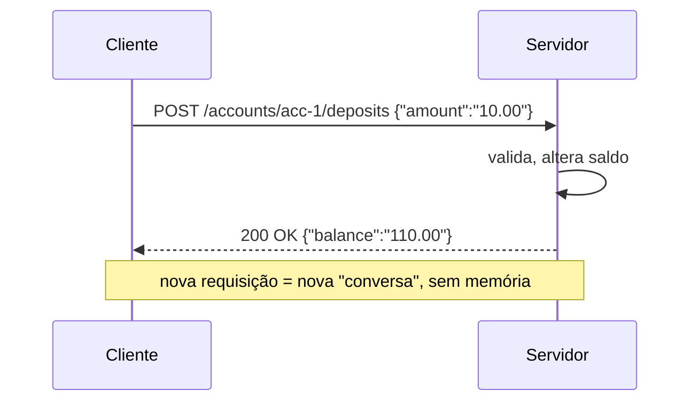

# J2.02 — HTTP: métodos, status codes, headers e corpo

> ⏱️ ~1h30 · 🟢 Júnior · Pré-requisitos: J1.04, J1.11, J2.01

## 🎯 Objetivos
Ao final desta aula você consegue:
- Ler e escrever uma requisição e uma resposta HTTP/1.1 "na mão".
- Escolher o método (`GET`, `POST`, `PUT`, `PATCH`, `DELETE`) e dizer se é seguro e idempotente.
- Escolher o status code certo (2xx, 3xx, 4xx, 5xx) para cada situação.
- Usar os headers principais (`Content-Type`, `Accept`, `Content-Length`, `Location`, `Authorization`, `Allow`).
- Explicar a diferença entre HTTP sem estado e o que o servidor precisa lembrar.

## 🤔 Por que isso importa
A API do PayFlow (J6) é HTTP puro com convenções. Um `POST` que devolve `200` com `{"error": ...}` no corpo quebra clientes, métricas e alertas; um `GET` que altera saldo é um bug de segurança. Quem lê HTTP "cru" depura em minutos o que o framework esconde.

## 💡 Intuição (explicação simples)
HTTP é um **pedido por escrito num balcão**: você entrega um formulário (método + endereço + cabeçalhos + corpo) e o atendente devolve outro (código de resultado + cabeçalhos + corpo). O atendente **não lembra de você** entre um atendimento e outro: cada formulário precisa trazer tudo o que for necessário (isso é *stateless*).

## 🔬 Como funciona por dentro
Uma requisição HTTP/1.1 é **texto** sobre a conexão TCP, com fim de linha `\r\n` (CRLF):
```
POST /accounts/acc-1/deposits HTTP/1.1      ← linha de requisição: MÉTODO caminho versão
Host: 127.0.0.1:8080                         ← headers (nome: valor)
Content-Type: application/json
Content-Length: 18
                                             ← linha em branco: fim dos headers
{"amount":"10.00"}                           ← corpo (opcional)
```
Resposta:
```
HTTP/1.1 200 OK                              ← versão, código, texto
Content-type: application/json; charset=utf-8
Content-length: 47

{"id":"acc-1","owner":"Ana","balance":"110.00"}
```

### Métodos
| Método | Uso | Seguro* | Idempotente** | Corpo típico |
|---|---|---|---|---|
| `GET` | ler | sim | sim | não |
| `POST` | criar / executar ação | não | **não** | sim |
| `PUT` | substituir inteiro | não | sim | sim |
| `PATCH` | alterar parcialmente | não | depende | sim |
| `DELETE` | remover | não | sim | não |
| `HEAD` / `OPTIONS` | só headers / o que é permitido | sim | sim | não |

\* *Seguro*: não altera estado no servidor. \*\* *Idempotente*: repetir a requisição deixa o servidor no mesmo estado que enviar uma vez. Dois `POST /transfers` iguais criam **duas** transferências, por isso o PayFlow terá `idempotency_key` (regra 4 em `projeto-central.md`; J6 e P3).

### Status codes (família + os que você mais usa)
| Faixa | Significa | Exemplos |
|---|---|---|
| 1xx | informativo | 100 Continue |
| **2xx** | sucesso | **200** OK · **201** Created (+ `Location`) · **204** No Content |
| **3xx** | redirecionamento | **301** movido · **302/307** temporário · **304** não modificado (cache) |
| **4xx** | erro **do cliente** | **400** requisição inválida · **401** não autenticado · **403** proibido · **404** não existe · **405** método não permitido · **409** conflito · **422** não processável (regra de negócio) · **429** muitas requisições |
| **5xx** | erro **do servidor** | **500** erro interno · **502/503/504** gateway/indisponível/timeout |

`401` = "não sei quem é você"; `403` = "sei quem é você e você não pode". Lista oficial na [MDN](https://developer.mozilla.org/en-US/docs/Web/HTTP/Reference/Status).

### Headers essenciais
- `Host` (obrigatório no HTTP/1.1), `User-Agent`, `Accept` (formatos que o cliente aceita), `Authorization` (credenciais; J8), `Cookie` (J2.04).
- `Content-Type` (formato do corpo: `application/json`), `Content-Length` (tamanho em **bytes**), `Location` (onde está o recurso criado), `Allow` (métodos aceitos num 405), `Cache-Control`.
- Nomes de header **não diferenciam maiúsculas**; os valores podem diferenciar.

### Versões
HTTP/1.1 (texto, uma resposta por vez por conexão), HTTP/2 (binário, várias requisições na mesma conexão) e HTTP/3 (sobre QUIC/UDP). A semântica (métodos, status, headers) é a mesma; o que muda é o transporte. Este módulo usa o formato 1.1 porque dá para **ler**.



## 🛠️ Exemplo prático
> Testado com JDK 25.0.5. Pré-requisito: o servidor do `mini-bank` rodando (J2.06). Para acompanhar agora, copie `BankServer` e `MiniJson` da J2.06 ou use qualquer servidor HTTP local.

### Falar HTTP "na mão" por um `Socket` (`HttpCru.java`)
```java
import java.io.*;
import java.net.Socket;
import java.nio.charset.StandardCharsets;

public class HttpCru {
    public static void main(String[] args) throws Exception {
        String body = "{\"amount\":\"10.00\"}";
        // HTTP/1.1 é texto: linha de requisição, headers, linha em branco, corpo. Fim de linha = CRLF.
        String request = "POST /accounts/acc-1/deposits HTTP/1.1\r\n"
                + "Host: 127.0.0.1:8080\r\n"
                + "Content-Type: application/json\r\n"
                + "Content-Length: " + body.getBytes(StandardCharsets.UTF_8).length + "\r\n"
                + "Connection: close\r\n"
                + "\r\n"
                + body;
        try (Socket s = new Socket("127.0.0.1", 8080)) {
            s.getOutputStream().write(request.getBytes(StandardCharsets.UTF_8));
            s.getOutputStream().flush();
            System.out.print(new String(s.getInputStream().readAllBytes(), StandardCharsets.UTF_8));
        }
    }
}
```
```bash
java HttpCru.java
```
Saída real (o `Date` muda; saldo parte de 100.00 do *seed*):
```
HTTP/1.1 200 OK
Date: Thu, 12 Nov 2026 20:49:33 GMT
Content-type: application/json; charset=utf-8
Content-length: 47

{"id":"acc-1","owner":"Ana","balance":"110.00"}
```
- `Content-Length` precisa bater com os **bytes** do corpo (não com o número de caracteres: `ç` ocupa 2 bytes em UTF-8). Se vier maior, o servidor fica esperando bytes; se menor, corta o corpo.
- `Connection: close` faz o servidor fechar após responder, para `readAllBytes()` terminar.

### O que `curl -v` mostra (mesma conversa)
```bash
curl -sv -X POST -H 'Content-Type: application/json' -d '{"amount":"5"}' http://127.0.0.1:8080/accounts/acc-1/deposits
```
Linhas `>` são o que o cliente envia; `<`, o que recebe; `*` são informações do curl:
```
> POST /accounts/acc-1/deposits HTTP/1.1
> Host: 127.0.0.1:8080
> User-Agent: curl/8.18.0
> Accept: */*
> Content-Type: application/json
> Content-Length: 14
>
< HTTP/1.1 200 OK
< Content-type: application/json; charset=utf-8
< Content-length: 47
```
Um `405` com `Allow`:
```bash
curl -si -X DELETE http://127.0.0.1:8080/accounts
```
```
HTTP/1.1 405 Method Not Allowed
Allow: GET, POST
Content-type: application/json; charset=utf-8
Content-length: 30

{"error":"Method not allowed"}
```

## 🧠 Pausa para lógica
**Enunciado:** escreva `parse(String raw)` que transforma o texto de uma requisição em `record Request(String method, String path, Map<String,String> headers, String body)`. Nomes de header ignoram maiúsculas. Lance `IllegalArgumentException("Bad request line: ...")` se a primeira linha não tiver 3 partes.

<details><summary>Dica</summary>O corpo começa depois da primeira ocorrência de <code>"\r\n\r\n"</code>. Para o <code>Map</code> ignorar maiúsculas, use <code>new TreeMap&lt;&gt;(String.CASE_INSENSITIVE_ORDER)</code>.</details>
<details><summary>Solução (testada)</summary>

```java
record Request(String method, String path, Map<String, String> headers, String body) { }

static Request parse(String raw) {
    int split = raw.indexOf("\r\n\r\n");
    String head = split < 0 ? raw : raw.substring(0, split);
    String body = split < 0 ? "" : raw.substring(split + 4);
    String[] lines = head.split("\r\n");
    String[] first = lines[0].split(" ");
    if (first.length != 3) throw new IllegalArgumentException("Bad request line: " + lines[0]);
    Map<String, String> headers = new TreeMap<>(String.CASE_INSENSITIVE_ORDER);
    for (int i = 1; i < lines.length; i++) {
        int c = lines[i].indexOf(':');
        if (c <= 0) throw new IllegalArgumentException("Bad header: " + lines[i]);
        headers.put(lines[i].substring(0, c).trim(), lines[i].substring(c + 1).trim());
    }
    return new Request(first[0], first[1], headers, body);
}
```
Entrada `POST /accounts HTTP/1.1 ... content-type: application/json ... {}` → `POST /accounts ct=application/json body={}`; `GET /sem-versao` → `Bad request line: GET /sem-versao`.
</details>

**Variação:** o corpo pode vir em *chunks* (`Transfer-Encoding: chunked`). Por que `Content-Length` não basta nesse caso?

## ⚠️ Erros comuns e boas práticas de produção
- **`GET` com efeito colateral** (ex.: `GET /accounts/1/withdraw`): proxies, crawlers e pré-carregamento do navegador podem repeti-lo. Ações usam `POST`.
- **`200` com erro no corpo:** monitoramento e clientes enxergam "sucesso". Use o status correto; o formato padronizado do corpo de erro (Problem Details, RFC 9457) vem em J6.
- **Confundir `401` e `403`**, ou usar `500` para erro de validação do cliente (deveria ser `400`/`422`).
- **Corpo sem `Content-Type`:** o servidor não sabe se é JSON, texto ou formulário. Resultado comum: `415 Unsupported Media Type` ou campo `null`.
- **Esquecer `Content-Length`/`chunked`** numa resposta escrita à mão: o cliente fica pendurado até o timeout.
- **Dados sensíveis na URL** (`?token=...`, `?senha=...`) ficam em logs, histórico e proxies. Vão em header ou corpo, e sempre sob HTTPS (J2.03).
- **Dinheiro no corpo como número JSON** pode virar `double` no cliente: o PayFlow usa string (`"balance":"110.00"`), ver J2.04.

## 🧩 Exercícios
1. **Fixação:** classifique, com método e status esperados: (a) consultar o saldo; (b) criar conta; (c) depositar em conta que não existe; (d) sacar mais que o saldo; (e) enviar JSON malformado; (f) chamar `DELETE /accounts`.
2. **Aplicação no PayFlow:**
   - [ ] Com o servidor da J2.06 no ar, rode `HttpCru.java` e `curl -sv` e identifique cada linha (`>`/`<`).
   - [ ] Provoque 200, 201, 400, 404, 405 e 422 com `curl -i`, um de cada, e anote o corpo.
   - [ ] Implemente `parse` (Pausa) com 3 testes JUnit.
3. **Desafio (opcional):** envie um corpo com `ç` e `Content-Length` calculado em caracteres (errado) e descreva o que o servidor faz.

<details><summary>Solução de referência (fixação)</summary>

(a) `GET /accounts/{id}` → 200; (b) `POST /accounts` → 201 + `Location`; (c) `POST /accounts/{id}/deposits` → 404; (d) `POST .../withdrawals` → 422 (regra de negócio; alguns times usam 409 ou 400, o importante é ser consistente); (e) 400; (f) `DELETE /accounts` → 405 com `Allow: GET, POST`.
</details>

## 🎤 Na entrevista
- **`PUT` vs `PATCH` vs `POST`?** `POST` cria/executa ação e não é idempotente; `PUT` substitui o recurso inteiro e é idempotente; `PATCH` altera parte.
- **O que significa idempotente e por que importa em pagamentos?** Repetir a requisição tem o mesmo efeito de uma vez. Rede falha e clientes repetem; sem idempotência, o cliente pode ser cobrado duas vezes.
- **401 vs 403?** 401: não autenticado (credenciais ausentes/inválidas). 403: autenticado, mas sem permissão.
- **O que é HTTP *stateless*?** O servidor não guarda contexto entre requisições; cada uma traz o necessário. Estado (login) é recuperado por cookie/token (J2.04).

## 📚 Para ir além
- 📄 [MDN — HTTP response status codes](https://developer.mozilla.org/en-US/docs/Web/HTTP/Reference/Status): referência de cada código, com quando usar.
- 📄 [RFC 9110 — HTTP Semantics](https://www.rfc-editor.org/rfc/rfc9110): a especificação oficial de métodos, status e headers; consulte a seção de métodos para "seguro" e "idempotente".
- 📄 [MDN — Overview of HTTP](https://developer.mozilla.org/en-US/docs/Web/HTTP/Overview).
- 🎥 ⚠️ Nenhum vídeo verificado nesta execução.

## ✅ Checklist da aula
- [ ] Leio uma requisição e uma resposta HTTP crua sem ajuda.
- [ ] Sei dizer método, status e headers certos para cada operação do mini-bank.
- [ ] Reproduzi 200, 201, 400, 404, 405 e 422.
- [ ] `parse` implementado e testado.
