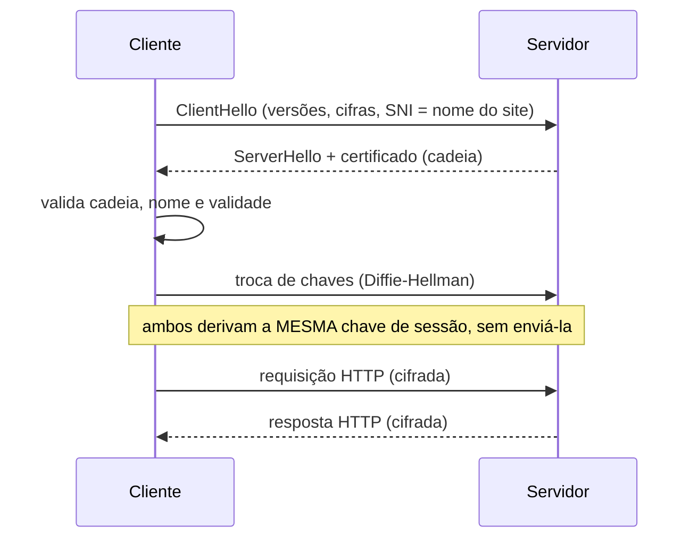

# J2.03 — HTTPS e TLS

> ⏱️ ~1h30 · 🟢 Júnior · Pré-requisitos: J1.15, J2.01, J2.02

## 🎯 Objetivos
Ao final desta aula você consegue:
- Explicar o que o TLS garante (confidencialidade, integridade, autenticidade do servidor) e o que não garante.
- Descrever, em alto nível, o handshake TLS e o papel de certificado, CA e cadeia de confiança.
- Inspecionar a conexão TLS com `openssl s_client` e com `HttpClient`.
- Reconhecer e diagnosticar `SSLHandshakeException` e certificado expirado.
- Dizer por que nunca se "desliga a validação" de certificado para fazer o código funcionar.

## 🤔 Por que isso importa
Senhas, tokens e saldos do PayFlow cruzam redes que você não controla (Wi-Fi do café, provedor, proxies). Sem TLS, qualquer intermediário lê e altera o tráfego. Em produção, 90% dos problemas com HTTPS são certificado expirado, cadeia incompleta ou nome errado, e o júnior que sabe ler o erro resolve rápido.

## 💡 Intuição (explicação simples)
HTTP puro é um **cartão-postal**: o carteiro e os vizinhos leem. HTTPS é uma **carta num cofre lacrado** com três garantias:
1. só o destinatário abre (**confidencialidade**);
2. o lacre rompido denuncia adulteração (**integridade**);
3. o remetente apresenta um **documento emitido por um cartório confiável** (certificado assinado por uma autoridade certificadora), provando que o site é mesmo o que diz ser (**autenticidade**).

## 🔬 Como funciona por dentro
**HTTPS = HTTP dentro de TLS** (Transport Layer Security), sobre TCP, tipicamente na porta 443. SSL é o nome antigo; só TLS 1.2 e 1.3 são usados hoje.


- **Criptografia assimétrica** (par chave pública/privada) serve para **provar identidade e combinar uma chave**; **simétrica** (uma chave só, rápida) cifra os dados. O TLS usa as duas: a assimétrica no início, a simétrica no resto.
- **Certificado X.509**: contém nome(s) do site (*Subject Alternative Name*), chave pública, validade (`notBefore`/`notAfter`) e a **assinatura de quem o emitiu**.
- **Cadeia de confiança**: certificado do site ← CA intermediária ← **CA raiz** (já instalada no sistema/JDK, no *truststore*). O cliente confia no site se conseguir montar a cadeia até uma raiz confiável, dentro da validade e com o nome certo.
- **SNI** (*Server Name Indication*): o cliente informa o nome no `ClientHello`, para um mesmo IP servir vários sites.
- **TLS 1.3** simplifica o handshake (menos viagens de ida e volta) e elimina cifras fracas.
- **O que o TLS não faz:** não valida *quem é você* (isso é autenticação, J8), não protege o dado no servidor ou no banco (criptografia em repouso, S5) e não impede um site legítimo de ser malicioso.
- **mTLS** (os dois lados apresentam certificado) existe para comunicação entre serviços; aparece em S5.
- Certificados são emitidos por CAs (ex.: Let's Encrypt, gratuita e automática) e **expiram**; por isso a renovação é automatizada.

## 🛠️ Exemplo prático
> Testado em Linux, OpenSSL e JDK 25.0.5, com acesso à internet. Os nomes de CA e as datas mudam.

### Inspecionar o handshake com `openssl`
```bash
openssl s_client -connect example.com:443 -servername example.com </dev/null 2>&1 \
  | grep -E "Protocol|Cipher|subject=|issuer=|Verification|depth"
```
Saída real (recorte):
```
depth=3 C=US, O=SSL Corporation, CN=SSL.com TLS ECC Root CA 2022
depth=2 C=US, O=SSL Corporation, CN=SSL.com TLS Transit ECC CA R2
depth=1 C=US, O=SSL Corporation, CN=Cloudflare TLS Issuing ECC CA 3
depth=0 CN=example.com
subject=CN=example.com
issuer=C=US, O=SSL Corporation, CN=Cloudflare TLS Issuing ECC CA 3
Verification: OK
New, TLSv1.3, Cipher is TLS_AES_256_GCM_SHA384
```
`depth=0` é o certificado do site; os números maiores são as CAs até a **raiz** (`depth=3`). `Verification: OK` significa que a cadeia chegou a uma raiz confiável.

```bash
curl -sI https://example.com | head -3      # mesma coisa com curl; -v mostra o handshake
```
Saída real: `HTTP/2 200` (o curl negociou HTTP/2).

### Java: ver a sessão TLS e o certificado (`Tls.java`)
```java
import java.net.URI;
import java.net.http.*;
import java.security.cert.X509Certificate;
import java.time.Instant;
import java.time.temporal.ChronoUnit;

public class Tls {
    public static void main(String[] args) throws Exception {
        HttpClient http = HttpClient.newHttpClient();
        HttpResponse<Void> r = http.send(HttpRequest.newBuilder(URI.create("https://example.com")).build(),
                HttpResponse.BodyHandlers.discarding());
        var ssl = r.sslSession().orElseThrow();            // só existe em conexões HTTPS
        System.out.println("HTTP: " + r.version() + " status " + r.statusCode());
        System.out.println("TLS: " + ssl.getProtocol() + " / " + ssl.getCipherSuite());
        X509Certificate cert = (X509Certificate) ssl.getPeerCertificates()[0];
        System.out.println("subject: " + cert.getSubjectX500Principal());
        System.out.println("issuer:  " + cert.getIssuerX500Principal());
        long days = ChronoUnit.DAYS.between(Instant.now(), cert.getNotAfter().toInstant());
        System.out.println("dias até expirar: " + (days >= 0 ? "ok (>0)" : "EXPIRADO") + " ; chain=" + ssl.getPeerCertificates().length);
        // certificado inválido: o nome do certificado não bate com o host
        try {
            http.send(HttpRequest.newBuilder(URI.create("https://wrong.host.badssl.com/")).build(), HttpResponse.BodyHandlers.discarding());
        } catch (Exception e) { System.out.println(e.getClass().getSimpleName() + ": " + e.getMessage()); }
    }
}
```
```bash
java Tls.java
```
Saída real:
```
HTTP: HTTP_2 status 200
TLS: TLSv1.3 / TLS_AES_256_GCM_SHA384
subject: CN=example.com
issuer:  CN=Cloudflare TLS Issuing ECC CA 3, O=SSL Corporation, C=US
dias até expirar: ok (>0) ; chain=4
SSLHandshakeException: (certificate_unknown) No subject alternative DNS name matching wrong.host.badssl.com found.
```
- O `HttpClient` valida a cadeia e o nome **por padrão**, usando o *truststore* do JDK. O último caso falhou **por segurança**, não por bug.
- `badssl.com` é um site público de testes com certificados propositalmente quebrados (outros hosts: `expired.badssl.com`, `self-signed.badssl.com`). ⚠️ Esta execução só testou `wrong.host.badssl.com`; os outros dois seguem o mesmo padrão de erro, mas não foram rodados.

### Certificado autoassinado em desenvolvimento
Gerar um par para testes locais (válido por 30 dias; o navegador/curl reclamará, o que é esperado):
```bash
openssl req -x509 -newkey rsa:2048 -nodes -keyout key.pem -out cert.pem -days 30 -subj "/CN=localhost"
```
⚠️ Comando padrão do OpenSSL, mas **não executado** nesta execução. Nunca use autoassinado em produção para usuários finais; em ambiente de teste, **adicione o certificado ao truststore** em vez de desativar a validação. A configuração de HTTPS no Spring Boot é assunto de J5/J8; em produção o TLS costuma ser terminado por um *load balancer* ou *ingress* (J10, P7).

## 🧠 Pausa para lógica
**Enunciado:** um monitor precisa avisar quando um certificado estiver a menos de 14 dias de expirar. Escreva `long daysLeft(Instant notAfter, Clock clock)` e teste com um `Clock` fixo. Cuidado com o certificado que expirou há 12 horas: quantos dias ele "tem"?

<details><summary>Dica</summary><code>ChronoUnit.DAYS.between(a, b)</code> <b>trunca</b> para zero. Pense no que isso faz com valores entre −1 e 1 dia.</details>
<details><summary>Solução (testada)</summary>

```java
static long daysLeft(Instant notAfter, Clock clock) {
    return ChronoUnit.DAYS.between(clock.instant(), notAfter);   // trunca
}
// clock fixo em 2026-11-12T00:00Z:
// notAfter 2026-12-12T00:00Z -> 30
// notAfter 2026-11-11T12:00Z (expirou há 12h) -> 0   <- armadilha: "0 dias" parece "ainda vale hoje"
```
Para decidir expirado, **não** use o número de dias: use `!clock.instant().isBefore(notAfter)`. Para o alerta, `Duration.between(...).compareTo(Duration.ofDays(14)) < 0`.
</details>

**Variação:** escreva o alerta com `Duration` e inclua o caso "expirado há menos de um dia" em um teste parametrizado.

## ⚠️ Erros comuns e boas práticas de produção
- `javax.net.ssl.SSLHandshakeException: PKIX path building failed: ... unable to find valid certification path to requested target` — o JDK não confia na CA (comum com certificado corporativo ou autoassinado). Solução correta: importar a CA no *truststore* (`keytool -importcert`). **Não** desative a validação.
- `SSLHandshakeException: No subject alternative DNS name matching <host> found` — o nome da URL não está no certificado (visto acima); usar o IP em vez do nome costuma causar isso.
- **Certificado expirado:** causa clássica de incidente às 3h da manhã. Automatize a renovação e monitore a data de expiração.
- **Cadeia incompleta:** o servidor precisa enviar também as intermediárias; navegadores às vezes "se viram", o Java não.
- **`TrustAll`/`verify=false` copiado do Stack Overflow:** remove a proteção contra *man-in-the-middle*. Nunca no código que vai para produção.
- **Relógio errado** na máquina faz um certificado válido parecer "ainda não válido" ou expirado.
- **Misto:** página HTTPS carregando recurso HTTP é bloqueada pelo navegador.
- Redirecionar HTTP→HTTPS (301) e usar o header `Strict-Transport-Security` (HSTS) é prática padrão de produção.

## 🧩 Exercícios
1. **Fixação:** o que acontece, em termos de segurança, se o TLS usar só criptografia simétrica com uma chave fixa embutida no navegador? E por que não usar só assimétrica para todos os dados?
2. **Aplicação no PayFlow:**
   - [ ] Rode `openssl s_client` contra um site e anote protocolo, cifra e a cadeia (`depth`).
   - [ ] Rode `Tls.java` e mostre o `subject`, o `issuer` e o resultado do host com nome errado.
   - [ ] Escreva `daysLeft` com um teste de `Clock` fixo e o caso "expirado há 12 h".
   - [ ] Anote em `docs/` do repositório: "o PayFlow será servido só por HTTPS; o TLS será terminado em ___ (decidir em J10)".
3. **Desafio (opcional):** consulte `expired.badssl.com` com `curl -v` e com `HttpClient`; compare as mensagens de erro.

<details><summary>Solução de referência (fixação)</summary>

Uma chave fixa conhecida por todos não protege nada (qualquer um a extrai e decifra o tráfego de todos). Só assimétrica seria correta mas muito lenta para volumes grandes. Por isso: assimétrica/Diffie-Hellman para **combinar** uma chave nova por sessão e provar identidade; simétrica para cifrar os dados.
</details>

## 🎤 Na entrevista
- **O que é HTTPS e o que o TLS garante?** HTTP sobre TLS: confidencialidade, integridade e autenticação do servidor (e opcionalmente do cliente, no mTLS). Não garante que o servidor seja confiável nem protege dados em repouso.
- **Explique o handshake TLS de forma simples.** O cliente diz as versões/cifras que aceita e o nome do site; o servidor envia o certificado; o cliente valida a cadeia, o nome e a validade; combinam uma chave de sessão por troca de chaves; o resto do tráfego vai cifrado com essa chave.
- **O que é uma CA e uma cadeia de confiança?** CA é a entidade que assina certificados; o cliente confia em um conjunto de CAs raiz e aceita certificados cuja cadeia de assinaturas leve até uma delas.
- **Apareceu `PKIX path building failed`. O que fazer?** Descobrir qual CA falta no truststore e importá-la; nunca desabilitar a verificação.

## 📚 Para ir além
- 📄 [Java SE 25 — `HttpClient`](https://docs.oracle.com/en/java/javase/25/docs/api/java.net.http/java/net/http/HttpClient.html): `sslContext`, `version`, e como o cliente se comporta com HTTPS.
- 📄 [MDN — Cross-Origin Resource Sharing (CORS)](https://developer.mozilla.org/en-US/docs/Web/HTTP/Guides/CORS): útil para entender por que "https vs http" e "origem" importam no navegador (retomado em J4/J6).
- 📄 TLS 1.3 é especificado na RFC 8446 (⚠️ a página do RFC Editor a marca como **obsoleta**, substituída por uma revisão mais nova que não foi verificada aqui; por isso o link não é citado).
- 🎥 ⚠️ Nenhum vídeo verificado nesta execução.

## ✅ Checklist da aula
- [ ] Explico as três garantias do TLS e o que ele não cobre.
- [ ] Leio a cadeia de certificados (`depth`) e sei o que é a raiz.
- [ ] Reproduzi um `SSLHandshakeException` e expliquei a causa.
- [ ] Nunca vou desativar a validação de certificado para "fazer funcionar".
