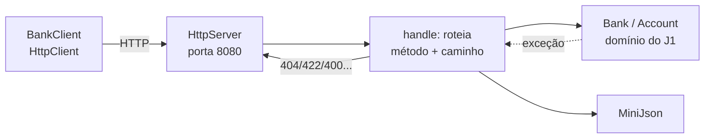

# J2.06 — Servidor mínimo com `com.sun.net.httpserver` e cliente `java.net.http.HttpClient`

> ⏱️ ~1h30 · 🟢 Júnior · Pré-requisitos: J1.09, J1.14, J1.16, J2.01 a J2.05

## 🎯 Objetivos
Ao final desta aula você consegue:
- Subir um servidor HTTP em Java sem framework, com roteamento manual.
- Mapear exceções de negócio para status HTTP corretos (400, 404, 405, 422).
- Chamar o servidor com `HttpClient`, com timeouts, e ler status, headers e corpo.
- Testar servidor e cliente juntos com JUnit, usando porta livre (`0`).
- Listar o que um framework (Spring, J5) faz por você e que você acabou de fazer à mão.

## 🤔 Por que isso importa
Spring Boot esconde roteamento, parsing de corpo, serialização JSON, mapeamento de erros e *threads*. Quem já escreveu isso uma vez entende **o que o framework faz** e depura erros como `405`, `415` e `Content-Length` com segurança. Também é a entrega do módulo: o `mini-bank` ganha uma fachada HTTP.

## 💡 Intuição (explicação simples)
O servidor é um **guichê**: fica aberto, recebe formulários (requisições), olha o tipo de pedido, chama o setor certo (o `Bank`) e devolve um recibo com um código de resultado. O cliente é a **pessoa na fila**, que preenche o formulário, entrega e espera, com paciência limitada (timeout).

## 🔬 Como funciona por dentro

- **`com.sun.net.httpserver.HttpServer`** (módulo `jdk.httpserver`, API suportada pelo JDK; documentação em [Java SE 25](https://docs.oracle.com/en/java/javase/25/docs/api/jdk.httpserver/com/sun/net/httpserver/package-summary.html)): `createContext(caminho, handler)` associa um prefixo de caminho a um `HttpHandler`; o handler recebe um `HttpExchange` (requisição + resposta).
- **Contexto "/"** casa **todos** os caminhos; o roteamento por método e caminho (`GET /accounts/{id}`) é feito por nós. Um framework faz isso com anotações (`@GetMapping`, J5).
- **Ordem obrigatória na resposta:** `sendResponseHeaders(status, tamanho)` **antes** de escrever o corpo; fechar o corpo (`close`) termina a resposta. Tamanho `> 0` = `Content-Length` fixo.
- **Threads:** o executor padrão atende **uma requisição por vez**. Isso é proposital aqui: o `Bank` (J1) não é seguro para uso concorrente. Quando o PayFlow tiver banco e transações (J3, J5), a concorrência é tratada ali; o tema em profundidade é P1.
- **`HttpClient`** (Java 11+): imutável e reutilizável, com `HttpRequest` e `BodyHandlers`. `send` é bloqueante; `sendAsync` devolve `CompletableFuture` (P1). Timeouts: `connectTimeout` (no cliente) e `timeout` (na requisição).

### Rotas do `mini-bank`
| Método e caminho | Ação | Sucesso | Erros |
|---|---|---|---|
| `GET /accounts` | lista contas | 200 | — |
| `POST /accounts` `{"id","owner"}` | cria conta | 201 + `Location` | 400 (campos faltando/duplicada) |
| `GET /accounts/{id}` | consulta | 200 | 404 |
| `GET /accounts/{id}/statement` | extrato | 200 | 404 |
| `POST /accounts/{id}/deposits` `{"amount"}` | deposita | 200 | 400 (valor inválido/≤0), 404 |
| `POST /accounts/{id}/withdrawals` `{"amount"}` | saca | 200 | 400, 404, **422** (saldo insuficiente) |
| qualquer outro método nesses caminhos | — | — | 405 + `Allow` |
| caminho desconhecido | — | — | 404 |

Corpo de erro (provisório): `{"error":"mensagem"}`. O formato padronizado (Problem Details, RFC 9457) entra em J6.

## 🛠️ Exemplo prático
> **Código compilado e testado** com JDK 25.0.5, Maven 3.9.12, JUnit 6.1.3 e AssertJ 3.27.7: `mvn test` com **9 testes verdes** (7 da J1 + 2 novos). Mesmo `pom.xml` da J1.16, sem dependências novas.

Estrutura (acrescente ao `mini-bank`, pacote `com.payflow.minibank.web`):
```
mini-bank/src/main/java/com/payflow/minibank/
├── Bank.java            ← ganha o método all()
└── web/
    ├── BankServer.java
    ├── BankClient.java
    └── MiniJson.java
mini-bank/src/test/java/com/payflow/minibank/web/BankServerTest.java
```

### 1) `Bank.all()` — a única mudança no domínio
```java
public Collection<Account> all() { return Collections.unmodifiableCollection(accounts.values()); }
// imports: java.util.Collection, java.util.Collections
```

### 2) `MiniJson.java` — JSON à mão (só para estudo)
```java
package com.payflow.minibank.web;

import com.payflow.minibank.Account;
import com.payflow.minibank.Entry;

import java.util.regex.Matcher;
import java.util.regex.Pattern;

/** JSON feito à mão, só para ver o formato. Em J5/J6 o Spring faz isso com uma biblioteca. */
final class MiniJson {
    private MiniJson() { }

    static String quote(String s) {
        StringBuilder sb = new StringBuilder("\"");
        for (char c : s.toCharArray()) {
            switch (c) {
                case '"' -> sb.append("\\\"");
                case '\\' -> sb.append("\\\\");
                case '\n' -> sb.append("\\n");
                case '\r' -> sb.append("\\r");
                case '\t' -> sb.append("\\t");
                default -> {
                    if (c < 0x20) sb.append(String.format("\\u%04x", (int) c));
                    else sb.append(c);
                }
            }
        }
        return sb.append('"').toString();
    }

    static String account(Account a) {
        // dinheiro como string: evita que o parser do cliente converta para double (J2.04)
        return "{\"id\":" + quote(a.id()) + ",\"owner\":" + quote(a.owner())
                + ",\"balance\":" + quote(a.balance().toString()) + "}";
    }

    static String accounts(Iterable<Account> list) {
        StringBuilder sb = new StringBuilder("[");
        boolean first = true;
        for (Account a : list) {
            if (!first) sb.append(',');
            sb.append(account(a));
            first = false;
        }
        return sb.append(']').toString();
    }

    static String statement(Iterable<Entry> entries) {
        StringBuilder sb = new StringBuilder("[");
        boolean first = true;
        for (Entry e : entries) {
            if (!first) sb.append(',');
            sb.append("{\"type\":").append(quote(e.type().name()))
              .append(",\"amount\":").append(quote(e.amount().toString()))
              .append(",\"createdAt\":").append(quote(e.createdAt().toString())).append('}');
            first = false;
        }
        return sb.append(']').toString();
    }

    static String error(String message) {
        return "{\"error\":" + quote(message) + "}";
    }

    /** Lê um campo de texto de um objeto JSON simples. Limitado de propósito (sem aninhamento). */
    static String field(String json, String name) {
        Matcher m = Pattern.compile("\"" + Pattern.quote(name) + "\"\\s*:\\s*\"((?:[^\"\\\\]|\\\\.)*)\"").matcher(json);
        if (!m.find()) return null;
        return m.group(1).replace("\\\"", "\"").replace("\\\\", "\\");
    }
}
```
Limitações **conhecidas**: `field` só lê strings de objetos planos e não trata `\uXXXX` ao ler; JSON com aninhamento ou números sem aspas (`{"amount": 10}`) **não** é entendido (resulta em `400`). Uma biblioteca resolve tudo isso em J5.

### 3) `BankServer.java`
```java
package com.payflow.minibank.web;

import com.payflow.minibank.Account;
import com.payflow.minibank.Bank;
import com.payflow.minibank.InsufficientFundsException;
import com.payflow.minibank.Money;
import com.sun.net.httpserver.HttpExchange;
import com.sun.net.httpserver.HttpServer;

import java.io.IOException;
import java.io.OutputStream;
import java.net.InetSocketAddress;
import java.nio.charset.StandardCharsets;
import java.time.Clock;

/** Servidor HTTP mínimo do mini-bank, sem framework. */
public class BankServer {
    private final Bank bank;
    private final HttpServer server;

    public BankServer(Bank bank, int port) throws IOException {
        this.bank = bank;
        this.server = HttpServer.create(new InetSocketAddress("127.0.0.1", port), 0);
        // Um único contexto "/" e roteamento manual: dá para ver o que o Spring MVC esconde.
        server.createContext("/", this::handle);
        // Executor padrão = 1 thread: as requisições são atendidas uma por vez, por isso
        // o Bank (não thread-safe) não precisa de lock aqui. Concorrência é assunto de P1.
    }

    public void start() { server.start(); }
    public void stop() { server.stop(0); }
    public int port() { return server.getAddress().getPort(); }

    private void handle(HttpExchange ex) throws IOException {
        try {
            route(ex);
        } catch (IllegalArgumentException e) {
            send(ex, e.getMessage().startsWith("Account not found") ? 404 : 400, MiniJson.error(e.getMessage()));
        } catch (InsufficientFundsException e) {
            send(ex, 422, MiniJson.error(e.getMessage()));
        } catch (RuntimeException e) {
            e.printStackTrace();
            send(ex, 500, MiniJson.error("Internal error"));
        } finally {
            ex.close();
        }
    }

    private void route(HttpExchange ex) throws IOException {
        String method = ex.getRequestMethod();
        String path = ex.getRequestURI().getPath();
        String[] p = path.split("/");                       // "/accounts/a1/deposits" -> ["", "accounts", "a1", "deposits"]

        if (path.equals("/accounts")) {
            if (method.equals("GET")) { send(ex, 200, MiniJson.accounts(bank.all())); return; }
            if (method.equals("POST")) { createAccount(ex); return; }
            methodNotAllowed(ex, "GET, POST"); return;
        }
        if (p.length == 3 && p[1].equals("accounts")) {
            if (!method.equals("GET")) { methodNotAllowed(ex, "GET"); return; }
            send(ex, 200, MiniJson.account(bank.get(p[2]))); return;
        }
        if (p.length == 4 && p[1].equals("accounts") && p[3].equals("statement")) {
            if (!method.equals("GET")) { methodNotAllowed(ex, "GET"); return; }
            send(ex, 200, MiniJson.statement(bank.get(p[2]).statement())); return;
        }
        if (p.length == 4 && p[1].equals("accounts") && (p[3].equals("deposits") || p[3].equals("withdrawals"))) {
            if (!method.equals("POST")) { methodNotAllowed(ex, "POST"); return; }
            Account acc = bank.get(p[2]);
            Money amount = parseAmount(MiniJson.field(readBody(ex), "amount"));
            if (p[3].equals("deposits")) acc.deposit(amount); else acc.withdraw(amount);
            send(ex, 200, MiniJson.account(acc)); return;
        }
        send(ex, 404, MiniJson.error("No route for " + method + " " + path));
    }

    private void createAccount(HttpExchange ex) throws IOException {
        String body = readBody(ex);
        String id = MiniJson.field(body, "id");
        String owner = MiniJson.field(body, "owner");
        if (id == null || id.isBlank() || owner == null || owner.isBlank()) {
            throw new IllegalArgumentException("Fields 'id' and 'owner' are required");
        }
        Account created = bank.open(id, owner);
        ex.getResponseHeaders().set("Location", "/accounts/" + created.id());
        send(ex, 201, MiniJson.account(created));
    }

    private static Money parseAmount(String text) {
        if (text == null) throw new IllegalArgumentException("Field 'amount' is required");
        try {
            return Money.of(text);
        } catch (NumberFormatException e) {
            throw new IllegalArgumentException("Invalid amount: " + text);
        }
    }

    private static String readBody(HttpExchange ex) throws IOException {
        return new String(ex.getRequestBody().readAllBytes(), StandardCharsets.UTF_8);
    }

    private static void methodNotAllowed(HttpExchange ex, String allow) throws IOException {
        ex.getResponseHeaders().set("Allow", allow);
        send(ex, 405, MiniJson.error("Method not allowed"));
    }

    private static void send(HttpExchange ex, int status, String json) throws IOException {
        byte[] bytes = json.getBytes(StandardCharsets.UTF_8);
        ex.getResponseHeaders().set("Content-Type", "application/json; charset=utf-8");
        ex.sendResponseHeaders(status, bytes.length);          // length > 0: corpo com Content-Length
        try (OutputStream out = ex.getResponseBody()) {
            out.write(bytes);
        }
    }

    public static void main(String[] args) throws IOException {
        int port = args.length > 0 ? Integer.parseInt(args[0]) : 8080;
        Bank bank = new Bank(Clock.systemUTC());
        bank.open("acc-1", "Ana").deposit(Money.of("100.00"));   // seed
        BankServer s = new BankServer(bank, port);
        s.start();
        System.out.println("mini-bank listening on http://127.0.0.1:" + s.port());
    }
}
```
Pontos de atenção:
- **Ordem dos `catch`:** `IllegalArgumentException` e `InsufficientFundsException` são `RuntimeException`; os específicos vêm **antes** do genérico.
- **Mapear exceção → status** é a "camada de tradução" que em J6 vira `@RestControllerAdvice`.
- Dar `404` olhando o texto da mensagem (`startsWith("Account not found")`) é **frágil** e proposital para o exercício: o refinamento (uma `AccountNotFoundException`) é o exercício 2.
- Não há `Content-Type` de entrada validado: um framework responderia `415 Unsupported Media Type`.

### 4) `BankClient.java`
```java
package com.payflow.minibank.web;

import java.io.IOException;
import java.net.URI;
import java.net.http.HttpClient;
import java.net.http.HttpRequest;
import java.net.http.HttpResponse;
import java.time.Duration;

/** Cliente do servidor do mini-bank com java.net.http.HttpClient. */
public class BankClient {
    private final HttpClient http = HttpClient.newBuilder()
            .connectTimeout(Duration.ofSeconds(2))                // timeout de conexão: sempre defina
            .build();
    private final String base;

    public BankClient(String base) { this.base = base; }

    public HttpResponse<String> get(String path) throws IOException, InterruptedException {
        return send(HttpRequest.newBuilder(URI.create(base + path)).GET());
    }

    public HttpResponse<String> post(String path, String json) throws IOException, InterruptedException {
        return send(HttpRequest.newBuilder(URI.create(base + path))
                .header("Content-Type", "application/json")
                .POST(HttpRequest.BodyPublishers.ofString(json)));
    }

    private HttpResponse<String> send(HttpRequest.Builder b) throws IOException, InterruptedException {
        HttpRequest req = b.timeout(Duration.ofSeconds(5))       // timeout da resposta
                .header("Accept", "application/json").build();
        return http.send(req, HttpResponse.BodyHandlers.ofString());
    }

    public static void main(String[] args) throws Exception {
        BankClient c = new BankClient(args.length > 0 ? args[0] : "http://127.0.0.1:8080");
        HttpResponse<String> r = c.post("/accounts", "{\"id\":\"acc-2\",\"owner\":\"Bia\"}");
        System.out.println(r.statusCode() + " " + r.headers().firstValue("Location").orElse("-") + " " + r.body());
        r = c.post("/accounts/acc-2/deposits", "{\"amount\":\"25.50\"}");
        System.out.println(r.statusCode() + " " + r.body());
        r = c.post("/accounts/acc-2/withdrawals", "{\"amount\":\"999\"}");
        System.out.println(r.statusCode() + " " + r.body());
        r = c.get("/accounts/nope");
        System.out.println(r.statusCode() + " " + r.body());
        System.out.println(c.get("/accounts").body());
    }
}
```
- O `HttpClient` **não lança exceção para 404/500**: ele devolve a resposta; **você** olha `statusCode()`. Só falha de rede/timeout vira exceção (`IOException`, `HttpTimeoutException`).
- Sem `timeout`, uma chamada pode esperar para sempre. Defina os dois (conexão e resposta).

### 5) Rodar
Terminal 1 (servidor):
```bash
mvn -q compile
java -cp target/classes com.payflow.minibank.web.BankServer 8080
```
```
mini-bank listening on http://127.0.0.1:8080
```
Terminal 2 (cliente):
```bash
java -cp target/classes com.payflow.minibank.web.BankClient
```
Saída real:
```
201 /accounts/acc-2 {"id":"acc-2","owner":"Bia","balance":"0.00"}
200 {"id":"acc-2","owner":"Bia","balance":"25.50"}
422 {"error":"Insufficient funds: balance=25.50, requested=999.00"}
404 {"error":"Account not found: nope"}
[{"id":"acc-1","owner":"Ana","balance":"100.00"},{"id":"acc-2","owner":"Bia","balance":"25.50"}]
```
Com `curl` (J2.05): `curl -i http://127.0.0.1:8080/accounts/acc-1` devolve
```
HTTP/1.1 200 OK
Date: Thu, 12 Nov 2026 20:49:31 GMT
Content-type: application/json; charset=utf-8
Content-length: 47

{"id":"acc-1","owner":"Ana","balance":"100.00"}
```
Extrato: `curl -s http://127.0.0.1:8080/accounts/acc-1/statement | jq .` mostra `type`, `amount` e `createdAt` em ISO-8601 UTC.

### 6) Teste automatizado (`BankServerTest.java`)
```java
package com.payflow.minibank.web;

import com.payflow.minibank.Bank;
import org.junit.jupiter.api.AfterEach;
import org.junit.jupiter.api.BeforeEach;
import org.junit.jupiter.api.Test;

import java.time.Clock;

import static org.assertj.core.api.Assertions.assertThat;

class BankServerTest {
    private BankServer server;
    private BankClient client;

    @BeforeEach
    void start() throws Exception {
        server = new BankServer(new Bank(Clock.systemUTC()), 0);   // porta 0 = o SO escolhe uma livre
        server.start();
        client = new BankClient("http://127.0.0.1:" + server.port());
    }

    @AfterEach
    void stop() { server.stop(); }

    @Test
    void createsAccountAndDeposits() throws Exception {
        var created = client.post("/accounts", "{\"id\":\"a1\",\"owner\":\"Ana\"}");
        assertThat(created.statusCode()).isEqualTo(201);
        assertThat(created.headers().firstValue("Location")).contains("/accounts/a1");

        var dep = client.post("/accounts/a1/deposits", "{\"amount\":\"10.5\"}");
        assertThat(dep.statusCode()).isEqualTo(200);
        assertThat(dep.body()).contains("\"balance\":\"10.50\"");
    }

    @Test
    void mapsErrorsToStatusCodes() throws Exception {
        client.post("/accounts", "{\"id\":\"a1\",\"owner\":\"Ana\"}");
        assertThat(client.get("/accounts/zzz").statusCode()).isEqualTo(404);
        assertThat(client.post("/accounts/a1/withdrawals", "{\"amount\":\"5\"}").statusCode()).isEqualTo(422);
        assertThat(client.post("/accounts/a1/deposits", "{\"amount\":\"abc\"}").statusCode()).isEqualTo(400);
        assertThat(client.post("/accounts/a1/deposits", "{\"amount\":\"-1\"}").statusCode()).isEqualTo(400);
        assertThat(client.post("/accounts", "{\"id\":\"a1\",\"owner\":\"Dup\"}").statusCode()).isEqualTo(400);
        assertThat(client.post("/accounts/a1", "{}").statusCode()).isEqualTo(405);
        assertThat(client.get("/nada").statusCode()).isEqualTo(404);
    }
}
```
```bash
export JAVA_HOME=/usr/lib/jvm/java-25-openjdk-amd64   # ou: sdk use java 25...
mvn test
```
Resultado: `Tests run: 2` (servidor) + `Tests run: 7` (`AccountTest`), 0 falhas. Avisos `WARNING: ... sun.misc.Unsafe` vêm do próprio Maven e não indicam problema.
Se o `mvn` usar o JDK 17 por engano: `release version 25 not supported` (veja J0.02).

### O que o Spring vai fazer por você (J5/J6)
| Você fez à mão aqui | No Spring |
|---|---|
| `createContext("/")` + `if` de caminho/método | `@RestController`, `@GetMapping`, `@PostMapping`, `@PathVariable` |
| `MiniJson` | serialização/desserialização automática (biblioteca JSON) |
| `catch` → status | `@RestControllerAdvice` + Problem Details |
| `readBody` + `field` | `@RequestBody` com DTO e validação (`@Valid`) |
| Executor de 1 thread | pool de threads do Tomcat |
| `HttpClient` | `RestClient` |

## 🧠 Pausa para lógica
**Enunciado:** o `route` repete `p.length == 4 && p[1].equals(...)`. Escreva `Map<String,String> match(String template, String path)` que casa `/accounts/{id}/deposits` com `/accounts/acc-1/deposits` e devolve `{id=acc-1}` (ou `null` se não casar). Segmentos vazios (`/accounts/`) não casam com `{id}`.

<details><summary>Dica</summary>Divida template e caminho por <code>/</code>; os tamanhos precisam ser iguais; um segmento <code>{nome}</code> casa com qualquer valor não vazio e o registra.</details>
<details><summary>Solução (testada)</summary>

```java
static Map<String, String> match(String template, String path) {
    String[] t = template.split("/"), p = path.split("/");
    if (t.length != p.length) return null;
    Map<String, String> vars = new LinkedHashMap<>();
    for (int i = 0; i < t.length; i++) {
        if (t[i].startsWith("{") && t[i].endsWith("}")) {
            if (p[i].isEmpty()) return null;
            vars.put(t[i].substring(1, t[i].length() - 1), p[i]);
        } else if (!t[i].equals(p[i])) return null;
    }
    return vars;
}
```
Resultados: `/accounts/{id}` × `/accounts/acc-1` → `{id=acc-1}`; × `/accounts/acc-1/extra` → `null`; × `/accounts/` → `null` (Java descarta o segmento vazio final do `split`, então os tamanhos diferem); `/accounts` × `/accounts` → `{}`.
</details>

**Variação:** devolva também o **método permitido** por rota para gerar o header `Allow` automaticamente, em vez de escrevê-lo em cada `if`.

## ⚠️ Erros comuns e boas práticas de produção
- `java.net.BindException: Address already in use` — a porta 8080 está ocupada (servidor anterior ainda no ar). `ss -tlnp | grep 8080` e finalize, ou suba em outra porta (`java ... BankServer 8081`).
- `java.net.ConnectException` (em `HttpClient`, a mensagem pode vir vazia ou como `Connection refused`) — servidor parado.
- `java.net.http.HttpTimeoutException: request timed out` — sem resposta em 5 s; veja se o servidor travou.
- **Escrever o corpo antes de `sendResponseHeaders`:** a resposta fica inválida ou lança `IOException` (a mensagem exata varia; ⚠️ não reproduzido aqui). Ordem: headers, depois corpo.
- **Não fechar o `HttpExchange`/`OutputStream`:** o cliente fica esperando o fim da resposta.
- **`sendResponseHeaders(status, 0)`** significa "tamanho desconhecido, use *chunked*"; `-1` significa "sem corpo" (para 204). Passar o tamanho real é o caso comum aqui.
- **Exceção não tratada no handler:** a conexão fecha sem resposta HTTP e o cliente recebe uma `IOException` (⚠️ mensagem exata não reproduzida aqui). Por isso o `catch (RuntimeException)` final devolve `500`.
- **Estado compartilhado sem sincronização:** só é seguro aqui porque o executor tem 1 thread. Trocar por um pool exige tornar o `Bank` thread-safe (P1) ou delegar ao banco (J3/J5).
- `com.sun.net.httpserver` serve para **ferramentas, testes e protótipos**; para produção usa-se um servidor completo (Tomcat embutido no Spring Boot, J5).
- **Não confie na entrada:** `id` e `owner` vêm do cliente; aqui `quote` escapa na saída, e J8 aprofunda validação e injeção.

## 🧩 Exercícios
1. **Fixação:** por que o servidor responde `422` para saldo insuficiente e `404` para conta inexistente, em vez de `500` para ambos? Qual a diferença de significado para o cliente?
2. **Aplicação no PayFlow (entrega do módulo, tag `payflow-J2`):**
   - [ ] `Bank.all()`, `MiniJson`, `BankServer`, `BankClient` e `BankServerTest` adicionados ao `mini-bank` (os 9 testes passam com `mvn test`).
   - [ ] Troque o `startsWith("Account not found")` por uma `AccountNotFoundException` (unchecked) lançada por `Bank.get`, tratada no servidor com `404`; ajuste o teste.
   - [ ] Adicione `GET /accounts?owner=Ana` (filtro por *query string*, `ex.getRequestURI().getQuery()`) e um teste.
   - [ ] Valide `Content-Type: application/json` nos `POST` e responda `415` caso contrário, com teste.
   - [ ] Rode `scripts/smoke.sh` (J2.05) contra o servidor e salve a coleção Bruno/Postman.
   - [ ] README do `mini-bank` com a tabela de rotas e como subir o servidor.
   - [ ] Commits em Conventional Commits, um PR mesclado e a tag:
```bash
git tag payflow-J2
git push origin payflow-J2
```
3. **Desafio (opcional):** troque o executor por um pool de 4 threads (`server.setExecutor(Executors.newFixedThreadPool(4))`), faça 200 depósitos simultâneos de R$ 1,00 e confira se o saldo final bate. Observe o que acontece e explique (a correção é assunto de P1).

<details><summary>Solução de referência (fixação)</summary>

`404`: o recurso pedido **não existe** (erro de endereçamento do cliente). `422`: o pedido é válido e o recurso existe, mas a **regra de negócio** impede a operação. `500` seria "erro **nosso**", e aqui o servidor funcionou como projetado; o status errado dispararia alertas falsos e levaria o cliente a repetir a chamada à toa.
</details>

<details><summary>Solução de referência (<code>AccountNotFoundException</code>)</summary>

```java
public class AccountNotFoundException extends RuntimeException {
    public AccountNotFoundException(String id) { super("Account not found: " + id); }
}
// Bank.get: orElseThrow(() -> new AccountNotFoundException(id))
// BankServer.handle: catch (AccountNotFoundException e) { send(ex, 404, ...); }  // ANTES de IllegalArgumentException
```
Se `AccountNotFoundException` estender `IllegalArgumentException`, o `catch` mais específico precisa vir primeiro. *(Esboço; não foi executado nesta execução.)*
</details>

## 🎤 Na entrevista
- **O que um framework como o Spring MVC faz que você teve de fazer à mão?** Roteamento por anotação, conversão de JSON para objetos e de volta, validação, mapeamento de exceções para status, gerenciamento de threads e *content negotiation*.
- **Por que definir timeouts no cliente HTTP?** Sem timeout, uma dependência lenta prende threads indefinidamente e derruba o seu serviço em cascata. Defino timeout de conexão e de resposta (e, mais tarde, *retry* com cuidado e *circuit breaker*, P5).
- **O `HttpClient` lança exceção em um 404?** Não; devolve a resposta e eu verifico o `statusCode()`. Exceções são para falhas de comunicação.
- **Quando você usaria `com.sun.net.httpserver` em vez do Spring?** Ferramentas internas, testes que precisam de um servidor falso e protótipos pequenos; para aplicações reais, o Spring Boot.

## 📚 Para ir além
- 📄 [Java SE 25 — pacote `com.sun.net.httpserver`](https://docs.oracle.com/en/java/javase/25/docs/api/jdk.httpserver/com/sun/net/httpserver/package-summary.html): `HttpServer`, `HttpHandler`, `HttpExchange`.
- 📄 [Java SE 25 — `HttpClient`](https://docs.oracle.com/en/java/javase/25/docs/api/java.net.http/java/net/http/HttpClient.html): `newBuilder`, timeouts, `send` e `sendAsync`.
- 📄 [MDN — HTTP response status codes](https://developer.mozilla.org/en-US/docs/Web/HTTP/Reference/Status).
- 📄 [RFC 9110 — HTTP Semantics](https://www.rfc-editor.org/rfc/rfc9110): significado de cada status e método.
- 🎥 ⚠️ Nenhum vídeo verificado nesta execução.

## ✅ Checklist da aula
- [ ] Servidor e cliente rodam; `mvn test` com 9 testes verdes.
- [ ] Cada erro de negócio vira o status HTTP correto.
- [ ] Defini timeouts de conexão e de resposta no cliente.
- [ ] Consigo listar o que o Spring fará por mim em J5/J6.
- [ ] Tag `payflow-J2` criada e enviada.
