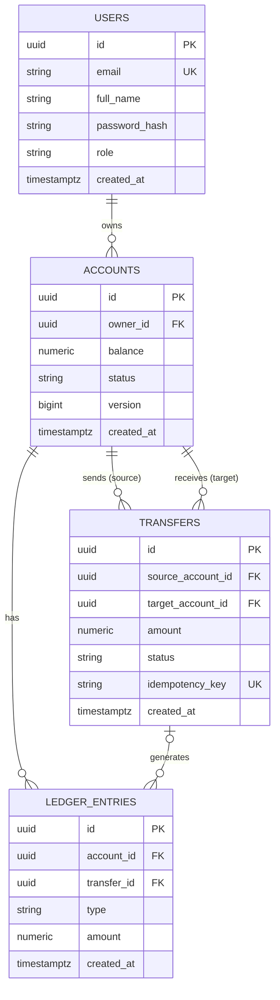
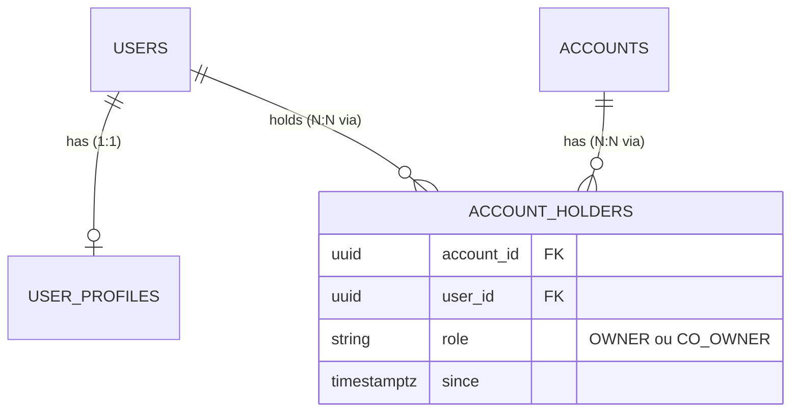

# J3.01 — Modelagem: entidades, relacionamentos e diagrama ER

> ⏱️ ~1h30 · 🟢 Júnior · Pré-requisitos: J1.10, J1.11, J2.06 (o `mini-bank` guardava tudo em memória; aqui começamos a guardar em banco)

## 🎯 Objetivos
Ao final desta aula você consegue:
- Identificar **entidades**, **atributos** e **relacionamentos** a partir de um texto de requisitos.
- Classificar um relacionamento como **1:1**, **1:N** ou **N:N** e dizer onde fica a chave estrangeira em cada caso.
- Desenhar um **diagrama ER** em Mermaid (notação "pé de galinha") e lê-lo.
- Traduzir o diagrama em tabelas, incluindo a **tabela associativa** do N:N.
- Calcular uma **ordem de criação** das tabelas que respeita as dependências.

## 🤔 Por que isso importa
O modelo de dados é a decisão mais cara de mudar em um sistema: o código se reescreve em dias, mas milhões de linhas já gravadas com um modelo ruim exigem migração, janela de manutenção e cuidado. Em um time, o júnior raramente desenha o modelo sozinho, mas **lê diagramas ER todos os dias** (ao entrar num projeto, ao revisar uma migração, ao escrever um `JOIN`) e precisa questionar um modelo quando algo não fecha. Nesta aula você aprende a linguagem desse desenho; as próximas dão o rigor (J3.02) e o SQL.

## 💡 Intuição (explicação simples)
Pense no **fichário de uma biblioteca**:
- Uma ficha para cada **leitor** (nome, e-mail).
- Uma ficha para cada **livro** (título, autor).
- Uma ficha de **empréstimo** que **liga** um leitor a um livro e anota a data.

Ninguém copia o endereço do leitor em cada ficha de empréstimo: a ficha de empréstimo guarda só o **número** do leitor e do livro. Se o leitor muda de endereço, corrige-se em um único lugar. Um banco relacional é exatamente isso: **várias tabelas pequenas, cada uma sobre uma coisa só, ligadas por números de identificação**.

## 🔬 Como funciona por dentro

### Vocabulário
| Termo | O que é | Exemplo no PayFlow |
|---|---|---|
| **Entidade** | Uma "coisa" do negócio sobre a qual guardamos dados (um substantivo). Vira uma **tabela**. | `User`, `Account`, `Transfer`, `LedgerEntry` |
| **Instância** | Um exemplo concreto da entidade. Vira uma **linha**. | A usuária Ana Silva |
| **Atributo** | Uma propriedade da entidade. Vira uma **coluna**. | `email`, `balance` |
| **Identificador** | O atributo (ou conjunto) que distingue uma instância das outras. Vira a **chave primária** (J3.02). | `id` |
| **Relacionamento** | Uma ligação entre entidades (um verbo). Vira uma **chave estrangeira** (ou uma tabela de ligação). | "um usuário **possui** contas" |
| **Cardinalidade** | Quantas instâncias de um lado se ligam a quantas do outro. | 1 usuário : N contas |
| **Opcionalidade** | A ligação é obrigatória ou opcional? | Um usuário pode ter **zero** contas |

### Os três tipos de relacionamento
| Tipo | Leitura | Como vira tabela | Exemplo |
|---|---|---|---|
| **1:N** (um-para-muitos) | Um `User` tem várias `Account`; cada `Account` é de **um** `User`. | **Chave estrangeira no lado "N"**: `accounts.owner_id → users.id`. | `users` → `accounts` |
| **1:1** (um-para-um) | Uma instância de cada lado, no máximo. | Chave estrangeira **com restrição de unicidade** em um dos lados (ou mesma chave nas duas tabelas). | `users` ↔ `user_profiles` (dados opcionais) |
| **N:N** (muitos-para-muitos) | Uma conta pode ter vários titulares **e** um titular pode ter várias contas. | **Tabela associativa** com duas chaves estrangeiras (e, se houver, atributos *da ligação*). | `accounts` ↔ `users` via `account_holders` |

Regra prática: **uma coluna nunca guarda uma lista**. Se você pensou em "uma coluna com vários ids", é um 1:N ou N:N disfarçado (J3.02 mostra por que isso quebra a 1ª forma normal).

### Notação do diagrama ER ("pé de galinha")
O Mermaid usa símbolos nas pontas da linha. Cada ponta diz "quantos, no mínimo e no máximo":

| Símbolo (lado) | Significa |
|---|---|
| `\|\|` | exatamente um |
| `\|o` | zero ou um |
| `o{` | zero ou muitos |
| `\|{` | um ou muitos |

`USERS ||--o{ ACCOUNTS : owns` lê-se: "**um** usuário possui **zero ou muitos** contas".

### Do requisito ao modelo, em 5 passos
Aplicados ao texto abaixo, que resume o PayFlow (`00-guia/projeto-central.md`):

> *Pessoas se cadastram com e-mail e senha. Cada pessoa pode abrir várias contas. Uma conta tem saldo e um status. Uma transferência leva dinheiro de uma conta para outra. Cada movimentação de dinheiro, seja um depósito ou uma transferência, vira um lançamento imutável na conta; uma transferência gera dois lançamentos (um débito e um crédito).*

1. **Sublinhe os substantivos** → candidatos a entidade: pessoa/usuário, conta, transferência, lançamento. ("Saldo" e "status" são atributos, não entidades: não têm vida própria.)
2. **Sublinhe os verbos** → relacionamentos: usuário *possui* contas; conta *tem* lançamentos; transferência *gera* lançamentos; transferência *sai de* e *vai para* uma conta.
3. **Defina a cardinalidade de cada um**, perguntando nas duas direções: "uma conta tem quantos lançamentos?" (muitos) / "um lançamento pertence a quantas contas?" (uma).
4. **Liste os atributos** de cada entidade e o identificador.
5. **Revise as exceções**: "e o depósito, que não é transferência?" → o lançamento de depósito **não tem** transferência, então a ligação `LedgerEntry → Transfer` é **opcional** (zero ou um). Esse detalhe é uma decisão do projeto (ver `projeto/adrs/0001-ledger-transfer-id-nulo.md`).

Repare que `Transfer` se liga a `Account` **duas vezes** (origem e destino). São **dois relacionamentos 1:N diferentes** entre as mesmas tabelas, por isso `transfers` terá duas colunas de chave estrangeira.



> Este é o ER **final** do módulo (o de `projeto-central.md`, com `full_name`, `created_at` e a ligação opcional do lançamento). O código das próximas aulas o implementa.

### Exemplos de 1:1 e N:N (fora do PayFlow atual)

- **1:1:** `user_profiles` guarda dados raros ou sensíveis (documento, data de nascimento) separados de `users`, que é lida o tempo todo. A chave estrangeira em `user_profiles` é **única**.
- **N:N:** "conta conjunta". A tabela associativa `account_holders` tem uma linha por par (conta, titular), e pode ter **atributos da ligação** (`role`, `since`), que não pertencem nem à conta nem ao usuário. O PayFlow **não** implementa contas conjuntas (cada conta tem um dono, `accounts.owner_id`): modelar o que ainda ninguém pediu é custo sem retorno. Fica como desafio.

## 🛠️ Exemplo prático
Nesta aula o artefato é o **diagrama**, e o código Java calcula uma consequência dele: a **ordem em que as tabelas podem ser criadas** (e, ao contrário, apagadas). Não dá para criar `accounts` antes de `users`, porque a chave estrangeira aponta para uma tabela que ainda não existe.

> Testado com JDK 25.0.5 (`java CreationOrder.java`).

`CreationOrder.java`:
```java
import java.util.*;

public class CreationOrder {
    /** dependencies: tabela -> tabelas que ela referencia (FKs). Devolve uma ordem de criação válida. */
    static List<String> creationOrder(Map<String, Set<String>> dependencies) {
        Map<String, Integer> pending = new TreeMap<>();            // quantas dependências faltam
        Map<String, List<String>> dependents = new TreeMap<>();    // quem espera por mim
        dependencies.forEach((table, deps) -> {
            pending.put(table, deps.size());
            deps.forEach(d -> dependents.computeIfAbsent(d, k -> new ArrayList<>()).add(table));
        });
        Deque<String> ready = new ArrayDeque<>();
        pending.forEach((t, n) -> { if (n == 0) ready.add(t); });
        List<String> order = new ArrayList<>();
        while (!ready.isEmpty()) {
            String table = ready.poll();
            order.add(table);
            for (String dependent : dependents.getOrDefault(table, List.of())) {
                if (pending.merge(dependent, -1, Integer::sum) == 0) ready.add(dependent);
            }
        }
        if (order.size() != dependencies.size()) {
            throw new IllegalArgumentException("Circular foreign keys among: " + new TreeSet<>(pending.keySet()).stream().filter(t -> !order.contains(t)).toList());
        }
        return order;
    }

    public static void main(String[] args) {
        Map<String, Set<String>> payflow = new TreeMap<>();
        payflow.put("users", Set.of());
        payflow.put("accounts", Set.of("users"));
        payflow.put("transfers", Set.of("accounts"));
        payflow.put("ledger_entries", Set.of("accounts", "transfers"));
        List<String> order = creationOrder(payflow);
        System.out.println("create: " + order);
        System.out.println("drop  : " + order.reversed());
        Map<String, Set<String>> cyc = Map.of("a", Set.of("b"), "b", Set.of("a"), "c", Set.of());
        try { creationOrder(cyc); } catch (IllegalArgumentException e) { System.out.println(e.getMessage()); }
    }
}
```
```bash
java CreationOrder.java
```
Saída real:
```
create: [users, accounts, transfers, ledger_entries]
drop  : [ledger_entries, transfers, accounts, users]
Circular foreign keys among: [a, b]
```
Para **apagar**, a ordem se inverte: primeiro quem aponta, depois quem é apontado. E duas tabelas que se referenciam mutuamente (`a` ↔ `b`) são um **ciclo**: não há ordem possível sem recursos extras. Sinal de que o modelo precisa ser repensado.

## 🧠 Pausa para lógica
**Enunciado:** o código acima é uma **ordenação topológica** (algoritmo de Kahn). Reescreva `creationOrder` mentalmente para o PayFlow e responda: (a) por que `users` sai primeiro? (b) se adicionarmos `account_holders` (N:N), depende de quais tabelas e onde entra na ordem? (c) o que acontece com a ordem se `users` ganhasse uma coluna `default_account_id → accounts`?

<details><summary>Dica</summary>Uma tabela só pode ser criada quando <b>todas</b> as tabelas que ela referencia já existem. Conte as dependências que faltam e vá liberando as tabelas que chegam a zero.</details>
<details><summary>Solução (testada)</summary>

(a) `users` não referencia ninguém (zero dependências pendentes), então entra na fila logo de início. (b) `account_holders` referencia `accounts` e `users`: entra depois das duas. Saída real: `[users, accounts, account_holders, transfers, ledger_entries]`. (c) `users → accounts` **e** `accounts → users` formam um ciclo, e o ciclo trava também quem depende dele: o algoritmo lança `Circular foreign keys among: [accounts, ledger_entries, transfers, users]`. A saída real no mundo é uma coluna anulável preenchida depois, com a chave estrangeira adicionada por `ALTER TABLE` depois que as duas tabelas existem, ou (melhor) repensar: guardar "conta padrão" como atributo da conta (`accounts.is_default`).
</details>

**Variação:** faça `creationOrder` devolver **níveis** (tabelas que podem ser criadas em paralelo). Para o PayFlow: `[users] → [accounts] → [transfers] → [ledger_entries]`; e se `ledger_entries` não referenciasse `transfers`?

## ⚠️ Erros comuns e boas práticas de produção
- **Tabela "faz-tudo":** uma tabela `payments` com 60 colunas, muitas vazias conforme o tipo. Sinal de várias entidades misturadas.
- **Modelar a tela, não o domínio:** colunas `campo1`, `campo2`, ou uma tabela por formulário. O modelo deve refletir o negócio, e as telas mudam.
- **Esconder um N:N em uma coluna:** `owner_ids = '1,2,3'`. Não dá para ter chave estrangeira nem índice úteis; a J3.02 explica.
- **Esquecer os atributos da ligação** do N:N (`since`, `role`): acabam em lugar errado.
- **Nome de pessoa ou e-mail como identificador:** mudam. Use um identificador próprio e imutável (J3.02).
- **Modelar o futuro distante:** contas conjuntas, múltiplas moedas e extratos fiscais "porque um dia podem ser úteis". Cada tabela extra é código, teste e migração. Modele o que o requisito atual exige; migrações (J3.12) existem para evoluir.
- **Dado derivado guardado sem decisão consciente:** `accounts.balance` é a soma dos lançamentos (regra 3 do PayFlow). Guardar o saldo é **redundância deliberada** (ler o saldo sem somar milhões de linhas), e por isso há uma consulta de conferência (J3.07). Redundância acidental é bug esperando para acontecer.

## 🧩 Exercícios
1. **Fixação:** classifique (1:1, 1:N ou N:N) e diga onde fica a chave estrangeira: (a) conta ↔ lançamentos; (b) usuário ↔ chaves PIX (cada usuário tem várias, cada chave é de um usuário); (c) transferência ↔ conta de origem; (d) estudante ↔ curso; (e) usuário ↔ configurações de notificação (uma linha por usuário).
2. **Aplicação no PayFlow:** no repositório `payflow`, crie `docs/er-diagram.md` com o diagrama ER acima.
   - [ ] As quatro entidades do PayFlow (`users`, `accounts`, `transfers`, `ledger_entries`) com todos os atributos e PK/FK/UK marcados.
   - [ ] Os dois relacionamentos entre `accounts` e `transfers` (origem e destino) estão rotulados.
   - [ ] A ligação `transfers` → `ledger_entries` é **opcional** (`|o--o{`), com uma frase explicando por quê (depósito).
   - [ ] Uma legenda de dez linhas: "o que cada tabela representa" e as regras de negócio 1 a 5 (`projeto-central.md`) que o desenho já ajuda a proteger.
   - [ ] O arquivo renderiza no GitHub (os blocos ```` ```mermaid ```` são exibidos como diagrama).
   - [ ] Commit: `docs: add PayFlow ER diagram`.
3. **Desafio (opcional):** modele **contas conjuntas** (N:N com `account_holders`) e **chaves PIX** (1:N de `users`, com a chave única no sistema inteiro). O que acontece com `accounts.owner_id`? Que regras de negócio novas surgem (ex.: quem pode movimentar)?

<details><summary>Solução de referência (fixação)</summary>

(a) 1:N, FK em `ledger_entries.account_id`. (b) 1:N, FK em `pix_keys.user_id` (e a chave em si `UNIQUE`). (c) 1:N, FK em `transfers.source_account_id`. (d) N:N, tabela associativa `enrollments(student_id, course_id)`. (e) 1:1, FK `user_id` **única** em `notification_settings` (ou `user_id` como a própria chave primária).
</details>

## 🎤 Na entrevista
- **Como você implementa um relacionamento N:N em um banco relacional?** Com uma **tabela associativa** que tem uma chave estrangeira para cada lado; a chave primária costuma ser o par (e se a ligação tem atributos próprios, como data de início, eles ficam nessa tabela).
- **Onde fica a chave estrangeira em um 1:N?** No lado "N" (a tabela filha): cada `account` guarda o `owner_id` do seu dono.
- **O que é cardinalidade e opcionalidade?** Cardinalidade é quantas instâncias se ligam (1:1, 1:N, N:N). Opcionalidade é se a ligação é obrigatória (um lançamento *precisa* de conta) ou opcional (um lançamento *pode* não ter transferência).
- **Você recebe um modelo com uma coluna `tags = 'a,b,c'`. O que questiona?** Lista em uma coluna impede chave estrangeira, índice eficiente e consultas simples (`WHERE tag = 'a'`). Propor tabela `tags` + associativa.

## 📚 Para ir além
- 📄 [Mermaid — Entity Relationship Diagram](https://mermaid.js.org/syntax/entityRelationshipDiagram.html): a sintaxe completa dos símbolos de cardinalidade; vale para ler a tabela de "pé de galinha".
- 📄 [PostgreSQL — Foreign Keys (tutorial)](https://www.postgresql.org/docs/18/tutorial-fk.html): exemplo curto de duas tabelas ligadas e do que o banco impede.
- 📑 *Designing Data-Intensive Applications* (Kleppmann), capítulo sobre modelos de dados: compara relacional, documento e grafo (numeração do capítulo varia por edição; não conferida).
- 🎥 ⚠️ Nenhum vídeo verificado nesta execução.

## ✅ Checklist da aula
- [ ] Sei separar entidade, atributo e relacionamento em um texto de requisitos.
- [ ] Classifico 1:1, 1:N e N:N e digo onde fica a chave estrangeira.
- [ ] Leio os símbolos `||`, `|o`, `o{`, `|{`.
- [ ] `docs/er-diagram.md` criado e renderizando no GitHub.
- [ ] Rodei `CreationOrder.java` e expliquei a ordem de criação e de remoção.
