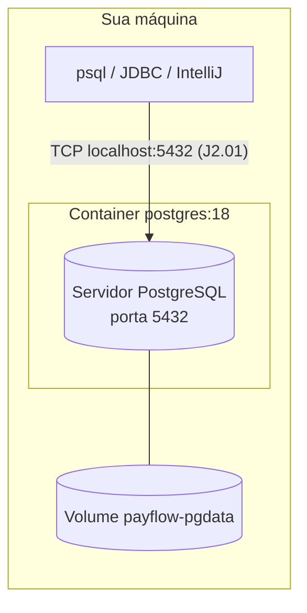

# J3.03 — PostgreSQL com Docker e primeiros comandos

> ⏱️ ~1h30 · 🟢 Júnior · Pré-requisitos: J0.01, J2.01, J3.01 (Docker é estudado a fundo no J9; aqui usamos só os comandos necessários)

## 🎯 Objetivos
Ao final desta aula você consegue:
- Subir o **PostgreSQL 18** em um container com **volume** (os dados sobrevivem ao container).
- Conectar com o `psql` e usar os meta-comandos essenciais (`\l`, `\c`, `\dt`, `\d`, `\x`, `\timing`, `\q`).
- Explicar a hierarquia **servidor → banco → schema → tabela** e como o cliente chega ao servidor (porta 5432).
- Executar um arquivo `.sql` pelo terminal.
- Diagnosticar os erros mais comuns de subida e de conexão.

## 🤔 Por que isso importa
Todo dev backend roda um banco **na própria máquina**. Instalar o PostgreSQL direto no sistema operacional "suja" a máquina, trava na versão errada e é difícil de recriar. Um container descartável resolve: sobe em segundos, na versão exata de produção, e some sem deixar rastro. E o `psql` é a ferramenta que você usará para investigar problemas, mesmo quando houver ferramentas gráficas.

## 💡 Intuição (explicação simples)
Pense em um **prédio comercial**:
- O **servidor PostgreSQL** é o prédio (um programa que fica rodando e atendendo).
- Cada **banco de dados** (*database*) é um andar, isolado dos outros.
- Dentro do andar há **salas** (*schemas*; a padrão chama-se `public`) e, nas salas, os **armários** (*tabelas*).
- O **container** é o prédio **pré-fabricado dentro de uma caixa lacrada**: você liga, usa e descarta. O **volume** é um **cofre fora da caixa**, onde ficam os dados: se a caixa for jogada fora, o cofre continua.
- O `psql` é o **interfone** pelo qual você fala com o prédio.

## 🔬 Como funciona por dentro

- **Cliente-servidor sobre TCP** (J2.01): o servidor escuta na **porta 5432**; cada conexão é atendida por um **processo** do servidor. O `psql`, o JDBC (J3.11) e o IntelliJ são apenas **clientes** do mesmo protocolo.
- **`-p 5432:5432`** publica a porta do container na porta 5432 da sua máquina (`host:container`).
- **Variáveis de ambiente** da imagem oficial: `POSTGRES_PASSWORD` (obrigatória), `POSTGRES_USER` e `POSTGRES_DB` (opcionais). Segundo a [página oficial da imagem](https://hub.docker.com/_/postgres), elas só têm efeito **quando o diretório de dados está vazio** (primeira criação); um banco já existente "é deixado intacto".
- **Autenticação:** a imagem confia nas conexões locais **de dentro do container** (por isso `docker exec ... psql` não pede senha), mas **exige a senha** de quem conecta de fora, como o JDBC da sua máquina (documentação da imagem).
- **Volume no PostgreSQL 18:** a partir da versão 18 a imagem guarda os dados em `/var/lib/postgresql/18/docker` e o volume deve ser montado em **`/var/lib/postgresql`** (e não mais em `/var/lib/postgresql/data`, como nos tutoriais antigos). Está na página oficial da imagem e foi **reproduzido nesta aula** (ver "Erros comuns").

### Meta-comandos do `psql` (começam com `\`, não são SQL)
| Comando | Faz |
|---|---|
| `\?` | Ajuda dos meta-comandos |
| `\l` | Lista os bancos |
| `\c nome` | Conecta a outro banco |
| `\dt` | Lista as tabelas do schema atual |
| `\d tabela` | Descreve a tabela (colunas, constraints, índices, referências) |
| `\d+ tabela` | Descrição estendida |
| `\x` | Alterna a saída "expandida" (uma coluna por linha; útil em linhas largas) |
| `\timing` | Mostra o tempo de cada comando |
| `\i arquivo.sql` | Executa um arquivo |
| `\conninfo` | Mostra os dados da conexão |
| `\q` | Sai |

Um comando SQL termina com **`;`**. Sem o `;`, o `psql` espera mais linhas (o prompt muda para `payflow-#`).

## 🛠️ Exemplo prático
> Testado com Docker 29.9.2 e a imagem `postgres:18` (PostgreSQL **18.6** na data do teste). 💸 Nada aqui gera custo: tudo roda na sua máquina.

### 1. Subir o banco do PayFlow
```bash
docker run -d --name payflow-pg \
  -e POSTGRES_USER=payflow \
  -e POSTGRES_PASSWORD=payflow \
  -e POSTGRES_DB=payflow \
  -p 5432:5432 \
  -v payflow-pgdata:/var/lib/postgresql \
  postgres:18
```
- `-d`: em segundo plano. `--name`: nome para os próximos comandos. `-v nome:caminho`: **volume nomeado**. `postgres:18`: fixamos a **versão maior** (nunca `latest`: uma atualização silenciosa de versão quebra o ambiente).
- Usuário e senha `payflow/payflow` são **só para desenvolvimento local**. Segredos de verdade nunca vão para o Git (J8/J10).

Confira:
```bash
docker ps --filter name=payflow-pg
docker logs payflow-pg | tail -3
docker exec payflow-pg pg_isready -U payflow -d payflow
```
Saída esperada do último comando:
```
/var/run/postgresql:5432 - accepting connections
```
No início, `pg_isready` pode responder `no response` por alguns segundos: o servidor ainda está inicializando.

### 2. Entrar no `psql`
```bash
docker exec -it payflow-pg psql -U payflow -d payflow
```
(`-it` abre um terminal interativo. Em **scripts** e CI, sem terminal, use `-i` sem o `-t`; com `-t` o Docker responde `cannot attach stdin to a TTY-enabled container because stdin is not a terminal`.)

Dentro do `psql` (prompt `payflow=#`):
```sql
SELECT version();
SELECT 1 + 1 AS two, now() AS agora, current_database() AS banco, current_user AS usuario;
```
Saída real (a hora muda):
```
 two |             agora             |  banco  | usuario 
-----+-------------------------------+---------+---------
   2 | 2026-11-12 21:10:48.874092+00 | payflow | payflow
```
Meta-comandos:
```
payflow=# \conninfo
           Connection Information
      Parameter       |        Value        
----------------------+---------------------
 Database             | payflow
 Client User          | payflow
 Socket Directory     | /var/run/postgresql
 Server Port          | 5432
 ...
payflow=# \l
```
`\l` lista `payflow` (o seu), `postgres` (banco administrativo padrão) e `template0`/`template1` (moldes usados para criar bancos novos). Ainda não há tabelas: `\dt` responde `Did not find any tables.` A criação vem na J3.04.

### 3. Executar um arquivo `.sql`
```bash
# -i (stdin) lê o arquivo; ON_ERROR_STOP=1 aborta no primeiro erro (sem isso, o psql segue adiante)
docker exec -i payflow-pg psql -U payflow -d payflow -v ON_ERROR_STOP=1 < script.sql
```
Um único comando sem abrir o prompt: `docker exec payflow-pg psql -U payflow -d payflow -c "SELECT 1"`.

### 4. Parar, retomar e entender o que persiste
```bash
docker stop payflow-pg          # para; os dados continuam no volume
docker start payflow-pg         # retoma, com os mesmos dados
docker rm -f payflow-pg         # remove o container; o VOLUME continua
docker volume ls                # payflow-pgdata ainda está aqui
docker volume rm payflow-pgdata # ⚠️ APAGA os dados (irreversível)
```
Teste feito: criamos uma tabela, removemos o container (`docker rm -f`), subimos outro apontando para o **mesmo volume** e a tabela continuava lá.

### 5. Conectar de fora (a porta 5432 da sua máquina)
O **JDBC** (J3.11) usará a URL `jdbc:postgresql://localhost:5432/payflow` com usuário e senha. Ferramentas gráficas (a janela *Database* do IntelliJ, DBeaver) usam os mesmos dados de host, porta, banco, usuário e senha. ⚠️ Não testamos as ferramentas gráficas nesta execução; o procedimento está nas documentações de cada uma.

### 6. Script de ajuda para o PayFlow (exercício 2)
Um `scripts/db-up.sh` **idempotente** (roda quantas vezes quiser; testado em duas execuções seguidas e em uma execução do zero, com container, porta e volume novos):
```bash
#!/usr/bin/env bash
set -euo pipefail
NAME=payflow-pg
if docker ps -a --format '{{.Names}}' | grep -qx "$NAME"; then
  docker start "$NAME" >/dev/null
else
  docker run -d --name "$NAME" \
    -e POSTGRES_USER=payflow -e POSTGRES_PASSWORD=payflow -e POSTGRES_DB=payflow \
    -p 5432:5432 -v payflow-pgdata:/var/lib/postgresql postgres:18 >/dev/null
fi
until docker exec "$NAME" pg_isready -U payflow -d payflow >/dev/null 2>&1; do sleep 1; done
echo "PostgreSQL pronto em localhost:5432"
```

## 🧠 Pausa para lógica
**Enunciado:** o `until ... pg_isready ... sleep 1` acima é uma **espera com tentativas**. Em código Java (o `Main` do PayFlow vai precisar esperar o banco), escreva `waitUntil(check, maxAttempts, first, cap)` que tenta até `maxAttempts` vezes e **dobra a espera** a cada falha (*backoff exponencial*) até um teto. Não espere depois da última tentativa.

<details><summary>Dica</summary>Guarde <code>delay</code>; após cada falha faça <code>delay = Math.min(delay * 2, cap)</code>. Cuidado com o <code>sleep</code> depois da última tentativa: é tempo perdido.</details>
<details><summary>Solução (testada com JDK 25.0.5)</summary>

```java
import java.io.IOException;
import java.net.InetSocketAddress;
import java.net.Socket;
import java.time.Duration;

public class WaitForDb {
    interface Check { boolean ok(); }

    /** Tenta até {@code maxAttempts} vezes, dobrando a espera (backoff exponencial) até o teto. */
    static int waitUntil(Check check, int maxAttempts, Duration first, Duration cap) throws InterruptedException {
        long delay = first.toMillis();
        for (int attempt = 1; attempt <= maxAttempts; attempt++) {
            if (check.ok()) return attempt;
            if (attempt == maxAttempts) break;                       // não espera depois da última
            System.out.println("tentativa " + attempt + " falhou; esperando " + delay + " ms");
            Thread.sleep(delay);
            delay = Math.min(delay * 2, cap.toMillis());
        }
        throw new IllegalStateException("not ready after " + maxAttempts + " attempts");
    }

    static boolean portOpen(String host, int port) {
        try (Socket s = new Socket()) { s.connect(new InetSocketAddress(host, port), 500); return true; }
        catch (IOException e) { return false; }
    }

    public static void main(String[] args) throws Exception {
        System.out.println("porta 5432 -> aberta na tentativa " + waitUntil(() -> portOpen("localhost", 5432), 5, Duration.ofMillis(200), Duration.ofSeconds(2)));
        try { waitUntil(() -> portOpen("localhost", 5999), 4, Duration.ofMillis(100), Duration.ofMillis(400)); }
        catch (IllegalStateException e) { System.out.println(e.getMessage()); }
    }
}
```
Saída real (com o banco no ar na 5432 e nada na 5999):
```
porta 5432 -> aberta na tentativa 1
tentativa 1 falhou; esperando 100 ms
tentativa 2 falhou; esperando 200 ms
tentativa 3 falhou; esperando 400 ms
not ready after 4 attempts
```
Porta aberta (`Socket` conectando) **não** garante que o PostgreSQL já aceita consultas; o `pg_isready` (ou uma tentativa de login) é uma checagem melhor. A ideia do backoff é a mesma em clientes HTTP, filas e pools (P3/P5).
</details>

**Variação:** acrescente **jitter** (um acréscimo aleatório pequeno à espera). Por que ajuda quando 100 instâncias do serviço sobem ao mesmo tempo?

## ⚠️ Erros comuns e boas práticas de produção
- **Porta 5432 ocupada** (outro PostgreSQL, ou o container da sessão anterior):
  ```
  docker: Error response from daemon: ... Bind for 0.0.0.0:5432 failed: port is already allocated
  ```
  Pare o outro (`docker ps`, `docker stop`) ou publique em outra porta (`-p 5433:5432`) e ajuste a URL.
- **Esqueceu `POSTGRES_PASSWORD`:**
  ```
  Error: Database is uninitialized and superuser password is not specified.
         You must specify POSTGRES_PASSWORD to a non-empty value for the superuser.
  ```
- **Volume no caminho antigo (tutoriais anteriores ao 18):** com `-v dados:/var/lib/postgresql/data` na imagem 18, o container **sai com erro** logo ao subir:
  ```
  Error: in 18+, these Docker images are configured to store database data in a
         format which is compatible with "pg_ctlcluster" (...)
         The suggested container configuration for 18+ is to place a single mount
         at /var/lib/postgresql which will then place PostgreSQL data in a
         subdirectory, ...
  ```
  Monte em `/var/lib/postgresql`.
- **`FATAL: database "naoexiste" does not exist` / `password authentication failed for user "payflow"`:** nome do banco ou senha diferentes do que o container foi criado com. Lembre: as variáveis `POSTGRES_*` só valem na **primeira** inicialização do volume; mudar a senha no `docker run` **não** altera um banco já criado. (Para recomeçar do zero em desenvolvimento: `docker rm -f` + `docker volume rm`.)
- **`Connection refused` na primeira tentativa:** o servidor ainda inicia. Espere o `pg_isready` (a Pausa) antes de conectar.
- **Usar `postgres:latest`:** a versão pode subir de uma hora para outra e o volume deixa de ser compatível. **Fixe a versão** (`postgres:18`), idealmente igual à de produção.
- **Esquecer o `;`** no `psql`: o prompt vira `payflow-#`; digite `;` para fechar o comando ou `\r` para limpar.
- **Expor o banco para a internet** (`-p 0.0.0.0:5432`, firewall aberto) com senha fraca: só para desenvolvimento local; em nuvem o banco fica em rede privada (J10, P9).

## 🧩 Exercícios
1. **Fixação:** explique cada parte do `docker run` da seção 1 (`-d`, `--name`, `-e`, `-p 5432:5432`, `-v`). O que aconteceria sem o `-v`? Qual a diferença entre um *database* e um *schema*?
2. **Aplicação no PayFlow:** deixe o banco local reproduzível no repositório `payflow`.
   - [ ] `scripts/db-up.sh` (acima), executável (`chmod +x`), roda duas vezes seguidas sem erro.
   - [ ] `scripts/psql.sh` com `docker exec -it payflow-pg psql -U payflow -d payflow "$@"`.
   - [ ] `pg_isready` responde `accepting connections`; `\conninfo` mostra o banco `payflow` e a porta 5432.
   - [ ] O README ganha a seção "Banco local" com os comandos de subir, parar e **recomeçar do zero** (e o aviso ⚠️ de que `docker volume rm` apaga os dados).
   - [ ] Nada de senha de produção no repositório (a senha `payflow` é só de desenvolvimento local e está **em um só lugar**: o script).
   - [ ] Commit: `chore: add local PostgreSQL scripts`.
3. **Desafio (opcional):** suba um **segundo** PostgreSQL em outra porta (`5433`) com outro nome e outro volume, crie uma tabela nele e prove que o primeiro não enxerga a tabela.

<details><summary>Solução de referência (fixação)</summary>

`-d` roda em segundo plano; `--name` dá um nome fixo; `-e` define variáveis de ambiente (usuário, senha, banco iniciais); `-p 5432:5432` liga a porta 5432 da máquina à do container; `-v payflow-pgdata:/var/lib/postgresql` guarda os dados em um volume. Sem `-v`, o Docker cria um volume **anônimo** que não é reaproveitado ao recriar o container: os dados "somem". *Database* é um espaço isolado de dados (não se faz `JOIN` entre bancos); *schema* é um agrupamento de objetos **dentro** de um banco (o padrão é `public`).
</details>

## 🎤 Na entrevista
- **Por que usar Docker para o banco em desenvolvimento?** Ambiente igual ao de produção (mesma versão), descartável, sem instalar nada no sistema, fácil de recriar para cada projeto.
- **O que acontece com os dados se o container for removido?** Se houver volume, nada: o volume continua e o próximo container o reutiliza. Sem volume (ou com volume anônimo), os dados se perdem.
- **Diferença entre *database* e *schema* no PostgreSQL?** Um servidor tem vários *databases* (isolados); cada um tem vários *schemas* (espaços de nomes, padrão `public`), que contêm tabelas.
- **O container "sobe" mas o app dá `Connection refused`. O que você verifica?** Se o container está rodando (`docker ps`), se a porta está publicada (`-p`), se o servidor já aceita conexões (`pg_isready`) e se a URL/host/porta do app batem com isso.

## 📚 Para ir além
- 📄 [Docker Hub — imagem oficial `postgres`](https://hub.docker.com/_/postgres): variáveis de ambiente, onde montar o volume, scripts de inicialização (`/docker-entrypoint-initdb.d`) e as notas da versão 18; leia a seção sobre `PGDATA`.
- 📄 [PostgreSQL — `psql`](https://www.postgresql.org/docs/18/app-psql.html): a referência completa dos meta-comandos.
- 📄 [Docker — persistência de dados do container](https://docs.docker.com/get-started/docker-concepts/running-containers/persisting-container-data/): volumes explicados em poucos minutos de leitura.
- 🎥 ⚠️ Nenhum vídeo verificado nesta execução.

## ✅ Checklist da aula
- [ ] Container `payflow-pg` no ar com volume em `/var/lib/postgresql`.
- [ ] `pg_isready` e `\conninfo` funcionando.
- [ ] Executei um `.sql` por `docker exec -i ... < arquivo`.
- [ ] Sei o que persiste (volume) e o que se perde ao remover o container.
- [ ] `scripts/db-up.sh` e `scripts/psql.sh` commitados.
