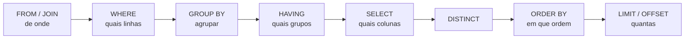

# J3.05 — SQL II: `SELECT`, `WHERE`, `ORDER BY`, `LIMIT`

> ⏱️ ~1h30 · 🟢 Júnior · Pré-requisitos: J3.04 (esquema e seed carregados), J1.02 (operadores lógicos), J1.15 (`java.time`)

## 🎯 Objetivos
Ao final desta aula você consegue:
- Escrever consultas com **projeção**, **apelidos** (`AS`), **expressões** e `CASE`.
- Filtrar com `AND`/`OR`/`NOT`, `IN`, `BETWEEN`, `LIKE`/`ILIKE` e `IS NULL`.
- Explicar a **lógica de três valores** (`NULL`) e por que `= NULL` nunca funciona.
- Ordenar de forma **determinística** e paginar com `LIMIT`/`OFFSET` e com **keyset**.
- Dizer em que **ordem lógica** o PostgreSQL avalia as cláusulas.

## 🤔 Por que isso importa
`SELECT` é a instrução que você mais vai escrever na vida. O extrato do PayFlow (uma conta, os lançamentos mais recentes, 10 por página) é um `SELECT` com `WHERE`, `ORDER BY` e `LIMIT`. Quase todo bug de consulta de júnior cai em quatro lugares, todos desta aula: `NULL`, ordenação sem desempate, paginação por `OFFSET` e filtro de período com `BETWEEN`.

## 💡 Intuição (explicação simples)
Um `SELECT` é um **pedido ao bibliotecário**: *"mostre (colunas) das fichas de (tabela) que atendem a (condição), na ordem (tal), só as (N) primeiras."* O bibliotecário **não** lê o seu pedido de cima para baixo: ele primeiro pega a estante (`FROM`), depois separa as fichas que servem (`WHERE`), só então escolhe o que mostrar (`SELECT`), organiza (`ORDER BY`) e corta a pilha (`LIMIT`). Por isso um apelido criado no `SELECT` ainda não existe na hora do `WHERE`.

## 🔬 Como funciona por dentro

### A ordem lógica de execução

Você escreve `SELECT` primeiro, mas ele é avaliado **depois** de `FROM` e `WHERE`. Consequências: apelido do `SELECT` **não** vale no `WHERE` (vale no `ORDER BY`); `WHERE` filtra **linhas** antes de agrupar, `HAVING` filtra **grupos** depois (J3.07). (Isso descreve a **semântica**; o banco pode executar em outra ordem se o resultado for o mesmo.)

### Predicados que você vai usar
| Operador | Exemplo | Observação |
|---|---|---|
| `=`, `<>`, `<`, `<=`, `>`, `>=` | `balance >= 500` | `<>` é "diferente" (também `!=`) |
| `AND`, `OR`, `NOT` | `role = 'USER' AND ...` | `AND` tem precedência sobre `OR`: use parênteses |
| `IN (...)` | `status IN ('FAILED', 'PENDING')` | Atalho para vários `OR` |
| `BETWEEN a AND b` | `balance BETWEEN 500 AND 900` | **Inclui** os dois extremos |
| `LIKE` / `ILIKE` | `email LIKE 'ana%'` | `%` = qualquer texto; `_` = um caractere; `ILIKE` ignora maiúsculas (extensão do PostgreSQL) |
| `IS NULL` / `IS NOT NULL` | `transfer_id IS NULL` | **O único** jeito de testar nulo |

### `NULL`: lógica de três valores
`NULL` significa **"desconhecido"**, não "vazio" nem zero. Toda comparação com `NULL` resulta em um terceiro valor, **desconhecido**, e o `WHERE` só deixa passar o que é **verdadeiro**:
```sql
SELECT NULL = NULL AS eq, NULL IS NULL AS is_null, (NULL AND false) AS n_and_f, (NULL OR true) AS n_or_t;
```
```
 eq | is_null | n_and_f | n_or_t 
----+---------+---------+--------
    | t       | f       | t
```
`NULL = NULL` é **desconhecido** (aparece em branco), não `true`. `desconhecido AND false` é `false`; `desconhecido OR true` é `true`. No PayFlow, `ledger_entries.transfer_id` é `NULL` nos depósitos; `WHERE transfer_id = NULL` **nunca** devolve nada, e `WHERE transfer_id <> 'x'` **também descarta** os depósitos. Funções úteis: `COALESCE(a, b)` (primeiro não nulo) e `count(coluna)`, que **ignora** nulos (J3.07).

### Ordenação
`ORDER BY coluna [ASC|DESC] [NULLS FIRST|LAST]`. Em ordem ascendente, o PostgreSQL coloca os nulos **por último** por padrão (e, em `DESC`, por primeiro: `NULLS FIRST` é o padrão de `DESC`). Se várias linhas têm o mesmo valor da coluna de ordenação, a ordem entre elas é **indefinida**: pode mudar de uma execução para outra. Sempre acrescente um **desempate** único (`, id`).

### Paginação
| Técnica | Como | Problema |
|---|---|---|
| **`LIMIT n OFFSET m`** | "pule `m`, traga `n`" | O banco **precisa produzir e descartar** as `m` linhas: quanto mais fundo, mais lento. Se alguém insere uma linha entre duas páginas, um item **repete** ou **some**. |
| **Keyset** (por cursor) | `WHERE (chave) < (último visto) ORDER BY chave LIMIT n` | Custo constante com índice (J3.09); estável diante de inserções; só avança/volta (sem "ir para a página 50"). |

## 🛠️ Exemplo prático
> Testado em PostgreSQL 18.6 com o seed da J3.04. Para executar: `./scripts/psql.sh` (J3.03) ou `docker exec -it payflow-pg psql -U payflow -d payflow`.

### Projeção, apelidos, filtros e ordenação
```sql
SELECT email, full_name FROM users ORDER BY full_name;
```
```
       email       |  full_name  
-------------------+-------------
 ana@payflow.dev   | Ana Silva
 bruno@payflow.dev | Bruno Costa
 carla@payflow.dev | Carla Dias
 diego@payflow.dev | Diego Alves
 admin@payflow.dev | Eva Admin
(5 rows)
```
```sql
SELECT id, balance FROM accounts WHERE balance BETWEEN 500 AND 900 ORDER BY balance DESC;
SELECT id, status FROM transfers WHERE status IN ('FAILED', 'PENDING');
SELECT email, role FROM users WHERE role = 'USER' AND email LIKE '%a@%';
```
```
                  id                  | balance          (2 linhas: 830.00 e 574.50)
 20000000-0000-0000-0000-000000000001 |  830.00
 20000000-0000-0000-0000-000000000002 |  574.50

 30000000-0000-0000-0000-000000000004 | FAILED          (1 linha)

       email       | role                                (2 linhas: ana@ e carla@)
```
`SELECT DISTINCT type FROM ledger_entries;` devolve `DEBIT` e `CREDIT` (valores distintos, em ordem não garantida).

### `CASE` e `COALESCE`
```sql
SELECT id, amount,
       CASE WHEN amount >= 100 THEN 'ALTO' WHEN amount >= 50 THEN 'MEDIO' ELSE 'BAIXO' END AS faixa
FROM transfers ORDER BY amount DESC;
```
```
                  id                  | amount | faixa 
--------------------------------------+--------+-------
 30000000-0000-0000-0000-000000000004 | 500.00 | ALTO
 30000000-0000-0000-0000-000000000001 | 150.00 | ALTO
 30000000-0000-0000-0000-000000000002 |  75.50 | MEDIO
 30000000-0000-0000-0000-000000000003 |  20.00 | BAIXO
```
```sql
SELECT id, COALESCE(transfer_id::text, 'deposito') AS origem FROM ledger_entries ORDER BY id LIMIT 4;
```
Os três primeiros lançamentos (depósitos) mostram `deposito`; o quarto mostra o id da transferência. `::text` é a conversão de tipo do PostgreSQL (equivale a `CAST(transfer_id AS text)`).

### Datas e fusos
```sql
SELECT created_at,
       created_at AT TIME ZONE 'America/Sao_Paulo' AS sp,
       date_trunc('month', created_at) AS mes
FROM transfers LIMIT 2;
```
```
       created_at       |         sp          |          mes           
------------------------+---------------------+------------------------
 2026-01-10 11:00:00+00 | 2026-01-10 08:00:00 | 2026-01-01 00:00:00+00
 2026-01-12 15:30:00+00 | 2026-01-12 12:30:00 | 2026-01-01 00:00:00+00
```
A sessão está em UTC (`SHOW timezone` mostra `Etc/UTC` no container). `AT TIME ZONE` converte o **instante** para o relógio de um lugar (resultado sem fuso: é "o relógio da parede" de São Paulo).

### O que dá errado: os quatro clássicos
**1. `NULL` e a contagem.**
```sql
SELECT count(*) AS total, count(transfer_id) AS with_transfer FROM ledger_entries;
```
```
 total | with_transfer 
-------+---------------
     9 |             6
```
`count(*)` conta linhas; `count(coluna)` conta as **não nulas** (os 3 depósitos ficam de fora).

**2. Apelido no `WHERE`.**
```sql
SELECT amount * 2 AS dobro FROM ledger_entries WHERE dobro > 100;
```
```
ERROR:  column "dobro" does not exist
LINE 1: ...ECT amount * 2 AS dobro FROM ledger_entries WHERE dobro > 10...
```
O `WHERE` roda **antes** do `SELECT`. Repita a expressão (`WHERE amount * 2 > 100`). No `ORDER BY` o apelido funciona: `ORDER BY dobro DESC LIMIT 2` devolve `2000.00` e `1000.00`.

**3. Aspas duplas no valor.**
```sql
SELECT id FROM accounts WHERE status = "ACTIVE";
```
```
ERROR:  column "ACTIVE" does not exist
```
Aspas **simples** para texto (`'ACTIVE'`); aspas duplas são identificador.

**4. `BETWEEN` em datas/horas.** `BETWEEN a AND b` inclui os dois extremos; com `timestamp` o "dia final" começa à meia-noite e **perde** o resto do dia:
```sql
SELECT id, created_at FROM transfers
WHERE created_at BETWEEN '2026-01-10' AND '2026-01-12' ORDER BY created_at;   -- 1 linha (só a de 10/01)
SELECT id, created_at FROM transfers
WHERE created_at >= '2026-01-10' AND created_at < '2026-01-13' ORDER BY created_at;   -- 2 linhas (10/01 e 12/01 15:30)
```
O primeiro **perde** a transferência de `2026-01-12 15:30`, porque `'2026-01-12'` significa `2026-01-12 00:00:00`. A forma certa para períodos é o **intervalo semiaberto**: `>= início AND < início do dia seguinte`.

### Ordenação com desempate e nulos
```sql
SELECT x FROM (VALUES (1), (NULL), (3)) v(x) ORDER BY x;             -- 1, 3, (nulo)
SELECT x FROM (VALUES (1), (NULL), (3)) v(x) ORDER BY x DESC NULLS LAST;   -- 3, 1, (nulo)
```
E o desempate no extrato (as duas últimas linhas têm o mesmo `created_at`):
```sql
SELECT id, amount, created_at FROM ledger_entries ORDER BY created_at DESC, id DESC LIMIT 3;
```
```
                  id                  | amount |       created_at       
--------------------------------------+--------+------------------------
 40000000-0000-0000-0000-000000000009 |  20.00 | 2026-01-15 09:10:00+00
 40000000-0000-0000-0000-000000000008 |  20.00 | 2026-01-15 09:10:00+00
 40000000-0000-0000-0000-000000000007 |  75.50 | 2026-01-12 15:30:00+00
```
Sem o `, id DESC`, os dois primeiros poderiam trocar de lugar entre execuções, e a **página seguinte** poderia repetir ou pular um deles.

### Paginação: `OFFSET` e keyset
```sql
-- página 2 (índice 1), 3 por página: OFFSET = página * tamanho
SELECT id, amount FROM ledger_entries ORDER BY id LIMIT 3 OFFSET 3;

-- keyset: "os 3 depois do último id que eu vi"
SELECT id, amount FROM ledger_entries
WHERE id > '40000000-0000-0000-0000-000000000003'
ORDER BY id LIMIT 3;
```
Os dois devolvem as mesmas linhas (ids `...04`, `...05`, `...06`). A diferença aparece com **volume** e com **inserções concorrentes**; a medição fica para a J3.09, quando houver milhões de linhas. Para o extrato (ordem `created_at DESC, id DESC`), o cursor tem **duas** colunas: `WHERE (created_at, id) < (último_created_at, último_id)` (comparação de linhas do PostgreSQL), apoiado pelo índice `(account_id, created_at DESC)` da J3.09.

## 🧠 Pausa para lógica
**Enunciado:** implemente em Java (a) `totalPages(totalItems, pageSize)` **sem** `double`, (b) `offset(page, pageSize)` com página começando em 0 e (c) `after(sortedDesc, cursor, size)` — uma paginação **keyset** sobre uma lista ordenada por `(createdAt DESC, id DESC)`, em que vários itens têm o mesmo `createdAt`.

<details><summary>Dica</summary>O teto de uma divisão inteira: <code>(total + size - 1) / size</code>. No keyset, um item está "depois" do cursor se o <code>createdAt</code> é menor, ou se é igual e o <code>id</code> é menor.</details>
<details><summary>Solução (testada com JDK 25.0.5)</summary>

```java
import java.util.*;

public class Paging {
    static int totalPages(int totalItems, int pageSize) { return (totalItems + pageSize - 1) / pageSize; }   // teto sem double
    static int offset(int page, int pageSize) { return page * pageSize; }                                     // página começa em 0

    record Entry(int id, long createdAt) { }

    /** Keyset: devolve até {@code size} itens "depois" do cursor, na ordem (createdAt DESC, id DESC). */
    static List<Entry> after(List<Entry> sortedDesc, Entry cursor, int size) {
        List<Entry> out = new ArrayList<>();
        for (Entry e : sortedDesc) {
            boolean beforeCursor = cursor == null
                    || e.createdAt() < cursor.createdAt()
                    || (e.createdAt() == cursor.createdAt() && e.id() < cursor.id());
            if (beforeCursor) { out.add(e); if (out.size() == size) break; }
        }
        return out;
    }

    public static void main(String[] args) {
        System.out.println("23 itens, 10 por página -> " + totalPages(23, 10) + " páginas; offsets: " + offset(0, 10) + ", " + offset(1, 10) + ", " + offset(2, 10));
        System.out.println("20 itens, 10 por página -> " + totalPages(20, 10) + " páginas; 0 itens -> " + totalPages(0, 10));
        List<Entry> desc = new ArrayList<>();
        for (int i = 1; i <= 7; i++) desc.add(new Entry(i, i / 2));           // vários itens com o mesmo createdAt
        desc.sort(Comparator.comparingLong(Entry::createdAt).thenComparingInt(Entry::id).reversed());
        System.out.println("ordem: " + desc);
        Entry cursor = null;
        for (int p = 1; p <= 3; p++) {
            List<Entry> page = after(desc, cursor, 3);
            System.out.println("página " + p + ": " + page.stream().map(Entry::id).toList());
            if (page.isEmpty()) break;
            cursor = page.getLast();
        }
    }
}
```
Saída real:
```
23 itens, 10 por página -> 3 páginas; offsets: 0, 10, 20
20 itens, 10 por página -> 2 páginas; 0 itens -> 0
ordem: [Entry[id=7, createdAt=3], Entry[id=6, createdAt=3], Entry[id=5, createdAt=2], Entry[id=4, createdAt=2], Entry[id=3, createdAt=1], Entry[id=2, createdAt=1], Entry[id=1, createdAt=0]]
página 1: [7, 6, 5]
página 2: [4, 3, 2]
página 3: [1]
```
O desempate por `id` mantém a ordem total, então o cursor `(createdAt, id)` não repete nem pula ninguém, mesmo com `createdAt` igual. Este laço percorre a lista toda a cada página (O(n)); no banco, o índice leva direto ao ponto do cursor.
</details>

**Variação:** e se a ordem for crescente? O que muda na comparação do cursor? E se um item **novo** com `createdAt` maior entrar entre a página 1 e a 2: `OFFSET` e keyset se comportam igual?

## ⚠️ Erros comuns e boas práticas de produção
- **`= NULL` / `<> NULL`:** nunca verdadeiros; use `IS NULL`/`IS NOT NULL`. E `col <> 'x'` **não** devolve linhas em que `col` é nulo.
- **`ORDER BY` sem desempate** com paginação: páginas com itens repetidos ou faltando, e bugs que "só acontecem em produção".
- **`OFFSET` grande:** lento e instável. Em listas que crescem (extrato, auditoria), prefira keyset.
- **`SELECT *` no código de aplicação:** traz colunas que você não usa, quebra se a tabela ganhar uma coluna sensível (por exemplo `password_hash`) e atrapalha índices que cobrem a consulta (J3.09). Liste as colunas. (Para explorar no `psql`, tudo bem.)
- **`BETWEEN` em `timestamp`**: perde o último dia (acima). Use o intervalo semiaberto.
- **`LIKE '%texto'` e funções na coluna** (`WHERE lower(email) = ...`): não usam índices comuns (J3.09). Note que `WHERE lower(email) LIKE 'ANA%'` devolve **0 linhas** aqui, porque o `lower()` já minusculizou e o padrão está em maiúsculas; `ILIKE 'ANA%'` acha `ana@payflow.dev`.
- **Fuso horário implícito:** compare `TIMESTAMPTZ` com instantes (`'2026-01-10T00:00:00Z'`) e converta com `AT TIME ZONE` só na **exibição**.
- **Concatenar texto do usuário no SQL** para montar o `WHERE`: injeção de SQL. A J3.11 mostra o ataque e a defesa.

## 🧩 Exercícios
1. **Fixação:** escreva as consultas (confira com o seed): (a) e-mails de usuários que **não** são `ADMIN`; (b) contas `ACTIVE` com saldo maior que 100, da mais rica para a mais pobre; (c) lançamentos que **não** são depósito (`transfer_id` não nulo); (d) transferências concluídas em janeiro de 2026 (intervalo semiaberto); (e) a transferência de maior valor **concluída**; (f) usuários cujo nome contém "silva", sem diferenciar maiúsculas.
2. **Aplicação no PayFlow:** o **extrato** da conta de Ana.
   - [ ] `docs/queries/statement.sql` com o extrato de uma conta (parâmetro: o id), colunas explícitas (`id`, `type`, `amount`, `created_at`), ordem `created_at DESC, id DESC`.
   - [ ] Versão com `LIMIT 2 OFFSET 0` e `LIMIT 2 OFFSET 2` e a versão **keyset** (cursor = `(created_at, id)` da última linha da página anterior); as duas dão as mesmas linhas.
   - [ ] Um comentário no arquivo explicando por que o desempate `id` existe.
   - [ ] A consulta de "período" usa `>=` e `<`, não `BETWEEN`.
   - [ ] Commit: `docs(db): add statement queries`.
3. **Desafio (opcional):** a consulta "últimos 30 dias" em `TIMESTAMPTZ`: `created_at >= now() - interval '30 days'`. Reescreva para "o **dia calendário** de ontem **em São Paulo**" (dica: `date_trunc` e `AT TIME ZONE`), e explique o que muda se o servidor estiver em UTC.

<details><summary>Solução de referência (fixação)</summary>

```sql
-- (a)
SELECT email FROM users WHERE role <> 'ADMIN';
-- (b)
SELECT id, balance FROM accounts WHERE status = 'ACTIVE' AND balance > 100 ORDER BY balance DESC;
-- (c)
SELECT id, type, amount FROM ledger_entries WHERE transfer_id IS NOT NULL;
-- (d)
SELECT id, amount FROM transfers
WHERE status = 'COMPLETED' AND created_at >= '2026-01-01' AND created_at < '2026-02-01';
-- (e)
SELECT id, amount FROM transfers WHERE status = 'COMPLETED' ORDER BY amount DESC, id LIMIT 1;
-- (f)
SELECT full_name FROM users WHERE full_name ILIKE '%silva%';
```
(e) devolve a transferência de 150,00 (a de 500,00 está `FAILED`).
</details>

## 🎤 Na entrevista
- **Por que `WHERE col = NULL` não funciona?** `NULL` é "desconhecido": qualquer comparação com ele dá "desconhecido", que o `WHERE` trata como falso. Use `IS NULL`.
- **Qual a ordem lógica de avaliação de um `SELECT`?** `FROM/JOIN` → `WHERE` → `GROUP BY` → `HAVING` → `SELECT` → `DISTINCT` → `ORDER BY` → `LIMIT`. Por isso o apelido do `SELECT` não vale no `WHERE`.
- **Quais os problemas de paginar com `OFFSET`?** Custo cresce com a profundidade (o banco descarta as linhas puladas) e é instável se há inserções entre páginas (repete ou perde itens). Keyset resolve os dois, ao custo de não saltar para uma página arbitrária.
- **Por que `ORDER BY` precisa de um desempate único?** Linhas com o mesmo valor de ordenação não têm ordem definida; a ordem pode variar entre execuções e a paginação passa a repetir ou perder linhas.

## 📚 Para ir além
- 📄 [PostgreSQL — `SELECT`](https://www.postgresql.org/docs/18/sql-select.html): a sintaxe completa, incluindo `NULLS FIRST/LAST` e `FETCH FIRST`.
- 📄 [PostgreSQL — `LIMIT` e `OFFSET`](https://www.postgresql.org/docs/18/queries-limit.html): o aviso oficial sobre `OFFSET` e a necessidade de `ORDER BY` determinístico.
- 📄 [PostgreSQL — padrões (`LIKE`, `ILIKE`)](https://www.postgresql.org/docs/18/functions-matching.html): operadores e curingas.
- 📄 [PostgreSQL — expressões condicionais (`CASE`, `COALESCE`)](https://www.postgresql.org/docs/18/functions-conditional.html).
- 🎥 ⚠️ Nenhum vídeo verificado nesta execução.

## ✅ Checklist da aula
- [ ] Executei todas as consultas e conferi as saídas.
- [ ] Explico a lógica de três valores e uso `IS NULL`.
- [ ] Ordeno sempre com desempate; sei por que `OFFSET` é problemático.
- [ ] Uso intervalos semiabertos para períodos.
- [ ] `docs/queries/statement.sql` criado e commitado.
