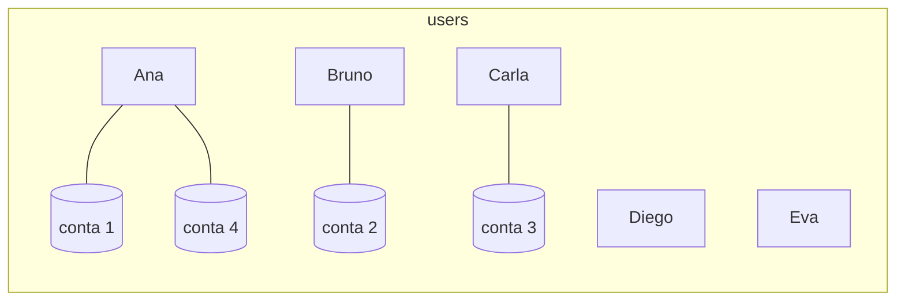

# J3.06 — SQL III: JOINs

> ⏱️ ~1h30 · 🟢 Júnior · Pré-requisitos: J3.01, J3.04, J3.05

## 🎯 Objetivos
Ao final desta aula você consegue:
- Combinar tabelas com `INNER JOIN`, `LEFT JOIN`, `FULL JOIN` e `CROSS JOIN`, e dizer qual usar.
- Explicar a diferença entre **`ON`** e **`WHERE`** em um `LEFT JOIN`.
- Fazer **anti-joins** ("quem **não** tem...") com `LEFT JOIN ... IS NULL` e `NOT EXISTS`, e evitar a armadilha do `NOT IN` com nulo.
- Ligar a **mesma tabela duas vezes** (origem e destino de uma transferência) e fazer *self join*.
- Reconhecer a **multiplicação de linhas** (*fan-out*) que corrompe somas.

## 🤔 Por que isso importa
Normalizar (J3.02) divide os dados em várias tabelas; o `JOIN` é como você os **junta de volta**. Praticamente toda tela do PayFlow é um `JOIN`: o extrato mostra o **nome** da outra pessoa na transferência (três tabelas), o painel de administração lista usuários **com ou sem** conta. E o erro mais caro desta aula é silencioso: um `JOIN` que **repete linhas** e infla um total sem dar erro nenhum.

## 💡 Intuição (explicação simples)
Você tem duas listas em papel: a dos **leitores** e a dos **empréstimos** (cada empréstimo anota o número do leitor). Um `JOIN` é **colocar as duas listas lado a lado e ligar com uma caneta** cada empréstimo ao seu leitor, usando o número como "fio".
- **INNER JOIN:** mostra só quem tem fio dos dois lados (leitores **com** empréstimo).
- **LEFT JOIN:** mostra **todos** os leitores; quem não tem empréstimo aparece com o lado direito **em branco** (`NULL`).
- **ANTI-JOIN:** mostra só os leitores **sem** fio nenhum.

## 🔬 Como funciona por dentro
Sintaxe: `FROM a JOIN b ON a.coluna = b.coluna`. A condição do `ON` é o "fio".

| Tipo | Devolve | Uso típico no PayFlow |
|---|---|---|
| `INNER JOIN` (ou só `JOIN`) | Só pares que casam | Contas **com** o dono |
| `LEFT [OUTER] JOIN` | Todas as linhas da esquerda; direita `NULL` se não casou | Usuários **com ou sem** conta |
| `RIGHT JOIN` | O espelho do `LEFT` | Raro: inverta a ordem e use `LEFT` |
| `FULL [OUTER] JOIN` | Todas de **ambos** os lados | Auditoria: "o que não tem par em nenhum dos lados" |
| `CROSS JOIN` | **Todas as combinações** (produto cartesiano) | Gerar grades (usuário × status); raramente é o que se quer |


No esquema do seed: Ana tem 2 contas, Bruno e Carla têm 1, Diego e Eva **não têm conta**. `INNER JOIN` devolve 4 linhas; `LEFT JOIN` devolve 6 (as 4 + Diego e Eva com conta `NULL`).

### `ON` versus `WHERE` em `LEFT JOIN`
- Condição no **`ON`** decide **quais linhas da direita casam**; a linha da esquerda continua aparecendo.
- Condição no **`WHERE`** roda **depois** do join e **descarta** linhas, inclusive as da esquerda sem par. Filtrar a coluna da direita no `WHERE` transforma o `LEFT JOIN` em `INNER JOIN` sem você perceber.

### Anti-join: "quem **não** tem..."
Três formas; as duas primeiras são seguras:
1. `LEFT JOIN ... WHERE direita.chave IS NULL`
2. `WHERE NOT EXISTS (SELECT 1 FROM ... WHERE ...)`
3. `WHERE id NOT IN (SELECT ...)` — **armadilha:** se a subconsulta devolver **um único `NULL`**, o `NOT IN` não devolve **nenhuma** linha (lógica de três valores, J3.05).

### Como o banco junta (visão rápida)
O PostgreSQL tem três algoritmos: *nested loop* (para cada linha da esquerda, procura na direita), *hash join* (monta uma tabela hash de um lado e consulta com o outro) e *merge join* (junta duas listas já ordenadas). O otimizador escolhe, e você lê qual ele escolheu no `EXPLAIN` (J3.09). A Pausa mostra por que a escolha importa.

## 🛠️ Exemplo prático
> Testado em PostgreSQL 18.6 com o seed da J3.04.

### `INNER` e `LEFT`
```sql
SELECT u.full_name, a.id AS account_id, a.balance
FROM users u
JOIN accounts a ON a.owner_id = u.id
ORDER BY u.full_name, a.created_at;
```
```
  full_name  |              account_id              | balance 
-------------+--------------------------------------+---------
 Ana Silva   | 20000000-0000-0000-0000-000000000001 |  830.00
 Ana Silva   | 20000000-0000-0000-0000-000000000004 |    0.00
 Bruno Costa | 20000000-0000-0000-0000-000000000002 |  574.50
 Carla Dias  | 20000000-0000-0000-0000-000000000003 |  295.50
(4 rows)
```
Ana aparece **duas vezes**: é 1:N (uma linha por conta). (Sem o desempate `a.created_at`, a ordem entre as duas linhas de Ana seria indefinida.)
```sql
SELECT u.full_name, a.balance
FROM users u
LEFT JOIN accounts a ON a.owner_id = u.id
ORDER BY u.full_name, a.created_at;
```
```
  full_name  | balance 
-------------+---------
 Ana Silva   |  830.00
 Ana Silva   |    0.00
 Bruno Costa |  574.50
 Carla Dias  |  295.50
 Diego Alves |        
 Eva Admin   |        
(6 rows)
```
Diego e Eva aparecem com saldo em branco (`NULL`).

### Anti-join: usuários sem conta
```sql
-- (1) LEFT JOIN ... IS NULL
SELECT u.full_name FROM users u
LEFT JOIN accounts a ON a.owner_id = u.id
WHERE a.id IS NULL;

-- (2) NOT EXISTS
SELECT u.full_name FROM users u
WHERE NOT EXISTS (SELECT 1 FROM accounts a WHERE a.owner_id = u.id);
```
As duas devolvem `Diego Alves` e `Eva Admin`. O `SELECT 1` dentro do `EXISTS` é só convenção: `EXISTS` só pergunta "há alguma linha?", e as colunas não importam.

**A armadilha do `NOT IN`:**
```sql
SELECT id FROM users WHERE id NOT IN (SELECT owner_id FROM accounts);            -- Diego e Eva: ok (owner_id é NOT NULL)
SELECT id FROM users WHERE id NOT IN (SELECT transfer_id FROM ledger_entries);   -- 0 linhas!
```
A segunda devolve `(0 rows)` porque `ledger_entries.transfer_id` **tem `NULL`s** (os depósitos): para cada `id`, o `NOT IN` avalia "`id` é diferente de todos os valores **e** de `NULL`", que é "desconhecido", e a linha é descartada. Para corrigir: filtrar `WHERE transfer_id IS NOT NULL` na subconsulta, ou usar `NOT EXISTS` (que não tem esse problema). (O exemplo mistura tabelas de propósito, só para exibir o efeito do `NULL`.)

### `ON` ou `WHERE`?
```sql
-- condição no ON: todos os usuários continuam; "balance" só vem de contas ACTIVE
SELECT u.full_name, a.balance FROM users u
LEFT JOIN accounts a ON a.owner_id = u.id AND a.status = 'ACTIVE' ORDER BY 1, 2;
```
```
  full_name  | balance 
-------------+---------
 Ana Silva   |    0.00
 Ana Silva   |  830.00
 Bruno Costa |  574.50
 Carla Dias  |        ← conta BLOQUEADA: casou nenhuma ACTIVE, mas Carla continua aparecendo
 Diego Alves |        
 Eva Admin   |        
(6 rows)
```
```sql
-- condição no WHERE: descarta quem não tem conta ACTIVE (virou INNER JOIN)
SELECT u.full_name, a.balance FROM users u
LEFT JOIN accounts a ON a.owner_id = u.id WHERE a.status = 'ACTIVE' ORDER BY 1, 2;
```
```
  full_name  | balance 
-------------+---------
 Ana Silva   |    0.00
 Ana Silva   |  830.00
 Bruno Costa |  574.50
(3 rows)
```
Carla, Diego e Eva **sumiram**. (Os `ORDER BY 1, 2` ordenam pela 1ª e 2ª colunas do `SELECT`; vale para exploração, mas em código escreva os nomes.)

### A mesma tabela duas vezes (origem e destino)
`transfers` aponta **duas vezes** para `accounts`. Cada ligação precisa de um **apelido** diferente, e cada conta leva ao seu dono em `users`:
```sql
SELECT t.id, us.full_name AS source_owner, ut.full_name AS target_owner, t.amount, t.status
FROM transfers t
JOIN accounts sa ON sa.id = t.source_account_id
JOIN users    us ON us.id = sa.owner_id
JOIN accounts ta ON ta.id = t.target_account_id
JOIN users    ut ON ut.id = ta.owner_id
ORDER BY t.created_at;
```
```
                  id                  | source_owner | target_owner | amount |  status   
--------------------------------------+--------------+--------------+--------+-----------
 30000000-0000-0000-0000-000000000001 | Ana Silva    | Bruno Costa  | 150.00 | COMPLETED
 30000000-0000-0000-0000-000000000002 | Bruno Costa  | Carla Dias   |  75.50 | COMPLETED
 30000000-0000-0000-0000-000000000003 | Ana Silva    | Carla Dias   |  20.00 | COMPLETED
 30000000-0000-0000-0000-000000000004 | Carla Dias   | Ana Silva    | 500.00 | FAILED
(4 rows)
```

### *Self join* e `CROSS JOIN`
```sql
-- pares de contas do mesmo dono (a1.id < a2.id evita repetir o par e parear a conta com ela mesma)
SELECT a1.id AS a, a2.id AS b FROM accounts a1
JOIN accounts a2 ON a1.owner_id = a2.owner_id AND a1.id < a2.id;
```
Devolve 1 linha: as duas contas de Ana. E `SELECT count(*) FROM users CROSS JOIN (VALUES ('ACTIVE'),('BLOCKED'),('CLOSED')) AS s(status);` devolve **15** = 5 usuários × 3 status.

### A armadilha do *fan-out*: o `JOIN` que infla a soma
Total das transferências concluídas, o jeito errado e o certo:
```sql
-- ERRADO: cada transferência casa com 2 lançamentos, então o valor é contado 2 vezes
SELECT SUM(t.amount) AS wrong_total
FROM transfers t JOIN ledger_entries l ON l.transfer_id = t.id
WHERE t.status = 'COMPLETED';                                    -- 491.00

-- CERTO: some ANTES de juntar (ou nem junte, se não precisa)
SELECT SUM(amount) AS right_total FROM transfers WHERE status = 'COMPLETED';   -- 245.50
```
O `JOIN` 1:N **multiplica** a linha do lado "1" pelo número de linhas do lado "N". Se a soma estiver no lado "1", ela infla. O banco **não avisa**. Regra: antes de somar depois de um `JOIN`, pergunte "quantas linhas casam para cada linha da minha tabela principal?"

### Erros de sintaxe típicos
```sql
SELECT * FROM users JOIN accounts ON accounts.owner_id = users.id WHERE id = '1';
```
```
ERROR:  column reference "id" is ambiguous
```
`id` existe nas duas tabelas. Qualifique sempre (`u.id`, `a.id`). O mesmo vale para `created_at` (`ERROR: column reference "created_at" is ambiguous`).

## 🧠 Pausa para lógica
**Enunciado:** o anti-join "usuários sem conta" pode ser feito em Java de dois jeitos. (a) *Nested loop*: para cada usuário, varrer **todas** as contas. (b) *Hash*: montar um `Set` com os donos e consultar. Implemente os dois, **conte as comparações** e compare com 5.000 usuários e 2.500 contas.

<details><summary>Dica</summary>No (a), conte cada comparação dentro do laço interno e use <code>break</code> quando achar. No (b), conte só as consultas ao <code>Set</code>.</details>
<details><summary>Solução (testada com JDK 25.0.5)</summary>

```java
import java.util.*;

public class Joins {
    record User(int id, String name) { }
    record Account(int id, int ownerId) { }

    static int comparisons = 0;

    /** Nested loop: para cada usuário, varre todas as contas. O(n*m). */
    static List<String> usersWithoutAccountNested(List<User> users, List<Account> accounts) {
        List<String> out = new ArrayList<>();
        for (User u : users) {
            boolean found = false;
            for (Account a : accounts) { comparisons++; if (a.ownerId() == u.id()) { found = true; break; } }
            if (!found) out.add(u.name());
        }
        return out;
    }

    /** Hash: monta um Set com os donos e consulta em O(1). O(n+m). */
    static List<String> usersWithoutAccountHash(List<User> users, List<Account> accounts) {
        Set<Integer> owners = new HashSet<>();
        for (Account a : accounts) owners.add(a.ownerId());
        List<String> out = new ArrayList<>();
        for (User u : users) { comparisons++; if (!owners.contains(u.id())) out.add(u.name()); }
        return out;
    }

    public static void main(String[] args) {
        List<User> users = List.of(new User(1, "Ana"), new User(2, "Bruno"), new User(3, "Carla"), new User(4, "Diego"), new User(5, "Eva"));
        List<Account> accounts = List.of(new Account(1, 1), new Account(2, 2), new Account(3, 3), new Account(4, 1));
        System.out.println("nested: " + usersWithoutAccountNested(users, accounts) + " (" + comparisons + " comparações)");
        comparisons = 0;
        System.out.println("hash  : " + usersWithoutAccountHash(users, accounts) + " (" + comparisons + " consultas)");
        // escala
        List<User> bigU = new ArrayList<>(); List<Account> bigA = new ArrayList<>();
        for (int i = 0; i < 5000; i++) bigU.add(new User(i, "u" + i));
        for (int i = 0; i < 5000; i += 2) bigA.add(new Account(i, i));
        comparisons = 0; usersWithoutAccountNested(bigU, bigA); long n = comparisons;
        comparisons = 0; usersWithoutAccountHash(bigU, bigA); long h = comparisons;
        System.out.println("5000 usuários x 2500 contas: nested=" + n + " hash=" + h);
    }
}
```
```
nested: [Diego, Eva] (14 comparações)
hash  : [Diego, Eva] (5 consultas)
5000 usuários x 2500 contas: nested=9376250 hash=5000
```
Com 5.000 × 2.500 o *nested loop* faz **9,4 milhões** de comparações; o *hash*, 5.000 consultas (mais a montagem do `Set`, 2.500 inserções). É por isso que o otimizador escolhe o algoritmo conforme o tamanho das tabelas e os índices disponíveis, e é por isso que um `JOIN` em coluna **sem índice** pode ser tão lento (J3.09).
</details>

**Variação:** e se a lista de contas já estiver **ordenada** por `ownerId`? Como um *merge join* (duas listas ordenadas percorridas em paralelo) faria o trabalho em O(n+m) sem `Set`?

## ⚠️ Erros comuns e boas práticas de produção
- **Fan-out em somas e contagens:** `JOIN` 1:N antes de `SUM`/`COUNT` repete linhas. Use `COUNT(DISTINCT ...)`, agregue em subconsulta/CTE antes de juntar (J3.07, J3.08), ou não junte.
- **`WHERE` na coluna da direita de um `LEFT JOIN`:** vira `INNER JOIN`. Ponha a condição no `ON`.
- **`NOT IN` com subconsulta que pode ter `NULL`:** zero linhas e nenhum erro. Prefira `NOT EXISTS`.
- **Esquecer a condição do `JOIN`** (ou usá-la errada): vira produto cartesiano (`CROSS JOIN`). Duas tabelas de 10.000 linhas dão 100 milhões de linhas. Em `JOIN ... ON`, confira o número de linhas do resultado.
- **Colunas ambíguas:** sempre qualifique com o apelido da tabela.
- **`JOIN` em colunas sem índice** (chaves estrangeiras!): lento com volume (J3.09).
- **`RIGHT JOIN`:** quase sempre dá para trocar a ordem e usar `LEFT`, que se lê melhor.
- **Juntar pelo tipo errado** (`id::text = outra`): impede o uso do índice e esconde dados sujos.

## 🧩 Exercícios
1. **Fixação:** escreva: (a) contas **sem nenhum lançamento** (`LEFT JOIN`/`NOT EXISTS`); (b) usuários com **mais de uma** conta (use `GROUP BY ... HAVING`: adianta a J3.07); (c) o nome do dono de cada conta **bloqueada**; (d) uma consulta que mostre, para cada usuário, quantas contas **ACTIVE** ele tem, **incluindo zero** (cuidado com `ON` x `WHERE`).
2. **Aplicação no PayFlow:** o **extrato com a contraparte**.
   - [ ] `docs/queries/statement_with_counterparty.sql`: para a conta de Ana, cada lançamento mostra `created_at`, `type`, `amount` e o **nome da outra pessoa** (vazio nos depósitos).
   - [ ] Usa `ledger_entries` ligada a si mesma (o lançamento "par" da mesma transferência) e depois `accounts` e `users`; os depósitos continuam aparecendo (`LEFT JOIN`).
   - [ ] Resultado para a conta de Ana: 3 linhas (depósito de 1.000,00 sem contraparte; débito de 150,00 com Bruno Costa; débito de 20,00 com Carla Dias).
   - [ ] Mostre, com um comentário, o que acontece se trocar os `LEFT JOIN` por `JOIN`.
   - [ ] Commit: `docs(db): add statement with counterparty query`.
3. **Desafio (opcional):** escreva a consulta de **conferência de transferências**: transferências `COMPLETED` que **não** têm exatamente um `DEBIT` e um `CREDIT` com o valor da transferência. (Deve devolver zero linhas no seed.)

<details><summary>Solução de referência (exercício 2)</summary>

```sql
SELECT l.created_at, l.type, l.amount, cu.full_name AS counterparty
FROM ledger_entries l
LEFT JOIN ledger_entries o ON o.transfer_id = l.transfer_id AND o.id <> l.id
LEFT JOIN accounts oa      ON oa.id = o.account_id
LEFT JOIN users cu         ON cu.id = oa.owner_id
WHERE l.account_id = '20000000-0000-0000-0000-000000000001'
ORDER BY l.created_at, l.id;
```
```
       created_at       |  type  | amount  | counterparty 
------------------------+--------+---------+--------------
 2026-01-05 09:10:00+00 | CREDIT | 1000.00 | 
 2026-01-10 11:00:00+00 | DEBIT  |  150.00 | Bruno Costa
 2026-01-15 09:10:00+00 | DEBIT  |   20.00 | Carla Dias
(3 rows)
```
O depósito tem `transfer_id` nulo, então `o.transfer_id = l.transfer_id` nunca casa e a contraparte fica em branco: **por isso** o `LEFT JOIN`. Com `JOIN`, o depósito sumiria do extrato.
</details>

## 🎤 Na entrevista
- **Diferença entre `INNER JOIN` e `LEFT JOIN`?** `INNER` devolve só as linhas que casam nos dois lados; `LEFT` devolve todas as da esquerda, com `NULL` onde a direita não casa.
- **Como achar os registros de A que não têm correspondente em B?** `LEFT JOIN B ... WHERE B.chave IS NULL` ou `NOT EXISTS`. Evitar `NOT IN` se a subconsulta puder trazer `NULL`.
- **Por que o `SUM` ficou maior depois de um `JOIN`?** O `JOIN` 1:N repetiu a linha do lado "1" para cada linha do "N" (*fan-out*). Agregar antes de juntar, ou somar na tabela certa.
- **`ON` ou `WHERE` em um `LEFT JOIN`?** Condição sobre a tabela da direita vai no `ON`; no `WHERE` ela descarta as linhas sem par e anula o `LEFT`.

## 📚 Para ir além
- 📄 [PostgreSQL — Tutorial: Joins Between Tables](https://www.postgresql.org/docs/18/tutorial-join.html): o tutorial oficial, com exemplos de `LEFT` e *self join*.
- 📄 [PostgreSQL — `SELECT` (cláusula `FROM` e tipos de join)](https://www.postgresql.org/docs/18/sql-select.html): semântica exata de cada join.
- 📄 [PostgreSQL — subconsultas (`EXISTS`, `IN`, `NOT IN`)](https://www.postgresql.org/docs/18/functions-subquery.html): as regras de nulo estão descritas aqui.
- 🎥 ⚠️ Nenhum vídeo verificado nesta execução.

## ✅ Checklist da aula
- [ ] Executei `INNER`, `LEFT`, anti-join, *self join* e `CROSS JOIN` no seed.
- [ ] Sei por que `ON` e `WHERE` se comportam diferente em `LEFT JOIN`.
- [ ] Reproduzi o `NOT IN` com `NULL` (0 linhas) e o *fan-out* (491,00 × 245,50).
- [ ] `docs/queries/statement_with_counterparty.sql` criado e commitado.
