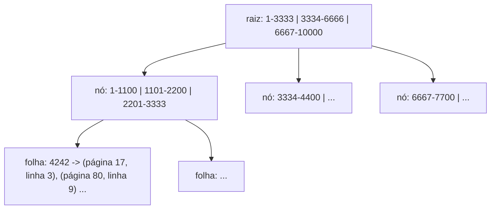

# J3.09 — Índices e `EXPLAIN` básico

> ⏱️ ~1h30 · 🟢 Júnior · Pré-requisitos: J3.04 a J3.08, J1.16 (Big-O)

## 🎯 Objetivos
Ao final desta aula você consegue:
- Explicar o que é um **índice B-tree** e por que ele transforma uma busca linear em logarítmica.
- Ler um plano de `EXPLAIN` / `EXPLAIN ANALYZE`: o tipo de varredura, o custo, as linhas estimadas × reais e o tempo.
- Criar o índice certo para uma consulta (simples, **composto**, de **expressão**) e dizer a **ordem das colunas**.
- Reconhecer por que um índice **não é usado** e quanto ele **custa** nas escritas.
- Achar **chaves estrangeiras sem índice** no esquema do PayFlow.

## 🤔 Por que isso importa
"A tela do extrato está lenta" é, em uma enorme parte dos casos, uma consulta sem o índice certo. Um índice bem escolhido muda uma consulta de **segundos** para **milissegundos**; um índice mal escolhido não ajuda e **torna as escritas mais lentas**. Saber ler um `EXPLAIN` é o que separa "acho que está lento" de "está lento **porque** o banco varre 1 milhão de linhas para achar 100". O júnior não precisa dominar o otimizador, mas precisa **medir**, criar um índice com critério e provar o ganho.

## 💡 Intuição (explicação simples)
Um **índice remissivo no fim de um livro**: para achar onde se fala de "TLS", você não lê as 600 páginas (varredura completa); consulta o índice, em ordem alfabética, e vai direto às páginas 112 e 340. O índice do banco é o mesmo: uma **estrutura extra, ordenada**, que aponta para onde estão as linhas. O custo: o índice **ocupa espaço** e, a cada linha nova ou alterada, **o índice também precisa ser atualizado** (como refazer o índice do livro a cada edição).

## 🔬 Como funciona por dentro

### B-tree: a árvore balanceada
O índice padrão do PostgreSQL (`CREATE INDEX` sem mais nada) é uma **B-tree**: uma árvore em que cada nó tem muitas chaves ordenadas, de modo que mesmo milhões de linhas exigem poucos "saltos" da raiz à folha.

Como a árvore é **balanceada**, buscar uma chave custa O(log n) **mesmo no pior caso** (J1.16). Cada folha guarda a chave e **onde está a linha** na tabela. Como as chaves ficam em ordem, a B-tree serve **igualdade** (`=`), **faixa** (`<`, `>`, `BETWEEN`) e **`ORDER BY`** sem ordenar de novo.

### Como o banco escolhe: o planejador (*planner*)
Para cada consulta o PostgreSQL considera planos possíveis e escolhe o de **menor custo estimado**, com base em **estatísticas** da tabela (quantas linhas, como os valores se distribuem; coletadas pelo `ANALYZE` e pelo *autovacuum*). Você pode ver o plano escolhido:

| Comando | Faz |
|---|---|
| `EXPLAIN consulta` | Mostra o plano **sem executar** (só estimativas) |
| `EXPLAIN ANALYZE consulta` | **Executa de verdade** e mostra também tempo e linhas **reais** |
| `EXPLAIN (ANALYZE, BUFFERS) ...` | Acrescenta quantas páginas foram lidas (do cache: `shared hit`; do disco: `read`) |

⚠️ `EXPLAIN ANALYZE` **executa a consulta**. Em `UPDATE`/`DELETE`/`INSERT` isso **altera os dados**. Para analisar um comando de escrita, envolva em `BEGIN; ... ROLLBACK;` (testado abaixo).

### Os nós de varredura que você vai ver
| Nó | Significa | Quando aparece |
|---|---|---|
| **Seq Scan** | Lê a tabela **inteira**, linha a linha | Tabela pequena, ou a consulta precisa de **muitas** linhas, ou não há índice útil |
| **Index Scan** | Percorre o índice e vai buscar cada linha na tabela | Poucas linhas, em ordem |
| **Bitmap Index Scan + Bitmap Heap Scan** | Junta primeiro, no índice, **quais páginas** da tabela visitar, e depois as lê em ordem | Número intermediário de linhas (comum com índice simples) |
| **Index Only Scan** | Responde só com o índice, sem ir à tabela | Quando o índice **cobre** todas as colunas pedidas (aprofunda em P2) |

Ler um plano: de **dentro para fora** e de **baixo para cima** (os nós mais indentados rodam primeiro). Os números principais: `cost=0.00..21846.00` (custo estimado **inicial..total**, em unidade arbitrária, só para comparar planos), `rows=100` (linhas estimadas), `actual time=... rows=... loops=...` (medidas reais, só no `ANALYZE`) e `Execution Time`.

### Índice composto e a regra do prefixo
`CREATE INDEX ... ON t (a, b)` ordena por `a` e, **dentro de cada `a`, por `b`**. Ele serve a consultas por `a` e por `a` + `b` (e `a` + `ORDER BY b`); em geral **não** serve bem a consultas só por `b`. A **ordem das colunas** importa: coloque primeiro a coluna testada com **igualdade**, depois a de **ordenação/faixa**. O PostgreSQL 18 ganhou *skip scan* para usar um índice multicoluna em mais casos (notas da versão 18); o planejador só o escolhe quando compensa, e nos testes abaixo escolheu varredura completa.

### O custo dos índices
Cada índice é uma estrutura a manter: **toda** inserção, atualização que mude a coluna indexada e exclusão atualiza **todos** os índices da tabela. Você troca **escrita mais lenta e mais espaço** por **leitura mais rápida**. Índice sem uso é só custo.

## 🛠️ Exemplo prático
> Testado com PostgreSQL 18.6 (Docker, J3.03). **Os tempos abaixo foram medidos nesta máquina**; os seus serão diferentes, mas a **ordem de grandeza** e as formas dos planos devem se repetir. O seed do PayFlow é pequeno demais para mostrar índices (9 lançamentos), então usamos uma **tabela de laboratório** com 1 milhão de linhas, que **não faz parte** do esquema do PayFlow.

### 1. A tabela de laboratório
Crie `db/scratch/lab_entries.sql`:
```sql
-- Tabela de laboratório (NÃO faz parte do esquema do PayFlow): 1.000.000 de lançamentos
DROP TABLE IF EXISTS lab_entries;
CREATE TABLE lab_entries (
    id         BIGINT         NOT NULL,
    account_id INT            NOT NULL,
    amount     NUMERIC(19, 2) NOT NULL,
    created_at TIMESTAMPTZ    NOT NULL,
    note       TEXT,
    CONSTRAINT pk_lab_entries PRIMARY KEY (id)
);

INSERT INTO lab_entries (id, account_id, amount, created_at, note)
SELECT g,
       1 + (g % 10000),                                        -- 10.000 contas, ~100 lançamentos cada
       round((random() * 1000)::numeric, 2),
       timestamptz '2026-01-01 00:00:00+00' + g * interval '30 seconds',
       'entry ' || g
FROM generate_series(1, 1000000) AS g;

ANALYZE lab_entries;
```
```bash
docker exec -i payflow-pg psql -U payflow -d payflow -q -v ON_ERROR_STOP=1 < db/scratch/lab_entries.sql
docker exec payflow-pg psql -U payflow -d payflow -c "SELECT count(*), pg_size_pretty(pg_total_relation_size('lab_entries')) AS size FROM lab_entries;"
```
```
  count  | size  
---------+-------
 1000000 | 95 MB
```
Ela tem 10.000 "contas" com ~100 lançamentos cada: a consulta "lançamentos da conta 4242" devolve 100 linhas entre 1.000.000 (0,01%: **muito seletiva**). Levou ~2 s para gerar nesta máquina.

### 2. Sem índice: varredura completa
Para um plano mais simples de ler, desligue o paralelismo **nesta sessão**:
```sql
SET max_parallel_workers_per_gather = 0;
EXPLAIN (ANALYZE, BUFFERS) SELECT * FROM lab_entries WHERE account_id = 4242;
```
```
 Seq Scan on lab_entries  (cost=0.00..21846.00 rows=100 width=38) (actual time=0.211..26.986 rows=100.00 loops=1)
   Filter: (account_id = 4242)
   Rows Removed by Filter: 999900
   Buffers: shared hit=9346
 Planning Time: 0.243 ms
 Execution Time: 27.038 ms
```
Leitura: leu **as 9.346 páginas** da tabela e **descartou 999.900 linhas** para devolver 100. (Sem o `SET`, o PostgreSQL usa um plano **paralelo**: `Gather` + `Parallel Seq Scan`, que nesta máquina levou ~17 ms; é o mesmo trabalho dividido entre processos.)

### 3. Com índice
```sql
\timing on
CREATE INDEX idx_lab_entries_account_id ON lab_entries (account_id);     -- Time: 179 ms
EXPLAIN (ANALYZE, BUFFERS) SELECT * FROM lab_entries WHERE account_id = 4242;
```
```
 Bitmap Heap Scan on lab_entries  (cost=5.20..375.42 rows=100 width=38) (actual time=0.050..0.131 rows=100.00 loops=1)
   Recheck Cond: (account_id = 4242)
   Heap Blocks: exact=100
   ->  Bitmap Index Scan on idx_lab_entries_account_id  (cost=0.00..5.17 rows=100 width=0) (actual time=0.038..0.038 rows=100.00 loops=1)
         Index Cond: (account_id = 4242)
 Execution Time: 0.147 ms
```
De **27 ms para 0,15 ms**: cerca de **180 vezes** mais rápido, e o custo estimado caiu de 21.846 para 375. O plano é *bitmap* porque as 100 linhas estão **espalhadas** por 100 páginas (o `account_id` não segue a ordem de inserção).

Busca pela **chave primária** (índice criado pela constraint, J3.02):
```sql
EXPLAIN (ANALYZE) SELECT * FROM lab_entries WHERE id = 500000;
```
```
 Index Scan using pk_lab_entries on lab_entries  (cost=0.42..8.44 rows=1 width=38) (actual time=0.014..0.014 rows=1.00 loops=1)
 Execution Time: 0.022 ms
```
**Constraints `PRIMARY KEY` e `UNIQUE` criam índice sozinhas**; é assim que o banco verifica a unicidade rápido.

### 4. Índice composto: o extrato (filtro + ordenação)
O extrato é "os 10 lançamentos mais recentes da conta". Com só o índice de `account_id`:
```sql
EXPLAIN (ANALYZE) SELECT * FROM lab_entries WHERE account_id = 4242 ORDER BY created_at DESC LIMIT 10;
```
```
 Limit  ... (actual time=0.073..0.075 rows=10.00 loops=1)
   ->  Sort  ... Sort Key: created_at DESC   Sort Method: top-N heapsort  Memory: 26kB
         ->  Bitmap Heap Scan on lab_entries  ... rows=100.00
               ->  Bitmap Index Scan on idx_lab_entries_account_id
 Execution Time: 0.081 ms
```
Ele acha as 100 linhas da conta e **ordena** para pegar 10. Agora o composto (igualdade primeiro, ordenação depois):
```sql
CREATE INDEX idx_lab_entries_account_created ON lab_entries (account_id, created_at DESC);
EXPLAIN (ANALYZE) SELECT * FROM lab_entries WHERE account_id = 4242 ORDER BY created_at DESC LIMIT 10;
```
```
 Limit  (cost=0.42..40.99 rows=10 width=38) (actual time=0.021..0.029 rows=10.00 loops=1)
   ->  Index Scan using idx_lab_entries_account_created on lab_entries  (cost=0.42..406.11 rows=100 ...)
         Index Cond: (account_id = 4242)
 Execution Time: 0.038 ms
```
Sem **nó `Sort`**: o índice já entrega as linhas na ordem, e o `LIMIT 10` **para depois de 10 linhas** (lê 13 páginas em vez de 106). Este é o índice do extrato do PayFlow; ele aparece na migração `V4` (J3.12).

### 5. Quando o índice **não** é usado
```sql
-- (a) pouca seletividade: pede 90% da tabela
EXPLAIN (ANALYZE) SELECT * FROM lab_entries WHERE account_id < 9000;
```
```
 Seq Scan on lab_entries  (cost=0.00..21846.00 rows=899259 ...) (actual time=0.005..36.974 rows=899900.00 loops=1)
 Execution Time: 54.514 ms
```
Para devolver 899.900 linhas, ir e voltar ao índice seria **pior** que ler a tabela inteira: o planejador **acertou** em ignorar o índice.
```sql
-- (b) função/expressão na coluna indexada
EXPLAIN (ANALYZE) SELECT * FROM lab_entries WHERE account_id + 0 = 4242;           -- Seq Scan, 26 ms
-- (c) LIKE com curinga no início, mesmo havendo índice em "note"
CREATE INDEX idx_lab_entries_note ON lab_entries (note);
EXPLAIN (ANALYZE) SELECT * FROM lab_entries WHERE note LIKE '%99999';              -- Seq Scan, 52 ms
-- (d) só a 2ª coluna do composto
EXPLAIN (ANALYZE) SELECT count(*) FROM lab_entries WHERE created_at = timestamptz '2026-01-02 00:00:00+00';   -- Seq Scan, 26 ms
```
- (b) O índice é sobre `account_id`, não sobre `account_id + 0`: o banco não "desfaz" a expressão.
- (c) A B-tree ordena do **começo** do texto; "termina em 99999" não aproveita a ordem. (Existem índices para isso, como o `pg_trgm`, que ficam fora do escopo.)
- (d) O índice composto começa por `account_id`; sem filtrar por ela, ele não ajuda aqui.

**Índice de expressão.** Para buscas sem diferenciar maiúsculas (`WHERE lower(email) = ...`), indexe a **mesma expressão** que a consulta usa:
```sql
EXPLAIN (ANALYZE) SELECT * FROM lab_entries WHERE lower(note) = 'entry 500000';          -- Seq Scan, 175 ms
CREATE INDEX idx_lab_entries_lower_note ON lab_entries (lower(note));
EXPLAIN (ANALYZE) SELECT * FROM lab_entries WHERE lower(note) = 'entry 500000';          -- Bitmap Index Scan, 0.052 ms
```

### 6. O custo das escritas (medido)
Inserir os mesmos 1.000.000 de linhas em uma tabela **sem** índices secundários e em outra **com três**:
```sql
\timing on
INSERT INTO lab_noidx SELECT * FROM lab_entries;     -- INSERT 0 1000000   Time: 507 ms
INSERT INTO lab_idx   SELECT * FROM lab_entries;     -- INSERT 0 1000000   Time: 5772 ms   (3 índices secundários)
```
Cerca de **11 vezes mais lento** com três índices. Tamanhos dos índices na tabela de laboratório (medidos **antes** de criar o índice de `lower(note)`):
```
            indexname            |  size   
---------------------------------+---------
 pk_lab_entries                  | 21 MB
 idx_lab_entries_account_id      | 6712 kB
 idx_lab_entries_account_created | 30 MB
 idx_lab_entries_note            | 30 MB
```
Em um sistema de pagamentos, o `ledger_entries` recebe muitas escritas: **cada índice a mais é pago em cada lançamento**. Crie o índice que uma consulta **real e frequente** precisa, e nenhum a mais.

### 7. `EXPLAIN ANALYZE` de uma escrita (com `ROLLBACK`)
```sql
BEGIN;
EXPLAIN ANALYZE DELETE FROM lab_entries WHERE account_id = 4242;
SELECT count(*) FROM lab_entries WHERE account_id = 4242;     -- 0 (dentro da transação)
ROLLBACK;
SELECT count(*) FROM lab_entries WHERE account_id = 4242;     -- 100 (voltou)
```
O `DELETE` foi **executado** (por isso o `ANALYZE` mede o tempo real), mas o `ROLLBACK` desfez. Sem o `BEGIN`/`ROLLBACK` você apagaria os dados.

### 8. Os índices do PayFlow
**Chaves estrangeiras não ganham índice automático** (a [documentação](https://www.postgresql.org/docs/18/ddl-constraints.html) explica que um `DELETE` na tabela referenciada ou um `UPDATE` da coluna referenciada exige uma varredura da tabela que referencia, então "geralmente é uma boa ideia indexar as colunas de referência"). Liste as FKs **sem** índice:
```sql
SELECT c.conrelid::regclass AS table_name, a.attname AS fk_column, c.conname
FROM pg_constraint c
JOIN pg_attribute a ON a.attrelid = c.conrelid AND a.attnum = c.conkey[1]
WHERE c.contype = 'f'
  AND NOT EXISTS (SELECT 1 FROM pg_index i WHERE i.indrelid = c.conrelid AND i.indkey[0] = c.conkey[1])
ORDER BY 1, 2;
```
```
   table_name   |     fk_column     |          conname           
----------------+-------------------+----------------------------
 accounts       | owner_id          | fk_accounts_owner
 transfers      | source_account_id | fk_transfers_source
 transfers      | target_account_id | fk_transfers_target
 ledger_entries | account_id        | fk_ledger_entries_account
 ledger_entries | transfer_id       | fk_ledger_entries_transfer
(5 rows)
```
Cinco FKs sem índice. (Esta consulta olha só a **primeira coluna** de cada FK; no PayFlow todas são de uma coluna.) Crie `db/scratch/indexes.sql`:
```sql
CREATE INDEX idx_accounts_owner_id ON accounts (owner_id);
CREATE INDEX idx_transfers_source_account_id ON transfers (source_account_id);
CREATE INDEX idx_transfers_target_account_id ON transfers (target_account_id);
CREATE INDEX idx_ledger_entries_account_created ON ledger_entries (account_id, created_at DESC);
CREATE INDEX idx_ledger_entries_transfer_id ON ledger_entries (transfer_id);
```
Repare que `idx_ledger_entries_account_created` serve **tanto** à FK `account_id` (é a primeira coluna) **quanto** ao extrato (filtro + ordenação). Rode a consulta de FKs sem índice de novo: `(0 rows)`.

### 9. "Criei o índice e o banco não usa!"
Com o seed pequeno (9 lançamentos), o plano ignora o índice:
```sql
EXPLAIN SELECT * FROM ledger_entries
WHERE account_id = '20000000-0000-0000-0000-000000000001' ORDER BY created_at DESC LIMIT 10;
```
```
 Limit  (cost=1.12..1.13 rows=1 width=114)
   ->  Sort  (cost=1.12..1.13 rows=1 width=114)
         Sort Key: created_at DESC
         ->  Seq Scan on ledger_entries  (cost=0.00..1.11 rows=1 width=114)
```
**Está certo.** A tabela cabe em **uma página**: lê-la (custo 1,11) é mais barato que visitar o índice. Para provar que o índice **funciona** (e só para o teste), force-o:
```sql
SET enable_seqscan = off;      -- só nesta sessão; nunca em produção
EXPLAIN SELECT * FROM ledger_entries WHERE account_id = '20000000-0000-0000-0000-000000000001' ORDER BY created_at DESC LIMIT 10;
```
```
 Limit  (cost=0.14..8.15 rows=1 width=114)
   ->  Index Scan using idx_ledger_entries_account_created on ledger_entries  (cost=0.14..8.15 rows=1 width=114)
         Index Cond: (account_id = '20000000-0000-0000-0000-000000000001'::uuid)
```
O índice é aceito e **tem custo maior** (8,15 contra 1,13): por isso o planejador não o escolhe. Índices só pagam a conta com **volume**. Nunca conclua "o índice não presta" medindo em tabela de 9 linhas.

## 🧠 Pausa para lógica
**Enunciado:** a B-tree promete O(log n). Mostre em Java o que isso significa contando **comparações**: busca **linear** (lê tudo, como o *Seq Scan*) contra **busca binária** em um array ordenado (a ideia por trás do índice) para n = 1.000, 1.000.000 e 100.000.000, no **pior caso** (a chave é o último elemento).

<details><summary>Dica</summary>Busca binária: compare com o elemento do meio; se a chave é maior, descarte a metade de baixo; se menor, a de cima. Cada passo corta o problema pela metade: quantos cortes até sobrar 1 elemento?</details>
<details><summary>Solução (testada com JDK 25.0.5)</summary>

```java
import java.util.*;

public class BinarySearchCount {
    static long comparisons;

    static int linear(long[] a, long key) { for (int i = 0; i < a.length; i++) { comparisons++; if (a[i] == key) return i; } return -1; }

    static int binary(long[] a, long key) {
        int lo = 0, hi = a.length - 1;
        while (lo <= hi) {
            int mid = (lo + hi) >>> 1;
            comparisons++;
            if (a[mid] == key) return mid;
            if (a[mid] < key) lo = mid + 1; else hi = mid - 1;
        }
        return -1;
    }

    public static void main(String[] args) {
        for (int n : new int[] {1_000, 1_000_000, 100_000_000}) {
            long[] a = new long[n];
            for (int i = 0; i < n; i++) a[i] = i;
            long key = n - 1;                                   // pior caso
            comparisons = 0; linear(a, key);  long lin = comparisons;
            comparisons = 0; binary(a, key);  long bin = comparisons;
            System.out.printf("n=%,d  linear=%,d comparações  binária=%d comparações%n", n, lin, bin);
        }
    }
}
```
```
n=1,000  linear=1,000 comparações  binária=10 comparações
n=1,000,000  linear=1,000,000 comparações  binária=20 comparações
n=100,000,000  linear=100,000,000 comparações  binária=27 comparações
```
Multiplicar os dados por 100.000 (de mil para cem milhões) levou a busca binária de 10 para 27 comparações: cresce com **log₂ n**. É essa a propriedade que o índice dá ao banco. (A B-tree do banco tem centenas de chaves por nó, então são ainda menos "saltos"; o array precisa estar **ordenado**, e o índice mantém essa ordem **a cada escrita**: é o preço da seção 6.) A execução com 100 milhões de `long` usa ~800 MB de memória: se faltar memória, rode com `java -Xmx2g` ou reduza o maior `n`.
</details>

**Variação:** por que o índice de uma coluna com **dois** valores possíveis (por exemplo, `status` entre `ACTIVE` e `CLOSED`, com 99% `ACTIVE`) ajuda para buscar `CLOSED`, mas é inútil para buscar `ACTIVE`?

## ⚠️ Erros comuns e boas práticas de produção
- **FK sem índice:** `JOIN` e `DELETE` no pai ficam lentos com volume; use a consulta da seção 8 em revisões de migração.
- **Índice em tudo "por garantia":** escritas ~11x mais lentas no teste acima, mais espaço, mais manutenção. Um índice é justificado por uma **consulta real**, medida.
- **Coluna errada primeiro no composto:** `(created_at, account_id)` não serve ao extrato por conta. Igualdade antes, ordenação/faixa depois.
- **Função na coluna** (`lower(email)`, `date(created_at)`, `amount * 100`): o índice simples não é usado; indexe a **expressão** ou reescreva a condição (use intervalos em datas: `created_at >= ... AND < ...`).
- **`LIKE '%texto'`:** varredura completa.
- **Conclusão apressada com tabela pequena:** o planejador **prefere** Seq Scan; só meça com volume realista.
- **`EXPLAIN ANALYZE` em escrita sem `ROLLBACK`:** a escrita acontece de verdade.
- **Confundir custo com tempo:** `cost=` é unidade arbitrária, serve para **comparar planos**, não para prever milissegundos. Olhe o `actual time` e `Buffers`.
- **Estatísticas velhas:** depois de uma carga grande, rode `ANALYZE tabela` (o *autovacuum* costuma cuidar, mas não instantaneamente). Plano com `rows=` muito diferente do `actual rows=` é sinal.
- **`CREATE INDEX` em tabela grande de produção** trava as escritas durante a criação; existe `CREATE INDEX CONCURRENTLY` (P2, S3).
- **Tipos incompatíveis** na comparação (`WHERE account_id = '4242'` ok, mas `WHERE id::text = ...` não usa índice): compare com o tipo certo.

## 🧩 Exercícios
1. **Fixação:** para cada consulta, diga qual índice ajudaria (ou "nenhum"): (a) `SELECT * FROM transfers WHERE source_account_id = ? ORDER BY created_at DESC LIMIT 20`; (b) `SELECT * FROM users WHERE lower(email) = ?`; (c) `SELECT * FROM accounts WHERE status = 'ACTIVE'` (95% das contas são `ACTIVE`); (d) `SELECT * FROM transfers WHERE idempotency_key = ?`.
2. **Aplicação no PayFlow:** índices com prova.
   - [ ] `db/scratch/lab_entries.sql` executado; você reproduziu o **antes** (Seq Scan) e o **depois** (Index/Bitmap Scan) e anotou os tempos **da sua máquina** em `docs/performance-notes.md`.
   - [ ] `db/scratch/indexes.sql` aplicado ao esquema do PayFlow; a consulta de FKs sem índice devolve **0 linhas**.
   - [ ] Você explica, no mesmo arquivo, por que o índice **não** é usado no seed pequeno e demonstra com `SET enable_seqscan = off`.
   - [ ] Você mediu o custo de escrita (seção 6) na sua máquina e anotou a razão.
   - [ ] Para o índice `(account_id, created_at DESC)`: o plano do extrato (últimos 10) **não tem** nó `Sort`.
   - [ ] Commit: `perf(db): add indexes and performance notes`.
3. **Desafio (opcional):** crie o índice de `lower(note)` e prove que a consulta `WHERE note = 'entry 500000'` (sem `lower`) **não** o usa. Depois, em `transfers` do PayFlow, qual índice **parcial** ajudaria a achar rapidamente só as transferências com status `PENDING`? (Pesquise `CREATE INDEX ... WHERE ...`; aprofunda em P2.)

<details><summary>Solução de referência (fixação)</summary>

(a) `transfers (source_account_id, created_at DESC)`: igualdade na primeira coluna, ordenação na segunda (o índice simples de `source_account_id` ajuda, mas o composto evita o `Sort`). (b) Índice de **expressão** `ON users (lower(email))`; ou, melhor, um índice **`UNIQUE`** sobre `lower(email)` (`CREATE UNIQUE INDEX ... ON users (lower(email))`), que além de acelerar impede e-mails que só diferem em maiúsculas. (c) **Nenhum**: pouca seletividade (devolve 95% da tabela); o Seq Scan é melhor. (d) Já existe: a constraint `UNIQUE (idempotency_key)` criou o índice `uk_transfers_idempotency_key`.
</details>

## 🎤 Na entrevista
- **O que é um índice e qual o custo?** Uma estrutura ordenada (B-tree, por padrão) que permite achar linhas sem varrer a tabela, em O(log n). Custo: espaço e escrita mais lenta, pois cada insert/update/delete mantém todos os índices.
- **Como você investiga uma consulta lenta?** `EXPLAIN (ANALYZE, BUFFERS)`, olhando o tipo de varredura, `Rows Removed by Filter`, estimado × real e `Buffers`; depois o índice certo; depois medir de novo. Cuidado com `ANALYZE` em escrita.
- **Por que o banco às vezes ignora um índice existente?** O custo estimado do caminho com índice é maior: tabela pequena, consulta que devolve grande fração da tabela, função aplicada à coluna, curinga no início do `LIKE`, estatísticas desatualizadas, coluna fora da ordem do composto.
- **Em um índice composto `(a, b)`, a ordem importa?** Sim. Serve a `a` e a `a + b`; em geral não serve só a `b`. Igualdade primeiro, ordenação/faixa depois.
- **`PRIMARY KEY` já cria índice?** Sim, e `UNIQUE` também. Chaves **estrangeiras** não.

## 📚 Para ir além
- 📄 [PostgreSQL — Indexes](https://www.postgresql.org/docs/18/indexes.html): capítulo oficial (tipos, multicoluna, expressão, parcial, só-índice).
- 📄 [PostgreSQL — Using `EXPLAIN`](https://www.postgresql.org/docs/18/using-explain.html): como ler plano, custo e `ANALYZE`, com exemplos.
- 📄 [PostgreSQL — tipos de índice](https://www.postgresql.org/docs/18/indexes-types.html): B-tree, Hash, GiST, GIN, BRIN e quando cada um serve.
- 📄 [Use The Index, Luke](https://use-the-index-luke.com/): livro gratuito e excelente sobre indexação para devs; comece pelo capítulo de anatomia de um índice.
- 📑 *Designing Data-Intensive Applications* (Kleppmann): capítulo sobre armazenamento e recuperação (B-trees e LSM-trees; numeração varia por edição).
- 🎥 ⚠️ Nenhum vídeo verificado nesta execução.

## ✅ Checklist da aula
- [ ] Reproduzi Seq Scan → Index/Bitmap Scan na tabela de laboratório e anotei meus tempos.
- [ ] Leio `cost`, `rows`, `actual time`, `Buffers` e `Rows Removed by Filter`.
- [ ] Criei o índice composto do extrato e vi o `Sort` desaparecer.
- [ ] Entendo por que o índice não é usado no seed pequeno.
- [ ] Medi o custo de escrita dos índices.
- [ ] Os 5 índices do PayFlow criados; consulta de FKs sem índice devolve 0 linhas.
