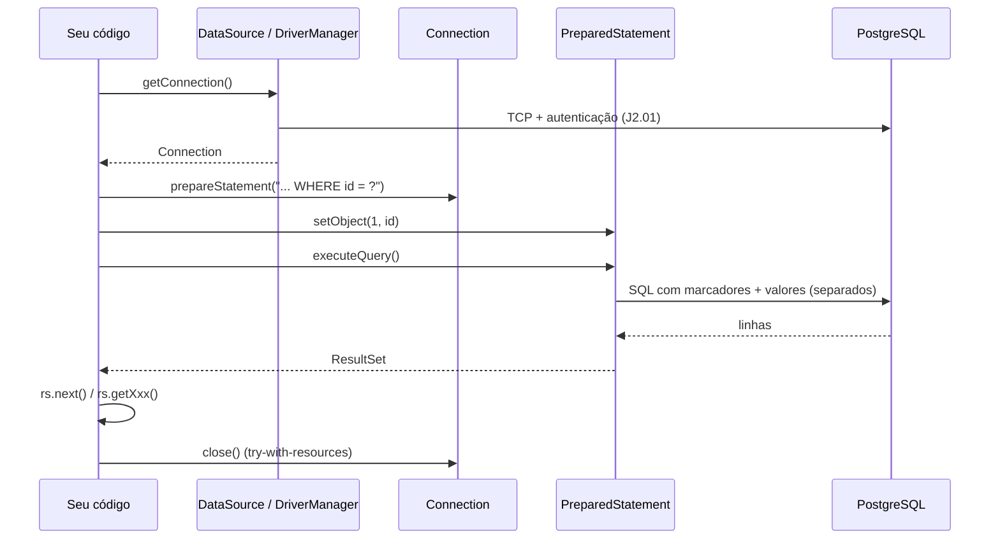

# J3.11 — JDBC puro e SQL injection com `PreparedStatement`

> ⏱️ ~1h30 · 🟢 Júnior · Pré-requisitos: J3.04 a J3.10, J1.09 (exceções e `try-with-resources`), J1.15 (`BigDecimal`, `java.time`), J1.16 (JUnit)

## 🎯 Objetivos
Ao final desta aula você consegue:
- Conectar o Java ao PostgreSQL com **JDBC** e executar consultas e comandos com `PreparedStatement`.
- Mapear **tipos SQL ↔ Java** do PayFlow (`UUID`, `NUMERIC`, `TIMESTAMPTZ`) sem perder precisão.
- Implementar a **transferência** como **uma transação JDBC** (`commit`/`rollback`) e testá-la.
- **Explorar** uma injeção de SQL em código vulnerável e **corrigi-la** com parâmetros.
- Explicar por que não se pode parametrizar o nome de uma coluna e como **permitir** só valores conhecidos.

## 🤔 Por que isso importa
Por baixo de Spring Data, Hibernate e `JdbcTemplate` existe o JDBC. Quem o conhece lê stack traces de banco sem medo, entende o que o framework faz (J5) e sabe depurar quando ele falha. E a **injeção de SQL** continua entre as falhas mais exploradas da web (a OWASP a mantém na categoria "Injection" do Top 10): um único `+` concatenando texto do usuário em uma consulta vaza o banco inteiro. A defesa é simples e **obrigatória** em qualquer código que fale com banco.

## 💡 Intuição (explicação simples)
Pense em **fazer um pedido em um restaurante**:
- **JDBC** é o **cardápio padronizado** que qualquer restaurante aceita; o **driver** (`postgresql-42.x.jar`) é o **garçom** que fala o idioma do PostgreSQL.
- **Concatenar texto** é **ditar o pedido inteiro como uma frase livre**, incluindo o que o cliente falou: se o cliente disser "uma pizza **e abra o cofre**", o garçom ingênuo repete e a cozinha obedece.
- **`PreparedStatement`** é o **formulário de pedido**: a receita está impressa, e o cliente só preenche os **campos em branco** (`?`). Mesmo que escreva "abra o cofre" no campo, a cozinha trata aquilo como **o nome do prato**, nunca como instrução.

## 🔬 Como funciona por dentro

### A cadeia JDBC

- **`java.sql`** é a **API** (interfaces `Connection`, `PreparedStatement`, `ResultSet`); o **driver** da fornecedora a implementa. Você declara a dependência `org.postgresql:postgresql`.
- **`DriverManager.getConnection(url, user, pass)`** abre uma conexão nova a cada chamada (TCP + autenticação: **caro**). **`DataSource`** é a forma recomendada de obter conexões; `PGSimpleDataSource` (do driver) **não é um pool**. Em produção usa-se um **pool de conexões** (HikariCP): conexões abertas são reaproveitadas. O Spring Boot configura um pool para você (J5); o dimensionamento é assunto de P2. Neste módulo, abrir uma conexão por operação é aceitável.
- **`try-with-resources`** (J1.09) fecha `ResultSet`, `PreparedStatement` e `Connection` na ordem inversa, **mesmo com exceção**. Conexão não fechada **vaza** (o servidor tem um limite de conexões).
- **`SQLException` é *checked*** (J1.09). Cada uma traz o **`SQLState`** (código de 5 caracteres, padronizado: `23505` = violação de unicidade, `23503` = chave estrangeira, `23514` = `CHECK`, `40P01` = *deadlock* no PostgreSQL). Em vez de espalhar `throws SQLException`, a camada de acesso a dados embrulha em uma exceção **não verificada** que guarda a causa (`DataAccessException`, abaixo), o mesmo desenho que o Spring adota (J5).

### Mapeamento de tipos (o essencial)
| SQL | Java | Como | Atenção |
|---|---|---|---|
| `UUID` | `java.util.UUID` | `setObject(i, uuid)` / `getObject(col, UUID.class)` | Não use `String` |
| `NUMERIC(19,2)` | `BigDecimal` | `setBigDecimal` / `getBigDecimal` | **Nunca** `getDouble` |
| `TIMESTAMPTZ` | `OffsetDateTime` | `getObject(col, OffsetDateTime.class)` | O driver **não** converte direto para `Instant` (verificado abaixo): use `.toInstant()` |
| `VARCHAR` | `String` | `setString` / `getString` | |
| `BIGINT` | `long` | `getLong` | |
| `NULL` | — | `getObject(col, UUID.class)` devolve `null`; para `getLong`/`getInt`, use `rs.wasNull()` | Os depósitos têm `transfer_id` nulo |

### Transações em JDBC
A conexão começa em **autocommit** (`true`): cada comando é confirmado na hora (J3.10). Para uma transação: `setAutoCommit(false)`, executar vários comandos, e `commit()` ou, em caso de erro, `rollback()`. O padrão de código é:
```java
c.setAutoCommit(false);
try {
    // comandos ...
    c.commit();
} catch (SQLException | RuntimeException e) {
    c.rollback();
    throw e;
}
```

## 🛠️ Exemplo prático
> Testado com JDK 25.0.5, Maven 3.9.12, PostgreSQL 18.6, driver `org.postgresql:postgresql:42.7.14`, JUnit 6.1.3, AssertJ 3.27.7. O `mvn` precisa de `JAVA_HOME` apontando para o JDK 25 (senão: `release version 25 not supported`, J2). Os avisos `WARNING: ... sun.misc.Unsafe` que o Maven imprime no JDK 25 são do próprio Maven e inofensivos.

### 1. O repositório `payflow` vira um projeto Maven
Daqui em diante, o repositório `payflow` (J0) **é** o projeto Java do PayFlow (`groupId com.payflow`, `artifactId payflow`). Na J5 ele ganhará o Spring Boot **sem mudar de lugar**. Estrutura ao fim desta aula:
```
payflow/
├── pom.xml
├── db/scratch/            schema.sql, indexes.sql, seed.sql (J3.04, J3.09; viram migrações na J3.12)
├── src/main/java/com/payflow/db/   Database, User, Account, LedgerEntry, Transfer, exceções, repositórios, TransferService, Demo
└── src/test/java/com/payflow/db/   DbTestSupport, RepositoryTest, TransferServiceTest, demo/ (demonstrações)
```
Lembre-se de que o `.gitignore` do J0 deve ignorar `target/`.

`pom.xml` (só o necessário; o Flyway entra na J3.12):
```xml
<project xmlns="http://maven.apache.org/POM/4.0.0"
         xmlns:xsi="http://www.w3.org/2001/XMLSchema-instance"
         xsi:schemaLocation="http://maven.apache.org/POM/4.0.0 https://maven.apache.org/xsd/maven-4.0.0.xsd">
  <modelVersion>4.0.0</modelVersion>
  <groupId>com.payflow</groupId>
  <artifactId>payflow</artifactId>
  <version>0.1.0-SNAPSHOT</version>

  <properties>
    <maven.compiler.release>25</maven.compiler.release>
    <project.build.sourceEncoding>UTF-8</project.build.sourceEncoding>
  </properties>

  <dependencies>
    <dependency>
      <groupId>org.postgresql</groupId>
      <artifactId>postgresql</artifactId>
      <version>42.7.14</version>
    </dependency>
    <dependency>
      <groupId>org.junit.jupiter</groupId>
      <artifactId>junit-jupiter</artifactId>
      <version>6.1.3</version>
      <scope>test</scope>
    </dependency>
    <dependency>
      <groupId>org.assertj</groupId>
      <artifactId>assertj-core</artifactId>
      <version>3.27.7</version>
      <scope>test</scope>
    </dependency>
  </dependencies>

  <build>
    <plugins>
      <plugin>
        <groupId>org.apache.maven.plugins</groupId>
        <artifactId>maven-surefire-plugin</artifactId>
        <version>3.5.4</version>
      </plugin>
      <plugin>
        <groupId>org.codehaus.mojo</groupId>
        <artifactId>exec-maven-plugin</artifactId>
        <version>3.7.0</version>
      </plugin>
    </plugins>
  </build>
</project>
```
Versões conferidas no Maven Central em 2026-11-12. **Reconfira ao criar o seu projeto.**

### 2. Conexão: `Database`
```java
package com.payflow.db;

import javax.sql.DataSource;
import org.postgresql.ds.PGSimpleDataSource;

/** Cria a conexão com o PostgreSQL e roda as migrações do Flyway. */
public final class Database {

    private Database() { }

    /** Lê a configuração do ambiente; os valores padrão servem só para o Docker local da J3.03. */
    public static DataSource dataSource() {
        PGSimpleDataSource ds = new PGSimpleDataSource();
        ds.setUrl(env("PAYFLOW_DB_URL", "jdbc:postgresql://localhost:5432/payflow"));
        ds.setUser(env("PAYFLOW_DB_USER", "payflow"));
        ds.setPassword(env("PAYFLOW_DB_PASSWORD", "payflow"));
        return ds;
    }

    private static String env(String name, String fallback) {
        String value = System.getenv(name);
        return value == null || value.isBlank() ? fallback : value;
    }
}
```
Os valores padrão (`payflow`/`payflow`) servem **só** ao Docker local da J3.03. Em qualquer outro ambiente, a configuração vem de **variáveis de ambiente** (os segredos nunca vão para o Git; J8/J10).

### 3. Registros e exceções
```java
// User.java
package com.payflow.db;
import java.time.OffsetDateTime;
import java.util.UUID;
public record User(UUID id, String email, String fullName, String role, OffsetDateTime createdAt) { }

// Account.java
package com.payflow.db;
import java.math.BigDecimal;
import java.util.UUID;
public record Account(UUID id, UUID ownerId, BigDecimal balance, String status, long version) { }

// LedgerEntry.java
package com.payflow.db;
import java.math.BigDecimal;
import java.time.OffsetDateTime;
import java.util.UUID;
public record LedgerEntry(UUID id, UUID accountId, UUID transferId, String type,
                          BigDecimal amount, OffsetDateTime createdAt) { }

// Transfer.java
package com.payflow.db;
import java.math.BigDecimal;
import java.util.UUID;
public record Transfer(UUID id, UUID sourceAccountId, UUID targetAccountId,
                       BigDecimal amount, String status, String idempotencyKey) { }
```
```java
// DataAccessException.java: embrulha o SQLException (checked) e guarda a causa
package com.payflow.db;
import java.sql.SQLException;
public class DataAccessException extends RuntimeException {
    public DataAccessException(String message, SQLException cause) {
        super(message + " [SQLState=" + cause.getSQLState() + "]", cause);
    }
}

// InsufficientFundsException.java
package com.payflow.db;
public class InsufficientFundsException extends RuntimeException {
    public InsufficientFundsException(String message) { super(message); }
}

// AccountUnavailableException.java: a conta não existe ou não está ACTIVE
package com.payflow.db;
public class AccountUnavailableException extends RuntimeException {
    public AccountUnavailableException(String message) { super(message); }
}
```
Os registros seguem a convenção da J1: acessores sem prefixo (`id()`, `balance()`). `getX` aparece em J5 (JavaBeans/JPA). Repare que o saldo é `BigDecimal` e a data é `OffsetDateTime`.

Valida o valor **antes** de enviar ao banco:
```java
package com.payflow.db;

import java.math.BigDecimal;

/** Valida valores monetários antes de enviá-los ao banco (decisão 4: o arredondamento é feito na aplicação). */
final class Amounts {

    private Amounts() { }

    static BigDecimal requireValid(BigDecimal amount) {
        if (amount.signum() <= 0) {
            throw new IllegalArgumentException("amount must be positive");
        }
        if (amount.scale() > 2) {
            throw new IllegalArgumentException("amount must have at most 2 decimal places: " + amount);
        }
        return amount;
    }
}
```
Por que `scale() > 2` é recusado? O **arredondamento do banco e o do Java são diferentes**: ao gravar `10.005` em um `NUMERIC(19,2)`, o PostgreSQL arredonda para **`10.01`** (verificado abaixo), enquanto a decisão do projeto é `HALF_EVEN`, que daria `10.00`. Em vez de depender de uma conversão silenciosa, a aplicação **arredonda com `BigDecimal` (HALF_EVEN) antes** e o banco **só armazena** o que recebe; um valor com mais de 2 casas é um erro de programação e falha alto.

### 4. Consultas: `JdbcUserRepository`
```java
package com.payflow.db;

import java.sql.Connection;
import java.sql.PreparedStatement;
import java.sql.ResultSet;
import java.sql.SQLException;
import java.time.OffsetDateTime;
import java.util.Optional;
import java.util.UUID;
import javax.sql.DataSource;

public class JdbcUserRepository {

    private final DataSource dataSource;

    public JdbcUserRepository(DataSource dataSource) {
        this.dataSource = dataSource;
    }

    public User insert(String email, String fullName, String passwordHash) {
        String sql = """
                INSERT INTO users (email, full_name, password_hash)
                VALUES (?, ?, ?)
                RETURNING id, email, full_name, role, created_at
                """;
        try (Connection c = dataSource.getConnection();
             PreparedStatement ps = c.prepareStatement(sql)) {
            ps.setString(1, email);
            ps.setString(2, fullName);
            ps.setString(3, passwordHash);
            try (ResultSet rs = ps.executeQuery()) {
                rs.next();
                return map(rs);
            }
        } catch (SQLException e) {
            throw new DataAccessException("insert user failed", e);
        }
    }

    public Optional<User> findByEmail(String email) {
        String sql = "SELECT id, email, full_name, role, created_at FROM users WHERE email = ?";
        try (Connection c = dataSource.getConnection();
             PreparedStatement ps = c.prepareStatement(sql)) {
            ps.setString(1, email);
            try (ResultSet rs = ps.executeQuery()) {
                return rs.next() ? Optional.of(map(rs)) : Optional.empty();
            }
        } catch (SQLException e) {
            throw new DataAccessException("find user failed", e);
        }
    }

    private static User map(ResultSet rs) throws SQLException {
        return new User(
                rs.getObject("id", UUID.class),
                rs.getString("email"),
                rs.getString("full_name"),
                rs.getString("role"),
                rs.getObject("created_at", OffsetDateTime.class));
    }
}
```
- `INSERT ... RETURNING` devolve a linha criada (com o `id` e os `DEFAULT`s gerados pelo banco, J3.04) em **uma** ida ao banco.
- Os **text blocks** (`"""`, J1.04) deixam o SQL legível.
- Todo valor externo entra por `?`.

### 5. Contas, extrato e depósito: `JdbcAccountRepository`
```java
package com.payflow.db;

import java.math.BigDecimal;
import java.sql.Connection;
import java.sql.PreparedStatement;
import java.sql.ResultSet;
import java.sql.SQLException;
import java.time.OffsetDateTime;
import java.util.ArrayList;
import java.util.List;
import java.util.Optional;
import java.util.UUID;
import javax.sql.DataSource;

public class JdbcAccountRepository {

    private final DataSource dataSource;

    public JdbcAccountRepository(DataSource dataSource) {
        this.dataSource = dataSource;
    }

    public Account create(UUID ownerId) {
        String sql = "INSERT INTO accounts (owner_id) VALUES (?) "
                + "RETURNING id, owner_id, balance, status, version";
        try (Connection c = dataSource.getConnection();
             PreparedStatement ps = c.prepareStatement(sql)) {
            ps.setObject(1, ownerId);
            try (ResultSet rs = ps.executeQuery()) {
                rs.next();
                return map(rs);
            }
        } catch (SQLException e) {
            throw new DataAccessException("create account failed", e);
        }
    }

    public Optional<Account> findById(UUID id) {
        String sql = "SELECT id, owner_id, balance, status, version FROM accounts WHERE id = ?";
        try (Connection c = dataSource.getConnection();
             PreparedStatement ps = c.prepareStatement(sql)) {
            ps.setObject(1, id);
            try (ResultSet rs = ps.executeQuery()) {
                return rs.next() ? Optional.of(map(rs)) : Optional.empty();
            }
        } catch (SQLException e) {
            throw new DataAccessException("find account failed", e);
        }
    }

    public List<Account> findByOwner(UUID ownerId) {
        String sql = "SELECT id, owner_id, balance, status, version FROM accounts "
                + "WHERE owner_id = ? ORDER BY created_at, id";
        try (Connection c = dataSource.getConnection();
             PreparedStatement ps = c.prepareStatement(sql)) {
            ps.setObject(1, ownerId);
            try (ResultSet rs = ps.executeQuery()) {
                List<Account> accounts = new ArrayList<>();
                while (rs.next()) {
                    accounts.add(map(rs));
                }
                return accounts;
            }
        } catch (SQLException e) {
            throw new DataAccessException("list accounts failed", e);
        }
    }

    /** Extrato paginado, do mais novo para o mais antigo. {@code page} começa em 0. */
    public List<LedgerEntry> statement(UUID accountId, int page, int size) {
        String sql = """
                SELECT id, account_id, transfer_id, type, amount, created_at
                FROM ledger_entries
                WHERE account_id = ?
                ORDER BY created_at DESC, id DESC
                LIMIT ? OFFSET ?
                """;
        try (Connection c = dataSource.getConnection();
             PreparedStatement ps = c.prepareStatement(sql)) {
            ps.setObject(1, accountId);
            ps.setInt(2, size);
            ps.setInt(3, page * size);
            try (ResultSet rs = ps.executeQuery()) {
                List<LedgerEntry> entries = new ArrayList<>();
                while (rs.next()) {
                    entries.add(new LedgerEntry(
                            rs.getObject("id", UUID.class),
                            rs.getObject("account_id", UUID.class),
                            rs.getObject("transfer_id", UUID.class),   // null para depósitos
                            rs.getString("type"),
                            rs.getBigDecimal("amount"),
                            rs.getObject("created_at", OffsetDateTime.class)));
                }
                return entries;
            }
        } catch (SQLException e) {
            throw new DataAccessException("statement failed", e);
        }
    }

    /** Depósito: soma o saldo e grava o lançamento CREDIT na mesma transação. */
    public void deposit(UUID accountId, BigDecimal amount) {
        Amounts.requireValid(amount);
        try (Connection c = dataSource.getConnection()) {
            c.setAutoCommit(false);
            try {
                try (PreparedStatement up = c.prepareStatement(
                        "UPDATE accounts SET balance = balance + ?, version = version + 1 "
                                + "WHERE id = ? AND status = 'ACTIVE'")) {
                    up.setBigDecimal(1, amount);
                    up.setObject(2, accountId);
                    if (up.executeUpdate() == 0) {
                        throw new AccountUnavailableException("Account not found or not active: " + accountId);
                    }
                }
                try (PreparedStatement in = c.prepareStatement(
                        "INSERT INTO ledger_entries (account_id, type, amount) VALUES (?, 'CREDIT', ?)")) {
                    in.setObject(1, accountId);
                    in.setBigDecimal(2, amount);
                    in.executeUpdate();
                }
                c.commit();
            } catch (SQLException | RuntimeException e) {
                c.rollback();
                throw e;
            }
        } catch (SQLException e) {
            throw new DataAccessException("deposit failed", e);
        }
    }

    private static Account map(ResultSet rs) throws SQLException {
        return new Account(
                rs.getObject("id", UUID.class),
                rs.getObject("owner_id", UUID.class),
                rs.getBigDecimal("balance"),
                rs.getString("status"),
                rs.getLong("version"));
    }
}
```
- O `statement` é o **extrato paginado** da J3.05 (com desempate `id DESC`).
- O `deposit` é uma **transação**: o saldo sobe **e** o lançamento `CREDIT` entra, ou nenhum dos dois.
- O depósito `UPDATE ... WHERE id = ? AND status = 'ACTIVE'` devolve **zero linhas afetadas** se a conta não existe ou não está ativa; o código transforma isso em `AccountUnavailableException`.

### 6. A transferência: `TransferService`
```java
package com.payflow.db;

import java.math.BigDecimal;
import java.sql.Connection;
import java.sql.PreparedStatement;
import java.sql.ResultSet;
import java.sql.SQLException;
import java.util.UUID;
import javax.sql.DataSource;

/** Transferência entre contas: débito, crédito e lançamentos em UMA transação (ACID). */
public class TransferService {

    private final DataSource dataSource;

    public TransferService(DataSource dataSource) {
        this.dataSource = dataSource;
    }

    public Transfer transfer(UUID sourceId, UUID targetId, BigDecimal amount, String idempotencyKey) {
        Amounts.requireValid(amount);
        if (sourceId.equals(targetId)) {
            throw new IllegalArgumentException("source and target must differ");
        }
        try (Connection c = dataSource.getConnection()) {
            c.setAutoCommit(false);
            try {
                Transfer result = doTransfer(c, sourceId, targetId, amount, idempotencyKey);
                c.commit();
                return result;
            } catch (SQLException | RuntimeException e) {
                c.rollback();
                throw e;
            }
        } catch (SQLException e) {
            throw new DataAccessException("transfer failed", e);
        }
    }

    private Transfer doTransfer(Connection c, UUID sourceId, UUID targetId,
                                BigDecimal amount, String key) throws SQLException {
        // 1. Registra a transferência. Se a chave já existe, devolve a existente (regra 4).
        UUID transferId;
        try (PreparedStatement ps = c.prepareStatement("""
                INSERT INTO transfers (source_account_id, target_account_id, amount, idempotency_key)
                VALUES (?, ?, ?, ?)
                ON CONFLICT (idempotency_key) DO NOTHING
                RETURNING id
                """)) {
            ps.setObject(1, sourceId);
            ps.setObject(2, targetId);
            ps.setBigDecimal(3, amount);
            ps.setString(4, key);
            try (ResultSet rs = ps.executeQuery()) {
                if (!rs.next()) {
                    return findByKey(c, key);
                }
                transferId = rs.getObject(1, UUID.class);
            }
        }

        // 2. Débito: o UPDATE condicional é atômico; a condição "balance >= ?" protege a regra 1.
        try (PreparedStatement ps = c.prepareStatement("""
                UPDATE accounts SET balance = balance - ?, version = version + 1
                WHERE id = ? AND status = 'ACTIVE' AND balance >= ?
                """)) {
            ps.setBigDecimal(1, amount);
            ps.setObject(2, sourceId);
            ps.setBigDecimal(3, amount);
            if (ps.executeUpdate() == 0) {
                throw rejection(c, sourceId);
            }
        }

        // 3. Crédito.
        try (PreparedStatement ps = c.prepareStatement("""
                UPDATE accounts SET balance = balance + ?, version = version + 1
                WHERE id = ? AND status = 'ACTIVE'
                """)) {
            ps.setBigDecimal(1, amount);
            ps.setObject(2, targetId);
            if (ps.executeUpdate() == 0) {
                throw new AccountUnavailableException("Target account not found or not active: " + targetId);
            }
        }

        // 4. Lançamentos imutáveis (regra 5): um DEBIT e um CREDIT.
        try (PreparedStatement ps = c.prepareStatement("""
                INSERT INTO ledger_entries (account_id, transfer_id, type, amount)
                VALUES (?, ?, 'DEBIT', ?), (?, ?, 'CREDIT', ?)
                """)) {
            ps.setObject(1, sourceId);
            ps.setObject(2, transferId);
            ps.setBigDecimal(3, amount);
            ps.setObject(4, targetId);
            ps.setObject(5, transferId);
            ps.setBigDecimal(6, amount);
            ps.executeUpdate();
        }

        // 5. Marca como concluída.
        try (PreparedStatement ps = c.prepareStatement(
                "UPDATE transfers SET status = 'COMPLETED' WHERE id = ?")) {
            ps.setObject(1, transferId);
            ps.executeUpdate();
        }
        return new Transfer(transferId, sourceId, targetId, amount, "COMPLETED", key);
    }

    /** O débito falhou: descobre por quê (conta inexistente/inativa ou saldo insuficiente). */
    private RuntimeException rejection(Connection c, UUID sourceId) throws SQLException {
        try (PreparedStatement ps = c.prepareStatement("SELECT status, balance FROM accounts WHERE id = ?")) {
            ps.setObject(1, sourceId);
            try (ResultSet rs = ps.executeQuery()) {
                if (!rs.next() || !"ACTIVE".equals(rs.getString("status"))) {
                    return new AccountUnavailableException("Source account not found or not active: " + sourceId);
                }
                return new InsufficientFundsException(
                        "Insufficient funds in " + sourceId + ": balance " + rs.getBigDecimal("balance"));
            }
        }
    }

    private Transfer findByKey(Connection c, String key) throws SQLException {
        try (PreparedStatement ps = c.prepareStatement("""
                SELECT id, source_account_id, target_account_id, amount, status, idempotency_key
                FROM transfers WHERE idempotency_key = ?
                """)) {
            ps.setString(1, key);
            try (ResultSet rs = ps.executeQuery()) {
                rs.next();
                return new Transfer(rs.getObject("id", UUID.class),
                        rs.getObject("source_account_id", UUID.class),
                        rs.getObject("target_account_id", UUID.class),
                        rs.getBigDecimal("amount"), rs.getString("status"),
                        rs.getString("idempotency_key"));
            }
        }
    }
}
```
Pontos de projeto:
1. **Uma conexão, uma transação** (`autoCommit=false`): débito, crédito, lançamentos e status ou ficam todos, ou nenhum (regra 2).
2. **Idempotência (regra 4):** o `INSERT ... ON CONFLICT (idempotency_key) DO NOTHING RETURNING id` devolve linha **só** quando inseriu; se não devolveu, a chave já existia e o método devolve a transferência **existente** sem repetir o movimento. (Verificar que os parâmetros da segunda chamada são iguais aos da primeira é assunto da API REST, J6.)
3. **O débito é um `UPDATE` condicional** (`WHERE ... balance >= ?`): a **verificação e a alteração acontecem no mesmo comando atômico**. O contrário seria `SELECT` do saldo, comparar em Java e depois `UPDATE`: entre as duas etapas, outra transação pode gastar o mesmo dinheiro (uma *condição de corrida*; P1/P2). O `CHECK (balance >= 0)` do banco é a segunda barreira.
4. Se o débito afetou **0 linhas**, o método descobre **por quê** (conta inexistente/inativa ou saldo insuficiente) para devolver o erro certo.
5. **Os lançamentos são só `INSERT`** (regra 5, imutabilidade).
6. A `version` da conta é incrementada (preparação para P2).

Uma execução de demonstração (precisa do esquema e do seed da J3.04 e J3.09 carregados no banco `payflow`):
```java
package com.payflow.db;

import java.math.BigDecimal;
import java.util.UUID;
import javax.sql.DataSource;

/** Faz uma transferência de demonstração no banco de desenvolvimento (precisa do esquema e do seed carregados). */
public class Demo {
    public static void main(String[] args) {
        DataSource ds = Database.dataSource();
        var accounts = new JdbcAccountRepository(ds);
        var transfers = new TransferService(ds);
        UUID ana = UUID.fromString("20000000-0000-0000-0000-000000000001");
        UUID bruno = UUID.fromString("20000000-0000-0000-0000-000000000002");

        System.out.println("Antes : Ana=" + accounts.findById(ana).orElseThrow().balance()
                + " Bruno=" + accounts.findById(bruno).orElseThrow().balance());
        Transfer t = transfers.transfer(ana, bruno, new BigDecimal("10.00"), "demo-" + UUID.randomUUID());
        System.out.println("Transfer " + t.status() + " de " + t.amount());
        System.out.println("Depois: Ana=" + accounts.findById(ana).orElseThrow().balance()
                + " Bruno=" + accounts.findById(bruno).orElseThrow().balance());
        System.out.println("Extrato de Ana (página 0, 3 itens):");
        accounts.statement(ana, 0, 3).forEach(e ->
                System.out.println("  " + e.createdAt() + " " + e.type() + " " + e.amount()));
    }
}
```
```bash
export JAVA_HOME=/usr/lib/jvm/java-25-openjdk-amd64     # ou: sdk use java 25...
mvn -q compile exec:java -Dexec.mainClass=com.payflow.db.Demo
```
Saída real (o instante do lançamento muda):
```
Antes : Ana=830.00 Bruno=574.50
Transfer COMPLETED de 10.00
Depois: Ana=820.00 Bruno=584.50
Extrato de Ana (página 0, 3 itens):
  2026-11-12T21:35:52.663108Z DEBIT 10.00
  2026-01-15T09:10Z DEBIT 20.00
  2026-01-10T11:00Z DEBIT 150.00
```

### 7. Testes (com o PostgreSQL do Docker, banco separado)
> 🧪 **Nota importante.** Estes são **testes de integração** contra um PostgreSQL **real**: nunca H2 (decisão 5 do projeto). Por enquanto usamos o banco do **Docker local**, em um banco **separado** (`payflow_test`), que o teste **apaga e recria**. Na J7 isso passa a ser feito com **Testcontainers** (um banco descartável por execução, sem depender de você ter subido nada). Crie o banco de teste uma vez:
> ```bash
> docker exec payflow-pg psql -U payflow -d postgres -c "CREATE DATABASE payflow_test"
> ```

`src/test/java/com/payflow/db/DbTestSupport.java`:
```java
package com.payflow.db;

import java.io.IOException;
import java.nio.file.Files;
import java.nio.file.Path;
import java.sql.Connection;
import java.sql.ResultSet;
import java.sql.SQLException;
import java.sql.Statement;
import java.util.UUID;
import javax.sql.DataSource;
import org.postgresql.ds.PGSimpleDataSource;

/** Banco de TESTE separado (payflow_test), recriado do zero a cada teste a partir de db/scratch/*.sql. */
final class DbTestSupport {

    static final UUID ANA = UUID.fromString("20000000-0000-0000-0000-000000000001");
    static final UUID BRUNO = UUID.fromString("20000000-0000-0000-0000-000000000002");
    static final UUID CARLA_BLOCKED = UUID.fromString("20000000-0000-0000-0000-000000000003");

    private DbTestSupport() { }

    static DataSource freshDatabase() {
        PGSimpleDataSource ds = new PGSimpleDataSource();
        ds.setUrl("jdbc:postgresql://localhost:5432/payflow_test");
        ds.setUser("payflow");
        ds.setPassword("payflow");
        try (Connection c = ds.getConnection(); Statement st = c.createStatement()) {
            st.execute("DROP SCHEMA public CASCADE; CREATE SCHEMA public;");
            for (String file : new String[] {"schema.sql", "indexes.sql", "seed.sql"}) {
                st.execute(Files.readString(Path.of("db/scratch", file)));
            }
        } catch (SQLException | IOException e) {
            throw new IllegalStateException("could not reset the test database", e);
        }
        return ds;
    }

    static long count(DataSource ds, String sql) {
        try (Connection c = ds.getConnection(); Statement st = c.createStatement();
             ResultSet rs = st.executeQuery(sql)) {
            rs.next();
            return rs.getLong(1);
        } catch (SQLException e) {
            throw new IllegalStateException(e);
        }
    }
}
```
`src/test/java/com/payflow/db/TransferServiceTest.java`:
```java
package com.payflow.db;

import static com.payflow.db.DbTestSupport.ANA;
import static com.payflow.db.DbTestSupport.BRUNO;
import static com.payflow.db.DbTestSupport.CARLA_BLOCKED;
import static org.assertj.core.api.Assertions.assertThat;
import static org.assertj.core.api.Assertions.assertThatThrownBy;

import java.math.BigDecimal;
import javax.sql.DataSource;
import org.junit.jupiter.api.BeforeEach;
import org.junit.jupiter.api.Test;

class TransferServiceTest {

    private DataSource ds;
    private JdbcAccountRepository accounts;
    private TransferService service;

    @BeforeEach
    void setUp() {
        ds = DbTestSupport.freshDatabase();
        accounts = new JdbcAccountRepository(ds);
        service = new TransferService(ds);
    }

    private BigDecimal balance(java.util.UUID id) {
        return accounts.findById(id).orElseThrow().balance();
    }

    @Test
    void transferMovesMoneyAndWritesTwoLedgerEntries() {
        Transfer t = service.transfer(ANA, BRUNO, new BigDecimal("100.00"), "k-1");

        assertThat(t.status()).isEqualTo("COMPLETED");
        assertThat(balance(ANA)).isEqualByComparingTo("730.00");
        assertThat(balance(BRUNO)).isEqualByComparingTo("674.50");
        assertThat(DbTestSupport.count(ds, "SELECT count(*) FROM ledger_entries WHERE transfer_id = '" + t.id() + "'"))
                .isEqualTo(2);
    }

    @Test
    void insufficientFundsRollsEverythingBack() {
        assertThatThrownBy(() -> service.transfer(ANA, BRUNO, new BigDecimal("5000.00"), "k-2"))
                .isInstanceOf(InsufficientFundsException.class);

        assertThat(balance(ANA)).isEqualByComparingTo("830.00");
        assertThat(balance(BRUNO)).isEqualByComparingTo("574.50");
        assertThat(DbTestSupport.count(ds, "SELECT count(*) FROM transfers WHERE idempotency_key = 'k-2'")).isZero();
    }

    @Test
    void failureAfterTheDebitUndoesTheDebit() {
        // O débito em Ana funciona; o crédito na conta BLOQUEADA da Carla falha -> tudo volta.
        assertThatThrownBy(() -> service.transfer(ANA, CARLA_BLOCKED, new BigDecimal("50.00"), "k-3"))
                .isInstanceOf(AccountUnavailableException.class);

        assertThat(balance(ANA)).isEqualByComparingTo("830.00");
        assertThat(DbTestSupport.count(ds, "SELECT count(*) FROM transfers WHERE idempotency_key = 'k-3'")).isZero();
    }

    @Test
    void sameIdempotencyKeyDoesNotRepeatTheTransfer() {
        Transfer first = service.transfer(ANA, BRUNO, new BigDecimal("10.00"), "k-4");
        Transfer second = service.transfer(ANA, BRUNO, new BigDecimal("10.00"), "k-4");

        assertThat(second.id()).isEqualTo(first.id());
        assertThat(balance(ANA)).isEqualByComparingTo("820.00");
        assertThat(DbTestSupport.count(ds, "SELECT count(*) FROM transfers WHERE idempotency_key = 'k-4'")).isEqualTo(1);
    }

    @Test
    void balanceAlwaysEqualsTheSumOfTheLedger() {
        service.transfer(ANA, BRUNO, new BigDecimal("33.33"), "k-5");
        accounts.deposit(BRUNO, new BigDecimal("12.34"));

        long divergent = DbTestSupport.count(ds, """
                SELECT count(*) FROM (
                  SELECT a.id FROM accounts a
                  LEFT JOIN ledger_entries l ON l.account_id = a.id
                  GROUP BY a.id, a.balance
                  HAVING a.balance <> COALESCE(SUM(CASE l.type WHEN 'CREDIT' THEN l.amount ELSE -l.amount END), 0)
                ) d
                """);
        assertThat(divergent).isZero();
    }

    @Test
    void rejectsAmountsWithMoreThanTwoDecimalPlaces() {
        assertThatThrownBy(() -> service.transfer(ANA, BRUNO, new BigDecimal("10.005"), "k-6"))
                .isInstanceOf(IllegalArgumentException.class)
                .hasMessageContaining("2 decimal places");
        assertThatThrownBy(() -> service.transfer(ANA, BRUNO, BigDecimal.ZERO, "k-7"))
                .isInstanceOf(IllegalArgumentException.class);
    }
}
```
`src/test/java/com/payflow/db/RepositoryTest.java`:
```java
package com.payflow.db;

import static com.payflow.db.DbTestSupport.ANA;
import static org.assertj.core.api.Assertions.assertThat;
import static org.assertj.core.api.Assertions.assertThatThrownBy;

import java.math.BigDecimal;
import javax.sql.DataSource;
import org.junit.jupiter.api.BeforeEach;
import org.junit.jupiter.api.Test;

class RepositoryTest {

    private DataSource ds;
    private JdbcUserRepository users;
    private JdbcAccountRepository accounts;

    @BeforeEach
    void setUp() {
        ds = DbTestSupport.freshDatabase();
        users = new JdbcUserRepository(ds);
        accounts = new JdbcAccountRepository(ds);
    }

    @Test
    void findsSeededUserByEmail() {
        assertThat(users.findByEmail("ana@payflow.dev")).get()
                .extracting(User::fullName).isEqualTo("Ana Silva");
        assertThat(users.findByEmail("ninguem@payflow.dev")).isEmpty();
    }

    @Test
    void duplicateEmailViolatesTheUniqueConstraint() {
        assertThatThrownBy(() -> users.insert("ana@payflow.dev", "Outra Ana", "hash"))
                .isInstanceOf(DataAccessException.class)
                .hasMessageContaining("23505");
    }

    @Test
    void injectionPayloadIsJustTextWhenUsingPreparedStatement() {
        assertThat(users.findByEmail("x' OR '1'='1")).isEmpty();
    }

    @Test
    void depositIncreasesBalanceAndAppearsOnTheStatement() {
        accounts.deposit(ANA, new BigDecimal("25.50"));

        assertThat(accounts.findById(ANA).orElseThrow().balance()).isEqualByComparingTo("855.50");
        var firstPage = accounts.statement(ANA, 0, 2);
        assertThat(firstPage).hasSize(2);
        assertThat(firstPage.getFirst().amount()).isEqualByComparingTo("25.50");
        assertThat(firstPage.getFirst().transferId()).isNull();
    }

}
```
```bash
mvn test
```
Saída resumida:
```
Tests run: 6, Failures: 0, Errors: 0, Skipped: 0 -- in com.payflow.db.TransferServiceTest
Tests run: 4, Failures: 0, Errors: 0, Skipped: 0 -- in com.payflow.db.RepositoryTest
Tests run: 10, Failures: 0, Errors: 0, Skipped: 0
```
Um teste interessante é `failureAfterTheDebitUndoesTheDebit`: a transferência para a conta **bloqueada** da Carla faz o **débito** em Ana funcionar e o **crédito** falhar; o teste prova que o `rollback` devolveu o dinheiro. E `balanceAlwaysEqualsTheSumOfTheLedger` roda a consulta de conferência da J3.07 **como teste**.

### 8. Passeio pelos tipos e pelos erros reais
`src/test/java/com/payflow/db/demo/JdbcTour.java` (resumo; o código completo está nos arquivos de referência do checkpoint):
```bash
mvn -q test-compile exec:java -Dexec.mainClass=com.payflow.db.demo.JdbcTour -Dexec.classpathScope=test
```
Saída real (o JVM estava em `America/Sao_Paulo`, UTC-3; o banco, em UTC):
```
id           = 20000000-0000-0000-0000-000000000001
BigDecimal   = 830.00
double       = 830.0
OffsetDateTime = 2026-01-05T09:05Z
getTimestamp = 2026-01-05 06:05:00.0  (depende do fuso da JVM!)
Instant      -> conversion to class java.time.Instant from timestamptz not supported
-> Instant   = 2026-01-05T09:05:00Z
autoCommit padrão = true
-- erros
E1 Connection to localhost:5999 refused. Check that the hostname and port are correct and that the postmaster is accepting TCP/IP connections. | SQLState=08001
E2 FATAL: password authentication failed for user "payflow" | SQLState=28P01
E3 FATAL: database "naoexiste" does not exist | SQLState=3D000
E4 ERROR: relation "account" does not exist   Position: 15 | SQLState=42P01
E5 No value specified for parameter 2.
E6 ERROR: duplicate key value violates unique constraint "uk_users_email"   Detail: Key (email)=(ana@payflow.dev) already exists. | SQLState=23505
E7 ResultSet not positioned properly, perhaps you need to call next. | SQLState=24000
E8 The column name saldo was not found in this ResultSet. | SQLState=42703
10.005 gravado em NUMERIC(19,2) = 10.01  (o banco arredonda; Java HALF_EVEN daria 10.00)
```
O que cada um ensina:
- `double = 830.0`: perderia a escala e, em outros valores, a exatidão. **`BigDecimal`**, sempre.
- `getTimestamp`: devolve uma data **no fuso da JVM** (06:05, e não 09:05 UTC); fonte clássica de bug. Use `OffsetDateTime`.
- O driver **não** converte `timestamptz` direto para `Instant` (nesta versão, 42.7.14): converta com `.toInstant()`.
- **E1** (`08001`): ninguém escutando (container parado ou porta errada). **E2** (`28P01`): senha errada. **E3** (`3D000`): banco inexistente. **E4** (`42P01`): tabela inexistente (erro de digitação no SQL; `Position: 15` aponta onde). **E5**: faltou `setXxx` de um `?`. **E6** (`23505`): violação de `UNIQUE`; `SQLState` permite tratar por tipo **sem** ler a mensagem. **E7**: esqueceu `rs.next()`. **E8**: nome de coluna que não está no `SELECT`.

## 🛡️ SQL injection: o ataque e a defesa
### O código vulnerável
Uma busca de usuários por nome, feita do jeito que **não** se faz. Mantenha este tipo de código **só em `src/test`**, nunca em `src/main`:
```java
/** VULNERÁVEL: concatena a entrada do usuário no texto do SQL. */
static List<String> searchUnsafe(Connection c, String name) throws SQLException {
    String sql = "SELECT email, full_name FROM users WHERE full_name ILIKE '%" + name + "%'";
    // ...executa com Statement e lê o ResultSet
}

/** SEGURO: o SQL é fixo e o valor viaja separado, como parâmetro. */
static List<String> searchSafe(Connection c, String name) throws SQLException {
    String sql = "SELECT email, full_name FROM users WHERE full_name ILIKE ?";
    try (PreparedStatement ps = c.prepareStatement(sql)) {
        ps.setString(1, "%" + name + "%");
        // ...executa e lê o ResultSet
    }
}
```
<details><summary>Código completo da demonstração (<code>SqlInjectionDemo.java</code>)</summary>

```java
package com.payflow.db.demo;

import java.sql.Connection;
import java.sql.PreparedStatement;
import java.sql.ResultSet;
import java.sql.SQLException;
import java.sql.Statement;
import java.util.ArrayList;
import java.util.List;
import javax.sql.DataSource;
import com.payflow.db.Database;

/** DEMONSTRAÇÃO de SQL injection. Código VULNERÁVEL de propósito: fica em src/test, nunca em src/main. */
public class SqlInjectionDemo {

    /** VULNERÁVEL: concatena a entrada do usuário no texto do SQL. */
    static List<String> searchUnsafe(Connection c, String name) throws SQLException {
        String sql = "SELECT email, full_name FROM users WHERE full_name ILIKE '%" + name + "%'";
        System.out.println("SQL> " + sql);
        List<String> out = new ArrayList<>();
        try (Statement st = c.createStatement(); ResultSet rs = st.executeQuery(sql)) {
            while (rs.next()) {
                out.add(rs.getString(1) + " | " + rs.getString(2));
            }
        }
        return out;
    }

    /** SEGURO: o SQL é fixo e o valor viaja separado, como parâmetro. */
    static List<String> searchSafe(Connection c, String name) throws SQLException {
        String sql = "SELECT email, full_name FROM users WHERE full_name ILIKE ?";
        List<String> out = new ArrayList<>();
        try (PreparedStatement ps = c.prepareStatement(sql)) {
            ps.setString(1, "%" + name + "%");
            try (ResultSet rs = ps.executeQuery()) {
                while (rs.next()) {
                    out.add(rs.getString(1) + " | " + rs.getString(2));
                }
            }
        }
        return out;
    }

    public static void main(String[] args) throws Exception {
        DataSource ds = Database.dataSource();
        try (Connection c = ds.getConnection()) {
            System.out.println("== busca normal");
            searchUnsafe(c, "ana").forEach(System.out::println);

            System.out.println("== ataque 1: OR '1'='1' (lista todos os usuários)");
            searchUnsafe(c, "zzz' OR '1'='1' --").forEach(System.out::println);

            System.out.println("== ataque 2: UNION (vaza o hash da administradora)");
            searchUnsafe(c, "zzz' UNION SELECT email, password_hash FROM users WHERE role = 'ADMIN' --")
                    .forEach(System.out::println);

            System.out.println("== ataque 3: várias instruções (DROP em tabela de laboratório)");
            try (Statement st = c.createStatement()) {
                st.execute("CREATE TABLE IF NOT EXISTS victim (id int)");
            }
            try {
                searchUnsafe(c, "zzz'; DROP TABLE victim; --").forEach(System.out::println);
            } catch (SQLException e) {
                System.out.println("erro: " + e.getMessage());
            }
            try (Statement st = c.createStatement(); ResultSet rs = st.executeQuery("SELECT to_regclass('victim')")) {
                rs.next();
                System.out.println("a tabela victim existe? -> " + rs.getString(1));
            }

            System.out.println("== os mesmos ataques contra a versão segura");
            searchSafe(c, "ana").forEach(System.out::println);
            System.out.println("-- payload OR: " + searchSafe(c, "zzz' OR '1'='1' --").size() + " linhas");
            System.out.println("-- payload UNION: "
                    + searchSafe(c, "zzz' UNION SELECT email, password_hash FROM users --").size() + " linhas");
        }
    }
}
```
</details>

```bash
mvn -q test-compile exec:java -Dexec.mainClass=com.payflow.db.demo.SqlInjectionDemo -Dexec.classpathScope=test
```
Saída real:
```
== busca normal
SQL> SELECT email, full_name FROM users WHERE full_name ILIKE '%ana%'
ana@payflow.dev | Ana Silva
== ataque 1: OR '1'='1' (lista todos os usuários)
SQL> SELECT email, full_name FROM users WHERE full_name ILIKE '%zzz' OR '1'='1' --%'
ana@payflow.dev | Ana Silva
bruno@payflow.dev | Bruno Costa
carla@payflow.dev | Carla Dias
diego@payflow.dev | Diego Alves
admin@payflow.dev | Eva Admin
== ataque 2: UNION (vaza o hash da administradora)
SQL> SELECT email, full_name FROM users WHERE full_name ILIKE '%zzz' UNION SELECT email, password_hash FROM users WHERE role = 'ADMIN' --%'
admin@payflow.dev | $2a$10$fakefakefakefakefakefakefakefakefakefakefakefakefake
== ataque 3: várias instruções (DROP em tabela de laboratório)
SQL> SELECT email, full_name FROM users WHERE full_name ILIKE '%zzz'; DROP TABLE victim; --%'
erro: Multiple ResultSets were returned by the query.
a tabela victim existe? -> null
== os mesmos ataques contra a versão segura
ana@payflow.dev | Ana Silva
-- payload OR: 0 linhas
-- payload UNION: 0 linhas
```
Como ler:
1. **O texto do usuário virou parte do SQL.** `zzz' OR '1'='1' --`: a aspa simples **fecha** o texto do `ILIKE`; o `OR '1'='1'` torna a condição sempre verdadeira; o `--` transforma o resto da linha (`%'`) em **comentário**. O ataque 1 listou **todos** os usuários.
2. **`UNION`** concatena o resultado de **outra** consulta: o atacante leu `password_hash` (aqui um falso) de quem escolheu, em uma tela que só mostrava nomes.
3. **O pior:** o ataque 3 executou um **`DROP TABLE`**. O driver devolveu um erro (`Multiple ResultSets were returned by the query`), **mas o `DROP` já tinha rodado** (a tabela `victim` não existe mais), porque o comando estava em autocommit. **Um erro na tela não significa que nada aconteceu.**
4. Na versão segura, o `'` é só um caractere dentro do texto buscado: **0 linhas**, e o SQL nunca muda.

### Por que o `PreparedStatement` protege
O SQL é **fixo** e escrito por você; os valores vão **separados**. Por padrão, o driver PostgreSQL envia o texto da consulta e os parâmetros em **mensagens diferentes** do protocolo (*Parse* e *Bind*), então o servidor já sabe qual é a **estrutura** da consulta antes de receber qualquer valor: **o valor não pode mudar a estrutura**. (Os detalhes do protocolo estão na documentação do driver.) Duas consequências:
- **Escapar manualmente** (`name.replace("'", "''")`) **não** é uma defesa confiável: é fácil esquecer um caso (codificações, barras, outros contextos). Use parâmetros.
- Dependendo do driver, o `PreparedStatement` também permite reaproveitar o plano da consulta entre execuções.

### O que **não** se parametriza: nomes de colunas
Um `?` é sempre um **valor**; **não** serve para nomes de tabela, coluna ou direção (`ORDER BY ?`, `FROM ?`). Para o extrato ordenável pelo cliente (`?sort=amount&dir=asc`), a defesa é uma **lista de permissão** (*allowlist*): só entra no SQL o que **você** escreveu:

`OrderBy.java` (testado com JDK 25.0.5):
```java
import java.util.*;

public class OrderBy {
    private static final Map<String, String> SORTABLE = Map.of(
            "date", "created_at", "amount", "amount");

    /** Nomes de coluna não podem ser parâmetros (?): só entram no SQL se estiverem na lista permitida. */
    static String orderByClause(String sortParam, String directionParam) {
        String column = SORTABLE.get(sortParam == null ? "date" : sortParam);
        if (column == null) throw new IllegalArgumentException("Invalid sort: " + sortParam);
        String direction = "asc".equalsIgnoreCase(directionParam) ? "ASC" : "DESC";   // só dois valores possíveis
        return " ORDER BY " + column + " " + direction + ", id " + direction;
    }

    public static void main(String[] args) {
        System.out.println(orderByClause(null, null));
        System.out.println(orderByClause("amount", "asc"));
        System.out.println(orderByClause("date", "desc; DROP TABLE users"));           // direção inválida cai no padrão
        try { orderByClause("balance; DROP TABLE users", "asc"); } catch (IllegalArgumentException e) { System.out.println(e.getMessage()); }
    }
}
```
```
 ORDER BY created_at DESC, id DESC
 ORDER BY amount ASC, id ASC
 ORDER BY created_at DESC, id DESC
Invalid sort: balance; DROP TABLE users
```
O texto do cliente **nunca** é inserido no SQL: ele só **escolhe** entre alternativas conhecidas. O mesmo vale para nomes de tabela e para cláusulas dinâmicas.

### Defesa em camadas (além do `PreparedStatement`)
- **Mínimo privilégio:** o usuário do banco da aplicação **não** deve poder `DROP TABLE` nem ler tabelas que não usa (J8).
- **Validar a entrada** (formato, tamanho, tipo) **além** de parametrizar.
- **ORMs não imunizam:** em JPA/Hibernate, concatenar texto em uma consulta JPQL tem o mesmo problema (J5); use parâmetros nomeados.
- **Não vazar o erro do banco** na resposta HTTP: `ERROR: relation "account" does not exist` ajuda quem ataca (J6, J8).
- Referências: [OWASP SQL Injection Prevention Cheat Sheet](https://cheatsheetseries.owasp.org/cheatsheets/SQL_Injection_Prevention_Cheat_Sheet.html) (J3.11, "Para ir além"); aprofundamento em J8.

## 🏗️ Limite conhecido: transferências cruzadas e *deadlock*
A transferência acima é **correta quanto aos dados** (ACID), mas **não é à prova de todos os problemas de concorrência**. Duas threads fazem 300 transferências cada: uma de Ana para Bruno e a outra de Bruno para Ana, **ao mesmo tempo**:
```bash
mvn -q test-compile exec:java -Dexec.mainClass=com.payflow.db.demo.CrossTransfersDemo -Dexec.classpathScope=test
```
Saída real (duas execuções):
```
ok=580  deadlocks(40P01)=20  outros=0
Ana + Bruno = 1404.50 (esperado 1404.50)

ok=575  deadlocks(40P01)=25  outros=0
Ana + Bruno = 1404.50 (esperado 1404.50)
```
- **Nenhum dinheiro apareceu nem sumiu** (1.404,50 = 830,00 + 574,50): **atomicidade e consistência funcionaram**, mesmo com as falhas.
- Mas **3% a 4%** das transferências foram abortadas pelo PostgreSQL com **`SQLState 40P01` (deadlock detected)**. Cada transação trava a conta de **origem** (o `UPDATE`) e depois a de **destino**. Em sentidos opostos, uma segura a conta A e quer a B, a outra segura a B e quer a A: **ninguém avança**, e o banco **derruba uma** delas para destravar.
- **O que fazer** é matéria de **P2**: travar as linhas sempre **na mesma ordem** (por exemplo, pelo menor `id` primeiro), *locking* pessimista/otimista (`version`), e **repetir** a transação quando o erro é `40P01`. Por ora: o `rollback` e o `SQLState` mostram que o erro é **detectável**; trate `40P01` como "tente de novo", nunca como "dinheiro perdido".

<details><summary>Código completo da demonstração (<code>CrossTransfersDemo.java</code>)</summary>

```java
package com.payflow.db.demo;

import com.payflow.db.DataAccessException;
import com.payflow.db.JdbcAccountRepository;
import com.payflow.db.TransferService;
import java.math.BigDecimal;
import java.sql.Connection;
import java.sql.Statement;
import java.util.ArrayList;
import java.util.List;
import java.util.UUID;
import java.util.concurrent.CountDownLatch;
import java.util.concurrent.ExecutorService;
import java.util.concurrent.Executors;
import java.util.concurrent.Future;
import java.util.concurrent.atomic.AtomicInteger;
import javax.sql.DataSource;
import org.postgresql.ds.PGSimpleDataSource;

/**
 * Duas threads fazem transferências em sentidos opostos (Ana -> Bruno e Bruno -> Ana) ao mesmo tempo.
 * Usa o banco payflow_test (apaga e recria o esquema!). Mostra que o dinheiro se conserva, mas que há deadlocks.
 */
public class CrossTransfersDemo {

    public static void main(String[] args) throws Exception {
        PGSimpleDataSource ds = new PGSimpleDataSource();
        ds.setUrl("jdbc:postgresql://localhost:5432/payflow_test");
        ds.setUser("payflow");
        ds.setPassword("payflow");
        reset(ds);

        var service = new TransferService(ds);
        var accounts = new JdbcAccountRepository(ds);
        UUID ana = UUID.fromString("20000000-0000-0000-0000-000000000001");
        UUID bruno = UUID.fromString("20000000-0000-0000-0000-000000000002");

        AtomicInteger ok = new AtomicInteger();
        AtomicInteger deadlocks = new AtomicInteger();
        AtomicInteger other = new AtomicInteger();
        int perThread = 300;
        CountDownLatch start = new CountDownLatch(1);
        ExecutorService pool = Executors.newFixedThreadPool(2);
        List<Future<?>> futures = new ArrayList<>();
        for (boolean forward : new boolean[] {true, false}) {
            futures.add(pool.submit(() -> {
                try {
                    start.await();
                } catch (InterruptedException e) {
                    return;
                }
                for (int i = 0; i < perThread; i++) {
                    UUID from = forward ? ana : bruno;
                    UUID to = forward ? bruno : ana;
                    try {
                        service.transfer(from, to, new BigDecimal("1.00"), UUID.randomUUID().toString());
                        ok.incrementAndGet();
                    } catch (DataAccessException e) {
                        if (e.getMessage().contains("40P01")) {
                            deadlocks.incrementAndGet();
                        } else {
                            other.incrementAndGet();
                        }
                    }
                }
            }));
        }
        start.countDown();
        for (Future<?> f : futures) {
            f.get();
        }
        pool.shutdown();

        BigDecimal total = accounts.findById(ana).orElseThrow().balance()
                .add(accounts.findById(bruno).orElseThrow().balance());
        System.out.println("ok=" + ok + "  deadlocks(40P01)=" + deadlocks + "  outros=" + other);
        System.out.println("Ana + Bruno = " + total + " (esperado 1404.50)");
    }

    private static void reset(DataSource ds) throws Exception {
        String dir = "db/scratch/";
        try (Connection c = ds.getConnection(); Statement st = c.createStatement()) {
            st.execute("DROP SCHEMA public CASCADE; CREATE SCHEMA public;");
            for (String f : new String[] {"schema.sql", "indexes.sql", "seed.sql"}) {
                st.execute(java.nio.file.Files.readString(java.nio.file.Path.of(dir + f)));
            }
        }
    }
}
```
</details>

## 🧠 Pausa para lógica
**Enunciado:** implemente `orderByClause(sort, direction)` (acima) **você mesmo**, com estas regras: colunas permitidas `date` → `created_at`, `amount` → `amount`; padrão `date DESC`; qualquer outra coluna lança `IllegalArgumentException`; a direção só pode ser `ASC` ou `DESC` (qualquer outro valor vira `DESC`); **sempre** acrescenta `, id` com a mesma direção (desempate, J3.05). Depois responda: por que `Map.get` com uma lista permitida é mais seguro que "limpar" o texto removendo `;` e aspas?

<details><summary>Dica</summary>Um <code>Map&lt;String,String&gt;</code> do nome público para o nome real da coluna impede o cliente de escolher o nome real, e permite renomear colunas sem mudar a API.</details>
<details><summary>Solução</summary>

A solução testada está acima (`OrderBy.java`). "Limpar" a entrada (denylist) tenta antecipar **tudo o que é perigoso**, e basta esquecer um caso (comentários, quebras de linha, funções, nomes de colunas válidas mas sensíveis como `password_hash`) para falhar. A lista permitida inverte o problema: **só o que você previu passa**. Ela também impede ordenar por uma coluna que existe mas que o cliente não devia usar (por exemplo, para inferir valores de `password_hash` pela ordem).
</details>

**Variação:** a API aceita `?sort=amount,date` (várias colunas). Como estender a lista permitida sem abrir brecha?

## ⚠️ Erros comuns e boas práticas de produção
- **Concatenar entrada em SQL** (`"... '" + x + "'"` ou `String.format`): injeção. Sempre `?`.
- **`Statement` com texto de usuário:** use `PreparedStatement` mesmo para consultas "simples".
- **Não fechar recursos** (`Connection`, `PreparedStatement`, `ResultSet`): vaza conexões; o servidor acaba com `FATAL: sorry, too many clients already`. `try-with-resources` sempre.
- **`catch (SQLException e) { }` vazio** ou só `e.printStackTrace()`: o erro some. Embrulhe e relance com a causa (`DataAccessException`) e preserve o `SQLState`.
- **`getDouble` para dinheiro** e **`getTimestamp`** para instantes: perda de exatidão e bug de fuso. `BigDecimal` e `OffsetDateTime`.
- **Esquecer o `rollback`** em uma transação que falhou: a conexão volta ao pool (J5) com uma transação aberta/abortada.
- **Chamadas externas** (HTTP, e-mail) **dentro** da transação: segura bloqueios e não é desfeita por `rollback` (J3.10; P3, Outbox).
- **Mensagens de erro do banco na resposta HTTP:** vazam estrutura (J6/J8).
- **Senha do banco no código ou no Git:** variáveis de ambiente (aqui, o padrão `payflow/payflow` é só do Docker local).
- **`SELECT *` mapeado por posição** (`rs.getString(3)`): quebra quando a tabela ganha coluna. Liste colunas e use nomes.
- **Uma consulta por item** em um laço (o "N+1", J5): se o código chama o banco dentro de um `for`, desconfie.
- **`autoCommit` esquecido em `true`** em um fluxo de várias etapas: cada passo vira uma transação (J3.10).

## 🧩 Exercícios
1. **Fixação:** (a) escreva, em JDBC, `findByOwner(UUID ownerId)` que devolva a lista de contas ordenada por `created_at`; (b) altere o `searchUnsafe` para `PreparedStatement` e **repita os 3 ataques**; (c) o que acontece com `ps.setString(1, null)` e com `ps.setObject(1, (UUID) null)`? (d) por que `ResultSet.getObject(col, UUID.class)` é preferível a `UUID.fromString(rs.getString(col))`?
2. **Aplicação no PayFlow:** o acesso JDBC do PayFlow.
   - [ ] `pom.xml`, `Database`, os 4 registros, as 3 exceções e `Amounts` conforme esta aula; `db/scratch/*.sql` carregados no banco `payflow` e `payflow_test` criado.
   - [ ] `JdbcUserRepository`, `JdbcAccountRepository` e `TransferService` implementados **a partir da sua leitura** (consulte o código acima depois de tentar).
   - [ ] `mvn test` passa com **10 testes** (6 de transferência/valores + 4 de repositório), com JDK 25.
   - [ ] Os testes cobrem: transferência feliz; saldo insuficiente com *rollback*; falha **após** o débito (conta bloqueada) com *rollback*; idempotência; conferência do saldo × lançamentos; rejeição de valor com 3 casas decimais.
   - [ ] `Demo` roda e imprime a transferência; as consultas de conferência (regras 2 e 3) continuam retornando 0 linhas depois.
   - [ ] Nenhum SQL concatena entrada externa; nenhum `catch` vazio; nenhum `double`.
   - [ ] A demonstração vulnerável está só em `src/test`; o ataque funciona nela e **falha** na versão segura.
   - [ ] Commit: `feat(db): add JDBC repositories and transactional transfer`.
3. **Desafio (opcional):** reproduza o *deadlock* (`CrossTransfersDemo`) e **corrija-o** travando as duas contas **na mesma ordem**: antes de alterar, execute `SELECT id FROM accounts WHERE id IN (?, ?) ORDER BY id FOR UPDATE` (o menor `id` primeiro). Rode de novo e confirme `deadlocks = 0` e a soma intacta. (Pesquise `SELECT ... FOR UPDATE`; é o tema de P2.)

<details><summary>Solução de referência (fixação)</summary>

(a)
```java
public List<Account> findByOwner(UUID ownerId) {
    String sql = "SELECT id, owner_id, balance, status, version FROM accounts WHERE owner_id = ? ORDER BY created_at, id";
    try (Connection c = dataSource.getConnection(); PreparedStatement ps = c.prepareStatement(sql)) {
        ps.setObject(1, ownerId);
        try (ResultSet rs = ps.executeQuery()) {
            List<Account> out = new ArrayList<>();
            while (rs.next()) out.add(map(rs));
            return out;
        }
    } catch (SQLException e) { throw new DataAccessException("list accounts failed", e); }
}
```
(Já está implementado em `JdbcAccountRepository`.) (c) Testado contra `ledger_entries.transfer_id` (coluna `uuid`): `setString(1, null)` envia um parâmetro de **texto** e o PostgreSQL recusa com `ERROR: operator does not exist: uuid = character varying`; `setObject(1, (UUID) null)` (e `setNull(1, Types.OTHER)`) funcionam, mas `WHERE transfer_id = ?` com `NULL` **nunca** é verdadeiro (a consulta devolveu `count=0`, mesmo havendo depósitos sem transferência, J3.05): para achar nulos use `IS NULL` no SQL, não um parâmetro nulo. (d) `getObject(col, UUID.class)` converte direto e devolve `null` para `NULL`; `UUID.fromString(rs.getString(col))` lança `NullPointerException` em `NULL` e faz um *parse* de texto à toa.
</details>

## 🎤 Na entrevista
- **`Statement` vs `PreparedStatement`?** `PreparedStatement` usa parâmetros (`?`): o SQL é fixo e os valores vão separados, o que **elimina** a injeção de SQL e permite reuso do plano. `Statement` executa texto montado à mão.
- **O que é SQL injection e como evita?** Texto do usuário que vira parte do SQL e muda seu significado. Defesa principal: consultas parametrizadas; mais: validação, mínimo privilégio no banco e não expor erros. Para nomes de colunas/ordem: lista permitida.
- **Por que `BigDecimal` e não `double` ao ler `NUMERIC`?** `double` é binário aproximado; o dinheiro exige exatidão. `getBigDecimal`/`setBigDecimal`.
- **O que é um pool de conexões e por que usar?** Um conjunto de conexões já abertas reaproveitadas pelas requisições, porque abrir uma conexão (TCP + autenticação) é caro; o pool também **limita** o número de conexões no banco (HikariCP; P2).
- **Como fazer duas operações de banco "ou tudo ou nada" em JDBC?** `setAutoCommit(false)`, executar as operações, `commit()`; em erro, `rollback()`.
- **O `rollback` desfaz o e-mail que enviei dentro da transação?** Não. Apenas o banco. Efeitos externos precisam de outro padrão (Outbox, P3).

## 📚 Para ir além
- 📄 [pgjdbc — Executing Queries and Processing Results](https://jdbc.postgresql.org/documentation/query/): consultas, `PreparedStatement`, `ResultSet` e transações no driver PostgreSQL.
- 📄 [pgjdbc — Using the Driver](https://jdbc.postgresql.org/documentation/use/): URL de conexão, parâmetros e boas práticas.
- 📄 [Java SE 25 — `PreparedStatement`](https://docs.oracle.com/en/java/javase/25/docs/api/java.sql/java/sql/PreparedStatement.html) e [`Connection`](https://docs.oracle.com/en/java/javase/25/docs/api/java.sql/java/sql/Connection.html): a API (controle de transação, `setAutoCommit`).
- 📄 [OWASP — SQL Injection Prevention Cheat Sheet](https://cheatsheetseries.owasp.org/cheatsheets/SQL_Injection_Prevention_Cheat_Sheet.html): as defesas, em ordem de preferência.
- 📄 [OWASP — SQL Injection](https://owasp.org/www-community/attacks/SQL_Injection): descrição do ataque, com exemplos de payloads.
- 📄 [OWASP Top 10](https://owasp.org/Top10/): a lista de riscos; a injeção é uma das categorias (aprofundada em J8).
- 📄 [Oracle — JDBC Basics (tutorial)](https://docs.oracle.com/javase/tutorial/jdbc/basics/index.html): o tutorial oficial (conceitos; exemplos com outro banco).
- 🎥 ⚠️ Nenhum vídeo verificado nesta execução.

## ✅ Checklist da aula
- [ ] Projeto Maven `payflow` compilando com JDK 25; `mvn test` com 10 testes verdes.
- [ ] Reproduzi os 3 ataques e a versão segura.
- [ ] Reproduzi o *deadlock* e sei explicar por que a soma continuou correta.
- [ ] Mapeei `UUID`, `NUMERIC` e `TIMESTAMPTZ` sem `String`/`double`.
- [ ] Sei por que `ORDER BY` precisa de lista permitida.
