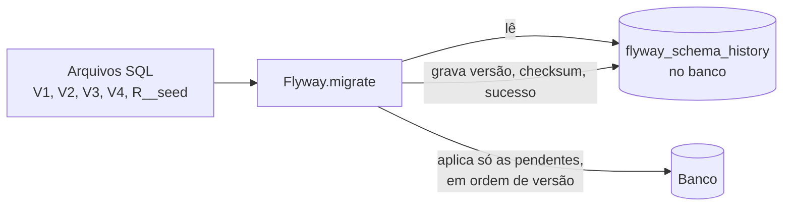

# J3.12 — Migrações com Flyway

> ⏱️ ~1h30 · 🟢 Júnior · Pré-requisitos: J3.04, J3.09, J3.11, J0.04 (Git)

## 🎯 Objetivos
Ao final desta aula você consegue:
- Explicar por que o esquema do banco precisa ser **versionado** como o código.
- Escrever **migrações versionadas** (`V<n>__descrição.sql`) e **repetíveis** (`R__descrição.sql`) e rodá-las com o **Flyway** a partir do Java.
- Ler a tabela `flyway_schema_history` e interpretar os erros de **checksum**, de **migração que falha** e de **versão fora de ordem**.
- Separar o **esquema** (todos os ambientes) dos **dados de exemplo** (só dev/teste).
- Recriar um banco de teste do zero com `clean` + `migrate`, com segurança.

## 🤔 Por que isso importa
Até aqui, o esquema vive em `db/scratch/*.sql` e você o carrega à mão. Em um time, isso quebra: "na minha máquina a coluna existe", "em produção alguém rodou o script pela metade", "qual versão do banco este código espera?" O Flyway (e ferramentas parecidas, como o Liquibase) resolve com a regra: **toda mudança no banco é um arquivo numerado, no Git, aplicado automaticamente e na mesma ordem em todos os ambientes**. É a prática padrão em qualquer projeto Java profissional, e uma das primeiras coisas que você verá ao abrir um repositório de trabalho.

## 💡 Intuição (explicação simples)
O **Git para o banco de dados**. Pense em um **diário de obras de um prédio**: cada reforma é um capítulo **numerado** ("cap. 1: fundação; cap. 2: andares..."). Para montar um prédio idêntico em outro terreno, você aplica os capítulos na ordem. **Ninguém reescreve um capítulo já executado**: se o encanamento ficou errado, escreve-se um capítulo **novo** ("cap. 7: corrigir o encanamento"). E o diário anota **quais capítulos já foram feitos** em cada prédio, com uma "assinatura" (o *checksum*) do texto de cada um, para perceber se alguém o adulterou.

## 🔬 Como funciona por dentro

1. **Descobre** os arquivos nos *locations* configurados (`classpath:db/migration`).
2. **Compara** com a tabela **`flyway_schema_history`**, que o Flyway cria no banco e onde anota cada migração aplicada (versão, descrição, *checksum*, quando, sucesso).
3. **Aplica** as pendentes, **em ordem numérica de versão**, e anota cada uma. Se não há pendentes, não faz nada (a documentação: executar o `migrate` "é idempotente"). É recomendado rodar o `migrate` **ao iniciar a aplicação**, para que o código e o banco nunca estejam desencontrados.
4. **Valida** antes de aplicar: se um arquivo **já aplicado** mudou (checksum diferente), **recusa**.

### Convenções (da [documentação do Flyway](https://documentation.red-gate.com/flyway/flyway-concepts/migrations/versioned-migrations))
| Tipo | Nome | Quando roda |
|---|---|---|
| **Versionada** | `V<versão>__<descrição>.sql` (**dois** underscores), por exemplo `V2__create_accounts.sql` | **Uma vez**, na ordem das versões; o arquivo **não pode mais mudar** |
| **Repetível** | `R__<descrição>.sql` | **Sempre que o checksum muda**, depois de todas as versionadas; ordem alfabética da descrição |

- As versões são ordenadas **numericamente** ("como se espera"): `2` vem antes de `10`; `1.2` antes de `1.10` (a Pausa implementa isso).
- O **checksum** detecta alteração acidental. A documentação recomenda **não alterar migrações versionadas já aplicadas** em ambientes permanentes: crie uma migração nova e **"role para frente"** (*roll-forward*).
- Por padrão, o Flyway executa **cada migração em uma transação**. O PostgreSQL aceita **DDL dentro de transação**, então uma migração que falha no meio **volta atrás inteira** (testado abaixo). (Outros bancos não oferecem essa garantia.)

### Esquema × dados de exemplo
- **Esquema** (`V1`..`V4`) vai para **todos** os ambientes, incluindo produção.
- **Seed** de desenvolvimento (usuários de mentira, saldos) **nunca** deve ir para produção. Duas decisões do PayFlow:
  1. O seed fica em outro *location* (`classpath:db/seed`), **ligado só em dev/teste**.
  2. É uma migração **repetível** (`R__dev_seed.sql`) e **idempotente** (`ON CONFLICT (id) DO NOTHING`, J3.04), em vez de uma `V100__...`: assim ela **sempre roda depois** das versionadas e não atrapalha novas versões (uma versão nova **menor** que uma já aplicada seria recusada como "fora de ordem").
- O Spring Boot (J5) aceita vários *locations* por configuração; a [documentação](https://docs.spring.io/spring-boot/how-to/data-initialization.html) mostra o padrão `classpath:db/migration` e a propriedade `spring.flyway.locations` (lista separada por vírgulas). Por isso o PayFlow já usa **exatamente** `src/main/resources/db/migration`: ao migrar para o Spring Boot, os arquivos **não mudam de lugar**.

## 🛠️ Exemplo prático
> Testado com Flyway **13.12.2** (`flyway-core` e `flyway-database-postgresql`), PostgreSQL 18.6, JDK 25.0.5. As mensagens de erro abaixo são reais.

### 1. Dependências
No `pom.xml` do `payflow`, acrescente (versões do Maven Central em 2026-11-12; reconfira):
```xml
<dependency>
  <groupId>org.flywaydb</groupId>
  <artifactId>flyway-core</artifactId>
  <version>13.12.2</version>
</dependency>
<dependency>
  <groupId>org.flywaydb</groupId>
  <artifactId>flyway-database-postgresql</artifactId>
  <version>13.12.2</version>
</dependency>
```
O **módulo do banco é obrigatório**: só com `flyway-core`, o Flyway responde `FlywayException: Unsupported Database: PostgreSQL 18.6` (verificado removendo o módulo).

O `pom.xml` completo fica assim:
```xml
<project xmlns="http://maven.apache.org/POM/4.0.0"
         xmlns:xsi="http://www.w3.org/2001/XMLSchema-instance"
         xsi:schemaLocation="http://maven.apache.org/POM/4.0.0 https://maven.apache.org/xsd/maven-4.0.0.xsd">
  <modelVersion>4.0.0</modelVersion>
  <groupId>com.payflow</groupId>
  <artifactId>payflow</artifactId>
  <version>0.1.0-SNAPSHOT</version>

  <properties>
    <maven.compiler.release>25</maven.compiler.release>
    <project.build.sourceEncoding>UTF-8</project.build.sourceEncoding>
  </properties>

  <dependencies>
    <dependency>
      <groupId>org.postgresql</groupId>
      <artifactId>postgresql</artifactId>
      <version>42.7.14</version>
    </dependency>
    <dependency>
      <groupId>org.flywaydb</groupId>
      <artifactId>flyway-core</artifactId>
      <version>13.12.2</version>
    </dependency>
    <dependency>
      <groupId>org.flywaydb</groupId>
      <artifactId>flyway-database-postgresql</artifactId>
      <version>13.12.2</version>
    </dependency>
    <dependency>
      <groupId>org.junit.jupiter</groupId>
      <artifactId>junit-jupiter</artifactId>
      <version>6.1.3</version>
      <scope>test</scope>
    </dependency>
    <dependency>
      <groupId>org.assertj</groupId>
      <artifactId>assertj-core</artifactId>
      <version>3.27.7</version>
      <scope>test</scope>
    </dependency>
  </dependencies>

  <build>
    <plugins>
      <plugin>
        <groupId>org.apache.maven.plugins</groupId>
        <artifactId>maven-surefire-plugin</artifactId>
        <version>3.5.4</version>
      </plugin>
      <plugin>
        <groupId>org.codehaus.mojo</groupId>
        <artifactId>exec-maven-plugin</artifactId>
        <version>3.7.0</version>
      </plugin>
    </plugins>
  </build>
</project>
```

### 2. As migrações
Apague `db/scratch/schema.sql`, `indexes.sql` e `seed.sql` **depois** de criar os arquivos abaixo (o `lab_entries.sql` e o `transfer.sql` **não** são migrações: laboratório e script de exemplo; guarde-os em `docs/` ou apague). Em `src/main/resources/db/migration/`:

`V1__create_users.sql`
```sql
CREATE TABLE users (
    id            UUID         NOT NULL DEFAULT uuidv7(),
    email         VARCHAR(255) NOT NULL,
    full_name     VARCHAR(120) NOT NULL,
    password_hash VARCHAR(100) NOT NULL,
    role          VARCHAR(20)  NOT NULL DEFAULT 'USER',
    created_at    TIMESTAMPTZ  NOT NULL DEFAULT now(),
    CONSTRAINT pk_users PRIMARY KEY (id),
    CONSTRAINT uk_users_email UNIQUE (email),
    CONSTRAINT ck_users_role CHECK (role IN ('USER', 'ADMIN'))
);
```
`V2__create_accounts.sql`
```sql
CREATE TABLE accounts (
    id         UUID           NOT NULL DEFAULT uuidv7(),
    owner_id   UUID           NOT NULL,
    balance    NUMERIC(19, 2) NOT NULL DEFAULT 0,
    status     VARCHAR(20)    NOT NULL DEFAULT 'ACTIVE',
    version    BIGINT         NOT NULL DEFAULT 0,
    created_at TIMESTAMPTZ    NOT NULL DEFAULT now(),
    CONSTRAINT pk_accounts PRIMARY KEY (id),
    CONSTRAINT fk_accounts_owner FOREIGN KEY (owner_id) REFERENCES users (id),
    CONSTRAINT ck_accounts_balance CHECK (balance >= 0),
    CONSTRAINT ck_accounts_status CHECK (status IN ('ACTIVE', 'BLOCKED', 'CLOSED'))
);
```
`V3__create_transfers_and_ledger_entries.sql`
```sql
CREATE TABLE transfers (
    id                UUID           NOT NULL DEFAULT uuidv7(),
    source_account_id UUID           NOT NULL,
    target_account_id UUID           NOT NULL,
    amount            NUMERIC(19, 2) NOT NULL,
    status            VARCHAR(20)    NOT NULL DEFAULT 'PENDING',
    idempotency_key   VARCHAR(100)   NOT NULL,
    created_at        TIMESTAMPTZ    NOT NULL DEFAULT now(),
    CONSTRAINT pk_transfers PRIMARY KEY (id),
    CONSTRAINT fk_transfers_source FOREIGN KEY (source_account_id) REFERENCES accounts (id),
    CONSTRAINT fk_transfers_target FOREIGN KEY (target_account_id) REFERENCES accounts (id),
    CONSTRAINT uk_transfers_idempotency_key UNIQUE (idempotency_key),
    CONSTRAINT ck_transfers_amount CHECK (amount > 0),
    CONSTRAINT ck_transfers_status CHECK (status IN ('PENDING', 'COMPLETED', 'FAILED')),
    CONSTRAINT ck_transfers_different_accounts CHECK (source_account_id <> target_account_id)
);

CREATE TABLE ledger_entries (
    id          UUID           NOT NULL DEFAULT uuidv7(),
    account_id  UUID           NOT NULL,
    transfer_id UUID,
    type        VARCHAR(10)    NOT NULL,
    amount      NUMERIC(19, 2) NOT NULL,
    created_at  TIMESTAMPTZ    NOT NULL DEFAULT now(),
    CONSTRAINT pk_ledger_entries PRIMARY KEY (id),
    CONSTRAINT fk_ledger_entries_account FOREIGN KEY (account_id) REFERENCES accounts (id),
    CONSTRAINT fk_ledger_entries_transfer FOREIGN KEY (transfer_id) REFERENCES transfers (id),
    CONSTRAINT ck_ledger_entries_type CHECK (type IN ('DEBIT', 'CREDIT')),
    CONSTRAINT ck_ledger_entries_amount CHECK (amount > 0)
);
```
`V4__create_indexes.sql`
```sql
-- Índices nas colunas de chave estrangeira e no caminho do extrato (J3.09)
CREATE INDEX idx_accounts_owner_id ON accounts (owner_id);
CREATE INDEX idx_transfers_source_account_id ON transfers (source_account_id);
CREATE INDEX idx_transfers_target_account_id ON transfers (target_account_id);
CREATE INDEX idx_ledger_entries_account_created ON ledger_entries (account_id, created_at DESC);
CREATE INDEX idx_ledger_entries_transfer_id ON ledger_entries (transfer_id);
```
E o seed (só dev/teste), em `src/main/resources/db/seed/R__dev_seed.sql`:
```sql
-- Dados de exemplo do PayFlow (UUIDs fixos e legíveis; hashes de senha são FALSOS)
INSERT INTO users (id, email, full_name, password_hash, role, created_at) VALUES
 ('10000000-0000-0000-0000-000000000001', 'ana@payflow.dev',   'Ana Silva',   '$2a$10$fakefakefakefakefakefakefakefakefakefakefakefakefake', 'USER',  '2026-01-05 09:00:00+00'),
 ('10000000-0000-0000-0000-000000000002', 'bruno@payflow.dev', 'Bruno Costa', '$2a$10$fakefakefakefakefakefakefakefakefakefakefakefakefake', 'USER',  '2026-01-06 10:30:00+00'),
 ('10000000-0000-0000-0000-000000000003', 'carla@payflow.dev', 'Carla Dias',  '$2a$10$fakefakefakefakefakefakefakefakefakefakefakefakefake', 'USER',  '2026-01-07 14:15:00+00'),
 ('10000000-0000-0000-0000-000000000004', 'diego@payflow.dev', 'Diego Alves', '$2a$10$fakefakefakefakefakefakefakefakefakefakefakefakefake', 'USER',  '2026-01-08 16:45:00+00'),
 ('10000000-0000-0000-0000-000000000005', 'admin@payflow.dev', 'Eva Admin',   '$2a$10$fakefakefakefakefakefakefakefakefakefakefakefakefake', 'ADMIN', '2026-01-01 08:00:00+00')
ON CONFLICT (id) DO NOTHING;


INSERT INTO accounts (id, owner_id, balance, status, created_at) VALUES
 ('20000000-0000-0000-0000-000000000001', '10000000-0000-0000-0000-000000000001',  830.00, 'ACTIVE',  '2026-01-05 09:05:00+00'),
 ('20000000-0000-0000-0000-000000000002', '10000000-0000-0000-0000-000000000002',  574.50, 'ACTIVE',  '2026-01-06 10:35:00+00'),
 ('20000000-0000-0000-0000-000000000003', '10000000-0000-0000-0000-000000000003',  295.50, 'BLOCKED', '2026-01-07 14:20:00+00'),
 ('20000000-0000-0000-0000-000000000004', '10000000-0000-0000-0000-000000000001',    0.00, 'ACTIVE',  '2026-02-01 12:00:00+00')
ON CONFLICT (id) DO NOTHING;


INSERT INTO transfers (id, source_account_id, target_account_id, amount, status, idempotency_key, created_at) VALUES
 ('30000000-0000-0000-0000-000000000001', '20000000-0000-0000-0000-000000000001', '20000000-0000-0000-0000-000000000002', 150.00, 'COMPLETED', 'key-0001', '2026-01-10 11:00:00+00'),
 ('30000000-0000-0000-0000-000000000002', '20000000-0000-0000-0000-000000000002', '20000000-0000-0000-0000-000000000003',  75.50, 'COMPLETED', 'key-0002', '2026-01-12 15:30:00+00'),
 ('30000000-0000-0000-0000-000000000003', '20000000-0000-0000-0000-000000000001', '20000000-0000-0000-0000-000000000003',  20.00, 'COMPLETED', 'key-0003', '2026-01-15 09:10:00+00'),
 ('30000000-0000-0000-0000-000000000004', '20000000-0000-0000-0000-000000000003', '20000000-0000-0000-0000-000000000001', 500.00, 'FAILED',    'key-0004', '2026-01-20 18:00:00+00')
ON CONFLICT (id) DO NOTHING;


INSERT INTO ledger_entries (id, account_id, transfer_id, type, amount, created_at) VALUES
 ('40000000-0000-0000-0000-000000000001', '20000000-0000-0000-0000-000000000001', NULL, 'CREDIT', 1000.00, '2026-01-05 09:10:00+00'),
 ('40000000-0000-0000-0000-000000000002', '20000000-0000-0000-0000-000000000002', NULL, 'CREDIT',  500.00, '2026-01-06 10:40:00+00'),
 ('40000000-0000-0000-0000-000000000003', '20000000-0000-0000-0000-000000000003', NULL, 'CREDIT',  200.00, '2026-01-07 14:25:00+00'),
 ('40000000-0000-0000-0000-000000000004', '20000000-0000-0000-0000-000000000001', '30000000-0000-0000-0000-000000000001', 'DEBIT',  150.00, '2026-01-10 11:00:00+00'),
 ('40000000-0000-0000-0000-000000000005', '20000000-0000-0000-0000-000000000002', '30000000-0000-0000-0000-000000000001', 'CREDIT', 150.00, '2026-01-10 11:00:00+00'),
 ('40000000-0000-0000-0000-000000000006', '20000000-0000-0000-0000-000000000002', '30000000-0000-0000-0000-000000000002', 'DEBIT',   75.50, '2026-01-12 15:30:00+00'),
 ('40000000-0000-0000-0000-000000000007', '20000000-0000-0000-0000-000000000003', '30000000-0000-0000-0000-000000000002', 'CREDIT',  75.50, '2026-01-12 15:30:00+00'),
 ('40000000-0000-0000-0000-000000000008', '20000000-0000-0000-0000-000000000001', '30000000-0000-0000-0000-000000000003', 'DEBIT',   20.00, '2026-01-15 09:10:00+00'),
 ('40000000-0000-0000-0000-000000000009', '20000000-0000-0000-0000-000000000003', '30000000-0000-0000-0000-000000000003', 'CREDIT',  20.00, '2026-01-15 09:10:00+00')
ON CONFLICT (id) DO NOTHING;
```

### 3. Rodar o Flyway pelo Java
`Database.java` ganha o método `migrate`:
```java
package com.payflow.db;

import javax.sql.DataSource;
import org.flywaydb.core.Flyway;
import org.postgresql.ds.PGSimpleDataSource;

/** Cria a conexão com o PostgreSQL e roda as migrações do Flyway. */
public final class Database {

    private Database() { }

    /** Lê a configuração do ambiente; os valores padrão servem só para o Docker local da J3.03. */
    public static DataSource dataSource() {
        PGSimpleDataSource ds = new PGSimpleDataSource();
        ds.setUrl(env("PAYFLOW_DB_URL", "jdbc:postgresql://localhost:5432/payflow"));
        ds.setUser(env("PAYFLOW_DB_USER", "payflow"));
        ds.setPassword(env("PAYFLOW_DB_PASSWORD", "payflow"));
        return ds;
    }

    /** Aplica as migrações pendentes. {@code withSeed} inclui os dados de exemplo (só em dev/teste). */
    public static void migrate(DataSource ds, boolean withSeed) {
        Flyway.configure()
                .dataSource(ds)
                .locations(withSeed
                        ? new String[] {"classpath:db/migration", "classpath:db/seed"}
                        : new String[] {"classpath:db/migration"})
                .load()
                .migrate();
    }

    private static String env(String name, String fallback) {
        String value = System.getenv(name);
        return value == null || value.isBlank() ? fallback : value;
    }
}
```
E o `Demo` agora migra antes de usar:
```java
package com.payflow.db;

import java.math.BigDecimal;
import java.util.UUID;
import javax.sql.DataSource;

/** Roda as migrações (com seed) e faz uma transferência de demonstração. */
public class Demo {
    public static void main(String[] args) {
        DataSource ds = Database.dataSource();
        Database.migrate(ds, true);

        var accounts = new JdbcAccountRepository(ds);
        var transfers = new TransferService(ds);
        UUID ana = UUID.fromString("20000000-0000-0000-0000-000000000001");
        UUID bruno = UUID.fromString("20000000-0000-0000-0000-000000000002");

        System.out.println("Antes : Ana=" + accounts.findById(ana).orElseThrow().balance()
                + " Bruno=" + accounts.findById(bruno).orElseThrow().balance());
        Transfer t = transfers.transfer(ana, bruno, new BigDecimal("10.00"), "demo-" + UUID.randomUUID());
        System.out.println("Transfer " + t.status() + " de " + t.amount());
        System.out.println("Depois: Ana=" + accounts.findById(ana).orElseThrow().balance()
                + " Bruno=" + accounts.findById(bruno).orElseThrow().balance());
        accounts.statement(ana, 0, 3).forEach(e ->
                System.out.println("  " + e.createdAt() + " " + e.type() + " " + e.amount()));
    }
}
```
Para começar de um banco **limpo** (o `payflow` do Docker já tem tabelas criadas à mão), recrie o schema `public`:
```bash
docker exec payflow-pg psql -U payflow -d payflow -c "DROP SCHEMA public CASCADE; CREATE SCHEMA public;"
export JAVA_HOME=/usr/lib/jvm/java-25-openjdk-amd64
mvn -q compile exec:java -Dexec.mainClass=com.payflow.db.Demo
```
Saída real (o Flyway registra com o log padrão do Java; o formato da data varia):
```
INFO: Database: jdbc:postgresql:******** (PostgreSQL 18.6)
INFO: Schema history table "public"."flyway_schema_history" does not exist yet
INFO: Successfully validated 5 migrations (execution time 00:00.025s)
INFO: Creating Schema History table "public"."flyway_schema_history" ...
INFO: Current version of schema "public": << Empty Schema >>
INFO: Migrating schema "public" to version "1 - create users"
INFO: Migrating schema "public" to version "2 - create accounts"
INFO: Migrating schema "public" to version "3 - create transfers and ledger entries"
INFO: Migrating schema "public" to version "4 - create indexes"
INFO: Migrating schema "public" with repeatable migration "dev seed"
INFO: Successfully applied 5 migrations to schema "public", now at version v4 (execution time 00:00.030s)
Antes : Ana=830.00 Bruno=574.50
Transfer COMPLETED de 10.00
Depois: Ana=820.00 Bruno=584.50
...
```
Rodando **de novo**:
```
INFO: Successfully validated 5 migrations (execution time 00:00.027s)
INFO: Schema "public" is up to date. No migration necessary.
```
A tabela de histórico:
```sql
SELECT installed_rank, version, description, type, script, checksum, success FROM flyway_schema_history ORDER BY installed_rank;
```
```
 installed_rank | version |             description             | type |                   script                    |  checksum  | success 
----------------+---------+-------------------------------------+------+---------------------------------------------+------------+---------
              1 | 1       | create users                        | SQL  | V1__create_users.sql                        |  419821391 | t
              2 | 2       | create accounts                     | SQL  | V2__create_accounts.sql                     | 2097749088 | t
              3 | 3       | create transfers and ledger entries | SQL  | V3__create_transfers_and_ledger_entries.sql | 1175933846 | t
              4 | 4       | create indexes                      | SQL  | V4__create_indexes.sql                      | 2126793028 | t
              5 |         | dev seed                            | SQL  | R__dev_seed.sql                             | 1912286444 | t
```
(Os *checksums* dependem do conteúdo exato dos arquivos; os seus serão diferentes se você mudar um espaço.) A migração repetível não tem versão.

### 4. Adotar o Flyway em um banco que já tem tabelas
Se você rodar o `Demo` **sem** recriar o schema (as tabelas criadas à mão da J3.04 ainda existem), o Flyway recusa:
```
Exception in thread "main" org.flywaydb.core.api.FlywayException: Found non-empty schema(s) "public" but no schema history table. Use baseline() or set baselineOnMigrate to true to initialize the schema history table.
```
Proteção: o Flyway **não assume** que um banco com tabelas está em uma versão conhecida. Em desenvolvimento, recrie o banco (acima). Em um banco **existente e importante** (produção) o caminho é o *baseline*: declarar "este banco já está na versão N", e só então migrar dali para frente (a documentação do Flyway descreve o `baseline`).

### 5. Os cenários que dão errado (reais)
Em um banco de laboratório (`payflow_flylab`) e com as migrações em uma pasta externa (`locations("filesystem:/tmp/mig")`), reproduza:

**(a) Nova migração: aplica só a pendente.** Crie `V5__add_users_phone.sql` com `ALTER TABLE users ADD COLUMN phone VARCHAR(20);` e rode `migrate`: aparece `5  add users phone  SUCCESS`.

**(b) Editar uma migração já aplicada.** Mude `VARCHAR(20)` para `VARCHAR(30)` em `V5__add_users_phone.sql` e rode `migrate`:
```
ERRO FlywayValidateException: Validate failed: Migrations have failed validation
Migration checksum mismatch for migration version 5
-> Applied to database : -1527793276
-> Resolved locally    : 475258593
Either revert the changes to the migration, or run repair to update the schema history.
```
O Flyway **recusou** rodar qualquer coisa: o arquivo no Git não corresponde mais ao que foi aplicado. **A correção certa é desfazer a edição** e criar `V6__...` com a mudança (`ALTER TABLE users ALTER COLUMN phone TYPE VARCHAR(30)`). O `repair` apenas **atualiza o checksum** no histórico (e remove registros de migrações que falharam); usá-lo para "calar" o erro **esconde** que o banco e o arquivo divergem. Nos nossos testes, o `repair` fez o histórico voltar a "valer", mas o banco continuava com `VARCHAR(20)` (a edição **nunca foi aplicada**).

**(c) Uma migração que falha no meio.** `V6__broken.sql`:
```sql
CREATE TABLE notifications (id UUID PRIMARY KEY);
INSERT INTO nao_existe VALUES (1);
```
```
SEVERE: Migration of schema "public" to version "6 - broken" failed! Changes successfully rolled back.
ERRO FlywayMigrateException: Failed to execute script V6__broken.sql
---------------------------------------
SQL State  : 42P01
Message    : ERROR: relation "nao_existe" does not exist
Location   : /tmp/mig/V6__broken.sql (/tmp/mig/V6__broken.sql)
Line       : 2
```
`Changes successfully rolled back`: o `CREATE TABLE notifications` **também foi desfeito** (conferido: a tabela **não existe**), porque o DDL do PostgreSQL é transacional. A migração fica `PENDING`; corrija o arquivo e rode de novo.

**(d) Versão menor que a atual, criada depois.** Com a V6 aplicada, alguém adiciona `V5_5__late.sql`:
```
ERRO FlywayValidateException: Validate failed: Migrations have failed validation
Detected resolved migration not applied to database: 5.5.
To ignore this migration, set -ignoreMigrationPatterns='*:ignored'. To allow executing this migration, set -outOfOrder=true.
```
É o que acontece quando **dois colegas** criam migrações em branches paralelas: o segundo PR a ser mesclado traz uma versão **menor** que a já aplicada. A solução de time: **renumere** a sua migração para uma versão **maior** que a do `main` **antes** de mesclar (o CI da J10 pode checar). `outOfOrder=true` existe, mas é exceção.

**(e) Nome errado: o arquivo é ignorado em silêncio.** Estes arquivos **não** foram aplicados **e não houve erro nenhum**: `v5__lowercase.sql` (minúscula), `V5-single-dash.sql` (hífen) e `V7_bad.sql` (um underscore só). O Flyway só reconhece o padrão `V<versão>__<descrição>.sql` (e `R__...`); o que não casa é **ignorado**. Sintoma clássico: "a minha migração não rodou". Confira o nome com `flyway.info()` ou o log "Successfully validated N migrations".

**(f) `clean` é desabilitado por padrão.**
```
FlywayException: Unable to execute clean as it has been disabled with the 'flyway.cleanDisabled' property.
```
`clean` **apaga todos os objetos do schema**. Por isso vem desligado: só se habilita **em banco de teste** (`cleanDisabled(false)`, abaixo). **Nunca** em produção.

### 6. Os testes agora usam o Flyway
`DbTestSupport` recria o banco de teste do zero com `clean` + `migrate` (em vez de ler `db/scratch/*.sql`):
```java
package com.payflow.db;

import java.sql.Connection;
import java.sql.ResultSet;
import java.sql.SQLException;
import java.sql.Statement;
import java.util.UUID;
import javax.sql.DataSource;
import org.flywaydb.core.Flyway;
import org.postgresql.ds.PGSimpleDataSource;

/** Banco de TESTE separado (payflow_test), recriado do zero a cada teste. */
final class DbTestSupport {

    static final UUID ANA = UUID.fromString("20000000-0000-0000-0000-000000000001");
    static final UUID BRUNO = UUID.fromString("20000000-0000-0000-0000-000000000002");
    static final UUID CARLA_BLOCKED = UUID.fromString("20000000-0000-0000-0000-000000000003");

    private DbTestSupport() { }

    static DataSource freshDatabase() {
        PGSimpleDataSource ds = new PGSimpleDataSource();
        ds.setUrl("jdbc:postgresql://localhost:5432/payflow_test");
        ds.setUser("payflow");
        ds.setPassword("payflow");
        Flyway flyway = Flyway.configure()
                .dataSource(ds)
                .locations("classpath:db/migration", "classpath:db/seed")
                .cleanDisabled(false)          // só no banco de teste!
                .load();
        flyway.clean();
        flyway.migrate();
        return ds;
    }

    static long count(DataSource ds, String sql) {
        try (Connection c = ds.getConnection(); Statement st = c.createStatement();
             ResultSet rs = st.executeQuery(sql)) {
            rs.next();
            return rs.getLong(1);
        } catch (SQLException e) {
            throw new IllegalStateException(e);
        }
    }
}
```
Repare que `locations` inclui o **seed**, e que `cleanDisabled(false)` aparece **só aqui**, apontando para `payflow_test`. E o `RepositoryTest` ganha um teste de que as migrações foram aplicadas na ordem:
```java
package com.payflow.db;

import static com.payflow.db.DbTestSupport.ANA;
import static org.assertj.core.api.Assertions.assertThat;
import static org.assertj.core.api.Assertions.assertThatThrownBy;

import java.math.BigDecimal;
import javax.sql.DataSource;
import org.flywaydb.core.Flyway;
import org.junit.jupiter.api.BeforeEach;
import org.junit.jupiter.api.Test;

class RepositoryTest {

    private DataSource ds;
    private JdbcUserRepository users;
    private JdbcAccountRepository accounts;

    @BeforeEach
    void setUp() {
        ds = DbTestSupport.freshDatabase();
        users = new JdbcUserRepository(ds);
        accounts = new JdbcAccountRepository(ds);
    }

    @Test
    void findsSeededUserByEmail() {
        assertThat(users.findByEmail("ana@payflow.dev")).get()
                .extracting(User::fullName).isEqualTo("Ana Silva");
        assertThat(users.findByEmail("ninguem@payflow.dev")).isEmpty();
    }

    @Test
    void duplicateEmailViolatesTheUniqueConstraint() {
        assertThatThrownBy(() -> users.insert("ana@payflow.dev", "Outra Ana", "hash"))
                .isInstanceOf(DataAccessException.class)
                .hasMessageContaining("23505");
    }

    @Test
    void injectionPayloadIsJustTextWhenUsingPreparedStatement() {
        assertThat(users.findByEmail("x' OR '1'='1")).isEmpty();
    }

    @Test
    void depositIncreasesBalanceAndAppearsOnTheStatement() {
        accounts.deposit(ANA, new BigDecimal("25.50"));

        assertThat(accounts.findById(ANA).orElseThrow().balance()).isEqualByComparingTo("855.50");
        var firstPage = accounts.statement(ANA, 0, 2);
        assertThat(firstPage).hasSize(2);
        assertThat(firstPage.getFirst().amount()).isEqualByComparingTo("25.50");
        assertThat(firstPage.getFirst().transferId()).isNull();
    }

    @Test
    void migrationsAreAppliedInOrder() {
        var info = Flyway.configure().dataSource(ds)
                .locations("classpath:db/migration", "classpath:db/seed").load().info();
        assertThat(info.applied()).hasSize(5);                 // V1..V4 + R__dev_seed
        assertThat(info.pending()).isEmpty();
        assertThat(info.current().getVersion().getVersion()).isEqualTo("4");
    }
}
```
```bash
mvn test
```
```
Tests run: 6, Failures: 0, Errors: 0, Skipped: 0 -- in com.payflow.db.TransferServiceTest
Tests run: 5, Failures: 0, Errors: 0, Skipped: 0 -- in com.payflow.db.RepositoryTest
Tests run: 11, Failures: 0, Errors: 0, Skipped: 0
```
O teste `migrationsAreAppliedInOrder` é um **teste de migração**: a cada execução, **todo o histórico de migrações é aplicado a um banco vazio**. Assim, uma migração quebrada é descoberta no PR, não em produção. (Na J7, com Testcontainers, o banco de teste passa a ser descartável por execução, e na J10 o CI repete isso.)

## 🧠 Pausa para lógica
**Enunciado:** implemente `compare(String a, String b)` para ordenar versões de migração como `"1"`, `"1.2"`, `"1.10"`, `"2"`, `"5.5"`, `"10"` **numericamente**, parte por parte. Mostre a diferença para a ordenação **como texto** (`Collections.sort`) e explique por que o Flyway não pode ordenar como texto.

<details><summary>Dica</summary>Divida por <code>.</code>, compare os pedaços como <code>int</code> e trate a parte ausente como 0 (<code>"5" == "5.0"</code>).</details>
<details><summary>Solução (testada com JDK 25.0.5)</summary>

```java
import java.util.*;

public class MigrationVersion {
    /** Compara versões "1", "2", "5.5", "10" parte a parte, como números. */
    static int compare(String a, String b) {
        String[] x = a.split("\\."), y = b.split("\\.");
        for (int i = 0; i < Math.max(x.length, y.length); i++) {
            int xi = i < x.length ? Integer.parseInt(x[i]) : 0;
            int yi = i < y.length ? Integer.parseInt(y[i]) : 0;
            if (xi != yi) return Integer.compare(xi, yi);
        }
        return 0;
    }

    public static void main(String[] args) {
        List<String> versions = new ArrayList<>(List.of("10", "2", "1", "5.5", "5", "1.10", "1.2"));
        Collections.sort(versions);
        System.out.println("como texto : " + versions);
        versions.sort(MigrationVersion::compare);
        System.out.println("como número: " + versions);
    }
}
```
```
como texto : [1, 1.10, 1.2, 10, 2, 5, 5.5]
como número: [1, 1.2, 1.10, 2, 5, 5.5, 10]
```
Como **texto**, `"10"` vem antes de `"2"` (compara-se `'1'` com `'2'`) e `"1.10"` antes de `"1.2"`: a V10 rodaria antes da V2. Por isso, versões são comparadas como **números**. (Esta função só ilustra a ideia; o Flyway implementa a sua própria regra, descrita na documentação como ordenação numérica "do jeito esperado".)
</details>

**Variação:** o que a função faz com `"1.a"` (lança `NumberFormatException`)? E o Flyway com um arquivo `V1a__x.sql`? Testamos: ele é **ignorado em silêncio**, como os nomes errados do cenário (e): não casa com o padrão de versão numérica.

## ⚠️ Erros comuns e boas práticas de produção
- **Editar uma migração já aplicada:** erro de *checksum* (acima). Crie uma nova.
- **`repair` para "calar" o erro:** esconde divergência real. Entenda a causa antes.
- **Nome fora do padrão:** o arquivo é ignorado **em silêncio** (acima). Use sempre `V<n>__descrição.sql`.
- **Colisão de versões entre PRs:** renumere antes de mesclar; revise a pasta de migrações como parte do *code review*.
- **`clean` em produção:** apaga tudo. Mantenha `cleanDisabled=true` (o padrão) fora dos testes.
- **Seed de desenvolvimento indo para produção:** mantenha-o em *location* separado e habilitado só em dev/teste.
- **Migração destrutiva sem plano** (`DROP COLUMN`, `ALTER TYPE` em tabela grande): trava tabelas e perde dados. Em produção, a mudança segura é feita em **etapas compatíveis** (*expand/contract*: adicionar, migrar os dados, trocar o código, remover depois; S3). Faça **backup** antes de migrações de risco (💸 em nuvem, snapshots têm custo; J10).
- **Esquecer a compatibilidade com o código antigo:** durante um deploy, a versão **antiga** do aplicativo roda por algum tempo contra o esquema **novo**. Migrações devem ser compatíveis com as duas versões (S3 aprofunda).
- **Migração enorme e lenta** (criar índice em tabela grande, `UPDATE` de milhões de linhas): pode segurar bloqueios por muito tempo. Divida e avalie `CREATE INDEX CONCURRENTLY` (P2/S3, e atenção: ele não roda dentro de transação).
- **Sem teste de migração:** rode **todo** o histórico em um banco vazio no CI (J10), e teste também a atualização a partir da versão anterior.
- **Dado de referência vs seed:** dados que o sistema **precisa** (por exemplo, uma tabela de países) podem entrar em migração versionada; dados **de exemplo** não.
- **Commit com o banco de dev "na mão":** se você alterou o banco no `psql` e não criou a migração, os colegas e o CI não têm a mudança. **O Git é a fonte da verdade**, o banco de dev é descartável.

## 🧩 Exercícios
1. **Fixação:** (a) escreva a migração `V5__add_accounts_currency.sql` que adiciona `currency CHAR(3) NOT NULL DEFAULT 'BRL'` a `accounts` com um `CHECK` (`currency = 'BRL'`); (b) por que **não** se edita `V2__create_accounts.sql`? (c) o que acontece se dois PRs criarem `V5__...` com conteúdos diferentes? (d) Por que a `R__dev_seed.sql` usa `ON CONFLICT DO NOTHING`?
2. **Aplicação no PayFlow:** o esquema em migrações. **Esta é a entrega do módulo.**
   - [ ] `src/main/resources/db/migration/V1..V4` e `src/main/resources/db/seed/R__dev_seed.sql` criados (a partir de `db/scratch`), e os arquivos de `db/scratch` removidos (menos o `lab_entries.sql`, que vira `docs/lab_entries.sql`).
   - [ ] `Database.migrate` e o `Demo` atualizados; em um schema `public` vazio, `Demo` aplica **5** migrações; na segunda execução diz "No migration necessary".
   - [ ] Os `INFO` do Flyway mostram as migrações 1 a 4 e a repetível.
   - [ ] `SELECT ... FROM flyway_schema_history` mostra as 5 linhas com `success = t`.
   - [ ] `mvn test` passa com **11 testes**, usando `clean` + `migrate`, com `cleanDisabled(false)` apenas em `DbTestSupport`.
   - [ ] Você reproduziu **(b)** o *checksum mismatch* e **(c)** a migração que falha (conferindo que a tabela do meio **não** foi criada), e **(e)** o nome errado ignorado, em um banco/pasta de laboratório, e registrou as mensagens em `docs/flyway-notes.md`.
   - [ ] O README do projeto explica como subir o banco e rodar `mvn test`.
   - [ ] Commit: `feat(db): add Flyway migrations and dev seed`.
3. **Desafio (opcional):** crie `V5__ledger_append_only.sql` com o *trigger* da J3.10 (regra 5) e um teste JUnit que prove que `UPDATE` e `DELETE` em `ledger_entries` **falham**, e que a transferência continua funcionando. (Testamos a migração do *trigger* no Flyway: o bloco `$$ ... $$` é aceito.) Que cuidado o `clean`/`seed` precisa ter com um *trigger* que **proíbe** `DELETE`? (Pista: o `clean` apaga o schema inteiro, não linhas.)

<details><summary>Solução de referência (fixação)</summary>

(a)
```sql
ALTER TABLE accounts ADD COLUMN currency CHAR(3) NOT NULL DEFAULT 'BRL';
ALTER TABLE accounts ADD CONSTRAINT ck_accounts_currency CHECK (currency = 'BRL');
```
(`DEFAULT` permite o `NOT NULL` em uma tabela que já tem linhas, J3.04.) (b) A V2 já foi aplicada em outros bancos; editá-la quebra o checksum e **não** altera os bancos onde já rodou. Mudanças vão em **novas** versões. (c) Se os dois chegam à `main`, o Flyway recusa com `FlywayException: Found more than one migration with version 5` seguido da lista dos arquivos (testado); se um deles já tinha sido aplicado em outro banco, o outro aparece como `Detected resolved migration not applied to database`. Renumere antes de mesclar. (d) Porque a repetível **reroda** quando o checksum muda: sem `ON CONFLICT DO NOTHING`, a segunda execução tentaria reinserir os mesmos ids e falharia por chave duplicada; com ele, só insere o que falta e **não** sobrescreve edições locais.
</details>

## 🎤 Na entrevista
- **O que é o Flyway e que problema resolve?** Uma ferramenta de **migração de esquema**: versiona as mudanças do banco em arquivos numerados, aplica as pendentes na ordem em cada ambiente e registra o que já foi aplicado (checksum), mantendo código e banco em sincronia.
- **Por que não se edita uma migração já aplicada?** O Flyway guarda um checksum; a edição causa erro de validação e, mesmo se forçada, **não** altera os bancos onde a versão antiga já rodou: eles divergem. Cria-se uma migração nova (*roll-forward*).
- **Migração versionada vs repetível?** A versionada roda **uma vez**, em ordem de versão, e é imutável; a repetível roda **de novo** sempre que seu conteúdo muda, depois das versionadas (boa para *views*, funções, ou um seed idempotente).
- **Dois desenvolvedores criaram a mesma versão em branches diferentes. E agora?** O segundo a mesclar renumera sua migração para uma versão maior que a do `main`; o CI pode validar. `outOfOrder` é exceção.
- **Como você aplicaria uma mudança de esquema sem *downtime*?** Em etapas compatíveis com a versão atual e a anterior do código (*expand/contract*): adicionar, migrar dados, trocar o código, depois remover (S3).

## 📚 Para ir além
- 📄 [Flyway — Versioned migrations](https://documentation.red-gate.com/flyway/flyway-concepts/migrations/versioned-migrations): nomes, versões, checksum e a recomendação de não mudar migrações aplicadas.
- 📄 [Flyway — Repeatable migrations](https://documentation.red-gate.com/flyway/flyway-concepts/migrations/repeatable-migrations): quando e como reexecutam.
- 📄 [Flyway — visão geral de migrações](https://documentation.red-gate.com/fd/migrations-271585107.html): descoberta, transação por migração, `migrate` idempotente e tabela de histórico.
- 📄 [Spring Boot — Database Initialization (Flyway)](https://docs.spring.io/spring-boot/how-to/data-initialization.html): como o Boot integra o Flyway e a propriedade `spring.flyway.locations` (volta na J5).
- 📄 [Repositório do Flyway no GitHub](https://github.com/flyway/flyway): código-fonte e notas de versão.
- 📑 *Refactoring Databases* (Ambler & Sadalage): catálogo de refatorações de banco e migração gradual (título citado de memória; capítulos não conferidos).
- 🎥 ⚠️ Nenhum vídeo verificado nesta execução.

## ✅ Checklist da aula
- [ ] Migrações `V1..V4` e seed repetível no lugar certo; `db/scratch` aposentado.
- [ ] `Demo` aplica 5 migrações num schema vazio e depois não faz nada.
- [ ] Li `flyway_schema_history` e expliquei as colunas.
- [ ] Reproduzi *checksum mismatch*, migração que falha e nome ignorado.
- [ ] `mvn test` com 11 testes verdes usando `clean` + `migrate` só no banco de teste.
- [ ] Sei por que não se edita uma migração aplicada.
