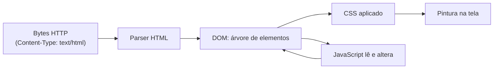

# J4.01 — HTML semântico e formulários

> ⏱️ ~1h30 · 🟢 Júnior · Pré-requisitos: J2.02 (HTTP: métodos, headers, corpo), J2.04 (cookies e JSON), J0.01 (terminal)

## 🎯 Objetivos
Ao final desta aula você consegue:
- Escrever uma página HTML com a **estrutura semântica** correta (`header`, `nav`, `main`, `section`, `footer`, títulos em ordem).
- Montar um **formulário** com `label`, tipos de `input` adequados e **validação nativa** (`required`, `type`, `pattern`).
- Explicar **o que o navegador envia** quando o formulário é submetido (método, `Content-Type`, corpo codificado) e por que o atributo `name` é obrigatório.
- Escolher entre `GET` e `POST` em um formulário e dizer por que login e depósito **nunca** usam `GET`.
- Abrir o protótipo da tela de login e do depósito do PayFlow e conferir a validação no navegador.

## 🤔 Por que isso importa
Como dev backend, você vai receber tudo o que o usuário digita **por um formulário** (ou por um JavaScript que imita um). Quem entende o que o navegador realmente envia depura em minutos o que outros levam horas ("o campo chegou nulo", "o `+` virou espaço", "o valor chegou com vírgula"). E o HTML bem escrito é a base de acessibilidade, SEO e testes: um `label` certo faz o leitor de tela anunciar o campo, e faz o teste automatizado achá-lo. Em vagas Java, a tela quase sempre existe (Thymeleaf, Angular, React) e o backend precisa conversar com ela sem surpresas.

## 💡 Intuição (explicação simples)
HTML é a **planta baixa** de uma casa: diz *o que é cada cômodo* (cozinha, quarto, banheiro), não a cor da parede (isso é CSS) nem o que a porta automática faz (isso é JavaScript). **Semântica** é colocar a placa certa em cada cômodo: se você chama o banheiro de "sala", a casa até funciona, mas quem depende da placa (leitor de tela, buscador, outro programador) se perde. E um **formulário** é um **formulário de papel**: cada campo tem um rótulo impresso (`label`), um nome interno na ficha (`name`) e, ao entregar no balcão, o atendente copia **apenas os campos que têm nome** para a ficha do sistema.

## 🔬 Como funciona por dentro
O navegador baixa o texto HTML (J2.02) e o **interpreta (parse)** em uma árvore de objetos, o **DOM** (*Document Object Model*). Tudo que o CSS e o JavaScript fazem depois é sobre essa árvore, não sobre o texto.



### Estrutura semântica
```html
<!DOCTYPE html>                      <!-- obrigatório: liga o modo padrão (sem ele, o "quirks mode") -->
<html lang="pt-BR">                  <!-- idioma: leitor de tela escolhe a pronúncia; tradutores usam -->
<head>
  <meta charset="utf-8">             <!-- sem isso, "ção" pode virar "ção" -->
  <meta name="viewport" content="width=device-width, initial-scale=1"> <!-- celular: J4.03 -->
  <title>Extrato · PayFlow</title>   <!-- aparece na aba, no histórico e no leitor de tela -->
</head>
<body>
  <header>...</header>               <!-- cabeçalho do site ou da seção -->
  <nav aria-label="Principal">...</nav>
  <main>                             <!-- UM por página: o conteúdo principal -->
    <h1>Extrato</h1>
    <section aria-labelledby="t">    <!-- bloco temático COM título -->
      <h2 id="t">Lançamentos</h2>
    </section>
  </main>
  <footer>...</footer>
</body>
</html>
```

| Elemento | Quando usar | Não confunda com |
|---|---|---|
| `h1`…`h6` | Hierarquia do conteúdo (um `h1` por página; não pule níveis) | "texto grande" (isso é CSS) |
| `nav` | Bloco de navegação principal | qualquer lista de links |
| `main` | O conteúdo único da página | `div` genérico |
| `section` / `article` | Bloco temático com título / conteúdo independente | `div` só para agrupar estilo |
| `button` | Ação (enviar, abrir, carregar mais) | `a` (link **navega**; botão **faz**) |
| `a href` | Ir para outra URL | `div onclick` (não recebe foco nem Enter) |
| `table`, `th scope` | **Dados** em linhas e colunas (extrato!) | layout de página |
| `div`, `span` | Quando **nenhum** elemento semântico serve | tudo (é o último recurso) |

### Formulários: o que o navegador faz ao enviar
1. Percorre os controles do formulário (`input`, `select`, `textarea`).
2. **Valida** (se não houver `novalidate`): `required`, `type`, `pattern`, `min`/`max`, `maxlength`. Se algo falha, **não envia** e mostra uma mensagem.
3. Monta pares `name=valor` **só dos controles que têm `name`** (e, para checkbox/radio, só dos marcados), codifica em **URL-encoding** (`application/x-www-form-urlencoded`, o padrão) e envia.

Capturamos o que o Chrome 156 realmente enviou (com `nc -l`) para um formulário `method="post"` com `target`, `amount`, `note`, um checkbox marcado e um `input` **sem** `name`:

```http
POST /transfers HTTP/1.1
Host: localhost:9100
Content-Length: 89
Content-Type: application/x-www-form-urlencoded
Origin: null
...

target=bruno%40payflow.dev&amount=25%2C90&note=oi+%26+tchau&ignored_no_name2=x&confirm=on
```
Observe: `@` virou `%40`, a vírgula virou `%2C`, o espaço virou `+`, `&` virou `%26`; o checkbox marcado enviou `confirm=on`; o campo **sem `name` não foi enviado**. (Um campo que não chega ao servidor, na maioria das vezes, é um `name` esquecido ou com erro de digitação.) Com `method="get"`, esses mesmos pares iriam na **URL** (`/transfers?target=...&amount=...`).

**GET ou POST?** `GET` é para **ler** (é seguro e idempotente, J2.02): os dados ficam na URL, no histórico do navegador, em *logs* de proxy e de servidor, e o botão "voltar" reenvia sem avisar. `POST` é para **alterar** estado (login, depósito, transferência): os dados vão no corpo, e o navegador **avisa** antes de reenviar ao recarregar. Senha na URL é um vazamento esperando acontecer.

### Tipos de `input` e o que cada um ganha
| `type` | Ganho | Cuidado |
|---|---|---|
| `email` | Valida o formato `x@y` e abre teclado de e-mail no celular | A validação é **fraca**; o servidor revalida |
| `password` | Oculta os caracteres | Não protege nada sozinho (HTTPS, J2.03) |
| `text` + `inputmode="decimal"` | Teclado numérico no celular, **sem** as manias do `number` | Você valida o formato (`pattern` ou JavaScript) |
| `number` | Setas, `min`/`max`/`step` | Aceita `e` (notação científica), o formato digitado depende do idioma do navegador e `valueAsNumber` é um `double` do JavaScript: ruim para dinheiro |
| `date` | Seletor de data; o valor é sempre `AAAA-MM-DD` | O texto exibido muda com o idioma; o valor enviado, não |
| `checkbox` | Sim/não | Desmarcado **não envia nada** |
| `hidden` | Carrega um valor sem exibir | O usuário pode **alterar** (nunca confie nele) |

**Dinheiro:** o PayFlow usa `type="text"` com `inputmode="decimal"` e `pattern`. O valor é enviado **como texto** ("25,90") e o servidor converte para `BigDecimal` (decisão 4 e 18 do projeto). Assim, nenhum `double` do navegador toca no valor.

### Validação nativa (medida)
Rodamos o formulário do protótipo (`docs/frontend-lab/01-transfer-form.html`) no Chrome e lemos `element.validity` de cada campo:
```
vazio        -> target:valueMissing amount:valueMissing note:ok when:ok confirm:valueMissing
inválido     -> target:typeMismatch amount:patternMismatch note:ok when:ok confirm:valueMissing
válido       -> target:ok amount:ok note:ok when:ok confirm:ok
FormData     -> {"target":"bruno@payflow.dev","amount":"25,90","note":"","when":"now","confirm":"on"}
```
(`bruno` não é e-mail → `typeMismatch`; `12,345` não casa com `pattern` → `patternMismatch`.) **Validação no navegador é conforto, não segurança**: qualquer um envia `POST` pelo `curl` (J2.05) sem passar por ela. O servidor **sempre** valida de novo.

## 🛠️ Exemplo prático
Crie a pasta de laboratório no projeto e abra o arquivo no navegador (não precisa de servidor):
```bash
cd payflow
mkdir -p docs/frontend-lab
# crie docs/frontend-lab/01-transfer-form.html com o conteúdo abaixo
xdg-open docs/frontend-lab/01-transfer-form.html      # Linux; no macOS: open; no Windows: start
```

`docs/frontend-lab/01-transfer-form.html` (testado no Chrome 156):
```html
<!DOCTYPE html>
<html lang="pt-BR">
<head>
  <meta charset="utf-8">
  <meta name="viewport" content="width=device-width, initial-scale=1">
  <title>Nova transferência · PayFlow (protótipo)</title>
</head>
<body>
  <header>
    <a href="/accounts">PayFlow</a>
    <nav aria-label="Principal">
      <ul>
        <li><a href="/accounts">Contas</a></li>
        <li><a href="/transfers/new" aria-current="page">Transferir</a></li>
      </ul>
    </nav>
  </header>

  <main>
    <h1>Nova transferência</h1>
    <form action="/transfers" method="post">
      <fieldset>
        <legend>Destino</legend>
        <p>
          <label for="target">E-mail do destinatário</label>
          <input id="target" name="target" type="email" required autocomplete="off">
        </p>
      </fieldset>

      <p>
        <label for="amount">Valor (R$)</label>
        <input id="amount" name="amount" type="text" inputmode="decimal" required
               pattern="[0-9]+([,.][0-9]{1,2})?" title="Use números, com até 2 casas decimais. Exemplo: 25,90">
      </p>

      <p>
        <label for="note">Mensagem (opcional)</label>
        <textarea id="note" name="note" rows="2" maxlength="140"></textarea>
      </p>

      <p>
        <label for="when">Quando</label>
        <select id="when" name="when">
          <option value="now" selected>Agora</option>
          <option value="tomorrow">Amanhã</option>
        </select>
      </p>

      <p>
        <input id="confirm" name="confirm" type="checkbox" required>
        <label for="confirm">Confirmo que os dados estão corretos</label>
      </p>

      <button type="submit">Transferir</button>
    </form>
  </main>

  <footer><p>PayFlow · projeto de estudo</p></footer>
</body>
</html>
```
Tente enviar vazio, depois com `bruno` no e-mail, depois com `12,345` no valor: cada caso mostra uma mensagem diferente do navegador. (O envio vai dar erro de página, porque `/transfers` não existe: o que importa aqui é a validação. Na aba **Network** do DevTools, J2.05, você vê o `POST` quando a validação passa.)

Pontos de leitura:
- `label for="x"` + `input id="x"` **liga** o rótulo ao campo: clicar no texto foca o campo e o leitor de tela anuncia "E-mail do destinatário, campo de edição". `placeholder` **não** substitui `label` (some ao digitar).
- `title` do `pattern` vira parte da mensagem de erro.
- `autocomplete` ajuda gerenciadores de senha e o preenchimento automático (valores padronizados: `username`, `current-password`, `new-password`, `off`).
- `aria-current="page"` marca o link da página atual para tecnologias assistivas.

## 🧠 Pausa para lógica
Um colega escreveu `<input type="number" name="amount">` para o valor do depósito e o usuário digitou `0,1` e `0,2` em dois depósitos. O servidor recebeu `"0.1"` e `"0.2"` e somou como `double`. Qual problema aparece e qual é a correção em duas camadas (HTML e servidor)?

<details><summary>Dica e solução</summary>

Dica: lembre da J1.15 (`0.1 + 0.2` em ponto flutuante). Solução: `double` não representa 0,1 exatamente, e a soma dá `0.30000000000000004`. **Servidor:** `BigDecimal` a partir da `String` (`new BigDecimal("0.1")`), validar escala ≤ 2 (decisão 18) e armazenar `NUMERIC(19,2)`. **HTML:** `type="text"` com `inputmode="decimal"` e `pattern`, para o navegador **não** converter nada e o texto chegar intacto ao servidor, que decide como interpretar (inclusive a vírgula brasileira).
</details>

## ⚠️ Erros comuns e boas práticas de produção
- **`name` esquecido:** o campo não chega ao servidor (`request.getParameter("amount")` devolve `null`). Confira no DevTools → Network → Payload.
- **`<button>` dentro de `<form>` sem `type`:** o padrão é `submit`; um botão "Cancelar" sem `type="button"` **envia** o formulário.
- **`<div onclick>` no lugar de `<button>`:** não recebe foco pelo teclado nem responde a Enter/Espaço (testado em J4.08).
- **Vários `h1`, saltos de `h2` para `h4`, `h3` só porque a fonte é menor:** quebra a navegação por títulos do leitor de tela.
- **`id` repetido:** o `label for` aponta para o primeiro; scripts e testes se confundem.
- **Acentos quebrados** (`ção`): faltou `<meta charset="utf-8">` **ou** o servidor mandou `Content-Type: text/html` sem `charset` (J2.02). O PayFlow manda `text/html; charset=utf-8`.
- **Confiar em `required`/`pattern`/`hidden`/`disabled`:** tudo isso é editável no DevTools. **Revalide no servidor** (Bean Validation na J5).
- **Formulário de alteração por `GET`:** um prefetch, um robô ou um link malicioso pode disparar a ação.

## 🧩 Exercícios
1. **Fixação:** (a) o que faz o navegador quando um `input` **sem** `name` está no formulário? (b) como um `<input type="checkbox" name="news">` desmarcado aparece no corpo? (c) por que `label for` é melhor que `placeholder`? (d) qual a diferença entre `<a href>` e `<button>` do ponto de vista de quem usa só o teclado?
2. **Aplicação no PayFlow:** protótipos estáticos das telas do painel, que na J4.06 viram templates.
   - [ ] Pasta `web-prototype/` na raiz do projeto com `login.html` (campo de e-mail, `type="email"`, `required`, `autocomplete="username"`, botão "Entrar") e `statement.html` (saldo, formulário de depósito com `amount` e uma **tabela** `caption`/`thead`/`tbody` com 3 lançamentos fixos).
   - [ ] Cada página com `lang="pt-BR"`, `charset`, `viewport`, `title`, um `main` e **um** `h1`.
   - [ ] Todos os campos com `label` ligado por `for`/`id` e `name`.
   - [ ] Login e depósito com `method="post"`; nenhum formulário de alteração com `get`.
   - [ ] Valor do depósito como `type="text"` + `inputmode="decimal"` + `pattern` (nada de `type="number"`).
   - [ ] Você capturou, no DevTools → Network, o corpo de um `POST` com a validação passando e conferiu `%40` e `%2C`.
   - [ ] Commit: `feat(web): add static HTML prototypes for login and statement`.
3. **Desafio (opcional):** suba um servidor de captura (`nc -l -p 9100`) e aponte o `action` do protótipo para `http://localhost:9100/`. Envie o formulário e compare o que você vê com a captura desta aula. Depois mude para `method="get"` e anote **onde** os dados foram parar.

<details><summary>Soluções de referência</summary>

1. (a) Não é enviado (testado: a captura não traz o campo sem `name`). (b) Não aparece: desmarcado não envia **nada** (o marcado envia `news=on`, ou o `value` definido). (c) O `label` fica visível o tempo todo, aumenta a área de clique e é lido pelo leitor de tela; o `placeholder` some ao digitar e costuma ter contraste baixo. (d) O `a` navega para uma URL e é ativado por Enter; o `button` executa uma ação e é ativado por Enter **e** Espaço; ambos recebem foco. Um `div` com `onclick` não recebe foco.
2. O protótipo final está, em versão renderizada, em `web-prototype/` (J4.06 mostra o resultado completo). Estrutura mínima do depósito: `<form action="/accounts/ID/deposit" method="post"><label for="amount">Valor (R$)</label><input id="amount" name="amount" type="text" inputmode="decimal" required pattern="[0-9]+([,.][0-9]{1,2})?"><button type="submit">Depositar</button></form>`.
3. Com `GET`, a linha de requisição vira `GET /?target=bruno%40payflow.dev&amount=25%2C90... HTTP/1.1` e o corpo fica vazio.
</details>

## 🎤 Na entrevista
- **Qual a diferença entre `GET` e `POST` em um formulário?** `GET` coloca os dados na URL e serve para leitura (seguro, idempotente, cacheável, fica em histórico e logs); `POST` envia no corpo e serve para alterar estado. Segredos e ações de escrita **nunca** vão por `GET`.
- **Para que serve HTML semântico?** Dá significado aos blocos: acessibilidade (leitores de tela navegam por marcos e títulos), SEO, manutenção e testes que localizam elementos por papel e nome.
- **A validação do HTML5 basta?** Não. É experiência de uso; o cliente pode ser contornado. A validação que vale é a do servidor.
- **Por que um campo some do corpo do `POST`?** Sem `name`, desabilitado (`disabled`), checkbox/radio desmarcado ou fora do `<form>`.

## 📚 Para ir além
- 📄 [MDN — Structuring content with HTML](https://developer.mozilla.org/en-US/docs/Learn_web_development/Core/Structuring_content): o curso de HTML da MDN, passo a passo, para consolidar elementos e semântica.
- 📄 [MDN — Client-side form validation](https://developer.mozilla.org/en-US/docs/Learn_web_development/Extensions/Forms/Form_validation): atributos de validação e a Constraint Validation API (`validity`), usada nos testes desta aula.
- 📄 [MDN — `<input>`](https://developer.mozilla.org/en-US/docs/Web/HTML/Reference/Elements/input): todos os `type`, atributos e comportamentos; consulte ao escolher um tipo.
- 📄 [MDN — `<form>`](https://developer.mozilla.org/en-US/docs/Web/HTML/Reference/Elements/form): `action`, `method`, `enctype` e o que cada um muda na requisição.
- 📄 [web.dev — Learn HTML](https://web.dev/learn/html): curso gratuito, com ênfase em semântica e formulários.
- 🎥 ⚠️ Nenhum vídeo verificado nesta execução.

## ✅ Checklist da aula
- [ ] Sei desenhar o caminho texto HTML → DOM → pintura.
- [ ] `01-transfer-form.html` aberto no navegador; vi as três mensagens de validação.
- [ ] Capturei um `POST` real e li o corpo `x-www-form-urlencoded`.
- [ ] Sei por que o campo de dinheiro é `text` com `inputmode="decimal"`.
- [ ] Protótipos `login.html` e `statement.html` criados em `web-prototype/`.
