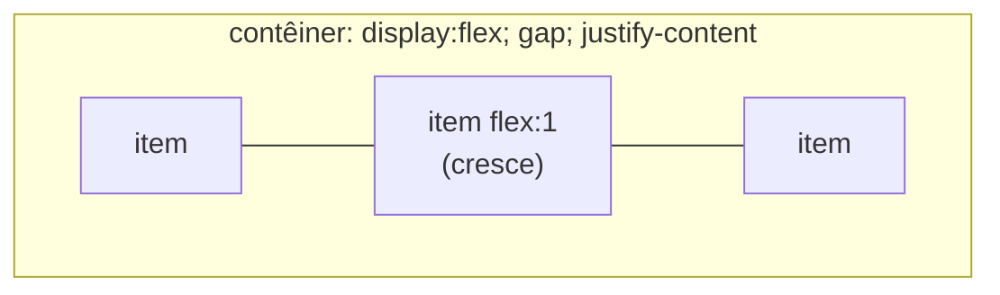

# J4.02 — CSS: box model e flexbox

> ⏱️ ~1h30 · 🟢 Júnior · Pré-requisitos: J4.01 (HTML semântico e formulários)

## 🎯 Objetivos
Ao final desta aula você consegue:
- Ligar um arquivo CSS a uma página e escrever **seletores** de elemento, classe, `id` e atributo.
- Explicar a **cascata** (origem, especificidade, ordem) e por que "o meu estilo não pegou".
- Calcular o tamanho real de uma caixa com **box model** e usar `box-sizing: border-box`.
- Alinhar e distribuir itens em uma linha ou coluna com **flexbox** (`display: flex`, `gap`, `justify-content`, `align-items`, `flex`).
- Aplicar **variáveis CSS** (`--cor`) para manter um visual consistente no painel do PayFlow.

## 🤔 Por que isso importa
Você não vai virar designer, mas vai abrir telas de um sistema Java e precisar **ler** o CSS ("por que esse botão sumiu no celular?"), ajustar um alinhamento e conversar com o time de front-end. O CSS tem poucas ideias centrais (cascata, caixa, fluxo, flexbox e grid); entendê-las evita o ciclo "mexer até funcionar". Em entrevistas para júnior full stack, "o que é box model?" e "como centralizar um elemento?" são perguntas clássicas.

## 💡 Intuição (explicação simples)
Toda coisa na página é uma **caixa de presente**: o **conteúdo** é o presente, o **padding** é o papel de seda ao redor, a **borda** é a caixa, e a **margem** é o espaço livre que você deixa na prateleira para a caixa vizinha. O navegador empilha as caixas como **linhas de um texto** (o *fluxo normal*). O **flexbox** é uma **prateleira com regras**: você diz "coloque tudo em uma fileira, deixe este item crescer, distribua o resto do espaço" e a prateleira faz as contas.

## 🔬 Como funciona por dentro

### 1. Ligando o CSS e a sintaxe
```html
<link rel="stylesheet" href="app.css">   <!-- dentro do <head>; cacheável, reaproveitado por todas as páginas -->
```
```css
seletor {            /* QUAIS elementos */
  propriedade: valor; /* O QUE muda */
}
```
| Seletor | Pega | Exemplo |
|---|---|---|
| Elemento | todas as tags daquele tipo | `h1 { ... }` |
| Classe | elementos com `class="card"` | `.card { ... }` (o mais usado) |
| `id` | o elemento com `id="amount"` | `#amount { ... }` (evite para estilo) |
| Atributo | por atributo | `input[aria-invalid="true"] { ... }` |
| Descendente | dentro de outro | `.site-header nav { ... }` |
| Pseudo-classe | estado | `a:hover`, `:focus-visible`, `li:last-child` |

### 2. A cascata (quem ganha quando duas regras brigam)
1. **Origem e `!important`** (estilos do navegador < do autor; `!important` inverte).
2. **Especificidade**: `id` > classe/atributo/pseudo-classe > elemento. `#a` vence `.b`, que vence `p`.
3. **Ordem**: a regra **mais tarde** no arquivo vence quando o resto empata.
Além disso, algumas propriedades são **herdadas** pelos filhos (`color`, `font-*`), outras não (`border`, `margin`). Regra prática: estilize por **classe**, com baixa especificidade, e evite `!important`: ele só cria uma guerra de especificidade.

### 3. O box model
```
┌────────────────────── margin ──────────────────────┐   (transparente; separa caixas)
│  ┌────────────────── border ──────────────────┐   │
│  │  ┌─────────────── padding ──────────────┐  │   │
│  │  │         ┌── content ──┐              │  │   │
│  │  │         │ width×height│              │  │   │
│  │  │         └─────────────┘              │  │   │
│  │  └──────────────────────────────────────┘  │   │
│  └────────────────────────────────────────────┘   │
└────────────────────────────────────────────────────┘
```
Por padrão (`box-sizing: content-box`), `width` é a largura **só do conteúdo**: padding e borda se **somam**. Isso quebra layouts ("coloquei 100% e estourou a tela"). Medimos no Chrome duas caixas iguais, `width: 200px; padding: 20px; border: 5px`:

| `box-sizing` | Largura total medida |
|---|---|
| `content-box` (padrão) | **250 px** (200 + 2×20 + 2×5) |
| `border-box` | **200 px** (o `width` já inclui padding e borda) |

Por isso o PayFlow começa o CSS com a regra universal:
```css
*, *::before, *::after { box-sizing: border-box; }
```
Detalhes úteis: margens verticais de blocos vizinhos **colapsam** (a maior vence, não somam); `inline` (texto, `span`, `a`) ignora `width`/`height`; `block` ocupa a linha toda.

### 4. Unidades
| Unidade | Significa | Use para |
|---|---|---|
| `px` | pixel CSS | bordas finas (1px), sombras |
| `rem` | múltiplo do tamanho da fonte da raiz (16px por padrão) | fontes, espaçamentos: respeitam a preferência de zoom/fonte do usuário |
| `em` | múltiplo da fonte do próprio elemento | espaçamentos que acompanham o texto |
| `%` | fração do elemento pai | larguras |
| `vw`/`vh` | 1% da largura/altura da janela | seções de tela cheia (com cuidado no celular) |

### 5. Flexbox
`display: flex` transforma o elemento em um **contêiner flex**; seus filhos diretos viram **itens**. Há um **eixo principal** (`flex-direction: row` por padrão: horizontal) e um **eixo cruzado** (perpendicular).

| Propriedade (no contêiner) | Efeito |
|---|---|
| `flex-direction: row \| column` | direção do eixo principal |
| `justify-content` | distribui **no eixo principal** (`flex-start`, `center`, `space-between`) |
| `align-items` | alinha **no eixo cruzado** (`stretch`, `center`, `flex-start`) |
| `gap` | espaço entre os itens (substitui margens "na mão") |
| `flex-wrap: wrap` | permite quebrar em várias linhas |

| Propriedade (no item) | Efeito |
|---|---|
| `flex: 1` | o item **cresce** para ocupar o espaço livre |
| `flex-shrink` | quanto encolhe quando falta espaço (padrão `1`) |

Medimos uma barra com `display: flex; gap: 8px; justify-content: space-between; width: 600px` e três filhos (`logo`, `cresce` com `flex: 1`, `ok`): as larguras ficaram **28 px + 525 px + 30 px**, que somadas aos dois `gap` de 8 px dão ≈ 600 px. O item com `flex: 1` absorveu o que sobrou.


**Centralizar** (a pergunta de entrevista): `display: flex; justify-content: center; align-items: center;` no contêiner.

## 🛠️ Exemplo prático
Arquivo `web-prototype/app.css` (primeira metade; a segunda, com grid e responsividade, vem na J4.03). Ligue-o nas três páginas do protótipo com `<link rel="stylesheet" href="app.css">`.

```css
/* PayFlow — estilos do painel (J4.02 e J4.03) */
:root {                       /* variáveis CSS: um só lugar para o "design" */
  --bg: #f6f7f9;
  --surface: #ffffff;
  --text: #1c2430;
  --muted: #5b6676;
  --brand: #0b5fff;
  --brand-dark: #0a49c4;
  --ok: #0f7a3d;
  --warn: #9a5b00;
  --danger: #b42318;
  --border: #d5dae1;
  --radius: 8px;
  --gap: 1rem;
}

*, *::before, *::after { box-sizing: border-box; }

body {
  margin: 0;
  min-height: 100vh;
  display: flex;                 /* o rodapé fica embaixo mesmo em página curta */
  flex-direction: column;
  font: 1rem/1.5 system-ui, -apple-system, "Segoe UI", Roboto, sans-serif;
  color: var(--text);
  background: var(--bg);
}
main { flex: 1; }               /* o conteúdo "empurra" o rodapé */

h1 { font-size: 1.75rem; margin: 0 0 .5rem; }
h2 { font-size: 1.25rem; margin: 1.5rem 0 .5rem; }
a { color: var(--brand); }
.muted { color: var(--muted); }

/* cabeçalho: flexbox */
.site-header {
  display: flex;
  align-items: center;
  justify-content: space-between;
  gap: var(--gap);
  padding: .75rem 1rem;
  background: var(--surface);
  border-bottom: 1px solid var(--border);
}
.site-header nav { display: flex; align-items: center; gap: var(--gap); }
.brand { font-weight: 700; font-size: 1.25rem; text-decoration: none; color: var(--text); }
.who { color: var(--muted); }

/* formulários: cada campo é uma coluna flex (rótulo em cima, input embaixo) */
.field { display: flex; flex-direction: column; gap: .25rem; margin-bottom: var(--gap); }
label { font-weight: 600; }
input {
  font: inherit;
  padding: .5rem .75rem;
  border: 1px solid var(--muted);
  border-radius: var(--radius);
  background: var(--surface);
  color: inherit;
}
input[aria-invalid="true"] { border-color: var(--danger); }
.error { color: var(--danger); margin: 0; }

.button {
  display: inline-block;
  font: inherit; font-weight: 600;
  padding: .5rem 1rem;
  border: 2px solid var(--brand);
  border-radius: var(--radius);
  background: var(--brand);
  color: #fff;
  text-decoration: none;
  cursor: pointer;
}
.button:hover { background: var(--brand-dark); border-color: var(--brand-dark); }
:focus-visible { outline: 3px solid #ffb703; outline-offset: 2px; }  /* NUNCA remova o foco sem trocar por algo visível */
```
Para usar as classes, o HTML do protótipo ganha `class="site-header"` no `header`, `class="field"` em cada bloco de rótulo+campo e `class="button"` no botão. Abra a página: o cabeçalho passa a ter a marca à esquerda e o usuário/saída à direita (`space-between`), e o rodapé fica colado embaixo.

**Experimento (5 min):** no DevTools, aba **Elements**, selecione um `.field`; no painel **Computed** você vê o diagrama do box model com os valores reais. Altere `gap` e `flex-direction` ao vivo e veja a página mudar.

## 🧠 Pausa para lógica
No cabeçalho, o nome do usuário (`.who`) e o botão "Sair" devem ficar **grudados no canto direito**, com a marca à esquerda, **sem** usar `float` nem margens fixas. Qual combinação de propriedades faz isso? E como colocar a marca e o menu juntos à esquerda e só o "Sair" à direita?

<details><summary>Dica e solução</summary>

Dica: pense em quem é o contêiner e quem são os itens. Solução: `.site-header { display: flex; justify-content: space-between; align-items: center; }` com **dois** filhos (marca e `nav`): o espaço livre fica entre eles. Para "marca + menu à esquerda e Sair à direita", dê `margin-left: auto` ao item "Sair": em um contêiner flex, uma margem `auto` absorve **todo** o espaço livre daquele lado e empurra o item para o canto.
</details>

## ⚠️ Erros comuns e boas práticas de produção
- **Estourar a largura** ("rolagem horizontal"): `width: 100%` com `padding` e **sem** `border-box`. A regra universal resolve.
- **Estilo que "não pega":** especificidade ou ordem. No DevTools, a regra perdedora aparece **riscada**; olhe o seletor da vencedora.
- **`outline: none` sem alternativa:** quem navega por teclado perde o foco visível (acessibilidade, J4.08).
- **Cores sem contraste:** texto cinza claro sobre branco é ilegível (medimos 1,92:1 para `#bbb`; o mínimo é 4,5:1, J4.08).
- **Tamanhos em `px` para fonte:** ignoram a preferência de fonte maior do usuário; prefira `rem`.
- **`!important` por todo lado:** vira dívida; refatore a especificidade.
- **Cache do CSS em desenvolvimento:** a página mostra o estilo antigo. Recarregue sem cache (Ctrl+Shift+R) ou marque "Disable cache" no DevTools.
- **`<center>`, `<font>`, `float` para layout:** obsoletos para isso; use flexbox e grid.

## 🧩 Exercícios
1. **Fixação:** (a) uma caixa tem `width: 300px; padding: 10px; border: 2px solid; box-sizing: content-box`. Qual a largura total? E com `border-box`? (b) qual a diferença entre `justify-content` e `align-items`? (c) entre `#x`, `.x` e `p.x`, qual vence se todas pegarem o mesmo elemento? (d) por que `rem` é melhor que `px` para fonte?
2. **Aplicação no PayFlow:**
   - [ ] `web-prototype/app.css` com variáveis em `:root`, a regra `border-box`, estilos do cabeçalho (flex), dos campos (coluna flex), do botão e do foco visível.
   - [ ] As três páginas do protótipo (`login.html`, `accounts.html`, `statement.html`) usam o mesmo arquivo CSS.
   - [ ] Nenhum `!important`, nenhum `id` usado como seletor de estilo, nenhuma cor escrita fora de `:root`.
   - [ ] O rodapé fica no fim da janela em uma página curta (teste `login.html`).
   - [ ] Você leu o box model de um elemento no painel **Computed** do DevTools e anotou os valores de `padding` e `border`.
   - [ ] Commit: `style(web): add base styles, header and form components`.
3. **Desafio (opcional):** faça o cabeçalho empilhar (marca em cima, menu embaixo) quando a janela tiver menos de 30rem, usando só `flex-direction` e `flex-wrap` (a J4.03 mostra `@media`; tente antes só com `flex-wrap: wrap`).

<details><summary>Soluções de referência</summary>

1. (a) `content-box`: 300 + 2×10 + 2×2 = **324 px**; `border-box`: **300 px**. (b) `justify-content` age no eixo **principal** (a direção dos itens); `align-items` no **cruzado**. Em `flex-direction: column` os papéis trocam de eixo. (c) `#x` (id) tem a maior especificidade. Entre `.x` e `p.x`, `p.x` vence (classe + elemento). (d) `rem` acompanha a fonte-raiz do navegador; `px` ignora a preferência do usuário.
2. O arquivo completo (as duas metades) está na J4.03; a primeira metade desta aula já funciona sozinha.
3. `.site-header { flex-wrap: wrap; }` e dê ao `nav` `flex: 1 1 100%`: quando não couber, o `nav` quebra para a linha de baixo.
</details>

## 🎤 Na entrevista
- **O que é o box model?** Cada elemento é uma caixa com conteúdo, padding, borda e margem. Com `content-box` o `width` mede só o conteúdo; com `border-box`, inclui padding e borda, o que torna o dimensionamento previsível.
- **Como a cascata resolve conflitos?** Origem/`!important`, depois especificidade (id > classe > elemento) e, por fim, a ordem no arquivo.
- **Como centralizar um elemento na vertical e na horizontal?** Contêiner com `display: flex; justify-content: center; align-items: center;` (ou `display: grid; place-items: center;`).
- **Flexbox ou grid?** Flexbox para **uma dimensão** (uma linha ou coluna de itens); grid para **duas dimensões** (linhas e colunas ao mesmo tempo): J4.03.

## 📚 Para ir além
- 📄 [MDN — The box model](https://developer.mozilla.org/en-US/docs/Learn_web_development/Core/Styling_basics/Box_model): explicação oficial, com diagramas, de `content`, `padding`, `border`, `margin` e `box-sizing`.
- 📄 [MDN — Flexbox](https://developer.mozilla.org/en-US/docs/Learn_web_development/Core/CSS_layout/Flexbox): o tutorial do módulo de layout da MDN, com exercícios.
- 📄 [MDN — CSS flexible box layout](https://developer.mozilla.org/en-US/docs/Web/CSS/CSS_flexible_box_layout): referência completa das propriedades, para consulta.
- 📄 [web.dev — Learn CSS](https://web.dev/learn/css): curso gratuito, com seções sobre cascata, especificidade e box model.
- 📄 [Chrome DevTools](https://developer.chrome.com/docs/devtools/): documentação do painel que você usou no experimento.
- 🎥 ⚠️ Nenhum vídeo verificado nesta execução.

## ✅ Checklist da aula
- [ ] Sei explicar `content-box` × `border-box` com os números (250 × 200 px).
- [ ] Sei dizer por que uma regra CSS "não pegou" usando especificidade e ordem.
- [ ] Alinhei o cabeçalho com flexbox e o rodapé ficou embaixo.
- [ ] `app.css` com variáveis e sem `!important`.
- [ ] Li o painel **Computed** do DevTools.
