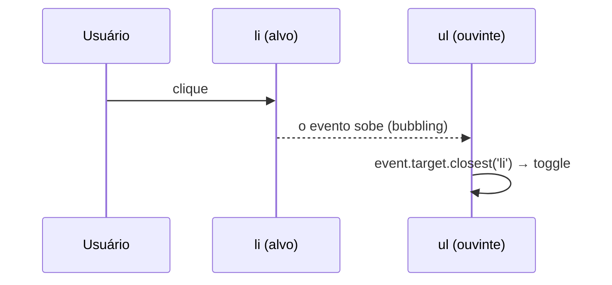

# J4.04 — JavaScript essencial: DOM e eventos

> ⏱️ ~1h30 · 🟢 Júnior · Pré-requisitos: J4.01 (HTML), J4.03 (CSS), J1.13 (lambdas e streams: ajuda a ler `map`/`filter`)

## 🎯 Objetivos
Ao final desta aula você consegue:
- Escrever JavaScript moderno básico (`const`/`let`, funções *arrow*, objetos, arrays, `map`/`filter`, *template literals*) e apontar **as diferenças que mais pegam quem vem de Java**.
- **Selecionar e alterar** elementos do DOM (`querySelector`, `textContent`, `classList`, `dataset`, `createElement`, `<template>`).
- Tratar **eventos** (`submit`, `click`), usar `preventDefault()` e a **delegação de eventos**.
- Explicar por que `textContent` é seguro e `innerHTML` com dado externo é uma falha de **XSS**, e demonstrar a diferença.
- Validar o formulário de depósito no navegador **como conforto** (o servidor valida de novo).

## 🤔 Por que isso importa
Mesmo em um sistema "de backend", o JavaScript aparece: um botão que carrega mais linhas, um campo que formata o valor, uma validação que responde sem recarregar a página. Para o dev Java, o ponto crítico é **o que chega do servidor vira texto na tela**: se o JavaScript injeta esse texto como HTML, qualquer nome de usuário malicioso vira código executando no navegador de outra pessoa (XSS). Além disso, JavaScript tem armadilhas de tipo que contrastam com Java (`'5' + 3`, números sempre `double`) e que, em um sistema de pagamentos, **machucam**.

## 💡 Intuição (explicação simples)
Se o HTML é a planta baixa e o CSS é a decoração, o JavaScript é o **porteiro e o eletricista**: ele **observa** o que acontece (alguém tocou a campainha = um *evento*) e **mexe** na casa em tempo real (acende uma luz, troca um quadro = altera o *DOM*). A **delegação de eventos** é ter **um** porteiro na entrada do prédio atendendo todos os apartamentos, inclusive os construídos depois, em vez de contratar um porteiro por apartamento.

## 🔬 Como funciona por dentro

### 1. Onde o JavaScript roda
O navegador tem um **mecanismo JavaScript** (V8, no Chrome) e entrega a ele o DOM da página. O script é carregado por:
```html
<script src="statement.js" defer></script>   <!-- baixa em paralelo e roda DEPOIS de montar o HTML (na ordem) -->
```
`defer` evita o erro clássico de "o elemento ainda não existe": `document.querySelector('#x')` devolve `null` se o script rodar antes do HTML. Sem `defer`, coloque o `<script>` no fim do `body`. JavaScript roda em **uma única thread**: uma função longa **congela** a página (J4.05 explica o laço de eventos).

### 2. JavaScript para quem vem de Java (medido no Node 22)
| Assunto | Java | JavaScript (saída real) |
|---|---|---|
| Variáveis | `final`/tipo explícito | `const x = 1` (não reatribui), `let y = 2`; **evite `var`** |
| Tipagem | estática | **dinâmica**: o tipo é do valor, não da variável |
| Igualdade | `equals` | use **`===`** (sem conversão). `1 == '1'` → `true`; `1 === '1'` → `false` |
| Soma de texto e número | erro de compilação | `'5' + 3` → `"53"`, mas `'5' - 3` → `2` |
| Números | `int`, `long`, `BigDecimal` | **um só tipo `Number` = `double`**: `0.1 + 0.2` → `0.30000000000000004` |
| Converter texto | `new BigDecimal("25.90")` | `Number('25.90')` → `25.9`; `Number('25,90')` → **`NaN`**; `Number('')` → **`0`** |
| Ausência de valor | `null` | `null` **e** `undefined`; `typeof null` → `"object"` (um defeito histórico) |
| Padrão | `Optional.orElse` | `x ?? 'padrão'` (só para `null`/`undefined`); `x \|\| 'padrão'` também troca `0` e `""` |
| Listas | `stream().map().toList()` | `[1,2,3].map(x => x * 2)` → `[2,4,6]`; `filter`, `reduce` |
| Desestruturação | `record` | `const { id, ...resto } = obj` |
| Formatar dinheiro/data | `NumberFormat`, `DateTimeFormatter` | `Intl.NumberFormat('pt-BR', {style:'currency', currency:'BRL'}).format(1234.5)` → `R$ 1.234,50` |

**Regra de ouro para dinheiro:** o servidor manda o valor como **string** (`"25.90"`, decisão 11 do projeto). No navegador, **só converta com `Number(...)` para exibir** (formatar). **Nunca some, subtraia ou compare saldos em JavaScript**: quem calcula dinheiro é o servidor (`BigDecimal`).

### 3. O DOM: selecionar e alterar
```js
const form  = document.querySelector('#deposit');        // 1º elemento que casa com o seletor CSS (ou null)
const items = document.querySelectorAll('#log li');      // todos (NodeList)
el.textContent = 'texto';                                 // define TEXTO (seguro)
el.hidden = true;                                         // atributo hidden
el.classList.add('credit'); el.classList.toggle('done');  // classes CSS
el.setAttribute('aria-invalid', 'true');                  // qualquer atributo
el.dataset.nextPage;                                      // lê data-next-page="1" (dataset usa camelCase)
const li = document.createElement('li'); list.append(li); // cria e insere
```
Os **seletores** são os do CSS (J4.02). Para repetir uma estrutura, use `<template>`: o navegador **não renderiza** o conteúdo dele; o JavaScript clona com `template.content.cloneNode(true)`.

### 4. Eventos
```js
form.addEventListener('submit', (event) => {
  event.preventDefault();    // cancela o comportamento padrão (aqui, enviar o formulário)
  ...
});
```
Um evento **sobe** (*bubbling*) do elemento clicado até a raiz. Isso permite a **delegação**: um ouvinte no pai atende os filhos, inclusive os criados depois:
```js
list.addEventListener('click', (event) => {
  const item = event.target.closest('li');   // quem foi clicado? o <li> mais próximo
  if (item) item.classList.toggle('done');
});
```


### 5. XSS: `textContent` × `innerHTML` (testado)
Tentamos inserir `` (um texto "vindo do servidor"):
```
textContent -> alertas: 0 | texto exibido: 
innerHTML   -> alertas: 1 [ 'XSS' ]
```
Com `textContent` o navegador mostra o **texto** literal. Com `innerHTML` ele **interpreta como HTML**, a imagem falha ao carregar e o `onerror` **executa código do atacante** no navegador da vítima: roubo de dados da página, ações em nome do usuário. **Regra:** dado externo entra no DOM com `textContent` (ou `setAttribute`/`createElement`); `innerHTML` só com HTML **seu**, nunca com dado de usuário ou da API (OWASP, em *Para ir além*; aprofundado em J8).

## 🛠️ Exemplo prático
Laboratório `docs/frontend-lab/04-dom-events.html` (testado no Chrome 156): um formulário de depósito com validação no cliente e uma lista de depósitos feitos.

```html
<!DOCTYPE html>
<html lang="pt-BR">
<head>
  <meta charset="utf-8">
  <title>DOM e eventos</title>
</head>
<body>
  <form id="deposit" novalidate>
    <label for="amount">Valor (R$)</label>
    <input id="amount" name="amount" inputmode="decimal">
    <p id="amount-error" role="alert" hidden></p>
    <button type="submit">Depositar</button>
  </form>
  <ul id="log"></ul>

  <script>
    const form = document.querySelector('#deposit');
    const input = document.querySelector('#amount');
    const error = document.querySelector('#amount-error');
    const log = document.querySelector('#log');

    // Valida no cliente SÓ para dar resposta rápida; o servidor valida de novo (nunca confie no navegador).
    const parseAmount = (text) => {
      const normalized = text.trim().replace(',', '.');
      return /^\d+(\.\d{1,2})?$/.test(normalized) && Number(normalized) > 0 ? normalized : null;
    };

    form.addEventListener('submit', (event) => {
      event.preventDefault();                       // não deixa o navegador enviar o formulário
      const amount = parseAmount(input.value);
      if (amount === null) {
        error.textContent = 'Informe um valor positivo com até 2 casas decimais.';
        error.hidden = false;
        input.setAttribute('aria-invalid', 'true');
        input.focus();
        return;
      }
      error.hidden = true;
      input.removeAttribute('aria-invalid');
      const item = document.createElement('li');
      item.textContent = `Depósito de ${amount}`;  // textContent: texto, nunca HTML
      log.append(item);
      form.reset();
    });

    // Delegação de eventos: UM ouvinte no <ul> atende itens criados depois.
    log.addEventListener('click', (event) => {
      const item = event.target.closest('li');
      if (item) item.classList.toggle('done');
    });
  </script>
</body>
</html>
```
Resultado medido (automatizando o navegador com Puppeteer; rode no seu e veja o mesmo):
```
erro         -> visível: Informe um valor positivo com até 2 casas decimais. | aria-invalid=true | foco em #amount
lista        -> ["Depósito de 25.9","Depósito de 10"] | erro oculto: true
delegação    -> ["done",""]          (clique no 1º <li>)
```
Observações: (1) a string `25.9` (não um `Number`) vai para a lista: mantemos o **texto** normalizado; (2) `role="alert"` faz o leitor de tela **anunciar** o erro quando o texto aparece; (3) `input.focus()` leva o cursor ao campo com problema; (4) o `novalidate` no formulário desliga a validação nativa para mostrarmos a nossa mensagem (a J4.08 revisa essa escolha).

### Aplicando ao PayFlow: desenhar as linhas do extrato
Em `web-prototype/statement.js` (versão desta aula, com dados fixos; a J4.05 troca os dados fixos por `fetch`):

```js
const body = document.querySelector('#entries');
const template = document.querySelector('#entry-row');

const money = new Intl.NumberFormat('pt-BR', { style: 'currency', currency: 'BRL' });
const when = new Intl.DateTimeFormat('pt-BR', {
  day: '2-digit', month: '2-digit', year: 'numeric',
  hour: '2-digit', minute: '2-digit', timeZone: 'America/Sao_Paulo',
});

const label = (entry) =>
  entry.transferId === null ? 'Depósito'
    : entry.type === 'CREDIT' ? 'Transferência recebida' : 'Transferência enviada';

const render = (entry) => {
  const row = template.content.cloneNode(true);                  // clona o <template>
  const [date, description, amount] = row.querySelectorAll('td');
  date.textContent = when.format(new Date(entry.createdAt)).replace(', ', ' ');  // pt-BR devolve "10/01/2026, 08:00"
  description.textContent = label(entry);
  const credit = entry.type === 'CREDIT';
  amount.textContent = (credit ? '+ ' : '− ') + money.format(Number(entry.amount)); // Number só para EXIBIR
  amount.classList.add(credit ? 'credit' : 'debit');
  return row;
};

[{ id: 'e1', type: 'CREDIT', transferId: null, amount: '1000.00', createdAt: '2026-01-05T09:10:00Z' }]
  .forEach((entry) => body.append(render(entry)));
```
No HTML, `<template id="entry-row"><tr><td></td><td></td><td class="num"></td></tr></template>` fica dentro de `main`. A saída para a entrada acima: `05/01/2026 06:10 | Depósito | + R$ 1.000,00` (o horário é o de São Paulo: 09:10 UTC − 3 h).

## 🧠 Pausa para lógica
Um colega escreveu: `if (input.value == 0) { mostrarErro(); }`. O usuário digitou `abc`, depois uma string vazia, depois `0,00`. O erro apareceu em quais casos? Reescreva a validação sem depender de coerção.

<details><summary>Dica e solução</summary>

Dica: o que `Number('')` devolve? E `'abc' == 0`? Solução: `'' == 0` → `true` (a string vazia converte para `0`), `'abc' == 0` → `false` (vira `NaN`), `'0,00' == 0` → `false` (`Number('0,00')` é `NaN`). Logo o erro aparece **só** para o campo vazio; `abc` e `0,00` passam sem erro (e o `0,00` seguiria para o servidor!). Correção: validar o **formato** com expressão regular e o valor depois, com `===`: `/^\d+(\.\d{1,2})?$/.test(normalized) && Number(normalized) > 0`, como no `parseAmount` acima.
</details>

## ⚠️ Erros comuns e boas práticas de produção
- **`Cannot read properties of null (reading 'addEventListener')`:** o `querySelector` devolveu `null` (seletor errado ou script rodando antes do HTML). Use `defer` e confira o seletor no console.
- **`Uncaught ReferenceError: x is not defined`:** nome com erro de digitação ou fora de escopo. O console mostra o arquivo e a linha.
- **`innerHTML` com texto da API:** XSS (medido acima). Use `textContent`.
- **Esquecer o `preventDefault()`:** o formulário é enviado e a página recarrega; o seu código "não funciona".
- **Ouvintes dentro de laços** para itens dinâmicos: prefira a **delegação**.
- **Cálculo de saldo em `Number`:** perde precisão (`0.1 + 0.2`). Quem calcula é o servidor.
- **Validar só no cliente:** `curl` ignora o JavaScript. Valide sempre no servidor.
- **Colocar segredos no JavaScript:** o arquivo é público para quem abrir o DevTools.
- **Bibliotecas por `<script>` de CDN sem controle de versão e integridade:** risco de cadeia de suprimentos (J8/P10).

## 🧩 Exercícios
1. **Fixação:** (a) por que `'5' + 3` é `"53"`? (b) qual a diferença entre `textContent` e `innerHTML` e qual usar com dados da API? (c) o que faz `event.preventDefault()` em um `submit`? (d) como funciona a delegação de eventos e por que ela atende itens criados depois?
2. **Aplicação no PayFlow:**
   - [ ] `web-prototype/statement.js` com `render(entry)` usando `<template>`, `Intl.NumberFormat`/`Intl.DateTimeFormat` pt-BR (fuso `America/Sao_Paulo`) e `textContent`.
   - [ ] A tela mostra a linha "Depósito, + R$ 1.000,00" a partir de **um objeto** do mesmo formato do JSON da API (J2.04: dinheiro como string, data ISO UTC).
   - [ ] O formulário de depósito valida o valor no cliente (`parseAmount`), mostra o erro em `role="alert"`, marca `aria-invalid` e devolve o foco ao campo.
   - [ ] Nenhum `innerHTML` com dado externo; nenhuma soma ou comparação de saldos em JavaScript.
   - [ ] O script é carregado com `defer` e o console do navegador não mostra erros.
   - [ ] Commit: `feat(web): render statement rows and validate deposit form in JavaScript`.
3. **Desafio (opcional):** faça o campo de valor **aceitar vírgula ou ponto** e, ao sair do campo (`blur`), reformatar o texto para o padrão brasileiro com duas casas (`25,9` → `25,90`), **sem** converter para `Number` (manipule o texto).

<details><summary>Soluções de referência</summary>

1. (a) O operador `+` com um texto concatena: o número `3` vira `"3"`. (b) `textContent` insere **texto**; `innerHTML` interpreta **HTML** (e executa atributos como `onerror`); com dados da API, `textContent`. (c) Cancela a ação padrão do navegador (enviar o formulário e recarregar), permitindo tratar o envio no JavaScript. (d) O evento sobe do alvo até os ancestrais; um ouvinte no pai usa `event.target.closest(seletor)` para saber quem foi clicado, então não precisa registrar ouvintes em cada filho, inclusive nos criados depois.
3. Esboço (não executado): `input.addEventListener('blur', () => { const n = parseAmount(input.value); if (n !== null) { const [i, d = ''] = n.split('.'); input.value = i + ',' + d.padEnd(2, '0'); } });`
</details>

## 🎤 Na entrevista
- **`==` ou `===` em JavaScript?** `===`: não converte tipos. `==` aplica coerção e gera surpresas (`'' == 0` é `true`).
- **O que é o DOM?** A representação em objetos da página; o JavaScript lê e altera essa árvore e o navegador atualiza a tela.
- **O que é event bubbling e delegação de eventos?** O evento sobe do elemento até a raiz; delegação é usar um ouvinte no ancestral e identificar o alvo com `event.target`, o que também cobre elementos criados depois.
- **O que é XSS e como o front-end ajuda a evitá-lo?** Injeção de script via dado não confiável. No front: inserir dados como texto (`textContent`), nunca `innerHTML`; e o servidor escapa a saída (Thymeleaf faz isso por padrão, J4.06).
- **Por que não usar `Number` para dinheiro?** É `double` (ponto flutuante binário): `0.1 + 0.2 !== 0.3`. Manter o valor como string e calcular no servidor com `BigDecimal`.

## 📚 Para ir além
- 📄 [MDN — Document Object Model (introdução)](https://developer.mozilla.org/en-US/docs/Web/API/Document_Object_Model/Introduction): o que é o DOM e como o JavaScript o acessa.
- 📄 [MDN — Introduction to events](https://developer.mozilla.org/en-US/docs/Learn_web_development/Core/Scripting/Events): `addEventListener`, `preventDefault`, bubbling e delegação.
- 📄 [MDN — `<template>`](https://developer.mozilla.org/en-US/docs/Web/API/HTMLTemplateElement): como funciona o elemento usado para clonar as linhas do extrato.
- 📄 [OWASP — Cross Site Scripting Prevention Cheat Sheet](https://cheatsheetseries.owasp.org/cheatsheets/Cross_Site_Scripting_Prevention_Cheat_Sheet.html): as regras de saída segura por contexto (HTML, atributo, JavaScript).
- 📄 [OWASP — Cross Site Scripting (XSS)](https://owasp.org/www-community/attacks/xss/): o ataque, tipos e exemplos.
- 📄 [javascript.info](https://javascript.info/): tutorial moderno e completo de JavaScript, bom para consulta.
- 🎥 ⚠️ Nenhum vídeo verificado nesta execução.

## ✅ Checklist da aula
- [ ] Sei listar 5 diferenças entre Java e JavaScript que causam bugs.
- [ ] Reproduzi o XSS com `innerHTML` e a versão segura com `textContent`.
- [ ] `04-dom-events.html` funciona: erro, foco, lista e delegação.
- [ ] `statement.js` desenha linhas a partir de um objeto no formato da API.
- [ ] Nunca somei ou comparei dinheiro em JavaScript.
