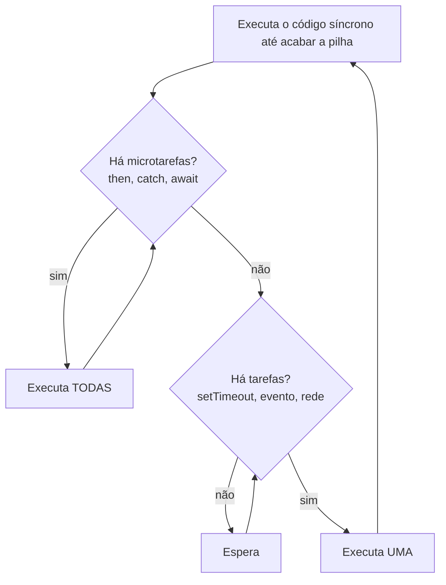

# J4.05 — Promises, `async`/`await` e `fetch`

> ⏱️ ~1h30 · 🟢 Júnior · Pré-requisitos: J4.04 (DOM e eventos), J2.02 (HTTP: status e headers), J2.04 (JSON, cookies, sessão)

## 🎯 Objetivos
Ao final desta aula você consegue:
- Explicar o **laço de eventos** (*event loop*) e prever a ordem de código síncrono, microtarefas (`Promise`) e tarefas (`setTimeout`).
- Escrever e ler código com **`Promise`**, `then`/`catch` e **`async`/`await`** com `try/catch/finally`.
- Chamar a API do PayFlow com **`fetch`** e tratar os três tipos de falha: **HTTP de erro** (404/401/500), **rede** e **tempo esgotado**.
- Escolher entre chamadas **em sequência**, **`Promise.all`** e **`Promise.allSettled`**.
- Explicar a **política de mesma origem** e o **CORS**, e reconhecer a mensagem de erro no console.

## 🤔 Por que isso importa
No navegador, **tudo que fala com o servidor é assíncrono**: a requisição leva tempo e a página não pode congelar esperando. Quase todo bug de front-end "estranho" (a tela mostra dado velho, o botão funciona duas vezes, o erro some em silêncio) vem de não entender essa espera. Para o dev Java, o paralelo é `CompletableFuture`; e o `fetch` é o `HttpClient` do navegador (J2.06) com uma pegadinha que aparece em toda entrevista: **o `fetch` não falha em HTTP 404 ou 500**.

## 💡 Intuição (explicação simples)
Você está em um **restaurante com um único garçom** (a thread do JavaScript). Ele anota seu pedido e **não fica parado na cozinha esperando**: leva o pedido, atende outras mesas e, quando a cozinha avisa que ficou pronto, entrega. A **Promise** é a **senha do pedido**: um compromisso de que "o prato virá, ou virá um aviso de que deu errado". `await` é "enquanto o meu pedido não chega, o garçom atende outras mesas; quando chegar, eu continuo daqui". As **microtarefas** são os recados urgentes colados na bancada: o garçom lê **todos** antes de pegar a próxima mesa nova.

## 🔬 Como funciona por dentro

### 1. O laço de eventos
JavaScript tem **uma pilha de execução** e **filas**. Depois de terminar o código atual, o motor esvazia as **microtarefas** (callbacks de Promise) e só então pega a próxima **tarefa** (timer, clique, resposta de rede).


Medimos no Node 22 (`docs/frontend-lab/05-async.mjs`):
```js
setTimeout(() => console.log('D: setTimeout 0 (tarefa)'), 0);
Promise.resolve().then(() => console.log('C: then (microtarefa)'));
(async () => { console.log('B: dentro da async, antes do await'); await null; console.log('C2: depois do await'); })();
console.log('A: fim do código síncrono');
```
```
B: dentro da async, antes do await
A: fim do código síncrono
C: then (microtarefa)
C2: depois do await
D: setTimeout 0 (tarefa)
```
Até o primeiro `await`, a função `async` roda **de forma síncrona** (por isso `B` vem antes de `A`); tudo depois do `await` vira microtarefa; `setTimeout(…, 0)` espera **todas** as microtarefas.

### 2. Promise e `async`/`await`
Uma **Promise** está em um de três estados: *pending* (pendente), *fulfilled* (cumprida, com valor) ou *rejected* (rejeitada, com erro).
```js
fetch(url)
  .then((response) => response.json())     // devolve OUTRA promise: encadeia
  .then((data) => console.log(data))
  .catch((error) => console.error(error)); // pega rejeição de qualquer elo acima
```
`async`/`await` é a mesma coisa com cara de código sequencial:
```js
async function load() {
  try {
    const response = await fetch(url);
    const data = await response.json();
    return data;
  } catch (error) {         // equivale ao .catch
    ...
  } finally {               // sempre roda (reabilitar botão, parar o "carregando")
    ...
  }
}
```
Uma função `async` **sempre devolve uma Promise**. `await` só funciona dentro de função `async` (ou no nível de módulo ES).

### 3. `fetch`: o que ele faz e o que NÃO faz
`fetch(url, opções)` devolve uma `Promise<Response>`. Pontos que geram bugs, **todos medidos** contra o PayFlow rodando (`05-async.mjs`):

| Situação | O que acontece | Saída real |
|---|---|---|
| HTTP 404/401/500 | A promise **cumpre**; olhe `response.ok` / `response.status` | `status=404 ok=false corpo={"error":"account not found"}` e `status=401 ok=false` |
| `.json()` em uma página HTML (ex.: redirecionou ao login) | `SyntaxError` | `SyntaxError: Unexpected token '<', "<!DOCTYPE "... is not valid JSON` |
| Servidor fora do ar / porta fechada | A promise **rejeita** com `TypeError` | `TypeError: fetch failed (causa: AggregateError, ECONNREFUSED)` (no navegador: `TypeError: Failed to fetch`) |
| Servidor lento | Espera **indefinidamente** (sem timeout por padrão) | com `AbortSignal.timeout(100)`: `TimeoutError: The operation was aborted due to timeout` |

Então o padrão correto é:
```js
const response = await fetch(url, { headers: { Accept: 'application/json' }, signal: AbortSignal.timeout(5000) });
if (response.status === 401) { window.location.assign('/login'); return; }   // sessão expirou
if (!response.ok) throw new Error(`HTTP ${response.status}`);                // transforma HTTP de erro em exceção
const data = await response.json();
```
- **Cookies:** por padrão (`credentials: 'same-origin'`), o `fetch` envia os cookies **só para a mesma origem**. É por isso que o `statement.js` funciona com a sessão `PAYFLOW_SESSION` (HttpOnly: o JavaScript **não lê** o cookie, mas o navegador o anexa, J2.04).
- **Dica de teste:** a porta 1 não serve para simular "porta fechada": o `fetch` bloqueia algumas portas e responde `bad port` sem tentar conectar. Usamos a porta 59999.

### 4. Várias chamadas: sequência × paralelo
Três chamadas a um servidor que demora 300 ms (medido):
```
em sequência: 909 ms        (await, await, await)
Promise.all    : 303 ms     (as três juntas)
allSettled     : fulfilled, rejected
```
- **`Promise.all([...])`**: espera todas; **rejeita na primeira falha** (as outras continuam, mas você perde os resultados).
- **`Promise.allSettled([...])`**: espera todas e devolve o status de cada uma; use quando falhas parciais são aceitáveis.
- Só use paralelo quando as chamadas são **independentes**; se a segunda precisa do resultado da primeira, a sequência é obrigatória.

### 5. Mesma origem e CORS
Uma **origem** é esquema + host + porta (`http://localhost:8080`). Por padrão, o JavaScript de uma página **não pode ler** respostas de outra origem. Isso protege o usuário: sem essa regra, uma página qualquer poderia usar a sua sessão para ler seu extrato em outra aba. O servidor pode **autorizar** outra origem com o header `Access-Control-Allow-Origin` (**CORS**, *Cross-Origin Resource Sharing*).

Reproduzimos: a página servida em `http://localhost:8081` chamando `fetch('http://localhost:8080/api/accounts/x/statement')` (outra **porta** = outra origem):
```
Access to fetch at 'http://localhost:8080/api/accounts/x/statement' from origin 'http://localhost:8081' has been blocked by CORS policy: No 'Access-Control-Allow-Origin' header is present on the requested resource.
TypeError: Failed to fetch
```
O erro **aparece no console**, mas o JavaScript só recebe um `TypeError: Failed to fetch` genérico. **O servidor recebeu e respondeu**; foi o navegador que impediu a leitura. Em desenvolvimento com um front-end separado (Angular/React em outra porta) isso é comum; a solução é configurar CORS **no servidor** (J6/J8) e **não** desligar a segurança do navegador. No PayFlow, a página e a API têm a mesma origem: sem CORS.

## 🛠️ Exemplo prático
Como o painel real só nasce na J4.06, usamos um **servidor de mentira** (`ApiStub`) que serve a pasta `web-prototype/` e responde a `/api/accounts/{id}/statement?page=N` com 12 lançamentos fixos (5 por página), mais três contas de teste: `…dead` devolve 500, `…5ec` devolve 401 e `…510e` demora 2 s. O código está em `docs/frontend-lab/ApiStub.java` (cerca de 70 linhas, usa `com.sun.net.httpserver` como na J2.06).

```bash
cd payflow
export JAVA_HOME=/usr/lib/jvm/java-25-openjdk-amd64      # ajuste ao seu JDK 25
$JAVA_HOME/bin/java docs/frontend-lab/ApiStub.java web-prototype
# ApiStub em http://localhost:8081 (pasta web-prototype)
curl -s 'localhost:8081/api/accounts/x/statement?page=2' | jq -c .
# {"page":2,"hasMore":false,"entries":[{"id":"e10",...},{"id":"e11",...}]}
```
Agora o `web-prototype/statement.js` **completo** (acrescenta o `fetch` ao `render` da J4.04):

```js
// Extrato: "Mais antigos" carrega a próxima página sem recarregar a tela (J4.04 e J4.05).
// Sem JavaScript, o link continua funcionando como navegação normal.
(() => {
  const link = document.querySelector('#load-more');
  const body = document.querySelector('#entries');
  const template = document.querySelector('#entry-row');
  const status = document.querySelector('#status');
  if (!link || !body || !template) return;

  const money = new Intl.NumberFormat('pt-BR', { style: 'currency', currency: 'BRL' });
  const when = new Intl.DateTimeFormat('pt-BR', {
    day: '2-digit', month: '2-digit', year: 'numeric',
    hour: '2-digit', minute: '2-digit', timeZone: 'America/Sao_Paulo',
  });

  const label = (entry) =>
    entry.transferId === null ? 'Depósito'
      : entry.type === 'CREDIT' ? 'Transferência recebida' : 'Transferência enviada';

  const render = (entry) => {
    const row = template.content.cloneNode(true);
    const [date, description, amount] = row.querySelectorAll('td');
    date.textContent = when.format(new Date(entry.createdAt)).replace(', ', ' ');
    description.textContent = label(entry);               // textContent: nunca innerHTML com dados do servidor
    const credit = entry.type === 'CREDIT';
    amount.textContent = (credit ? '+ ' : '− ') + money.format(Number(entry.amount)); // Number só para EXIBIR
    amount.classList.add(credit ? 'credit' : 'debit');
    return row;
  };

  let loading = false;
  link.addEventListener('click', async (event) => {
    event.preventDefault();
    if (loading) return;
    loading = true;
    link.setAttribute('aria-disabled', 'true');
    const page = Number(link.dataset.nextPage);
    try {
      const response = await fetch(`/api/accounts/${body.dataset.accountId}/statement?page=${page}`, {
        headers: { Accept: 'application/json' },
      });
      if (response.status === 401) { window.location.assign('/login'); return; }
      if (!response.ok) throw new Error(`HTTP ${response.status}`);
      const data = await response.json();
      data.entries.forEach((entry) => body.append(render(entry)));
      status.textContent = `${data.entries.length} lançamentos carregados.`;
      if (data.hasMore) {
        link.dataset.nextPage = String(page + 1);
      } else {
        link.remove();
      }
    } catch (error) {
      status.textContent = 'Não foi possível carregar mais lançamentos. Tente de novo.';
      console.error('load more failed', error);
    } finally {
      loading = false;
      link.removeAttribute('aria-disabled');
    }
  });
})();
```
Para o JavaScript funcionar, `statement.html` precisa de: `<tbody id="entries" data-account-id="...">`, `<a id="load-more" href="statement.html?page=1" data-next-page="1">Mais antigos</a>`, `<p id="status" class="sr-only" role="status" aria-live="polite"></p>` e o `<template id="entry-row">` da J4.04. Carregue com `<script src="statement.js" defer></script>`. (A classe `sr-only`, que esconde o `status` da tela mas o mantém audível para leitores de tela, é definida na J4.08; até lá a mensagem fica visível, o que ajuda a testar.)

**Cenários medidos** (Chrome 156 automatizado contra o `ApiStub`):
```
ok (1º clique)        : linhas 5 -> 10 | status="5 lançamentos carregados." | link presente
ok (2º clique)        : linhas 12 | link removido | último: 17/01/2026 09:00 | Transferência enviada | − R$ 21,50
erro 500              : linhas 5 -> 5 | status="Não foi possível carregar mais lançamentos. Tente de novo." | link presente
sessão expirada (401) : navegou para /login
clique duplo + API lenta (2 s): linhas 10 (uma só carga)
console: error: load more failed Error: HTTP 500
```
Perceba os cuidados: (1) `loading` impede cargas duplicadas; (2) `finally` **sempre** reabilita o link; (3) o erro vai para o usuário (`status`, lido por leitores de tela por causa do `aria-live`) **e** para o console (para quem depura); (4) o link `href` real continua funcionando **sem JavaScript** (*aprimoramento progressivo*).

## 🧠 Pausa para lógica
Prevendo a saída, o que este código imprime e em que ordem? Depois, por que o `then` do 404 **não** cai no `catch`?
```js
console.log(1);
setTimeout(() => console.log(2), 0);
fetch('/api/accounts/inexistente/statement')
  .then((r) => { console.log(3, r.status); return r.json(); })
  .then(() => console.log(4))
  .catch(() => console.log(5));
Promise.resolve().then(() => console.log(6));
console.log(7);
```
<details><summary>Dica e solução</summary>

Dica: o `fetch` precisa da rede (tarefa), o `Promise.resolve().then` é microtarefa. Solução: `1`, `7` (síncronos), `6` (microtarefa), `2` (tarefa do timer), e quando a resposta chega: `3 404` e, se o corpo não for JSON válido, `5`; se for JSON (como o `{"error":"..."}` do PayFlow), `4`. O `404` **não rejeita** a promise do `fetch`: ela cumpre com `response.ok === false`; só **falha de rede** rejeita. Por isso é preciso o `if (!response.ok) throw ...`. (A ordem de `2` e de `3` depende do tempo da rede; o `1 7 6` é garantido.)
</details>

## ⚠️ Erros comuns e boas práticas de produção
- **Achar que o `fetch` falha em 404/500:** o `catch` não é chamado; confira `response.ok`.
- **`SyntaxError: Unexpected token '<'`:** você pediu JSON e recebeu HTML (redirecionamento ao login, página de erro). Confira `response.status` e o `Content-Type` antes de `.json()`.
- **`TypeError: Failed to fetch` com um erro de CORS no console:** é o navegador bloqueando a leitura (origens diferentes). Conserte no servidor, não no navegador. Se **não** houver erro de CORS, o servidor está fora do ar ou a URL está errada.
- **`await` dentro de `forEach`:** o `forEach` ignora promises. Use `for...of` (sequência) ou `Promise.all(array.map(async ...))` (paralelo).
- **Esquecer o `await`:** `const data = fetch(...)` guarda uma **Promise**, não os dados (`Promise { <pending> }` no console).
- **Sem estado de carregamento nem tratamento de erro:** o botão "não responde" quando o servidor demora; trate `loading`, erro e vazio.
- **Concatenar dados do usuário na URL sem `encodeURIComponent`:** quebra a consulta (`&`, `#`, espaço) e abre brecha de injeção de parâmetros.
- **Cache do navegador em dados de saldo:** `GET` de dados voláteis precisa de `Cache-Control` adequado no servidor (J6).
- **Desligar a segurança do Chrome** (`--disable-web-security`) para "resolver" CORS: nunca.

## 🧩 Exercícios
1. **Fixação:** (a) por que `fetch` a uma URL que devolve 500 **não** cai no `catch`? (b) qual a ordem entre `console.log` síncrono, `then` e `setTimeout(0)`? (c) quando usar `Promise.all` e quando `allSettled`? (d) o que é uma origem e por que a porta conta?
2. **Aplicação no PayFlow:**
   - [ ] `statement.js` completo conforme esta aula, com `link`/`body`/`template`/`status` e o guarda `loading`.
   - [ ] `ApiStub` rodando e `statement.html` carregando mais linhas até o link sumir (12 linhas no total).
   - [ ] Tratamento de **três** falhas verificado à mão: HTTP 500 (conta `…dead`), 401 (conta `…5ec`) e API lenta (`…510e`) com clique duplo (uma só carga).
   - [ ] Mensagem de erro em um elemento com `role="status"` e `aria-live="polite"`.
   - [ ] Dinheiro e datas só **formatados** no cliente; valores continuam strings até a exibição.
   - [ ] Você reproduziu o erro de CORS (página em `localhost:8081` chamando `localhost:8080`) e anotou a mensagem.
   - [ ] Commit: `feat(web): load more statement entries with fetch and handle failures`.
3. **Desafio (opcional):** adicione um **timeout de 5 s** (`AbortSignal.timeout`) e uma **nova tentativa** (1 retry, só para falhas de rede ou `5xx`, **nunca** para `4xx`). Teste com a conta `…510e` reduzindo o timeout para 1 s.

<details><summary>Soluções de referência</summary>

1. (a) O `fetch` só rejeita quando não consegue obter **uma resposta HTTP** (rede, DNS, CORS, abortado). Um 500 **é** uma resposta; use `response.ok`. (b) Síncrono → microtarefas (`then`, depois do `await`) → tarefas (`setTimeout`, eventos, respostas de rede). (c) `all` quando **todas** são necessárias e uma falha invalida o conjunto; `allSettled` quando falhas parciais são aceitáveis e você quer o resultado de cada uma. (d) Esquema + host + **porta**; portas diferentes são origens diferentes, então `:8081` lendo `:8080` é *cross-origin*.
3. Esboço (não executado): trocar a chamada por `fetch(url, { signal: AbortSignal.timeout(5000), ... })` e envolver em um laço `for (let attempt = 0; attempt < 2; attempt++)`, repetindo apenas quando `error.name === 'TimeoutError'`, `error instanceof TypeError` ou `response.status >= 500`.
</details>

## 🎤 Na entrevista
- **O que é uma Promise?** Um objeto que representa o resultado futuro de uma operação assíncrona, em um dos estados pendente, cumprida ou rejeitada; permite encadear (`then`) e tratar erros (`catch`).
- **`async`/`await` bloqueia o programa?** Não. Suspende **aquela função** e devolve o controle ao laço de eventos; o resto da página continua responsiva.
- **O `fetch` rejeita em HTTP 404?** Não; só rejeita em falha de rede. É preciso checar `response.ok`/`status`.
- **O que é CORS e por que existe?** Um mecanismo do navegador que, por padrão, impede páginas de ler respostas de outra origem; o servidor pode autorizar origens específicas por headers. Protege o usuário, não o servidor.
- **Como o JavaScript, sendo single-thread, atende várias coisas "ao mesmo tempo"?** Por meio do laço de eventos: operações de rede e timers rodam fora da thread JS, e seus callbacks entram em filas executadas quando a pilha esvazia.

## 📚 Para ir além
- 📄 [MDN — Using the Fetch API](https://developer.mozilla.org/en-US/docs/Web/API/Fetch_API/Using_Fetch): o guia oficial do `fetch`, com `ok`, cabeçalhos, credenciais e erros.
- 📄 [MDN — How to use promises](https://developer.mozilla.org/en-US/docs/Learn_web_development/Extensions/Async_JS/Promises): tutorial de Promises, com `Promise.all` e encadeamento.
- 📄 [MDN — `async` function](https://developer.mozilla.org/en-US/docs/Web/JavaScript/Reference/Statements/async_function): referência de `async`/`await`.
- 📄 [MDN — The event loop](https://developer.mozilla.org/en-US/docs/Web/JavaScript/Event_loop): filas, microtarefas e execução até o fim.
- 📄 [MDN — `AbortSignal.timeout()`](https://developer.mozilla.org/en-US/docs/Web/API/AbortSignal/timeout_static): como colocar prazo em um `fetch`.
- 📄 [MDN — Cross-Origin Resource Sharing (CORS)](https://developer.mozilla.org/en-US/docs/Web/HTTP/Guides/CORS): origens, *preflight* e os headers `Access-Control-*`.
- 🎥 ⚠️ Nenhum vídeo verificado nesta execução.

## ✅ Checklist da aula
- [ ] Prevejo a ordem síncrono → microtarefa → tarefa.
- [ ] Sei os três tipos de falha do `fetch` e como cada um aparece.
- [ ] `statement.js` completo funcionando contra o `ApiStub`.
- [ ] Reproduzi o erro de CORS e sei por que não "conserto" no navegador.
- [ ] Sei quando usar `Promise.all` × `allSettled`.
