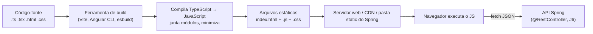

# J4.07 — Visão de Angular, React e TypeScript

> ⏱️ ~1h30 · 🟢 Júnior · Pré-requisitos: J4.04 e J4.05 (JavaScript, DOM, `fetch`), J4.06 (renderização no servidor)

## 🎯 Objetivos
Ao final desta aula você consegue:
- Explicar o que é uma **SPA** (*Single Page Application*), o que o **Node/npm** e um **bundler** fazem e por que times Java costumam ter um front-end separado.
- Ler **TypeScript** simples (`interface`, tipos união, `string | null`) e entender o que o compilador pega e o que ele **não** pega.
- Ler um **componente React** (função, JSX, `props`, `useState`, `useEffect`) e um **componente Angular** (`@Component`, *template*, `signal`, `inject`, `@for`/`@if`).
- Comparar React e Angular com conceitos que você já conhece do Spring (injeção de dependência, opinião vs. liberdade).
- Decidir, com argumentos, **onde o PayFlow usa SSR** e **onde faria uma SPA**, e registrar a decisão em um ADR.

## 🤔 Por que isso importa
Em vagas Java, a pergunta "você já mexeu com front-end?" quase sempre significa **Angular ou React** conversando com a sua API Spring. Você não precisa ser especialista: precisa **conversar** (entender os termos, ler um componente, saber o que o front espera da API) e **desenhar APIs que o front consiga consumir** (contratos estáveis, erros claros, CORS, paginação). Também precisa saber quando uma SPA **não** vale o custo: uma tela de extrato com um botão "carregar mais" não precisa de 200 MB de `node_modules`.

## 💡 Intuição (explicação simples)
Na J4.06 o servidor entregava **a casa montada** (HTML pronto). Em uma **SPA**, o servidor entrega o **kit de montagem**: uma página quase vazia, um pacote de JavaScript (as peças e o manual) e uma **API** (o depósito de materiais, o JSON). O navegador monta a casa. **Componentes** são peças de LEGO: um `StatementTable` recebe o id da conta, busca os dados, guarda "o que mostrar agora" (**estado**) e, quando o estado muda, o framework **refaz só a parte da tela afetada**. **TypeScript** é o JavaScript com **etiquetas de tipo**: antes de rodar, um revisor confere se você está encaixando a peça certa.

## 🔬 Como funciona por dentro

### 1. O ecossistema: Node, npm e bundler

- **Node.js** roda JavaScript fora do navegador; é a base das ferramentas de build. **npm** é o gerenciador de pacotes (equivale ao Maven: `package.json` ≈ `pom.xml`, `node_modules` ≈ `~/.m2`, `package-lock.json` ≈ a versão exata de cada dependência).
- O build produz **arquivos estáticos**. Em um time Java, eles são servidos de um **servidor/CDN separado** (o mais comum) ou copiados para `src/main/resources/static` do Spring Boot.
- Em desenvolvimento, o front roda em outra porta (por exemplo `localhost:5173` ou `4200`) e chama a API em `localhost:8080`: **outra origem** → **CORS** (J4.05). A saída é um **proxy de desenvolvimento** (o servidor do front repassa `/api/*` para o 8080) ou configurar CORS no servidor (J6/J8).

### 2. TypeScript
TypeScript é um **superconjunto** do JavaScript com **tipos estáticos**. O compilador confere os tipos e **apaga** todos eles: o que roda no navegador é JavaScript comum. Por isso o TypeScript pega erros de **uso** (propriedade errada, tipo trocado) mas **não valida** o JSON que chega da rede.

O contrato do **extrato do PayFlow** descrito como tipos (`types.ts`):
```ts
export type EntryType = 'CREDIT' | 'DEBIT';

export interface StatementEntry {
  id: string;
  type: EntryType;
  transferId: string | null;   // null = depósito
  amount: string;              // dinheiro como string (decisão do PayFlow)
  createdAt: string;           // ISO-8601 UTC
}

export interface StatementPage {
  page: number;
  hasMore: boolean;
  entries: StatementEntry[];
}
```
Equivalem a **records e enums** do Java: `interface` ≈ `record` (só a forma), `'CREDIT' | 'DEBIT'` ≈ `enum`/*sealed*, `string | null` ≈ `Optional<String>`/`@Nullable`. O **compilador** (`tsc 7.0.2`) rejeita, com mensagens claras (testado):
```ts
const e: StatementEntry = { id: 'x', type: 'REFUND', transferId: null, amount: 10, createdAt: '2026-01-01T00:00:00Z' };
console.log(e.amout);
```
```text
src/bad.ts(2,38): error TS2322: Type '"REFUND"' is not assignable to type 'EntryType'.
src/bad.ts(2,72): error TS2322: Type 'number' is not assignable to type 'string'.
src/bad.ts(3,15): error TS2551: Property 'amout' does not exist on type 'StatementEntry'. Did you mean 'amount'?
```
Note o segundo erro: `amount: 10` falha porque o contrato diz **string** (dinheiro). O TypeScript ajuda a **manter a regra do PayFlow**. Mas:
```ts
return (await response.json()) as StatementPage;   // "as" é uma PROMESSA ao compilador, não uma validação
```
Se a API mandar `amount: 10` (número), o `as` não reclama e o erro só aparece em execução. Contratos **vivos** entre Java e front vêm de **OpenAPI** (J6), que pode **gerar** esses tipos.

### 3. React (biblioteca): componentes como funções
React 19 (versão `19.3.1` do npm em 2026-11-13). Um componente é uma **função** que recebe `props` e devolve **JSX** (HTML dentro do JavaScript). O estado fica em **hooks**:

`StatementTable.tsx` (compilado com `tsc` e renderizado no servidor Node, testado):
```tsx
import { useEffect, useState } from 'react';
import { fetchStatement } from './api';
import type { StatementEntry } from './types';

const money = new Intl.NumberFormat('pt-BR', { style: 'currency', currency: 'BRL' });

function label(entry: StatementEntry): string {
  if (entry.transferId === null) return 'Depósito';
  return entry.type === 'CREDIT' ? 'Transferência recebida' : 'Transferência enviada';
}

export function StatementTable({ accountId }: { accountId: string }) {
  const [entries, setEntries] = useState<StatementEntry[]>([]);
  const [page, setPage] = useState(0);
  const [hasMore, setHasMore] = useState(true);
  const [error, setError] = useState<string | null>(null);

  useEffect(() => {
    fetchStatement(accountId, page)
      .then((data) => {
        setEntries((previous) => [...previous, ...data.entries]);
        setHasMore(data.hasMore);
      })
      .catch((e: Error) => setError(e.message));
  }, [accountId, page]);

  if (error) return <p role="alert">Não foi possível carregar o extrato ({error}).</p>;

  return (
    <>
      <table>
        <caption>Lançamentos</caption>
        <tbody>
          {entries.map((entry) => (
            <tr key={entry.id}>
              <td>{label(entry)}</td>
              <td className={entry.type === 'CREDIT' ? 'credit' : 'debit'}>
                {money.format(Number(entry.amount))}
              </td>
            </tr>
          ))}
        </tbody>
      </table>
      {hasMore && <button onClick={() => setPage(page + 1)}>Mais antigos</button>}
    </>
  );
}
```
Como ler:
- `{ accountId }: { accountId: string }` → **props** tipadas (os "parâmetros" do componente).
- `useState(x)` devolve `[valor, funçãoParaMudar]`. **Mudar o estado** (`setPage`) faz o React **chamar a função de novo** e atualizar o DOM só onde mudou.
- `useEffect(fn, [dependências])` roda **depois** de desenhar, e **de novo quando uma dependência muda** (aqui, `accountId` ou `page`): é onde vai o `fetch`.
- `{entries.map(... <tr key=...>)}` ≈ `th:each`; `key` identifica cada linha para o React reaproveitar o DOM.
- `{hasMore && <button>}` ≈ `th:if`. O JSX **escapa** o texto por padrão (como o `th:text`); `dangerouslySetInnerHTML` é o `th:utext`/`innerHTML` do React, com o nome certo.
- A mesma lógica de `label` e `money.format` que escrevemos em JavaScript puro na J4.04, agora em componente.

Renderizamos o componente no servidor com `react-dom/server` (sem `useEffect`, só a primeira passada):
```html
<table><caption>Lançamentos</caption><tbody></tbody></table><button>Mais antigos</button>
```
Tabela **vazia** e botão: é o estado inicial (`entries = []`, `hasMore = true`) antes de o `fetch` terminar.

### 4. Angular (framework): componentes + injeção de dependência
Angular 22 (`@angular/core` `22.2.6` no npm). É um **framework completo** e opinativo: roteamento, formulários, cliente HTTP, injeção de dependência e build (Angular CLI) vêm no pacote, e o código é **TypeScript** com decoradores (como as anotações do Spring).

`statement.component.ts` (compilado com o compilador do Angular com `strictTemplates`, testado):
```ts
import { Component, inject, input, signal } from '@angular/core';
import { CurrencyPipe } from '@angular/common';
import { HttpClient } from '@angular/common/http';

interface StatementEntry { id: string; type: 'CREDIT' | 'DEBIT'; transferId: string | null; amount: string; createdAt: string; }
interface StatementPage { page: number; hasMore: boolean; entries: StatementEntry[]; }

@Component({
  selector: 'app-statement',
  imports: [CurrencyPipe],
  template: `
    <table>
      <caption>Lançamentos</caption>
      <tbody>
        @for (entry of entries(); track entry.id) {
          <tr>
            <td>{{ entry.transferId === null ? 'Depósito' : 'Transferência' }}</td>
            <td [class.credit]="entry.type === 'CREDIT'">
              {{ entry.amount | currency: 'BRL' : 'symbol' : '1.2-2' : 'pt-BR' }}
            </td>
          </tr>
        } @empty {
          <tr><td colspan="2">Nenhum lançamento.</td></tr>
        }
      </tbody>
    </table>
    @if (hasMore()) {
      <button type="button" (click)="loadMore()">Mais antigos</button>
    }
  `,
})
export class StatementComponent {
  accountId = input.required<string>();            // entrada do componente (signal)
  private http = inject(HttpClient);                // injeção de dependência, como no Spring
  entries = signal<StatementEntry[]>([]);
  hasMore = signal(true);
  private page = 0;

  loadMore(): void {
    this.http.get<StatementPage>(`/api/accounts/${this.accountId()}/statement?page=${this.page}`)
      .subscribe((data) => {
        this.entries.update((current) => [...current, ...data.entries]);
        this.hasMore.set(data.hasMore);
        this.page++;
      });
  }
}
```
Como ler:
- `@Component({ selector, template, imports })` ≈ `@Component` do Spring + a "view": o **template** é HTML com `{{ }}` (valor), `[class.credit]="..."` (ligação de propriedade), `(click)="..."` (evento) e `@for`/`@if`/`@empty` (controle de fluxo; ≈ `th:each`/`th:if`).
- `signal(valor)` guarda estado; `entries()` **lê** e `entries.update(...)`/`set(...)` **escreve**; a tela atualiza sozinha.
- `inject(HttpClient)` é **injeção de dependência** (J5 mostra a do Spring): o framework entrega o cliente HTTP pronto.
- `| currency: ...` é um **pipe** (formatador no template).
- Com `strictTemplates`, o compilador **confere o template contra o TypeScript**: trocamos `transferId` por `transferID` e ele recusou (testado): `error TS2551: Property 'transferID' does not exist on type 'StatementEntry'. Did you mean 'transferId'?`

### 5. Comparando
| | **React** | **Angular** | **Thymeleaf + JS pontual (PayFlow)** |
|---|---|---|---|
| Natureza | Biblioteca de UI (você escolhe o resto) | Framework completo e opinativo | Motor de templates no servidor |
| Linguagem | JS/TS + JSX | TypeScript + templates | Java + HTML + um pouco de JS |
| Estado | Hooks (`useState`) | Signals (`signal`) | Sessão e banco no servidor |
| Injeção de dependência | Não nativa (contexto, módulos) | Nativa (`inject`) | A do Spring, na J5 |
| Curva de aprendizado | Menor para começar, mais decisões depois | Maior no início, mais padronizado | A menor para quem já sabe Java |
| Perfil típico | Startups, produtos, times mistos | Empresas grandes e corporativas | Sistemas internos, páginas simples |
Como analogia: **Angular está para o front-end como o Spring está para o back-end** (conjunto integrado e convenções); **React está mais para uma biblioteca** que você combina com roteamento, dados e formulários de sua escolha. Nenhum é "o certo": o time e o produto decidem.

### 6. Versões e o que a ferramenta exigiu (2026-11-13)
| Ferramenta | Versão | Fonte |
|---|---|---|
| React / React DOM | 19.3.1 | `npm view react version` |
| Angular (`@angular/core`) / CLI | 22.2.6 / 22.2.7 | `npm view @angular/core version` |
| TypeScript | 7.0.2 (o compilador do Angular 22 declara `typescript >=6.0 <6.1`) | `npm view typescript version`, `npm view @angular/compiler-cli@22.2.6 peerDependencies` |
| Node.js exigido pelo Angular 22 | `^22.22.3 \|\| ^24.15.0 \|\| >=26.0.0` | `npm view @angular/core@22.2.6 engines` |
**O que aconteceu aqui:** na máquina do curso (Node 22.22.1), o `ng new` do Angular CLI 22.2.7 **recusou** executar: `The Angular CLI requires a minimum Node.js version of v22.22.3 or v24.15.0 or v26.0.0.` Lição prática: **a versão do Node importa**; use um gerenciador de versões do Node (como nvm ou fnm) e leia o campo `engines`. Para validar o exemplo sem o CLI, rodamos só o compilador (`ngc`) com TypeScript 6.0.

## 🛠️ Exemplo prático
Vamos **ler e verificar** o código, sem construir um app (o curso é de Java). Crie uma pasta de laboratório (precisa de Node 22+):
```bash
mkdir -p docs/frontend-lab/react-ts/src && cd docs/frontend-lab/react-ts
npm init -y
npm i react@19.3.1 react-dom@19.3.1 typescript@7.0.2 esbuild@0.28.2 @types/react @types/react-dom @types/node
```
Crie `src/types.ts`, `src/api.ts` e `src/StatementTable.tsx` com o código desta aula; `src/api.ts` é:
```ts
import type { StatementPage } from './types';

export async function fetchStatement(accountId: string, page: number): Promise<StatementPage> {
  const response = await fetch(`/api/accounts/${accountId}/statement?page=${page}`, {
    headers: { Accept: 'application/json' },
  });
  if (!response.ok) {
    throw new Error(`HTTP ${response.status}`);
  }
  return (await response.json()) as StatementPage;   // "as" é uma promessa ao compilador, não uma validação
}
```
`tsconfig.json`:
```json
{
  "compilerOptions": {
    "target": "ES2022", "module": "ESNext", "moduleResolution": "Bundler",
    "jsx": "react-jsx", "strict": true, "noEmit": true, "skipLibCheck": true, "types": ["node"]
  },
  "include": ["src"]
}
```
Verifique os tipos e renderize o componente (um `src/ssr.tsx` com `renderToStaticMarkup`):
```bash
npx tsc -p .                  # sem saída = sem erros de tipo (exit 0)
# src/ssr.tsx:
#   import { renderToStaticMarkup } from 'react-dom/server';
#   import { StatementTable } from './StatementTable';
#   console.log(renderToStaticMarkup(<StatementTable accountId="20000000-0000-0000-0000-000000000001" />));
npx esbuild src/ssr.tsx --bundle --platform=node --outfile=out.js --log-level=warning && node out.js
# <table><caption>Lançamentos</caption><tbody></tbody></table><button>Mais antigos</button>
```
Provoque os erros do `bad.ts` mostrado na seção 2 e leia as mensagens do `tsc`. **Não** versionar `node_modules` (adicione `node_modules/` e `out.js` ao `.gitignore`).

### Decisão do PayFlow (ADR 0005)
O painel continua **SSR com Thymeleaf + JavaScript pontual**; o registro está em `projeto/adrs/0005-front-end-ssr-com-thymeleaf.md`. A API JSON (`/api/accounts/{id}/statement`) é **desenhada como contrato estável** para que, se um dia houver Angular/React, o back-end **não mude**.

## 🏗️ Estudo de caso
**Cenário:** o produto pede para o PayFlow "ter app no celular e painel web rico, com atualização em tempo real do saldo". O time tem 4 pessoas, todas de Java. Qual a arquitetura de front-end?

<details><summary>Dica e solução</summary>

Dica: separe **o que o produto exige** do **que o time sabe fazer bem**. Solução (uma possível): (1) o **contrato da API** vem primeiro (OpenAPI, J6), porque o app de celular e qualquer painel rico vão consumi-lo; (2) painel web rico → **SPA** (Angular, se a empresa já usa; React, se a contratação favorece) em repositório separado, servida por CDN, falando com a API, e **CORS/proxy** resolvidos; (3) "tempo real" é um requisito de **servidor** (WebSocket/SSE, P3), não de framework; (4) o painel interno administrativo simples continua em **Thymeleaf**; (5) **não** reescrever o que já funciona só por moda; (6) custo: dois ciclos de build e deploy, tipos compartilhados via OpenAPI, segurança do token no navegador (J8). Registrar em ADR com as consequências (mais um repositório, mais habilidades necessárias no time).
</details>

## ⚖️ Trade-offs e quando NÃO usar
- **SPA quando:** muita interatividade (editor, painel em tempo real, arrastar e soltar), um **mesmo back-end** para web e celular, times de front-end dedicados.
- **SPA quando NÃO:** páginas de leitura e formulários simples, equipe pequena sem front-end, necessidade de SEO e de primeira pintura rápida (SPAs puras podem exigir renderização no servidor, que aumenta a complexidade), ambiente que não aceita a cadeia de build.
- **Custos escondidos de uma SPA:** dois deploys, duas formas de autenticação (token no navegador, J8), CORS, duplicação de regras de formatação e validação, dependências npm (cadeia de suprimentos), versionamento de contrato.
- **SSR quando:** conteúdo e regras no servidor, funcionamento sem JS, equipe de Java.

## ⚠️ Erros comuns e boas práticas de produção
- **Versão do Node incompatível:** `The Angular CLI requires a minimum Node.js version...` (visto aqui). Leia `engines` e use um gerenciador de versões.
- **`TS2322: Type 'X' is not assignable to type 'Y'`:** o tipo declarado e o valor divergem; é o compilador funcionando. Não "resolva" com `any` nem com `as` sem pensar: você apaga a proteção.
- **`as StatementPage` em `response.json()`:** promessa, não validação; um contrato quebrado só aparece em execução. Valide (ou gere os tipos de OpenAPI) em integrações críticas.
- **`Access to fetch ... has been blocked by CORS policy`:** front e API em origens diferentes (J4.05). Proxy de desenvolvimento ou CORS no servidor; nunca desligar a segurança do navegador.
- **Colocar segredos em variáveis do front:** tudo que vai no bundle é **público** (chave de API, senha, token de serviço).
- **`node_modules` no Git, `package-lock.json` ignorado:** builds não reprodutíveis. Versione o *lock*, ignore `node_modules`.
- **Dependências sem critério:** um `npm i` pode trazer centenas de pacotes transitivos; olhe a necessidade, a manutenção e `npm audit` (J8).
- **Dinheiro como `number` no contrato TypeScript:** perde precisão; mantenha `string` (decisão 11) e formate só na exibição.
- **Reescrever o que funciona:** trocar SSR por SPA sem requisito é custo, não evolução.

## 🧩 Exercícios
1. **Fixação:** (a) o que o TypeScript faz com os tipos em tempo de execução? (b) o que `useEffect(fn, [accountId, page])` garante? (c) qual a diferença conceitual entre React e Angular? (d) por que `as StatementPage` não protege contra um contrato quebrado?
2. **Aplicação no PayFlow:**
   - [ ] Pasta `docs/frontend-lab/react-ts` com `types.ts`, `api.ts`, `StatementTable.tsx`, `ssr.tsx` e `tsconfig.json`; `npx tsc -p .` sem erros e a saída `<table>...<button>Mais antigos</button>` reproduzida.
   - [ ] Um `bad.ts` provocando os 3 erros do `tsc` (tipo da união, `number` no lugar de `string`, propriedade com erro de digitação).
   - [ ] `docs/frontend-notes.md` com: (1) a tabela SSR × SPA aplicada ao PayFlow, (2) o contrato do extrato como tipos TypeScript, (3) o que **mudaria no back-end** se o front virasse Angular/React (CORS, autenticação por token, OpenAPI), em 10 linhas no máximo.
   - [ ] `projeto/adrs/0005-front-end-ssr-com-thymeleaf.md` no formato dos ADRs anteriores (contexto, opções, decisão, consequências) e linha nova em `projeto/adrs/README.md`.
   - [ ] `node_modules/` e `out.js` no `.gitignore`.
   - [ ] Commit: `docs(web): add front-end notes, TypeScript contract lab and ADR 0005`.
3. **Desafio (opcional):** reescreva o **trecho do "Mais antigos"** com o componente React acima, em uma página servida pelo `PayflowServer` (bundle com `esbuild --bundle --format=esm`, copiado para `static/`; o servidor só aceita `.css` e `.js` com nomes `[a-z0-9.-]+`). Compare: linhas de código, dependências e o que acontece com o JavaScript desligado.

<details><summary>Soluções de referência</summary>

1. (a) Nada: os tipos são **apagados** na compilação; só existem para o compilador e o editor. (b) Que o efeito roda depois da renderização e **de novo apenas quando** `accountId` ou `page` mudam. (c) React é uma **biblioteca** de interface (liberdade e decisões suas); Angular é um **framework** completo (DI, roteamento, formulários e CLI integrados, com convenções). (d) `as` só diz ao compilador "confie em mim"; nenhum código verifica o JSON recebido.
2. Os comandos e as saídas estão na seção "Exemplo prático". O ADR 0005 do PayFlow está pronto no repositório do curso (`projeto/adrs/`) para comparar com o seu.
3. Esboço (não executado): `createRoot(document.querySelector('#statement-root')).render(<StatementTable accountId={...} />)`; espere mais dependências e um `package.json`, e **nenhum** extrato com JavaScript desligado (em contraste com o link `?page=1` do SSR).
</details>

## 🎤 Na entrevista
- **O que é uma SPA?** Uma aplicação cujo navegador baixa uma página e um pacote de JavaScript uma vez, e depois troca as telas **sem recarregar**, buscando dados de uma API.
- **React ou Angular?** React é uma biblioteca de UI flexível; Angular é um framework completo e opinativo com TypeScript, DI e CLI. Escolho pelo time, pelo produto e pelo ecossistema da empresa.
- **O que o TypeScript traz?** Verificação estática de tipos, melhor autocompletar e refatoração segura; os tipos somem na compilação e não validam dados em execução.
- **Como o back-end Java se relaciona com um front Angular/React?** Pela API (REST/JSON), com contrato documentado (OpenAPI), CORS configurado, autenticação por token/sessão, paginação e erros padronizados (Problem Details).
- **Quando você NÃO faria uma SPA?** Páginas simples e orientadas a conteúdo, equipe sem front-end, necessidade de funcionar sem JS ou de primeira tela rápida e simples.

## 📚 Para ir além
- 📄 [Angular — What is Angular?](https://angular.dev/overview): a visão geral oficial do framework.
- 📄 [Angular — Components (essentials)](https://angular.dev/essentials/components): o que é um componente, `@Component`, `template` e `imports`.
- 📄 [React — Learn](https://react.dev/learn): o curso oficial de React, interativo.
- 📄 [React — Using TypeScript](https://react.dev/learn/typescript): como tipar `props` e `useState`.
- 📄 [TypeScript — Handbook](https://www.typescriptlang.org/docs/handbook/intro.html): a documentação oficial; leia "The Basics" e "Everyday Types".
- 📄 [MDN — Cross-Origin Resource Sharing (CORS)](https://developer.mozilla.org/en-US/docs/Web/HTTP/Guides/CORS): o que o seu back-end precisa configurar para um front em outra origem.
- 🎥 ⚠️ Nenhum vídeo verificado nesta execução.

## ✅ Checklist da aula
- [ ] Sei desenhar o caminho código-fonte → build → arquivos estáticos → navegador → API.
- [ ] Leio os tipos de `types.ts` e explico o que `string | null` e a união de strings significam.
- [ ] Rodei `tsc` e vi os 3 erros de propósito.
- [ ] Leio o componente React e o Angular e aponto onde estão estado, efeito/serviço e template.
- [ ] `docs/frontend-notes.md` e o ADR 0005 escritos.
