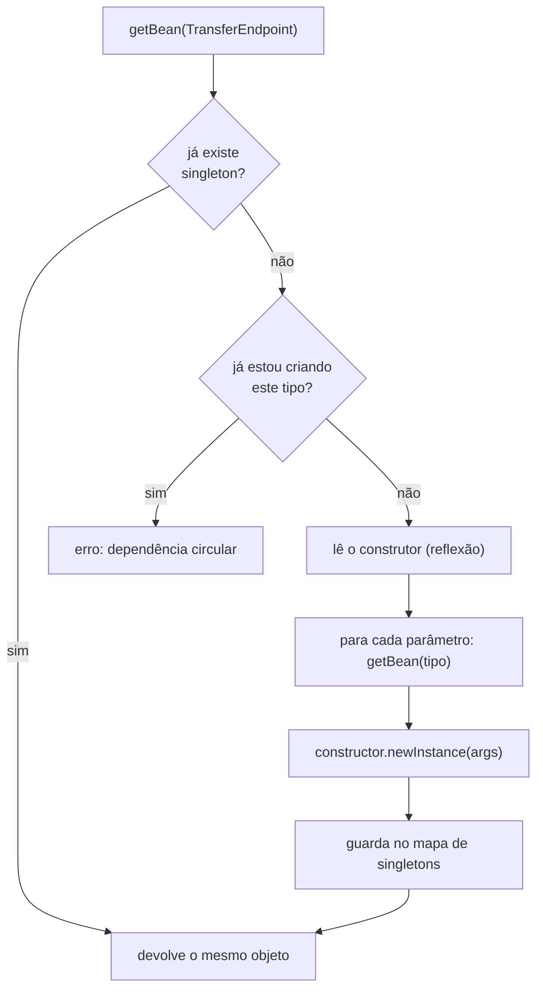

# J5.01 — Inversão de controle e injeção de dependência (mini-container à mão)

> ⏱️ ~1h30 · 🟢 Júnior · Pré-requisitos: J1.06–J1.07 (polimorfismo, interfaces, composição e injeção pelo construtor), J1.09 (exceções), J0.02 (rodar Java pela linha de comando)

## 🎯 Objetivos
Ao final desta aula você consegue:
- Explicar **inversão de controle** (IoC) e **injeção de dependência** (DI) com suas próprias palavras e dizer o que **o contêiner** faz que você faria à mão.
- Reconhecer o acoplamento de uma classe que usa `new` para criar suas dependências e **refatorá-la** para receber as dependências pelo construtor.
- Escrever um **mini-contêiner** de ~50 linhas que registra classes, lê o construtor por **reflexão**, cria as dependências **recursivamente** e guarda **singletons**.
- Diagnosticar os três erros clássicos de um contêiner: **bean ausente**, **candidatos demais** e **dependência circular**.
- Testar um *service* sem contêiner nenhum, passando dublês pelo construtor.

## 🤔 Por que isso importa
Toda vaga Java com Spring pressupõe que você entende o que significa "o Spring injeta isso". Quem decora `@Autowired` sem saber o que acontece por baixo trava na primeira mensagem de erro do tipo `NoSuchBeanDefinitionException` ou `UnsatisfiedDependencyException` (você vai vê-las na J5.03). Quem construiu um contêiner pequeno **lê** essas mensagens como diagnóstico, não como mistério. Este é o motivo de começar o módulo **sem Spring**.

## 💡 Intuição (explicação simples)
Um restaurante. No restaurante A, o chef **planta a horta, cria as galinhas e compra o gás** antes de cozinhar: quer trocar o fornecedor de ovos? Reforma a cozinha inteira, e para treinar um chef novo é preciso ter horta de verdade. No restaurante B, o chef **recebe os ingredientes prontos** na bancada e só cozinha. Quem monta a bancada é o **gerente** (o contêiner). O chef continua sendo dono da receita; só perdeu o **controle** sobre de onde vêm os ingredientes. Essa troca de quem controla é a **inversão de controle**; entregar os ingredientes pela bancada é a **injeção de dependência**.

## 🔬 Como funciona por dentro

### 1. O problema: `new` por toda parte
```java
class TransferService {
    private final AccountRepository accounts = new JdbcAccountRepository(Database.dataSource()); // acoplada!
    private final Notifier notifier = new EmailNotifier("smtp.empresa.com");                      // acoplada!
}
```
- Para **testar** `TransferService` você precisa de um banco e de um servidor SMTP de verdade.
- Para **trocar** a implementação (outro banco, outro canal), você **edita** a classe.
- Quem monta o quê fica **espalhado**: cada classe sabe como construir suas vizinhas.

### 2. Dependência vs. injeção
Uma **dependência** é qualquer objeto de que uma classe precisa para trabalhar. **Injetar** é fazer a classe **receber** a dependência de fora, de preferência pelo **construtor** (J1.07) e pelo **tipo mais abstrato** (a interface, não a classe concreta):
```java
class TransferService {
    private final AccountRepository accounts;
    private final Notifier notifier;
    TransferService(AccountRepository accounts, Notifier notifier) { ... }
}
```
Agora a classe **declara o que precisa** e não sabe de onde vem. Em produção chega um repositório JDBC; no teste, um dublê.

### 3. IoC e DI: a diferença
- **Inversão de controle** é o princípio geral: o *framework* (e não o seu código) decide **quando** criar e chamar os objetos. ("Não nos ligue, nós ligamos para você.")
- **Injeção de dependência** é **uma forma** de IoC, a que o Spring usa: o contêiner entrega as dependências a quem as declarou.
- O **contêiner** (no Spring, o `ApplicationContext`) é o gerente: conhece as **definições** (que classes existem), cria os objetos na **ordem certa** (dependências primeiro) e os guarda. Os objetos gerenciados por ele se chamam **beans**.

A [documentação do Spring](https://docs.spring.io/spring-framework/reference/core/beans/introduction.html) descreve exatamente isso: o processo em que os objetos definem suas dependências (argumentos de construtor, etc.) e o contêiner as injeta ao criar o bean.

### 4. O que o nosso contêiner precisa fazer

Quatro ideias, todas no código abaixo:
1. **Definições**: uma lista das classes anotadas (no Spring, o *scan* do classpath monta isso; veja J5.03).
2. **Resolução por tipo**: para um parâmetro `AccountRepository`, procurar **a** classe registrada que o implementa. Zero candidatos ou mais de um é erro.
3. **Recursão**: criar um bean exige criar antes as dependências dele.
4. **Singleton**: criado uma vez, reaproveitado (o escopo padrão do Spring).

## 🛠️ Exemplo prático
> Testado com **JDK 25.0.5** (`java Arquivo.java` executa um arquivo-fonte sem `javac`; desde o JDK 22 o lançador também encontra outros arquivos `.java` da **mesma pasta**, [JEP 458](https://openjdk.org/jeps/458)). Crie a pasta `docs/spring-lab/di/` no projeto `payflow` e coloque lá os três arquivos abaixo.

### 1. O contêiner e o domínio: `MiniDi.java`
```java
import java.lang.annotation.ElementType;
import java.lang.annotation.Retention;
import java.lang.annotation.RetentionPolicy;
import java.lang.annotation.Target;
import java.lang.reflect.Constructor;
import java.lang.reflect.InvocationTargetException;
import java.math.BigDecimal;
import java.util.ArrayDeque;
import java.util.ArrayList;
import java.util.Deque;
import java.util.LinkedHashMap;
import java.util.List;
import java.util.Map;

/** Mini-container de injeção de dependência: o que o Spring faz, em ~50 linhas. Rode: java MiniDi.java */
public class MiniDi {

    // ---------------------------------------------------------------- a "anotação" do nosso mini-Spring
    @Retention(RetentionPolicy.RUNTIME)      // fica no .class e pode ser lida em execução (reflexão)
    @Target(ElementType.TYPE)
    @interface Component { }

    // ---------------------------------------------------------------- o domínio do exemplo
    interface AccountRepository { BigDecimal balanceOf(String accountId); }

    interface Notifier { void send(String message); }

    @Component
    static class InMemoryAccountRepository implements AccountRepository {
        public BigDecimal balanceOf(String accountId) { return new BigDecimal("830.00"); }
    }

    @Component
    static class ConsoleNotifier implements Notifier {
        public void send(String message) { System.out.println("[notify] " + message); }
    }

    @Component
    static class TransferService {
        private final AccountRepository accounts;       // dependências recebidas, nunca criadas aqui
        private final Notifier notifier;

        TransferService(AccountRepository accounts, Notifier notifier) {
            this.accounts = accounts;
            this.notifier = notifier;
        }

        boolean canTransfer(String accountId, BigDecimal amount) {
            boolean ok = accounts.balanceOf(accountId).compareTo(amount) >= 0;
            notifier.send("transfer of " + amount + " from " + accountId + (ok ? " allowed" : " denied"));
            return ok;
        }
    }

    @Component
    static class TransferEndpoint {
        private final TransferService service;

        TransferEndpoint(TransferService service) { this.service = service; }

        String handle(String accountId, String amount) {
            return service.canTransfer(accountId, new BigDecimal(amount)) ? "200 OK" : "422 Unprocessable";
        }
    }

    // ---------------------------------------------------------------- o contêiner
    static class BeanException extends RuntimeException {
        BeanException(String message) { super(message); }
    }

    static class MiniContainer {
        private final List<Class<?>> definitions = new ArrayList<>();            // "o que existe" (o scan do Spring)
        private final Map<Class<?>, Object> singletons = new LinkedHashMap<>();  // "o que já foi criado"
        private final Deque<Class<?>> inCreation = new ArrayDeque<>();

        void register(Class<?>... classes) {
            for (Class<?> c : classes) {
                if (!c.isAnnotationPresent(Component.class)) {
                    throw new BeanException(c.getSimpleName() + " is not annotated with @Component");
                }
                definitions.add(c);
            }
        }

        <T> T getBean(Class<T> type) {
            List<Class<?>> candidates = definitions.stream().filter(type::isAssignableFrom).toList();
            if (candidates.isEmpty()) {
                throw new BeanException("No bean of type " + type.getSimpleName());
            }
            if (candidates.size() > 1) {
                throw new BeanException("Expected one bean of type " + type.getSimpleName()
                        + " but found " + candidates.stream().map(Class::getSimpleName).toList());
            }
            return type.cast(create(candidates.getFirst()));
        }

        private Object create(Class<?> impl) {
            Object existing = singletons.get(impl);
            if (existing != null) {
                return existing;                                              // singleton: reaproveita
            }
            if (inCreation.contains(impl)) {
                throw new BeanException("Circular dependency: "
                        + inCreation.reversed().stream().map(Class::getSimpleName).toList()
                        + " -> " + impl.getSimpleName());
            }
            inCreation.push(impl);
            try {
                Constructor<?>[] constructors = impl.getDeclaredConstructors();
                if (constructors.length != 1) {
                    throw new BeanException(impl.getSimpleName() + " must have exactly one constructor");
                }
                Constructor<?> constructor = constructors[0];
                constructor.setAccessible(true);
                Object[] args = new Object[constructor.getParameterCount()];
                Class<?>[] types = constructor.getParameterTypes();
                for (int i = 0; i < args.length; i++) {
                    args[i] = getBean(types[i]);                              // recursão: dependências primeiro
                }
                Object bean = constructor.newInstance(args);
                singletons.put(impl, bean);
                System.out.println("created " + impl.getSimpleName());
                return bean;
            } catch (InvocationTargetException | InstantiationException | IllegalAccessException e) {
                throw new BeanException("Cannot create " + impl.getSimpleName() + ": " + e);
            } finally {
                inCreation.pop();
            }
        }
    }

    // ---------------------------------------------------------------- uso
    public static void main(String[] args) {
        var container = new MiniContainer();
        container.register(TransferEndpoint.class, TransferService.class,
                InMemoryAccountRepository.class, ConsoleNotifier.class);

        TransferEndpoint endpoint = container.getBean(TransferEndpoint.class);
        System.out.println(endpoint.handle("20000000-0000-0000-0000-000000000001", "100.00"));
        System.out.println(endpoint.handle("20000000-0000-0000-0000-000000000001", "5000.00"));
        System.out.println("mesma instância? " + (container.getBean(TransferService.class)
                == container.getBean(TransferService.class)));
    }
}
```
```bash
export JAVA_HOME=/usr/lib/jvm/java-25-openjdk-amd64      # ajuste ao seu JDK 25
cd docs/spring-lab/di && java MiniDi.java
```
Saída real:
```
created InMemoryAccountRepository
created ConsoleNotifier
created TransferService
created TransferEndpoint
[notify] transfer of 100.00 from 20000000-0000-0000-0000-000000000001 allowed
200 OK
[notify] transfer of 5000.00 from 20000000-0000-0000-0000-000000000001 denied
422 Unprocessable
mesma instância? true
```
**Leia a ordem das linhas `created`:** pedimos só o `TransferEndpoint`, mas o contêiner criou antes o repositório, o notificador e o `TransferService`. Ele descobriu essa ordem **lendo os construtores**: nenhuma linha do `main` diz "crie o repositório primeiro". Essa é a inversão de controle acontecendo.

Pontos de código:
- **Reflexão** (`getDeclaredConstructors`, `getParameterTypes`, `newInstance`) é a API do Java para inspecionar e criar classes **em execução** (visão geral em [dev.java/learn/reflection](https://dev.java/learn/reflection/)). O Spring usa a mesma ideia, com muito mais cuidado e otimização.
- `@Retention(RUNTIME)`: sem isso a anotação some depois da compilação e `isAnnotationPresent` devolve `false`. O `@Component` real do Spring também é `RUNTIME`.
- `type::isAssignableFrom` é a **resolução por tipo**: o parâmetro `AccountRepository` casa com `InMemoryAccountRepository` porque ela o implementa.
- O mapa `singletons` é o "cache" do escopo singleton (na J5.03 veremos os outros escopos).

### 2. Os erros clássicos: `MiniDiErrors.java`
```java
import java.math.BigDecimal;

/** Os três erros clássicos de um contêiner de DI e o teste sem contêiner. Rode: java MiniDiErrors.java */
public class MiniDiErrors {

    @MiniDi.Component
    static class SmsNotifier implements MiniDi.Notifier {
        public void send(String message) { System.out.println("[sms] " + message); }
    }

    @MiniDi.Component
    static class ChickenService {
        ChickenService(EggService eggs) { }
    }

    @MiniDi.Component
    static class EggService {
        EggService(ChickenService chicken) { }
    }

    static void attempt(String title, Runnable action) {
        try {
            action.run();
        } catch (MiniDi.BeanException e) {
            System.out.println(title + "\n  -> " + e.getMessage());
        }
    }

    public static void main(String[] args) {
        attempt("1. falta um bean", () -> {
            var c = new MiniDi.MiniContainer();
            c.register(MiniDi.TransferService.class, MiniDi.InMemoryAccountRepository.class);
            c.getBean(MiniDi.TransferService.class);
        });
        attempt("2. dois candidatos", () -> {
            var c = new MiniDi.MiniContainer();
            c.register(MiniDi.TransferService.class, MiniDi.InMemoryAccountRepository.class,
                    MiniDi.ConsoleNotifier.class, SmsNotifier.class);
            c.getBean(MiniDi.TransferService.class);
        });
        attempt("3. dependência circular", () -> {
            var c = new MiniDi.MiniContainer();
            c.register(ChickenService.class, EggService.class);
            c.getBean(ChickenService.class);
        });
        attempt("4. classe sem @Component", () -> new MiniDi.MiniContainer().register(String.class));

        // Teste SEM contêiner: injeção manual de um repositório falso e de um notificador que só anota mensagens.
        var sent = new java.util.ArrayList<String>();
        var service = new MiniDi.TransferService(id -> new BigDecimal("10.00"), sent::add);
        System.out.println("5. com dublês: " + service.canTransfer("x", new BigDecimal("50.00")) + " " + sent);
    }
}
```
```bash
java MiniDiErrors.java
```
Saída real:
```
created InMemoryAccountRepository
1. falta um bean
  -> No bean of type Notifier
created InMemoryAccountRepository
2. dois candidatos
  -> Expected one bean of type Notifier but found [ConsoleNotifier, SmsNotifier]
3. dependência circular
  -> Circular dependency: [ChickenService, EggService] -> ChickenService
4. classe sem @Component
  -> String is not annotated with @Component
5. com dublês: false [transfer of 50.00 from x denied]
```
(O `created InMemoryAccountRepository` aparece porque o repositório é criado **antes** de o contêiner descobrir que falta o `Notifier`: os parâmetros do construtor são resolvidos em ordem.)

Os quatro erros têm **irmãos idênticos no Spring**, que você encontrará na J5.03: bean ausente (`NoSuchBeanDefinitionException`), mais de um candidato (`NoUniqueBeanDefinitionException`) e dependência circular (`BeanCurrentlyInCreationException`). E a linha 5 mostra o ganho principal: **testar `TransferService` sem contêiner, sem banco e sem e-mail**, passando um *lambda* como repositório e `sent::add` como notificador.

### 3. Injeção por construtor, por *setter* ou por campo
| Forma | Exemplo | Quando |
|---|---|---|
| **Construtor** | `TransferService(AccountRepository r)` | **Padrão**: dependência obrigatória, campo `final`, objeto sempre válido, testável sem contêiner |
| *Setter* | `setNotifier(Notifier n)` | Dependência **opcional** ou reconfigurável |
| **Campo** | `@Autowired private Notifier n;` | Evite: esconde as dependências, impede `final` e exige reflexão até nos testes |

A [documentação do Spring](https://docs.spring.io/spring-framework/reference/core/beans/dependencies/factory-collaborators.html) diz que a equipe geralmente defende a injeção por **construtor**. É o que o PayFlow vai usar em todo o módulo. O nosso contêiner só sabe a injeção por construtor, de propósito.

## 🧠 Pausa para lógica
**Enunciado:** o contêiner descobre a ordem de criação **durante** a execução. Escreva `order(Map<String, List<String>> dependencies)` que, dado o grafo "bean → beans de que ele depende", devolve a **ordem de criação** (dependências primeiro) e **lança uma exceção mostrando o caminho** se houver um ciclo (`A -> B -> C -> A`). É a **ordenação topológica** de um grafo.

<details><summary>Dica</summary>Faça uma busca em profundidade (DFS). Mantenha três estados por nó: <i>não visitado</i>, <i>em visita</i> (está na pilha de chamadas agora) e <i>concluído</i>. Se você chega a um nó "em visita", fechou um ciclo. Um nó só entra na lista de saída <b>depois</b> de visitar todas as suas dependências.</details>
<details><summary>Solução (testada com JDK 25.0.5)</summary>

```java
import java.util.ArrayDeque;
import java.util.ArrayList;
import java.util.Deque;
import java.util.HashSet;
import java.util.LinkedHashMap;
import java.util.LinkedHashSet;
import java.util.List;
import java.util.Map;
import java.util.Set;

/** Ordem de criação dos beans (ordenação topológica) com detecção de ciclo. Rode: java CreationOrder.java */
public class CreationOrder {

    static List<String> order(Map<String, List<String>> dependencies) {
        Set<String> done = new LinkedHashSet<>();             // já ordenados (a ordem de inserção é o resultado)
        Set<String> visiting = new HashSet<>();
        Deque<String> path = new ArrayDeque<>();
        for (String bean : dependencies.keySet()) {
            visit(bean, dependencies, done, visiting, path);
        }
        return new ArrayList<>(done);
    }

    private static void visit(String bean, Map<String, List<String>> deps,
                              Set<String> done, Set<String> visiting, Deque<String> path) {
        if (done.contains(bean)) {
            return;
        }
        path.addLast(bean);
        if (!visiting.add(bean)) {
            throw new IllegalStateException("cycle: " + String.join(" -> ", path));
        }
        for (String dependency : deps.getOrDefault(bean, List.of())) {
            visit(dependency, deps, done, visiting, path);
        }
        visiting.remove(bean);
        path.removeLast();
        done.add(bean);                                        // só entra depois das suas dependências
    }

    public static void main(String[] args) {
        Map<String, List<String>> ok = new LinkedHashMap<>();
        ok.put("TransferEndpoint", List.of("TransferService"));
        ok.put("TransferService", List.of("AccountRepository", "Notifier"));
        ok.put("AccountRepository", List.of());
        ok.put("Notifier", List.of());
        System.out.println(order(ok));

        Map<String, List<String>> cyclic = new LinkedHashMap<>();
        cyclic.put("A", List.of("B"));
        cyclic.put("B", List.of("C"));
        cyclic.put("C", List.of("A"));
        try {
            order(cyclic);
        } catch (IllegalStateException e) {
            System.out.println(e.getMessage());
        }
    }
}
```
Saída real:
```
[AccountRepository, Notifier, TransferService, TransferEndpoint]
cycle: A -> B -> C -> A
```
Complexidade: **O(V + E)** (cada bean e cada dependência é visitado uma vez). Compare com a ordem que o seu mini-contêiner produziu: é a mesma lógica, escondida na recursão.
</details>

**Variação mais difícil:** permita **dependência opcional** (um parâmetro marcado com `@Optional` que não derruba a criação quando falta) e **ordene só o necessário** para criar um bean pedido (o subgrafo alcançável a partir dele).

## ⚠️ Erros comuns e boas práticas de produção
- **Criar `new` de um bean dentro de outro bean.** `new TransferService(...)` dentro de um controller cria uma instância **fora do contêiner**: sem injeção, sem proxies (transações e segurança deixam de funcionar; J5.11). Regra: ou o **contêiner** cria, ou ninguém injeta nada nela.
- **Depender da classe concreta** (`JdbcAccountRepository`) em vez da interface (`AccountRepository`): funciona, mas perde o ganho de trocar e de testar com dublê. Use interface onde **há mesmo** mais de uma implementação possível (ou um dublê de teste); não crie interface para cada classe por reflexo.
- **Construtor com muitos parâmetros** (6, 7, 8...) é um **sinal**: a classe faz coisa demais. A injeção por construtor torna o problema visível; campo `@Autowired` o esconde.
- **Dependência circular** (A precisa de B, B precisa de A) quase sempre indica que as responsabilidades estão mal divididas; extraia a parte comum para uma terceira classe. Não "resolva" com injeção por *setter* sem pensar.
- **DI não é só Spring.** Passar dependências pelo construtor a partir de um `main` (a *composition root*, a raiz de composição onde você monta tudo) já é DI; o contêiner só **automatiza** a montagem quando o grafo cresce.

## 🧩 Exercícios
1. **Fixação:** (a) com suas palavras, qual a diferença entre IoC e DI? (b) por que a injeção por construtor permite campos `final`? (c) o que acontece no `MiniDi` se uma classe `@Component` tiver **dois** construtores, e por que o Spring resolve isso de outro jeito (J5.03)? (d) por que `@Retention(RUNTIME)` é necessário?
2. **Aplicação no PayFlow:** monte o laboratório e estenda-o com um conceito do projeto.
   - [ ] Pasta `docs/spring-lab/di/` com `MiniDi.java`, `MiniDiErrors.java` e `CreationOrder.java`, executando com `java <Arquivo>.java` e produzindo as saídas desta aula.
   - [ ] Acrescente ao `MiniDi` um `@Component` `SystemClock implements Clock` (interface sua, com `Instant now()`) e injete-a no `TransferService`, para que o aviso inclua a hora. Escreva um teste manual (um `main`) que passe um `Clock` **fixo** ao construtor e confirme a mensagem exata, sem contêiner.
   - [ ] Mostre, com uma linha de `MiniDiErrors`, o erro ao pedir `getBean(Clock.class)` **sem** registrar a implementação.
   - [ ] Em `docs/spring-lab/README.md`, escreva 5 linhas: o que é um *bean*, o que é o contêiner, por que construtor e não campo.
   - [ ] Commit: `docs(spring): add hand-made DI container lab`.
3. **Desafio (opcional):** faça o contêiner aceitar **mais de um candidato** quando o parâmetro tiver um `@Primary` (anotação sua) em uma das classes, em vez de falhar. (É o que o `@Primary` do Spring faz; J5.03.)

<details><summary>Soluções de referência</summary>

1. (a) IoC é o princípio: quem controla a criação e a chamada dos objetos é o framework, não o seu código. DI é a técnica em que o framework **entrega** as dependências prontas a quem as declarou. (b) O objeto recebe tudo no construtor, então os campos são atribuídos uma única vez e nunca mudam depois (e o objeto nunca fica "meio montado"). (c) O `MiniDi` recusa (`must have exactly one constructor`); o Spring escolhe sozinho se há **um** construtor e, havendo vários, exige marcar qual usar com `@Autowired`. (d) Sem `RUNTIME`, a anotação não existe no `.class` carregado e a reflexão não a vê.
2. A interface `Clock` com um método `Instant now()` e um `@Component SystemClock` que devolve `Instant.now()`; no teste manual: `new TransferService(repo, notifier, () -> Instant.parse("2026-01-01T00:00:00Z"))` (a interface com um método aceita lambda). `getBean(Clock.class)` sem registro: `No bean of type Clock`.
3. Esboço (não executado): se `candidates.size() > 1`, filtre por `c.isAnnotationPresent(Primary.class)`; se sobrar **exatamente um**, use-o; senão, lance a exceção de ambiguidade.
</details>

## 🎤 Na entrevista
- **O que é inversão de controle e injeção de dependência?** IoC: o framework controla o ciclo de vida e as chamadas; DI: ele entrega as dependências prontas (de preferência pelo construtor). Ganhos: baixo acoplamento, troca de implementação por configuração e testes com dublês.
- **Injeção por construtor, setter ou campo: qual e por quê?** Construtor para dependências obrigatórias (campos `final`, objeto sempre válido, testável sem Spring); *setter* para opcionais; campo evita-se por esconder dependências e dificultar o teste. A documentação do Spring recomenda o construtor.
- **O que é um bean?** Um objeto cujo ciclo de vida é gerenciado pelo contêiner do Spring (criado, configurado e montado por ele).
- **O que acontece com uma dependência circular?** O contêiner não consegue decidir quem criar primeiro e falha (no Spring, `BeanCurrentlyInCreationException`; veja J5.03). A correção é redesenhar as responsabilidades, não esconder o ciclo.

## 📚 Para ir além
- 📄 [Spring Framework — The IoC Container: introdução](https://docs.spring.io/spring-framework/reference/core/beans/introduction.html): a definição oficial de IoC, bean e contêiner.
- 📄 [Spring Framework — Dependency Injection](https://docs.spring.io/spring-framework/reference/core/beans/dependencies/factory-collaborators.html): construtor × *setter*, dependências circulares e a recomendação da equipe.
- 📄 [Martin Fowler — Inversion of Control Containers and the Dependency Injection pattern](https://martinfowler.com/articles/injection.html): o artigo clássico que deu nome ao padrão.
- 📄 [dev.java — Reflection](https://dev.java/learn/reflection/): a API usada pelo mini-contêiner.
- 📄 [JEP 458 — Launch Multi-File Source-Code Programs](https://openjdk.org/jeps/458): por que `java MiniDiErrors.java` encontra o `MiniDi.java`.
- 🎥 ⚠️ Nenhum vídeo verificado nesta execução.

## ✅ Checklist da aula
- [ ] Rodei `MiniDi.java` e expliquei por que a ordem das linhas `created` é essa.
- [ ] Provoquei os quatro erros e li cada mensagem.
- [ ] Testei o `TransferService` **sem** contêiner, com dublês.
- [ ] Resolvi a ordenação topológica com detecção de ciclo.
- [ ] Sei dizer por que a injeção por construtor é o padrão.
