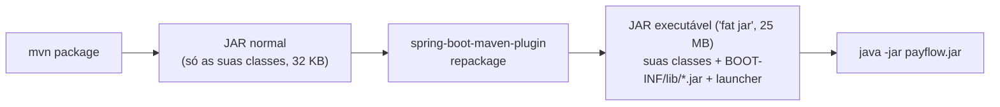

# J5.02 — Spring Initializr, estrutura do projeto e starters

> ⏱️ ~1h30 · 🟢 Júnior · Pré-requisitos: J5.01 (IoC, DI e o mini-contêiner), J0.02 (Maven), J3.12 (Flyway e o esquema do PayFlow), J3.03 (PostgreSQL no Docker)

## 🎯 Objetivos
Ao final desta aula você consegue:
- Gerar um projeto no **Spring Initializr** (site e `curl`) e explicar cada arquivo que ele cria.
- Explicar o papel do **`spring-boot-starter-parent`** (BOM e configuração de build), dos **starters** e do **`spring-boot-maven-plugin`**.
- Explicar as três anotações dentro de **`@SpringBootApplication`** e por que a classe principal fica no **pacote raiz**.
- Converter o projeto `payflow` (J3/J4) em uma aplicação Spring Boot, subir o Tomcat embutido e gerar o **JAR executável**.
- Inspecionar o contexto: quantos **beans** existem e quais são seus.

## 🤔 Por que isso importa
No primeiro dia de um emprego Java com Spring você vai **abrir** um projeto que já existe: `pom.xml`, `Application.java`, `application.yml`. Entender o que cada peça faz (e o que **não** precisa estar lá, porque o Boot já resolve) é o que separa "copiei do tutorial" de "sei mexer". E, quando você cria um serviço novo, o ponto de partida é o Initializr.

## 💡 Intuição (explicação simples)
Imagine montar uma cozinha. Você pode comprar cada utensílio avulso, de marcas diferentes, e torcer para a tampa servir na panela. Ou comprar **kits** de uma só marca, testados juntos: o *kit de assar* (forma, luva, termômetro), o *kit de café* (moedor, coador, jarra). O **Initializr** é a loja onde você escolhe os kits; cada **starter** é um kit; o **`spring-boot-starter-parent`** é o catálogo que garante que todas as peças de todos os kits têm versões **compatíveis entre si**. Você escolhe a funcionalidade; o Boot escolhe as versões.

## 🔬 Como funciona por dentro

### 1. O que o Initializr gera
O [start.spring.io](https://start.spring.io/) é um serviço web (e uma API) que monta um projeto-esqueleto. O mesmo pedido, pela linha de comando (testado em 2026-11-13, Boot 4.1.2):
```bash
curl -s https://start.spring.io/starter.zip \
  -d type=maven-project -d language=java -d bootVersion=4.1.2 -d javaVersion=25 \
  -d groupId=com.payflow -d artifactId=payflow -d name=payflow -d packageName=com.payflow \
  -d dependencies=web,thymeleaf,data-jpa,validation,actuator,flyway,postgresql,devtools \
  -o payflow-initializr.zip
```
Gera, entre outros:
```
.gitignore  .gitattributes  HELP.md  mvnw  mvnw.cmd  .mvn/wrapper/
pom.xml
src/main/java/com/payflow/PayflowApplication.java
src/main/resources/application.properties        # só: spring.application.name=payflow
src/test/java/com/payflow/PayflowApplicationTests.java    # um teste "contextLoads"
```
- **`mvnw` / `.mvn/wrapper`**: o *Maven Wrapper*. Roda a versão de Maven que o projeto pede, sem você instalá-la; o time inteiro usa a mesma. (`./mvnw spring-boot:run` no lugar de `mvn ...`.)
- **`HELP.md`**: links de referência dos starters escolhidos. Está no `.gitignore` gerado.
- **`application.properties`**: o arquivo de configuração. Vamos trocá-lo por **YAML** (J5.05), mas o formato não importa para o Spring.

Duas mudanças do **Boot 4** que tutoriais antigos não mostram (conferidas no `pom.xml` gerado):
- A dependência `web` do Initializr virou **`spring-boot-starter-webmvc`** ("Starter for using Spring MVC and Tomcat"). O `spring-boot-starter-web` ainda existe, mas a própria descrição dele diz **deprecated in favor of spring-boot-starter-webmvc**.
- Cada starter ganhou um **starter de teste** par (`spring-boot-starter-webmvc-test`, `spring-boot-starter-data-jpa-test`...), com as ferramentas de teste daquela tecnologia. (Na J7 você vai usá-los; nesta aula só `spring-boot-starter-test`.)

### 2. O `pom.xml` de um projeto Spring Boot
```xml
<parent>
  <groupId>org.springframework.boot</groupId>
  <artifactId>spring-boot-starter-parent</artifactId>
  <version>4.1.2</version>
  <relativePath/>
</parent>
```
O **`spring-boot-starter-parent`** faz três coisas por você:
1. **Gerencia as versões** (é um BOM, *Bill of Materials*): você escreve `<artifactId>postgresql</artifactId>` **sem versão** e o parent escolhe a testada com aquele Boot. Por isso o `pom.xml` do PayFlow **perde** as `<version>` do Flyway, do JUnit e do driver.
2. **Configura o build**: `java.version` vira o `release` do compilador, codificação UTF-8, `-parameters`, plugins com versões fixas.
3. **Configura o `spring-boot-maven-plugin`** (repackage, `spring-boot:run`).

Um **starter** é só um `pom.xml` com **dependências transitivas** já escolhidas (sem código próprio). `spring-boot-starter-webmvc` traz Spring MVC, Tomcat embutido, Jackson e o *starter* base (que traz o Logback e o contêiner do Spring). Você pode conferir com `mvn dependency:tree`.

> 📌 **As versões que o Boot 4.1.2 escolheu** (do `spring-boot-dependencies-4.1.2.pom`, 2026-11-13): Spring Framework 7.0.10, Tomcat 11.0.27, Hibernate 7.4.13.Final, HikariCP 7.0.2, Flyway **12.4.0**, Thymeleaf **3.1.5.RELEASE**, JUnit Jupiter **6.0.3**, Jackson **3.1.7** (agora `tools.jackson`, não mais `com.fasterxml.jackson`), PostgreSQL driver 42.7.14. Atenção: **são diferentes** das que você fixou na J3/J4 (Flyway 13.12.2, Thymeleaf 3.1.7, JUnit 6.1.3). Regra: **deixe o Boot escolher**. Só sobrescreva uma versão (propriedade `<flyway.version>`, por exemplo) com um motivo concreto, como uma correção de segurança, e registre o motivo. Seu banco de desenvolvimento migrado pela J3 continua válido: testamos o Flyway 12.4.0 contra um histórico gravado pelo 13.12.2 e ele respondeu `Successfully validated 5 migrations` e `Schema "public" is up to date`.

### 3. A classe principal e `@SpringBootApplication`
```java
@SpringBootApplication
public class PayflowApplication {
    public static void main(String[] args) {
        SpringApplication.run(PayflowApplication.class, args);
    }
}
```
`@SpringBootApplication` é um atalho para **três** anotações (a [documentação](https://docs.spring.io/spring-boot/reference/using/using-the-springbootapplication-annotation.html) as lista):

| Anotação | O que faz | Veremos em |
|---|---|---|
| `@SpringBootConfiguration` | Marca a classe como fonte de definições de beans (uma `@Configuration`) | J5.03 |
| `@ComponentScan` | Varre **este pacote e os de baixo** procurando `@Component` e derivados | J5.03 |
| `@EnableAutoConfiguration` | Liga a **autoconfiguração**: o Boot cria beans conforme o que está no classpath | J5.04 |

**Consequência prática:** a classe principal fica no **pacote raiz** (`com.payflow`) e tudo mais em subpacotes (`com.payflow.web`, `com.payflow.domain`...). Se você puser um `@Service` em `com.outro`, o scan **não o encontra** e a injeção falha (veja "Erros comuns").

`SpringApplication.run(...)` faz o trabalho pesado: lê a configuração, cria o **`ApplicationContext`** (o contêiner da J5.01, versão profissional), cria os beans, sobe o Tomcat embutido e devolve o controle. Num aplicativo web, o contexto é um `AnnotationConfigServletWebServerApplicationContext` (testado abaixo).

### 4. Como o projeto vira um JAR executável

O JAR "gordo" guarda os jars das dependências dentro de `BOOT-INF/lib/` e usa o `JarLauncher` do Boot para carregá-los: **um arquivo, um comando**. É o que a J9 (Docker) vai copiar para dentro da imagem.

## 🛠️ Exemplo prático
> Testado com **JDK 25.0.5**, **Maven 3.9.12**, **Spring Boot 4.1.2** e PostgreSQL 18.6 (container `payflow-pg` da J3.03; suba com `bash scripts/db-up.sh`).

### 1. Converter o `payflow` em um projeto Spring Boot
Abra o `pom.xml` do repositório `payflow` e **substitua-o** por este (as dependências de teste da J3/J4, `junit-jupiter` e `assertj-core`, vêm agora do `spring-boot-starter-test`; o plugin `exec-maven-plugin` sai porque a aplicação passa a subir por `spring-boot:run`):
```xml
<?xml version="1.0" encoding="UTF-8"?>
<project xmlns="http://maven.apache.org/POM/4.0.0"
         xmlns:xsi="http://www.w3.org/2001/XMLSchema-instance"
         xsi:schemaLocation="http://maven.apache.org/POM/4.0.0 https://maven.apache.org/xsd/maven-4.0.0.xsd">
  <modelVersion>4.0.0</modelVersion>

  <parent>
    <groupId>org.springframework.boot</groupId>
    <artifactId>spring-boot-starter-parent</artifactId>
    <version>4.1.2</version>
    <relativePath/>
  </parent>

  <groupId>com.payflow</groupId>
  <artifactId>payflow</artifactId>
  <version>0.1.0-SNAPSHOT</version>
  <name>payflow</name>

  <properties>
    <java.version>25</java.version>
  </properties>

  <dependencies>
    <dependency>
      <groupId>org.springframework.boot</groupId>
      <artifactId>spring-boot-starter-webmvc</artifactId>
    </dependency>
    <dependency>
      <groupId>org.springframework.boot</groupId>
      <artifactId>spring-boot-starter-thymeleaf</artifactId>
    </dependency>
    <dependency>
      <groupId>org.springframework.boot</groupId>
      <artifactId>spring-boot-starter-jdbc</artifactId>
    </dependency>
    <dependency>
      <groupId>org.springframework.boot</groupId>
      <artifactId>spring-boot-starter-flyway</artifactId>
    </dependency>
    <dependency>
      <groupId>org.flywaydb</groupId>
      <artifactId>flyway-database-postgresql</artifactId>
    </dependency>
    <dependency>
      <groupId>org.postgresql</groupId>
      <artifactId>postgresql</artifactId>
      <!-- na J5.04 vira scope runtime, quando a classe Database (J3) sair do projeto -->
    </dependency>
    <dependency>
      <groupId>org.springframework.boot</groupId>
      <artifactId>spring-boot-starter-test</artifactId>
      <scope>test</scope>
    </dependency>
  </dependencies>

  <build>
    <plugins>
      <plugin>
        <groupId>org.springframework.boot</groupId>
        <artifactId>spring-boot-maven-plugin</artifactId>
      </plugin>
    </plugins>
  </build>
</project>
```
Repare em **zero** tags `<version>` nas dependências. Dois detalhes que custam horas a quem não sabe:
- **`spring-boot-starter-flyway` não traz o módulo do PostgreSQL.** Sem `flyway-database-postgresql` a aplicação cai com `Unsupported Database: PostgreSQL 18.6` (a mesma lição da J3.12). Aqui também **sem versão**: o BOM a gerencia.
- O starter do **Thymeleaf** substitui a dependência `org.thymeleaf:thymeleaf` que você fixou na J4 (ele traz `thymeleaf-spring6`, a integração com o Spring MVC). E o `slf4j-simple` da J4 **sai**: o Spring Boot traz o **Logback** (J5.14). Se os dois ficarem no classpath, o SLF4J avisa de múltiplas implementações.

### 2. A classe principal e a configuração mínima
`src/main/java/com/payflow/PayflowApplication.java`
```java
package com.payflow;

import org.springframework.boot.SpringApplication;
import org.springframework.boot.autoconfigure.SpringBootApplication;

@SpringBootApplication
public class PayflowApplication {

    public static void main(String[] args) {
        SpringApplication.run(PayflowApplication.class, args);
    }
}
```
`src/main/resources/application.yml` (primeira versão; a J5.05 explica o formato e os perfis):
```yaml
spring:
  application:
    name: payflow
  datasource:
    url: jdbc:postgresql://localhost:5432/payflow
    username: payflow
    password: payflow
  flyway:
    locations: classpath:db/migration,classpath:db/seed
```
As migrações da J3 (`src/main/resources/db/migration` e `db/seed`) **não mudam de lugar** (decisão 13): o Spring Boot usa `classpath:db/migration` por padrão, e `locations` acrescenta o seed (só em dev; na J5.05 isso passa para um perfil).

### 3. Um primeiro endpoint
Só para provar que o servidor responde (será removido na J5.15, quando o Actuator trouxer o *health check*):
```java
package com.payflow;

import org.springframework.web.bind.annotation.GetMapping;
import org.springframework.web.bind.annotation.RestController;

@RestController
public class PingController {

    @GetMapping("/ping")
    public String ping() {
        return "pong";
    }
}
```
```bash
export JAVA_HOME=/usr/lib/jvm/java-25-openjdk-amd64
mvn spring-boot:run          # ou ./mvnw spring-boot:run
```
Saída real (resumida; seu PID e horário mudam):
```
  .   ____          _            __ _ _
 /\\ / ___'_ __ _ _(_)_ __  __ _ \ \ \ \
( ( )\___ | '_ | '_| | '_ \/ _` | \ \ \ \
 \\/  ___)| |_)| | | | | || (_| |  ) ) ) )
  '  |____| .__|_| |_|_| |_\__, | / / / /
 =========|_|==============|___/=/_/_/_/

 :: Spring Boot ::                (v4.1.2)

INFO 1887728 --- [payflow] [main] com.payflow.PayflowApplication           : Starting PayflowApplication using Java 25.0.5.0.3 with PID 1887728 (...)
INFO 1887728 --- [payflow] [main] com.payflow.PayflowApplication           : No active profile set, falling back to 1 default profile: "default"
INFO 1887728 --- [payflow] [main] o.s.boot.tomcat.TomcatWebServer          : Tomcat initialized with port 8080 (http)
INFO 1887728 --- [payflow] [main] o.apache.catalina.core.StandardEngine    : Starting Servlet engine: [Apache Tomcat/11.0.27]
INFO 1887728 --- [payflow] [main] b.w.c.s.WebApplicationContextInitializer : Root WebApplicationContext: initialization completed in 475 ms
INFO 1887728 --- [payflow] [main] com.zaxxer.hikari.HikariDataSource       : HikariPool-1 - Starting...
INFO 1887728 --- [payflow] [main] com.zaxxer.hikari.pool.HikariPool        : HikariPool-1 - Added connection org.postgresql.jdbc.PgConnection@32a72c4
INFO 1887728 --- [payflow] [main] com.zaxxer.hikari.HikariDataSource       : HikariPool-1 - Start completed.
INFO 1887728 --- [payflow] [main] org.flywaydb.core.FlywayExecutor         : Database: jdbc:postgresql://localhost:5432/payflow (PostgreSQL 18.6)
INFO 1887728 --- [payflow] [main] o.f.core.internal.command.DbValidate     : Successfully validated 5 migrations (execution time 00:00.011s)
INFO 1887728 --- [payflow] [main] o.f.core.internal.command.DbMigrate      : Migrating schema "public" to version "1 - create users"
...
INFO 1887728 --- [payflow] [main] o.f.core.internal.command.DbMigrate      : Successfully applied 5 migrations to schema "public", now at version v4 (execution time 00:00.016s)
INFO 1887728 --- [payflow] [main] o.s.boot.tomcat.TomcatWebServer          : Tomcat started on port 8080 (http) with context path '/'
INFO 1887728 --- [payflow] [main] com.payflow.PayflowApplication           : Started PayflowApplication in 1.241 seconds (process running for 1.412)
```
(Primeira execução, em um banco vazio, como acima; em um banco já migrado: `Schema "public" is up to date. No migration necessary.`) Em outro terminal:
```bash
curl -si localhost:8080/ping
# HTTP/1.1 200
# Content-Type: text/plain;charset=UTF-8
# pong
```
**Leia o log como uma história**, na ordem em que as coisas acontecem: (1) o perfil ativo (`default`), (2) o Tomcat é preparado, (3) o **pool de conexões HikariCP** abre uma conexão com o PostgreSQL, (4) o **Flyway** valida e aplica as migrações, (5) o Tomcat começa a atender, (6) "Started". **Você não escreveu uma linha** para criar o pool, chamar o Flyway ou iniciar o Tomcat: foi a autoconfiguração (J5.04). Veja também o padrão de cada linha: `data-hora nível PID --- [aplicação] [thread] logger : mensagem` (J5.14).

### 4. Quantos beans existem?
Um laboratório descartável para olhar dentro do contêiner:
```java
package com.payflow.lab;

import java.util.Arrays;
import org.springframework.boot.ApplicationArguments;
import org.springframework.boot.ApplicationRunner;
import org.springframework.context.ApplicationContext;
import org.springframework.stereotype.Component;

/** Laboratório (J5.02): lista os beans que o contêiner criou. Apague depois da aula. */
@Component
public class BeanTour implements ApplicationRunner {

    private final ApplicationContext context;

    public BeanTour(ApplicationContext context) {          // o próprio contexto também é injetável
        this.context = context;
    }

    @Override
    public void run(ApplicationArguments args) {
        String[] names = context.getBeanDefinitionNames();
        System.out.println("beans no contexto: " + names.length);
        Arrays.stream(names).filter(n -> context.getType(n) != null
                        && context.getType(n).getName().startsWith("com.payflow")).sorted()
                .forEach(n -> System.out.println("  payflow bean: " + n + " -> " + context.getType(n).getName()));
        System.out.println("tipo do contexto: " + context.getClass().getName());
    }
}
```
Saída real (reinicie a aplicação):
```
beans no contexto: 205
  payflow bean: beanTour -> com.payflow.lab.BeanTour
  payflow bean: payflowApplication -> com.payflow.PayflowApplication
  payflow bean: pingController -> com.payflow.PingController
tipo do contexto: org.springframework.boot.web.server.servlet.context.AnnotationConfigServletWebServerApplicationContext
```
**Você escreveu 3 classes; o contexto tem 205 beans.** Os 202 restantes vieram da autoconfiguração (DataSource, Flyway, Tomcat, Jackson, Spring MVC...). Repare também que o `BeanTour` recebeu o `ApplicationContext` **pelo construtor**: a DI da J5.01, sem nenhuma anotação extra. E o nome do bean (`pingController`) é o nome da classe com a primeira letra minúscula (J5.03 detalha).

### 5. O JAR executável
```bash
mvn -DskipTests package
ls -la target/*.jar target/*.original
# 25171082  target/payflow-0.1.0-SNAPSHOT.jar          (o "fat jar")
#    32246  target/payflow-0.1.0-SNAPSHOT.jar.original (só as suas classes)
unzip -p target/payflow-0.1.0-SNAPSHOT.jar META-INF/MANIFEST.MF | grep -E 'Main-Class|Start-Class|Spring-Boot-Version'
# Main-Class: org.springframework.boot.loader.launch.JarLauncher
# Start-Class: com.payflow.PayflowApplication
# Spring-Boot-Version: 4.1.2
jar tf target/payflow-0.1.0-SNAPSHOT.jar | grep -c 'BOOT-INF/lib/'      # 52 (51 jars + a pasta)

SERVER_PORT=8090 java -jar target/payflow-0.1.0-SNAPSHOT.jar
# Tomcat started on port 8090 (http) ... Started PayflowApplication in 1.692 seconds
curl -s localhost:8090/ping        # pong
```
O `SERVER_PORT=8090` na frente do comando **mudou a porta sem recompilar** (variável de ambiente sobrepondo a configuração): a J5.05 explica a regra por trás.

## 🧠 Pausa para lógica
**Enunciado:** a aplicação precisa escolher a porta: `--server.port=9000` (argumento), a variável `SERVER_PORT`, ou o `server.port` do `application.yml`, ou o padrão `8080`. Escreva `resolvePort(String[] args, Map<String,String> env, Properties yml)` que devolve a porta pela ordem de prioridade: **argumento > variável de ambiente > arquivo > 8080**. Pense em como representar "ausente" e em um valor inválido (`--server.port=abc`).

<details><summary>Dica</summary>Percorra uma lista de "fontes" em ordem de prioridade (cada uma devolve <code>Optional&lt;String&gt;</code>) e fique com a primeira presente; só então converta com <code>Integer.parseInt</code>, tratando o erro com uma mensagem que diga <b>de qual fonte</b> veio o valor ruim.</details>
<details><summary>Solução (testada com JDK 25.0.5)</summary>

```java
import java.util.List;
import java.util.Map;
import java.util.Optional;
import java.util.Properties;
import java.util.function.Supplier;

public class ResolvePort {

    record Source(String name, Supplier<Optional<String>> value) { }

    static int resolvePort(String[] args, Map<String, String> env, Properties yml) {
        List<Source> sources = List.of(
                new Source("argument --server.port", () -> java.util.Arrays.stream(args)
                        .filter(a -> a.startsWith("--server.port="))
                        .map(a -> a.substring("--server.port=".length())).findFirst()),
                new Source("env SERVER_PORT", () -> Optional.ofNullable(env.get("SERVER_PORT"))),
                new Source("file server.port", () -> Optional.ofNullable(yml.getProperty("server.port"))));
        for (Source s : sources) {
            Optional<String> raw = s.value().get();
            if (raw.isPresent()) {
                try {
                    return Integer.parseInt(raw.get().trim());
                } catch (NumberFormatException e) {
                    throw new IllegalArgumentException("invalid port '" + raw.get() + "' from " + s.name());
                }
            }
        }
        return 8080;
    }

    public static void main(String[] args) {
        Properties yml = new Properties();
        yml.setProperty("server.port", "8081");
        System.out.println(resolvePort(new String[] {"--server.port=9000"}, Map.of("SERVER_PORT", "8090"), yml)); // 9000
        System.out.println(resolvePort(new String[] {}, Map.of("SERVER_PORT", "8090"), yml));                     // 8090
        System.out.println(resolvePort(new String[] {}, Map.of(), yml));                                          // 8081
        System.out.println(resolvePort(new String[] {}, Map.of(), new Properties()));                             // 8080
        try {
            resolvePort(new String[] {"--server.port=abc"}, Map.of(), yml);
        } catch (IllegalArgumentException e) {
            System.out.println(e.getMessage());     // invalid port 'abc' from argument --server.port
        }
    }
}
```
Parar na **primeira** fonte presente (e não "tentar a próxima se a conversão falhar") é uma decisão: um valor inválido em uma fonte de alta prioridade é um **erro de configuração** que deve aparecer, não ser ignorado em silêncio. Na J5.05 você verá o Spring fazer exatamente isso com muitas fontes.
</details>

**Variação mais difícil:** aceite também `--server.port=8000-8010` como intervalo e devolva a primeira porta **livre** do intervalo (teste com `ServerSocket`).

## ⚠️ Erros comuns e boas práticas de produção
- **Classe principal no pacote errado** (ou um `@Service` fora de `com.payflow`): o *component scan* não encontra o bean. Mensagem típica ao injetá-lo: `No qualifying bean of type 'com.outro.Algo' available` (J5.03).
- **Porta ocupada:** `Web server failed to start. Port 8080 was already in use.` Conserte o conflito (mate o processo antigo) ou troque a porta com `SERVER_PORT`.
- **Banco desligado** (`Connection to localhost:5432 refused`): a aplicação **não sobe**. É bom: falha rápida. Rode `bash scripts/db-up.sh`.
- **JDK errado:** o `java -version` do shell ainda pode ser o 17 (pendência do aluno desde J0). Com o `java.version` 25 no `pom.xml`, o Maven falha com `Fatal error compiling: error: release version 25 not supported` (testado com JDK 17). Exporte o `JAVA_HOME` do JDK 25.
- **Versão fixada à mão:** colocar `<version>` em dependência gerenciada pelo Boot costuma gerar combinações **não testadas**. Se precisar, use a propriedade do BOM e escreva o motivo ao lado.
- **Escolher a versão do Spring Boot:** use a **última estável da linha atual** (aqui, 4.1.2; a 4.2 estava em candidata a lançamento, `4.2.0-RC2`, quando esta aula foi escrita). Atualizações de *patch* (4.1.x) são seguras; as de versão maior (4.x → 5.x) pedem leitura das notas de migração.
- **`HELP.md`, `target/` e `.idea/` não vão para o Git** (o `.gitignore` do Initializr já cuida; confira o seu).

## 🧩 Exercícios
1. **Fixação:** (a) o que o `spring-boot-starter-parent` faz, em três itens? (b) o que é um *starter* e o que ele **não** contém? (c) quais são as três anotações dentro de `@SpringBootApplication`? (d) por que a classe principal fica no pacote raiz? (e) por que o JAR executável é muito maior do que o `.jar.original`?
2. **Aplicação no PayFlow:** converta o projeto e documente.
   - [ ] `pom.xml` novo (sem versões nas dependências; `java.version` 25), `PayflowApplication`, `application.yml` e `PingController`.
   - [ ] `mvn spring-boot:run` sobe sem erro, o log mostra o Flyway validando as 5 migrações e `curl localhost:8080/ping` responde `pong`.
   - [ ] `mvn dependency:tree` conferido: você anotou em `docs/spring-lab/starters.md` **uma** dependência transitiva trazida por cada starter (`webmvc`, `thymeleaf`, `jdbc`).
   - [ ] `BeanTour` executado, com o número de beans do **seu** contexto anotado.
   - [ ] `mvn -DskipTests package` gera o JAR executável, que sobe com `java -jar` em outra porta (`SERVER_PORT`).
   - [ ] Gere o mesmo projeto no Initializr (site ou `curl` desta aula) e compare o `pom.xml` gerado com o seu; anote **três** diferenças.
   - [ ] Commit: `build: convert payflow to a Spring Boot project`.
3. **Desafio (opcional):** mova `PayflowApplication` para `com.payflow.app` e veja o que quebra no `BeanTour` e no `/ping`. Corrija de **duas** formas: voltando ao pacote raiz e com `@SpringBootApplication(scanBasePackages = "com.payflow")`.

<details><summary>Soluções de referência</summary>

1. (a) Gerencia versões (BOM), configura o compilador e o encoding e configura o `spring-boot-maven-plugin`. (b) Um `pom.xml` que agrupa dependências compatíveis para uma finalidade (web, JPA...); não tem código próprio. (c) `@SpringBootConfiguration`, `@ComponentScan`, `@EnableAutoConfiguration`. (d) O `@ComponentScan` começa no pacote da classe anotada e desce; fora dele nada é encontrado. (e) O fat jar embute todas as dependências (51 jars, 25 MB) e o *launcher*; o `.original` só tem as classes do projeto.
2. Diferenças comuns: o Initializr gera `application.properties` (você usa YAML), `0.0.1-SNAPSHOT` (você usa `0.1.0-SNAPSHOT`), inclui `mvnw`/`.mvn`, `HELP.md` e starters de teste por tecnologia (`spring-boot-starter-webmvc-test`...), e um teste `PayflowApplicationTests`.
3. Mover a classe principal para `com.payflow.app` faz o scan cobrir só `com.payflow.app`: `pingController` some do contexto e `/ping` responde 404 (esboço, não executado). Conserto 1: voltar ao pacote raiz. Conserto 2: `scanBasePackages = "com.payflow"`.
</details>

## 🎤 Na entrevista
- **O que é o Spring Boot e qual a diferença para o Spring Framework?** O Framework fornece o contêiner (IoC/DI), MVC, acesso a dados etc. O Boot **configura tudo isso automaticamente** com valores padrão sensatos: starters para dependências, autoconfiguração, servidor embutido e JAR executável. Ele não substitui o Framework; roda sobre ele.
- **O que faz `@SpringBootApplication`?** Combina `@SpringBootConfiguration`, `@EnableAutoConfiguration` e `@ComponentScan` (o scan parte do pacote da classe).
- **O que é um starter?** Um conjunto de dependências compatíveis para uma funcionalidade; o `spring-boot-starter-parent` (ou o BOM) fixa as versões.
- **Como você roda e entrega uma aplicação Spring Boot?** Em desenvolvimento, `mvn spring-boot:run`; para entrega, `mvn package` gera um JAR executável (`java -jar`), que em seguida vai para uma imagem de container (J9).

## 📚 Para ir além
- 📄 [Spring Initializr](https://start.spring.io/): o gerador oficial (site e API; o `curl` desta aula usa a API).
- 📄 [Spring Boot — Using `@SpringBootApplication`](https://docs.spring.io/spring-boot/reference/using/using-the-springbootapplication-annotation.html): as três anotações e as opções de customização.
- 📄 [Spring Boot — Structuring Your Code](https://docs.spring.io/spring-boot/reference/using/structuring-your-code.html): por que e como organizar os pacotes.
- 📄 [Spring Boot — Build Systems (starters e dependências)](https://docs.spring.io/spring-boot/reference/using/build-systems.html): como o BOM, o parent e os starters funcionam.
- 📄 [Spring Boot — Maven Plugin](https://docs.spring.io/spring-boot/maven-plugin/index.html): `spring-boot:run`, `repackage` e `build-image`.
- 📄 [Spring Boot — Executable JAR format](https://docs.spring.io/spring-boot/specification/executable-jar/index.html): o formato interno do *fat jar*.
- 📄 [Spring Boot — System Requirements](https://docs.spring.io/spring-boot/system-requirements.html): versões de Java, Maven e Gradle aceitas.
- 📄 [Spring Guides — Getting Started with Spring Boot](https://spring.io/guides/gs/spring-boot): o roteiro oficial de "primeiro app".
- 🎥 ⚠️ Nenhum vídeo verificado nesta execução.

## ✅ Checklist da aula
- [ ] Gerei um projeto pelo Initializr e li cada arquivo.
- [ ] O `payflow` é um projeto Spring Boot (`spring-boot-starter-parent` 4.1.2) e sobe com `mvn spring-boot:run`.
- [ ] Li o log de inicialização e identifiquei Hikari, Flyway e Tomcat.
- [ ] Sei dizer por que o `pom.xml` não tem versões nas dependências.
- [ ] Gerei e rodei o JAR executável com `SERVER_PORT` diferente.
