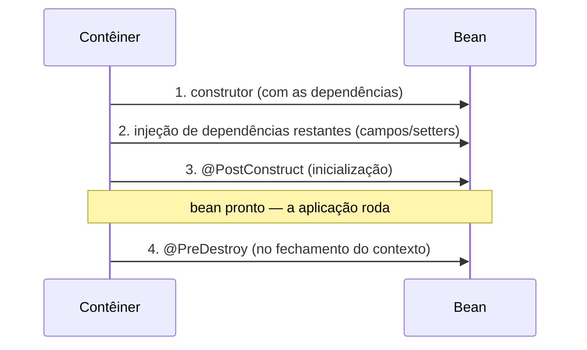

# J5.03 — Beans: escopos, ciclo de vida e estereótipos

> ⏱️ ~1h30 · 🟢 Júnior · Pré-requisitos: J5.01 (IoC e DI), J5.02 (projeto Spring Boot, `@SpringBootApplication`, `ApplicationContext`), J1.07 (interfaces), J1.09 (exceções)

## 🎯 Objetivos
Ao final desta aula você consegue:
- Declarar beans com **estereótipos** (`@Component`, `@Service`, `@Repository`, `@Controller`) e com **métodos `@Bean`** em uma `@Configuration`, e saber **quando usar cada um**.
- Explicar o **nome** de um bean e o que o *component scan* encontra.
- Distinguir os escopos **singleton** e **prototype** (e citar request/session) e evitar a armadilha do prototype dentro de um singleton.
- Descrever o **ciclo de vida** (construtor, injeção, `@PostConstruct`, uso, `@PreDestroy`) e usá-lo para inicialização e limpeza.
- Ler e consertar os erros reais de injeção: `NoSuchBeanDefinitionException`, `NoUniqueBeanDefinitionException` (com `@Primary` e `@Qualifier`) e dependência circular.
- Transformar os repositórios e o serviço de transferência da J3 em beans do PayFlow.

## 🤔 Por que isso importa
Uma parte enorme dos erros de "a aplicação não sobe" no Spring é de bean: um que falta, um que sobra, um que depende de si mesmo. Quem entende **como o contêiner decide** lê a mensagem e resolve em minutos. Entender escopo e ciclo de vida evita ainda os bugs mais caros: estado de um usuário vazando para outro (um singleton com campo mutável) e recursos (conexões, *threads*) que nunca são liberados.

## 💡 Intuição (explicação simples)
No restaurante da J5.01, o **gerente** (contêiner) tem a lista de **funcionários** (beans). Os **estereótipos** são o crachá: "cozinha" (`@Service`), "estoque" (`@Repository`), "salão" (`@Controller`): o gerente os reconhece pelo crachá (o *scan*) e o crachá diz a **função**. O `@Bean` é o contratado externo: uma empresa de limpeza que você não pode "crachar", então o gerente anota na lista: "chamar esta empresa assim".
**Escopo** é "quantos funcionários desse tipo existem": um único chef para todo mundo (**singleton**) ou um garçom novo para cada mesa (**prototype**). O **ciclo de vida** é a carreira do funcionário: é contratado (construtor), recebe os ingredientes (injeção), faz o treinamento de integração (`@PostConstruct`), trabalha, e no fim do expediente apaga o fogão (`@PreDestroy`).

## 🔬 Como funciona por dentro

### 1. Como o contêiner descobre os beans
Duas formas de **declarar** um bean:

| Forma | Como | Quando |
|---|---|---|
| **Estereótipo** na classe | `@Component` (ou `@Service`, `@Repository`, `@Controller`, `@RestController`) | Classes **suas**. O *component scan* da `@SpringBootApplication` (J5.02) as acha |
| **Método `@Bean`** em uma classe `@Configuration` | `@Bean Clock clock() { return Clock.systemUTC(); }` | Objetos que você **não** pode anotar (classes de bibliotecas, `Clock`, `RestClient`) ou que exigem lógica de criação |

`@Service`, `@Repository` e `@Controller` são **`@Component` com um significado**: a [documentação](https://docs.spring.io/spring-framework/reference/core/beans/classpath-scanning.html) os chama de *stereotypes* e eles são meta-anotados com `@Component`. A diferença é de **intenção** (e de alguns comportamentos extras):

| Estereótipo | Camada | Extra |
|---|---|---|
| `@Controller` / `@RestController` | Web (J5.06) | Mapeia requisições HTTP |
| `@Service` | Regras de negócio (ex.: `TransferService`) | Nenhum; só documenta a intenção |
| `@Repository` | Acesso a dados (ex.: `JdbcAccountRepository`) | Ativa a **tradução de exceções** de persistência (J5.09) |
| `@Component` | Qualquer outro | — |

**O nome do bean:** sem nome explícito, é o **nome simples da classe com a inicial minúscula** (`JdbcAccountRepository` → `jdbcAccountRepository`). Dá para dar nome: `@Component("smsNotifier")`; num `@Bean`, o nome é o do **método** (`clock()` → `clock`). (Classe **aninhada** ganha o prefixo da externa, como `beansLabTest.SmsNotifier`: foi o que o laboratório abaixo mostrou. Em código de produção, classes de bean são de nível superior.)

### 2. Escolher qual construtor e como injetar
- **Um único construtor:** o Spring o usa **sem precisar de `@Autowired`** (é o caso de todo o PayFlow).
- **Vários construtores:** marque o que o contêiner deve usar com `@Autowired`; sem isso ele procura um construtor sem argumentos e falha.
- Injete **o tipo** (interface ou classe) de que precisa. Se houver **mais de um** candidato, use `@Primary` (um é o padrão) ou `@Qualifier("nome")` (escolha explícita no ponto de injeção).

### 3. Escopos
O **escopo** responde: *quantas instâncias e por quanto tempo?* ([documentação](https://docs.spring.io/spring-framework/reference/core/beans/factory-scopes.html))

| Escopo | Instâncias | Típico |
|---|---|---|
| **singleton** (**padrão**) | **Uma** por contêiner, criada na inicialização | Quase tudo: serviços, repositórios, controllers |
| **prototype** | **Uma nova a cada pedido** ao contêiner | Objetos com estado próprio de curta vida |
| request / session | Uma por requisição HTTP / por sessão HTTP (só em aplicações web) | Dados de contexto de uma requisição |

**Regra de ouro do singleton:** como **todas as *threads*** (todas as requisições) compartilham a mesma instância, um bean singleton **não pode guardar estado mutável de um usuário** em campos. Serviço do PayFlow: só campos `final` com dependências. Estado da requisição vive em **variáveis locais** e parâmetros.

**A armadilha do prototype dentro de singleton:** o singleton é criado **uma vez**, então recebe **um** prototype **uma vez**, e o guarda para sempre: aquele "novo a cada pedido" vira singleton na prática. Para obter um novo a cada uso, injete um `ObjectProvider<Prototype>` e chame `getObject()` (o laboratório mostra os dois).

### 4. Ciclo de vida

- **`@PostConstruct`** (`jakarta.annotation`, não `javax`): roda **depois** da injeção. Aqui o objeto já tem todas as dependências, então dá para validar a configuração, abrir um recurso, popular um cache.
- **`@PreDestroy`**: roda quando o contexto **fecha** (parada da aplicação). Libere o que abriu.
- **Singletons são criados na inicialização** (*eager*), então um erro de bean aparece **ao subir**, não na primeira requisição: falha rápida.
- Por baixo, os `@PostConstruct`/`@PreDestroy` são tratados por *`BeanPostProcessor`s* do contêiner: classes que podem **inspecionar e até substituir** cada bean ao criá-lo. É por esse mecanismo que o Spring envolve alguns beans em **proxies** (veja abaixo e J5.11).

### 5. Os erros reais de bean
O Spring envolve a causa raiz em uma `UnsatisfiedDependencyException` ("não consegui montar o bean X") e a causa verdadeira vem em `Caused by`/`getCause()`:

| Causa raiz | Significa | Conserto |
|---|---|---|
| `NoSuchBeanDefinitionException` | **Nenhum** bean do tipo pedido | Falta o estereótipo/`@Bean`? Está fora do pacote do scan (J5.02)? Falta o *starter*? |
| `NoUniqueBeanDefinitionException` | **Mais de um** candidato | `@Primary` ou `@Qualifier`; ou rever o desenho |
| `BeanCurrentlyInCreationException` | **Ciclo**: A precisa de B que precisa de A | Redesenhar (extrair uma terceira classe). O Spring Boot **recusa ciclos** por padrão (`spring.main.allow-circular-references=false`) |

## 🛠️ Exemplo prático
> Testado com **JDK 25.0.5**, **Spring Boot 4.1.2** (Spring Framework 7.0.10) e JUnit 6. O laboratório usa um `AnnotationConfigApplicationContext` "solto" dentro de testes (sem subir o Tomcat, sem banco): é o mesmo contêiner da aplicação, em miniatura, e é o equivalente profissional do `MiniContainer` da J5.01.

### 1. O laboratório
`src/test/java/com/payflow/lab/BeansLabTest.java`
```java
package com.payflow.lab;

import static org.assertj.core.api.Assertions.assertThat;
import static org.assertj.core.api.Assertions.assertThatThrownBy;

import jakarta.annotation.PostConstruct;
import jakarta.annotation.PreDestroy;
import java.time.Clock;
import java.time.Instant;
import java.time.ZoneOffset;
import java.util.ArrayList;
import java.util.List;
import java.util.UUID;
import org.junit.jupiter.api.Test;
import org.springframework.beans.factory.ObjectProvider;
import org.springframework.beans.factory.annotation.Qualifier;
import org.springframework.context.annotation.AnnotationConfigApplicationContext;
import org.springframework.context.annotation.Bean;
import org.springframework.context.annotation.Configuration;
import org.springframework.context.annotation.Primary;
import org.springframework.context.annotation.Scope;
import org.springframework.stereotype.Component;
import org.springframework.stereotype.Service;

/** Laboratório da J5.03: escopos, ciclo de vida e os erros clássicos, com um contexto Spring "solto". */
class BeansLabTest {

    // ------------------------------------------------------------------ escopos
    @Component
    static class Singleton { }

    @Component
    @Scope("prototype")
    static class Prototype { }

    @Service
    static class UsesPrototypeDirectly {
        final Prototype prototype;
        UsesPrototypeDirectly(Prototype prototype) { this.prototype = prototype; }
    }

    @Service
    static class UsesPrototypeProvider {
        private final ObjectProvider<Prototype> provider;
        UsesPrototypeProvider(ObjectProvider<Prototype> provider) { this.provider = provider; }
        Prototype fresh() { return provider.getObject(); }
    }

    @Test
    void singletonIsSharedAndPrototypeIsNot() {
        try (var ctx = new AnnotationConfigApplicationContext(Singleton.class, Prototype.class)) {
            assertThat(ctx.getBean(Singleton.class)).isSameAs(ctx.getBean(Singleton.class));
            assertThat(ctx.getBean(Prototype.class)).isNotSameAs(ctx.getBean(Prototype.class));
            System.out.println("singleton: " + id(ctx.getBean(Singleton.class)) + " " + id(ctx.getBean(Singleton.class)));
            System.out.println("prototype: " + id(ctx.getBean(Prototype.class)) + " " + id(ctx.getBean(Prototype.class)));
        }
    }

    @Test
    void prototypeInjectedIntoASingletonIsFrozen() {
        try (var ctx = new AnnotationConfigApplicationContext(Prototype.class,
                UsesPrototypeDirectly.class, UsesPrototypeProvider.class)) {
            var direct = ctx.getBean(UsesPrototypeDirectly.class);
            var viaProvider = ctx.getBean(UsesPrototypeProvider.class);
            System.out.println("direto:   " + id(direct.prototype) + " " + id(direct.prototype));
            System.out.println("provider: " + id(viaProvider.fresh()) + " " + id(viaProvider.fresh()));
            assertThat(direct.prototype).isSameAs(direct.prototype);
            assertThat(viaProvider.fresh()).isNotSameAs(viaProvider.fresh());
        }
    }

    // ------------------------------------------------------------------ ciclo de vida
    static final List<String> EVENTS = new ArrayList<>();

    @Component
    static class Dependency {
        Dependency() { EVENTS.add("1. Dependency: constructor"); }
    }

    @Component
    static class Lifecycle {
        Lifecycle(Dependency dependency) { EVENTS.add("2. Lifecycle: constructor (dependency received)"); }

        @PostConstruct
        void ready() { EVENTS.add("3. Lifecycle: @PostConstruct"); }

        @PreDestroy
        void closing() { EVENTS.add("5. Lifecycle: @PreDestroy"); }
    }

    @Test
    void lifecycleOrder() {
        EVENTS.clear();
        var ctx = new AnnotationConfigApplicationContext(Dependency.class, Lifecycle.class);
        EVENTS.add("4. context is ready, application runs");
        ctx.close();
        EVENTS.forEach(System.out::println);
        assertThat(EVENTS).hasSize(5);
    }

    // ------------------------------------------------------------------ @Bean para classes que não são suas
    @Configuration
    static class ClockConfig {
        @Bean
        Clock clock() { return Clock.fixed(Instant.parse("2026-01-10T11:00:00Z"), ZoneOffset.UTC); }
    }

    @Service
    static class UsesClock {
        final Clock clock;
        UsesClock(Clock clock) { this.clock = clock; }
    }

    @Test
    void beanMethodRegistersAThirdPartyObject() {
        try (var ctx = new AnnotationConfigApplicationContext(ClockConfig.class, UsesClock.class)) {
            System.out.println("clock bean: " + String.join(",", ctx.getBeanNamesForType(Clock.class))
                    + " -> " + ctx.getBean(UsesClock.class).clock.instant());
            System.out.println("nomes: " + String.join(",", ctx.getBeanDefinitionNames()));
        }
    }

    // ------------------------------------------------------------------ os erros clássicos
    interface Notifier { void send(String m); }

    @Component("emailNotifier")
    static class EmailNotifier implements Notifier { public void send(String m) { } }

    @Component("smsNotifier")
    static class SmsNotifier implements Notifier { public void send(String m) { } }

    @Service
    static class NeedsNotifier {
        NeedsNotifier(Notifier notifier) { }
    }

    @Service
    static class NeedsMissing {
        NeedsMissing(UUID uuid) { }
    }

    @Test
    void missingBean() {
        assertThatThrownBy(() -> new AnnotationConfigApplicationContext(NeedsMissing.class))
                .satisfies(e -> System.out.println("MISSING:\n" + e.getClass().getName() + ": " + e.getMessage()
                        + "\nCAUSE: " + e.getCause().getClass().getName() + ": " + e.getCause().getMessage()));
    }

    @Test
    void ambiguousBean() {
        assertThatThrownBy(() -> new AnnotationConfigApplicationContext(
                EmailNotifier.class, SmsNotifier.class, NeedsNotifier.class))
                .satisfies(e -> System.out.println("AMBIGUOUS:\n" + e.getClass().getName() + ": " + e.getMessage()
                        + "\nCAUSE: " + e.getCause().getClass().getName() + ": " + e.getCause().getMessage()));
    }

    @Primary
    @Component
    static class PrimaryPush implements Notifier { public void send(String m) { } }

    @Service
    static class PicksByName {
        final Notifier notifier;
        PicksByName(@Qualifier("smsNotifier") Notifier notifier) { this.notifier = notifier; }
    }

    @Test
    void primaryAndQualifier() {
        try (var ctx = new AnnotationConfigApplicationContext(EmailNotifier.class, SmsNotifier.class,
                PrimaryPush.class, NeedsNotifier.class, PicksByName.class)) {
            System.out.println("primary: " + ctx.getBean(Notifier.class).getClass().getSimpleName());
            System.out.println("qualifier: " + ctx.getBean(PicksByName.class).notifier.getClass().getSimpleName());
        }
    }

    @Service
    static class Chicken {
        Chicken(Egg egg) { }
    }

    @Service
    static class Egg {
        Egg(Chicken chicken) { }
    }

    @Test
    void circular() {
        assertThatThrownBy(() -> new AnnotationConfigApplicationContext(Chicken.class, Egg.class))
                .satisfies(e -> System.out.println("CIRCULAR root cause:\n"
                        + org.springframework.core.NestedExceptionUtils.getRootCause(e).getClass().getName()));
    }

    private static String id(Object o) {
        return o.getClass().getSimpleName() + "@" + Integer.toHexString(System.identityHashCode(o));
    }
}
```
```bash
export JAVA_HOME=/usr/lib/jvm/java-25-openjdk-amd64
mvn -q test -Dtest=BeansLabTest
```
Saída real (os *hashes* mudam a cada execução; o Spring também imprime avisos `WARN ... cancelling refresh attempt` nos testes de erro, omitidos aqui):
```
singleton: Singleton@5c84624f Singleton@5c84624f
prototype: Prototype@63034ed1 Prototype@232024b9
direto:   Prototype@6bb7cce7 Prototype@6bb7cce7
provider: Prototype@4163f1cd Prototype@5fa05212
1. Dependency: constructor
2. Lifecycle: constructor (dependency received)
3. Lifecycle: @PostConstruct
4. context is ready, application runs
5. Lifecycle: @PreDestroy
clock bean: clock -> 2026-01-10T11:00:00Z
primary: PrimaryPush
qualifier: SmsNotifier
```
O que cada bloco prova:
- **`singleton`**: o mesmo *hash* duas vezes → **uma** instância. **`prototype`**: *hashes* diferentes → uma por pedido.
- **`direto` × `provider`**: o prototype injetado **direto** em um singleton é o **mesmo** nas duas chamadas (congelou); pelo `ObjectProvider` cada `getObject()` devolve uma instância nova.
- **Ciclo de vida:** a `Dependency` é construída **antes** (o `Lifecycle` a exige), depois o construtor do `Lifecycle`, depois `@PostConstruct`, e só no `ctx.close()` o `@PreDestroy`.
- **`@Bean`**: o método `clock()` virou o bean `clock`; o `UsesClock` o recebeu pelo construtor, pelo **tipo**.
- **`@Primary`/`@Qualifier`**: com três `Notifier`, quem não diz nada recebe o `@Primary` (`PrimaryPush`); quem pede `@Qualifier("smsNotifier")` recebe o `SmsNotifier`.

Os erros reais (mensagens completas dos testes `missingBean`, `ambiguousBean` e `circular`):
```
MISSING:
UnsatisfiedDependencyException: Error creating bean with name 'beansLabTest.NeedsMissing':
  Unsatisfied dependency expressed through constructor parameter 0:
  No qualifying bean of type 'java.util.UUID' available: expected at least 1 bean which qualifies as autowire candidate. Dependency annotations: {}
CAUSE: org.springframework.beans.factory.NoSuchBeanDefinitionException: No qualifying bean of type 'java.util.UUID' available ...

AMBIGUOUS:
UnsatisfiedDependencyException: Error creating bean with name 'beansLabTest.NeedsNotifier':
  Unsatisfied dependency expressed through constructor parameter 0:
  No qualifying bean of type 'com.payflow.lab.BeansLabTest$Notifier' available: expected single matching bean but found 2: emailNotifier,smsNotifier
CAUSE: org.springframework.beans.factory.NoUniqueBeanDefinitionException: ... expected single matching bean but found 2: emailNotifier,smsNotifier

CIRCULAR:
UnsatisfiedDependencyException: Error creating bean with name 'beansLabTest.Chicken': Unsatisfied dependency expressed through constructor parameter 0:
  Error creating bean with name 'beansLabTest.Egg': Unsatisfied dependency expressed through constructor parameter 0:
  Error creating bean with name 'beansLabTest.Chicken': Requested bean is currently in creation:
  Is there an unresolvable circular reference or an asynchronous initialization dependency?
CIRCULAR root cause: org.springframework.beans.factory.BeanCurrentlyInCreationException
```
**Como ler**: (1) o **nome do bean** que falhou (`Error creating bean with name ...`); (2) **qual parâmetro** (`constructor parameter 0`); (3) o **tipo** que ele procurava; (4) a **causa** (`expected at least 1` = faltou; `expected single matching bean but found 2: ...` = sobrou, com os nomes; `currently in creation` = ciclo, com o caminho `Chicken → Egg → Chicken`). Compare com as quatro mensagens do seu `MiniContainer` da J5.01: é a mesma informação.

> 💡 No primeiro teste de qualificador, usar `@Qualifier("smsNotifier")` com a classe aninhada **sem nome explícito** falhou com `No qualifying bean ... Dependency annotations: {@Qualifier("smsNotifier")}`, porque o bean se chamava `beansLabTest.SmsNotifier`. Por isso o laboratório dá `@Component("smsNotifier")`. **Erro clássico:** o nome do qualificador não bate com o nome do bean.

### 2. Os beans do PayFlow
Os repositórios e o serviço da J3 já recebem o `DataSource` pelo construtor (o **único** construtor), então basta o crachá. Acrescente a anotação e o `import` em cada um:
```java
// src/main/java/com/payflow/db/JdbcUserRepository.java
import org.springframework.stereotype.Repository;

@Repository
public class JdbcUserRepository { /* ... igual à J3 ... */ }
```
```java
// JdbcAccountRepository.java          → @Repository
// TransferService.java                → @Service   (import org.springframework.stereotype.Service)
```
Quem entrega o `DataSource`? **Ninguém que você escreveu**: foi a autoconfiguração (o pool Hikari que apareceu no log da J5.02). A J5.04 mostra como. E o relógio da aplicação, como `@Bean`, para que nenhuma classe precise chamar `Instant.now()` diretamente (nos testes, trocamos por um relógio fixo; J1.15):
```java
package com.payflow.config;

import java.time.Clock;
import org.springframework.context.annotation.Bean;
import org.springframework.context.annotation.Configuration;

@Configuration
public class ClockConfig {

    /** O relógio da aplicação: injetado onde se precisa de "agora" (nos testes, troca-se por um fixo). */
    @Bean
    public Clock clock() {
        return Clock.systemUTC();
    }
}
```
Suba de novo com `mvn spring-boot:run` (o `BeanTour` da J5.02 ainda está lá):
```
beans no contexto: 210
  payflow bean: beanTour -> com.payflow.lab.BeanTour
  payflow bean: clockConfig -> com.payflow.config.ClockConfig$$SpringCGLIB$$0
  payflow bean: jdbcAccountRepository -> com.payflow.db.JdbcAccountRepository$$SpringCGLIB$$0
  payflow bean: jdbcUserRepository -> com.payflow.db.JdbcUserRepository$$SpringCGLIB$$0
  payflow bean: payflowApplication -> com.payflow.PayflowApplication
  payflow bean: pingController -> com.payflow.PingController
  payflow bean: transferService -> com.payflow.db.TransferService
```
O desligamento ordenado também é visível (exercício 2: um `StartupBanner` com `@PostConstruct`/`@PreDestroy`). Ao parar a aplicação com `Ctrl+C` (sinal SIGINT) ou `kill <pid>` (SIGTERM; testado), o contexto fecha e o log mostra, **nesta ordem**:
```
PayFlow starting at 2026-11-13T14:18:13.199427591Z          ← @PostConstruct, ao subir
PayFlow stopping at 2026-11-13T14:18:21.373834023Z          ← @PreDestroy, ao parar
HikariPool-1 - Shutdown initiated...                         ← o pool é fechado depois, pelo próprio contexto
HikariPool-1 - Shutdown completed.
```
(`kill -9` mata o processo **sem** nenhum `@PreDestroy`: por isso ele é o último recurso.)

Duas observações:
1. **Os beans do PayFlow são 7** (eram 3) e o contexto foi de 205 a 210 (a diferença inclui o `clock`).
2. **Os tipos terminam em `$$SpringCGLIB$$0`.** Isso **não** é um bug: o bean não é a sua classe, é um **proxy** (uma subclasse gerada em execução, com a biblioteca CGLIB embutida no Spring). Há dois motivos aqui: classes `@Configuration` são *enhanced* para que um `@Bean` chamado de outro `@Bean` devolva sempre o mesmo objeto singleton; e as `@Repository` ganham um proxy de **tradução de exceções** de persistência. O `TransferService` ainda é a classe pura, porque nada o exige; na J5.11, quando ele ganhar `@Transactional`, também virará um proxy. Moral: **o objeto que você recebe pode ser um proxy da sua classe**, por isso as classes de bean **não podem ser `final`** e métodos `private` ou `final` não passam pelo proxy. Pare de testar com `==` na classe concreta.

## 🧠 Pausa para lógica
**Enunciado:** o Spring guarda os singletons em um `Map<String, Object>` e os **destrói na ordem inversa da criação** (quem foi criado por último, que depende dos anteriores, sai primeiro). Implemente `Registry` com `register(String name, AutoCloseable bean)` e `close()` que fecha na ordem inversa, **continua mesmo que um `close` falhe** e, no fim, lança **uma** exceção com os demais erros como *suppressed*. (Se o `TransferService` ainda usa o repositório durante o `@PreDestroy`, fechar o repositório antes dá erro.)

<details><summary>Dica</summary>Guarde os beans em uma <code>ArrayDeque</code> usada como pilha (<code>push</code> a cada registro; <code>pop</code> no fechamento sai do último para o primeiro). Para os erros: capture a primeira exceção e use <code>addSuppressed</code> nas seguintes (como faz o <code>try-with-resources</code>, J1.09).</details>
<details><summary>Solução (testada com JDK 25.0.5)</summary>

```java
import java.util.ArrayDeque;
import java.util.Deque;

public class Registry {

    private record Entry(String name, AutoCloseable bean) { }

    private final Deque<Entry> stack = new ArrayDeque<>();

    void register(String name, AutoCloseable bean) {
        stack.push(new Entry(name, bean));
        System.out.println("created " + name);
    }

    /** Fecha na ordem inversa; se algum falhar, continua e relata todos. */
    void close() {
        IllegalStateException failure = null;
        while (!stack.isEmpty()) {
            Entry e = stack.pop();
            try {
                e.bean().close();
                System.out.println("closed  " + e.name());
            } catch (Exception ex) {
                var error = new IllegalStateException("failed closing " + e.name(), ex);
                if (failure == null) {
                    failure = error;
                } else {
                    failure.addSuppressed(error);
                }
            }
        }
        if (failure != null) {
            throw failure;
        }
    }

    public static void main(String[] args) {
        Registry r = new Registry();
        r.register("dataSource", () -> { });
        r.register("accountRepository", () -> { throw new Exception("pool already closed"); });
        r.register("transferService", () -> { });
        r.register("notifier", () -> { throw new Exception("socket reset"); });
        try {
            r.close();
        } catch (IllegalStateException e) {
            System.out.println(e.getMessage() + " (suppressed: " + e.getSuppressed().length + ")");
            for (Throwable s : e.getSuppressed()) System.out.println("  also: " + s.getMessage());
        }
    }
}
```
Saída real:
```
created dataSource
created accountRepository
created transferService
created notifier
closed  transferService
closed  dataSource
failed closing notifier (suppressed: 1)
  also: failed closing accountRepository
```
A ordem de fechamento (`transferService` → `dataSource`, o inverso da criação) se manteve e o `dataSource` **foi fechado mesmo com dois erros no meio**; o primeiro erro vira a exceção principal e o segundo fica como *suppressed*.
</details>

**Variação mais difícil:** troque a pilha por um **grafo de dependências** (J5.01): feche cada bean só **depois** de todos que dependem dele.

## ⚠️ Erros comuns e boas práticas de produção
- **Estado mutável em singleton.** `private BigDecimal lastAmount;` em um `@Service` é compartilhado por todos os usuários: é um **bug de concorrência** (P1) e, em dinheiro, um incidente. Só `final` com dependências.
- **`new` em vez de injetar:** `new TransferService(...)` dentro de outro bean fura o contêiner: sem proxies, sem injeção, sem ciclo de vida.
- **`@Qualifier` com o nome errado** (o nome do bean é o da classe com inicial minúscula, ou o que você definiu).
- **`@PostConstruct` pesado** (chamar APIs externas, consultas lentas): atrasa e pode impedir a subida. Valide e prepare; o trabalho de verdade vai para outro lugar.
- **Esquecer de fechar recursos** que o contêiner não conhece: se você abre algo em `@PostConstruct`, feche em `@PreDestroy`. (Beans que implementam `AutoCloseable` já são fechados pelo contêiner.)
- **Prototype injetado em singleton** sem `ObjectProvider`: parece criar um novo a cada uso e não cria.
- **Não anote classes de domínio** (`Account`, `User`) com `@Component`: elas são dados criados por você; beans são **colaboradores** (serviços, repositórios, clientes).
- **`@Autowired` em campo:** evite (J5.01). Em testes, você ainda pode criar o objeto com `new` e dublês graças ao construtor.

## 🧩 Exercícios
1. **Fixação:** (a) qual a diferença prática entre `@Component` e `@Service`? (b) quando usar `@Bean` em vez de `@Component`? (c) qual o escopo padrão e o que ele implica para campos mutáveis? (d) em que momento o `@PostConstruct` roda e por que **não** no construtor? (e) o que significa `expected single matching bean but found 2` e duas formas de resolver?
2. **Aplicação no PayFlow:** beans e ciclo de vida.
   - [ ] `@Repository` em `JdbcUserRepository` e `JdbcAccountRepository`, `@Service` em `TransferService` e `ClockConfig` com o `Clock`; a aplicação sobe e o `BeanTour` lista os 7 beans do PayFlow.
   - [ ] `src/test/java/com/payflow/lab/BeansLabTest.java` com os testes da aula; todos passam com `mvn test`.
   - [ ] Um `@Component` `StartupBanner` (em `com.payflow.lab`) com `@PostConstruct` que registra uma linha com o `Clock` injetado e `@PreDestroy` que registra o desligamento; você viu as duas linhas ao subir e ao parar (Ctrl+C) a aplicação.
   - [ ] Provocou **dois erros de propósito** no PayFlow (por exemplo, remover o `@Repository` de `JdbcUserRepository` e injetá-lo em um `@Component`; mover uma classe para fora do pacote `com.payflow`) e colou as mensagens em `docs/spring-lab/bean-errors.md`, anotando a causa e o conserto.
   - [ ] Nenhum bean tem campo mutável.
   - [ ] Commit: `feat(config): register repositories, service and clock as beans`.
3. **Desafio (opcional):** crie um bean de escopo `request` (`@Scope(WebApplicationContext.SCOPE_REQUEST)` com `proxyMode = ScopedProxyMode.TARGET_CLASS`) que guarda um *correlation id* gerado a cada requisição, injete-o em um singleton e mostre que ele muda a cada `curl`. Pesquise por que o `proxyMode` é necessário.

<details><summary>Soluções de referência</summary>

1. (a) Nenhuma funcional: `@Service` é um `@Component` que documenta a camada. (b) Quando você não é dono da classe (biblioteca) ou precisa de lógica para construí-la (por exemplo, `Clock`, `RestClient`). (c) Singleton: uma instância compartilhada por todas as requisições, então campo mutável é bug de concorrência. (d) Depois da injeção; no construtor as dependências opcionais por *setter/campo* ainda não foram atribuídas e o objeto pode ainda não estar pronto. (e) Há dois beans do mesmo tipo e o ponto de injeção não escolhe: use `@Primary` em um deles ou `@Qualifier("nome")` no parâmetro (ou injete o tipo mais específico).
2. Um `StartupBanner` típico: `@PostConstruct void hello() { log.info("PayFlow started at {}", clock.instant()); }` (use `System.out` até a J5.14 ensinar o logger). Erro de scan: `UnsatisfiedDependencyException ... NoSuchBeanDefinitionException: No qualifying bean of type 'com.payflow.db.JdbcUserRepository'`.
3. Esboço (não executado): o singleton é criado antes de qualquer requisição, então precisa de um **proxy** que, a cada chamada, resolve o bean `request` da requisição corrente; sem `proxyMode`, a injeção falha por não haver requisição ativa na inicialização.
</details>

## 🎤 Na entrevista
- **Quais os escopos de um bean e qual o padrão?** Singleton (padrão, uma instância por contêiner), prototype (nova a cada pedido) e, em web, request e session. Singleton exige que o bean seja *stateless* (ou thread-safe).
- **`@Component`, `@Service`, `@Repository`, `@Controller`: qual a diferença?** Todos registram o bean por *scan*; os três últimos são especializações que indicam a camada e, em alguns casos, adicionam comportamento (`@Repository` traduz exceções de persistência; `@Controller` habilita mapeamento web).
- **Descreva o ciclo de vida de um bean.** Instanciação (construtor), injeção das dependências, *post-processors* e `@PostConstruct`, uso, e `@PreDestroy` no fechamento do contexto.
- **O que causa `NoSuchBeanDefinitionException` e `NoUniqueBeanDefinitionException`?** Nenhum bean elegível (falta anotação, pacote fora do scan, falta a dependência) / mais de um candidato (resolve com `@Primary`, `@Qualifier` ou redesenho).
- **Por que o Spring recusa dependências circulares?** Porque quase sempre indicam responsabilidades mal divididas; com injeção por construtor, não há como criar A antes de B e B antes de A.

## 📚 Para ir além
- 📄 [Spring Framework — Bean Scopes](https://docs.spring.io/spring-framework/reference/core/beans/factory-scopes.html): singleton, prototype, request/session e a seção sobre prototype dentro de singleton.
- 📄 [Spring Framework — Customizing the Nature of a Bean (ciclo de vida)](https://docs.spring.io/spring-framework/reference/core/beans/factory-nature.html): callbacks, `InitializingBean`, `DisposableBean`.
- 📄 [Spring Framework — `@PostConstruct` e `@PreDestroy`](https://docs.spring.io/spring-framework/reference/core/beans/annotation-config/postconstruct-and-predestroy-annotations.html): as anotações usadas nesta aula.
- 📄 [Spring Framework — Classpath Scanning e estereótipos](https://docs.spring.io/spring-framework/reference/core/beans/classpath-scanning.html): `@Component`, nomes de beans e filtros do scan.
- 📄 [Spring Framework — `@Bean` e `@Configuration`](https://docs.spring.io/spring-framework/reference/core/beans/java/bean-annotation.html): métodos de fábrica de beans.
- 📄 [`@Primary`](https://docs.spring.io/spring-framework/reference/core/beans/annotation-config/autowired-primary.html) e [`@Qualifier`](https://docs.spring.io/spring-framework/reference/core/beans/annotation-config/autowired-qualifiers.html): resolver ambiguidades.
- 🎥 ⚠️ Nenhum vídeo verificado nesta execução.

## ✅ Checklist da aula
- [ ] Sei criar bean por estereótipo e por `@Bean` e escolho o certo.
- [ ] Rodei o `BeansLabTest` e expliquei cada saída (singleton, prototype, ciclo de vida, `@Primary`, `@Qualifier`).
- [ ] Li as mensagens de bean ausente, ambíguo e circular e sei achar o nome do bean, o parâmetro e o tipo.
- [ ] Os repositórios, o `TransferService` e o `Clock` do PayFlow são beans.
- [ ] Sei por que o tipo do bean aparece com `$$SpringCGLIB$$` e o que isso muda.
