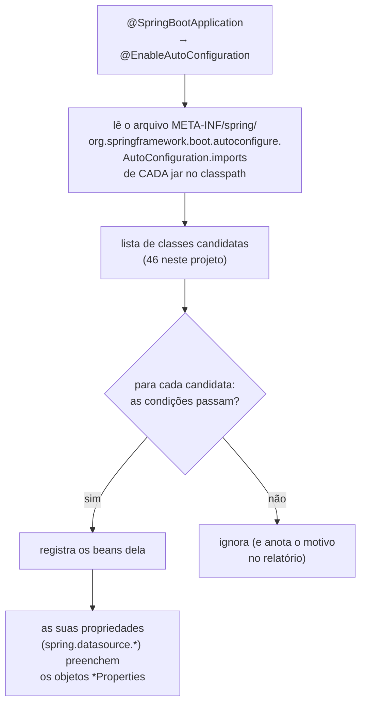

# J5.04 — Como funciona a autoconfiguração

> ⏱️ ~1h30 · 🟢 Júnior · Pré-requisitos: J5.01–J5.03 (DI, projeto Spring Boot, beans, `@Bean`, `@Configuration`), J1.13 (lambdas e `Predicate`)

## 🎯 Objetivos
Ao final desta aula você consegue:
- Explicar o que a **autoconfiguração** faz, **quando** ela age e **como** você a substitui ("o Boot recua").
- Gerar e **ler o relatório de condições** (`--debug`) para responder "por que este bean existe?" e "por que este não existe?".
- Nomear as condições mais comuns (`@ConditionalOnClass`, `@ConditionalOnMissingBean`, `@ConditionalOnProperty`) e escrever uma autoconfiguração em miniatura **testada**.
- **Excluir** uma autoconfiguração e reconhecer os erros típicos quando ela não consegue se configurar (`Failed to configure a DataSource`).
- Remover do PayFlow o código que o Boot agora faz por você (a classe `Database` da J3) e explicar quem cria o `DataSource` e roda o Flyway.

## 🤔 Por que isso importa
"Mágica" é o que o iniciante vê e "convenção com regras explícitas" é o que o sênior vê. Quando a aplicação não sobe com uma mensagem estranha, ou quando um bean "não é o que eu defini", a pergunta certa é **qual autoconfiguração decidiu isso e por quê**, e o relatório de condições responde. Em entrevista, "como funciona a autoconfiguração do Spring Boot?" é pergunta clássica de júnior para pleno.

## 💡 Intuição (explicação simples)
Um hotel arruma o quarto conforme a sua **reserva e a sua mala**. Você chegou com carro elétrico? Põem o carregador na vaga. Fez a reserva "com café da manhã"? Montam a mesa. E se você **trouxe a sua própria** cafeteira? Eles **não colocam outra**: recuam. Cada decisão é uma regra do tipo "*se* X estiver presente (ou ausente), *então* faça Y". A autoconfiguração do Spring Boot é essa equipe de arrumação: ela olha o **classpath** (o que você trouxe), as **propriedades** (o que você pediu) e os **beans que você já definiu** (o que você trouxe pronto) e só então monta o que falta.

## 🔬 Como funciona por dentro

### 1. O mecanismo, em quatro passos

1. **Candidatas.** Cada módulo do Spring Boot que está no classpath traz uma lista, no arquivo `META-INF/spring/org.springframework.boot.autoconfigure.AutoConfiguration.imports`, com os nomes de suas classes de autoconfiguração. No **Boot 4** essas listas ficam em **módulos separados** (conferido no JAR do PayFlow): `spring-boot-jdbc` tem 9 (por exemplo `org.springframework.boot.jdbc.autoconfigure.DataSourceAutoConfiguration`), `spring-boot-flyway` tem 2 (`org.springframework.boot.flyway.autoconfigure.FlywayAutoConfiguration`), `spring-boot-webmvc` tem 6, e assim por diante: **46 candidatas** em 11 *jars*. É por isso que adicionar um *starter* "liga" uma funcionalidade: o módulo novo entra no classpath e traz as suas candidatas.
2. **Condições.** Cada candidata é uma classe `@AutoConfiguration` (uma `@Configuration` especial) com **condições**. Só entra o que passa em todas.
3. **Recuo.** Quase todo bean autoconfigurado tem `@ConditionalOnMissingBean`: "só crio este **se você não tiver criado o seu**". Um bean seu **sempre ganha**.
4. **Propriedades.** Valores como `spring.datasource.url` preenchem classes `*Properties` (J5.05), e a autoconfiguração usa o resultado.

### 2. As condições que você vai ler todo dia
| Condição | Pergunta que responde | Exemplo real (do relatório) |
|---|---|---|
| `@ConditionalOnClass` | A classe X está no classpath? (o *starter* está presente?) | `HikariDataSource` → cria o pool Hikari |
| `@ConditionalOnMissingClass` | A classe X **não** está? | — |
| `@ConditionalOnBean` | Já existe um bean do tipo X? | Flyway só se houver `DataSource` |
| `@ConditionalOnMissingBean` | **Não** existe bean do tipo X? (o recuo) | `DataSource` só se você não definiu o seu |
| `@ConditionalOnProperty` | A propriedade está definida (e com o valor esperado)? | `spring.flyway.enabled=true` |
| `@ConditionalOnWebApplication` | É uma aplicação web? | `DispatcherServlet` |

A ordem importa: `@ConditionalOnBean`/`@ConditionalOnMissingBean` olham os beans **já registrados naquele momento**. Por isso o Boot as usa em **autoconfigurações** (processadas **depois** das suas configurações) e a documentação desaconselha usá-las em `@Configuration` comuns: o resultado dependeria da ordem de processamento. (O laboratório mais adiante reproduz isso em um programa de 80 linhas.)

### 3. O relatório de condições (`--debug`)
Qualquer aplicação Spring Boot imprime **por que** cada autoconfiguração entrou ou não, se for iniciada com `--debug` (a [documentação](https://docs.spring.io/spring-boot/reference/using/auto-configuration.html) recomenda exatamente isso). Com o JAR da J5.02:
```bash
java -jar target/payflow-0.1.0-SNAPSHOT.jar --debug
```
O relatório tem quatro seções: **Positive matches** (entrou, com os motivos), **Negative matches** (não entrou, com o motivo), **Exclusions** e **Unconditional classes**. Neste projeto (Boot 4.1.2) cada uma das duas seções principais tem **dezenas** de entradas. Trechos reais:
```
Positive matches:
-----------------
   DataSourceAutoConfiguration matched:
      - @ConditionalOnClass found required classes 'javax.sql.DataSource', 'org.springframework.jdbc.datasource.embedded.EmbeddedDatabaseType' (OnClassCondition)
      - @ConditionalOnMissingBean (types: io.r2dbc.spi.ConnectionFactory; SearchStrategy: all) did not find any beans (OnBeanCondition)

   DataSourceConfiguration.Hikari matched:
      - @ConditionalOnClass found required class 'com.zaxxer.hikari.HikariDataSource' (OnClassCondition)
      - @ConditionalOnProperty (spring.datasource.type=com.zaxxer.hikari.HikariDataSource) matched (OnPropertyCondition)
      - @ConditionalOnMissingBean (types: javax.sql.DataSource; SearchStrategy: all) did not find any beans (OnBeanCondition)

   FlywayAutoConfiguration matched:
      - @ConditionalOnClass found required class 'org.flywaydb.core.Flyway' (OnClassCondition)
      - @ConditionalOnBooleanProperty (spring.flyway.enabled=true) matched (OnPropertyCondition)

Negative matches:
-----------------
   DataSourceAutoConfiguration.EmbeddedDatabaseConfiguration:
      Did not match:
         - EmbeddedDataSource spring.datasource.url is set (DataSourceAutoConfiguration.EmbeddedDatabaseCondition)

   DataSourceConfiguration.Dbcp2:
      Did not match:
         - @ConditionalOnClass did not find required class 'org.apache.commons.dbcp2.BasicDataSource' (OnClassCondition)

   AopAutoConfiguration.AspectJAutoProxyingConfiguration:
      Did not match:
         - @ConditionalOnClass did not find required class 'org.aspectj.weaver.Advice' (OnClassCondition)
```
**Lendo a história do `DataSource`:** (1) há um `DataSource` no classpath e nenhum `ConnectionFactory` reativo; (2) o Hikari está no classpath, então o pool é o Hikari (os outros, `Dbcp2`, `Tomcat`, `OracleUcp`, estão em *Negative matches*, "required class not found"); (3) **você não definiu um `DataSource`** ("did not find any beans"), então o Boot cria o dele; (4) o banco **embutido** (H2) foi recusado porque você definiu `spring.datasource.url`. Cada decisão é uma frase legível. O mesmo relatório está disponível em tempo de execução pelo endpoint `/actuator/conditions` (J5.15) ([documentação](https://docs.spring.io/spring-boot/api/rest/actuator/conditions.html)).

> 💡 Em um `mvn spring-boot:run`, passe o argumento assim: `mvn spring-boot:run -Dspring-boot.run.arguments=--debug`.

### 4. Quem faz o quê no PayFlow, depois da J5.02
| Antes (J3/J4, à mão) | Agora (autoconfiguração) |
|---|---|
| `Database.dataSource()` com `PGSimpleDataSource` e variáveis de ambiente | `DataSourceAutoConfiguration` + `spring.datasource.*` → **pool Hikari** (J5.05) |
| `Database.migrate(ds, true)` no `main` | `FlywayAutoConfiguration` roda as migrações na subida (log: Flyway **antes** de `Tomcat started`) |
| `HttpServer.create(...)` | `ServletWebServerFactory` do Tomcat (J5.06) |
| `JsonWriter` escrito à mão | `JacksonAutoConfiguration` (J5.06) |
| `Views` (`TemplateEngine` do Thymeleaf) | `ThymeleafAutoConfiguration` (J5.06) |

## 🛠️ Exemplo prático
> Testado com **JDK 25.0.5**, **Spring Boot 4.1.2**, PostgreSQL 18.6.

### 1. Uma autoconfiguração em miniatura (e os testes dela)
O **`ApplicationContextRunner`** (da biblioteca de testes do Spring Boot) cria um contexto **descartável** com só as classes que você escolher, o que torna fácil testar condições. (Ele volta na J7.) A "biblioteca" do exemplo é um `Greeter`:

`src/test/java/com/payflow/lab/AutoConfigLabTest.java`
```java
package com.payflow.lab;

import static org.assertj.core.api.Assertions.assertThat;

import org.junit.jupiter.api.Test;
import org.springframework.boot.autoconfigure.AutoConfiguration;
import org.springframework.boot.autoconfigure.AutoConfigurations;
import org.springframework.boot.autoconfigure.condition.ConditionalOnMissingBean;
import org.springframework.boot.autoconfigure.condition.ConditionalOnProperty;
import org.springframework.boot.test.context.runner.ApplicationContextRunner;
import org.springframework.context.annotation.Bean;
import org.springframework.context.annotation.Configuration;

/** Laboratório da J5.04: uma autoconfiguração em miniatura, com as mesmas condições do Spring Boot. */
class AutoConfigLabTest {

    /** O "serviço" que a nossa mini-biblioteca oferece. */
    record Greeter(String greeting) {
        String greet(String name) { return greeting + ", " + name + "!"; }
    }

    /** A autoconfiguração: cria um Greeter padrão, a menos que o usuário já tenha definido o dele
     *  ou desligue a funcionalidade por propriedade. */
    @AutoConfiguration
    @ConditionalOnProperty(prefix = "payflow.greeting", name = "enabled", havingValue = "true", matchIfMissing = true)
    static class GreeterAutoConfiguration {

        @Bean
        @ConditionalOnMissingBean
        Greeter greeter() {
            return new Greeter("Hello");
        }
    }

    @Configuration
    static class UserConfiguration {
        @Bean
        Greeter portugueseGreeter() {
            return new Greeter("Olá");
        }
    }

    private final ApplicationContextRunner runner = new ApplicationContextRunner()
            .withConfiguration(AutoConfigurations.of(GreeterAutoConfiguration.class));

    @Test
    void createsTheDefaultBean() {
        runner.run(ctx -> {
            assertThat(ctx).hasSingleBean(Greeter.class);
            System.out.println("1. padrão:        " + ctx.getBean(Greeter.class).greet("Ana"));
        });
    }

    @Test
    void backsOffWhenTheUserDefinesTheirOwnBean() {
        runner.withUserConfiguration(UserConfiguration.class).run(ctx -> {
            assertThat(ctx).hasSingleBean(Greeter.class);
            assertThat(ctx).hasBean("portugueseGreeter").doesNotHaveBean("greeter");
            System.out.println("2. bean do usuário: " + ctx.getBean(Greeter.class).greet("Ana"));
        });
    }

    @Test
    void doesNotCreateTheBeanWhenDisabledByProperty() {
        runner.withPropertyValues("payflow.greeting.enabled=false").run(ctx -> {
            assertThat(ctx).doesNotHaveBean(Greeter.class);
            System.out.println("3. desligado por propriedade: " + ctx.getBeansOfType(Greeter.class).size() + " beans");
        });
    }
}
```
```bash
export JAVA_HOME=/usr/lib/jvm/java-25-openjdk-amd64
mvn -q test -Dtest=AutoConfigLabTest
```
Saída real:
```
1. padrão:        Hello, Ana!
3. desligado por propriedade: 0 beans
2. bean do usuário: Olá, Ana!
```
O que cada cenário prova (e por que o código é um **modelo** de como o Boot faz):
1. Sem nada do usuário, a autoconfiguração cria o `Greeter` padrão.
2. Com um `Greeter` do usuário, **só existe o dele** (`doesNotHaveBean("greeter")`): o `@ConditionalOnMissingBean` fez a autoconfiguração **recuar**. É exatamente o que acontece com o `DataSource` se você declarar um.
3. Com `payflow.greeting.enabled=false`, a classe inteira some por causa do `@ConditionalOnProperty` (`matchIfMissing = true` quer dizer "se a propriedade não existir, **liga**": o padrão é ligado, e você desliga).

### 2. Desligar uma autoconfiguração
Com `--debug` e a exclusão por propriedade:
```bash
java -jar target/payflow-0.1.0-SNAPSHOT.jar --debug \
  --spring.autoconfigure.exclude=org.springframework.boot.flyway.autoconfigure.FlywayAutoConfiguration
```
Saída real (trecho do relatório):
```
Exclusions:
-----------

    org.springframework.boot.flyway.autoconfigure.FlywayAutoConfiguration
```
A aplicação sobe **sem rodar as migrações**. O equivalente no código é `@SpringBootApplication(exclude = FlywayAutoConfiguration.class)` (documentação: `exclude` e `spring.autoconfigure.exclude`). Use para **entender**; em projetos reais exclua uma autoconfiguração só com um motivo claro.

### 3. Quando a autoconfiguração não consegue se configurar
Duas mensagens reais que você verá (testadas):
```bash
java -jar target/payflow-0.1.0-SNAPSHOT.jar --spring.datasource.url=
```
```
***************************
APPLICATION FAILED TO START
***************************

Description:

Failed to configure a DataSource: 'url' attribute is not specified and no embedded datasource could be configured.

Reason: Failed to determine a suitable driver class

Action:

Consider the following:
	If you want an embedded database (H2, HSQL or Derby), please put it on the classpath.
	If you have database settings to be loaded from a particular profile you may need to activate it (no profiles are currently active).
```
Esse bloco é uma **análise de falha** (*failure analyzer*): o Boot reconhece erros comuns e escreve **Description** e **Action** em vez de um *stack trace*. Aqui, sem URL, o Boot tentou o banco embutido, não achou nenhum (nem H2 no classpath) e desistiu. A causa no PayFlow: a propriedade vazia (ou ausente). E a segunda, senha errada:
```bash
java -jar target/payflow-0.1.0-SNAPSHOT.jar --spring.datasource.password=errada
```
```
Error creating bean with name 'flywayInitializer' defined in class path resource
 [org/springframework/boot/flyway/autoconfigure/FlywayAutoConfiguration$FlywayConfiguration.class]: Unable to obtain connection from database
Caused by: org.flywaydb.core.internal.exception.sqlExceptions.FlywaySqlUnableToConnectToDbException:
 Unable to obtain connection from database: FATAL: password authentication failed for user "payflow"
```
Leia pelo **nome do bean** (`flywayInitializer`, o primeiro a tocar o banco) e pela **causa raiz** (`FATAL: password authentication failed`, que você já conhece da J3).

### 4. Limpar o PayFlow
A classe `Database` (J3.11/J3.12) criava o `DataSource` e chamava o Flyway. Agora isso é do Boot. Faça:
```bash
git rm src/main/java/com/payflow/db/Database.java
git rm src/main/java/com/payflow/db/Demo.java 2>/dev/null || true        # o demo da J3.11, se você o criou
git rm src/main/java/com/payflow/web/WebApp.java                        # o main do painel da J4 (agora é a PayflowApplication)
```
E, no `pom.xml`, o driver do PostgreSQL volta ao escopo habitual (ninguém mais o usa em tempo de compilação):
```xml
<dependency>
  <groupId>org.postgresql</groupId>
  <artifactId>postgresql</artifactId>
  <scope>runtime</scope>
</dependency>
```
```bash
mvn -q clean package -DskipTests
ls -la target/payflow-0.1.0-SNAPSHOT.jar      # 25171854 bytes: continua um JAR executável
```
Os testes da J3 continuam usando o próprio `DbTestSupport` (com o `Flyway` direto), porque ainda são **testes JDBC sem Spring**; na J5.11 eles migram para `@SpringBootTest`. O servidor antigo (`PayflowServer`) ainda compila: ele recebe o `DataSource` por parâmetro. A J5.06 o aposenta.

## 🧠 Pausa para lógica
**Enunciado:** escreva um **avaliador de condições** em miniatura (como o do Boot): uma lista de candidatas, cada uma com condições (`classe presente`, `bean ausente`, `bean presente`, `propriedade definida`), avaliadas **em ordem**; as que passam registram o seu bean (o que afeta as seguintes), e o programa imprime um relatório com **Positive/Negative matches** e o **primeiro motivo** de cada negativa. Rode em dois cenários: sem beans do usuário e com um `DataSource` do usuário.

<details><summary>Dica</summary>Modele <code>Condition</code> como <code>(descrição, Predicate&lt;Env&gt;)</code>, onde <code>Env</code> guarda o classpath, os beans já registrados (um <code>Set</code> mutável) e as propriedades. Para cada candidata, use <code>stream().filter(c -&gt; !c.test(env)).findFirst()</code> para achar a primeira condição que falha. Registre o bean da candidata no <code>Set</code> <b>só se</b> ela passar, antes de avaliar a próxima.</details>
<details><summary>Solução (testada com JDK 25.0.5)</summary>

```java
import java.util.ArrayList;
import java.util.HashSet;
import java.util.List;
import java.util.Map;
import java.util.Set;
import java.util.function.Predicate;

/** Um "Spring Boot de brinquedo": candidatos com condições, avaliados em ordem, gerando um relatório. */
public class ConditionsReport {

    /** O que o "contêiner" sabe: classes no classpath, beans já registrados e propriedades. */
    record Env(Set<String> classpath, Set<String> beans, Map<String, String> properties) { }

    record Condition(String description, Predicate<Env> test) { }

    record Candidate(String name, String provides, List<Condition> conditions) { }

    static Condition onClass(String c) {
        return new Condition("@ConditionalOnClass " + c, env -> env.classpath().contains(c));
    }

    static Condition onMissingBean(String type) {
        return new Condition("@ConditionalOnMissingBean " + type, env -> !env.beans().contains(type));
    }

    static Condition onBean(String type) {
        return new Condition("@ConditionalOnBean " + type, env -> env.beans().contains(type));
    }

    static Condition onProperty(String key) {
        return new Condition("@ConditionalOnProperty " + key, env -> env.properties().containsKey(key));
    }

    /** Avalia os candidatos NA ORDEM; um candidato que combina registra o seu bean (e isso afeta os seguintes). */
    static String evaluate(Env env, List<Candidate> candidates) {
        List<String> positive = new ArrayList<>();
        List<String> negative = new ArrayList<>();
        for (Candidate c : candidates) {
            Condition failed = c.conditions().stream().filter(k -> !k.test().test(env)).findFirst().orElse(null);
            if (failed == null) {
                positive.add("   " + c.name() + " matched (" + c.conditions().size() + " conditions)");
                env.beans().add(c.provides());
            } else {
                negative.add("   " + c.name() + ":\n      Did not match: " + failed.description());
            }
        }
        return "Positive matches:\n" + String.join("\n", positive)
                + "\n\nNegative matches:\n" + String.join("\n", negative);
    }

    public static void main(String[] args) {
        List<Candidate> candidates = List.of(
                new Candidate("DataSourceAutoConfiguration", "DataSource",
                        List.of(onClass("javax.sql.DataSource"), onMissingBean("DataSource"))),
                new Candidate("FlywayAutoConfiguration", "Flyway",
                        List.of(onClass("org.flywaydb.core.Flyway"), onBean("DataSource"))),
                new Candidate("HibernateJpaAutoConfiguration", "EntityManagerFactory",
                        List.of(onClass("jakarta.persistence.EntityManager"), onBean("DataSource"))),
                new Candidate("RedisAutoConfiguration", "RedisConnectionFactory",
                        List.of(onClass("io.lettuce.core.RedisClient"))));

        Set<String> classpath = Set.of("javax.sql.DataSource", "org.flywaydb.core.Flyway");

        System.out.println("=== cenário 1: o usuário não definiu nada ===");
        System.out.println(evaluate(new Env(classpath, new HashSet<>(), Map.of()), candidates));

        System.out.println("\n=== cenário 2: o usuário já definiu o seu DataSource ===");
        System.out.println(evaluate(new Env(classpath, new HashSet<>(Set.of("DataSource")), Map.of()), candidates));
    }
}
```
Saída real:
```
=== cenário 1: o usuário não definiu nada ===
Positive matches:
   DataSourceAutoConfiguration matched (2 conditions)
   FlywayAutoConfiguration matched (2 conditions)

Negative matches:
   HibernateJpaAutoConfiguration:
      Did not match: @ConditionalOnClass jakarta.persistence.EntityManager
   RedisAutoConfiguration:
      Did not match: @ConditionalOnClass io.lettuce.core.RedisClient

=== cenário 2: o usuário já definiu o seu DataSource ===
Positive matches:
   FlywayAutoConfiguration matched (2 conditions)

Negative matches:
   DataSourceAutoConfiguration:
      Did not match: @ConditionalOnMissingBean DataSource
   HibernateJpaAutoConfiguration:
      Did not match: @ConditionalOnClass jakarta.persistence.EntityManager
   RedisAutoConfiguration:
      Did not match: @ConditionalOnClass io.lettuce.core.RedisClient
```
Dois detalhes: (1) no cenário 2 a `FlywayAutoConfiguration` **ainda** entra, porque o `DataSource` **do usuário** satisfaz o `@ConditionalOnBean DataSource` (é a prova de que o recuo não quebra quem depende dele); (2) se você **trocar a ordem** da lista e colocar o Flyway **antes** do `DataSource`, o resultado muda no cenário 1: o Flyway não encontra o bean e é recusado. É por isso que o Spring Boot ordena as autoconfigurações explicitamente (`@AutoConfiguration(after = ...)`) e só as usa para `@ConditionalOnBean`.
</details>

**Variação mais difícil:** acrescente a condição `@ConditionalOnMissingClass` e o conceito de **ordem explícita** (`after`): ordene as candidatas topologicamente (J5.01) antes de avaliá-las.

## ⚠️ Erros comuns e boas práticas de produção
- **Esperar que a autoconfiguração sobrescreva o seu bean.** É o contrário: **seu bean ganha**. Se o `DataSource` "não é o do `application.yml`", provavelmente você definiu um `@Bean DataSource` em algum lugar.
- **Dois `DataSource` (ou dois beans do mesmo tipo) sem `@Primary`:** a autoconfiguração **recua** (por causa do `MissingBean`) e a aplicação acaba com ambiguidade (J5.03). Não crie `DataSource` próprio sem necessidade.
- **"Funciona na minha máquina" com banco embutido.** Se `spring.datasource.url` não for lido e houver H2 no classpath, o Boot sobe com **H2 em memória** em silêncio. Foi por isso que o `application.yml` da J5.02 tem a URL e que a decisão 5 do curso proíbe H2 nos testes de integração.
- **Excluir autoconfiguração por impaciência** (para "fazer a aplicação subir") esconde o problema real. Leia o relatório.
- **Não leia o relatório inteiro**: use a busca por nome (`grep -A5 "DataSourceAutoConfiguration"`), é um texto grande.
- **Atualizar a versão do Boot muda as autoconfigurações.** Nomes de pacote e de propriedades mudam entre versões maiores (nesta aula, no Boot 4, `org.springframework.boot.jdbc.autoconfigure.*` em vez do antigo `org.springframework.boot.autoconfigure.jdbc.*`); tutoriais antigos citam nomes que não existem mais.

## 🧩 Exercícios
1. **Fixação:** (a) em uma frase, como o Spring Boot decide quais beans criar? (b) para que serve `@ConditionalOnMissingBean` e por que ele existe? (c) onde ficam, no JAR, os nomes das autoconfigurações? (d) o que você faz quando a aplicação cria um bean "que eu não queria"? (e) o que `matchIfMissing = true` significa?
2. **Aplicação no PayFlow:** inspecione e limpe.
   - [ ] `AutoConfigLabTest` e `docs/spring-lab/ConditionsReport.java` no projeto, executando e produzindo as saídas desta aula.
   - [ ] Você gerou o relatório com `--debug` e salvou em `docs/spring-lab/conditions-report.txt`; anotou **três** autoconfigurações positivas e **três** negativas, **cada uma com o motivo**, em `docs/spring-lab/autoconfig-notes.md`.
   - [ ] `Database.java` (e `Demo.java`/`WebApp.java`) removidos; `postgresql` com `scope` `runtime`; `mvn clean package` verde; a aplicação sobe e o Flyway valida as 5 migrações.
   - [ ] Você provocou os dois erros (URL vazia e senha errada) e colou o `Description`/`Action` (e a causa raiz) em `docs/spring-lab/startup-errors.md`.
   - [ ] Você anotou como o `DataSource` e o Flyway eram criados **antes** (qual classe/linha) e quem os cria **agora**.
   - [ ] Commit: `refactor: let Spring Boot create the DataSource and run Flyway`.
3. **Desafio (opcional):** crie uma `@AutoConfiguration` real que registre um `Clock` **só se** não houver outro `Clock` (`@ConditionalOnMissingBean`) e escreva dois testes com `ApplicationContextRunner`: um com e outro sem um `Clock` fixo do usuário. (Esta é a versão "de verdade" do `ClockConfig` da J5.03.)

<details><summary>Soluções de referência</summary>

1. Ele lê a lista de classes candidatas de cada módulo no classpath e registra só as cujas condições passam (classe presente, bean ausente, propriedade definida...). (b) Para o Boot **recuar** quando você já definiu o seu bean: configuração padrão sensata que você pode substituir sem desligar nada. (c) Em `META-INF/spring/org.springframework.boot.autoconfigure.AutoConfiguration.imports`, dentro de cada JAR de módulo. (d) Rode com `--debug`, ache a autoconfiguração e a condição; resolva com o seu próprio bean, a propriedade que a desliga ou, em último caso, `exclude`. (e) Se a propriedade não existir, a condição é satisfeita (o padrão é "ligado").
2. Respostas pessoais; confira que cada negativa cita a condição (por exemplo, `Dbcp2`: `@ConditionalOnClass did not find required class 'org.apache.commons.dbcp2.BasicDataSource'`).
3. Esboço (não executado): `@AutoConfiguration static class ClockAutoConfiguration { @Bean @ConditionalOnMissingBean Clock clock() { return Clock.systemUTC(); } }` e testes com `runner.withBean(Clock.class, () -> fixed).run(...)` e `runner.run(...)`.
</details>

## 🎤 Na entrevista
- **Como funciona a autoconfiguração do Spring Boot?** `@EnableAutoConfiguration` (dentro de `@SpringBootApplication`) importa as classes listadas em `META-INF/spring/...AutoConfiguration.imports` de cada JAR; cada uma tem condições (`@ConditionalOnClass`, `@ConditionalOnMissingBean`, `@ConditionalOnProperty`) que decidem se os beans dela entram. Os beans do usuário têm prioridade.
- **Como descobrir por que um bean foi (ou não foi) criado?** Executar com `--debug` (relatório de condições) ou consultar `/actuator/conditions`.
- **Como substituir ou desligar uma autoconfiguração?** Definir o próprio bean do mesmo tipo (a autoconfiguração recua), usar a propriedade de ligar/desligar dela, ou excluí-la com `exclude`/`spring.autoconfigure.exclude`.
- **O que é um starter e como ele se relaciona com a autoconfiguração?** O starter traz as dependências; ao entrarem no classpath, as classes de autoconfiguração do módulo passam a ser candidatas e as condições `@ConditionalOnClass` passam.

## 📚 Para ir além
- 📄 [Spring Boot — Auto-configuration](https://docs.spring.io/spring-boot/reference/using/auto-configuration.html): `--debug`, substituição e `exclude`.
- 📄 [Spring Boot — Creating Your Own Auto-configuration](https://docs.spring.io/spring-boot/reference/features/developing-auto-configuration.html): `@AutoConfiguration`, o arquivo `.imports` e as anotações de condição.
- 📄 [Spring Boot — Actuator: endpoint `conditions`](https://docs.spring.io/spring-boot/api/rest/actuator/conditions.html): o relatório em tempo de execução.
- 📄 [Spring Boot — Testing Spring Boot Applications](https://docs.spring.io/spring-boot/reference/testing/spring-boot-applications.html): onde `ApplicationContextRunner` e `@SpringBootTest` são apresentados.
- 📄 [Spring Boot — Auto-configuration Classes (apêndice)](https://docs.spring.io/spring-boot/appendix/auto-configuration-classes/index.html): a lista oficial de todas as autoconfigurações por módulo.
- 📄 [Spring Boot — SQL Databases (`DataSource`, Hikari)](https://docs.spring.io/spring-boot/reference/data/sql.html): como o pool é escolhido e configurado.
- 🎥 ⚠️ Nenhum vídeo verificado nesta execução.

## ✅ Checklist da aula
- [ ] Rodei `--debug` e li as seções Positive e Negative matches do `DataSourceAutoConfiguration`.
- [ ] O laboratório com `ApplicationContextRunner` passa nos três cenários.
- [ ] Sei dizer o que `@ConditionalOnMissingBean` garante.
- [ ] Removi a classe `Database` e o Flyway/DataSource agora são do Boot.
- [ ] Reconheço as duas mensagens de falha (`Failed to configure a DataSource` e `password authentication failed`).
