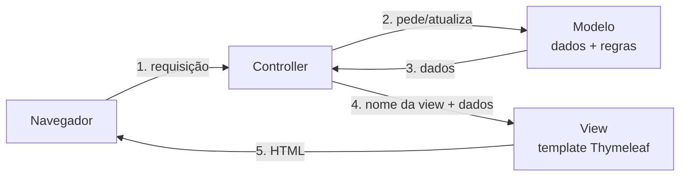
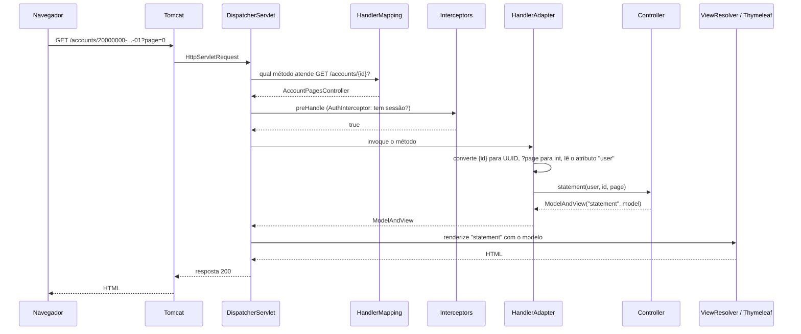

# J5.06 — Spring MVC e o padrão MVC

> ⏱️ ~1h30 · 🟢 Júnior · Pré-requisitos: J5.01–J5.05 (DI, beans, autoconfiguração, `application.yml`), J2 (HTTP, status, cookies), J4.06 (o painel com Thymeleaf e o servidor manual `PayflowServer`)

## 🎯 Objetivos
Ao final desta aula você consegue:
- Explicar o padrão **MVC** (modelo, visão, controlador) e o caminho de uma requisição por **Tomcat → `DispatcherServlet` → controller → view**.
- Escrever **controllers** com `@Controller`, `@RestController`, `@GetMapping`/`@PostMapping`, `@PathVariable`, `@RequestParam` e `@RequestAttribute`, e devolver páginas, JSON, status e redirecionamentos corretos (inclusive **303**).
- Usar **interceptors** (`HandlerInterceptor`) para exigir login e **`@ControllerAdvice`** para tratar erros em um lugar só.
- **Portar** o servidor manual da J4 para Spring MVC **sem mudar** os templates, o JavaScript nem o contrato da API, e provar com os mesmos testes.
- Diagnosticar os problemas reais do porte: `302` em vez de `303`, rota inexistente virando `500`, o template `error` capturado pelo Boot.

## 🤔 Por que isso importa
Na J4 você escreveu um servidor com `if`s e expressões regulares para cada rota, e viu quanto código é de **infraestrutura** (ler o formulário, escrever o cookie, serializar JSON, tratar exceção) e não de **negócio**. Spring MVC leva essa infraestrutura embora: você declara **o quê** (`@GetMapping("/accounts/{id}")`) e o framework cuida do **como**. Em qualquer vaga Java web, "escrever um controller" é a tarefa mais comum do dia a dia.

## 💡 Intuição (explicação simples)
Um **hotel**. Os hóspedes (requisições) chegam todos à **recepção** (o `DispatcherServlet`), que **não resolve nada sozinha**: lê o pedido, consulta a lista de quem atende cada tipo de pedido (*handler mapping*) e encaminha ao **setor** certo (o *controller*). Antes de entrar no setor, o **segurança** confere a pulseira (o *interceptor*). O setor prepara o que o hóspede pediu (usa o **modelo**: dados e regras) e entrega a **bandeja** (o nome de uma *view*); quem monta a apresentação na bandeja é o **copeiro** (o motor de templates, Thymeleaf). Se algo dá errado no setor, a **gerência de ocorrências** (`@ControllerAdvice`) decide o que dizer ao hóspede.

## 🔬 Como funciona por dentro

### 1. O padrão MVC

- **Modelo:** os dados e as regras do domínio (`Account`, o saldo, o depósito).
- **Visão:** como mostrar (o HTML do Thymeleaf; um JSON também é uma "visão").
- **Controlador:** recebe a requisição, chama o modelo e **escolhe** a visão. **Não** contém regra de negócio nem HTML.
Separar as três coisas permite trocar a visão (HTML → JSON) sem tocar na regra e testar a regra sem navegador.

### 2. O caminho de uma requisição no Spring MVC

Os papéis (todos já criados e ligados pela **autoconfiguração**, J5.04):
- **`DispatcherServlet`:** o *front controller*: **o único servlet**; todas as requisições passam por ele.
- **`HandlerMapping`:** "qual método responde a este método HTTP + caminho?". O Spring monta a tabela ao subir, lendo as anotações (veja o log abaixo).
- **`HandlerInterceptor`:** código **antes/depois** do controller, para **vários** controllers (login, métricas).
- **`HandlerAdapter`** e **resolvedores de argumento:** chamam o método e **fabricam os parâmetros** (`@PathVariable UUID id` converte o texto da URL em `UUID`; `@RequestParam int page` converte e usa `defaultValue`).
- **Retorno do método:** um **nome de view** (`String`), um `ModelAndView`, um `ResponseEntity` (status + cabeçalhos + corpo) ou um **objeto** em um `@RestController` (que o **Jackson** converte em JSON: um `HttpMessageConverter`).
- **`ViewResolver`:** transforma o nome `"statement"` no arquivo `templates/statement.html` (no Boot, o do Thymeleaf).

### 3. As anotações que você usará todo dia
| Anotação | Faz |
|---|---|
| `@Controller` | Bean web cujo retorno `String` é **nome de view** |
| `@RestController` | `@Controller` + `@ResponseBody`: o retorno vira **corpo** (JSON), não view |
| `@GetMapping`, `@PostMapping`, ... | Liga **método HTTP + caminho** ao método Java (`@RequestMapping` é a forma geral) |
| `@PathVariable` | Pega `{id}` do caminho (e converte o tipo) |
| `@RequestParam` | Pega `?page=` **ou** campo de formulário; `defaultValue`, `required` |
| `@RequestAttribute` | Pega um atributo que um interceptor/filtro colocou na requisição |
| `@ControllerAdvice` + `@ExceptionHandler` | Trata exceções de **todos** os controllers em um lugar |

### 4. O que cada peça da J4 virou
| J4 (servidor manual) | J5.06 (Spring MVC) |
|---|---|
| `if (path.equals("/login") && method.equals("POST"))` | `@PostMapping("/login")` |
| Expressões regulares `STATEMENT_PAGE`, `UUID_RE` | `@GetMapping("/accounts/{id}")` + `@PathVariable UUID id` |
| `readForm(ex)` com `URLDecoder` | `@RequestParam String email` |
| `intParam(...)` com `Math.max/min` | `@RequestParam(defaultValue = "0") int page` + o limite vem do `application.yml` |
| `withUser(ex, api, action)` | `AuthInterceptor` (`HandlerInterceptor`) |
| `sessionId(ex)` e `Set-Cookie` na mão | `SessionCookies` (`ResponseCookie`) |
| `redirect(ex, ...)` com `sendResponseHeaders(303, -1)` | `Pages.redirect(...)` (`ModelAndView` com status 303) |
| `Views` e o `TemplateEngine` do Thymeleaf | `ThymeleafViewResolver` (autoconfiguração) |
| `JsonWriter` (cerca de 55 linhas) | Jackson (autoconfiguração) com `record`s |
| `catch (RuntimeException e)` → 500 | `@ControllerAdvice` |
| `staticFile(...)` + regex `STATIC_FILE` | `spring.mvc.static-path-pattern: /static/**` |
| `Sessions` | **igual**, agora um `@Component` |

## 🛠️ Exemplo prático
> Testado com **JDK 25.0.5**, **Spring Boot 4.1.2** (Spring MVC 7.0.10, Tomcat 11.0.27, Jackson 3.1.7, Thymeleaf 3.1.5), PostgreSQL 18.6.

### 1. Preparar o terreno
Os **templates** (`fragments`, `login`, `accounts`, `statement`, `error`) e os arquivos de `static/` **não mudam** (decisão 23): o `th:href`, o `th:action` e o `statement.js` seguem como na J4. Duas linhas de configuração fazem isso valer:

`src/main/resources/application.yml` (acrescente em `spring`; o resto como na J5.05):
```yaml
spring:
  web:
    locale: pt-BR                          # Content-Language e formatação padrão
  mvc:
    static-path-pattern: /static/**        # os templates referenciam /static/app.css e /static/statement.js
```
E, no `application-dev.yml`, o cache de templates desligado no desenvolvimento (em produção o padrão é **ligado**, e é o que se quer):
```yaml
  thymeleaf:
    cache: false                           # editar o template e recarregar a página, sem reiniciar
```
O que a autoconfiguração já fez por você: o `DispatcherServlet`, o `ThymeleafViewResolver` apontando para `classpath:/templates/` com sufixo `.html`, o conversor JSON e o *handler* de arquivos estáticos (`ResourceHttpRequestHandler`) para `/static/**`.

### 2. A sessão: três peças pequenas
`Sessions` fica **igual** à da J4, só com `@Component` e métodos `public` (a classe agora é um bean singleton; o mapa é `ConcurrentHashMap`, logo seguro para várias requisições ao mesmo tempo: veja a regra do singleton na J5.03). O **nome do cookie** vem do `PayflowProperties` (J5.05):

`src/main/java/com/payflow/web/SessionCookies.java`
```java
package com.payflow.web;

import com.payflow.config.PayflowProperties;
import jakarta.servlet.http.Cookie;
import jakarta.servlet.http.HttpServletRequest;
import jakarta.servlet.http.HttpServletResponse;
import java.util.Optional;
import org.springframework.http.HttpHeaders;
import org.springframework.http.ResponseCookie;
import org.springframework.stereotype.Component;
import org.springframework.web.util.WebUtils;

/** Lê, grava e apaga o cookie da sessão (nome vem do application.yml: payflow.session.cookie-name). */
@Component
public class SessionCookies {

    private final String name;

    public SessionCookies(PayflowProperties properties) {
        this.name = properties.session().cookieName();
    }

    public Optional<String> read(HttpServletRequest request) {
        Cookie cookie = WebUtils.getCookie(request, name);
        return cookie == null ? Optional.empty() : Optional.of(cookie.getValue());
    }

    public void write(HttpServletResponse response, String sessionId) {
        response.addHeader(HttpHeaders.SET_COOKIE, base(sessionId).build().toString());
    }

    public void clear(HttpServletResponse response) {
        response.addHeader(HttpHeaders.SET_COOKIE, base("").maxAge(0).build().toString());
    }

    private ResponseCookie.ResponseCookieBuilder base(String value) {
        return ResponseCookie.from(name, value).path("/").httpOnly(true).sameSite("Lax");
    }
}
```
O **interceptor** substitui o `withUser` da J4:

`src/main/java/com/payflow/web/AuthInterceptor.java`
```java
package com.payflow.web;

import com.payflow.db.User;
import jakarta.servlet.http.HttpServletRequest;
import jakarta.servlet.http.HttpServletResponse;
import java.io.IOException;
import java.nio.charset.StandardCharsets;
import java.util.Optional;
import org.springframework.http.HttpHeaders;
import org.springframework.http.HttpStatus;
import org.springframework.http.MediaType;
import org.springframework.stereotype.Component;
import org.springframework.web.servlet.HandlerInterceptor;

/**
 * Exige sessão nas rotas protegidas. Com sessão, guarda o usuário no atributo "user" da requisição.
 * Sem sessão: páginas redirecionam para /login (303) e a API responde 401 em JSON.
 */
@Component
public class AuthInterceptor implements HandlerInterceptor {

    public static final String USER = "user";

    private final SessionCookies cookies;
    private final Sessions sessions;

    public AuthInterceptor(SessionCookies cookies, Sessions sessions) {
        this.cookies = cookies;
        this.sessions = sessions;
    }

    @Override
    public boolean preHandle(HttpServletRequest request, HttpServletResponse response, Object handler)
            throws IOException {
        Optional<User> user = cookies.read(request).flatMap(sessions::userOf);
        if (user.isPresent()) {
            request.setAttribute(USER, user.get());
            return true;
        }
        if (request.getRequestURI().startsWith("/api/")) {
            response.setStatus(HttpStatus.UNAUTHORIZED.value());
            response.setContentType(MediaType.APPLICATION_JSON_VALUE);
            response.setCharacterEncoding(StandardCharsets.UTF_8.name());
            response.getWriter().write("{\"error\":\"not authenticated\"}");
        } else {
            response.setStatus(HttpStatus.SEE_OTHER.value());
            response.setHeader(HttpHeaders.LOCATION, "/login");
        }
        return false;                                         // false = a requisição NÃO chega ao controller
    }
}
```
- `preHandle` roda **antes** do controller; devolver `false` **encerra** a requisição ali (o controller nem é chamado).
- `request.setAttribute("user", ...)` é a ponte para o controller (`@RequestAttribute`).
- A API recebe **401 em JSON** (um `fetch` não deve receber uma página de login); as páginas, **303** para `/login`.

Um interceptor precisa ser **registrado** com os caminhos que protege:

`src/main/java/com/payflow/web/WebConfig.java`
```java
package com.payflow.web;

import org.springframework.context.annotation.Configuration;
import org.springframework.web.servlet.config.annotation.InterceptorRegistry;
import org.springframework.web.servlet.config.annotation.WebMvcConfigurer;

@Configuration
public class WebConfig implements WebMvcConfigurer {

    private final AuthInterceptor authInterceptor;

    public WebConfig(AuthInterceptor authInterceptor) {
        this.authInterceptor = authInterceptor;
    }

    @Override
    public void addInterceptors(InterceptorRegistry registry) {
        registry.addInterceptor(authInterceptor).addPathPatterns("/accounts/**", "/api/**");
    }
}
```

### 3. Os controllers
Um auxiliar evita repetir `ModelAndView` e status:

`src/main/java/com/payflow/web/Pages.java`
```java
package com.payflow.web;

import java.util.LinkedHashMap;
import java.util.Map;
import org.springframework.http.HttpStatus;
import org.springframework.web.servlet.ModelAndView;

/** Pequenos auxiliares para devolver uma página com o status certo ou um redirecionamento 303 (Post/Redirect/Get). */
final class Pages {

    private Pages() { }

    /** 303 See Other: o navegador troca para GET (o "redirect:" puro devolveria 302). */
    static ModelAndView redirect(String location) {
        ModelAndView mav = new ModelAndView("redirect:" + location);
        mav.setStatus(HttpStatus.SEE_OTHER);
        return mav;
    }

    /** Renderiza o template {@code view} com o status dado e os pares chave/valor do modelo. */
    static ModelAndView page(String view, HttpStatus status, Object... pairs) {
        Map<String, Object> model = new LinkedHashMap<>();
        for (int i = 0; i < pairs.length; i += 2) {
            model.put((String) pairs[i], pairs[i + 1]);
        }
        ModelAndView mav = new ModelAndView(view, model);
        mav.setStatus(status);
        return mav;
    }
}
```
**Atenção a um detalhe que custa caro:** retornar a string `"redirect:/login"` de um controller devolve **302**, não 303 (testado: `HTTP/1.1 302` com `Location: http://localhost:8080/login`). O `RedirectView` do Spring usa 302 por compatibilidade com clientes HTTP 1.0, e só envia 303 quando o status é pedido ([documentação do `RedirectView`](https://docs.spring.io/spring-framework/docs/current/javadoc-api/org/springframework/web/servlet/view/RedirectView.html): 303 "se a flag de compatibilidade HTTP 1.0 estiver desligada"). Como o PayFlow usa **Post/Redirect/Get com 303** (decisão 25) e os testes conferem, o `Pages.redirect` define o status.

`src/main/java/com/payflow/web/LoginController.java`
```java
package com.payflow.web;

import com.payflow.db.JdbcUserRepository;
import jakarta.servlet.http.HttpServletRequest;
import jakarta.servlet.http.HttpServletResponse;
import org.springframework.http.HttpStatus;
import org.springframework.stereotype.Controller;
import org.springframework.web.bind.annotation.GetMapping;
import org.springframework.web.bind.annotation.PostMapping;
import org.springframework.web.bind.annotation.RequestParam;
import org.springframework.web.servlet.ModelAndView;

/** Login provisório (só e-mail) e logout. Termina na J8, com Spring Security. */
@Controller
public class LoginController {

    private final JdbcUserRepository users;
    private final Sessions sessions;
    private final SessionCookies cookies;

    public LoginController(JdbcUserRepository users, Sessions sessions, SessionCookies cookies) {
        this.users = users;
        this.sessions = sessions;
        this.cookies = cookies;
    }

    @GetMapping("/")
    public ModelAndView root() {
        return Pages.redirect("/accounts");
    }

    @GetMapping("/login")
    public ModelAndView form() {
        return Pages.page("login", HttpStatus.OK);
    }

    @PostMapping("/login")
    public ModelAndView login(@RequestParam(defaultValue = "") String email, HttpServletResponse response) {
        String normalized = email.trim().toLowerCase();
        return users.findByEmail(normalized)
                .map(user -> {
                    cookies.write(response, sessions.create(user));
                    return Pages.redirect("/accounts");
                })
                .orElseGet(() -> Pages.page("login", HttpStatus.UNAUTHORIZED,
                        "error", "Não encontramos esse e-mail.", "email", normalized));
    }

    @PostMapping("/logout")
    public ModelAndView logout(HttpServletRequest request, HttpServletResponse response) {
        cookies.read(request).ifPresent(sessions::destroy);
        cookies.clear(response);
        return Pages.redirect("/login");
    }
}
```
`src/main/java/com/payflow/web/AccountPagesController.java`
```java
package com.payflow.web;

import com.payflow.config.PayflowProperties;
import com.payflow.db.Account;
import com.payflow.db.AccountUnavailableException;
import com.payflow.db.JdbcAccountRepository;
import com.payflow.db.LedgerEntry;
import com.payflow.db.User;
import java.math.BigDecimal;
import java.time.ZoneId;
import java.time.format.DateTimeFormatter;
import java.util.List;
import java.util.Optional;
import java.util.UUID;
import org.springframework.http.HttpStatus;
import org.springframework.stereotype.Controller;
import org.springframework.web.bind.annotation.GetMapping;
import org.springframework.web.bind.annotation.PathVariable;
import org.springframework.web.bind.annotation.PostMapping;
import org.springframework.web.bind.annotation.RequestAttribute;
import org.springframework.web.bind.annotation.RequestParam;
import org.springframework.web.servlet.ModelAndView;

/** Páginas do painel: contas, extrato e depósito. O usuário da sessão chega pelo AuthInterceptor. */
@Controller
public class AccountPagesController {

    private static final ZoneId ZONE = ZoneId.of("America/Sao_Paulo");
    private static final DateTimeFormatter DATE_TIME = DateTimeFormatter.ofPattern("dd/MM/yyyy HH:mm");

    private final JdbcAccountRepository accounts;
    private final PayflowProperties properties;

    public AccountPagesController(JdbcAccountRepository accounts, PayflowProperties properties) {
        this.accounts = accounts;
        this.properties = properties;
    }

    /** O que o template precisa para uma linha do extrato, já formatado para quem lê. */
    public record EntryView(String label, boolean credit, BigDecimal amount, String when) { }

    @GetMapping("/accounts")
    public ModelAndView list(@RequestAttribute(AuthInterceptor.USER) User user) {
        return Pages.page("accounts", HttpStatus.OK, "user", user, "accounts", accounts.findByOwner(user.id()));
    }

    @GetMapping("/accounts/{id}")
    public ModelAndView statement(@RequestAttribute(AuthInterceptor.USER) User user,
                                  @PathVariable UUID id,
                                  @RequestParam(defaultValue = "0") int page) {
        return statementPage(user, id, page, null, HttpStatus.OK);
    }

    @PostMapping("/accounts/{id}/deposit")
    public ModelAndView deposit(@RequestAttribute(AuthInterceptor.USER) User user,
                                @PathVariable UUID id,
                                @RequestParam(defaultValue = "") String amount) {
        if (ownedAccount(user, id).isEmpty()) {
            return statementPage(user, id, 0, null, HttpStatus.OK);     // vira a página 404 abaixo
        }
        String raw = amount.trim().replace(',', '.');
        try {
            accounts.deposit(id, new BigDecimal(raw));
            return Pages.redirect("/accounts/" + id);                    // Post/Redirect/Get: F5 não repete o depósito
        } catch (IllegalArgumentException e) {                           // inclui NumberFormatException
            return statementPage(user, id, 0,
                    "Informe um valor positivo com até 2 casas decimais, como 25,90.", HttpStatus.BAD_REQUEST);
        } catch (AccountUnavailableException e) {
            return statementPage(user, id, 0, "Esta conta não aceita depósitos agora.", HttpStatus.UNPROCESSABLE_ENTITY);
        }
    }

    private ModelAndView statementPage(User user, UUID id, int requestedPage, String formError, HttpStatus status) {
        Optional<Account> account = ownedAccount(user, id);
        if (account.isEmpty()) {
            return Pages.page("error", HttpStatus.NOT_FOUND, "user", user,
                    "title", "Conta não encontrada", "message", "Não encontramos essa conta.");
        }
        int size = properties.statement().pageSize();
        int page = Math.max(0, Math.min(requestedPage, properties.statement().maxPage()));
        List<EntryView> entries = accounts.statement(id, page, size).stream().map(this::view).toList();
        boolean hasMore = !accounts.statement(id, page + 1, size).isEmpty();
        ModelAndView mav = Pages.page("statement", status, "user", user, "account", account.get(),
                "entries", entries, "page", page, "hasMore", hasMore);
        if (formError != null) {
            mav.addObject("formError", formError);
        }
        return mav;
    }

    /** Só devolve a conta se ela for do usuário da sessão; de outro dono = "não existe" (o IDOR é tema da J8). */
    private Optional<Account> ownedAccount(User user, UUID id) {
        return accounts.findById(id).filter(a -> a.ownerId().equals(user.id()));
    }

    private EntryView view(LedgerEntry e) {
        boolean credit = e.type().equals("CREDIT");
        String label = e.transferId() == null ? "Depósito"
                : credit ? "Transferência recebida" : "Transferência enviada";
        return new EntryView(label, credit, e.amount(), DATE_TIME.format(e.createdAt().atZoneSameInstant(ZONE)));
    }
}
```
`src/main/java/com/payflow/web/StatementApiController.java`
```java
package com.payflow.web;

import com.payflow.config.PayflowProperties;
import com.payflow.db.JdbcAccountRepository;
import com.payflow.db.LedgerEntry;
import com.payflow.db.User;
import java.util.List;
import java.util.Map;
import java.util.UUID;
import org.springframework.http.ResponseEntity;
import org.springframework.web.bind.annotation.GetMapping;
import org.springframework.web.bind.annotation.PathVariable;
import org.springframework.web.bind.annotation.RequestAttribute;
import org.springframework.web.bind.annotation.RequestParam;
import org.springframework.web.bind.annotation.RestController;

/** O endpoint JSON que o statement.js consome (contrato estável: dinheiro em string, datas ISO-8601 UTC). */
@RestController
public class StatementApiController {

    private final JdbcAccountRepository accounts;
    private final PayflowProperties properties;

    public StatementApiController(JdbcAccountRepository accounts, PayflowProperties properties) {
        this.accounts = accounts;
        this.properties = properties;
    }

    public record EntryJson(String id, String type, String transferId, String amount, String createdAt) { }

    public record StatementJson(int page, boolean hasMore, List<EntryJson> entries) { }

    @GetMapping("/api/accounts/{id}/statement")
    public ResponseEntity<?> statement(@RequestAttribute(AuthInterceptor.USER) User user,
                                       @PathVariable UUID id,
                                       @RequestParam(defaultValue = "0") int page) {
        boolean owned = accounts.findById(id).filter(a -> a.ownerId().equals(user.id())).isPresent();
        if (!owned) {
            return ResponseEntity.status(404).body(Map.of("error", "account not found"));
        }
        int size = properties.statement().pageSize();
        int safePage = Math.max(0, Math.min(page, properties.statement().maxPage()));
        List<EntryJson> rows = accounts.statement(id, safePage, size).stream().map(this::json).toList();
        boolean hasMore = !accounts.statement(id, safePage + 1, size).isEmpty();
        return ResponseEntity.ok(new StatementJson(safePage, hasMore, rows));
    }

    private EntryJson json(LedgerEntry e) {
        return new EntryJson(e.id().toString(), e.type(),
                e.transferId() == null ? null : e.transferId().toString(),
                e.amount().toPlainString(),                       // dinheiro como string (decisão 11)
                e.createdAt().toInstant().toString());
    }
}
```
Leia as diferenças em relação à J4:
- O controller recebe **parâmetros já convertidos** (`UUID id`, `int page`) e o `User` do interceptor. Nenhuma linha de `URLDecoder` ou `split("&")`.
- O tamanho da página e o limite vêm do `PayflowProperties` (**`payflow.statement.page-size`**, J5.05): mude o `application.yml` (ou use `--payflow.statement.page-size=10`) e o extrato muda.
- O JSON é um `record` (`StatementJson`/`EntryJson`): o Jackson o serializa e **o contrato continua o da J4** (decisão 22): `amount` é **string** (`e.amount().toPlainString()`), `createdAt` em ISO-8601 UTC e `transferId` `null` nos depósitos.
- **Mudança de comportamento (proposital):** `?page=abc` agora responde **400** (o Spring não consegue converter para `int`; o `WebErrors` o transforma em "Pedido inválido"), enquanto um `{id}` que não é UUID continua **404**; a J4 devolvia a página 0 em silêncio. Um erro de entrada que aparece é melhor do que um que se esconde. (Páginas muito altas ou negativas, como `?page=-3` e `?page=99999999`, são **limitadas** pelo `max-page` e respondem 200. E os erros da **API** ainda voltam como página HTML: a J6 os transforma em Problem Details/JSON.)
- O controller ainda fala **direto com o repositório**. Está certo por agora; na J5.11 a regra do depósito vai para um `@Service` transacional, e o controller só traduz HTTP.

### 4. Tratamento de erros em um lugar só
`src/main/java/com/payflow/web/WebErrors.java`
```java
package com.payflow.web;

import jakarta.servlet.http.HttpServletResponse;
import org.slf4j.Logger;
import org.slf4j.LoggerFactory;
import org.springframework.http.HttpHeaders;
import org.springframework.http.HttpStatus;
import org.springframework.web.HttpRequestMethodNotSupportedException;
import org.springframework.web.bind.annotation.ControllerAdvice;
import org.springframework.web.bind.annotation.ExceptionHandler;
import org.springframework.web.method.annotation.MethodArgumentTypeMismatchException;
import org.springframework.web.servlet.ModelAndView;
import org.springframework.web.servlet.NoHandlerFoundException;
import org.springframework.web.servlet.resource.NoResourceFoundException;

/** Transforma exceções em páginas de erro (template "error") com o status certo. */
@ControllerAdvice
public class WebErrors {

    private static final Logger log = LoggerFactory.getLogger(WebErrors.class);   // o Logback chega na J5.14

    @ExceptionHandler({NoHandlerFoundException.class, NoResourceFoundException.class})
    public ModelAndView notFound() {
        return Pages.page("error", HttpStatus.NOT_FOUND,
                "title", "Página não encontrada", "message", "O endereço pedido não existe.");
    }

    /** Um parâmetro que não converte: {id} que não é UUID = recurso inexistente (404); ?page=abc = pedido inválido (400). */
    @ExceptionHandler(MethodArgumentTypeMismatchException.class)
    public ModelAndView badArgument(MethodArgumentTypeMismatchException e) {
        if ("id".equals(e.getName())) {
            return notFound();
        }
        return Pages.page("error", HttpStatus.BAD_REQUEST,
                "title", "Pedido inválido", "message", "O parâmetro '" + e.getName() + "' não é válido.");
    }

    @ExceptionHandler(HttpRequestMethodNotSupportedException.class)
    public ModelAndView methodNotAllowed(HttpRequestMethodNotSupportedException e, HttpServletResponse response) {
        if (e.getSupportedHttpMethods() != null) {
            response.setHeader(HttpHeaders.ALLOW, String.join(", ",
                    e.getSupportedHttpMethods().stream().map(Object::toString).toList()));
        }
        return Pages.page("error", HttpStatus.METHOD_NOT_ALLOWED,
                "title", "Método não permitido", "message", "Esta página não aceita " + e.getMethod() + ".");
    }

    @ExceptionHandler(Exception.class)
    public ModelAndView unexpected(Exception e) {
        log.error("Unexpected error", e);                                  // o detalhe vai para o log, não para a tela
        return Pages.page("error", HttpStatus.INTERNAL_SERVER_ERROR,
                "title", "Algo deu errado", "message", "Não conseguimos concluir a operação. Tente de novo em instantes.");
    }
}
```
Três lições embutidas aqui (as três foram **bugs reais** no porte):
1. **O Spring Boot já tem uma página de erro** e ela se chama **`error`**: se existe `templates/error.html`, o Boot a usa para os erros que **você não tratou**, com um modelo diferente do seu (sem `title`). Já na J5.02, antes de existir qualquer controller, `curl -H 'Accept: text/html' localhost:8080/` devolveu um 404 com `<title>null · PayFlow</title>`: o Boot usou o **nosso** `error.html`, que esperava um `title` no modelo. A defesa é tratar os erros comuns no `@ControllerAdvice`, **dando o modelo que o template espera**.
2. **`NoHandlerFoundException` (rota que não existe) caiu no `@ExceptionHandler(Exception.class)` e virou 500**, com `ERROR ... NoHandlerFoundException: No endpoint GET /nada.` no log. Um `catch (Exception)` engole tudo; os erros **esperados** (404, 405) precisam de handlers **mais específicos**. Depois de acrescentar `NoHandlerFoundException`, `/nada` respondeu **404** com a página certa.
3. **O 405** (método errado) devolve o cabeçalho `Allow` (decisão 12): `curl -X PUT /accounts` → `HTTP/1.1 405` com `Allow: GET`.

O `log.error("Unexpected error", e)` usa o SLF4J (a J5.14 explica o logging): o **detalhe fica no log** e o usuário vê só a mensagem genérica; nunca mostre o *stack trace* na tela.

### 5. Rodar e conferir
```bash
bash scripts/run-dev.sh          # perfil dev (J5.05): banco local + seed
```
A tabela que o Spring montou ao subir (ative com `--logging.level.org.springframework.web.servlet.mvc.method.annotation.RequestMappingHandlerMapping=TRACE`; saída real):
```
c.p.w.AccountPagesController:
	{GET [/accounts]}: list(User)
	{GET [/accounts/{id}]}: statement(User,UUID,int)
	{POST [/accounts/{id}/deposit]}: deposit(User,UUID,String)
c.p.w.LoginController:
	{GET [/]}: root()
	{GET [/login]}: form()
	{POST [/logout]}: logout(HttpServletRequest,HttpServletResponse)
	{POST [/login]}: login(String,HttpServletResponse)
c.p.w.StatementApiController:
	{GET [/api/accounts/{id}/statement]}: statement(User,UUID,int)
o.s.b.w.a.e.BasicErrorController:
	{ [/error]}: error(HttpServletRequest)
	{ [/error], produces [text/html]}: errorHtml(HttpServletRequest,HttpServletResponse)
11 mappings in 'requestMappingHandlerMapping'
```
(Incluindo o `PingController` da J5.02: 11.) E, com `--logging.level.org.springframework.web.servlet.DispatcherServlet=DEBUG`, cada requisição aparece como `POST "/login", parameters={masked}` e `Completed 303 SEE_OTHER`.

As mesmas verificações por fora do navegador que você fez na J4.06 (saída real):
```bash
J=/tmp/jar.txt
curl -si localhost:8080/ | head -3                 # HTTP/1.1 303  Location: /accounts
curl -si localhost:8080/accounts | head -3         # HTTP/1.1 303  Location: /login     (sem sessão)
curl -si -c $J -d 'email=ana@payflow.dev' localhost:8080/login | head -4
# HTTP/1.1 303
# Set-Cookie: PAYFLOW_SESSION=Nuk0V0sE...; Path=/; HttpOnly; SameSite=Lax
# Location: /accounts
curl -s -b $J localhost:8080/accounts | sed -n '/<main/,/<\/main>/p' | grep -E 'Conta|R\$|badge'
#   Conta <span>20000000</span>      <p class="balance">R$ 830,00</p>      <span class="badge badge-ok">Ativa</span>
AID=20000000-0000-0000-0000-000000000001
curl -s -o /dev/null -w '%{http_code} %{redirect_url}\n' -b $J --data-urlencode 'amount=25,90' localhost:8080/accounts/$AID/deposit
# 303 http://localhost:8080/accounts/20000000-0000-0000-0000-000000000001
curl -s -o /dev/null -w '%{http_code}\n' -b $J --data-urlencode 'amount=abc' localhost:8080/accounts/$AID/deposit      # 400
curl -s -b $J "localhost:8080/api/accounts/$AID/statement?page=0" | python3 -c "import json,sys; d=json.load(sys.stdin); print(d['page'],d['hasMore'],len(d['entries'])); print(d['entries'][0])"
# 0 False 4
# {'id': '01a1d550-...', 'type': 'CREDIT', 'transferId': None, 'amount': '25.90', 'createdAt': '2026-11-13T14:29:56.714633Z'}
curl -si localhost:8080/api/accounts/$AID/statement | sed -n '1p;/Content-Type/p;$p'
# HTTP/1.1 401   Content-Type: application/json;charset=UTF-8   {"error":"not authenticated"}
curl -s -o /dev/null -w '%{http_code}\n' -b $J localhost:8080/accounts/20000000-0000-0000-0000-000000000002   # 404 (conta do Bruno)
curl -s -o /dev/null -w '%{http_code}\n' -b $J localhost:8080/accounts/abc                                     # 404 (não é UUID)
curl -s -o /dev/null -w '%{http_code}\n' localhost:8080/nada                                                  # 404
curl -si -X PUT -b $J localhost:8080/accounts | sed -n '1p;/Allow/p'                                          # HTTP/1.1 405  Allow: GET
curl -si localhost:8080/static/app.css | sed -n '1p;/Content-Type/p'                                          # 200  Content-Type: text/css
curl -s -o /dev/null -w '%{http_code}\n' 'localhost:8080/static/..%2fpom.xml'                                 # 400 (o Tomcat recusa)
```
Três diferenças em relação à J4, todas **para melhor**: `?page=abc` → 400; `/static/..%2fpom.xml` → **400** (a barra codificada `%2f` é recusada antes de chegar ao seu código; a J4 respondia 404); o JSON de sucesso tem `Content-Type: application/json` **sem** `charset` (o correto: JSON é UTF-8 por definição).

### 6. Os testes: os mesmos da J4, no Spring
`PayflowServerTest` (J4) criava o servidor e o `DataSource` à mão. O novo teste **sobe a aplicação inteira** em uma porta aleatória com o perfil `test` (banco `payflow_test`, J5.05) e injeta o `Flyway` do contexto para recriar o banco a cada teste. As asserções são **as mesmas**; só mudam três (`application/json` sem `charset`, `text/css` sem `charset` e `..%2f` → 400 ou 404). O `@SpringBootTest` é visto a fundo na J7.

`src/test/java/com/payflow/web/PayflowWebTest.java`
```java
package com.payflow.web;

import static org.assertj.core.api.Assertions.assertThat;

import java.net.CookieManager;
import java.net.URI;
import java.net.URLEncoder;
import java.net.http.HttpClient;
import java.net.http.HttpRequest;
import java.net.http.HttpRequest.BodyPublishers;
import java.net.http.HttpResponse;
import java.net.http.HttpResponse.BodyHandlers;
import java.nio.charset.StandardCharsets;
import org.flywaydb.core.Flyway;
import org.junit.jupiter.api.BeforeEach;
import org.junit.jupiter.api.Test;
import org.springframework.beans.factory.annotation.Autowired;
import org.springframework.boot.test.context.SpringBootTest;
import org.springframework.boot.test.web.server.LocalServerPort;
import org.springframework.test.context.ActiveProfiles;

/** Testa o painel de ponta a ponta: Tomcat real, Spring MVC real, Thymeleaf real, PostgreSQL real (payflow_test). */
@SpringBootTest(webEnvironment = SpringBootTest.WebEnvironment.RANDOM_PORT)
@ActiveProfiles("test")
class PayflowWebTest {

    private static final String ANA_ACCOUNT = "20000000-0000-0000-0000-000000000001";
    private static final String BRUNO_ACCOUNT = "20000000-0000-0000-0000-000000000002";

    @LocalServerPort
    int port;

    @Autowired
    Flyway flyway;

    private HttpClient client;
    private String base;

    @BeforeEach
    void start() {
        flyway.clean();                                   // banco de teste do zero a cada teste (clean-disabled: false no perfil test)
        flyway.migrate();
        base = "http://localhost:" + port;
        client = HttpClient.newBuilder()
                .cookieHandler(new CookieManager())
                .followRedirects(HttpClient.Redirect.NEVER)    // queremos VER o 303
                .build();
    }

    private HttpResponse<String> get(String path) throws Exception {
        return client.send(HttpRequest.newBuilder(URI.create(base + path)).build(), BodyHandlers.ofString());
    }

    private HttpResponse<String> post(String path, String field, String value) throws Exception {
        String body = field + "=" + URLEncoder.encode(value, StandardCharsets.UTF_8);
        return client.send(HttpRequest.newBuilder(URI.create(base + path))
                .header("Content-Type", "application/x-www-form-urlencoded")
                .POST(BodyPublishers.ofString(body)).build(), BodyHandlers.ofString());
    }

    private void loginAsAna() throws Exception {
        assertThat(post("/login", "email", "ana@payflow.dev").statusCode()).isEqualTo(303);
    }

    @Test
    void pagesRequireLogin() throws Exception {
        var response = get("/accounts");
        assertThat(response.statusCode()).isEqualTo(303);
        assertThat(response.headers().firstValue("Location")).contains("/login");
        assertThat(get("/api/accounts/" + ANA_ACCOUNT + "/statement").statusCode()).isEqualTo(401);
    }

    @Test
    void loginSetsAnHttpOnlyCookieAndShowsTheBalance() throws Exception {
        var login = post("/login", "email", "ana@payflow.dev");
        assertThat(login.headers().firstValue("Set-Cookie").orElseThrow())
                .contains("PAYFLOW_SESSION=", "HttpOnly", "SameSite=Lax");
        var page = get("/accounts");
        assertThat(page.statusCode()).isEqualTo(200);
        assertThat(page.body()).contains("Ana Silva", "R$ 830,00", "Ativa");
    }

    @Test
    void unknownEmailIsRejectedAndTheOutputIsEscaped() throws Exception {
        var response = post("/login", "email", "<script>alert(1)</script>@x.com");
        assertThat(response.statusCode()).isEqualTo(401);
        assertThat(response.body()).doesNotContain("<script>alert(1)");
        assertThat(response.body()).contains("&lt;script&gt;alert(1)&lt;/script&gt;@x.com");
    }

    @Test
    void statementShowsFormattedEntries() throws Exception {
        loginAsAna();
        var body = get("/accounts/" + ANA_ACCOUNT).body();
        assertThat(body).contains("15/01/2026 06:10", "Transferência enviada", "− R$ 20,00",
                "Depósito", "+ R$ 1.000,00");
        assertThat(body).doesNotContain("id=\"load-more\"");         // só 3 lançamentos: sem próxima página
    }

    @Test
    void depositFollowsPostRedirectGet() throws Exception {
        loginAsAna();
        var response = post("/accounts/" + ANA_ACCOUNT + "/deposit", "amount", "25,90");
        assertThat(response.statusCode()).isEqualTo(303);
        assertThat(response.headers().firstValue("Location")).contains("/accounts/" + ANA_ACCOUNT);
        assertThat(get("/accounts/" + ANA_ACCOUNT).body()).contains("Saldo: R$ 855,90", "+ R$ 25,90");
    }

    @Test
    void invalidDepositShowsAnErrorAndChangesNothing() throws Exception {
        loginAsAna();
        for (String bad : new String[] {"abc", "-5", "0", "1,234", ""}) {
            var response = post("/accounts/" + ANA_ACCOUNT + "/deposit", "amount", bad);
            assertThat(response.statusCode()).as("amount '%s'", bad).isEqualTo(400);
            assertThat(response.body()).contains("role=\"alert\"", "Informe um valor positivo");
        }
        assertThat(get("/accounts/" + ANA_ACCOUNT).body()).contains("Saldo: R$ 830,00");
    }

    @Test
    void anotherUsersAccountLooksLikeItDoesNotExist() throws Exception {
        loginAsAna();
        assertThat(get("/accounts/" + BRUNO_ACCOUNT).statusCode()).isEqualTo(404);
        assertThat(get("/api/accounts/" + BRUNO_ACCOUNT + "/statement").statusCode()).isEqualTo(404);
        assertThat(post("/accounts/" + BRUNO_ACCOUNT + "/deposit", "amount", "5").statusCode()).isEqualTo(404);
    }

    @Test
    void apiReturnsMoneyAsStringAndPaginates() throws Exception {
        loginAsAna();
        for (int i = 1; i <= 4; i++) {
            post("/accounts/" + ANA_ACCOUNT + "/deposit", "amount", i + ",00");
        }
        var page0 = get("/api/accounts/" + ANA_ACCOUNT + "/statement?page=0");
        assertThat(page0.headers().firstValue("Content-Type")).contains("application/json");
        assertThat(page0.body()).contains("\"hasMore\":true", "\"amount\":\"4.00\"", "\"transferId\":null");
        var page1 = get("/api/accounts/" + ANA_ACCOUNT + "/statement?page=1");
        assertThat(page1.body()).contains("\"hasMore\":false", "\"amount\":\"1000.00\"");
    }

    @Test
    void servesStaticFilesWithTheRightTypeAndRejectsOthers() throws Exception {
        var css = get("/static/app.css");
        assertThat(css.statusCode()).isEqualTo(200);
        assertThat(css.headers().firstValue("Content-Type")).contains("text/css");
        assertThat(get("/static/..%2fpom.xml").statusCode()).isIn(400, 404);
        assertThat(get("/static/missing.js").statusCode()).isEqualTo(404);
    }

    @Test
    void logoutEndsTheSession() throws Exception {
        loginAsAna();
        assertThat(get("/accounts").statusCode()).isEqualTo(200);
        post("/logout", "x", "y");
        assertThat(get("/accounts").statusCode()).isEqualTo(303);
    }
}
```
```bash
mvn test
```
```
Tests run: 10, Failures: 0, Errors: 0 -- in com.payflow.web.PayflowWebTest
Tests run: 6,  Failures: 0, Errors: 0 -- in com.payflow.db.TransferServiceTest
Tests run: 5,  Failures: 0, Errors: 0 -- in com.payflow.db.RepositoryTest
Tests run: 8,  Failures: 0, Errors: 0 -- in com.payflow.lab.BeansLabTest
Tests run: 3,  Failures: 0, Errors: 0 -- in com.payflow.lab.AutoConfigLabTest
Tests run: 4,  Failures: 0, Errors: 0 -- in com.payflow.config.PayflowPropertiesTest
Tests run: 36, Failures: 0, Errors: 0, Skipped: 0
```
(Os 11 testes JDBC da J3 + os 10 do painel + os 15 de laboratório e configuração da J5.03–J5.05. No seu repositório, o `RepositoryTest` tem 5 testes porque inclui o teste de migrações da J3.12.)

### 7. Aposentar o servidor manual
```bash
git rm src/main/java/com/payflow/web/PayflowServer.java src/main/java/com/payflow/web/Views.java \
       src/main/java/com/payflow/web/JsonWriter.java src/test/java/com/payflow/web/PayflowServerTest.java
# Sessions.java: SUBSTITUA pela versão @Component (mesmo código, com @Component e métodos public)
# src/main/java/com/payflow/lab/BeanTour.java, PingController.java: podem continuar até a J5.15
```
Saem **cerca de 350 linhas de infraestrutura** (`PayflowServer` ≈ 270, `JsonWriter` ≈ 55 e `Views` ≈ 20, contadas nos blocos de código da J4.06) em troca de duas linhas de configuração e de controllers declarativos.

## 🧠 Pausa para lógica
**Enunciado:** escreva um **roteador** como o `HandlerMapping`: rotas com método e padrão (`/accounts/{id}`), que (a) extrai as **variáveis de caminho**; (b) escolhe a rota **mais específica** quando duas casam (`/accounts/new` × `/accounts/{id}`); (c) diferencia **404** (caminho sem rota) de **405** (existe rota, mas não para esse método, e devolve os métodos permitidos, o `Allow`).

<details><summary>Dica</summary>Divida padrão e caminho por <code>/</code> e compare <b>segmento a segmento</b> (mesmo número de segmentos). Um segmento <code>{nome}</code> casa com qualquer valor e o captura. Para a especificidade, conte os segmentos <b>literais</b>: mais literais, mais específico. Para o 405, acumule os métodos das rotas cujo <b>caminho</b> casou, mesmo que o método não.</details>
<details><summary>Solução (testada com JDK 25.0.5)</summary>

```java
import java.util.ArrayList;
import java.util.Comparator;
import java.util.HashMap;
import java.util.LinkedHashSet;
import java.util.List;
import java.util.Map;
import java.util.Optional;
import java.util.Set;

/** Um roteador minúsculo: método + padrão com {variáveis}, escolhe a rota mais específica e distingue 404 de 405. */
public class Router {

    record Route(String method, String pattern, String handler) { }

    sealed interface Result permits Found, MethodNotAllowed, NotFound { }
    record Found(Route route, Map<String, String> variables) implements Result { }
    record MethodNotAllowed(Set<String> allowed) implements Result { }
    record NotFound() implements Result { }

    private final List<Route> routes = new ArrayList<>();

    Router add(String method, String pattern, String handler) {
        routes.add(new Route(method, pattern, handler));
        return this;
    }

    /** Devolve as variáveis se o caminho casa com o padrão, ou empty. Segmento a segmento. */
    static Optional<Map<String, String>> match(String pattern, String path) {
        String[] p = pattern.split("/");
        String[] s = path.split("/");
        if (p.length != s.length) {
            return Optional.empty();
        }
        Map<String, String> variables = new HashMap<>();
        for (int i = 0; i < p.length; i++) {
            if (p[i].startsWith("{") && p[i].endsWith("}")) {
                variables.put(p[i].substring(1, p[i].length() - 1), s[i]);
            } else if (!p[i].equals(s[i])) {
                return Optional.empty();
            }
        }
        return Optional.of(variables);
    }

    /** Quanto mais segmentos literais, mais específico: "/accounts/new" vence "/accounts/{id}". */
    static long literals(String pattern) {
        return java.util.Arrays.stream(pattern.split("/")).filter(seg -> !seg.startsWith("{")).count();
    }

    Result dispatch(String method, String path) {
        Set<String> allowed = new LinkedHashSet<>();
        Found best = null;
        for (Route r : routes) {
            Optional<Map<String, String>> vars = match(r.pattern(), path);
            if (vars.isEmpty()) {
                continue;
            }
            allowed.add(r.method());
            if (r.method().equals(method)
                    && (best == null || literals(r.pattern()) > literals(best.route().pattern()))) {
                best = new Found(r, vars.get());
            }
        }
        if (best != null) {
            return best;
        }
        return allowed.isEmpty() ? new NotFound() : new MethodNotAllowed(allowed);
    }

    public static void main(String[] args) {
        Router router = new Router()
                .add("GET", "/accounts", "AccountPages#list")
                .add("GET", "/accounts/{id}", "AccountPages#statement")
                .add("GET", "/accounts/new", "AccountPages#newForm")
                .add("POST", "/accounts/{id}/deposit", "AccountPages#deposit");

        String[][] requests = {
                {"GET", "/accounts"}, {"GET", "/accounts/20000000"}, {"GET", "/accounts/new"},
                {"POST", "/accounts/20000000/deposit"}, {"GET", "/accounts/20000000/deposit"},
                {"DELETE", "/accounts"}, {"GET", "/nada"}};
        for (String[] r : requests) {
            String line = switch (router.dispatch(r[0], r[1])) {
                case Found f -> "200 -> " + f.route().handler() + " " + f.variables();
                case MethodNotAllowed m -> "405 Allow: " + String.join(", ", m.allowed());
                case NotFound n -> "404";
            };
            System.out.printf("%-6s %-32s %s%n", r[0], r[1], line);
        }
    }
}
```
Saída real:
```
GET    /accounts                        200 -> AccountPages#list {}
GET    /accounts/20000000               200 -> AccountPages#statement {id=20000000}
GET    /accounts/new                    200 -> AccountPages#newForm {}
POST   /accounts/20000000/deposit       200 -> AccountPages#deposit {id=20000000}
GET    /accounts/20000000/deposit       405 Allow: POST
DELETE /accounts                        405 Allow: GET
GET    /nada                            404
```
O `GET /accounts/new` casa com **duas** rotas (`/accounts/{id}` e `/accounts/new`) e vence a de mais literais. O Spring faz algo parecido (ordena por especificidade, com regras a mais) e o `sealed interface Result` com `switch` exaustivo (J1.14) garante que os três desfechos são tratados.
</details>

**Variação mais difícil:** suporte `{id:[0-9a-f-]{36}}` (variável com expressão regular) e o caractere `*` (um segmento qualquer); depois escreva os testes de empate.

## ⚠️ Erros comuns e boas práticas de produção
- **`redirect:` achando que é 303.** É 302 (veja acima). Para Post/Redirect/Get use 303.
- **`@Controller` quando queria JSON** (o retorno `String` vira **nome de view** e dá `Error resolving template [...]`) ou `@RestController` quando queria HTML (o texto sai cru). Em dúvida: HTML → `@Controller`; JSON → `@RestController`.
- **Controller gordo.** Regra de negócio no controller é difícil de testar e reutilizar. Controller: converte HTTP em chamada de método e o resultado em resposta. (Na J5.11 o depósito vai para o `@Service`.)
- **Dois métodos com o mesmo método HTTP + caminho:** a aplicação não sobe: `Ambiguous mapping. Cannot map 'a' method ... to {GET [/x]}: There is already 'b' bean method mapped.`
- **Esquecer de registrar o interceptor** (a classe com `@Component` **não** basta: ele precisa de `addInterceptors`), ou usar padrões de caminho que não cobrem a rota (`/accounts/**` cobre `/accounts` e `/accounts/{id}`).
- **`@ExceptionHandler(Exception.class)` sem cuidado:** engole erros esperados (viraram 500 aqui) e pode esconder bugs. Trate **primeiro** os específicos e logue o inesperado.
- **Mostrar `e.getMessage()` ao usuário:** vaza detalhes internos (nomes de tabela, SQL). Mensagem genérica na tela, detalhe no log.
- **`th:utext` com dado do usuário** (J4.06): continua proibido; Spring MVC não muda isso.
- **A sessão em memória só funciona com **uma** instância.** Com duas, o usuário perde a sessão ao cair em outra (J8/P2 resolvem).

## 🧩 Exercícios
1. **Fixação:** (a) por que existe um único `DispatcherServlet`? (b) o que faz `@PathVariable UUID id` quando o texto não é um UUID? (c) por que o `AuthInterceptor` devolve `false`? (d) qual a diferença entre `@Controller` e `@RestController`? (e) por que `redirect:/x` não serve para Post/Redirect/Get "de verdade" e o que fazer?
2. **Aplicação no PayFlow:** o porte do painel.
   - [ ] `SessionCookies`, `Sessions` (como `@Component`), `AuthInterceptor`, `WebConfig`, `Pages`, `LoginController`, `AccountPagesController`, `StatementApiController` e `WebErrors` criados; templates e `static/` **intactos**.
   - [ ] `PayflowServer`, `Views`, `JsonWriter` e `PayflowServerTest` removidos; `PayflowWebTest` com 10 testes verdes; `mvn test` sem falhas.
   - [ ] Os `curl` da seção 5 produzem as mesmas respostas; você conferiu o painel **no navegador** (login, contas, extrato, depósito, "Mais antigos" com `fetch`).
   - [ ] `--logging.level.org.springframework.web.servlet.mvc.method.annotation.RequestMappingHandlerMapping=TRACE` mostra a tabela de rotas; você a colou em `docs/spring-lab/mvc-mappings.txt`.
   - [ ] Você provocou os três problemas do porte (remover `NoHandlerFoundException` do handler → `/nada` dá 500; trocar `Pages.redirect` por `"redirect:..."` → 302; apagar o título do modelo de um erro → `null · PayFlow`) e anotou a causa de cada um em `docs/spring-lab/mvc-gotchas.md`.
   - [ ] `payflow.statement.page-size=2` (por argumento) muda o extrato sem recompilar.
   - [ ] Commit: `refactor(web): replace the JDK HttpServer with Spring MVC`.
3. **Desafio (opcional):** acrescente `GET /accounts/{id}/statement.csv` (um `@Controller` que devolve `ResponseEntity<String>` com `Content-Type: text/csv` e `Content-Disposition: attachment`), com **dinheiro como texto** e datas ISO. Teste com `curl -OJ`.

<details><summary>Soluções de referência</summary>

1. É o padrão *front controller*: um ponto de entrada onde se aplica o que é comum (localização, conversão, erros), e que delega ao controller certo. (b) A conversão falha (`MethodArgumentTypeMismatchException`); sem tratamento seria 400, e no PayFlow o `WebErrors` o transforma em 404. (c) `false` interrompe a cadeia: o controller não é chamado e a resposta (303/401) já foi escrita. (d) `@RestController` = `@Controller` + `@ResponseBody`: o retorno vira o corpo (JSON) em vez de nome de view. (e) `redirect:` produz 302; devolva `ModelAndView` com `setStatus(SEE_OTHER)` ou um `ResponseEntity` com `Location`.
2. Confira as saídas da seção 5; o extrato com `page-size=2` mostra 2 linhas por página.
3. Esboço (não executado): `ResponseEntity.ok().header("Content-Type", "text/csv; charset=utf-8").header("Content-Disposition", "attachment; filename=statement.csv").body(csv)`, com `amount().toPlainString()` e `createdAt().toInstant()`.
</details>

## 🎤 Na entrevista
- **Explique o fluxo de uma requisição no Spring MVC.** O Tomcat entrega ao `DispatcherServlet`, que consulta o `HandlerMapping` (método + caminho → método do controller), passa pelos interceptors, usa um `HandlerAdapter` para converter os argumentos e chamar o controller; o retorno vira view (resolvida pelo `ViewResolver`, ex.: Thymeleaf) ou corpo (via `HttpMessageConverter`, ex.: Jackson em JSON).
- **`@Controller` × `@RestController`?** O segundo inclui `@ResponseBody`: o retorno é serializado como corpo da resposta, normalmente JSON.
- **Filtro (servlet) × interceptor do Spring?** O filtro roda antes do Spring MVC, no nível do servlet; o interceptor roda dentro do `DispatcherServlet`, com acesso ao *handler*. Segurança (J8) usa filtros; regras web específicas, interceptors.
- **Como você trata exceções em uma aplicação Spring MVC?** `@ExceptionHandler` em um `@ControllerAdvice`, com handlers específicos primeiro e um genérico no fim; a resposta traz o status certo, e o detalhe vai para o log, não para o usuário.
- **Por que Post/Redirect/Get?** Depois de um `POST` bem-sucedido, responder com 303 evita reenvio do formulário ao atualizar a página (por exemplo, um depósito duplicado).

## 📚 Para ir além
- 📄 [Spring Framework — Web on Servlet Stack (Spring MVC)](https://docs.spring.io/spring-framework/reference/web/webmvc.html): o capítulo completo.
- 📄 [Spring Framework — `DispatcherServlet`](https://docs.spring.io/spring-framework/reference/web/webmvc/mvc-servlet.html): o fluxo e os beans especiais.
- 📄 [Spring Framework — Annotated Controllers](https://docs.spring.io/spring-framework/reference/web/webmvc/mvc-controller.html): mapeamentos, [argumentos](https://docs.spring.io/spring-framework/reference/web/webmvc/mvc-controller/ann-methods/arguments.html) e [tipos de retorno](https://docs.spring.io/spring-framework/reference/web/webmvc/mvc-controller/ann-methods/return-types.html).
- 📄 [Spring Framework — Interceptors](https://docs.spring.io/spring-framework/reference/web/webmvc/mvc-config/interceptors.html), [`@ExceptionHandler`](https://docs.spring.io/spring-framework/reference/web/webmvc/mvc-controller/ann-exceptionhandler.html) e [`@ControllerAdvice`](https://docs.spring.io/spring-framework/reference/web/webmvc/mvc-controller/ann-advice.html).
- 📄 [Spring Boot — Servlet Web Applications](https://docs.spring.io/spring-boot/reference/web/servlet.html): o que o Boot autoconfigura (conteúdo estático, Jackson, página de erro).
- 📄 [Thymeleaf + Spring](https://www.thymeleaf.org/doc/tutorials/3.1/thymeleafspring.html) e [Spring — Thymeleaf view](https://docs.spring.io/spring-framework/reference/web/webmvc-view/mvc-thymeleaf.html): a integração usada aqui.
- 🎥 ⚠️ Nenhum vídeo verificado nesta execução.

## ✅ Checklist da aula
- [ ] Desenhei de cabeça o caminho Tomcat → `DispatcherServlet` → controller → view.
- [ ] O painel da J4 funciona sobre Spring MVC, com os mesmos templates e o mesmo `statement.js`.
- [ ] Sei por que o `redirect:` dá 302 e como garantir 303.
- [ ] `WebErrors` trata 404, 405 e 500 sem engolir erros esperados.
- [ ] `PayflowServer`/`Views`/`JsonWriter` removidos; testes verdes.
