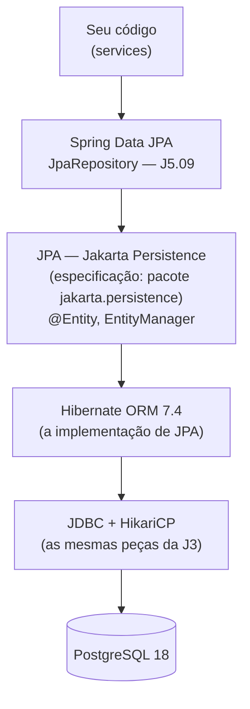

# J5.07 — JPA e Hibernate I: entidades e mapeamento

> ⏱️ ~1h30 · 🟢 Júnior · Pré-requisitos: J5.01–J5.06, J3 (esquema do PayFlow, tipos SQL, constraints, Flyway), J1.08 (`equals`/`hashCode`), J1.14 (`enum`), J1.15 (`BigDecimal`, `Instant`)

## 🎯 Objetivos
Ao final desta aula você consegue:
- Explicar o que é **ORM**, o **descompasso objeto-relacional** e a relação entre **JPA**, **Hibernate** e **Spring Data JPA**.
- Mapear uma classe Java para uma tabela com **`@Entity`**, `@Table`, `@Id`, `@Column`, `@Enumerated`, `@Version`, `@Generated` e `@Immutable`, escolhendo os tipos certos para **dinheiro, datas, enums e UUID**.
- Gerar **UUID versão 7** pelo Hibernate e ler os valores que o **banco** gera (`DEFAULT now()`).
- Usar `spring.jpa.hibernate.ddl-auto: validate` para o Hibernate **conferir** o mapeamento contra o esquema do Flyway, e ler as mensagens de erro reais.
- Ver o **SQL** que o Hibernate gera e abrir/ler `EntityManager.find` e `persist`.

## 🤔 Por que isso importa
Quase todo sistema Java com banco relacional usa JPA/Hibernate, e quase todo problema de desempenho e de dados "estranhos" em sistemas Spring nasce de um **mapeamento mal entendido**: um `enum` salvo como número, um `double` no lugar de `BigDecimal`, uma carga preguiçosa que explode. Na J3 você escreveu cada `SELECT` e cada `INSERT` à mão. O ORM os escreve por você, e **vale a pena só se você ainda sabe ler o SQL que ele gera**; por isso esta aula (e as próximas) mostram o SQL o tempo todo.

## 💡 Intuição (explicação simples)
Você fala português; o banco de dados fala "tabela". Um **intérprete** (o ORM) fica no meio: você diz "salve este `User`" e ele traduz para `INSERT INTO users ...`; o banco responde com linhas, e ele traduz de volta para objetos. Um bom intérprete também **anota o que mudou** durante a conversa e só leva ao banco o que de fato mudou. O **mapeamento** é o glossário que você entrega ao intérprete: "o campo `fullName` é a coluna `full_name`; o `status` é o texto `ACTIVE`; o `id` é gerado assim". Se o glossário está errado, a tradução sai errada **sem avisar**, e é por isso que usamos a validação que confere o glossário contra o esquema real.

## 🔬 Como funciona por dentro

### 1. As camadas (e os três nomes que se confundem)

- **JPA** (*Jakarta Persistence*) é uma **especificação**: define as anotações (`@Entity`, `@Id`) e a API (`EntityManager`) em `jakarta.persistence.*`. (Antes do Spring Boot 3 chamava-se `javax.persistence`.)
- **Hibernate ORM** é a **implementação** mais usada. Traz extras fora da especificação, em `org.hibernate.annotations.*` (aqui: `@UuidGenerator`, `@Generated`, `@Immutable`).
- **Spring Data JPA** (J5.09) é uma camada **em cima**, que gera repositórios prontos.
- Embaixo, tudo isso continua sendo **JDBC** com um pool (Hikari): as mesmas conexões, `PreparedStatement`s e transações da J3.

### 2. O descompasso objeto-relacional
| Mundo dos objetos | Mundo das tabelas | O que o ORM faz |
|---|---|---|
| Classe `Account` | Tabela `accounts` | `@Entity` + `@Table(name = "accounts")` |
| Campo `fullName` (camelCase) | Coluna `full_name` | Convenção de nomes (o Spring Boot converte camelCase em `snake_case`: testado, sem `@Column(name=...)` o campo `ownerId` bateu com `owner_id`) |
| `enum AccountStatus` | `VARCHAR` com `CHECK` | `@Enumerated(EnumType.STRING)` |
| Referência `account.owner` | Chave estrangeira `owner_id` | Associações (J5.08) |
| Identidade: `==` e `equals` | Identidade: chave primária | O `@Id` |
| Herança, coleções | Não existem em SQL | Estratégias de mapeamento (fora do escopo júnior) |
| Objetos em memória, grafos | Linhas, `JOIN` | Cargas preguiçosas, *fetch* (J5.08, J5.12) |

### 3. Regras de uma entidade
- A classe tem `@Entity`, **um `@Id`** e um **construtor sem argumentos** (pode ser `protected`): o Hibernate cria o objeto por reflexão e depois preenche os campos. Sem ele: `org.hibernate.InstantiationException: No default constructor for entity 'com.payflow.domain.User'` (testado).
- A classe **não pode ser `final`** e os métodos que o Hibernate precise interceptar não podem ser `final`: ele cria **subclasses (proxies)** para a carga preguiçosa (J5.08).
- Os campos guardam o estado. O Hibernate lê/escreve **os campos** quando o `@Id` está no campo (o que fazemos); em entidades **não** se usa `record` (precisam de mutação e de construtor padrão).
- Seu código **não** deve expor o estado como `public`. Operações de negócio viram métodos (`deposit`, `withdraw`) na J5.11.

### 4. Os mapeamentos do PayFlow, decisão por decisão
| Dado | Mapeamento | Por quê |
|---|---|---|
| `id` UUID | `@Id @UuidGenerator(style = VERSION_7)` | A aplicação (Hibernate) gera o UUID, como diz o ADR 0002; **v7** tem o tempo nos bits mais altos, então os IDs **crescem** com o tempo (bom para índices); o `uuidv7()` do banco continua como `DEFAULT` para inserts por SQL |
| Dinheiro | `BigDecimal` + `@Column(precision = 19, scale = 2)` | Decisão 4. **Nunca** `double`/`float` |
| `status`, `role`, `type` | `@Enumerated(EnumType.STRING)` | Texto legível e estável. **`ORDINAL` (número) é perigoso**: reordenar o `enum` corrompe os dados |
| `created_at` | `Instant` com `@Generated(event = INSERT)` e `insertable = false, updatable = false` | O banco preenche (`DEFAULT now()`); o Hibernate **lê de volta** na mesma ida ao banco (`INSERT ... RETURNING created_at`). **Exceção: o `LedgerEntry`** (imutável) recebe a hora **da aplicação**, pelo `Clock`: veja o aviso em "Erros comuns" |
| `version` da conta | `@Version long` | **Locking otimista** (o Hibernate soma 1 a cada `UPDATE` e recusa a escrita se outra transação mudou a linha). P2 explora a fundo; aqui só mantemos a coluna coerente com a J3 |
| `LedgerEntry` | `@Immutable` | O Hibernate **não** gera `UPDATE`: regra 5 (lançamentos nunca mudam) |
| FKs (`owner_id` etc.) | Campos `UUID` simples **por enquanto** | A J5.08 troca por associações (`@ManyToOne`) |

`Instant` ↔ `timestamptz` funciona direto (ao contrário do que vimos no driver JDBC puro, na J3.11, em que o `getObject(..., Instant.class)` não era suportado: o Hibernate faz a conversão por conta própria).

## 🛠️ Exemplo prático
> Testado com **JDK 25.0.5**, **Spring Boot 4.1.2** (Hibernate **7.4.13.Final**, a versão que o BOM do Boot escolhe) e PostgreSQL 18.6. As classes JDBC da J3 (`com.payflow.db`) continuam no projeto: os repositórios JPA entram na J5.09 e o JDBC sai na J5.11.

### 1. Dependência e configuração
No `pom.xml`, troque o starter JDBC pelo de **JPA** (ele já inclui o JDBC e o Hikari):
```xml
<dependency>
  <groupId>org.springframework.boot</groupId>
  <artifactId>spring-boot-starter-data-jpa</artifactId>     <!-- era spring-boot-starter-jdbc -->
</dependency>
```
No `application.yml` (dentro de `spring:`):
```yaml
spring:
  jpa:
    open-in-view: false                    # sem sessão aberta na camada web (J5.08)
    hibernate:
      ddl-auto: validate                   # o Flyway cria o esquema; o Hibernate só CONFERE (decisão 17)
```
- **`ddl-auto: validate`**: ao subir, o Hibernate compara **cada entidade** com o esquema real do banco e **recusa subir** se a tabela, a coluna ou o tipo não existirem. Os outros valores (`update`, `create`, `create-drop`) **alteram o esquema** e **não** são usados no PayFlow: o esquema é do **Flyway** (ADR 0003). `update` em produção é uma fonte clássica de desastre.
- **`open-in-view: false`**: explicado na J5.08. Sem ele, o Boot avisa `spring.jpa.open-in-view is enabled by default` na inicialização.

### 2. Os enums
```java
package com.payflow.domain;
public enum Role { USER, ADMIN }                              // Role.java
public enum AccountStatus { ACTIVE, BLOCKED, CLOSED }         // AccountStatus.java
public enum EntryType { DEBIT, CREDIT }                       // EntryType.java
public enum TransferStatus { PENDING, COMPLETED, FAILED }     // TransferStatus.java
```
(Cada `enum` em seu arquivo, em `src/main/java/com/payflow/domain/`.) Os nomes são exatamente os valores dos `CHECK` das migrações V1–V3.

### 3. As quatro entidades
`src/main/java/com/payflow/domain/User.java`
```java
package com.payflow.domain;

import jakarta.persistence.Column;
import jakarta.persistence.Entity;
import jakarta.persistence.EnumType;
import jakarta.persistence.Enumerated;
import jakarta.persistence.Id;
import jakarta.persistence.Table;
import java.time.Instant;
import java.util.UUID;
import org.hibernate.annotations.Generated;
import org.hibernate.annotations.UuidGenerator;
import org.hibernate.generator.EventType;

@Entity
@Table(name = "users")
public class User {

    @Id
    @UuidGenerator(style = UuidGenerator.Style.VERSION_7)
    private UUID id;

    @Column(nullable = false, unique = true, length = 255)
    private String email;

    @Column(name = "full_name", nullable = false, length = 120)
    private String fullName;

    @Column(name = "password_hash", nullable = false, length = 100)
    private String passwordHash;

    @Enumerated(EnumType.STRING)
    @Column(nullable = false, length = 20)
    private Role role = Role.USER;

    /** O banco preenche (DEFAULT now()); o Hibernate só lê. */
    @Generated(event = EventType.INSERT)
    @Column(name = "created_at", insertable = false, updatable = false)
    private Instant createdAt;

    protected User() {                     // exigido pelo JPA (o Hibernate cria o objeto por reflexão)
    }

    public User(String email, String fullName, String passwordHash) {
        this.email = email;
        this.fullName = fullName;
        this.passwordHash = passwordHash;
    }

    public UUID getId() { return id; }
    public String getEmail() { return email; }
    public String getFullName() { return fullName; }
    public String getPasswordHash() { return passwordHash; }
    public Role getRole() { return role; }
    public Instant getCreatedAt() { return createdAt; }
}
```
`src/main/java/com/payflow/domain/Account.java`
```java
package com.payflow.domain;

import jakarta.persistence.Column;
import jakarta.persistence.Entity;
import jakarta.persistence.EnumType;
import jakarta.persistence.Enumerated;
import jakarta.persistence.Id;
import jakarta.persistence.Table;
import jakarta.persistence.Version;
import java.math.BigDecimal;
import java.time.Instant;
import java.util.UUID;
import org.hibernate.annotations.Generated;
import org.hibernate.annotations.UuidGenerator;
import org.hibernate.generator.EventType;

@Entity
@Table(name = "accounts")
public class Account {

    @Id
    @UuidGenerator(style = UuidGenerator.Style.VERSION_7)
    private UUID id;

    @Column(name = "owner_id", nullable = false)
    private UUID ownerId;

    @Column(nullable = false, precision = 19, scale = 2)
    private BigDecimal balance = BigDecimal.ZERO;

    @Enumerated(EnumType.STRING)
    @Column(nullable = false, length = 20)
    private AccountStatus status = AccountStatus.ACTIVE;

    @Version
    private long version;

    @Generated(event = EventType.INSERT)
    @Column(name = "created_at", insertable = false, updatable = false)
    private Instant createdAt;

    protected Account() {
    }

    public Account(UUID ownerId) {
        this.ownerId = ownerId;
    }

    public UUID getId() { return id; }
    public UUID getOwnerId() { return ownerId; }
    public BigDecimal getBalance() { return balance; }
    public AccountStatus getStatus() { return status; }
    public long getVersion() { return version; }
    public Instant getCreatedAt() { return createdAt; }
}
```
`src/main/java/com/payflow/domain/LedgerEntry.java`
```java
package com.payflow.domain;

import jakarta.persistence.Column;
import jakarta.persistence.Entity;
import jakarta.persistence.EnumType;
import jakarta.persistence.Enumerated;
import jakarta.persistence.Id;
import jakarta.persistence.Table;
import java.math.BigDecimal;
import java.time.Instant;
import java.util.UUID;
import org.hibernate.annotations.Immutable;
import org.hibernate.annotations.UuidGenerator;

/** Lançamento contábil: nunca é alterado nem apagado (regra 5). */
@Entity
@Immutable
@Table(name = "ledger_entries")
public class LedgerEntry {

    @Id
    @UuidGenerator(style = UuidGenerator.Style.VERSION_7)
    private UUID id;

    @Column(name = "account_id", nullable = false)
    private UUID accountId;

    @Column(name = "transfer_id")
    private UUID transferId;                 // nulo nos depósitos (ADR 0001)

    @Enumerated(EnumType.STRING)
    @Column(nullable = false, length = 10)
    private EntryType type;

    @Column(nullable = false, precision = 19, scale = 2)
    private BigDecimal amount;

    /** Definido pela aplicação (com o Clock), não pelo banco: ver J5.11 (um @Immutable com @Generated falha ao gravar). */
    @Column(name = "created_at", nullable = false, updatable = false)
    private Instant createdAt;

    protected LedgerEntry() {
    }

    public LedgerEntry(UUID accountId, UUID transferId, EntryType type, BigDecimal amount, Instant createdAt) {
        this.accountId = accountId;
        this.transferId = transferId;
        this.createdAt = createdAt;
        this.type = type;
        this.amount = amount;
    }

    public UUID getId() { return id; }
    public UUID getAccountId() { return accountId; }
    public UUID getTransferId() { return transferId; }
    public EntryType getType() { return type; }
    public BigDecimal getAmount() { return amount; }
    public Instant getCreatedAt() { return createdAt; }
}
```
`src/main/java/com/payflow/domain/Transfer.java`
```java
package com.payflow.domain;

import jakarta.persistence.Column;
import jakarta.persistence.Entity;
import jakarta.persistence.EnumType;
import jakarta.persistence.Enumerated;
import jakarta.persistence.Id;
import jakarta.persistence.Table;
import java.math.BigDecimal;
import java.time.Instant;
import java.util.UUID;
import org.hibernate.annotations.Generated;
import org.hibernate.annotations.UuidGenerator;
import org.hibernate.generator.EventType;

@Entity
@Table(name = "transfers")
public class Transfer {

    @Id
    @UuidGenerator(style = UuidGenerator.Style.VERSION_7)
    private UUID id;

    @Column(name = "source_account_id", nullable = false)
    private UUID sourceAccountId;

    @Column(name = "target_account_id", nullable = false)
    private UUID targetAccountId;

    @Column(nullable = false, precision = 19, scale = 2)
    private BigDecimal amount;

    @Enumerated(EnumType.STRING)
    @Column(nullable = false, length = 20)
    private TransferStatus status = TransferStatus.PENDING;

    @Column(name = "idempotency_key", nullable = false, length = 100)
    private String idempotencyKey;

    @Generated(event = EventType.INSERT)
    @Column(name = "created_at", insertable = false, updatable = false)
    private Instant createdAt;

    protected Transfer() {
    }

    public Transfer(UUID sourceAccountId, UUID targetAccountId, BigDecimal amount, String idempotencyKey) {
        this.sourceAccountId = sourceAccountId;
        this.targetAccountId = targetAccountId;
        this.amount = amount;
        this.idempotencyKey = idempotencyKey;
    }

    public UUID getId() { return id; }
    public UUID getSourceAccountId() { return sourceAccountId; }
    public UUID getTargetAccountId() { return targetAccountId; }
    public BigDecimal getAmount() { return amount; }
    public TransferStatus getStatus() { return status; }
    public String getIdempotencyKey() { return idempotencyKey; }
    public Instant getCreatedAt() { return createdAt; }
}
```
Leia com atenção:
- **Os construtores públicos** recebem só o que o chamador deve informar (`new User(email, fullName, passwordHash)`); o **`protected` sem argumentos** é para o Hibernate.
- **Só getters**, sem *setters*: o estado muda por operações do domínio (J5.11), não por atribuição solta.
- `@Generated(event = EventType.INSERT)` + `insertable = false, updatable = false`: o `created_at` **fica fora do `INSERT`** (o banco usa o `DEFAULT`) e é **lido de volta**. **Só o `LedgerEntry` é diferente** (veja o código acima): ele não tem `@Generated`; a hora entra pelo construtor (explicação em "Erros comuns").
- `Account.balance` começa em `BigDecimal.ZERO` e `status` em `ACTIVE`, **no Java**, para que o objeto recém-criado já esteja coerente (o banco também tem `DEFAULT`, mas o Hibernate envia o valor explicitamente).
- O `Account` tem `@Version`; o Hibernate envia `version = 0` no `INSERT` e o incrementa a cada `UPDATE`.

### 4. O banco de teste sempre limpo: uma extensão JUnit
Os laboratórios desta e das próximas aulas assumem o **estado do seed** (a Ana com R$ 830,00 e três lançamentos). Mas **alguns testes gravam de verdade** (a J5.06 deposita; a J5.11 transfere) e deixam o banco `payflow_test` **diferente**: o teste seguinte, se roda depois, **falha por causa do dado deixado pelo anterior** (e só às vezes, porque a ordem de execução dos testes não é garantida). Isso aconteceu de fato neste curso: `MappingLabTest` esperava `830.00` e viu `810.00`. A regra: **todo teste que usa o banco parte do estado inicial conhecido**. Uma **extensão do JUnit** faz isso em um lugar só:

`src/test/java/com/payflow/support/ResetDatabase.java`
```java
package com.payflow.support;

import org.flywaydb.core.Flyway;
import org.junit.jupiter.api.extension.BeforeEachCallback;
import org.junit.jupiter.api.extension.ExtensionContext;
import org.springframework.test.context.junit.jupiter.SpringExtension;

/**
 * Recria o banco de teste (payflow_test) do zero antes de CADA teste: esquema (Flyway) + seed.
 * Assim nenhum teste depende da ordem de execução nem herda a sujeira de outro.
 * Uso: @ExtendWith(ResetDatabase.class), declarada ANTES de @SpringBootTest.
 */
public class ResetDatabase implements BeforeEachCallback {

    @Override
    public void beforeEach(ExtensionContext context) {
        Flyway flyway = SpringExtension.getApplicationContext(context).getBean(Flyway.class);
        flyway.clean();                               // permitido só no perfil test (spring.flyway.clean-disabled: false)
        flyway.migrate();
    }
}
```
- `BeforeEachCallback` é um ponto de extensão do JUnit: o método roda **antes de cada teste** da classe que declarar `@ExtendWith(ResetDatabase.class)`.
- `SpringExtension.getApplicationContext(context)` pega o contexto do Spring daquele teste (e o cria, se ainda não existir), de onde tiramos o bean **`Flyway`**. `clean()` só funciona porque o perfil `test` tem `spring.flyway.clean-disabled: false` (J5.05); em qualquer outro perfil ele **recusa** (J3.12).
- A anotação vai **antes** de `@SpringBootTest`, para a extensão rodar **antes** do início da transação de teste (J5.11).
- Custo: recriar o esquema e o seed a cada teste leva uma fração de segundo; em troca, **nenhum teste depende de outro**.

No `PayflowWebTest` (J5.06), troque o reset manual por ela: acrescente `@ExtendWith(ResetDatabase.class)` antes do `@SpringBootTest`, e remova o campo `Flyway flyway` e as duas linhas `flyway.clean(); flyway.migrate();` do `@BeforeEach`. A partir daqui **todo teste que usa o banco** (todos os desta aula em diante) declara `@ExtendWith(ResetDatabase.class)`.

### 5. Um laboratório com o SQL à vista
`src/test/java/com/payflow/jpa/MappingLabTest.java`
```java
package com.payflow.jpa;

import static org.assertj.core.api.Assertions.assertThat;

import com.payflow.domain.Account;
import com.payflow.domain.AccountStatus;
import com.payflow.domain.User;
import com.payflow.support.ResetDatabase;
import jakarta.persistence.EntityManager;
import java.math.BigDecimal;
import java.util.UUID;
import org.junit.jupiter.api.Test;
import org.junit.jupiter.api.extension.ExtendWith;
import org.springframework.beans.factory.annotation.Autowired;
import org.springframework.boot.test.context.SpringBootTest;
import org.springframework.test.context.ActiveProfiles;
import org.springframework.transaction.annotation.Transactional;

/** Laboratório da J5.07: o mapeamento objeto-relacional, com SQL à vista. */
@ExtendWith(ResetDatabase.class)
@SpringBootTest(properties = {
        "logging.level.org.hibernate.SQL=DEBUG",
        "spring.jpa.properties.hibernate.format_sql=true"})
@ActiveProfiles("test")
@Transactional                          // cada teste roda numa transação que sofre rollback no fim
class MappingLabTest {

    private static final UUID ANA = UUID.fromString("10000000-0000-0000-0000-000000000001");
    private static final UUID ANA_ACCOUNT = UUID.fromString("20000000-0000-0000-0000-000000000001");

    @Autowired
    EntityManager em;

    @Test
    void findsASeededUserById() {
        User ana = em.find(User.class, ANA);
        assertThat(ana.getFullName()).isEqualTo("Ana Silva");
        assertThat(ana.getRole().name()).isEqualTo("USER");
        System.out.println("createdAt lido do banco: " + ana.getCreatedAt());
    }

    @Test
    void mapsMoneyEnumsAndTheVersionOfAnAccount() {
        Account account = em.find(Account.class, ANA_ACCOUNT);
        assertThat(account.getBalance()).isEqualByComparingTo("830.00");
        assertThat(account.getBalance().scale()).isEqualTo(2);
        assertThat(account.getStatus()).isEqualTo(AccountStatus.ACTIVE);
        System.out.println("version = " + account.getVersion());
    }

    @Test
    void persistGeneratesAUuidV7AndReadsBackTheDatabaseDefaults() {
        User bia = new User("bia@payflow.dev", "Bia Lima", "$2a$10$fake");
        assertThat(bia.getId()).isNull();                  // ainda não gerado
        em.persist(bia);
        em.flush();                                        // força o INSERT agora (sem esperar o commit)
        System.out.println("id gerado = " + bia.getId() + "  | versão do UUID = " + bia.getId().version());
        assertThat(bia.getId().version()).isEqualTo(7);
        assertThat(bia.getCreatedAt()).isNotNull();        // veio do DEFAULT now() do banco
        assertThat(bia.getRole().name()).isEqualTo("USER");
    }

    @Test
    void newAccountStartsWithZeroBalanceActiveAndVersionZero() {
        Account account = new Account(ANA);
        em.persist(account);
        em.flush();
        assertThat(account.getBalance()).isEqualByComparingTo("0.00");
        assertThat(account.getStatus()).isEqualTo(AccountStatus.ACTIVE);
        assertThat(account.getVersion()).isZero();
    }
}
```
- `@SpringBootTest` sobe o contexto completo (perfil `test`, banco `payflow_test`); `@Transactional` no teste faz **rollback ao final de cada teste**, então o seed continua intacto (a J5.11 explica a transação; a J7 trata os testes a fundo).
- `logging.level.org.hibernate.SQL=DEBUG` imprime cada SQL; `format_sql` o deixa legível.
```bash
mvn test -Dtest=MappingLabTest
```
```
Tests run: 4, Failures: 0, Errors: 0, Skipped: 0
createdAt lido do banco: 2026-01-05T09:00:00Z
version = 0
id gerado = 01a1d555-03ad-7e68-8329-eab34009e7d7  | versão do UUID = 7
```
O SQL que o Hibernate gerou (trechos reais):
```sql
select u1_0.id, u1_0.created_at, u1_0.email, u1_0.full_name, u1_0.password_hash, u1_0.role
from users u1_0
where u1_0.id=?                                    -- em.find(User.class, id)

insert into users (email, full_name, password_hash, role, id)
values (?, ?, ?, ?, ?)
returning created_at                               -- persist(); o created_at NÃO foi enviado: voltou do banco

insert into accounts (balance, owner_id, status, version, id)
values (?, ?, ?, ?, ?)
returning created_at
```
Repare em três coisas: o alias `u1_0` (o Hibernate nomeia as tabelas), o `RETURNING created_at` (uma única ida ao banco), e que **o `id` já estava no objeto antes do `INSERT`** (UUID gerado na aplicação, versão **7**, como o teste afirma).

### 6. A validação do esquema, com erros reais
O Hibernate confere o mapeamento ao subir. Provocamos os erros de propósito (um por vez, no `User` e no `Account`); a mensagem real e a causa:

| Erro provocado | Mensagem real (parte final) |
|---|---|
| `@Column(name = "fullname")` (nome da coluna errado) | `SchemaManagementException: Schema validation: missing column [fullname] in table [users]` |
| `@Table(name = "account")` (tabela errada, singular) | `Schema validation: missing table [account]` |
| `@Enumerated(EnumType.ORDINAL)` em `status` | `Schema validation: wrong column type encountered in column [status] in table [accounts]; found [varchar (Types#VARCHAR)], but expecting [smallint (Types#TINYINT)]` |
| Sem construtor padrão (em tempo de uso) | `org.hibernate.InstantiationException: No default constructor for entity 'com.payflow.domain.User'` |

E o que a validação **não** pega (testado): trocar `BigDecimal` por **`double`** em `balance` e mudar `precision/scale` para `(10, 4)` **passaram** na validação. Ela confere **tabela, coluna e família de tipo**, mas **não** a precisão/escala, a nulabilidade, os `CHECK` nem os índices. Para isso, o teste de integração com o banco real (J3.12) e o **Flyway** continuam sendo a fonte de verdade. Moral: validar é uma rede de proteção, não um substituto para revisar o mapeamento.

## 🧠 Pausa para lógica
**Enunciado:** o Hibernate gera **UUIDs versão 7**: os 48 primeiros bits são os **milissegundos Unix**, depois 4 bits de versão (`0111`), 12 bits aleatórios, 2 bits de variante (`10`) e 62 bits aleatórios. (a) Implemente `generate(long unixMillis)` e `timestampOf(UUID)` (que extrai o instante de criação). (b) Mostre que ordenar UUIDv7 **como texto** reproduz a ordem de criação, e que isso **não vale** para UUIDv4. (c) Por que isso importa para o **índice** da chave primária?

<details><summary>Dica</summary>Em um <code>java.util.UUID</code>, o tempo está nos 48 bits mais altos do <code>getMostSignificantBits()</code>: <code>msb &gt;&gt;&gt; 16</code> recupera os milissegundos. Para montar: <code>(millis &lt;&lt; 16) | 0x7000 | 12 bits aleatórios</code>. Para (c), pense em onde um valor novo é inserido em uma árvore B ordenada.</details>
<details><summary>Solução (testada com JDK 25.0.5)</summary>

```java
import java.security.SecureRandom;
import java.time.Instant;
import java.util.ArrayList;
import java.util.Collections;
import java.util.List;
import java.util.UUID;

/** UUID versão 7: 48 bits de milissegundos Unix no início + versão + bits aleatórios. */
public class Uuid7 {

    private static final SecureRandom RANDOM = new SecureRandom();

    static UUID generate(long unixMillis) {
        long high = (unixMillis << 16) | 0x7000L | (RANDOM.nextLong() & 0x0FFFL);   // 48 bits de tempo | versão 7 | 12 bits aleatórios
        long low = (RANDOM.nextLong() & 0x3FFFFFFFFFFFFFFFL) | 0x8000000000000000L; // variante RFC 9562 (10xx...)
        return new UUID(high, low);
    }

    /** Extrai o instante de criação de um UUIDv7. */
    static Instant timestampOf(UUID uuid) {
        if (uuid.version() != 7) {
            throw new IllegalArgumentException("not a version 7 UUID: " + uuid);
        }
        return Instant.ofEpochMilli(uuid.getMostSignificantBits() >>> 16);
    }

    public static void main(String[] args) {
        UUID a = generate(Instant.parse("2026-01-10T11:00:00Z").toEpochMilli());
        System.out.println(a + "  versão=" + a.version() + "  tempo=" + timestampOf(a));

        // A ordem textual dos UUIDv7 acompanha a ordem de criação; a dos UUIDv4 é aleatória.
        List<UUID> v7 = new ArrayList<>();
        List<UUID> v4 = new ArrayList<>();
        long t0 = Instant.parse("2026-01-10T11:00:00Z").toEpochMilli();
        for (int i = 0; i < 5; i++) {
            v7.add(generate(t0 + i * 1000L));
            v4.add(UUID.randomUUID());
        }
        List<UUID> sortedV7 = new ArrayList<>(v7);
        Collections.sort(sortedV7);
        List<UUID> sortedV4 = new ArrayList<>(v4);
        Collections.sort(sortedV4);
        System.out.println("v7 ordenados = criados em ordem? " + sortedV7.equals(v7));
        System.out.println("v4 ordenados = criados em ordem? " + sortedV4.equals(v4));

        try {
            timestampOf(UUID.randomUUID());
        } catch (IllegalArgumentException e) {
            System.out.println(e.getMessage().replaceAll("[0-9a-f]{8}-[0-9a-f-]{27}", "<uuid>"));
        }
    }
}
```
Saída real:
```
019ba790-2380-7a71-b3cd-125a525f958c  versão=7  tempo=2026-01-10T11:00:00Z
v7 ordenados = criados em ordem? true
v4 ordenados = criados em ordem? false
not a version 7 UUID: <uuid>
```
(O `false` do v4 é "quase sempre": com 5 valores aleatórios há 1 chance em 120 de saírem em ordem.) **(c)** O índice da chave primária é uma **árvore B**. Com UUIDv4 (aleatório), cada novo valor cai em um **ponto aleatório** da árvore: páginas cheias se dividem, o cache de páginas "esquenta" tudo e a escrita fica mais lenta. Com UUIDv7, novos valores vão sempre para o **fim** (como um `bigint` crescente), com localidade de escrita e menos fragmentação, **sem perder** a vantagem do UUID (gerar sem consultar o banco, não expor contagem). É uma das razões da decisão 14 (e de o PostgreSQL 18 ter ganho a função `uuidv7()`).
</details>

**Variação mais difícil:** garanta **monotonicidade dentro do mesmo milissegundo** (use o contador de 12 bits `rand_a` como sequência) e escreva um teste com 100 mil UUIDs gerados em sequência, verificando que a ordem nunca falha.

## ⚠️ Erros comuns e boas práticas de produção
- **`@Enumerated(ORDINAL)`** (o padrão do JPA se você esquecer a anotação!). Sem `@Enumerated` o JPA grava o **número** da posição; reordenar o `enum` corrompe tudo. **Sempre `STRING`.**
- **`double`/`float` para dinheiro.** Perde exatidão (J1.15). `BigDecimal` com `precision`/`scale`.
- **`ddl-auto: update`** ou `create`: o Hibernate **altera o esquema** sozinho. Em produção, jamais; no PayFlow, o Flyway é o dono do esquema.
- **Nome de tabela reservado:** `user` é palavra reservada no PostgreSQL; por isso a tabela é `users` (J3.02) e a entidade tem `@Table(name = "users")`. Sem o `@Table`, o Hibernate procuraria `user`.
- **`equals`/`hashCode` por todos os campos** em entidade: quebra com objetos mutáveis e proxies. Regra segura: não sobrescreva até precisar; quando precisar, baseie-se no **`id`** (depois de atribuído) ou em uma **chave de negócio** estável (`email`). (Vimos o contrato na J1.08.)
- **`@Immutable` junto com `@Generated` quebra ao gravar (e a validação não avisa).** O `LedgerEntry` desta aula tem `@Immutable` (regra 5) e, **diferente das outras entidades**, o `created_at` dele **não** é `@Generated`: a primeira versão tinha, passou na validação do esquema, passou nos testes de leitura, e **falhou ao gravar o primeiro lançamento** (J5.11) com `org.springframework.orm.jpa.JpaSystemException: Lock mode WRITE not supported for read-only entity` (causa: `org.hibernate.UnsupportedLockAttemptException`, lançada em `EntityInsertAction.handleGeneratedProperties`, ao ler de volta a coluna gerada de uma entidade somente leitura). Conserto adotado: o `created_at` do lançamento é **definido pela aplicação** com o `Clock` (J5.03), no construtor (`new LedgerEntry(account, transfer, type, amount, clock.instant())`). Isso ainda tem uma vantagem: nos testes, um `Clock` fixo dá horas previsíveis. **Moral:** só um teste que **grava** prova que um mapeamento de escrita funciona.
- **`LocalDateTime` para instantes.** Não tem fuso: dois servidores em fusos diferentes salvam horas diferentes. `Instant` (UTC) ↔ `timestamptz`.
- **Esquecer o construtor padrão** ou deixar a entidade `final`.
- **Expor a entidade direto na API** (J6): vaza campos (`passwordHash`!) e amarra o contrato ao esquema. Use DTOs.
- **Misturar as duas `User`:** neste momento existem `com.payflow.db.User` (record da J3) e `com.payflow.domain.User` (entidade). Cuidado com o `import`; as classes JDBC saem na J5.11.

## 🧩 Exercícios
1. **Fixação:** (a) qual a diferença entre JPA, Hibernate e Spring Data JPA? (b) por que `@Enumerated(EnumType.STRING)`? (c) o que `ddl-auto: validate` faz e o que **não** faz? (d) por que uma entidade precisa de um construtor sem argumentos? (e) por que o `created_at` é `insertable = false, updatable = false`?
2. **Aplicação no PayFlow:** mapeie o domínio.
   - [ ] `pom.xml` com `spring-boot-starter-data-jpa` (no lugar do JDBC); `application.yml` com `ddl-auto: validate` e `open-in-view: false`.
   - [ ] Os 4 enums e as 4 entidades (`User`, `Account`, `LedgerEntry`, `Transfer`) em `com.payflow.domain`, conforme a aula; a aplicação **sobe** com `validate` (perfil `dev`).
   - [ ] `ResetDatabase` criada; `PayflowWebTest` migrado para ela; `MappingLabTest` com 4 testes verdes; você leu e entendeu o SQL de `find` e de `persist`.
   - [ ] **Quebre de propósito** três mapeamentos (nome de coluna, nome de tabela, `ORDINAL`), cole a mensagem real de cada um em `docs/spring-lab/jpa-mapping-errors.md` e desfaça.
   - [ ] Confirme em `docs/spring-lab/jpa-mapping-errors.md` o que a validação **não** pega (troque `precision`/`scale` e veja passar).
   - [ ] Nenhum `double`, nenhum `ORDINAL`, nenhuma entidade `final`, sem *setters* públicos.
   - [ ] Commit: `feat(domain): map User, Account, LedgerEntry and Transfer with JPA`.
3. **Desafio (opcional):** mapeie o `Transfer.status` e o `Account.status` com um **conversor** (`AttributeConverter`) para guardar como texto minúsculo (`active`) **sem** mudar o `CHECK`... e explique por que **não** vale a pena (o esquema e o domínio ficam desalinhados). Qual a alternativa mais simples?

<details><summary>Soluções de referência</summary>

1. (a) JPA é a especificação (`jakarta.persistence`), Hibernate é a implementação, Spring Data JPA é uma camada que gera repositórios por cima. (b) Texto estável e legível; `ORDINAL` depende da posição no `enum`. (c) Compara tabelas, colunas e tipos das entidades com o banco e recusa subir se divergirem; **não** confere precisão/escala, `CHECK`, nulabilidade nem índices, e **não** altera o esquema. (d) O Hibernate cria a instância por reflexão e depois preenche os campos. (e) O banco preenche pelo `DEFAULT now()`; o Hibernate só lê, para a hora vir de uma fonte única.
2. Confira que `mvn test -Dtest=MappingLabTest` passa e que os três erros produzem as mensagens da tabela.
3. Não vale a pena: o `CHECK` do banco só aceita `ACTIVE`, `BLOCKED`, `CLOSED`; um conversor para minúsculas obrigaria a mudar a migração (e todo SQL que mexe nessa coluna). A alternativa simples é manter o `enum` com o mesmo nome do valor do banco e traduzir **na apresentação** (como o template já faz, "Ativa").
</details>

## 🎤 Na entrevista
- **O que é JPA e qual a diferença para Hibernate?** JPA é a especificação Java de persistência (`jakarta.persistence`); Hibernate é a implementação mais usada, com recursos extras. Spring Data JPA gera repositórios por cima dela.
- **Como você mapeia um `enum` e por quê?** `@Enumerated(EnumType.STRING)`; `ORDINAL` quebra se a ordem do `enum` mudar.
- **O que significa `@Version`?** Locking otimista: o Hibernate inclui a versão no `UPDATE ... WHERE id = ? AND version = ?`; se outra transação alterou a linha, a atualização afeta 0 linhas e dispara `OptimisticLockException`, evitando atualizações perdidas.
- **`ddl-auto`: quais valores e qual usar em produção?** `none`, `validate`, `update`, `create`, `create-drop`. Em produção, `none` ou `validate`, com o esquema em ferramentas de migração (Flyway/Liquibase); `update` não.
- **Por que UUID v7 em vez de v4 como chave primária?** v7 é ordenável no tempo (prefixo de timestamp), o que dá localidade de escrita no índice e menos fragmentação, mantendo as vantagens do UUID.

## 📚 Para ir além
- 📄 [Hibernate ORM 7.4 — documentação](https://hibernate.org/orm/documentation/7.4/): guia do usuário e a referência das anotações (`@UuidGenerator`, `@Generated`, `@Immutable`).
- 📄 [Jakarta Persistence](https://jakarta.ee/specifications/persistence/): a especificação e a API (`jakarta.persistence`).
- 📄 [Spring Boot — Working with SQL Databases (JPA)](https://docs.spring.io/spring-boot/reference/data/sql.html): `spring.jpa.*`, `ddl-auto`, a estratégia de nomes e o `open-in-view`.
- 📄 [Spring Data JPA — referência](https://docs.spring.io/spring-data/jpa/reference/): a camada de repositórios (próxima aula).
- 📄 [RFC 9562 — UUIDs (inclui a versão 7)](https://www.rfc-editor.org/rfc/rfc9562): o formato do UUIDv7.
- 📄 [Vlad Mihalcea — blog sobre Hibernate/JPA](https://vladmihalcea.com/): artigos aprofundados sobre mapeamento e desempenho (consulte a data de cada artigo, pois as versões mudam).
- 🎥 ⚠️ Nenhum vídeo verificado nesta execução.

## ✅ Checklist da aula
- [ ] Sei dizer o que são JPA, Hibernate e Spring Data JPA e como se empilham.
- [ ] As quatro entidades estão mapeadas e a aplicação sobe com `ddl-auto: validate`.
- [ ] Dinheiro em `BigDecimal(19,2)`, enums em `STRING`, `Instant` para datas.
- [ ] Li o SQL de um `find` e de um `persist` e vi o `RETURNING created_at`.
- [ ] Sei o que a validação do esquema pega e o que não pega.
- [ ] Todo teste que usa o banco usa a extensão `ResetDatabase` (nenhum depende da ordem de execução).
