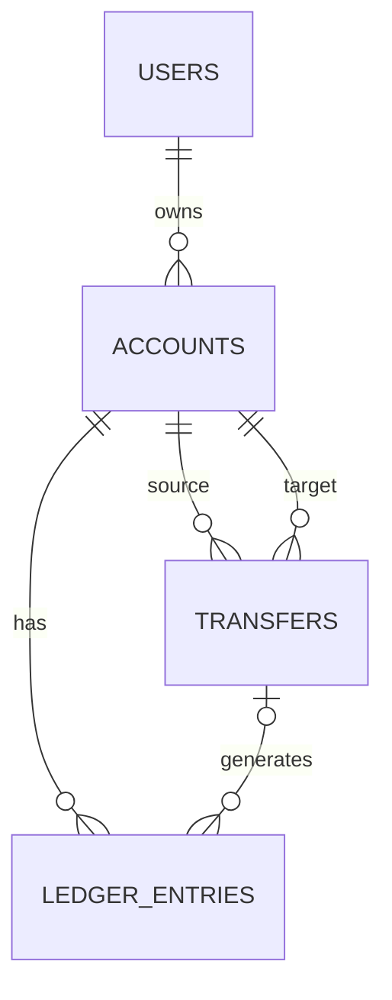
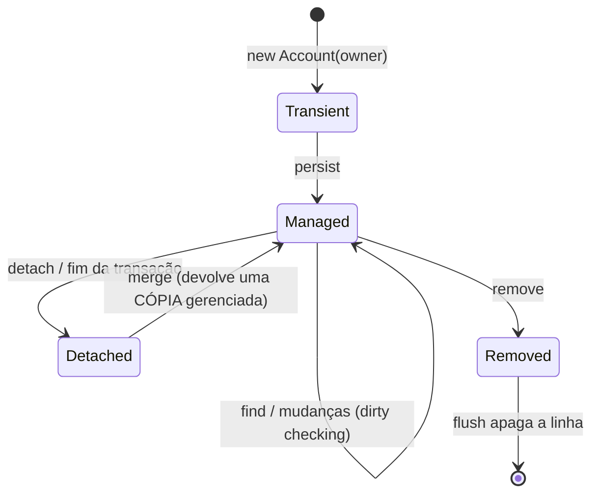

# J5.08 — JPA II: relacionamentos, lazy vs eager e `EntityManager`

> ⏱️ ~1h30 · 🟢 Júnior · Pré-requisitos: J5.07 (entidades e mapeamento), J3.01/J3.06 (relacionamentos, chaves estrangeiras e `JOIN`), J3.10 (transações)

## 🎯 Objetivos
Ao final desta aula você consegue:
- Mapear relacionamentos com **`@ManyToOne`**, **`@OneToMany(mappedBy = ...)`** e **`@JoinColumn`**, e dizer qual é o lado **dono** e qual é o lado **inverso**.
- Explicar **lazy** (preguiçoso) × **eager** (ansioso), os **valores padrão** do JPA e por que o PayFlow declara **`LAZY`** em tudo.
- Reproduzir e consertar a **`LazyInitializationException`**.
- Descrever o **contexto de persistência** (o "cache de primeiro nível"): identidade de objetos, estados da entidade, **dirty checking** (verificação de alterações) e **flush**.
- Usar `EntityManager.find`, `persist`, `detach`, `merge` e ler o SQL e a contagem de consultas.
- Explicar o *Open Session in View* (`spring.jpa.open-in-view`) e por que o PayFlow o desliga.

## 🤔 Por que isso importa
Quase todo bug de "dado errado" e todo problema de lentidão com JPA vêm de **não saber quando o Hibernate vai ao banco**. Por que `account.getOwner()` não gera SQL, mas `account.getOwner().getFullName()` gera? Por que mudei um campo e o banco foi atualizado sem eu chamar `save`? Por que `LazyInitializationException` aparece só em produção, ou só no template? Esta aula responde com experimentos, contando consultas.

## 💡 Intuição (explicação simples)
O **contexto de persistência** é a **mesa de trabalho** de um contador. Quando ele precisa de uma pasta (uma entidade), vai ao **arquivo** (o banco), traz a pasta e a **fotografa** antes de colocá-la na mesa. Pediu a mesma pasta de novo? Entrega a que já está na mesa, sem ir ao arquivo (**identidade**). No fim do dia, ele compara cada pasta da mesa com a fotografia e **leva de volta ao arquivo só o que mudou** (*dirty checking* + *flush*). Uma pasta que sai da mesa (**detached**) deixa de ser vigiada. E uma pasta **ligada a outra** (a conta ao seu dono) vem como um **cartão de referência** ("dono: user 10..01"): o contador só vai buscar a pasta do dono **se alguém pedir os detalhes**. Se a mesa já foi desmontada (a transação acabou) e alguém pede os detalhes, ninguém pode buscar: `LazyInitializationException`.

## 🔬 Como funciona por dentro

### 1. Relacionamentos: o lado dono e o lado inverso
No banco, um relacionamento é uma **coluna de chave estrangeira** em **uma** das tabelas (`accounts.owner_id`). No Java, você pode ter referências nos **dois** lados, mas só **um** lado manda no banco:


| Lado | Anotação | Papel |
|---|---|---|
| **Dono** (*owning side*): o que tem a **coluna FK** | `@ManyToOne` + `@JoinColumn(name = "owner_id")` em `Account.owner` | **Decide o que vai para o banco** |
| **Inverso**: o outro lado, opcional | `@OneToMany(mappedBy = "owner")` em `User.accounts` | Só **leitura/navegação**; `mappedBy` diz "quem manda é o campo `owner` de `Account`" |

Cardinalidades (J3.01) e a anotação correspondente: 1:N → `@ManyToOne` (lado N) e `@OneToMany` (lado 1); 1:1 → `@OneToOne`; N:N → `@ManyToMany` (com uma tabela de junção; o PayFlow não tem nenhum N:N). **Regra prática:** mapeie **só o lado `@ManyToOne`** a menos que precise de fato navegar do lado 1 para os N. Coleções são fonte de problemas (J5.12). Neste curso, `User.accounts` existe para o laboratório e é **somente leitura** (sem `cascade`).

`cascade` e `orphanRemoval` propagam operações (salvar/apagar) do pai para os filhos. **Não** use em `LedgerEntry` (imutável, regra 5) nem em `Transfer`; use com muita cautela em qualquer lugar.

### 2. Lazy × eager
Quando o Hibernate carrega uma conta, o que faz com o `owner`?
- **EAGER** (ansioso): carrega o dono **junto** (um `JOIN` ou uma consulta a mais).
- **LAZY** (preguiçoso): coloca no lugar um **proxy** (um objeto "casca" que sabe o `id` do dono e só vai ao banco quando você usa **outro** campo).

Os **padrões do JPA**, que surpreendem:
| Associação | Padrão |
|---|---|
| `@ManyToOne`, `@OneToOne` (para **um**) | **EAGER** |
| `@OneToMany`, `@ManyToMany` (para **muitos**) | LAZY |

**Teste real:** removemos o `fetch = LAZY` de `Account.owner` e fizemos `em.find(Account.class, id)`: o SQL virou **`from accounts a1_0 join users o1_0 on o1_0.id=a1_0.owner_id`**, com o usuário carregado junto (1 SQL, `owner` é um `User` de verdade). Em um sistema com 10 associações `@ManyToOne` esquecidas no padrão, **cada** `find` arrasta uma teia de `JOIN`s que você nunca pediu. **Por isso o PayFlow declara `fetch = FetchType.LAZY` em todo `@ManyToOne`** e **busca explicitamente** o que precisa (J5.12).

### 3. O contexto de persistência
O **`EntityManager`** é a porta de entrada do JPA. Ele mantém o **contexto de persistência** (*persistence context*): o conjunto de entidades que ele está **gerenciando** nesta unidade de trabalho (no Spring, normalmente **uma transação**: J5.11). A [documentação do Hibernate](https://docs.jboss.org/hibernate/orm/7.4/userguide/html_single/Hibernate_User_Guide.html) o descreve como um contexto de persistência de leitura "repetível" (*first level cache*). Ele faz quatro coisas:

1. **Mapa de identidade:** a mesma linha (tipo + `id`) é **sempre o mesmo objeto** dentro do contexto. Dois `find` do mesmo `id`: **um** SQL.
2. **Retrato:** ao carregar, guarda uma cópia do estado.
3. **Dirty checking:** ao **fazer o *flush***, compara cada entidade gerenciada com o retrato e gera o `UPDATE` das que mudaram. **Você não chama `save`/`update`.**
4. **Ciclo de vida:**

- **Transient/new:** objeto novo que o Hibernate ainda não conhece.
- **Managed:** vigiado; mudanças viram SQL no flush.
- **Detached:** já foi gerenciado, mas saiu do contexto (a transação acabou, ou `detach`); mudanças **não** são vigiadas.
- **Removed:** marcado para exclusão.

**Flush** (descarregar as mudanças para o banco) acontece: no **commit**, ao chamar `em.flush()` e **antes de uma consulta** que possa ser afetada (*auto flush*; testado abaixo). O flush **não** é o commit: o SQL vai para o banco dentro da transação e ainda pode sofrer rollback.

**`persist` × `merge`:** `persist(novo)` torna **aquele** objeto gerenciado; `merge(desanexado)` copia o estado para **outra** instância gerenciada e a devolve (o objeto que você passou continua desanexado). O Spring Data (`save`, J5.09) escolhe entre os dois.

> ⚠️ **O `UPDATE` do Hibernate atualiza todas as colunas** da entidade, não só as que mudaram: `update accounts set balance=?,owner_id=?,status=?,version=? where id=? and version=?` (saída real abaixo). Há uma opção (`@DynamicUpdate`) para gerar só as alteradas, que tem custo próprio; não a use por reflexo.

### 4. *Open Session in View* (OSIV)
Se o `EntityManager` ficasse aberto durante **a requisição inteira**, até a renderização do template, a carga preguiçosa "funcionaria" dentro do HTML. Isso é o **Open EntityManager in View**, e o **Spring Boot o liga por padrão** ([documentação](https://docs.spring.io/spring-boot/reference/data/sql.html)) e avisa na inicialização (mensagem real):
```
WARN ... JpaBaseConfiguration$JpaWebConfiguration : spring.jpa.open-in-view is enabled by default. Therefore, database queries may be performed during view rendering. Explicitly configure spring.jpa.open-in-view to disable this warning
```
O problema: consultas **escondidas** no template, conexão do banco **presa** até o fim da resposta (mesmo enquanto o navegador baixa), e `N+1` invisível. **Decisão do PayFlow: `spring.jpa.open-in-view: false`** (já definida na J5.07). Consequência: **a camada web recebe objetos já completos**; tudo o que a página precisa deve ser carregado **antes**, no serviço (J5.11) ou pela consulta (J5.12).

## 🛠️ Exemplo prático
> Testado com **JDK 25.0.5**, **Spring Boot 4.1.2** (Hibernate 7.4.13.Final), PostgreSQL 18.6.

### 1. As entidades com as associações
O que muda em relação à J5.07: `ownerId`, `accountId`, `transferId`, `sourceAccountId` e `targetAccountId` **deixam de ser `UUID` soltos** e viram **referências a objetos**. Os construtores passam a receber **objetos** (`new Account(owner)`), a `User` ganha a coleção inversa e a `Account` ganha duas operações de domínio (`block`, `activate`) para o laboratório. Versões completas:

`User.java`
```java
package com.payflow.domain;

import jakarta.persistence.Column;
import jakarta.persistence.Entity;
import jakarta.persistence.EnumType;
import jakarta.persistence.Enumerated;
import jakarta.persistence.Id;
import jakarta.persistence.OneToMany;
import jakarta.persistence.Table;
import java.time.Instant;
import java.util.ArrayList;
import java.util.Collections;
import java.util.List;
import java.util.UUID;
import org.hibernate.annotations.Generated;
import org.hibernate.annotations.UuidGenerator;
import org.hibernate.generator.EventType;

@Entity
@Table(name = "users")
public class User {

    @Id
    @UuidGenerator(style = UuidGenerator.Style.VERSION_7)
    private UUID id;

    @Column(nullable = false, unique = true, length = 255)
    private String email;

    @Column(name = "full_name", nullable = false, length = 120)
    private String fullName;

    @Column(name = "password_hash", nullable = false, length = 100)
    private String passwordHash;

    @Enumerated(EnumType.STRING)
    @Column(nullable = false, length = 20)
    private Role role = Role.USER;

    /** O banco preenche (DEFAULT now()); o Hibernate só lê. */
    @Generated(event = EventType.INSERT)
    @Column(name = "created_at", insertable = false, updatable = false)
    private Instant createdAt;

    /** Lado inverso da associação (o dono é Account.owner). Somente leitura: não há cascade. */
    @OneToMany(mappedBy = "owner")
    private List<Account> accounts = new ArrayList<>();

    protected User() {                     // exigido pelo JPA (o Hibernate cria o objeto por reflexão)
    }

    public User(String email, String fullName, String passwordHash) {
        this.email = email;
        this.fullName = fullName;
        this.passwordHash = passwordHash;
    }

    public UUID getId() { return id; }
    public String getEmail() { return email; }
    public String getFullName() { return fullName; }
    public String getPasswordHash() { return passwordHash; }
    public Role getRole() { return role; }
    public Instant getCreatedAt() { return createdAt; }
    public List<Account> getAccounts() { return Collections.unmodifiableList(accounts); }
}
```
`Account.java`
```java
package com.payflow.domain;

import jakarta.persistence.Column;
import jakarta.persistence.Entity;
import jakarta.persistence.EnumType;
import jakarta.persistence.Enumerated;
import jakarta.persistence.FetchType;
import jakarta.persistence.Id;
import jakarta.persistence.JoinColumn;
import jakarta.persistence.ManyToOne;
import jakarta.persistence.Table;
import jakarta.persistence.Version;
import java.math.BigDecimal;
import java.time.Instant;
import java.util.UUID;
import org.hibernate.annotations.Generated;
import org.hibernate.annotations.UuidGenerator;
import org.hibernate.generator.EventType;

@Entity
@Table(name = "accounts")
public class Account {

    @Id
    @UuidGenerator(style = UuidGenerator.Style.VERSION_7)
    private UUID id;

    @ManyToOne(fetch = FetchType.LAZY, optional = false)
    @JoinColumn(name = "owner_id", nullable = false)
    private User owner;

    @Column(nullable = false, precision = 19, scale = 2)
    private BigDecimal balance = BigDecimal.ZERO;

    @Enumerated(EnumType.STRING)
    @Column(nullable = false, length = 20)
    private AccountStatus status = AccountStatus.ACTIVE;

    @Version
    private long version;

    @Generated(event = EventType.INSERT)
    @Column(name = "created_at", insertable = false, updatable = false)
    private Instant createdAt;

    protected Account() {
    }

    public Account(User owner) {
        this.owner = owner;
    }

    public void block() {
        this.status = AccountStatus.BLOCKED;
    }

    public void activate() {
        this.status = AccountStatus.ACTIVE;
    }

    public UUID getId() { return id; }
    public User getOwner() { return owner; }
    public BigDecimal getBalance() { return balance; }
    public AccountStatus getStatus() { return status; }
    public long getVersion() { return version; }
    public Instant getCreatedAt() { return createdAt; }
}
```
`LedgerEntry.java`
```java
package com.payflow.domain;

import jakarta.persistence.Column;
import jakarta.persistence.Entity;
import jakarta.persistence.EnumType;
import jakarta.persistence.Enumerated;
import jakarta.persistence.FetchType;
import jakarta.persistence.Id;
import jakarta.persistence.JoinColumn;
import jakarta.persistence.ManyToOne;
import jakarta.persistence.Table;
import java.math.BigDecimal;
import java.time.Instant;
import java.util.UUID;
import org.hibernate.annotations.Immutable;
import org.hibernate.annotations.UuidGenerator;

/** Lançamento contábil: nunca é alterado nem apagado (regra 5). */
@Entity
@Immutable
@Table(name = "ledger_entries")
public class LedgerEntry {

    @Id
    @UuidGenerator(style = UuidGenerator.Style.VERSION_7)
    private UUID id;

    @ManyToOne(fetch = FetchType.LAZY, optional = false)
    @JoinColumn(name = "account_id", nullable = false)
    private Account account;

    @ManyToOne(fetch = FetchType.LAZY)
    @JoinColumn(name = "transfer_id")
    private Transfer transfer;               // nulo nos depósitos (ADR 0001)

    @Enumerated(EnumType.STRING)
    @Column(nullable = false, length = 10)
    private EntryType type;

    @Column(nullable = false, precision = 19, scale = 2)
    private BigDecimal amount;

    /** Definido pela aplicação (com o Clock), não pelo banco: ver J5.11 (um @Immutable com @Generated falha ao gravar). */
    @Column(name = "created_at", nullable = false, updatable = false)
    private Instant createdAt;

    protected LedgerEntry() {
    }

    public LedgerEntry(Account account, Transfer transfer, EntryType type, BigDecimal amount, Instant createdAt) {
        this.account = account;
        this.transfer = transfer;
        this.createdAt = createdAt;
        this.type = type;
        this.amount = amount;
    }

    public UUID getId() { return id; }
    public Account getAccount() { return account; }
    public Transfer getTransfer() { return transfer; }
    public EntryType getType() { return type; }
    public BigDecimal getAmount() { return amount; }
    public Instant getCreatedAt() { return createdAt; }
}
```
`Transfer.java`
```java
package com.payflow.domain;

import jakarta.persistence.Column;
import jakarta.persistence.Entity;
import jakarta.persistence.EnumType;
import jakarta.persistence.Enumerated;
import jakarta.persistence.FetchType;
import jakarta.persistence.Id;
import jakarta.persistence.JoinColumn;
import jakarta.persistence.ManyToOne;
import jakarta.persistence.Table;
import java.math.BigDecimal;
import java.time.Instant;
import java.util.UUID;
import org.hibernate.annotations.Generated;
import org.hibernate.annotations.UuidGenerator;
import org.hibernate.generator.EventType;

@Entity
@Table(name = "transfers")
public class Transfer {

    @Id
    @UuidGenerator(style = UuidGenerator.Style.VERSION_7)
    private UUID id;

    @ManyToOne(fetch = FetchType.LAZY, optional = false)
    @JoinColumn(name = "source_account_id", nullable = false)
    private Account source;

    @ManyToOne(fetch = FetchType.LAZY, optional = false)
    @JoinColumn(name = "target_account_id", nullable = false)
    private Account target;

    @Column(nullable = false, precision = 19, scale = 2)
    private BigDecimal amount;

    @Enumerated(EnumType.STRING)
    @Column(nullable = false, length = 20)
    private TransferStatus status = TransferStatus.PENDING;

    @Column(name = "idempotency_key", nullable = false, length = 100)
    private String idempotencyKey;

    @Generated(event = EventType.INSERT)
    @Column(name = "created_at", insertable = false, updatable = false)
    private Instant createdAt;

    protected Transfer() {
    }

    public Transfer(Account source, Account target, BigDecimal amount, String idempotencyKey) {
        this.source = source;
        this.target = target;
        this.amount = amount;
        this.idempotencyKey = idempotencyKey;
    }

    public UUID getId() { return id; }
    public Account getSource() { return source; }
    public Account getTarget() { return target; }
    public BigDecimal getAmount() { return amount; }
    public TransferStatus getStatus() { return status; }
    public String getIdempotencyKey() { return idempotencyKey; }
    public Instant getCreatedAt() { return createdAt; }
}
```
- `@JoinColumn(name = "owner_id", nullable = false)` + `optional = false`: o Hibernate sabe que a FK é obrigatória (pode usar `INNER JOIN` em vez de `LEFT JOIN`).
- `LedgerEntry.transfer` **não** tem `optional = false`: depósitos não têm transferência (ADR 0001).
- A coleção inversa devolve `Collections.unmodifiableList(accounts)`: quem usa não consegue alterá-la por fora. A atribuição certa é sempre pelo lado **dono** (`new Account(owner)`).
- No `MappingLabTest` da J5.07, troque `new Account(ANA)` por `User ana = em.find(User.class, ANA); new Account(ana)`.

### 2. O laboratório do contexto de persistência
`src/test/java/com/payflow/jpa/PersistenceContextLabTest.java`
```java
package com.payflow.jpa;

import static org.assertj.core.api.Assertions.assertThat;
import static org.assertj.core.api.Assertions.assertThatThrownBy;

import com.payflow.domain.Account;
import com.payflow.domain.AccountStatus;
import com.payflow.domain.User;
import com.payflow.support.ResetDatabase;
import jakarta.persistence.EntityManager;
import java.util.UUID;
import org.hibernate.Hibernate;
import org.hibernate.SessionFactory;
import org.hibernate.stat.Statistics;
import org.junit.jupiter.api.BeforeEach;
import org.junit.jupiter.api.Test;
import org.junit.jupiter.api.extension.ExtendWith;
import org.springframework.beans.factory.annotation.Autowired;
import org.springframework.boot.test.context.SpringBootTest;
import org.springframework.test.context.ActiveProfiles;
import org.springframework.transaction.PlatformTransactionManager;
import org.springframework.transaction.support.TransactionTemplate;

/** Laboratório da J5.08: associações, carga preguiçosa e o contexto de persistência (o "cache de 1º nível"). */
@ExtendWith(ResetDatabase.class)
@SpringBootTest(properties = {
        "logging.level.org.hibernate.SQL=DEBUG",
        "spring.jpa.properties.hibernate.generate_statistics=true"})
@ActiveProfiles("test")
class PersistenceContextLabTest {

    private static final UUID ANA = UUID.fromString("10000000-0000-0000-0000-000000000001");
    private static final UUID ANA_ACCOUNT = UUID.fromString("20000000-0000-0000-0000-000000000001");

    @Autowired
    EntityManager em;                         // um proxy compartilhado: usa o EntityManager da transação corrente

    @Autowired
    PlatformTransactionManager transactionManager;

    private TransactionTemplate tx;
    private Statistics statistics;

    @BeforeEach
    void setUp() {
        tx = new TransactionTemplate(transactionManager);
        statistics = em.getEntityManagerFactory().unwrap(SessionFactory.class).getStatistics();
        statistics.clear();
    }

    private long sqlCount() {
        return statistics.getPrepareStatementCount();
    }

    @Test
    void toOneAssociationIsLazyAndLoadsOnFirstUse() {
        tx.executeWithoutResult(status -> {
            Account account = em.find(Account.class, ANA_ACCOUNT);
            System.out.println("1. depois do find(Account): " + sqlCount() + " SQL");
            User owner = account.getOwner();
            System.out.println("2. tipo do owner: " + owner.getClass().getSimpleName()
                    + " | inicializado? " + Hibernate.isInitialized(owner));
            UUID ownerId = owner.getId();                          // o id já está no proxy: não vai ao banco
            System.out.println("3. owner.getId() = " + ownerId + " | SQL até aqui: " + sqlCount());
            String name = owner.getFullName();                     // aqui sim: SELECT users
            System.out.println("4. owner.getFullName() = " + name + " | SQL até aqui: " + sqlCount()
                    + " | inicializado? " + Hibernate.isInitialized(owner));
            assertThat(sqlCount()).isEqualTo(2);
        });
    }

    @Test
    void lazyInitializationExceptionOutsideTheTransaction() {
        Account account = tx.execute(status -> em.find(Account.class, ANA_ACCOUNT));   // a transação termina aqui
        User owner = account.getOwner();                       // proxy ainda não carregado
        assertThat(Hibernate.isInitialized(owner)).isFalse();
        assertThatThrownBy(owner::getFullName).satisfies(e ->
                System.out.println("LAZY ERROR:\n" + e.getClass().getName() + ": " + e.getMessage()));
    }

    @Test
    void theSameRowIsTheSameObjectInsideOnePersistenceContext() {
        tx.executeWithoutResult(status -> {
            Account first = em.find(Account.class, ANA_ACCOUNT);
            Account second = em.find(Account.class, ANA_ACCOUNT);
            System.out.println("mesma instância? " + (first == second) + " | SQL: " + sqlCount());
            assertThat(first).isSameAs(second);
            assertThat(sqlCount()).isEqualTo(1);
        });
        tx.executeWithoutResult(status -> {                    // outra transação = outro contexto = outro objeto
            Account third = em.find(Account.class, ANA_ACCOUNT);
            System.out.println("em outra transação, SQL acumulado: " + sqlCount());
            assertThat(sqlCount()).isEqualTo(2);
            assertThat(third).isNotNull();
        });
    }

    @Test
    void dirtyCheckingWritesTheChangeWithoutAnyCallToSave() {
        tx.executeWithoutResult(status -> {
            Account account = em.find(Account.class, ANA_ACCOUNT);
            System.out.println("antes: status=" + account.getStatus() + " version=" + account.getVersion());
            account.block();                                   // só mudamos o objeto; ninguém chamou save/update
            em.flush();                                        // o Hibernate compara com o "retrato" e emite o UPDATE
            System.out.println("depois do flush: status=" + account.getStatus() + " version=" + account.getVersion());
            assertThat(account.getStatus()).isEqualTo(AccountStatus.BLOCKED);
            assertThat(account.getVersion()).isEqualTo(1);
            status.setRollbackOnly();                          // não deixa a mudança no banco de teste
        });
    }

    @Test
    void aQueryTriggersAnAutomaticFlushBeforeRunning() {
        tx.executeWithoutResult(status -> {
            Account account = em.find(Account.class, ANA_ACCOUNT);
            account.block();
            System.out.println(">> vou rodar uma consulta JPQL; o UPDATE deve sair ANTES do SELECT");
            long blocked = em.createQuery("select count(a) from Account a where a.status = :s", Long.class)
                    .setParameter("s", AccountStatus.BLOCKED).getSingleResult();
            System.out.println(">> contas bloqueadas vistas pela consulta: " + blocked);
            status.setRollbackOnly();
        });
    }

    @Test
    void detachedEntitiesAreNotTracked() {
        tx.executeWithoutResult(status -> {
            Account account = em.find(Account.class, ANA_ACCOUNT);
            em.detach(account);                                // sai do contexto
            account.block();                                   // ninguém mais está olhando
            em.flush();
            System.out.println("UPDATEs emitidos: " + statistics.getEntityUpdateCount());
            assertThat(statistics.getEntityUpdateCount()).isZero();
            Account managedAgain = em.merge(account);          // volta ao contexto (cópia gerenciada)
            em.flush();
            System.out.println("depois do merge, UPDATEs: " + statistics.getEntityUpdateCount());
            assertThat(managedAgain).isNotSameAs(account);
            assertThat(statistics.getEntityUpdateCount()).isEqualTo(1);
            status.setRollbackOnly();
        });
    }

    @Test
    void theInverseSideOfTheAssociationIsALazyCollection() {
        tx.executeWithoutResult(status -> {
            User ana = em.find(User.class, ANA);
            System.out.println("SQL depois do find(User), antes de tocar na coleção: " + sqlCount());
            int size = ana.getAccounts().size();               // aqui o SELECT accounts acontece
            System.out.println("contas da Ana: " + size + " | SQL depois: " + sqlCount());
            assertThat(size).isEqualTo(2);
        });
    }
}
```
- `hibernate.generate_statistics=true` liga as **estatísticas** do Hibernate; `statistics.getPrepareStatementCount()` conta quantos SQL foram **preparados**: é a nossa régua.
- Aqui os testes **não** são `@Transactional`: criamos as transações com `TransactionTemplate` para controlar exatamente onde elas começam e terminam (a transação é o tema da J5.11).
```bash
mvn test -Dtest=PersistenceContextLabTest
```
```
Tests run: 7, Failures: 0, Errors: 0, Skipped: 0
```
**Experimento 1: lazy.** (`toOneAssociationIsLazyAndLoadsOnFirstUse`)
```
1. depois do find(Account): 1 SQL
2. tipo do owner: User$HibernateProxy | inicializado? false
3. owner.getId() = 10000000-0000-0000-0000-000000000001 | SQL até aqui: 1
4. owner.getFullName() = Ana Silva | SQL até aqui: 2 | inicializado? true
```
O `find` trouxe **só a conta** (1 SQL). O `owner` é um `User$HibernateProxy` (uma subclasse gerada em execução). `owner.getId()` **não** vai ao banco (o proxy já sabe o `id`); `getFullName()` **vai** (2º SQL) e inicializa o proxy.

**Experimento 2: `LazyInitializationException`.** (`lazyInitializationExceptionOutsideTheTransaction`)
```
org.hibernate.LazyInitializationException: Could not initialize proxy [com.payflow.domain.User#10000000-0000-0000-0000-000000000001] - no session
```
A conta foi carregada **dentro** de uma transação; ao usar `owner.getFullName()` **depois** que ela acabou, o proxy não tem mais "sessão" (contexto) para buscar. **Conserto:** carregar o que a tela precisa **dentro da transação** (no serviço: `JOIN FETCH`, J5.12, ou DTO). **Não** conserte com `FetchType.EAGER` por reflexo, nem com `open-in-view: true`.

**Experimento 3: identidade.** (`theSameRowIsTheSameObjectInsideOnePersistenceContext`)
```
mesma instância? true | SQL: 1
em outra transação, SQL acumulado: 2
```
Dois `find` do mesmo `id` na mesma transação: **o mesmo objeto**, **um** SQL. Em **outra** transação (outro contexto), vai ao banco de novo.

**Experimento 4: dirty checking.** (`dirtyCheckingWritesTheChangeWithoutAnyCallToSave`)
```
antes: status=ACTIVE version=0
depois do flush: status=BLOCKED version=1
```
Só chamamos `account.block()`. Ninguém chamou `save`. O `flush` gerou o `UPDATE` e o `@Version` subiu para 1.

**Experimento 5: auto flush.** (`aQueryTriggersAnAutomaticFlushBeforeRunning`) O SQL real, na ordem em que saiu:
```
>> vou rodar uma consulta JPQL; o UPDATE deve sair ANTES do SELECT
update accounts set balance=?,owner_id=?,status=?,version=? where id=? and version=?
select count(a1_0.id) from accounts a1_0 where a1_0.status=?
>> contas bloqueadas vistas pela consulta: 2
```
Antes de rodar a consulta `count(...)`, o Hibernate **descarregou** a mudança (para a consulta enxergar a conta bloqueada: Ana + a Carla do seed = 2). Repare no `update` com **todas as colunas** e `where id=? and version=?`.

**Experimento 6: `detach` e `merge`.** (`detachedEntitiesAreNotTracked`)
```
UPDATEs emitidos: 0                       ← a entidade desanexada mudou, ninguém vigiou
depois do merge, UPDATEs: 1               ← o merge copiou o estado para uma instância gerenciada
```
**Experimento 7: coleção preguiçosa.** (`theInverseSideOfTheAssociationIsALazyCollection`)
```
SQL depois do find(User), antes de tocar na coleção: 1
contas da Ana: 2 | SQL depois: 2
```
A coleção só é carregada no primeiro uso (`size()`).

### 3. OSIV e o contexto da aplicação
Confira que o `application.yml` tem `spring.jpa.open-in-view: false` (J5.07). Para ver o aviso do Boot, comente a linha e suba a aplicação: a mensagem da seção 4 aparece.

## 🧠 Pausa para lógica
**Enunciado:** implemente um **mini contexto de persistência**: `find(id)` (carrega do "banco" na primeira vez e **reaproveita** o mesmo objeto depois, guardando um **retrato** do estado) e `flush()` (compara cada objeto com o retrato e devolve os `UPDATE` necessários, **só com os campos alterados**, e atualiza o retrato).

<details><summary>Dica</summary>Use um <code>Map&lt;String, Account&gt;</code> (identidade) e um <code>Map&lt;String, Map&lt;String,Object&gt;&gt;</code> (retratos). <code>computeIfAbsent</code> é perfeito para o <code>find</code>. No <code>flush</code>, compare campo a campo e depois <b>troque o retrato</b> pelo estado atual (senão o próximo flush repete o UPDATE).</details>
<details><summary>Solução (testada com JDK 25.0.5)</summary>

```java
import java.util.ArrayList;
import java.util.HashMap;
import java.util.LinkedHashMap;
import java.util.List;
import java.util.Map;
import java.util.function.Function;

/** Um "contexto de persistência" de brinquedo: mapa de identidade + retrato (snapshot) + verificação de mudanças. */
public class MiniContext {

    /** A "entidade": mutável, como no JPA. */
    static class Account {
        final String id;
        String status;
        long balanceCents;

        Account(String id, String status, long balanceCents) {
            this.id = id;
            this.status = status;
            this.balanceCents = balanceCents;
        }

        Map<String, Object> state() {                       // o "retrato" dos campos
            Map<String, Object> m = new LinkedHashMap<>();
            m.put("status", status);
            m.put("balance", balanceCents);
            return m;
        }
    }

    private final Function<String, Account> database;         // quem "vai ao banco"
    private final Map<String, Account> identityMap = new HashMap<>();
    private final Map<String, Map<String, Object>> snapshots = new HashMap<>();
    int selects = 0;

    MiniContext(Function<String, Account> database) {
        this.database = database;
    }

    Account find(String id) {
        return identityMap.computeIfAbsent(id, key -> {         // 2ª chamada com o mesmo id: nem toca no banco
            selects++;
            Account loaded = database.apply(key);
            snapshots.put(key, loaded.state());                  // guarda o retrato no momento da carga
            return loaded;
        });
    }

    /** Compara cada entidade gerenciada com o seu retrato e devolve os UPDATEs necessários (só campos alterados). */
    List<String> flush() {
        List<String> updates = new ArrayList<>();
        for (Account a : identityMap.values()) {
            Map<String, Object> before = snapshots.get(a.id);
            Map<String, Object> now = a.state();
            List<String> changed = new ArrayList<>();
            for (var e : now.entrySet()) {
                if (!e.getValue().equals(before.get(e.getKey()))) {
                    changed.add(e.getKey() + "=" + e.getValue());
                }
            }
            if (!changed.isEmpty()) {
                updates.add("UPDATE accounts SET " + String.join(", ", changed) + " WHERE id='" + a.id + "'");
                snapshots.put(a.id, now);                        // o novo retrato
            }
        }
        return updates;
    }

    public static void main(String[] args) {
        MiniContext ctx = new MiniContext(id -> new Account(id, "ACTIVE", 83_000));

        Account first = ctx.find("A1");
        Account second = ctx.find("A1");
        System.out.println("mesma instância? " + (first == second) + " | SELECTs: " + ctx.selects);

        System.out.println("flush sem mudar nada: " + ctx.flush());
        first.status = "BLOCKED";                                // sem save(), sem update()
        System.out.println("flush depois de mudar o status: " + ctx.flush());
        System.out.println("flush de novo: " + ctx.flush());
        first.balanceCents += 2_590;
        first.status = "ACTIVE";
        System.out.println("flush com duas mudanças: " + ctx.flush());
    }
}
```
Saída real:
```
mesma instância? true | SELECTs: 1
flush sem mudar nada: []
flush depois de mudar o status: [UPDATE accounts SET status=BLOCKED WHERE id='A1']
flush de novo: []
flush com duas mudanças: [UPDATE accounts SET status=ACTIVE, balance=85590 WHERE id='A1']
```
É exatamente o que o Hibernate faz, com duas diferenças: ele guarda o retrato em um formato mais eficiente e, por padrão, gera o `UPDATE` com **todas** as colunas (o nosso só com as alteradas, o que o `@DynamicUpdate` faria). O custo do dirty checking cresce com o **número de entidades gerenciadas** (por isso transações curtas e consultas que não carregam milhares de objetos).
</details>

**Variação mais difícil:** acrescente `remove(id)` e `persist(account)` (com `INSERT` e `DELETE` na saída do `flush`, **na ordem certa**: inserts antes de updates antes de deletes).

## ⚠️ Erros comuns e boas práticas de produção
- **`@ManyToOne` sem `fetch = LAZY`.** O padrão é EAGER e arrasta `JOIN`s ocultos. Sempre declare.
- **Consertar `LazyInitializationException` com `EAGER` ou com `open-in-view: true`.** Esconde o problema. Carregue **o que a tela precisa**, na camada de serviço (J5.12).
- **`toString()`, `equals()` ou `hashCode()` gerados pela IDE/Lombok** incluindo associações: disparam cargas preguiçosas e recursão infinita (`User` → `accounts` → `owner` → `User`...). Não inclua associações.
- **Serializar a entidade em JSON** (J6): proxies e coleções preguiçosas quebram o Jackson (e vazam dados). Use DTOs.
- **Alterar só o lado inverso** da associação: não grava nada, porque quem manda é o lado dono.
- **Achar que `save` é necessário depois de alterar uma entidade gerenciada** (não é, dentro da transação) **ou que o `flush` é o commit** (não é).
- **Carregar milhares de entidades gerenciadas** em uma transação: o dirty checking e a memória crescem. Para relatórios, use consultas de leitura/DTOs (J5.10, J5.12).
- **Cascade em tudo.** `CascadeType.ALL` + `orphanRemoval` em uma associação errada apaga dados. Nunca em `LedgerEntry`.
- **Esquecer que `@Transactional` (J5.11) define a vida do contexto:** sem transação, cada chamada ao repositório tem o seu próprio contexto curtíssimo e as entidades chegam **desanexadas**.

## 🧩 Exercícios
1. **Fixação:** (a) qual lado de `@ManyToOne`/`@OneToMany` é o **dono** e o que `mappedBy` significa? (b) qual o padrão de `fetch` de `@ManyToOne` e por que o PayFlow o troca? (c) o que é o contexto de persistência e o que acontece com dois `find` do mesmo `id`? (d) o que é dirty checking? (e) por que o PayFlow desliga o `open-in-view`?
2. **Aplicação no PayFlow:** associações e experimentos.
   - [ ] As quatro entidades com `@ManyToOne(fetch = LAZY)` nas FKs (`Account.owner`, `LedgerEntry.account`, `LedgerEntry.transfer`, `Transfer.source`, `Transfer.target`) e a coleção inversa `User.accounts`; a aplicação sobe com `ddl-auto: validate`.
   - [ ] `MappingLabTest` adaptado (`new Account(ana)`) e `PersistenceContextLabTest` com 7 testes verdes.
   - [ ] **Reproduza** o experimento EAGER: tire o `LAZY` de `Account.owner`, rode `toOneAssociationIsLazyAndLoadsOnFirstUse` (ele **deve falhar**) e anote o SQL com o `join` em `docs/spring-lab/jpa-lazy-eager.md`; devolva o `LAZY`.
   - [ ] **Reproduza** a `LazyInitializationException` e conserte de **duas** formas em `docs/spring-lab/jpa-lazy-eager.md` (acessar dentro da transação; consulta com `join fetch`, a J5.12 detalha).
   - [ ] Você anotou a ordem exata do SQL do experimento 5 (auto flush) e explicou por que o `UPDATE` vem antes do `SELECT`.
   - [ ] Nenhuma entidade tem `cascade` e nenhuma tem `toString()` com associações.
   - [ ] Commit: `feat(domain): map associations with lazy loading`.
3. **Desafio (opcional):** use `em.getReference(User.class, id)` para criar uma `Account` **sem carregar** o usuário (só com o `id`) e veja que o `INSERT` sai **sem** nenhum `SELECT` em `users`. Quando isso é útil? E o que acontece se o `id` não existir?

<details><summary>Soluções de referência</summary>

1. (a) O lado dono é o que tem a **coluna FK** (`Account.owner`, `@ManyToOne` com `@JoinColumn`); `mappedBy = "owner"` no lado inverso (`User.accounts`) diz que quem controla a associação é o campo `owner` do outro lado. (b) EAGER; o PayFlow usa LAZY para não arrastar `JOIN`s não pedidos. (c) É o conjunto de entidades gerenciadas por uma transação; dois `find` do mesmo `id` devolvem **o mesmo objeto** e fazem **um** SQL. (d) Ao fazer o flush, o Hibernate compara cada entidade gerenciada com o retrato e emite `UPDATE` das alteradas. (e) Evita consultas escondidas na renderização e conexões presas durante toda a resposta; obriga a carregar o que a tela precisa no serviço.
2. Os valores esperados estão na seção "Exemplo prático". O `UPDATE` vem antes porque a consulta `count` precisa enxergar o estado atual da conta (auto flush).
3. `getReference` devolve um proxy sem consultar o banco; o `INSERT` usa só o `id` na FK; se o `id` não existir, o erro aparece depois, como violação da FK (`fk_accounts_owner`) no flush, não como "usuário não encontrado". Útil para associar entidades quando só se tem o `id` e já se sabe que existe.
</details>

## 🎤 Na entrevista
- **Qual a diferença entre lazy e eager loading? Qual o padrão?** Eager carrega a associação junto; lazy carrega no primeiro acesso (via proxy). O padrão é EAGER para associações "para um" e LAZY para "para muitos"; boa prática: declarar LAZY e buscar explicitamente o que precisa.
- **O que é `LazyInitializationException` e como evitar?** Acesso a uma associação preguiçosa fora do contexto de persistência (sem sessão). Evita-se carregando os dados necessários dentro da transação (`JOIN FETCH`, entity graph, DTO), não com EAGER global.
- **O que é o contexto de persistência / cache de primeiro nível?** O conjunto de entidades gerenciadas por uma transação: identidade garantida (mesmo `id`, mesmo objeto), dirty checking e flush automático.
- **Quais os estados de uma entidade?** *Transient* (novo), *managed*, *detached* e *removed*.
- **O que é *Open Session in View* e por que desligar?** Mantém o `EntityManager` aberto até o fim da requisição, permitindo lazy loading na view; consome conexão por mais tempo e esconde consultas. O Spring Boot o liga por padrão e muitos times o desligam.

## 📚 Para ir além
- 📄 [Hibernate ORM 7.4 — User Guide](https://docs.jboss.org/hibernate/orm/7.4/userguide/html_single/Hibernate_User_Guide.html): capítulos de associações, *fetching* e *Persistence Context* (flush, estados).
- 📄 [Spring Boot — JPA e o Open EntityManager in View](https://docs.spring.io/spring-boot/reference/data/sql.html): o comportamento padrão e como desligar.
- 📄 [Vlad Mihalcea — The Open Session In View Anti-Pattern](https://vladmihalcea.com/the-open-session-in-view-anti-pattern/): os argumentos contra o OSIV.
- 📄 [Vlad Mihalcea — Eager fetching is a code smell](https://vladmihalcea.com/eager-fetching-is-a-code-smell/): por que EAGER como padrão é um problema.
- 📄 [Jakarta Persistence](https://jakarta.ee/specifications/persistence/): a especificação (contexto de persistência, ciclo de vida das entidades).
- 🎥 ⚠️ Nenhum vídeo verificado nesta execução.

## ✅ Checklist da aula
- [ ] Sei qual é o lado dono e o inverso de uma associação e uso `mappedBy`.
- [ ] Declaro `fetch = LAZY` em todo `@ManyToOne` e sei o que o padrão EAGER faz.
- [ ] Reproduzi a `LazyInitializationException` e sei corrigi-la sem EAGER.
- [ ] Contei SQLs com `Statistics` e expliquei identidade, dirty checking e auto flush.
- [ ] Sei por que o PayFlow desliga o `open-in-view`.
