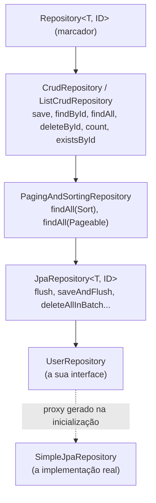

# J5.09 — Spring Data JPA: repositórios e consultas derivadas

> ⏱️ ~1h30 · 🟢 Júnior · Pré-requisitos: J5.03 (`@Repository`, proxies), J5.07–J5.08 (entidades, associações, contexto de persistência), J5.06 (controllers), J1.07 (interfaces), J3.11 (SQL injection e `PreparedStatement`)

## 🎯 Objetivos
Ao final desta aula você consegue:
- Criar um **repositório** estendendo `JpaRepository<T, ID>` e usar `save`, `findById`, `findAll`, `existsById`, `count` e `deleteById`.
- Escrever **consultas derivadas** só pelo **nome do método** (`findByEmail`, `existsByEmail`, `findByOwnerIdOrderByCreatedAtAscIdAsc`) e explicar o que o Spring Data gera.
- Explicar que o repositório é **uma interface** cuja implementação é um **proxy** criado na inicialização, e que ele **traduz exceções** (`DataIntegrityViolationException`).
- Ler os erros reais: método com **nome inválido** (a aplicação nem sobe) e **violação de unicidade**.
- Migrar do PayFlow as **leituras** (login e contas) do JDBC para repositórios JPA, e enfrentar as duas surpresas do porte (o `enum` no template e a tradução de exceções).

## 🤔 Por que isso importa
Na J3 você escreveu `JdbcUserRepository` com `PreparedStatement`, `ResultSet` e `try/catch` em cada método: ~40 linhas para "achar usuário por e-mail". Com Spring Data JPA são **zero linhas** de implementação. Em qualquer projeto Spring, o primeiro contato com o banco é uma interface `*Repository` com métodos de nome comprido. Saber o que acontece por baixo (SQL, transação, exceção) é o que separa quem copia de quem depura.

## 💡 Intuição (explicação simples)
Um **balcão de pedidos** em que você escreve em um papel **o nome do que quer**, "pizza de calabresa grande sem cebola", e a cozinha entende pela **gramática do nome**. Você não explica *como* fazer a massa. No Spring Data, o papel é o **nome do método**: `findByOwnerIdOrderByCreatedAtAsc` é entendido como "ache pelo dono, ordenado pela criação". Quem lê o papel e cozinha é o Spring Data, que **cria a implementação** da sua interface ao subir a aplicação; um erro de grafia no papel ("calabreza") **impede a cozinha de abrir**.

## 🔬 Como funciona por dentro

### 1. A hierarquia de repositórios

Você escreve **só** `public interface UserRepository extends JpaRepository<User, UUID> { }` e ganha o CRUD completo. Os dois parâmetros de tipo são **a entidade** e **o tipo do `@Id`**. (A [documentação](https://docs.spring.io/spring-data/jpa/reference/repositories/core-concepts.html) apresenta `CrudRepository` e `ListCrudRepository`: a segunda devolve `List` em vez de `Iterable`.)

**Quem implementa?** Na inicialização, o Spring Data **varre** as interfaces que estendem `Repository`, e para cada uma cria um **proxy** que delega os métodos de CRUD a uma instância de **`SimpleJpaRepository`** (testado: `é proxy JDK? true | alvo: SimpleJpaRepository`) e **interpreta** os outros métodos pelo nome (ou pela anotação `@Query`, J5.10). O repositório vira um bean singleton, injetável por construtor. A varredura é automática: o Boot ativa `@EnableJpaRepositories` por autoconfiguração (J5.04).

### 2. Transações e exceções já vêm de graça
Os métodos de `SimpleJpaRepository` são `@Transactional`: os de leitura com `readOnly = true`, os de escrita (`save`, `delete`) em transação normal ([documentação](https://docs.spring.io/spring-data/jpa/reference/jpa/transactions.html)). E, por ser um `@Repository` (J5.03), o proxy **traduz** exceções do JPA/JDBC para a hierarquia do Spring (`org.springframework.dao.*`): uma violação de `UNIQUE` vira **`DataIntegrityViolationException`** (verificado abaixo), sem `SQLException` e sem `SQLState` nas suas assinaturas.

### 3. A gramática das consultas derivadas
`<verbo>[Distinct][Top/First N]By<Propriedade>[Operador][And|Or <Propriedade>...][OrderBy<Propriedade>Asc|Desc]`

| Parte do nome | Exemplo | JPQL gerado (resumo) |
|---|---|---|
| `findBy` | `findByEmail(String e)` | `where e.email = ?1` |
| `existsBy` | `existsByEmail(String e)` | `select id ... where email = ? fetch first ? rows only` |
| `countBy` | `countByStatus(AccountStatus s)` | `select count(...) where status = ?` |
| `And` / `Or` | `findByStatusAndOwnerId(...)` | `where status = ? and owner.id = ?` |
| `OwnerId` (caminho) | `findByOwnerId(UUID id)` | `where owner.id = ?` (atravessa a associação `owner` até o `id`) |
| `OrderBy...Asc/Desc` | `...OrderByCreatedAtAscIdAsc` | `order by created_at asc, id asc` |
| `GreaterThan`, `LessThan`, `Between` | `findByAmountGreaterThan(BigDecimal v)` | `> ?`, `< ?`, `between ? and ?` |
| `Containing`, `StartingWith`, `EndingWith`, `Like` | `findByFullNameContaining(String s)` | `like ... ` |
| `IsNull`, `IsNotNull` | `findByTransferIsNull()` | `is null` |
| `In` | `findByStatusIn(Collection<AccountStatus> s)` | `in (...)` |
| `First`/`Top` | `findFirstByOwnerIdOrderByCreatedAt...` | `limit 1` |

A tabela completa está na [referência de palavras-chave](https://docs.spring.io/spring-data/jpa/reference/repositories/query-keywords-reference.html). **Regras de bolso:** nomes demais e `And` demais indicam que é hora de usar `@Query` (J5.10); e **o nome é validado na inicialização**.

**Tipos de retorno:** `Optional<T>` (zero ou um), `List<T>`, `Stream<T>` (precisa de transação e de fechamento), `Slice<T>`/`Page<T>` com `Pageable` (J5.10), `boolean`/`long` para `existsBy`/`countBy`.

**Segurança:** todos os valores entram como **parâmetros** da consulta (`where email = ?`), nunca concatenados. Um teste com o texto `x' OR '1'='1` devolveu **vazio**: é só um e-mail estranho, como na J3.11.

## 🛠️ Exemplo prático
> Testado com **JDK 25.0.5**, **Spring Boot 4.1.2** (Spring Data JPA 4.1.2, Hibernate 7.4.13.Final), PostgreSQL 18.6.

### 1. Os repositórios
`src/main/java/com/payflow/repository/UserRepository.java`
```java
package com.payflow.repository;

import com.payflow.domain.User;
import java.util.Optional;
import java.util.UUID;
import org.springframework.data.jpa.repository.JpaRepository;

public interface UserRepository extends JpaRepository<User, UUID> {

    /** SELECT ... FROM users WHERE email = ? (o nome do método É a consulta). */
    Optional<User> findByEmail(String email);

    boolean existsByEmail(String email);
}
```
`AccountRepository.java`
```java
package com.payflow.repository;

import com.payflow.domain.Account;
import com.payflow.domain.AccountStatus;
import java.util.List;
import java.util.UUID;
import org.springframework.data.jpa.repository.JpaRepository;

public interface AccountRepository extends JpaRepository<Account, UUID> {

    /** owner.id = ? (o Spring Data entende "OwnerId" como o caminho owner → id), em ordem estável. */
    List<Account> findByOwnerIdOrderByCreatedAtAscIdAsc(UUID ownerId);

    List<Account> findByStatus(AccountStatus status);
}
```
`TransferRepository.java`
```java
package com.payflow.repository;

import com.payflow.domain.Transfer;
import java.util.Optional;
import java.util.UUID;
import org.springframework.data.jpa.repository.JpaRepository;

public interface TransferRepository extends JpaRepository<Transfer, UUID> {

    /** Idempotência (regra 4): a chave única já usada? */
    Optional<Transfer> findByIdempotencyKey(String idempotencyKey);
}
```
Detalhes:
- `findByOwnerIdOrderByCreatedAtAscIdAsc`: `OwnerId` atravessa `Account.owner` até o `id` do `User`. O desempate por `Id` mantém a ordem estável (J3.05).
- Em `AccountRepository`, **não há** `findByOwnerId`: o nome com `OrderBy` já fixa a ordem. Um método de leitura sem ordem definida devolve linhas em ordem arbitrária.
- O `LedgerEntryRepository` (com paginação) vem na J5.10.

### 2. O laboratório: SQL, proxy, exceções
`src/test/java/com/payflow/jpa/RepositoryLabTest.java`
```java
package com.payflow.jpa;

import static org.assertj.core.api.Assertions.assertThat;
import static org.assertj.core.api.Assertions.assertThatThrownBy;

import com.payflow.domain.Account;
import com.payflow.domain.AccountStatus;
import com.payflow.domain.User;
import com.payflow.repository.AccountRepository;
import com.payflow.repository.TransferRepository;
import com.payflow.repository.UserRepository;
import com.payflow.support.ResetDatabase;
import java.util.List;
import java.util.UUID;
import org.junit.jupiter.api.Test;
import org.junit.jupiter.api.extension.ExtendWith;
import org.springframework.aop.framework.AopProxyUtils;
import org.springframework.aop.support.AopUtils;
import org.springframework.beans.factory.annotation.Autowired;
import org.springframework.boot.test.context.SpringBootTest;
import org.springframework.dao.DataIntegrityViolationException;
import org.springframework.test.context.ActiveProfiles;
import org.springframework.transaction.annotation.Transactional;

/** Laboratório da J5.09: repositórios Spring Data e consultas derivadas, com SQL à vista. */
@ExtendWith(ResetDatabase.class)
@SpringBootTest(properties = "logging.level.org.hibernate.SQL=DEBUG")
@ActiveProfiles("test")
@Transactional
class RepositoryLabTest {

    private static final UUID ANA = UUID.fromString("10000000-0000-0000-0000-000000000001");

    @Autowired UserRepository users;
    @Autowired AccountRepository accounts;
    @Autowired TransferRepository transfers;

    @Test
    void repositoriesAreProxiesOverSimpleJpaRepository() {
        System.out.println("é proxy JDK? " + AopUtils.isJdkDynamicProxy(users)
                + " | alvo: " + AopProxyUtils.ultimateTargetClass(users).getSimpleName());
        assertThat(AopUtils.isAopProxy(users)).isTrue();
    }

    @Test
    void derivedQueriesFindUsersByEmail() {
        System.out.println(">> findByEmail");
        assertThat(users.findByEmail("ana@payflow.dev")).get().extracting(User::getFullName).isEqualTo("Ana Silva");
        assertThat(users.findByEmail("ninguem@payflow.dev")).isEmpty();
        assertThat(users.existsByEmail("bruno@payflow.dev")).isTrue();
        assertThat(users.findByEmail("x' OR '1'='1")).isEmpty();          // injeção: é só texto (parâmetro)
    }

    @Test
    void derivedQueryTraversesTheAssociationPath() {
        System.out.println(">> findByOwnerIdOrderByCreatedAtAscIdAsc");
        List<Account> list = accounts.findByOwnerIdOrderByCreatedAtAscIdAsc(ANA);
        assertThat(list).hasSize(2);
        assertThat(list.getFirst().getBalance()).isEqualByComparingTo("830.00");
        assertThat(accounts.findByStatus(AccountStatus.BLOCKED)).hasSize(1);
    }

    @Test
    void saveAssignsTheIdAndTheDatabaseDefaults() {
        User bia = users.save(new User("bia@payflow.dev", "Bia Lima", "$2a$10$fake"));
        System.out.println("id após save = " + bia.getId());
        assertThat(bia.getId()).isNotNull();
        assertThat(users.findById(bia.getId())).contains(bia);            // mesmo objeto (contexto de persistência)
    }

    @Test
    void duplicateEmailIsTranslatedToASpringException() {
        users.save(new User("ana@payflow.dev", "Outra Ana", "$2a$10$fake"));
        assertThatThrownBy(users::flush).satisfies(e -> {
            System.out.println("DUPLICATE:\n" + e.getClass().getName() + ": " + e.getMessage().replace('\n', ' '));
            Throwable root = org.springframework.core.NestedExceptionUtils.getRootCause(e);
            System.out.println("raiz: " + root.getClass().getName() + " | " + root.getMessage().replace('\n', ' '));
            assertThat(e).isInstanceOf(DataIntegrityViolationException.class);
        });
    }

    @Test
    void unknownIdempotencyKeyIsEmpty() {
        assertThat(transfers.findByIdempotencyKey("key-0001")).isPresent();
        assertThat(transfers.findByIdempotencyKey("nao-existe")).isEmpty();
    }
}
```
```bash
mvn test -Dtest=RepositoryLabTest
```
```
Tests run: 6, Failures: 0, Errors: 0, Skipped: 0
é proxy JDK? true | alvo: SimpleJpaRepository
id após save = 01a1d55b-76d2-71e3-b281-f931abb4704b
```
O SQL gerado (saída real):
```sql
-- users.findByEmail("ana@payflow.dev")
select u1_0.id,u1_0.created_at,u1_0.email,u1_0.full_name,u1_0.password_hash,u1_0.role
from users u1_0 where u1_0.email=?

-- users.existsByEmail("bruno@payflow.dev")
select u1_0.id from users u1_0 where u1_0.email=? fetch first ? rows only

-- accounts.findByOwnerIdOrderByCreatedAtAscIdAsc(ANA)
select a1_0.id,a1_0.balance,a1_0.created_at,a1_0.owner_id,a1_0.status,a1_0.version
from accounts a1_0 where a1_0.owner_id=? order by a1_0.created_at,a1_0.id

-- accounts.findByStatus(BLOCKED)
select ... from accounts a1_0 where a1_0.status=?
```
Note: **`owner_id=?` direto na tabela `accounts`**, sem `JOIN` com `users`: o Hibernate entende que `owner.id` já está na coluna FK.

**A violação de unicidade, traduzida** (saída real do teste `duplicateEmailIsTranslatedToASpringException`):
```
org.springframework.dao.DataIntegrityViolationException: could not execute statement
 [ERROR: duplicate key value violates unique constraint "uk_users_email"   Detail: Key (email)=(ana@payflow.dev) already exists.]
 [insert into users (email,full_name,password_hash,role,id) values (?,?,?,?,?) returning created_at];
 SQL [insert into users (email,full_name,password_hash,role,id) values (?,?,?,?,?) returning created_at]; constraint [uk_users_email]
raiz: org.postgresql.util.PSQLException | ERROR: duplicate key value violates unique constraint "uk_users_email" ...
```
A causa raiz (`PSQLException`, `SQLState 23505`) é a mesma da J3.11; o que mudou é que o **seu código** captura `DataIntegrityViolationException` (hierarquia do Spring) e **não depende do banco**. Repare que a exceção só apareceu no **`flush()`** (o teste o chama): o `save` apenas **agenda** o `INSERT`; o SQL vai ao banco no *flush* ou no commit (J5.08). **Em produção, a violação aparece no commit/fim do método transacional, não na linha do `save`.**

**O nome inválido derruba a aplicação ao subir** (testado: trocamos `findByEmail` por `findByEmial`):
```
Error creating bean with name 'userRepository' defined in com.payflow.repository.UserRepository ...:
 No property 'emial' found for type 'User'; Did you mean 'email'
Caused by: org.springframework.data.repository.query.QueryCreationException:
 Cannot create query for method [UserRepository.findByEmial(java.lang.String)]; No property 'emial' found for type 'User'; Did you mean 'email'
Caused by: org.springframework.data.core.PropertyReferenceException: No property 'emial' found for type 'User'; Did you mean 'email'
```
É uma **vantagem** sobre o SQL em `String`: o erro aparece **na inicialização**, com sugestão, e não na primeira requisição (compare com o `ERROR: relation "account" does not exist` da J3.11).

### 3. Migrar as leituras do PayFlow para os repositórios
Plano: **só as leituras** (login, lista de contas, "esta conta é do usuário?") passam a usar JPA; o **extrato** (J5.10) e o **depósito** e a **transferência** (J5.11) continuam no JDBC por enquanto. Assim o painel funciona em todos os momentos e os 10 testes do `PayflowWebTest` seguem verdes.

**(a) O que a sessão guarda.** Até agora a sessão guardava o `User` do JDBC. Guardar uma **entidade JPA** na sessão é um erro: ela fica **desanexada** e desatualizada. Guarde só o necessário:

`src/main/java/com/payflow/web/CurrentUser.java`
```java
package com.payflow.web;

import java.util.UUID;

/** Quem está logado: só o que a sessão precisa guardar (nunca a entidade JPA inteira, que ficaria desatualizada). */
public record CurrentUser(UUID id, String email, String fullName) { }
```
Em `Sessions`, `AuthInterceptor`, `LoginController`, `AccountPagesController` e `StatementApiController`, troque `User` (do JDBC) por `CurrentUser` (remova `import com.payflow.db.User;`). `Sessions` passa a ser `Map<String, CurrentUser>`; o interceptor, `Optional<CurrentUser>`.

**(b) O login.** `LoginController` usa o `UserRepository` e guarda um `CurrentUser`:
```java
private final UserRepository users;     // import com.payflow.repository.UserRepository;

@PostMapping("/login")
public ModelAndView login(@RequestParam(defaultValue = "") String email, HttpServletResponse response) {
    String normalized = email.trim().toLowerCase();
    return users.findByEmail(normalized)
            .map(user -> {
                cookies.write(response, sessions.create(
                        new CurrentUser(user.getId(), user.getEmail(), user.getFullName())));
                return Pages.redirect("/accounts");
            })
            .orElseGet(() -> Pages.page("login", HttpStatus.UNAUTHORIZED,
                    "error", "Não encontramos esse e-mail.", "email", normalized));
}
```
**(c) As contas.** Em `AccountPagesController` (e igual no `StatementApiController`), acrescente o repositório JPA **ao lado** do JDBC, que ainda faz o extrato e o depósito:
```java
private final AccountRepository accountRepository;       // JPA: leituras de contas (J5.09)
private final JdbcAccountRepository accounts;             // JDBC: extrato e depósito (saem nas J5.10 e J5.11)

public AccountPagesController(AccountRepository accountRepository, JdbcAccountRepository accounts,
                              PayflowProperties properties) { ... }

@GetMapping("/accounts")
public ModelAndView list(@RequestAttribute(AuthInterceptor.USER) CurrentUser user) {
    return Pages.page("accounts", HttpStatus.OK, "user", user,
            "accounts", accountRepository.findByOwnerIdOrderByCreatedAtAscIdAsc(user.id()));
}

/** Só devolve a conta se ela for do usuário da sessão; de outro dono = "não existe". */
private Optional<Account> ownedAccount(CurrentUser user, UUID id) {     // import com.payflow.domain.Account;
    return accountRepository.findById(id).filter(a -> a.getOwner().getId().equals(user.id()));
}
```
O `a.getOwner().getId()` **não vai ao banco**: o `owner` é um proxy preguiçoso (J5.08) que já conhece o `id`. Confira com o log de SQL: `findById` gera **um** `select` em `accounts`, e nenhum em `users`. (Sem `open-in-view`, a entidade chega desanexada; ler o `id` do proxy continua permitido, mas `getOwner().getFullName()` falharia: o `LazyInitializationException` da J5.08.)

### 4. As duas surpresas do porte
Ao rodar o `PayflowWebTest` pela primeira vez depois da troca, **2 testes falharam**. Ambos valem como lição:

**Surpresa 1: o template parou de mostrar "Ativa".** O `accounts.html` comparava `${account.status == 'ACTIVE'}`: antes `status` era uma `String`; agora é um **`enum`**. Em SpEL, `AccountStatus.ACTIVE == 'ACTIVE'` é **falso** (um `enum` não é igual a uma `String`) e a página caiu no ramo "Encerrada"/`badge-warn`, **sem erro nenhum**. O teste `loginSetsAnHttpOnlyCookieAndShowsTheBalance` (que procura "Ativa") foi quem avisou. Conserto: compare o **nome** do `enum`:
```html
<span class="badge" th:classappend="${account.status.name() == 'ACTIVE'} ? 'badge-ok' : 'badge-warn'"
      th:text="${account.status.name() == 'ACTIVE'} ? 'Ativa' : (${account.status.name() == 'BLOCKED'} ? 'Bloqueada' : 'Encerrada')">Ativa</span>
```
Lição: **trocar o tipo de um campo pode quebrar um template em silêncio**; teste de ponta a ponta existe para isso (J7). (O `user.fullName` do `CurrentUser`, um `record`, funcionou: o Spring EL acessa o acessor `fullName()` de um `record`.)

**Surpresa 2: depósito de `-5` virou 500.** O `JdbcAccountRepository` (J3) lança `IllegalArgumentException("amount must be positive")` e o controller a capturava para responder 400. Agora respondeu **500**, com este erro no log:
```
org.springframework.dao.InvalidDataAccessApiUsageException: amount must be positive
```
Com o **JPA no classpath**, o `@Repository` (J5.03) do JDBC passou a ter um *post-processor* de **tradução de exceções**, e o tradutor do JPA converte `IllegalArgumentException` em `InvalidDataAccessApiUsageException`. **Acrescentar uma dependência mudou o comportamento de uma classe que você não tocou.** Como o JDBC sai na J5.11 (e a regra de valor mínimo vai para o serviço), o conserto é provisório, com um comentário:
```java
} catch (IllegalArgumentException | InvalidDataAccessApiUsageException e) {   // inclui NumberFormatException;
    // (com o JPA no classpath, o @Repository traduz a IllegalArgumentException do JDBC; some na J5.11)
    return statementPage(user, id, 0,
            "Informe um valor positivo com até 2 casas decimais, como 25,90.", HttpStatus.BAD_REQUEST);
}
```
(`AccountUnavailableException` não foi afetada: é uma exceção do domínio que nenhum tradutor reconhece.)
```bash
mvn test -Dtest=PayflowWebTest
# Tests run: 10, Failures: 0, Errors: 0, Skipped: 0
```

## 🧠 Pausa para lógica
**Enunciado:** escreva `toJpql(String entity, String methodName)` que transforma nomes como `findByStatusAndOwnerId` e `findByOwnerIdOrderByCreatedAtAscIdAsc` em JPQL, como o Spring Data. Suporte `find`/`exists`/`count`, `And`/`Or`, os operadores `GreaterThan`, `LessThan`, `Containing`, `StartingWith`, `IsNull`, `IsNotNull`, `Not` e `OrderBy...Asc/Desc`; um nome terminado em `Id` vira o caminho `x.id`.

<details><summary>Dica</summary>Use uma expressão regular para separar o verbo, o trecho entre <code>By</code> e <code>OrderBy</code> e o trecho de ordenação. Quebre o predicado por <code>Or</code> e depois por <code>And</code> (cuidado: use <i>lookahead</i> <code>(?=[A-Z])</code> para não quebrar "Ordem" ou "Order"). Teste os operadores do <b>mais longo para o mais curto</b> (<code>GreaterThan</code> antes de <code>Than</code>...).</details>
<details><summary>Solução (testada com JDK 25.0.5)</summary>

```java
import java.util.ArrayList;
import java.util.List;
import java.util.regex.Matcher;
import java.util.regex.Pattern;

/** Transforma o NOME de um método de repositório em JPQL, como faz o Spring Data (versão minúscula). */
public class DerivedQuery {

    /** Operadores suportados, do mais longo para o mais curto (para "GreaterThan" não virar "Greater" + "Than"). */
    private static final String[][] OPERATORS = {
            {"GreaterThan", "> :%s"}, {"LessThan", "< :%s"}, {"Containing", "like concat('%%', :%s, '%%')"},
            {"StartingWith", "like concat(:%s, '%%')"}, {"IsNotNull", "is not null"}, {"IsNull", "is null"},
            {"Not", "<> :%s"}};

    static String toJpql(String entity, String methodName) {
        Matcher m = Pattern.compile("^(find|exists|count)(?:\\w*?)By(.*?)(?:OrderBy(.*))?$").matcher(methodName);
        if (!m.matches()) {
            throw new IllegalArgumentException("cannot parse: " + methodName);
        }
        String select = switch (m.group(1)) {
            case "count" -> "select count(e) from " + entity + " e";
            case "exists" -> "select e.id from " + entity + " e";
            default -> "select e from " + entity + " e";
        };
        List<String> predicates = new ArrayList<>();
        StringBuilder where = new StringBuilder();
        String[] groupsOr = m.group(2).split("Or(?=[A-Z])");
        for (int g = 0; g < groupsOr.length; g++) {
            List<String> ands = new ArrayList<>();
            for (String part : groupsOr[g].split("And(?=[A-Z])")) {
                ands.add(predicate(part));
            }
            if (g > 0) {
                where.append(" or ");
            }
            where.append(String.join(" and ", ands));
        }
        StringBuilder jpql = new StringBuilder(select).append(" where ").append(where);
        if (m.group(3) != null) {
            List<String> orders = new ArrayList<>();
            Matcher o = Pattern.compile("([A-Z][a-z0-9]*(?:[A-Z][a-z0-9]*)*?)(Asc|Desc)").matcher(m.group(3));
            while (o.find()) {
                orders.add("e." + property(o.group(1)) + " " + o.group(2).toLowerCase());
            }
            jpql.append(" order by ").append(String.join(", ", orders));
        }
        return jpql.toString();
    }

    private static String predicate(String part) {
        for (String[] op : OPERATORS) {
            if (part.endsWith(op[0])) {
                String prop = property(part.substring(0, part.length() - op[0].length()));
                return "e." + prop + " " + op[1].formatted(prop.replace(".", "_"));
            }
        }
        String prop = property(part);
        return "e." + prop + " = :" + prop.replace(".", "_");
    }

    /**
     * "OwnerId" -> "owner.id" (caminho pela associação), "CreatedAt" -> "createdAt", "Email" -> "email".
     * Simplificação: o Spring Data consulta o modelo de entidades; aqui, um nome terminado em "Id" vira "x.id".
     */
    private static String property(String camel) {
        String first = Character.toLowerCase(camel.charAt(0)) + camel.substring(1);
        return first.length() > 2 && first.endsWith("Id")
                ? first.substring(0, first.length() - 2) + ".id" : first;
    }

    public static void main(String[] args) {
        for (String name : new String[] {
                "findByEmail",
                "existsByEmail",
                "findByOwnerIdOrderByCreatedAtAscIdAsc",
                "findByStatusAndOwnerId",
                "findByStatusOrOwnerId",
                "findByAmountGreaterThan",
                "findByFullNameContaining",
                "countByStatus",
                "findByTransferIdIsNull"}) {
            System.out.printf("%-42s %s%n", name, toJpql("X", name));
        }
    }
}
```
Saída real:
```
findByEmail                                select e from X e where e.email = :email
existsByEmail                              select e.id from X e where e.email = :email
findByOwnerIdOrderByCreatedAtAscIdAsc      select e from X e where e.owner.id = :owner_id order by e.createdAt asc, e.id asc
findByStatusAndOwnerId                     select e from X e where e.status = :status and e.owner.id = :owner_id
findByStatusOrOwnerId                      select e from X e where e.status = :status or e.owner.id = :owner_id
findByAmountGreaterThan                    select e from X e where e.amount > :amount
findByFullNameContaining                   select e from X e where e.fullName like concat('%', :fullName, '%')
countByStatus                              select count(e) from X e where e.status = :status
findByTransferIdIsNull                     select e from X e where e.transfer.id is null
```
O Spring Data faz isso de forma muito mais completa (`PartTree`), **consultando o modelo de entidades** para saber se `OwnerId` é a propriedade `ownerId` ou o caminho `owner.id` (a nossa versão **adivinha** pelo sufixo `Id`, o que é uma simplificação). Veja também a ambiguidade que isso resolve: se existissem uma propriedade `ownerId` **e** uma associação `owner`, o nome `findByOwnerId` seria ambíguo e se usa `findByOwner_Id`.
</details>

**Variação mais difícil:** acrescente `Between`, `In`, `Top3`/`First` (`limit`) e `Distinct`; depois faça o analisador **rejeitar** (com sugestão "Did you mean...") uma propriedade que não exista em uma lista de campos da entidade.

## ⚠️ Erros comuns e boas práticas de produção
- **Nome de método com erro de grafia** (`findByEmial`): a aplicação **não sobe**, com `No property 'emial' found ... Did you mean 'email'`. É um bom erro: leia a sugestão.
- **Métodos com nomes gigantes** (`findByOwnerIdAndStatusAndCreatedAtBetweenOrderBy...`): ilegíveis. A partir de três condições, prefira `@Query` com JPQL (J5.10).
- **`Optional` e `null`:** `findById` devolve `Optional`; `findByEmail` também. Não chame `.get()` sem checar; use `orElseThrow(...)` com uma exceção de negócio ou `map`/`orElseGet`.
- **`save` não é obrigatório para atualizar uma entidade gerenciada** (dirty checking, J5.08), mas é necessário para **inserir** e para atualizar uma entidade **desanexada**. `save` devolve a instância gerenciada: **use o retorno** (para uma desanexada, o `merge` devolve outra cópia).
- **Achar que `save` já gravou:** só agenda; o `INSERT`/`UPDATE` vai ao banco no *flush*/commit, e a violação de `UNIQUE` aparece **então**.
- **`findAll()` em tabela grande:** carrega **tudo** na memória. Use paginação (J5.10).
- **Entidade JPA na sessão ou em cache** (como no `CurrentUser`): fica desanexada e desatualizada. Guarde `id` e dados simples.
- **Capturar `SQLException`/`PSQLException` em código novo:** o repositório lança exceções do **Spring** (`DataIntegrityViolationException`, `DataAccessException`).
- **Dois `DataAccessException`:** a J3 criou `com.payflow.db.DataAccessException`, com o mesmo nome simples da `org.springframework.dao.DataAccessException`. Cuidado com o `import`; a da J3 sai na J5.11.
- **Repositório para tudo:** crie repositório só para **entidades-raiz** que você precisa buscar; não um por tabela por reflexo.

## 🧩 Exercícios
1. **Fixação:** (a) o que `extends JpaRepository<User, UUID>` dá sem você escrever nada, e quem implementa? (b) como o Spring Data entende `findByOwnerIdOrderByCreatedAtAscIdAsc`? (c) por que um nome de método errado derruba a aplicação **ao subir**? (d) o que é a exceção `DataIntegrityViolationException` e quando ela aparece de fato? (e) por que `save` pode não gerar SQL imediatamente?
2. **Aplicação no PayFlow:** repositórios e porte das leituras.
   - [ ] `UserRepository`, `AccountRepository` e `TransferRepository` criados; `RepositoryLabTest` com 6 testes verdes.
   - [ ] `CurrentUser` na sessão; `Sessions`, `AuthInterceptor`, `LoginController`, `AccountPagesController` e `StatementApiController` migrados como na seção 3; `PayflowWebTest` com 10 testes verdes.
   - [ ] O template `accounts.html` com `account.status.name()`; você **reproduziu** o defeito (voltou ao `== 'ACTIVE'`), anotou o que a página mostrou e o desfez.
   - [ ] **Prove** que o `ownedAccount` não faz `SELECT` em `users`: com `logging.level.org.hibernate.SQL=DEBUG`, abra `/accounts/{id}` e cole **o SQL real** em `docs/spring-lab/jpa-repositories.md`.
   - [ ] **Quebre** `findByEmail` (`findByEmial`), suba a aplicação, cole a mensagem completa em `docs/spring-lab/jpa-repositories.md` e desfaça.
   - [ ] `UserRepository.existsByEmail`: escreva um teste que cria um usuário com e-mail já existente por `save` + `flush` e confirma `DataIntegrityViolationException`.
   - [ ] Commit: `refactor(persistence): read users and accounts through Spring Data JPA`.
3. **Desafio (opcional):** acrescente `findByStatusAndOwnerIdOrderByCreatedAtDesc(AccountStatus, UUID)` e `countByStatus(AccountStatus)`, escreva testes e compare o SQL gerado com o que você escreveria à mão. Qual tem o melhor nome: o derivado ou um `@Query` explícito (J5.10)?

<details><summary>Soluções de referência</summary>

1. (a) O CRUD (`save`, `findById`, `findAll`, `existsById`, `count`, `deleteById`...) mais `flush`/`saveAndFlush`; a implementação é um proxy criado na inicialização que delega ao `SimpleJpaRepository`. (b) Como "ache por `owner.id`, ordenado por `createdAt` ascendente e `id` ascendente": `where a.owner.id = ?1 order by a.createdAt asc, a.id asc`. (c) Porque o Spring Data valida cada nome de método na inicialização, ao criar o repositório (`QueryCreationException`/`PropertyReferenceException`). (d) É a exceção do Spring para violação de integridade (`UNIQUE`, `FK`, `NOT NULL`); aparece quando o SQL vai ao banco (flush ou commit), não necessariamente na linha do `save`. (e) O `save` só coloca a entidade no contexto de persistência; o `INSERT` sai no flush/commit.
2. Os valores esperados estão na seção 2.
3. O derivado: `findByStatusAndOwnerIdOrderByCreatedAtDesc` já descreve a consulta em uma linha e é validado na subida; um `@Query` só vale quando o nome ficaria ilegível ou a consulta precisar de `JOIN`/agregação.
</details>

## 🎤 Na entrevista
- **O que é o Spring Data JPA e o que ele faz?** Uma camada sobre JPA que gera a implementação de repositórios a partir de interfaces: CRUD pronto, consultas derivadas do nome do método, `@Query`, paginação, auditoria. Reduz código repetitivo.
- **Como funcionam as consultas derivadas?** O Spring Data analisa o nome do método (`findBy...And...OrderBy...`), cria a consulta JPQL na inicialização e falha se a propriedade não existir. Valores são sempre parâmetros (sem injeção de SQL).
- **`save` insere ou atualiza?** Os dois: se a entidade é nova (por exemplo, `id` nulo), faz `persist`; senão, `merge`. O SQL só vai ao banco no flush/commit.
- **Qual a diferença entre `findById` e `getReferenceById`?** `findById` consulta e devolve `Optional`; `getReferenceById` devolve um proxy sem consultar (falha depois se não existir).
- **Por que o `DataIntegrityViolationException` e não `SQLException`?** O `@Repository` traduz as exceções específicas da tecnologia para a hierarquia independente do Spring (`DataAccessException`), que é não verificada.

## 📚 Para ir além
- 📄 [Spring Data JPA — Getting Started](https://docs.spring.io/spring-data/jpa/reference/jpa/getting-started.html) e [Core concepts](https://docs.spring.io/spring-data/jpa/reference/repositories/core-concepts.html): hierarquia de repositórios.
- 📄 [Spring Data JPA — Query Methods](https://docs.spring.io/spring-data/jpa/reference/jpa/query-methods.html): consultas derivadas, `@Query`, paginação e ordenação.
- 📄 [Spring Data — Query keywords reference](https://docs.spring.io/spring-data/jpa/reference/repositories/query-keywords-reference.html): a tabela completa de palavras-chave.
- 📄 [Spring Data JPA — Transactionality](https://docs.spring.io/spring-data/jpa/reference/jpa/transactions.html): `@Transactional` nos métodos do repositório.
- 📄 [Spring Framework — Hibernate/JPA e tradução de exceções](https://docs.spring.io/spring-framework/reference/data-access/orm/jpa.html): `@Repository` e `PersistenceExceptionTranslationPostProcessor`.
- 🎥 ⚠️ Nenhum vídeo verificado nesta execução.

## ✅ Checklist da aula
- [ ] Criei repositórios e li o SQL de cada método derivado.
- [ ] Sei que o repositório é um proxy de `SimpleJpaRepository` e que traduz exceções.
- [ ] Provoquei o erro de nome de método e li o "Did you mean".
- [ ] O login e as contas do PayFlow usam repositórios JPA, com `CurrentUser` na sessão.
- [ ] Sei explicar as duas surpresas do porte (`enum` no template e a tradução de exceções).
