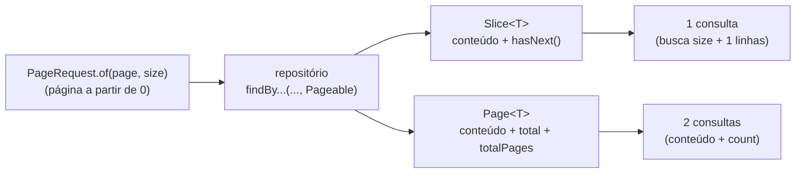

# J5.10 — JPQL e paginação

> ⏱️ ~1h30 · 🟢 Júnior · Pré-requisitos: J5.07–J5.09 (entidades, repositórios, consultas derivadas), J3.05 (`ORDER BY`, `LIMIT`/`OFFSET`, paginação), J3.07 (agregações)

> ✅ **Validação final (2026-11-24):** este módulo foi executado no PayFlow reconstruído; o resultado e o que continua não executado estão no [README do módulo](README.md). Os avisos "não executado" / "por leitura" abaixo descrevem a escrita original.

## 🎯 Objetivos
Ao final desta aula você consegue:
- Escrever consultas **JPQL** com `@Query` e **parâmetros nomeados** (`:accountId`), e dizer a diferença entre JPQL e SQL.
- Paginar com **`Pageable`**/`PageRequest` e escolher entre **`Slice`** e **`Page`** sabendo o **custo** de cada um (consulta `count` a mais).
- Ler o SQL gerado (`fetch first ? rows only`, `offset ? rows`) e a **contagem de consultas** de cada estratégia.
- Fazer a **aritmética de paginação** sem erros de "off-by-one" (páginas a partir de 0, itens exibidos a partir de 1, `long` para o *offset*).
- Substituir, no PayFlow, o extrato do JDBC (que fazia **duas** consultas para saber se havia "mais antigos") por **uma** consulta com `Slice`.

## 🤔 Por que isso importa
**Toda tela de lista precisa de paginação.** Sem ela, uma conta com 50 mil lançamentos derruba a aplicação ao abrir o extrato. E a paginação tem armadilhas clássicas: contar o total em toda requisição (caro), `OFFSET` enorme (lento), ordenação sem desempate (linhas que **repetem ou somem** entre páginas) e erro de uma posição (a última linha da página 1 aparece de novo na página 2). Esta aula mostra o custo de cada decisão **medindo** as consultas.

## 💡 Intuição (explicação simples)
Um **livro de recibos** de mil páginas. Você não lê tudo para achar o último recibo: abre pelo fim e lê **uma página de cada vez**. Para saber **se tem mais páginas**, basta olhar se há **mais um recibo** depois dos que você está lendo (**`Slice`**: pede um recibo a mais e confere). Para dizer "página 3 de 47", alguém precisa **contar todas as páginas** do livro (**`Page`**: uma segunda consulta, de contagem). Contar é caro em livros grandes: só conte quando a tela realmente mostra o total.

## 🔬 Como funciona por dentro

### 1. JPQL: SQL sobre **objetos**
**JPQL** (*Jakarta Persistence Query Language*) parece SQL, mas fala em **entidades e campos Java**, não em tabelas e colunas:
| SQL (J3) | JPQL |
|---|---|
| `SELECT ... FROM ledger_entries WHERE account_id = ?` | `select e from LedgerEntry e where e.account.id = :accountId` |
| `JOIN accounts a ON a.id = e.account_id` | `join e.account a` (usa a **associação** mapeada) |
| `type = 'CREDIT'` | `e.type = com.payflow.domain.EntryType.CREDIT` (o `enum` do Java) |
| Parâmetro posicional `?` | **Nomeado** `:accountId` + `@Param("accountId")` |

O Hibernate **traduz** o JPQL para o SQL do PostgreSQL (você vê no log). Boas razões para `@Query`: nomes de método derivado ficando enormes, `JOIN`s, agregações (`sum`, `count`, `group by`), e `select new ...` para projeções. **Valores sempre como parâmetros**: nunca concatene (J3.11).

### 2. Paginação: `Pageable`, `Slice` e `Page`

| | `Slice<T>` | `Page<T>` |
|---|---|---|
| Sabe quantos itens há **na página** | ✅ | ✅ |
| Sabe se há **próxima página** | ✅ (`hasNext()`) | ✅ |
| Sabe o **total** de itens e de páginas | ❌ | ✅ (`getTotalElements()`, `getTotalPages()`) |
| Consultas | **1** | **2** (a de conteúdo e um `count(*)`) |
| Use quando | "carregar mais", rolagem infinita, "Próxima →" | A tela mostra "página 3 de 47" ou o total |

A [documentação do Spring Data](https://docs.spring.io/spring-data/jpa/reference/repositories/query-methods-details.html) explica: com `Slice`, os metadados extras não são criados e **o `count` não é emitido**; para saber o total é preciso a consulta de contagem a mais.

**Como o `Slice` sabe se há próxima página sem contar?** Ele pede `size + 1` linhas ao banco. Se vierem `size + 1`, existe uma próxima (e o conteúdo devolvido é cortado em `size`).

### 3. As armadilhas da paginação
- **Ordenação sem desempate:** `order by created_at desc` com dois lançamentos no mesmo instante: o banco pode devolvê-los em ordens diferentes em duas consultas, e uma linha **repete ou some** entre as páginas. Sempre acrescente a chave única: `order by created_at desc, id desc` (J3.05). O PayFlow faz isso no nome do método (`...OrderByCreatedAtDescIdDesc`).
- **`OFFSET` grande é lento:** `offset 100000` obriga o banco a **ler e descartar** 100 mil linhas. Para extratos enormes se usa **paginação por chave** (*keyset*: `where (created_at, id) < (?, ?)`), assunto do módulo S3 (leia [Use The Index, Luke — No Offset](https://use-the-index-luke.com/no-offset)). No PayFlow, `payflow.statement.max-page` limita a profundidade (J5.05).
- **Página começa em 0** no Spring (`PageRequest.of(0, 5)` = primeira página); a tela exibe "página 1". Misturar as duas contagens é a origem do erro de uma posição.
- **`Page` em tudo:** o `count(*)` de uma tabela com milhões de linhas pode ser a consulta mais lenta da tela.

## 🛠️ Exemplo prático
> Testado com **JDK 25.0.5**, **Spring Boot 4.1.2**, PostgreSQL 18.6. O seed da Ana (conta `20000000-...-01`) tem **3 lançamentos** (1000.00, 150.00 e 20.00, o mais novo).

### 1. O repositório do extrato
`src/main/java/com/payflow/repository/LedgerEntryRepository.java`
```java
package com.payflow.repository;

import com.payflow.domain.LedgerEntry;
import java.math.BigDecimal;
import java.util.UUID;
import org.springframework.data.domain.Page;
import org.springframework.data.domain.Pageable;
import org.springframework.data.domain.Slice;
import org.springframework.data.jpa.repository.JpaRepository;
import org.springframework.data.jpa.repository.Query;
import org.springframework.data.repository.query.Param;

public interface LedgerEntryRepository extends JpaRepository<LedgerEntry, UUID> {

    /** Extrato: do mais novo para o mais antigo (desempate por id). Slice: sabe se há mais, sem contar o total. */
    Slice<LedgerEntry> findByAccountIdOrderByCreatedAtDescIdDesc(UUID accountId, Pageable pageable);

    /** A mesma consulta como Page: devolve também o total (uma consulta count a mais). */
    Page<LedgerEntry> findPageByAccountIdOrderByCreatedAtDescIdDesc(UUID accountId, Pageable pageable);

    /** JPQL explícito: o saldo que o livro-razão "diz" (regra 3: saldo = soma dos lançamentos). */
    @Query("""
            select coalesce(sum(case when e.type = com.payflow.domain.EntryType.CREDIT
                                     then e.amount else -e.amount end), 0)
            from LedgerEntry e
            where e.account.id = :accountId
            """)
    BigDecimal ledgerBalance(@Param("accountId") UUID accountId);
}
```
- Os **dois** primeiros métodos são **derivados** (J5.09): `findBy` + o caminho `Account.Id` + `OrderBy...Desc`. O que muda é o **retorno**: `Slice` ou `Page`. (O prefixo `findPageBy` é só um rótulo: o Spring Data ignora o texto entre `find` e `By`.)
- O terceiro é **JPQL explícito**: a soma que o livro-razão "diz" (regra 3: *o saldo é igual à soma dos lançamentos*, que na J3.07 era SQL puro). O `enum` aparece com o nome completo da classe (`com.payflow.domain.EntryType.CREDIT`) e o `coalesce(..., 0)` evita `null` para uma conta sem lançamentos.

### 2. O laboratório
`src/test/java/com/payflow/jpa/PaginationLabTest.java`
```java
package com.payflow.jpa;

import static org.assertj.core.api.Assertions.assertThat;

import com.payflow.domain.LedgerEntry;
import com.payflow.repository.AccountRepository;
import com.payflow.repository.LedgerEntryRepository;
import com.payflow.support.ResetDatabase;
import java.util.List;
import java.util.UUID;
import org.hibernate.SessionFactory;
import org.hibernate.stat.Statistics;
import org.junit.jupiter.api.Test;
import org.junit.jupiter.api.extension.ExtendWith;
import org.springframework.beans.factory.annotation.Autowired;
import org.springframework.boot.test.context.SpringBootTest;
import org.springframework.data.domain.Page;
import org.springframework.data.domain.PageRequest;
import org.springframework.data.domain.Slice;
import org.springframework.test.context.ActiveProfiles;
import org.springframework.transaction.annotation.Transactional;

/** Laboratório da J5.10: JPQL, Slice × Page e o custo de cada um. */
@ExtendWith(ResetDatabase.class)
@SpringBootTest(properties = {
        "logging.level.org.hibernate.SQL=DEBUG",
        "spring.jpa.properties.hibernate.generate_statistics=true"})
@ActiveProfiles("test")
@Transactional
class PaginationLabTest {

    private static final UUID ANA_ACCOUNT = UUID.fromString("20000000-0000-0000-0000-000000000001");

    @Autowired LedgerEntryRepository ledger;
    @Autowired AccountRepository accounts;
    @Autowired jakarta.persistence.EntityManager em;

    private Statistics statistics() {
        Statistics s = em.getEntityManagerFactory().unwrap(SessionFactory.class).getStatistics();
        s.clear();
        return s;
    }

    @Test
    void sliceKnowsIfThereIsAnotherPageWithoutCounting() {
        Statistics stats = statistics();
        Slice<LedgerEntry> first = ledger.findByAccountIdOrderByCreatedAtDescIdDesc(ANA_ACCOUNT, PageRequest.of(0, 2));
        System.out.println("SLICE página 0: " + first.getNumberOfElements() + " itens, hasNext=" + first.hasNext()
                + " | SQL: " + stats.getPrepareStatementCount());
        Slice<LedgerEntry> second = ledger.findByAccountIdOrderByCreatedAtDescIdDesc(ANA_ACCOUNT, PageRequest.of(1, 2));
        System.out.println("SLICE página 1: " + second.getNumberOfElements() + " itens, hasNext=" + second.hasNext());
        assertThat(first.hasNext()).isTrue();
        assertThat(second.hasNext()).isFalse();
        assertThat(first.getContent().getFirst().getAmount()).isEqualByComparingTo("20.00");   // o mais novo
    }

    @Test
    void pageAlsoRunsACountQuery() {
        Statistics stats = statistics();
        Page<LedgerEntry> page = ledger.findPageByAccountIdOrderByCreatedAtDescIdDesc(ANA_ACCOUNT, PageRequest.of(0, 2));
        System.out.println("PAGE: itens=" + page.getNumberOfElements() + " total=" + page.getTotalElements()
                + " páginas=" + page.getTotalPages() + " | SQL: " + stats.getPrepareStatementCount());
        assertThat(page.getTotalElements()).isEqualTo(3);
        assertThat(page.getTotalPages()).isEqualTo(2);
    }

    @Test
    void pageSizeBiggerThanTheDataDoesNotRunTheCount() {
        Statistics stats = statistics();
        Page<LedgerEntry> page = ledger.findPageByAccountIdOrderByCreatedAtDescIdDesc(ANA_ACCOUNT, PageRequest.of(0, 10));
        System.out.println("PAGE tamanho 10: itens=" + page.getNumberOfElements() + " | SQL: " + stats.getPrepareStatementCount());
        assertThat(page.getTotalElements()).isEqualTo(3);
    }

    @Test
    void jpqlSumMatchesTheAccountBalanceForEverySeededAccount() {
        for (var account : accounts.findAll()) {
            var fromLedger = ledger.ledgerBalance(account.getId());
            System.out.println("conta " + account.getId().toString().substring(0, 8) + "...: saldo=" + account.getBalance()
                    + " | soma dos lançamentos=" + fromLedger);
            assertThat(fromLedger).isEqualByComparingTo(account.getBalance());
        }
    }

    @Test
    void ordersByCreatedAtThenId() {
        List<LedgerEntry> all = ledger.findByAccountIdOrderByCreatedAtDescIdDesc(ANA_ACCOUNT, PageRequest.of(0, 10)).getContent();
        assertThat(all).extracting(e -> e.getAmount().toPlainString()).containsExactly("20.00", "150.00", "1000.00");
    }
}
```
```bash
mvn test -Dtest=PaginationLabTest
```
```
Tests run: 5, Failures: 0, Errors: 0, Skipped: 0
SLICE página 0: 2 itens, hasNext=true | SQL: 1
SLICE página 1: 1 itens, hasNext=false
PAGE: itens=2 total=3 páginas=2 | SQL: 2
PAGE tamanho 10: itens=3 | SQL: 1
conta 20000000...: saldo=830.00 | soma dos lançamentos=830.00
conta 20000000...: saldo=574.50 | soma dos lançamentos=574.50
conta 20000000...: saldo=295.50 | soma dos lançamentos=295.50
conta 20000000...: saldo=0.00 | soma dos lançamentos=0
```
O SQL real (reduzido às partes que importam):
```sql
-- Slice, página 0, tamanho 2: pede size + 1 = 3 linhas ("fetch first ?" recebe 3)
select le1_0.id, le1_0.account_id, le1_0.amount, le1_0.created_at, le1_0.transfer_id, le1_0.type
from ledger_entries le1_0 where le1_0.account_id=?
order by le1_0.created_at desc, le1_0.id desc fetch first ? rows only

-- Slice, página 1: o mesmo, com offset
... order by le1_0.created_at desc, le1_0.id desc offset ? rows fetch first ? rows only

-- Page: o de conteúdo + a contagem
select count(*) from ledger_entries le1_0 where le1_0.account_id=?

-- @Query JPQL: o enum virou literal e o "-e.amount" virou SQL
select coalesce(sum(case when le1_0.type='CREDIT' then le1_0.amount else -le1_0.amount end),0)
from ledger_entries le1_0 where le1_0.account_id=?
```
O que cada resultado ensina:
1. **`Slice` = 1 SQL** nas duas páginas e já sabe o `hasNext`. É a que o painel usa ("Mais antigos →").
2. **`Page` = 2 SQL** (conteúdo + `count`): `total=3`, `páginas=2`.
3. **`Page` de tamanho 10 com 3 itens = 1 SQL:** como a **primeira** página não está cheia, o Spring Data **já sabe** que o total é 3 e **pula** a contagem. (Mas **não** conte com isso: a regra é "2 consultas".)
4. **O JPQL `sum(...)` confere a regra 3** para as quatro contas do seed: `saldo = soma dos lançamentos`. O `0` da última conta vem do `coalesce`.

### 3. O extrato do PayFlow passa para o JPA
O JDBC da J3 (`statement(id, page, size)`) é chamado **duas vezes** por tela: uma para a página e outra, na página seguinte, só para saber se `hasMore` (J4.06 comentou isso: "na J6 a paginação com `Page` traz o total em uma consulta só"). Com `Slice`, **uma consulta** responde às duas perguntas. Em `AccountPagesController` e `StatementApiController`:
```java
import org.springframework.data.domain.PageRequest;
import org.springframework.data.domain.Slice;

private final LedgerEntryRepository ledger;        // injetado pelo construtor, ao lado do AccountRepository

Slice<LedgerEntry> slice = ledger.findByAccountIdOrderByCreatedAtDescIdDesc(id, PageRequest.of(page, size));
List<EntryView> entries = slice.getContent().stream().map(this::view).toList();
boolean hasMore = slice.hasNext();                  // era: !accounts.statement(id, page + 1, size).isEmpty()
```
E o `EntryView` (agora sobre a **entidade**):
```java
private EntryView view(LedgerEntry e) {
    boolean credit = e.getType() == EntryType.CREDIT;
    String label = e.getTransfer() == null ? "Depósito"
            : credit ? "Transferência recebida" : "Transferência enviada";
    return new EntryView(label, credit, e.getAmount(), DATE_TIME.format(e.getCreatedAt().atZone(ZONE)));
}
```
E o JSON da API:
```java
return new EntryJson(e.getId().toString(), e.getType().name(),
        e.getTransfer() == null ? null : e.getTransfer().getId().toString(),   // proxy: o id não vai ao banco
        e.getAmount().toPlainString(),                                          // dinheiro como string (decisão 11)
        e.getCreatedAt().toString());                                           // Instant: ISO-8601 UTC
```
Dois detalhes que **não** geram consulta extra: `e.getTransfer() == null` (para um depósito a FK é nula e o campo é `null`; para uma transferência o campo é um **proxy**, mas só testamos se é nulo) e `getTransfer().getId()` (o proxy já conhece o `id`). Se você pedisse `e.getTransfer().getStatus()`, aí sim iria ao banco (e N vezes: J5.12).

O `JdbcAccountRepository.statement` **não é mais usado**. O painel continua com os mesmos 10 testes verdes:
```bash
mvn test -Dtest=PayflowWebTest
# Tests run: 10, Failures: 0, Errors: 0, Skipped: 0
```
O painel e o `statement.js` (J4.05) não mudaram: o **contrato** da API (`page`, `hasMore`, `entries[]` com `amount` em string) é o mesmo.

## 🧠 Pausa para lógica
**Enunciado:** escreva `PageInfo of(int requestedPage, int size, long total)` que devolve: página efetiva (limitada ao intervalo válido), total de páginas, `hasPrevious`/`hasNext`, *offset* e a faixa de itens **como a tela mostra** ("itens 11–12"). Trate: total 0, página além da última, página negativa e **página gigante** (cuidado com o estouro de `int` em `page * size`). Depois explique como o `Slice` decide `hasNext` com `size + 1` linhas.

<details><summary>Dica</summary>Total de páginas = <code>ceil(total / size)</code> em inteiros: <code>(total + size - 1) / size</code>. O <i>offset</i> é <code>page * size</code>: use <code>long</code>. A faixa exibida começa em <code>offset + 1</code> (a tela conta a partir de 1) e termina em <code>min(offset + size, total)</code>; com total 0 mostre "0–0".</details>
<details><summary>Solução (testada com JDK 25.0.5)</summary>

```java
/** Aritmética de paginação sem erro de "off-by-one": páginas contadas a partir de 0, itens exibidos a partir de 1. */
public class PageMath {

    record PageInfo(int page, int size, long total, long totalPages, boolean hasPrevious, boolean hasNext,
                    long offset, long firstItem, long lastItem) { }

    static PageInfo of(int requestedPage, int size, long total) {
        if (size < 1) {
            throw new IllegalArgumentException("size must be >= 1");
        }
        long totalPages = (total + size - 1) / size;                        // divisão com arredondamento para cima
        int page = (int) Math.max(0, Math.min(requestedPage, Math.max(0, totalPages - 1)));   // limita ao intervalo válido
        long offset = (long) page * size;                                   // long: page * size pode estourar o int
        long first = total == 0 ? 0 : offset + 1;
        long last = Math.min(offset + size, total);
        return new PageInfo(page, size, total, totalPages, page > 0, page + 1 < totalPages, offset, first, last);
    }

    /** O que o Slice faz: busca size + 1 linhas; se vierem size + 1, existe uma próxima página. */
    static boolean hasNextBySlice(int rowsReturnedBySizePlusOneQuery, int size) {
        return rowsReturnedBySizePlusOneQuery > size;
    }

    public static void main(String[] args) {
        int[][] cases = {{0, 5, 12}, {2, 5, 12}, {9, 5, 12}, {0, 5, 0}, {1, 5, 10}, {0, 5, 5}, {-3, 5, 12}};
        for (int[] c : cases) {
            PageInfo p = of(c[0], c[1], c[2]);
            System.out.printf("página=%d tamanho=%d total=%d -> página efetiva=%d de %d | itens %d–%d | offset=%d | anterior=%b próxima=%b%n",
                    c[0], c[1], c[2], p.page(), p.totalPages(), p.firstItem(), p.lastItem(), p.offset(),
                    p.hasPrevious(), p.hasNext());
        }
        System.out.println("offset sem limitar a página: " + (long) Integer.MAX_VALUE * 100
                + " | com int estoura: " + (Integer.MAX_VALUE * 100));
        System.out.println("slice: 6 linhas de 5 pedidas+1 -> próxima? " + hasNextBySlice(6, 5)
                + " | 5 linhas -> " + hasNextBySlice(5, 5));
    }
}
```
Saída real:
```
página=0 tamanho=5 total=12 -> página efetiva=0 de 3 | itens 1–5 | offset=0 | anterior=false próxima=true
página=2 tamanho=5 total=12 -> página efetiva=2 de 3 | itens 11–12 | offset=10 | anterior=true próxima=false
página=9 tamanho=5 total=12 -> página efetiva=2 de 3 | itens 11–12 | offset=10 | anterior=true próxima=false
página=0 tamanho=5 total=0 -> página efetiva=0 de 0 | itens 0–0 | offset=0 | anterior=false próxima=false
página=1 tamanho=5 total=10 -> página efetiva=1 de 2 | itens 6–10 | offset=5 | anterior=true próxima=false
página=0 tamanho=5 total=5 -> página efetiva=0 de 1 | itens 1–5 | offset=0 | anterior=false próxima=false
página=-3 tamanho=5 total=12 -> página efetiva=0 de 3 | itens 1–5 | offset=0 | anterior=false próxima=true
offset sem limitar a página: 214748364700 | com int estoura: -100
slice: 6 linhas de 5 pedidas+1 -> próxima? true | 5 linhas -> false
```
Os casos de borda que mais erram: **total múltiplo do tamanho** (10 itens, tamanho 5: são 2 páginas, não 3 — por isso `(total + size - 1) / size` e não `total / size + 1`); **total 0** (0 páginas, não 1); e `int * int` (`Integer.MAX_VALUE * 100` vira **-100**: um *offset* negativo faria o banco recusar a consulta ou, pior, devolver coisa errada).
</details>

**Variação mais difícil:** implemente a **janela de links** de paginação (`1 … 4 5 [6] 7 8 … 47`) para qualquer página e total, com raio configurável, e a **paginação por chave** (*keyset*): dado o último `(createdAt, id)` da página anterior, gere a cláusula `where (created_at, id) < (?, ?)`.

## ⚠️ Erros comuns e boas práticas de produção
- **Ordenar sem desempate** (`order by created_at desc` apenas): linhas repetidas ou perdidas entre as páginas. **Sempre** inclua a chave primária.
- **`Page` em toda lista:** o `count(*)` pode custar mais que a página. Use `Slice` quando a tela não precisa do total.
- **`findAll()` sem paginação** em tabela que cresce: carrega tudo na memória.
- **Página sem limite máximo:** `?page=99999999` vira um `OFFSET` gigantesco. Limite (o `max-page` do PayFlow) e/ou use keyset.
- **Tamanho de página vindo do cliente sem limite** (`?size=1000000`): valide e imponha um máximo (o PayFlow fixa o tamanho em `payflow.statement.page-size`, com máximo 100 na validação da J5.05).
- **Misturar páginas de base 0 e base 1** entre API e tela.
- **JPQL concatenado:** `"... where e.email = '" + email + "'"` é **injeção de JPQL** (J3.11 e J8). Use `:parametro`.
- **`@Query` com o nome do **campo** errado.** O JPQL é validado **na inicialização**: trocamos `e.account.id` por `e.accountId` e a aplicação **não subiu**:
```
Caused by: org.springframework.data.repository.query.QueryCreationException:
 Cannot create query for method [LedgerEntryRepository.ledgerBalance(java.util.UUID)]; Query validation failed for 'select coalesce(sum(...)) from LedgerEntry e where e.accountId = :accountId'
Caused by: java.lang.IllegalArgumentException: org.hibernate.query.sqm.UnknownPathException:
 Could not resolve attribute 'accountId' of 'com.payflow.domain.LedgerEntry'
```
  Leia de baixo para cima: o **campo** que não existe (`accountId`) e a **entidade** (`LedgerEntry`). O campo se chama `account` (uma associação) e o `id` dele é `account.id`.
- **Projeções:** para listagens que não precisam da entidade inteira, uma consulta com `select new ...` ou uma **projeção** do Spring Data devolve só as colunas necessárias (a documentação de [projeções](https://docs.spring.io/spring-data/jpa/reference/repositories/projections.html) mostra as formas; a J5.12 usa uma).

## 🧩 Exercícios
1. **Fixação:** (a) qual a diferença entre JPQL e SQL? (b) quantas consultas fazem `Slice` e `Page`, e por quê? (c) por que `order by created_at desc` **sem** `id` é perigoso? (d) como o `Slice` sabe que há próxima página? (e) por que `Integer.MAX_VALUE * 100` é um problema em paginação?
2. **Aplicação no PayFlow:** o extrato em JPA.
   - [ ] `LedgerEntryRepository` com o `Slice`, o `Page` e o `@Query` da soma; `PaginationLabTest` com 5 testes verdes (3 lançamentos da Ana, `Slice` = 1 SQL, `Page` = 2 SQL).
   - [ ] `AccountPagesController` e `StatementApiController` usam o `Slice` (`hasNext()`), sem o JDBC; os 10 testes de `PayflowWebTest` continuam verdes.
   - [ ] **Prove** que o extrato agora faz **uma** consulta (e não duas): com `logging.level.org.hibernate.SQL=DEBUG`, abra `/accounts/{id}` e cole **o SQL real** em `docs/spring-lab/jpa-pagination.md`; compare com as duas chamadas da J4.
   - [ ] Com o painel no ar (perfil `dev`), registre 8 depósitos e confira, no navegador, "Mais antigos" com `payflow.statement.page-size=3` (argumento `--payflow.statement.page-size=3`): cada página tem 3 itens e a última **não** mostra o link.
   - [ ] Um teste (`@Transactional`) para a **regra 3** com o `ledgerBalance`: depois de um depósito via JDBC e de um `flush`/nova leitura, o saldo da conta bate com a soma do livro-razão. (Dica: use o `JdbcAccountRepository.deposit` do seu teste da J3.)
   - [ ] Você quebrou o JPQL de propósito (`e.accountId`), colou a mensagem real em `docs/spring-lab/jpa-pagination.md` e desfez.
   - [ ] Commit: `refactor(statement): paginate the ledger with Spring Data Slice`.
3. **Desafio (opcional):** implemente a paginação **por chave** (*keyset*) para o extrato: `findTop6ByAccountIdAndCreatedAtLessThanOrderByCreatedAtDescIdDesc` (ou um `@Query` com `(createdAt, id) < (?, ?)`), com um *cursor* (`createdAt` + `id` do último item) no lugar do número da página. Compare o `EXPLAIN` (J3.09) com o `OFFSET` em uma conta com 100 mil lançamentos (use o gerador de volume que você escreveu).

<details><summary>Soluções de referência</summary>

1. (a) JPQL consulta **entidades e campos** do modelo Java (`from LedgerEntry e where e.account.id = :id`); SQL consulta tabelas e colunas; o Hibernate traduz um para o outro. (b) `Slice`: 1 (busca `size + 1` linhas); `Page`: 2 (a de conteúdo e um `count(*)`); a `Page` precisa do total. (c) Dois lançamentos com o mesmo `created_at` podem sair em ordens diferentes em consultas diferentes: linhas repetem ou somem entre as páginas; o `id` é o desempate. (d) Pede `size + 1` linhas; se vier uma a mais, existe uma próxima página. (e) `int` estoura (vira `-100`): o *offset* precisa de `long`.
2. Confira que o SQL do extrato tem **um** `select ... fetch first ? rows only` por requisição.
3. Esboço (não executado): `where e.account.id = :id and (e.createdAt < :ts or (e.createdAt = :ts and e.id < :lastId)) order by e.createdAt desc, e.id desc` com `PageRequest.of(0, size + 1)` para o `hasNext`; o índice `idx_ledger_entries_account_created` (J3.09) atende diretamente.
</details>

## 🎤 Na entrevista
- **Como você pagina resultados com Spring Data?** Passa um `Pageable` (`PageRequest.of(page, size, sort)`) ao repositório e recebe `Page<T>` (com total) ou `Slice<T>` (sem total, uma consulta só). A página começa em 0.
- **`Page` ou `Slice`?** `Slice` quando só precisa saber se há próxima (rolagem infinita, "Mais antigos"); `Page` quando a tela exibe o total e o número de páginas, ciente do `count(*)` extra.
- **Quais os problemas de paginar com `OFFSET`?** Cresce linearmente com a profundidade (o banco lê e descarta as linhas anteriores) e é instável se os dados mudam entre as requisições; a alternativa é a paginação por chave (*keyset*/cursor).
- **O que é JPQL e quando usar `@Query`?** Linguagem de consulta orientada a objetos do JPA; use `@Query` para `JOIN`s, agregações, projeções ou quando o nome derivado fica ilegível. Sempre com parâmetros nomeados.
- **Como você garante uma ordenação estável na paginação?** Ordenando por uma coluna de negócio **e** pela chave primária como desempate.

## 📚 Para ir além
- 📄 [Spring Data JPA — Query Methods](https://docs.spring.io/spring-data/jpa/reference/jpa/query-methods.html): `@Query`, parâmetros nomeados, ordenação e paginação.
- 📄 [Spring Data — Query Methods: detalhes (`Slice`, `Page`, `Pageable`)](https://docs.spring.io/spring-data/jpa/reference/repositories/query-methods-details.html): quando o `count` é executado.
- 📄 [Spring Data JPA — Projections](https://docs.spring.io/spring-data/jpa/reference/repositories/projections.html): interfaces, DTOs e projeções dinâmicas.
- 📄 [Hibernate Query Language 7.4 (JPQL/HQL)](https://docs.hibernate.org/orm/7.4/querylanguage/html_single/Hibernate_Query_Language.html): o guia da linguagem de consulta.
- 📄 [Use The Index, Luke — Paging Through Results (No Offset)](https://use-the-index-luke.com/no-offset): por que `OFFSET` é lento e a alternativa *keyset*.
- 🎥 ⚠️ Nenhum vídeo verificado nesta execução.

## ✅ Checklist da aula
- [ ] Escrevi um `@Query` com parâmetro nomeado e li o SQL gerado.
- [ ] Sei dizer quantas consultas `Slice` e `Page` fazem e quando usar cada um.
- [ ] O extrato do PayFlow usa `Slice` e faz **uma** consulta por página.
- [ ] A ordenação do extrato tem desempate por `id`.
- [ ] Resolvi a aritmética de paginação com os casos de borda.
