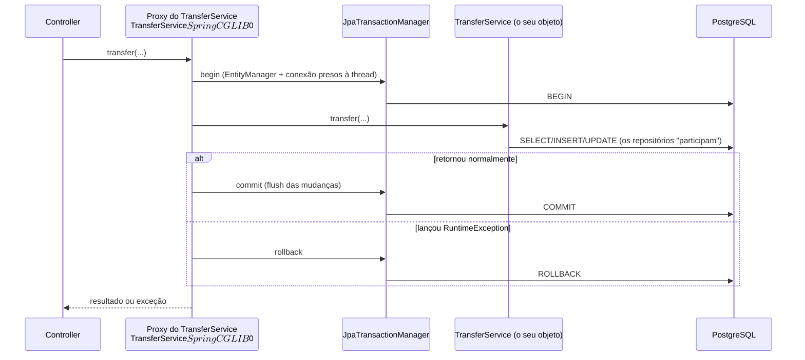

# J5.11 — `@Transactional` na prática

> ⏱️ ~1h30 · 🟢 Júnior · Pré-requisitos: J3.10 (transações e ACID), J5.03 (proxies, `$$SpringCGLIB$$`), J5.08 (contexto de persistência, dirty checking, flush), J5.09 (repositórios), J1.09 (exceções verificadas × não verificadas)

> ✅ **Validação final (2026-11-24):** este módulo foi executado no PayFlow reconstruído; o resultado e o que continua não executado estão no [README do módulo](README.md). Os avisos "não executado" / "por leitura" abaixo descrevem a escrita original.

## 🎯 Objetivos
Ao final desta aula você consegue:
- Explicar como `@Transactional` funciona por baixo (**proxy** que abre, confirma ou desfaz a transação) e **onde** colocá-lo (na camada de **serviço**).
- Prever **commit** ou **rollback** pela regra padrão (exceção **não verificada** desfaz; **verificada** confirma) e mudá-la com `rollbackFor`.
- Usar `readOnly`, entender a **propagação** (`REQUIRED` × `REQUIRES_NEW`) e reconhecer a armadilha da **auto-invocação**.
- Mover as regras do depósito e da transferência do PayFlow para **o domínio e os serviços**, e **remover o JDBC da J3**.
- Provar, com testes que **não** são `@Transactional`, que o **rollback** e o **commit** realmente acontecem no PostgreSQL.

## 🤔 Por que isso importa
A regra 2 do PayFlow (J3.10): *a transferência é atômica*, o dinheiro sai de uma conta **e** entra na outra, ou nada acontece. Na J3 você fez isso com `setAutoCommit(false)`, `commit()` e `rollback()` em `try/catch` **dentro de cada método**. Em um sistema Spring, isso vira **uma anotação**, e por isso mesmo é fácil usá-la **errada**: o rollback que não acontece (exceção verificada), a transação que não existe (auto-invocação), a gravação que some em silêncio (`readOnly`). Cada um desses é um incidente real de produção; todos são reproduzidos aqui.

## 💡 Intuição (explicação simples)
Uma **comanda de restaurante**. Abrir a comanda (começo da transação), lançar pratos e bebidas, e **fechar a conta no final** (commit): tudo é cobrado junto. Se o cliente passa mal no meio, **rasga-se a comanda** (rollback) e nada é cobrado. O `@Transactional` é o **garçom que abre e fecha a comanda por você**, sempre que você entra no salão por ele. Se você **atravessa a cozinha por uma porta de serviço** (chama o método de dentro da própria classe), o garçom não vê e **ninguém abre a comanda**. E a regra do restaurante diz: "se o problema é **inesperado** (exceção de execução), rasga a comanda; se é um **problema previsto e declarado** (exceção verificada), fecha a conta mesmo assim", a não ser que você diga o contrário.

## 🔬 Como funciona por dentro

### 1. O proxy que cuida da transação

- O bean `TransferService` **não é a sua classe**: é um **proxy** (a subclasse `TransferService$$SpringCGLIB$$0`, testado: `PROXY: TransferService$$SpringCGLIB$$0 | CGLIB? true`). Quem chama `transfer(...)` chama o proxy; o proxy abre a transação, **delega** ao seu objeto e fecha. É a mesma ideia do `@Repository` da J5.03.
- O gerenciador de transações é o **`JpaTransactionManager`** (autoconfigurado quando o JPA está no classpath; com só o JDBC era um `DataSourceTransactionManager`, como o relatório de condições da J5.04 listou). Ele liga **um `EntityManager` e uma conexão** à *thread* corrente. Todo repositório chamado dentro do método **participa da mesma transação** (e do mesmo contexto de persistência, J5.08).
- O **flush** (descarregar as mudanças) acontece **antes do commit**. É por isso que um `UPDATE` pode "sumir" se o commit nunca acontece e que a violação de `UNIQUE` só aparece no commit (J5.09).

### 2. Onde colocar `@Transactional`
- Na **camada de serviço**, nos métodos que representam **uma unidade de trabalho de negócio**: "depositar", "transferir". A **fronteira da transação = a fronteira do caso de uso**.
- **Não** no controller (mistura HTTP com banco) e **não** no repositório (o Spring Data já tem as suas transações por método; por isso duas chamadas de repositório soltas seriam **duas** transações).
- Métodos de **leitura** podem usar `@Transactional(readOnly = true)`. Mas veja o aviso abaixo.

### 3. As regras de rollback
Por padrão ([documentação](https://docs.spring.io/spring-framework/reference/data-access/transaction/declarative/rolling-back.html)):
| A exceção lançada pelo método é... | Resultado |
|---|---|
| `RuntimeException` (não verificada) ou `Error` | **ROLLBACK** |
| Exceção **verificada** (`Exception`, `IOException`...) | **COMMIT** (!) |
| Nenhuma | COMMIT |

A razão histórica: exceção verificada era "problema de negócio previsto" (o chamador pode querer o que foi feito até ali). Para mudar: `@Transactional(rollbackFor = Exception.class)`. **O PayFlow usa só exceções não verificadas** (`InsufficientFundsException`, `AccountUnavailableException` estendem `RuntimeException`), então o padrão serve.

### 4. Propagação e outros atributos
**Propagação** responde: *e se já existe uma transação quando este método é chamado?*
| Propagação | Comportamento | Quando |
|---|---|---|
| **`REQUIRED`** (padrão) | Participa da transação existente; se não há, cria uma | Quase tudo |
| **`REQUIRES_NEW`** | **Suspende** a atual e cria uma **nova e independente** (comita sozinha) | Registro de auditoria que deve ficar mesmo se o principal falhar |
| `SUPPORTS` / `MANDATORY` / `NEVER` | Usa se existir / exige existir / proíbe | Casos especiais |
| `NESTED` | Ponto de salvamento (*savepoint*) dentro da transação | Raro com JPA |

`readOnly = true` é uma **dica**: o Hibernate passa a **não** fazer flush (não verifica mudanças) e o driver pode otimizar. **Armadilha:** mudanças feitas dentro de uma transação `readOnly` são **silenciosamente descartadas** (testado abaixo). `isolation` e `timeout` também existem; o isolamento vem no módulo P2.

### 5. A armadilha da auto-invocação
Como o efeito vem do **proxy**, só a chamada **por fora** (`outro bean → proxy → método`) é interceptada. Uma chamada de **dentro da própria classe** (`this.metodo()`) **vai direto ao objeto, sem passar pelo proxy**, e a anotação do método chamado **não faz nada** ([documentação](https://docs.spring.io/spring-framework/reference/data-access/transaction/declarative/annotations.html)). Reproduzido abaixo.

## 🛠️ Exemplo prático
> Testado com **JDK 25.0.5**, **Spring Boot 4.1.2** (Spring Framework 7.0.10, Hibernate 7.4.13.Final), PostgreSQL 18.6.

### 1. O domínio ganha comportamento
As regras de negócio (saldo, conta ativa, valor válido) vão para **dentro da entidade** e de um utilitário: o serviço só **orquestra**. As exceções da J3 mudam de pacote (`com.payflow.db` → `com.payflow.domain`) e continuam não verificadas.

`src/main/java/com/payflow/domain/Amounts.java`
```java
package com.payflow.domain;

import java.math.BigDecimal;

/** Valida valores monetários (decisão 4: a aplicação arredonda antes; o banco só armazena). */
public final class Amounts {

    private Amounts() { }

    public static BigDecimal requireValid(BigDecimal amount) {
        if (amount == null || amount.signum() <= 0) {
            throw new IllegalArgumentException("amount must be positive");
        }
        if (amount.scale() > 2) {
            throw new IllegalArgumentException("amount must have at most 2 decimal places: " + amount);
        }
        return amount;
    }
}
```
`InsufficientFundsException.java` e `AccountUnavailableException.java` (em `com.payflow.domain`):
```java
package com.payflow.domain;

public class InsufficientFundsException extends RuntimeException {
    public InsufficientFundsException(String message) {
        super(message);
    }
}
```
```java
package com.payflow.domain;

/** A conta não existe ou não está ACTIVE. */
public class AccountUnavailableException extends RuntimeException {
    public AccountUnavailableException(String message) {
        super(message);
    }
}
```
`Account.java` ganha as operações `deposit` e `withdraw` (o resto é como na J5.08):
```java
package com.payflow.domain;

import jakarta.persistence.Column;
import jakarta.persistence.Entity;
import jakarta.persistence.EnumType;
import jakarta.persistence.Enumerated;
import jakarta.persistence.FetchType;
import jakarta.persistence.Id;
import jakarta.persistence.JoinColumn;
import jakarta.persistence.ManyToOne;
import jakarta.persistence.Table;
import jakarta.persistence.Version;
import java.math.BigDecimal;
import java.time.Instant;
import java.util.UUID;
import org.hibernate.annotations.Generated;
import org.hibernate.annotations.UuidGenerator;
import org.hibernate.generator.EventType;

@Entity
@Table(name = "accounts")
public class Account {

    @Id
    @UuidGenerator(style = UuidGenerator.Style.VERSION_7)
    private UUID id;

    @ManyToOne(fetch = FetchType.LAZY, optional = false)
    @JoinColumn(name = "owner_id", nullable = false)
    private User owner;

    @Column(nullable = false, precision = 19, scale = 2)
    private BigDecimal balance = BigDecimal.ZERO;

    @Enumerated(EnumType.STRING)
    @Column(nullable = false, length = 20)
    private AccountStatus status = AccountStatus.ACTIVE;

    @Version
    private long version;

    @Generated(event = EventType.INSERT)
    @Column(name = "created_at", insertable = false, updatable = false)
    private Instant createdAt;

    protected Account() {
    }

    public Account(User owner) {
        this.owner = owner;
    }

    /** Depósito: soma ao saldo. A conta precisa estar ativa. */
    public void deposit(BigDecimal amount) {
        Amounts.requireValid(amount);
        requireActive();
        this.balance = balance.add(amount);
    }

    /** Débito: o saldo nunca fica negativo (regra 1). */
    public void withdraw(BigDecimal amount) {
        Amounts.requireValid(amount);
        requireActive();
        if (balance.compareTo(amount) < 0) {
            throw new InsufficientFundsException("Insufficient funds in account " + id);
        }
        this.balance = balance.subtract(amount);
    }

    private void requireActive() {
        if (status != AccountStatus.ACTIVE) {
            throw new AccountUnavailableException("Account not active: " + id);
        }
    }

    public void block() {
        this.status = AccountStatus.BLOCKED;
    }

    public void activate() {
        this.status = AccountStatus.ACTIVE;
    }

    public UUID getId() { return id; }
    public User getOwner() { return owner; }
    public BigDecimal getBalance() { return balance; }
    public AccountStatus getStatus() { return status; }
    public long getVersion() { return version; }
    public Instant getCreatedAt() { return createdAt; }
}
```
- `deposit`/`withdraw` **validam o valor** (`Amounts`), exigem **conta ativa** e protegem a **regra 1** (saldo nunca negativo) **no código**, além do `CHECK` do banco (a segunda barreira, J3.10).
- Não há `setBalance`: o saldo só muda por operações do domínio.

`Transfer.java` ganha a única transição de estado que a J5 usa (o resto é como na J5.08):
```java
    /** A transferência nasce PENDING e vira COMPLETED quando os dois lados foram movimentados (J5.11). */
    public void complete() {
        this.status = TransferStatus.COMPLETED;
    }
```
Sem esse método, o `TransferService` abaixo **não compila** (`cannot find symbol: method complete()`).

### 2. Os serviços transacionais
`src/main/java/com/payflow/service/AccountService.java`
```java
package com.payflow.service;

import com.payflow.domain.Account;
import com.payflow.domain.AccountUnavailableException;
import com.payflow.domain.EntryType;
import com.payflow.domain.LedgerEntry;
import com.payflow.repository.AccountRepository;
import com.payflow.repository.LedgerEntryRepository;
import java.math.BigDecimal;
import java.time.Clock;
import java.util.UUID;
import org.springframework.stereotype.Service;
import org.springframework.transaction.annotation.Transactional;

@Service
public class AccountService {

    private final AccountRepository accounts;
    private final LedgerEntryRepository ledger;
    private final Clock clock;

    public AccountService(AccountRepository accounts, LedgerEntryRepository ledger, Clock clock) {
        this.accounts = accounts;
        this.ledger = ledger;
        this.clock = clock;
    }

    /** Depósito: soma o saldo e grava o lançamento CREDIT, na MESMA transação (tudo ou nada). */
    @Transactional
    public LedgerEntry deposit(UUID accountId, BigDecimal amount) {
        Account account = accounts.findById(accountId)
                .orElseThrow(() -> new AccountUnavailableException("Account not found: " + accountId));
        account.deposit(amount);                                         // regras no domínio; o dirty checking grava o UPDATE
        return ledger.save(new LedgerEntry(account, null, EntryType.CREDIT, amount, clock.instant()));
    }
}
```
`src/main/java/com/payflow/service/TransferService.java`
```java
package com.payflow.service;

import com.payflow.domain.Account;
import com.payflow.domain.AccountUnavailableException;
import com.payflow.domain.Amounts;
import com.payflow.domain.EntryType;
import com.payflow.domain.LedgerEntry;
import com.payflow.domain.Transfer;
import com.payflow.repository.AccountRepository;
import com.payflow.repository.LedgerEntryRepository;
import com.payflow.repository.TransferRepository;
import java.math.BigDecimal;
import java.time.Clock;
import java.time.Instant;
import java.util.UUID;
import org.springframework.stereotype.Service;
import org.springframework.transaction.annotation.Transactional;

/** Transferência entre contas: débito, crédito e lançamentos em UMA transação (ACID, regra 2). */
@Service
public class TransferService {

    private final AccountRepository accounts;
    private final TransferRepository transfers;
    private final LedgerEntryRepository ledger;
    private final Clock clock;

    public TransferService(AccountRepository accounts, TransferRepository transfers, LedgerEntryRepository ledger,
                           Clock clock) {
        this.accounts = accounts;
        this.transfers = transfers;
        this.ledger = ledger;
        this.clock = clock;
    }

    @Transactional
    public Transfer transfer(UUID sourceId, UUID targetId, BigDecimal amount, String idempotencyKey) {
        Amounts.requireValid(amount);
        if (sourceId.equals(targetId)) {
            throw new IllegalArgumentException("source and target must differ");
        }
        // Regra 4: a mesma chave não repete a transferência (devolve a existente).
        return transfers.findByIdempotencyKey(idempotencyKey).orElseGet(() -> execute(sourceId, targetId, amount, idempotencyKey));
    }

    private Transfer execute(UUID sourceId, UUID targetId, BigDecimal amount, String key) {
        Account source = load(sourceId);
        Account target = load(targetId);
        source.withdraw(amount);                                         // InsufficientFunds / AccountUnavailable
        target.deposit(amount);                                          // AccountUnavailable se bloqueada
        Transfer transfer = new Transfer(source, target, amount, key);
        transfer.complete();
        transfers.save(transfer);
        Instant now = clock.instant();                                   // o mesmo instante nos dois lançamentos
        ledger.save(new LedgerEntry(source, transfer, EntryType.DEBIT, amount, now));   // regra 5: só INSERT
        ledger.save(new LedgerEntry(target, transfer, EntryType.CREDIT, amount, now));
        return transfer;
    }

    private Account load(UUID id) {
        return accounts.findById(id).orElseThrow(() -> new AccountUnavailableException("Account not found: " + id));
    }
}
```
O que acontece, linha a linha, em `deposit`:
1. `@Transactional`: o proxy abre a transação.
2. `findById` carrega a conta (já **gerenciada** pelo contexto, J5.08).
3. `account.deposit(amount)`: o domínio aplica as regras e **muda o saldo na memória**.
4. `ledger.save(...)`: agenda o `INSERT` do lançamento `CREDIT`.
5. Ao **sair do método**, o proxy faz o *flush*: o Hibernate gera o `UPDATE accounts ... where id=? and version=?` (dirty checking, **sem chamar `save` na conta**) e o `INSERT` do lançamento, e depois o **commit**. Se o método lançasse uma exceção não verificada, **nada** disso valeria.

Em `transfer` o mesmo vale para **cinco** escritas (débito, crédito, transferência e dois lançamentos): **ou todas, ou nenhuma** (regra 2).
- A **idempotência** (regra 4) aqui é `transfers.findByIdempotencyKey(key).orElseGet(...)`: se a chave já existe, devolve a transferência existente sem mover dinheiro. **Duas requisições simultâneas** com a mesma chave ainda podem passar juntas pela consulta; quem decide é o `UNIQUE` do banco (a segunda falharia com `DataIntegrityViolationException` no commit). Idempotência de ponta a ponta é tema do módulo S1.
- O `Clock` (J5.03) fornece **o mesmo instante** para os dois lançamentos (`clock.instant()` uma vez).

> ⚖️ **Mudança de comportamento em relação à J3, de propósito:** na J3 o depósito era um `UPDATE accounts SET balance = balance + ?` (atômico no banco). Aqui é **ler, alterar e gravar** (*read-modify-write*). Se duas transações lêem o mesmo saldo e gravam, uma **sobrescreveria** a outra (*lost update*). O **`@Version`** da conta (J5.07) impede: o `UPDATE ... where id=? and version=?` da segunda afeta 0 linhas e o Spring lança **`ObjectOptimisticLockingFailureException`**. O PayFlow ainda **não trata** essa exceção (retentativa, mensagem ao usuário); isso é o módulo **P2** (locking otimista e pessimista). Para o júnior, o importante é: **o dado não se corrompe**, a requisição falha de forma visível.

### 3. O controller chama o serviço, e o JDBC sai
No `AccountPagesController`, o depósito passa a ser:
```java
private final AccountService accountService;      // no lugar do JdbcAccountRepository

@PostMapping("/accounts/{id}/deposit")
public ModelAndView deposit(@RequestAttribute(AuthInterceptor.USER) CurrentUser user,
                            @PathVariable UUID id, @RequestParam(defaultValue = "") String amount) {
    if (ownedAccount(user, id).isEmpty()) {
        return statementPage(user, id, 0, null, HttpStatus.OK);            // vira a página 404
    }
    String raw = amount.trim().replace(',', '.');
    try {
        accountService.deposit(id, new BigDecimal(raw));
        return Pages.redirect("/accounts/" + id);                           // Post/Redirect/Get
    } catch (IllegalArgumentException e) {                                  // inclui NumberFormatException
        return statementPage(user, id, 0,
                "Informe um valor positivo com até 2 casas decimais, como 25,90.", HttpStatus.BAD_REQUEST);
    } catch (AccountUnavailableException e) {
        return statementPage(user, id, 0, "Esta conta não aceita depósitos agora.", HttpStatus.UNPROCESSABLE_ENTITY);
    }
}
```
(Troque o `import com.payflow.db.AccountUnavailableException` por `com.payflow.domain.AccountUnavailableException`.) Repare que **o `catch` do `InvalidDataAccessApiUsageException` provisório da J5.09 sumiu**: a `IllegalArgumentException` do `Amounts` agora nasce em um `@Service` (que **não** tem tradução de exceções), e chega ao controller como ela mesma.

Agora o JDBC da J3 pode **sair**:
```bash
git rm -r src/main/java/com/payflow/db src/test/java/com/payflow/db
```
Isso remove `JdbcUserRepository`, `JdbcAccountRepository`, o `TransferService` do JDBC, os registros `User`/`Account`/`LedgerEntry`/`Transfer`, `DataAccessException` e o `DbTestSupport` (todo o pacote `com.payflow.db`). A tag `payflow-J4` guarda a versão anterior.

### 4. Os 11 testes da J3 viram testes do Spring
Os testes `TransferServiceTest` (6) e `RepositoryTest` (5) da J3 testavam o JDBC. Os **comportamentos** são os mesmos; agora eles exercitam o **serviço transacional** e os **repositórios** (e o `DbTestSupport` vira a extensão **`ResetDatabase`** da J5.07, que recria o banco a cada teste). **Esses testes não são `@Transactional` de propósito**: um teste `@Transactional` faz **rollback no fim** e esconderia o que queremos provar (commit e rollback reais).

`src/test/java/com/payflow/service/TransferServiceTest.java`
```java
package com.payflow.service;

import static org.assertj.core.api.Assertions.assertThat;
import static org.assertj.core.api.Assertions.assertThatThrownBy;

import com.payflow.domain.AccountUnavailableException;
import com.payflow.domain.InsufficientFundsException;
import com.payflow.domain.Transfer;
import com.payflow.domain.TransferStatus;
import com.payflow.repository.AccountRepository;
import com.payflow.repository.LedgerEntryRepository;
import com.payflow.repository.TransferRepository;
import com.payflow.support.ResetDatabase;
import java.math.BigDecimal;
import java.util.UUID;
import org.junit.jupiter.api.Test;
import org.junit.jupiter.api.extension.ExtendWith;
import org.springframework.beans.factory.annotation.Autowired;
import org.springframework.boot.test.context.SpringBootTest;
import org.springframework.jdbc.core.JdbcTemplate;
import org.springframework.test.context.ActiveProfiles;

/**
 * As regras da transferência, contra o PostgreSQL real. Estes testes NÃO são @Transactional de propósito:
 * queremos o commit e o rollback de verdade (o banco é recriado a cada teste).
 */
@ExtendWith(ResetDatabase.class)
@SpringBootTest
@ActiveProfiles("test")
class TransferServiceTest {

    static final UUID ANA = UUID.fromString("20000000-0000-0000-0000-000000000001");
    static final UUID BRUNO = UUID.fromString("20000000-0000-0000-0000-000000000002");
    static final UUID CARLA_BLOCKED = UUID.fromString("20000000-0000-0000-0000-000000000003");

    @Autowired TransferService service;
    @Autowired AccountRepository accounts;
    @Autowired TransferRepository transfers;
    @Autowired LedgerEntryRepository ledger;
    @Autowired JdbcTemplate jdbc;

    private BigDecimal balance(UUID id) {
        return accounts.findById(id).orElseThrow().getBalance();
    }

    @Test
    void transferMovesMoneyAndWritesTwoLedgerEntries() {
        Transfer t = service.transfer(ANA, BRUNO, new BigDecimal("100.00"), "k-1");

        assertThat(t.getStatus()).isEqualTo(TransferStatus.COMPLETED);
        assertThat(balance(ANA)).isEqualByComparingTo("730.00");
        assertThat(balance(BRUNO)).isEqualByComparingTo("674.50");
        assertThat(jdbc.queryForObject("select count(*) from ledger_entries where transfer_id = ?", Long.class, t.getId()))
                .isEqualTo(2);
    }

    @Test
    void insufficientFundsRollsEverythingBack() {
        assertThatThrownBy(() -> service.transfer(ANA, BRUNO, new BigDecimal("5000.00"), "k-2"))
                .isInstanceOf(InsufficientFundsException.class);

        assertThat(balance(ANA)).isEqualByComparingTo("830.00");
        assertThat(balance(BRUNO)).isEqualByComparingTo("574.50");
        assertThat(transfers.findByIdempotencyKey("k-2")).isEmpty();
    }

    @Test
    void failureAfterTheDebitUndoesTheDebit() {
        // O débito em Ana funciona; o crédito na conta BLOQUEADA da Carla falha -> tudo volta.
        assertThatThrownBy(() -> service.transfer(ANA, CARLA_BLOCKED, new BigDecimal("50.00"), "k-3"))
                .isInstanceOf(AccountUnavailableException.class);

        assertThat(balance(ANA)).isEqualByComparingTo("830.00");
        assertThat(transfers.findByIdempotencyKey("k-3")).isEmpty();
    }

    @Test
    void sameIdempotencyKeyDoesNotRepeatTheTransfer() {
        Transfer first = service.transfer(ANA, BRUNO, new BigDecimal("10.00"), "k-4");
        Transfer second = service.transfer(ANA, BRUNO, new BigDecimal("10.00"), "k-4");

        assertThat(second.getId()).isEqualTo(first.getId());
        assertThat(balance(ANA)).isEqualByComparingTo("820.00");
        assertThat(jdbc.queryForObject("select count(*) from transfers where idempotency_key = 'k-4'", Long.class))
                .isEqualTo(1);
    }

    @Test
    void balanceAlwaysEqualsTheSumOfTheLedger() {
        service.transfer(ANA, BRUNO, new BigDecimal("33.33"), "k-5");

        for (var account : accounts.findAll()) {
            assertThat(ledger.ledgerBalance(account.getId()))
                    .as("conta %s", account.getId()).isEqualByComparingTo(account.getBalance());
        }
    }

    @Test
    void rejectsAmountsWithMoreThanTwoDecimalPlaces() {
        assertThatThrownBy(() -> service.transfer(ANA, BRUNO, new BigDecimal("10.005"), "k-6"))
                .isInstanceOf(IllegalArgumentException.class)
                .hasMessageContaining("2 decimal places");
        assertThatThrownBy(() -> service.transfer(ANA, BRUNO, BigDecimal.ZERO, "k-7"))
                .isInstanceOf(IllegalArgumentException.class);
    }
}
```
`src/test/java/com/payflow/service/PersistenceIntegrationTest.java` (o antigo `RepositoryTest`)
```java
package com.payflow.service;

import static org.assertj.core.api.Assertions.assertThat;
import static org.assertj.core.api.Assertions.assertThatThrownBy;

import com.payflow.domain.User;
import com.payflow.repository.AccountRepository;
import com.payflow.repository.LedgerEntryRepository;
import com.payflow.repository.UserRepository;
import com.payflow.support.ResetDatabase;
import java.math.BigDecimal;
import java.util.UUID;
import org.flywaydb.core.Flyway;
import org.junit.jupiter.api.Test;
import org.junit.jupiter.api.extension.ExtendWith;
import org.springframework.beans.factory.annotation.Autowired;
import org.springframework.boot.test.context.SpringBootTest;
import org.springframework.dao.DataIntegrityViolationException;
import org.springframework.data.domain.PageRequest;
import org.springframework.test.context.ActiveProfiles;

/** O que a J3 testava com JDBC (usuário, depósito, migrações), agora pelos repositórios e serviços do Spring. */
@ExtendWith(ResetDatabase.class)
@SpringBootTest
@ActiveProfiles("test")
class PersistenceIntegrationTest {

    static final UUID ANA = UUID.fromString("20000000-0000-0000-0000-000000000001");

    @Autowired Flyway flyway;
    @Autowired UserRepository users;
    @Autowired AccountRepository accounts;
    @Autowired LedgerEntryRepository ledger;
    @Autowired AccountService accountService;

    @Test
    void findsSeededUserByEmail() {
        assertThat(users.findByEmail("ana@payflow.dev")).get().extracting(User::getFullName).isEqualTo("Ana Silva");
        assertThat(users.findByEmail("ninguem@payflow.dev")).isEmpty();
    }

    @Test
    void duplicateEmailViolatesTheUniqueConstraint() {
        assertThatThrownBy(() -> users.saveAndFlush(new User("ana@payflow.dev", "Outra Ana", "hash")))
                .isInstanceOf(DataIntegrityViolationException.class)
                .hasRootCauseMessage("ERROR: duplicate key value violates unique constraint \"uk_users_email\"\n"
                        + "  Detail: Key (email)=(ana@payflow.dev) already exists.");
    }

    @Test
    void injectionPayloadIsJustTextWhenUsingParameters() {
        assertThat(users.findByEmail("x' OR '1'='1")).isEmpty();
    }

    @Test
    void depositIncreasesBalanceAndAppearsOnTheStatement() {
        accountService.deposit(ANA, new BigDecimal("25.50"));

        assertThat(accounts.findById(ANA).orElseThrow().getBalance()).isEqualByComparingTo("855.50");
        var firstPage = ledger.findByAccountIdOrderByCreatedAtDescIdDesc(ANA, PageRequest.of(0, 2)).getContent();
        assertThat(firstPage).hasSize(2);
        assertThat(firstPage.getFirst().getAmount()).isEqualByComparingTo("25.50");
        assertThat(firstPage.getFirst().getTransfer()).isNull();
    }

    @Test
    void migrationsAreAppliedInOrder() {
        var info = flyway.info();
        assertThat(info.applied()).hasSize(5);                 // V1..V4 + R__dev_seed
        assertThat(info.pending()).isEmpty();
        assertThat(info.current().getVersion().getVersion()).isEqualTo("4");
    }
}
```
```bash
mvn test -Dtest='TransferServiceTest,PersistenceIntegrationTest,PayflowWebTest'
```
```
Tests run: 10, Failures: 0, Errors: 0 -- in com.payflow.web.PayflowWebTest
Tests run: 6,  Failures: 0, Errors: 0 -- in com.payflow.service.TransferServiceTest
Tests run: 5,  Failures: 0, Errors: 0 -- in com.payflow.service.PersistenceIntegrationTest
Tests run: 21, Failures: 0, Errors: 0, Skipped: 0
```
> 🔎 **Um bug que só apareceu aqui:** a primeira execução desses testes **falhou** ao gravar o primeiro lançamento (`JpaSystemException: Lock mode WRITE not supported for read-only entity`): o `@Immutable` do `LedgerEntry` não combina com `@Generated`. Foi por isso que o `LedgerEntry` desta etapa recebe o `created_at` pelo construtor (`clock.instant()`); a J5.07 explica o mapeamento corrigido. **Só um teste que grava prova um mapeamento de escrita.**

### 5. O laboratório de transações
`src/test/java/com/payflow/service/TransactionLabTest.java`
```java
package com.payflow.service;

import static org.assertj.core.api.Assertions.assertThat;
import static org.assertj.core.api.Assertions.assertThatThrownBy;

import com.payflow.domain.Account;
import com.payflow.domain.EntryType;
import com.payflow.domain.LedgerEntry;
import com.payflow.domain.User;
import com.payflow.repository.AccountRepository;
import com.payflow.repository.LedgerEntryRepository;
import com.payflow.repository.UserRepository;
import com.payflow.support.ResetDatabase;
import java.math.BigDecimal;
import java.time.Clock;
import java.util.UUID;
import org.junit.jupiter.api.Test;
import org.junit.jupiter.api.extension.ExtendWith;
import org.springframework.beans.factory.annotation.Autowired;
import org.springframework.boot.test.context.SpringBootTest;
import org.springframework.context.annotation.Import;
import org.springframework.context.annotation.Lazy;
import org.springframework.jdbc.core.JdbcTemplate;
import org.springframework.stereotype.Service;
import org.springframework.test.context.ActiveProfiles;
import org.springframework.transaction.annotation.Propagation;
import org.springframework.transaction.annotation.Transactional;
import org.springframework.transaction.support.TransactionSynchronizationManager;

/** Laboratório da J5.11: o que o @Transactional faz (e não faz), medido no banco. */
@ExtendWith(ResetDatabase.class)
@SpringBootTest
@ActiveProfiles("test")
@Import({TransactionLabTest.LabBank.class, TransactionLabTest.LabAudit.class})
class TransactionLabTest {

    static final UUID ANA = UUID.fromString("20000000-0000-0000-0000-000000000001");

    // ------------------------------------------------------------------ serviços de laboratório
    @Service
    static class LabBank {
        private final AccountRepository accounts;
        private final LedgerEntryRepository ledger;
        private final UserRepository users;
        private final LabAudit audit;
        private final Clock clock;
        @Autowired @Lazy LabBank self;                    // o próprio bean, VISTO PELO PROXY

        LabBank(AccountRepository accounts, LedgerEntryRepository ledger, UserRepository users, LabAudit audit, Clock clock) {
            this.accounts = accounts;
            this.ledger = ledger;
            this.users = users;
            this.audit = audit;
            this.clock = clock;
        }

        /** SEM @Transactional: o save e o ledger.save seriam duas transações; a falha no meio deixa o dado pela metade. */
        void depositThenFailWithoutTransaction(UUID id, BigDecimal amount) {
            Account a = accounts.findById(id).orElseThrow();      // entidade desanexada (sem transação aberta)
            a.deposit(amount);
            accounts.save(a);                                     // transação 1: UPDATE + commit
            throw new IllegalStateException("boom depois do save");
            // ledger.save(...) nunca roda: saldo mudou, lançamento não existe (viola a regra 3)
        }

        @Transactional
        void depositThenFailWithTransaction(UUID id, BigDecimal amount) {
            Account a = accounts.findById(id).orElseThrow();
            a.deposit(amount);
            accounts.saveAndFlush(a);                             // o UPDATE JÁ FOI ao banco (ainda sem commit)
            ledger.save(new LedgerEntry(a, null, EntryType.CREDIT, amount, clock.instant()));
            throw new IllegalStateException("boom: o rollback desfaz o UPDATE já enviado");
        }

        @Transactional
        void depositThenCheckedFailure(UUID id, BigDecimal amount) throws Exception {
            Account a = accounts.findById(id).orElseThrow();
            a.deposit(amount);
            throw new Exception("exceção VERIFICADA");            // por padrão NÃO faz rollback
        }

        @Transactional(rollbackFor = Exception.class)
        void depositThenCheckedFailureWithRollbackFor(UUID id, BigDecimal amount) throws Exception {
            Account a = accounts.findById(id).orElseThrow();
            a.deposit(amount);
            throw new Exception("exceção VERIFICADA, mas rollbackFor = Exception.class");
        }

        @Transactional(readOnly = true)
        void depositInsideReadOnly(UUID id, BigDecimal amount) {
            Account a = accounts.findById(id).orElseThrow();
            a.deposit(amount);                                    // muda o objeto, mas a transação é só de leitura
        }

        // ---------- auto-invocação
        boolean outerCallsInnerDirectly() { return inner(); }     // this.inner(): NÃO passa pelo proxy

        boolean outerCallsInnerThroughTheProxy() { return self.inner(); }

        @Transactional
        boolean inner() { return TransactionSynchronizationManager.isActualTransactionActive(); }

        @Transactional
        void concurrentDeposit(UUID id, BigDecimal amount) {
            accounts.findById(id).orElseThrow().deposit(amount);
        }

        // ---------- propagação
        @Transactional
        void outerFailsAfterAuditing() {
            users.saveAndFlush(new User("dentro@payflow.dev", "Dentro da externa", "hash"));
            audit.record("auditoria@payflow.dev");                // REQUIRES_NEW: transação PRÓPRIA
            throw new IllegalStateException("a externa falha");
        }
    }

    @Service
    static class LabAudit {
        private final UserRepository users;

        LabAudit(UserRepository users) { this.users = users; }

        @Transactional(propagation = Propagation.REQUIRES_NEW)
        void record(String email) {
            users.saveAndFlush(new User(email, "Registro de auditoria", "hash"));
        }
    }

    // ------------------------------------------------------------------ testes
    @Autowired LabBank bank;
    @Autowired AccountRepository accounts;
    @Autowired LedgerEntryRepository ledger;
    @Autowired UserRepository users;
    @Autowired JdbcTemplate jdbc;

    private BigDecimal balance() { return accounts.findById(ANA).orElseThrow().getBalance(); }

    private long ledgerRows() {
        return jdbc.queryForObject("select count(*) from ledger_entries where account_id = ?", Long.class, ANA);
    }

    @Test
    void withoutTransactionTheFailureLeavesHalfTheWork() {
        assertThatThrownBy(() -> bank.depositThenFailWithoutTransaction(ANA, new BigDecimal("10.00")))
                .isInstanceOf(IllegalStateException.class);
        System.out.println("A. sem @Transactional: saldo=" + balance() + " lançamentos=" + ledgerRows()
                + "  (saldo mudou; o lançamento não existe)");
        assertThat(balance()).isEqualByComparingTo("840.00");
        assertThat(ledgerRows()).isEqualTo(3);
    }

    @Test
    void withTransactionTheFailureRollsEverythingBack() {
        assertThatThrownBy(() -> bank.depositThenFailWithTransaction(ANA, new BigDecimal("10.00")))
                .isInstanceOf(IllegalStateException.class);
        System.out.println("B. com @Transactional: saldo=" + balance() + " lançamentos=" + ledgerRows()
                + "  (o UPDATE já enviado foi desfeito)");
        assertThat(balance()).isEqualByComparingTo("830.00");
        assertThat(ledgerRows()).isEqualTo(3);
    }

    @Test
    void aCheckedExceptionDoesNotRollBackByDefault() {
        assertThatThrownBy(() -> bank.depositThenCheckedFailure(ANA, new BigDecimal("10.00")))
                .hasMessageContaining("VERIFICADA");
        System.out.println("C. exceção verificada: saldo=" + balance() + "  (COMMIT, apesar da exceção)");
        assertThat(balance()).isEqualByComparingTo("840.00");
    }

    @Test
    void rollbackForMakesACheckedExceptionRollBack() {
        assertThatThrownBy(() -> bank.depositThenCheckedFailureWithRollbackFor(ANA, new BigDecimal("10.00")))
                .hasMessageContaining("VERIFICADA");
        System.out.println("D. rollbackFor = Exception.class: saldo=" + balance());
        assertThat(balance()).isEqualByComparingTo("830.00");
    }

    @Test
    void changesInsideAReadOnlyTransactionAreSilentlyDiscarded() {
        bank.depositInsideReadOnly(ANA, new BigDecimal("10.00"));          // não lança nada
        System.out.println("E. readOnly = true: saldo=" + balance() + "  (nenhum erro, nenhuma gravação)");
        assertThat(balance()).isEqualByComparingTo("830.00");
    }

    @Test
    void selfInvocationBypassesTheProxy() {
        System.out.println("F. this.inner():  transação ativa? " + bank.outerCallsInnerDirectly());
        System.out.println("F. self.inner():  transação ativa? " + bank.outerCallsInnerThroughTheProxy());
        assertThat(bank.outerCallsInnerDirectly()).isFalse();
        assertThat(bank.outerCallsInnerThroughTheProxy()).isTrue();
    }

    @Test
    void aStaleWriteIsRejectedByTheVersionColumn() {
        Account stale = accounts.findById(ANA).orElseThrow();              // lê a versão 0 (e a transação já terminou)
        bank.concurrentDeposit(ANA, new BigDecimal("5.00"));               // "outra requisição" grava: versão 1
        stale.deposit(new BigDecimal("7.00"));                             // altera a cópia ANTIGA
        assertThatThrownBy(() -> accounts.save(stale)).satisfies(e -> {
            System.out.println("H. escrita sobre dado velho: " + e.getClass().getSimpleName());
            System.out.println("   " + e.getMessage());
        });
        System.out.println("H. saldo no banco = " + balance() + "  (o depósito de 5.00 NÃO foi perdido)");
        assertThat(balance()).isEqualByComparingTo("835.00");
    }

    @Test
    void requiresNewCommitsEvenIfTheOuterTransactionRollsBack() {
        assertThatThrownBy(() -> bank.outerFailsAfterAuditing()).isInstanceOf(IllegalStateException.class);
        System.out.println("G. REQUIRES_NEW: externa=" + users.existsByEmail("dentro@payflow.dev")
                + " | auditoria=" + users.existsByEmail("auditoria@payflow.dev"));
        assertThat(users.existsByEmail("dentro@payflow.dev")).isFalse();
        assertThat(users.existsByEmail("auditoria@payflow.dev")).isTrue();
    }
}
```
```bash
mvn test -Dtest=TransactionLabTest
```
Saída real (8 testes, 0 falhas; saldo inicial da Ana = 830.00 e 3 lançamentos):
```
A. sem @Transactional: saldo=840.00 lançamentos=3  (saldo mudou; o lançamento não existe)
B. com @Transactional: saldo=830.00 lançamentos=3  (o UPDATE já enviado foi desfeito)
C. exceção verificada: saldo=840.00  (COMMIT, apesar da exceção)
D. rollbackFor = Exception.class: saldo=830.00
E. readOnly = true: saldo=830.00  (nenhum erro, nenhuma gravação)
F. this.inner():  transação ativa? false
F. self.inner():  transação ativa? true
G. REQUIRES_NEW: externa=false | auditoria=true
H. escrita sobre dado velho: ObjectOptimisticLockingFailureException
   Row was already updated or deleted by another transaction for entity [com.payflow.domain.Account with id '20000000-0000-0000-0000-000000000001']
H. saldo no banco = 835.00  (o depósito de 5.00 NÃO foi perdido)
```
Leitura, caso a caso:
- **A.** Sem `@Transactional`, `findById`, `save` e `ledger.save` seriam **transações separadas**: o `save` da conta confirmou (saldo 840) e a exceção veio **antes** do lançamento. **A regra 3 foi violada** (saldo ≠ soma dos lançamentos), sem nenhum erro de banco. Era a razão de a J3 usar uma transação.
- **B.** Com `@Transactional`, o `saveAndFlush` **já tinha enviado** o `UPDATE`, mas o `RuntimeException` fez **ROLLBACK**: saldo e lançamentos como antes. Prova de que o rollback desfaz SQL **já executado**.
- **C.** A exceção **verificada** não desfez nada: o saldo ficou 840. É o erro mais clássico de `@Transactional`. **D.** Com `rollbackFor = Exception.class`, desfaz.
- **E.** Em `readOnly = true`, `a.deposit(...)` mudou o objeto, **nenhum erro foi lançado** e **nada foi gravado**. Cuidado: um método "de consulta" que altera estado perde os dados em silêncio.
- **F.** `outerCallsInnerDirectly()` chama `inner()` por `this`: **sem transação** (`false`). Pelo `self` (o proxy), há transação (`true`). Conserto real: mover o método para **outro bean** e injetá-lo (a injeção do `self` com `@Lazy` é só para o laboratório).
- **H.** O `@Version` em ação (a "mudança de comportamento" do quadro acima): a cópia **velha** da conta (versão 0) tentou gravar depois de outra requisição ter gravado (versão 1). O `UPDATE ... where id=? and version=0` afetou **0 linhas** e o Spring lançou `ObjectOptimisticLockingFailureException`; o depósito de 5.00 **não** se perdeu (saldo 835.00). O PayFlow ainda não trata essa exceção (P2).
- **G.** A transação externa falhou depois de chamar `audit.record(...)` com **`REQUIRES_NEW`**: o usuário da externa **não** existe (rollback), o da auditoria **existe** (transação própria já confirmada).

**O log da transação** (`logging.level.org.springframework.transaction.interceptor=TRACE` e `...JpaTransactionManager=DEBUG`), resumido, de uma chamada a `transfer(...)`:
```java
package com.payflow.service;

import com.payflow.support.ResetDatabase;
import java.math.BigDecimal;
import java.util.UUID;
import org.junit.jupiter.api.Test;
import org.junit.jupiter.api.extension.ExtendWith;
import org.springframework.aop.support.AopUtils;
import org.springframework.beans.factory.annotation.Autowired;
import org.springframework.boot.test.context.SpringBootTest;
import org.springframework.test.context.ActiveProfiles;

/** Laboratório da J5.11: o log das transações e o proxy do serviço. */
@ExtendWith(ResetDatabase.class)
@SpringBootTest(properties = {
        "logging.level.org.springframework.transaction.interceptor=TRACE",
        "logging.level.org.springframework.orm.jpa.JpaTransactionManager=DEBUG"})
@ActiveProfiles("test")
class TransactionLoggingLabTest {

    @Autowired TransferService service;

    @Test
    void showsTheTransactionLifecycleInTheLog() {
        System.out.println("PROXY: " + service.getClass().getSimpleName() + " | CGLIB? " + AopUtils.isCglibProxy(service));
        System.out.println(">>> chamando transfer(...)");
        service.transfer(UUID.fromString("20000000-0000-0000-0000-000000000001"),
                UUID.fromString("20000000-0000-0000-0000-000000000002"), new BigDecimal("1.00"), "log-1");
        System.out.println("<<< transfer(...) terminou");
    }
}
```
```
>>> chamando transfer(...)
JpaTransactionManager : Creating new transaction with name [com.payflow.service.TransferService.transfer]: PROPAGATION_REQUIRED,ISOLATION_DEFAULT
JpaTransactionManager : Opened new EntityManager [SessionImpl(658800287<open>)] for JPA transaction
TransactionInterceptor: Getting transaction for [com.payflow.service.TransferService.transfer]
JpaTransactionManager : Found thread-bound EntityManager [SessionImpl(658800287<open>)] for JPA transaction
JpaTransactionManager : Participating in existing transaction
TransactionInterceptor: Getting transaction for [org.springframework.data.jpa.repository.support.SimpleJpaRepository.findById]
TransactionInterceptor: Completing transaction for [org.springframework.data.jpa.repository.support.SimpleJpaRepository.findById]
... (mais dois findById e três save, cada um "Participating in existing transaction") ...
TransactionInterceptor: Completing transaction for [com.payflow.service.TransferService.transfer]
JpaTransactionManager : Initiating transaction commit
JpaTransactionManager : Committing JPA transaction on EntityManager [SessionImpl(658800287<open>)]
JpaTransactionManager : Closing JPA EntityManager after transaction
```
**Leia:** **uma** transação (`PROPAGATION_REQUIRED`) foi criada em `TransferService.transfer`, **o mesmo `EntityManager`** (`658800287`) serve a todos os repositórios (que "participam"), e o **commit** vem no fim. Esse log é a ferramenta número um para responder "este método está mesmo dentro de uma transação?".

## 🧠 Pausa para lógica
**Enunciado:** implemente um **gerenciador de transações de brinquedo**: um "banco" (mapa de saldos) com `begin`, `commit` e `rollback` baseado em um **log de desfazer** (*undo log*: a cada escrita, guarda como desfazê-la) e uma função `inTransaction(db, rollbackForChecked, trabalho)` com **a regra do Spring**: exceção **não verificada** → rollback; **verificada** → commit (a menos que `rollbackForChecked`). Mostre: uma transferência bem-sucedida, uma que falha **depois do débito**, e as duas variantes da exceção verificada.

<details><summary>Dica</summary>No <code>put</code>, antes de escrever, empilhe uma <code>Runnable</code> que restaura o valor anterior. O <code>rollback</code> desempilha e executa <b>em ordem inversa</b> (a última escrita é a primeira desfeita). O <code>commit</code> apenas descarta o log. No <code>catch</code>, separe <code>RuntimeException | Error</code> de <code>Exception</code>: <b>a ordem dos <code>catch</code> importa</b> (a mais específica primeiro).</details>
<details><summary>Solução (testada com JDK 25.0.5)</summary>

```java
import java.math.BigDecimal;
import java.util.ArrayDeque;
import java.util.Deque;
import java.util.HashMap;
import java.util.Map;
import java.util.concurrent.Callable;

/** Um gerenciador de transações de brinquedo: log de desfazer (undo log), commit e as regras de rollback do Spring. */
public class MiniTx {

    /** O "banco": saldos por conta. Escritas durante uma transação ficam registradas para poderem ser desfeitas. */
    static class Database {
        private final Map<String, BigDecimal> balances = new HashMap<>();
        private Deque<Runnable> undoLog;                          // null = nenhuma transação aberta

        void put(String account, BigDecimal value) {
            BigDecimal before = balances.get(account);
            if (undoLog != null) {
                undoLog.push(() -> {                              // como desfazer ESTA escrita
                    if (before == null) balances.remove(account); else balances.put(account, before);
                });
            }
            balances.put(account, value);
        }

        BigDecimal get(String account) { return balances.get(account); }

        void begin() {
            if (undoLog != null) throw new IllegalStateException("transaction already open (this toy has no nesting)");
            undoLog = new ArrayDeque<>();
        }

        void commit() { undoLog = null; }                         // descarta o log: as escritas viram definitivas

        void rollback() {
            while (!undoLog.isEmpty()) undoLog.pop().run();       // desfaz em ordem inversa
            undoLog = null;
        }
    }

    /** O que o @Transactional faz: abre, executa, e decide entre commit e rollback pela exceção. */
    static <T> T inTransaction(Database db, boolean rollbackForChecked, Callable<T> work) throws Exception {
        db.begin();
        try {
            T result = work.call();
            db.commit();
            return result;
        } catch (RuntimeException | Error e) {
            db.rollback();                                        // padrão do Spring: não verificada = rollback
            throw e;
        } catch (Exception checked) {
            if (rollbackForChecked) db.rollback(); else db.commit();   // padrão do Spring: verificada = COMMIT
            throw checked;
        }
    }

    static void transfer(Database db, String from, String to, BigDecimal amount) {
        db.put(from, db.get(from).subtract(amount));
        if (to.equals("blocked")) {
            throw new IllegalStateException("target account is blocked");   // falha DEPOIS do débito
        }
        db.put(to, db.get(to).add(amount));
    }

    public static void main(String[] args) throws Exception {
        Database db = new Database();
        db.put("ana", new BigDecimal("830.00"));
        db.put("bruno", new BigDecimal("574.50"));
        db.put("blocked", new BigDecimal("295.50"));

        inTransaction(db, false, () -> { transfer(db, "ana", "bruno", new BigDecimal("100.00")); return null; });
        System.out.println("sucesso:                ana=" + db.get("ana") + " bruno=" + db.get("bruno"));

        try {
            inTransaction(db, false, () -> { transfer(db, "ana", "blocked", new BigDecimal("50.00")); return null; });
        } catch (IllegalStateException e) {
            System.out.println("não verificada:         ana=" + db.get("ana") + "  (rollback desfez o débito)");
        }

        try {
            inTransaction(db, false, () -> {
                db.put("ana", db.get("ana").subtract(new BigDecimal("10.00")));
                throw new Exception("checked");
            });
        } catch (Exception e) {
            System.out.println("verificada (padrão):    ana=" + db.get("ana") + "  (COMMIT apesar da exceção)");
        }

        try {
            inTransaction(db, true, () -> {
                db.put("ana", db.get("ana").subtract(new BigDecimal("10.00")));
                throw new Exception("checked");
            });
        } catch (Exception e) {
            System.out.println("verificada + rollbackFor: ana=" + db.get("ana") + "  (rollback)");
        }
    }
}
```
Saída real:
```
sucesso:                ana=730.00 bruno=674.50
não verificada:         ana=730.00  (rollback desfez o débito)
verificada (padrão):    ana=720.00  (COMMIT apesar da exceção)
verificada + rollbackFor: ana=720.00  (rollback)
```
(Na última linha o saldo continua 720: o rollback desfez só **a escrita feita dentro daquela transação**, de 720 para 710, e voltou a 720.) O *undo log* é o que os bancos fazem (de formas mais sofisticadas, como o WAL, J3.10), e a decisão entre commit e rollback no `catch` é o `TransactionInterceptor` do Spring em miniatura.
</details>

**Variação mais difícil:** suporte **propagação**: uma transação **interna** com `REQUIRED` (participa: o rollback da interna marca a externa como "só rollback") e com `REQUIRES_NEW` (um segundo log, independente), e reproduza o cenário G.

## ⚠️ Erros comuns e boas práticas de produção
- **Exceção verificada não desfaz.** Use exceções não verificadas no domínio, ou `rollbackFor`.
- **Auto-invocação:** `this.metodoTransacional()` não abre transação. Extraia para outro bean.
- **`@Transactional` em método `private`/`final`/`static`:** não é interceptado (e uma classe `final` não pode ser *proxiada* por CGLIB). Use métodos `public` (o Spring 6+ também intercepta `protected`/visibilidade de pacote em proxies de classe, mas não conte com isso).
- **`readOnly = true` em método que grava:** perde as mudanças em silêncio. Use `readOnly` só em consultas.
- **Engolir a exceção dentro do método transacional** (`try { ... } catch (Exception e) { log }`): a transação **não** vê a falha e **confirma** o que sobrou. Se precisa tratar, relance ou marque o rollback (`TransactionAspectSupport.currentTransactionStatus().setRollbackOnly()`).
- **Transação longa:** chamar **API externa**, e-mail ou `Thread.sleep` dentro de um método transacional **prende a conexão** do pool (Hikari: 10 conexões por padrão). Faça a chamada **fora** da transação, ou depois do commit (padrão *outbox*, módulo P3).
- **`@Transactional` no controller:** a transação fica aberta durante a renderização/serialização e mistura camadas.
- **Teste `@Transactional` que esconde problemas de commit:** como o teste faz rollback no fim, o *flush* e as constraints de commit podem nunca ser exercitados. Para regras transacionais (como estas), teste **sem** `@Transactional` no teste.
- **Dois métodos `@Transactional` chamados em sequência pelo controller** (`deposit` e depois `transfer`) são **duas** transações: o caso de uso inteiro deve estar **em um** método de serviço.
- **Esperar que o `UPDATE` saia na linha do `save`:** só no flush/commit; a violação de constraint aparece na **saída** do método transacional.

## 🧩 Exercícios
1. **Fixação:** (a) por que `@Transactional` funciona por meio de um **proxy**, e o que isso implica para chamadas dentro da mesma classe? (b) qual a regra padrão de rollback e como mudá-la? (c) para que serve `REQUIRES_NEW`? (d) o que acontece com mudanças feitas em um método `@Transactional(readOnly = true)`? (e) por que os testes desta aula **não** são `@Transactional`?
2. **Aplicação no PayFlow:** serviços transacionais.
   - [ ] `Amounts`, as duas exceções e `Account.deposit/withdraw` no domínio; `AccountService` e `TransferService` em `com.payflow.service`, ambos com `@Transactional` e `Clock` injetado.
   - [ ] O `AccountPagesController` chama o `AccountService`; o pacote `com.payflow.db` e `src/test/java/com/payflow/db` foram **removidos**; o projeto compila e sobe.
   - [ ] `TransferServiceTest` (6) e `PersistenceIntegrationTest` (5) verdes, **sem** `@Transactional` no teste; `PayflowWebTest` (10) verde.
   - [ ] `TransactionLabTest` com os 8 cenários; você colou as saídas A–H em `docs/spring-lab/transactions.md` e **explicou cada uma com suas palavras**.
   - [ ] Você ligou `logging.level.org.springframework.transaction.interceptor=TRACE` e colou o log de um depósito real (pelo painel, perfil `dev`), indicando a linha que mostra a transação e a que mostra o commit.
   - [ ] **Reproduza** a auto-invocação **no PayFlow**: crie um método `@Transactional` que chama outro `@Transactional` por `this` e comprove (com o log) que só existe **uma** transação; depois conserte extraindo para outro bean.
   - [ ] **Depósito concorrente de verdade:** o cenário H simula a corrida em sequência; escreva uma versão com **duas *threads*** (`Thread` ou `ExecutorService`; a concorrência vem no módulo P1, então use um exemplo curto) que depositam ao mesmo tempo na mesma conta e anote quantas falham com `ObjectOptimisticLockingFailureException` e por que isso é **melhor** que perder um depósito.
   - [ ] Commit: `refactor(domain): move deposit and transfer to transactional services; drop JDBC`.
3. **Desafio (opcional):** crie um `@Service` `AuditService` com `@Transactional(propagation = REQUIRES_NEW)` que registra em uma tabela de auditoria (nova migração `V5__create_audit_log.sql`), e chame-o a partir do `TransferService` **dentro do `catch`** de uma falha. Mostre que a auditoria sobrevive ao rollback da transferência.

<details><summary>Soluções de referência</summary>

1. (a) O Spring envolve o bean em um proxy que abre/fecha a transação em volta da chamada; uma chamada por `this` não passa pelo proxy, então a anotação do método chamado é ignorada. (b) Rollback para `RuntimeException` e `Error`; commit para exceção verificada; mude com `rollbackFor`/`noRollbackFor`. (c) Cria uma transação nova e independente (suspende a atual): usada para registros que devem permanecer mesmo se a principal falhar (auditoria). (d) São descartadas em silêncio (o Hibernate não faz flush). (e) Um teste transacional faz rollback no fim e esconderia o commit real e o rollback real que queremos provar.
2. Valores esperados: seção 5 (A–H) e os totais 10 + 6 + 5.
3. Esboço (não executado): o `AuditService.record(...)` com `REQUIRES_NEW` chamado **de outro bean** (o `TransferService` injeta o `AuditService`); como vimos no cenário G, a auditoria é confirmada mesmo que a transferência faça rollback.
</details>

## 🎤 Na entrevista
- **Como o `@Transactional` funciona?** Por AOP: o Spring cria um proxy em volta do bean; a chamada passa por um interceptor que abre a transação (via `PlatformTransactionManager`), executa o método e faz commit ou rollback conforme o resultado.
- **Quando `@Transactional` não funciona?** Auto-invocação, método não público (na prática), classe `final`, bean criado com `new`, exceção verificada sem `rollbackFor`, ou exceção engolida dentro do método.
- **O que é propagação? Diferença entre `REQUIRED` e `REQUIRES_NEW`?** `REQUIRED` participa da transação existente (ou cria); `REQUIRES_NEW` suspende a atual e cria uma nova, que confirma ou desfaz independentemente.
- **Para que serve `readOnly`?** Dica de otimização para consultas (sem flush/dirty checking); não é proteção: o banco pode ainda aceitar escritas, e mudanças podem ser descartadas.
- **Onde colocar a transação?** Na camada de serviço, em volta do caso de uso, nunca no controller; curta, sem chamadas externas dentro.
- **Como evitar *lost update*?** Locking otimista (`@Version`) ou pessimista (`SELECT ... FOR UPDATE`), ou `UPDATE` atômico; escolha e trade-offs no módulo P2.

## 📚 Para ir além
- 📄 [Spring Framework — Transaction Management](https://docs.spring.io/spring-framework/reference/data-access/transaction.html): o capítulo completo.
- 📄 [Spring Framework — Using `@Transactional`](https://docs.spring.io/spring-framework/reference/data-access/transaction/declarative/annotations.html): atributos, proxies e a nota sobre auto-invocação.
- 📄 [Spring Framework — Rolling Back a Declarative Transaction](https://docs.spring.io/spring-framework/reference/data-access/transaction/declarative/rolling-back.html): `RuntimeException` × verificada, `rollbackFor`.
- 📄 [Spring Framework — Transaction Propagation](https://docs.spring.io/spring-framework/reference/data-access/transaction/declarative/tx-propagation.html): `REQUIRED`, `REQUIRES_NEW`, `NESTED`.
- 📄 [Spring Framework — Proxying Mechanisms](https://docs.spring.io/spring-framework/reference/core/aop/proxying.html): JDK dinâmico × CGLIB e as limitações.
- 📄 [Vlad Mihalcea — Spring `@Transactional` annotation](https://vladmihalcea.com/spring-transactional-annotation/): armadilhas e boas práticas (verifique a data; os detalhes de versão mudam).
- 🎥 ⚠️ Nenhum vídeo verificado nesta execução.

## ✅ Checklist da aula
- [ ] Sei descrever o proxy transacional e prever commit ou rollback.
- [ ] Reproduzi os cenários A–H e expliquei cada um.
- [ ] `deposit` e `transfer` são serviços `@Transactional`; as regras estão no domínio.
- [ ] O JDBC da J3 foi removido e os 11 testes equivalentes passam (sem `@Transactional` no teste).
- [ ] Sei reconhecer auto-invocação, exceção verificada e `readOnly` como armadilhas.
