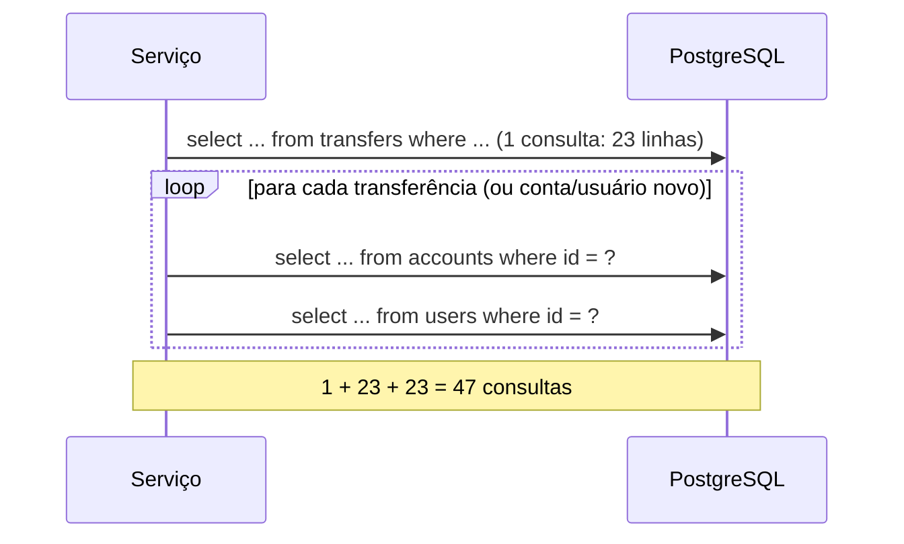

# J5.12 — Problema N+1

> ⏱️ ~1h30 · 🟢 Júnior · Pré-requisitos: J5.08 (lazy × eager, contexto de persistência), J5.09–J5.10 (repositórios, `@Query`), J5.11 (`@Transactional`), J3.06 (`JOIN`), J1.16 (testes)

> ✅ **Validação final (2026-11-24):** este módulo foi executado no PayFlow reconstruído; o resultado e o que continua não executado estão no [README do módulo](README.md). Os avisos "não executado" / "por leitura" abaixo descrevem a escrita original.

## 🎯 Objetivos
Ao final desta aula você consegue:
- Explicar o **problema N+1** e **reconhecê-lo** pelo número de SQLs (1 consulta da lista + N consultas, uma por item).
- **Medir** as consultas de um trecho com as estatísticas do Hibernate e **fixar o número** em um teste.
- Corrigir com **`JOIN FETCH`**, **`@EntityGraph`**, **projeção em DTO** e **batch fetching**, e dizer **quando** usar cada um.
- Explicar por que **trocar para `EAGER` não resolve**.
- Entregar ao PayFlow o **histórico de transferências** com **uma única consulta**.

## 🤔 Por que isso importa
N+1 é o problema de desempenho **mais comum** em aplicações JPA: funciona perfeitamente no ambiente de desenvolvimento (5 linhas) e **derruba** a produção (5 mil linhas). Não dá erro, não aparece em log de erro; só a **latência** e a conta do banco crescem. Em entrevista de Java, "o que é o problema N+1 e como resolver?" aparece em quase todo processo de júnior e pleno. A defesa é a mesma da J5.10: **medir** em vez de adivinhar.

## 💡 Intuição (explicação simples)
Você tem uma **lista de 20 convidados** e precisa do **endereço de cada um**. **Jeito ingênuo:** pega a lista (1 ida à secretaria) e, **para cada convidado, volta à secretaria** para perguntar o endereço (20 idas): **21 viagens**. **Jeito certo:** na primeira ida, já pede **a lista com os endereços** (1 viagem). O banco de dados é a secretaria, e **cada ida custa tempo de rede e de processamento**: 20 idas rápidas viram 2 mil idas lentas quando a lista cresce.

## 🔬 Como funciona por dentro

### 1. Como o N+1 nasce
Na J5.08 você declarou todo `@ManyToOne` como `LAZY`: o Hibernate coloca um **proxy** e só vai ao banco quando você usa um campo do objeto relacionado. Isso é **bom**, até você percorrer **uma lista** tocando o relacionado de **cada** item:
```java
for (Transfer t : transfers.findBy...(...)) {                 // 1 consulta: a lista
    t.getSource().getOwner().getFullName();                    // ← cada getter encadeado pode ir ao banco
    t.getTarget().getOwner().getFullName();
}
```
Para cada transferência, o Hibernate carrega a **conta** de origem, o **usuário** dono, a conta de destino e o usuário de destino: **1 + (contas) + (usuários)** consultas. O contexto de persistência (J5.08) **reaproveita** o que já carregou, então o custo é por **conta distinta e usuário distinto** (e não por linha), mas com muita gente diferente é o pior caso.


### 2. Por que `EAGER` não é a correção
`EAGER` diz "carregue **sempre** junto", mas quem decide **como** é o Hibernate: com `find` ele costuma usar `JOIN`; com **consultas JPQL/derivadas** ele carrega a lista e **depois, uma consulta por item** (o próprio N+1, só que **escondido** e para **todas** as telas, inclusive as que não precisam da associação). A J5.08 mostrou o efeito colateral. A regra do curso: **tudo `LAZY` + buscar explicitamente, caso a caso, o que a tela precisa**.

### 3. As correções
| Estratégia | Como | Consultas | Quando |
|---|---|---|---|
| **`JOIN FETCH`** (JPQL) | `join fetch t.source s join fetch s.owner ...` | 1 | Precisa das **entidades** carregadas, caso a caso |
| **`@EntityGraph`** | `@EntityGraph(attributePaths = {"source.owner", "target.owner"})` sobre a consulta | 1 | O mesmo, **declarativo**; funciona também em consultas derivadas |
| **Projeção em DTO** | `select new ...TransferSummary(...)` | 1 | **Só leitura** (telas, relatórios): busca **só as colunas** necessárias, sem entidades nem proxies |
| **Batch fetching** | `hibernate.default_batch_fetch_size=16` | ≈ 1 + ⌈A/16⌉ + ⌈U/16⌉ | Rede de segurança **global**: carrega os proxies em lotes (`where id in (?, ?, ...)`); não substitui as outras |

**Qual escolher?** Para **telas e APIs de leitura**, a **projeção em DTO** (menor tráfego, nenhuma surpresa de carga preguiçosa). Quando a regra de negócio precisa da **entidade** (para alterá-la), `JOIN FETCH` ou `@EntityGraph`. O **batch fetching** é uma boa rede de segurança global (reduz o estrago dos N+1 que você ainda não viu), mas **não** conserte com ele o que dá para consertar com a consulta certa.

### 4. Medir: a única forma de saber
`hibernate.generate_statistics=true` liga as estatísticas; `Statistics.getPrepareStatementCount()` conta os SQL preparados. Um **teste que fixa o número** (`isEqualTo(1)`) é a defesa contra regressão: se alguém trocar a consulta e reintroduzir o N+1, o teste quebra.

## 🛠️ Exemplo prático
> Testado com **JDK 25.0.5**, **Spring Boot 4.1.2** (Hibernate 7.4.13.Final), PostgreSQL 18.6.

### 1. O que vamos construir: o histórico de transferências
Uma tela "minhas transferências" (J6 a expõe na API) lista, de cada transferência, **quem enviou** e **quem recebeu** (os **nomes**), `amount`, `status` e a data. Os nomes estão **duas associações adiante** (`Transfer → Account → User`): o cenário perfeito para o N+1.

`src/main/java/com/payflow/repository/TransferSummary.java` (o modelo de leitura)
```java
package com.payflow.repository;

import com.payflow.domain.TransferStatus;
import java.math.BigDecimal;
import java.time.Instant;
import java.util.UUID;

/** Modelo de leitura: só o que o histórico precisa, sem entidades (nem proxies, nem cargas preguiçosas). */
public record TransferSummary(UUID id, BigDecimal amount, TransferStatus status,
                              String sourceName, String targetName, Instant createdAt) { }
```
`src/main/java/com/payflow/repository/TransferRepository.java` (as quatro versões lado a lado)
```java
package com.payflow.repository;

import com.payflow.domain.Transfer;
import java.util.List;
import java.util.Optional;
import java.util.UUID;
import org.springframework.data.jpa.repository.EntityGraph;
import org.springframework.data.jpa.repository.JpaRepository;
import org.springframework.data.jpa.repository.Query;
import org.springframework.data.repository.query.Param;

public interface TransferRepository extends JpaRepository<Transfer, UUID> {

    /** Idempotência (regra 4): a chave única já usada? */
    Optional<Transfer> findByIdempotencyKey(String idempotencyKey);

    /** Versão INGÊNUA do histórico: derivada, sem dizer o que carregar junto (a origem do N+1). */
    List<Transfer> findBySourceOwnerIdOrTargetOwnerIdOrderByCreatedAtDescIdDesc(UUID sourceOwnerId, UUID targetOwnerId);

    /** Correção 1: JOIN FETCH escrito à mão. */
    @Query("""
            select t from Transfer t
              join fetch t.source s join fetch s.owner
              join fetch t.target g join fetch g.owner
            where s.owner.id = :userId or g.owner.id = :userId
            order by t.createdAt desc, t.id desc
            """)
    List<Transfer> historyWithJoinFetch(@Param("userId") UUID userId);

    /** Correção 2: o mesmo efeito com um grafo de entidade declarativo. */
    @EntityGraph(attributePaths = {"source.owner", "target.owner"})
    @Query("""
            select t from Transfer t
            where t.source.owner.id = :userId or t.target.owner.id = :userId
            order by t.createdAt desc, t.id desc
            """)
    List<Transfer> historyWithEntityGraph(@Param("userId") UUID userId);

    /** Correção 3: projeção em DTO, sem entidades: uma consulta com só as colunas necessárias. */
    @Query("""
            select new com.payflow.repository.TransferSummary(t.id, t.amount, t.status, so.fullName, tg.fullName, t.createdAt)
            from Transfer t
              join t.source s join s.owner so
              join t.target g join g.owner tg
            where so.id = :userId or tg.id = :userId
            order by t.createdAt desc, t.id desc
            """)
    List<TransferSummary> historySummaries(@Param("userId") UUID userId);
}
```
- A **primeira** (derivada) é a ingênua: `findBySourceOwnerIdOrTargetOwnerId...` atravessa `source.owner.id` **para filtrar** (gera `JOIN`s no `WHERE`), mas **não** diz ao Hibernate para **carregar** essas entidades: elas voltam como proxies.
- As três correções usam `or` entre dois donos: o usuário pode ser quem **enviou** ou quem **recebeu**.
- O `select new com.payflow.repository.TransferSummary(...)` é uma **expressão de construtor**: o Hibernate preenche o `record` direto das colunas.

### 2. O laboratório: o N+1 medido
O cenário: a Ana (3 transferências do seed) **mais 20 transferências** para 20 pessoas diferentes (23 contas e 23 usuários distintos). `src/test/java/com/payflow/jpa/NPlusOneLabTest.java`
```java
package com.payflow.jpa;

import static org.assertj.core.api.Assertions.assertThat;

import com.payflow.domain.Account;
import com.payflow.domain.Transfer;
import com.payflow.domain.User;
import com.payflow.repository.AccountRepository;
import com.payflow.repository.TransferRepository;
import com.payflow.repository.TransferSummary;
import com.payflow.repository.UserRepository;
import com.payflow.service.TransferService;
import com.payflow.support.ResetDatabase;
import jakarta.persistence.EntityManager;
import java.math.BigDecimal;
import java.util.List;
import java.util.UUID;
import java.util.function.Supplier;
import org.hibernate.SessionFactory;
import org.hibernate.stat.Statistics;
import org.junit.jupiter.api.BeforeEach;
import org.junit.jupiter.api.Test;
import org.junit.jupiter.api.extension.ExtendWith;
import org.springframework.beans.factory.annotation.Autowired;
import org.springframework.boot.test.context.SpringBootTest;
import org.springframework.test.context.ActiveProfiles;
import org.springframework.transaction.PlatformTransactionManager;
import org.springframework.transaction.support.TransactionTemplate;

/** Laboratório da J5.12: o problema N+1 medido, e as correções. A Ana transfere para 20 pessoas diferentes. */
@ExtendWith(ResetDatabase.class)
@SpringBootTest(properties = "spring.jpa.properties.hibernate.generate_statistics=true")
@ActiveProfiles("test")
class NPlusOneLabTest {

    static final UUID ANA_USER = UUID.fromString("10000000-0000-0000-0000-000000000001");
    static final UUID ANA_ACCOUNT = UUID.fromString("20000000-0000-0000-0000-000000000001");
    static final int PEOPLE = 20;

    @Autowired UserRepository users;
    @Autowired AccountRepository accounts;
    @Autowired TransferRepository transfers;
    @Autowired TransferService transferService;
    @Autowired EntityManager em;
    @Autowired PlatformTransactionManager transactionManager;

    @BeforeEach
    void data() {
        for (int i = 1; i <= PEOPLE; i++) {
            User user = users.save(new User("person" + i + "@payflow.dev", "Pessoa " + i, "hash"));
            Account account = accounts.save(new Account(user));
            transferService.transfer(ANA_ACCOUNT, account.getId(), new BigDecimal("1.00"), "lab-" + i);
        }
    }

    /** Roda o bloco dentro de UMA transação (um contexto de persistência) e devolve quantos SQL foram preparados. */
    long countSql(Supplier<List<String>> block, String label) {
        Statistics stats = em.getEntityManagerFactory().unwrap(SessionFactory.class).getStatistics();
        stats.clear();
        List<String> lines = new TransactionTemplate(transactionManager).execute(status -> block.get());
        long sql = stats.getPrepareStatementCount();
        System.out.printf("%-34s -> %2d SQL | %d linhas | ex.: %s%n", label, sql, lines.size(), lines.getFirst());
        return sql;
    }

    static String line(Transfer t) {
        // O que o histórico mostra: de quem para quem. Cada getter encadeado pode ir ao banco.
        return t.getSource().getOwner().getFullName() + " -> " + t.getTarget().getOwner().getFullName() + " " + t.getAmount();
    }

    @Test
    void naiveVersionIsOnePlusTwoN() {
        long sql = countSql(() -> transfers.findBySourceOwnerIdOrTargetOwnerIdOrderByCreatedAtDescIdDesc(ANA_USER, ANA_USER)
                .stream().map(NPlusOneLabTest::line).toList(), "ingênuo (derivado)");
        assertThat(sql).isGreaterThan(2L * PEOPLE);
    }

    @Test
    void joinFetchIsOneQuery() {
        long sql = countSql(() -> transfers.historyWithJoinFetch(ANA_USER).stream().map(NPlusOneLabTest::line).toList(),
                "JOIN FETCH");
        assertThat(sql).isEqualTo(1);
    }

    @Test
    void entityGraphIsOneQuery() {
        long sql = countSql(() -> transfers.historyWithEntityGraph(ANA_USER).stream().map(NPlusOneLabTest::line).toList(),
                "@EntityGraph");
        assertThat(sql).isEqualTo(1);
    }

    @Test
    void dtoProjectionIsOneQueryWithoutEntities() {
        long sql = countSql(() -> transfers.historySummaries(ANA_USER).stream()
                .map((TransferSummary s) -> s.sourceName() + " -> " + s.targetName() + " " + s.amount()).toList(), "projeção em DTO");
        assertThat(sql).isEqualTo(1);
    }
}
```
```bash
mvn test -Dtest=NPlusOneLabTest
```
Saída real:
```
ingênuo (derivado)                 -> 47 SQL | 23 linhas | ex.: Ana Silva -> Pessoa 20 1.00
JOIN FETCH                         ->  1 SQL | 23 linhas | ex.: Ana Silva -> Pessoa 20 1.00
@EntityGraph                       ->  1 SQL | 23 linhas | ex.: Ana Silva -> Pessoa 20 1.00
projeção em DTO                    ->  1 SQL | 23 linhas | ex.: Ana Silva -> Pessoa 20 1.00
```
**47 consultas contra 1, para o mesmo resultado** (23 linhas, o mesmo exemplo). O SQL do ingênuo (dentro do bloco medido), em ordem:
```
 1: select t1_0.id, ... from transfers t1_0 join accounts s1_0 on ... join users ... where ... order by ...
 2: select a1_0.id, a1_0.balance, ... from accounts a1_0 where a1_0.id=?       ← conta de origem
 3: select u1_0.id, u1_0.email,  ... from users    u1_0 where u1_0.id=?        ← dono dela
 4: select a1_0.id, a1_0.balance, ... from accounts a1_0 where a1_0.id=?       ← conta de destino
 5: select u1_0.id, u1_0.email,  ... from users    u1_0 where u1_0.id=?        ← dono dela
 ... (o par "accounts + users" se repete) ...
46: select a1_0.id ... from accounts a1_0 where a1_0.id=?
47: select u1_0.id ... from users u1_0 where u1_0.id=?
```
A conta de **47** é `1 + 23 contas distintas + 23 usuários distintos` (a Ana e o Bruno e a Carla do seed aparecem em mais de uma transferência, mas o contexto de persistência os carrega **uma vez só**).

**Com o batch fetching ligado** (`spring.jpa.properties.hibernate.default_batch_fetch_size=16`, em `NPlusOneBatchLabTest`, que herda o laboratório e muda só a propriedade e a asserção):
```
ingênuo + batch size 16            ->  5 SQL | 23 linhas | ex.: Ana Silva -> Pessoa 20 1.00
```
**5 consultas:** a da lista, **2** de contas (23 proxies em lotes de 16: ⌈23/16⌉ = 2) e **2** de usuários. Melhor que 47, pior que 1 e **sem mudar nenhuma consulta**: bom como rede de segurança global.

`src/test/java/com/payflow/jpa/NPlusOneBatchLabTest.java`
```java
package com.payflow.jpa;

import static org.assertj.core.api.Assertions.assertThat;

import org.junit.jupiter.api.Test;
import org.springframework.boot.test.context.SpringBootTest;

/** O mesmo laboratório com batch fetching: só muda a propriedade e a asserção do "ingênuo" (os outros 3 testes são herdados). */
@SpringBootTest(properties = {
        "spring.jpa.properties.hibernate.generate_statistics=true",
        "spring.jpa.properties.hibernate.default_batch_fetch_size=16"})
class NPlusOneBatchLabTest extends NPlusOneLabTest {

    @Test
    @Override
    void naiveVersionIsOnePlusTwoN() {
        long sql = countSql(() -> transfers.findBySourceOwnerIdOrTargetOwnerIdOrderByCreatedAtDescIdDesc(ANA_USER, ANA_USER)
                .stream().map(NPlusOneLabTest::line).toList(), "ingênuo + batch size 16");
        assertThat(sql).isEqualTo(5);           // 1 (lista) + ⌈23/16⌉ = 2 (contas) + 2 (usuários)
    }
}
```
O `@SpringBootTest` da subclasse **substitui** o da classe-mãe (as propriedades não se somam: por isso a de estatísticas é repetida), e o Spring cria um **segundo contexto** só para ela.

### 3. O serviço do PayFlow: uma consulta, sem entidades
`src/main/java/com/payflow/service/TransferHistoryService.java`
```java
package com.payflow.service;

import com.payflow.repository.TransferRepository;
import com.payflow.repository.TransferSummary;
import java.util.List;
import java.util.UUID;
import org.springframework.stereotype.Service;
import org.springframework.transaction.annotation.Transactional;

@Service
public class TransferHistoryService {

    private final TransferRepository transfers;

    public TransferHistoryService(TransferRepository transfers) {
        this.transfers = transfers;
    }

    /** Histórico do usuário (enviadas e recebidas), do mais novo ao mais antigo: UMA consulta, sem entidades. */
    @Transactional(readOnly = true)
    public List<TransferSummary> historyOf(UUID userId) {
        return transfers.historySummaries(userId);
    }
}
```
E o teste que **fixa o número de consultas** (o seed da Ana tem 3 transferências envolvendo-a: 150.00 e 20.00 enviadas, e 500.00 da Carla, `FAILED`, a mais nova):
`src/test/java/com/payflow/service/TransferHistoryServiceTest.java`
```java
package com.payflow.service;

import static org.assertj.core.api.Assertions.assertThat;

import com.payflow.repository.TransferSummary;
import com.payflow.support.ResetDatabase;
import jakarta.persistence.EntityManager;
import java.util.UUID;
import org.hibernate.SessionFactory;
import org.hibernate.stat.Statistics;
import org.junit.jupiter.api.Test;
import org.junit.jupiter.api.extension.ExtendWith;
import org.springframework.beans.factory.annotation.Autowired;
import org.springframework.boot.test.context.SpringBootTest;
import org.springframework.test.context.ActiveProfiles;

/** O histórico de transferências: o conteúdo E o número de consultas (um teste que protege contra o N+1). */
@ExtendWith(ResetDatabase.class)
@SpringBootTest(properties = "spring.jpa.properties.hibernate.generate_statistics=true")
@ActiveProfiles("test")
class TransferHistoryServiceTest {

    static final UUID ANA_USER = UUID.fromString("10000000-0000-0000-0000-000000000001");

    @Autowired TransferHistoryService history;
    @Autowired EntityManager em;

    @Test
    void listsSentAndReceivedTransfersNewestFirstWithOneQuery() {
        Statistics stats = em.getEntityManagerFactory().unwrap(SessionFactory.class).getStatistics();
        stats.clear();

        var result = history.historyOf(ANA_USER);

        assertThat(stats.getPrepareStatementCount()).as("consultas SQL").isEqualTo(1);
        // Seed: três transferências envolvem a Ana: 150.00 e 20.00 enviadas, e 500.00 da Carla (FAILED, a mais nova).
        assertThat(result).extracting(TransferSummary::amount).extracting(Object::toString)
                .containsExactly("500.00", "20.00", "150.00");
        assertThat(result.getFirst().sourceName()).isEqualTo("Carla Dias");
        assertThat(result.getFirst().targetName()).isEqualTo("Ana Silva");
    }
}
```
```bash
mvn test -Dtest='TransferHistoryServiceTest,NPlusOneLabTest,NPlusOneBatchLabTest'
# Tests run: 1 (TransferHistoryServiceTest) + 4 (NPlusOneLabTest) + 4 (NPlusOneBatchLabTest) ; Failures: 0
```
(O `NPlusOneBatchLabTest` herda os 4 testes do laboratório e redefine o do "ingênuo", por isso ele também mostra 4.) `@Transactional(readOnly = true)` (J5.11) está certo aqui: é uma **consulta pura**, sem alterar estado.

## 🧠 Pausa para lógica
**Enunciado:** modele quantas **consultas** cada estratégia faz. Dada uma lista de transferências (origem, destino, dono da origem, dono do destino), calcule: (a) o **ingênuo** (`1 + contas distintas + usuários distintos`, porque o contexto de persistência reaproveita o que já carregou); (b) `JOIN FETCH`/`@EntityGraph`/DTO (sempre 1); (c) **batch fetching** com lotes de tamanho `B` (`1 + ⌈contas/B⌉ + ⌈usuários/B⌉`). Reproduza o **47 / 1 / 5** do laboratório e mostre como cada estratégia **cresce** com o tamanho da lista.

<details><summary>Dica</summary>Use <code>Set</code> para contar elementos <b>distintos</b> (é o que o contexto de persistência faz). A divisão com arredondamento para cima, em inteiros, é <code>(a + b - 1) / b</code> (a mesma da J5.10).</details>
<details><summary>Solução (testada com JDK 25.0.5)</summary>

```java
import java.util.HashSet;
import java.util.List;
import java.util.Set;

/** Quantas consultas cada estratégia de carga faz? Um modelo do que o Hibernate faz com associações preguiçosas. */
public class QueryCount {

    /** Uma transferência: qual conta de origem/destino e de quem são essas contas. */
    record Transfer(String sourceAccount, String targetAccount, String sourceOwner, String targetOwner) { }

    /** Ingênuo: 1 consulta da lista + 1 por conta DISTINTA + 1 por usuário DISTINTO (o contexto guarda o que já carregou). */
    static int naive(List<Transfer> transfers) {
        Set<String> accounts = new HashSet<>();
        Set<String> owners = new HashSet<>();
        for (Transfer t : transfers) {
            accounts.add(t.sourceAccount());
            accounts.add(t.targetAccount());
            owners.add(t.sourceOwner());
            owners.add(t.targetOwner());
        }
        return 1 + accounts.size() + owners.size();
    }

    /** JOIN FETCH / @EntityGraph / projeção em DTO: tudo vem na consulta da lista. */
    static int joinFetch(List<Transfer> transfers) {
        return 1;
    }

    /** Batch fetching: as cargas preguiçosas do mesmo tipo saem em lotes de até {@code batchSize} ids. */
    static int batched(List<Transfer> transfers, int batchSize) {
        Set<String> accounts = new HashSet<>();
        Set<String> owners = new HashSet<>();
        for (Transfer t : transfers) {
            accounts.add(t.sourceAccount());
            accounts.add(t.targetAccount());
            owners.add(t.sourceOwner());
            owners.add(t.targetOwner());
        }
        return 1 + ceilDiv(accounts.size(), batchSize) + ceilDiv(owners.size(), batchSize);
    }

    static int ceilDiv(int a, int b) {
        return (a + b - 1) / b;
    }

    public static void main(String[] args) {
        // O cenário do laboratório: as 3 transferências do seed da Ana + 20 transferências dela para pessoas diferentes.
        List<Transfer> data = new java.util.ArrayList<>();
        data.add(new Transfer("ana", "bruno", "Ana", "Bruno"));
        data.add(new Transfer("ana", "carla", "Ana", "Carla"));
        data.add(new Transfer("carla", "ana", "Carla", "Ana"));
        for (int i = 1; i <= 20; i++) {
            data.add(new Transfer("ana", "p" + i, "Ana", "Pessoa " + i));   // 23 transferências, 23 contas, 23 usuários
        }
        System.out.println("transferências: " + data.size());
        System.out.println("ingênuo:           " + naive(data) + " consultas");
        System.out.println("join fetch/graph:  " + joinFetch(data) + " consulta");
        System.out.println("batch size 16:     " + batched(data, 16) + " consultas");

        // Como cresce com o tamanho da lista (cada transferência com uma pessoa nova)
        for (int n : new int[] {10, 100, 1_000}) {
            List<Transfer> big = new java.util.ArrayList<>();
            for (int i = 1; i <= n; i++) big.add(new Transfer("A0", "A" + i, "U0", "U" + i));
            System.out.printf("n=%-5d ingênuo=%-5d join fetch=%d batch16=%d%n", n, naive(big), joinFetch(big), batched(big, 16));
        }
    }
}
```
Saída real:
```
transferências: 23
ingênuo:           47 consultas
join fetch/graph:  1 consulta
batch size 16:     5 consultas
n=10    ingênuo=23    join fetch=1 batch16=3
n=100   ingênuo=203   join fetch=1 batch16=15
n=1000  ingênuo=2003  join fetch=1 batch16=127
```
O modelo bate com o laboratório (47 / 1 / 5). Pense em **notação O**: o ingênuo é **O(N)** consultas (2003 para mil pessoas); o `JOIN FETCH` é **O(1)** em número de consultas (cada uma é maior, mas **uma** ida ao banco); o batch é **O(N/B)**: bem melhor, ainda crescendo. Para dar uma ideia **hipotética** (meça no seu ambiente, o custo real varia muito): se cada ida ao banco custasse 1 ms, as 2003 idas somariam cerca de 2 s, contra uma única ida.
</details>

**Variação mais difícil:** modele o caso em que o **mesmo** usuário aparece em várias contas e o contexto **reaproveita** o proxy, e o caso de **três níveis** de associação (`Transfer → Account → User → Role`), mostrando que o custo do `JOIN FETCH` continua 1 e o do ingênuo ganha um termo.

## ⚠️ Erros comuns e boas práticas de produção
- **N+1 invisível em desenvolvimento:** poucos dados escondem o problema. **Meça** com volume (J3 tem o gerador de volume) e **fixe o número de consultas em testes** de telas e APIs de lista.
- **Corrigir com `EAGER`:** piora (J5.08): vale para **todas** as consultas, inclusive as que não precisam.
- **`@OneToMany` com `JOIN FETCH` e paginação:** buscar uma **coleção** junto com `setMaxResults`/`Pageable` é um problema conhecido: como cada raiz vira várias linhas no `JOIN`, o limite do SQL não corresponde ao número de raízes, e o Hibernate pode precisar paginar **em memória**, com risco de carregar a tabela toda (**confirme no seu log**; veja o desafio 3). A abordagem segura: pagine as **entidades-raiz** e busque as coleções **em uma segunda consulta** (ou por batch fetching). **`JOIN FETCH` de associações "para um"** (como aqui) **não** tem esse problema.
- **Dois `JOIN FETCH` de coleções (`List`) na mesma consulta:** `MultipleBagFetchException`. Busque uma coleção por consulta, ou use `Set` onde fizer sentido.
- **Projeção em DTO com entidade dentro:** se o DTO guarda uma entidade com proxy, o N+1 volta. O `record` deve ter **valores simples**.
- **Medir só com `show-sql`:** `logging.level.org.hibernate.SQL=DEBUG` mostra os SQLs, mas **contar** é mais confiável com `Statistics`. Use os dois.
- **`LazyInitializationException` "consertada" com `open-in-view: true`:** esconde o N+1 dentro da renderização (J5.08). O PayFlow o mantém desligado.
- **`default_batch_fetch_size` como solução única:** ajuda, mas dá a falsa sensação de que "está resolvido"; a consulta certa continua melhor.
- **Esquecer o índice:** um `JOIN FETCH` em colunas de FK sem índice (J3.09) troca N consultas por uma muito lenta. As FKs do PayFlow têm índices (V4).

## 🧩 Exercícios
1. **Fixação:** (a) explique o N+1 com suas palavras e com a conta "1 + N" (ou "1 + A + U", como aqui); (b) por que `EAGER` não resolve; (c) cite as três correções que reduzem a **1** consulta e quando usar cada uma; (d) o que faz `hibernate.default_batch_fetch_size`; (e) por que o contexto de persistência faz o ingênuo custar "contas distintas", e não "linhas"?
2. **Aplicação no PayFlow:** o histórico sem N+1.
   - [ ] `TransferSummary`, as quatro consultas no `TransferRepository`, `TransferHistoryService` e `TransferHistoryServiceTest`; o teste passa e **fixa 1 consulta**.
   - [ ] `NPlusOneLabTest` (4 testes) e `NPlusOneBatchLabTest` (4 testes) verdes; você viu **47**, **1**, **1**, **1** e **5** na saída e colou em `docs/spring-lab/n-plus-one.md`.
   - [ ] Com `logging.level.org.hibernate.SQL=DEBUG`, você colou os **5 primeiros SQL do caso ingênuo** e **o SQL único** de `JOIN FETCH` e de DTO em `docs/spring-lab/n-plus-one.md`, comparando o tamanho das colunas.
   - [ ] **Quebre de propósito:** troque `historySummaries` por `findBy...` ingênuo no serviço e veja o `TransferHistoryServiceTest` **falhar** (`expected: 1 but was: ...`). Desfaça.
   - [ ] **Extrato com contraparte (desafio de produto):** acrescente ao extrato o nome da outra parte ("Transferência enviada **para Bruno Costa**") **sem** N+1, escolhendo e justificando a estratégia (`@EntityGraph` em `LedgerEntryRepository`, por exemplo). Ajuste o `statement.js` para manter o texto igual ao do servidor.
   - [ ] Commit: `perf(history): load transfer history with one query`.
3. **Desafio (opcional):** reproduza a **paginação com `JOIN FETCH` de coleção** (`select u from User u join fetch u.accounts` com `setMaxResults(2)`), **inspecione o SQL** e anote o que o Hibernate faz (limite no SQL ou em memória?). Depois pagine os usuários e busque as contas em uma **segunda** consulta com `where u.id in :ids`.

<details><summary>Soluções de referência</summary>

1. (a) Uma consulta traz a lista e, ao percorrê-la, cada item dispara uma consulta para a sua associação preguiçosa: 1 + N (aqui, 1 + 23 + 23, porque o contexto reaproveita o que já carregou). (b) `EAGER` vale para todas as consultas e, em consultas JPQL, ainda faz uma consulta por item; esconde o N+1. (c) `JOIN FETCH` (entidades, caso a caso), `@EntityGraph` (o mesmo, declarativo) e projeção em DTO (leitura pura, só as colunas). (d) Carrega as associações preguiçosas em **lotes** (`where id in (...)` com até B ids), reduzindo o número de consultas. (e) Porque cada entidade (tipo + id) é carregada **uma vez** por contexto: a segunda referência ao mesmo id usa o objeto já carregado.
2. Os números são os da seção 2. Quebrando o serviço, o teste falha com `consultas SQL expected: 1 but was: 47` (ou parecido).
3. Esboço (não executado): em muitas versões o Hibernate **aplica o limite em memória** para `join fetch` de coleção e emite um aviso; confirme no **seu** log antes de afirmar. A solução segura é paginar a raiz e buscar as coleções à parte.
</details>

## 🎤 Na entrevista
- **O que é o problema N+1 e como resolver?** Uma consulta para a lista mais uma por item para uma associação preguiçosa. Resolve-se com `JOIN FETCH`, `@EntityGraph`, projeções em DTO ou batch fetching, medindo as consultas.
- **Por que não usar `EAGER`?** Vale para todos os casos de uso, não evita o N+1 em consultas JPQL e carrega dados desnecessários; prefira `LAZY` e buscar explicitamente.
- **Como você detecta N+1?** Logando o SQL (`org.hibernate.SQL`), com as estatísticas do Hibernate em testes (contagem de consultas) e com APM/tracing em produção (muitos spans iguais).
- **`JOIN FETCH` ou `@EntityGraph`?** Equivalentes para o efeito; `@EntityGraph` é declarativo e funciona com consultas derivadas, `JOIN FETCH` é explícito na JPQL. Para leitura pura, uma projeção em DTO é ainda melhor.
- **O que é batch fetching?** Carregar vários proxies pendentes em uma única consulta `in (...)`, configurado por `hibernate.default_batch_fetch_size` ou `@BatchSize`; reduz N+1 sem mudar o código.

## 📚 Para ir além
- 📄 [Hibernate ORM 7.4 — Introduction (fetching e N+1)](https://docs.hibernate.org/orm/7.4/introduction/html_single/Hibernate_Introduction.html): a seção sobre otimizar a busca de associações e o N+1.
- 📄 [Hibernate ORM 7.4 — User Guide](https://docs.hibernate.org/orm/7.4/userguide/html_single/Hibernate_User_Guide.html): estratégias de *fetching*, `@BatchSize` e a referência de `hibernate.default_batch_fetch_size`.
- 📄 [Spring Data JPA — Query Methods e `@EntityGraph`](https://docs.spring.io/spring-data/jpa/reference/jpa/query-methods.html): grafos de entidade nos repositórios.
- 📄 [Spring Data JPA — Projections](https://docs.spring.io/spring-data/jpa/reference/repositories/projections.html): DTOs, interfaces e projeções dinâmicas.
- 📄 [Vlad Mihalcea — N+1 query problem with JPA and Hibernate](https://vladmihalcea.com/n-plus-1-query-problem/): o problema, a detecção e as correções (verifique a data; os detalhes de versão mudam).
- 🎥 ⚠️ Nenhum vídeo verificado nesta execução.

## ✅ Checklist da aula
- [ ] Reproduzi o N+1 e medi **47** consultas contra **1**.
- [ ] Sei as três correções de 1 consulta e quando usar cada uma; conheço o batch fetching.
- [ ] O histórico de transferências do PayFlow faz **uma** consulta, e um teste fixa isso.
- [ ] Sei por que `EAGER` não é a resposta.
- [ ] Sei explicar a conta `1 + A + U` e o `⌈A/B⌉` do batch.
